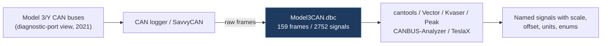
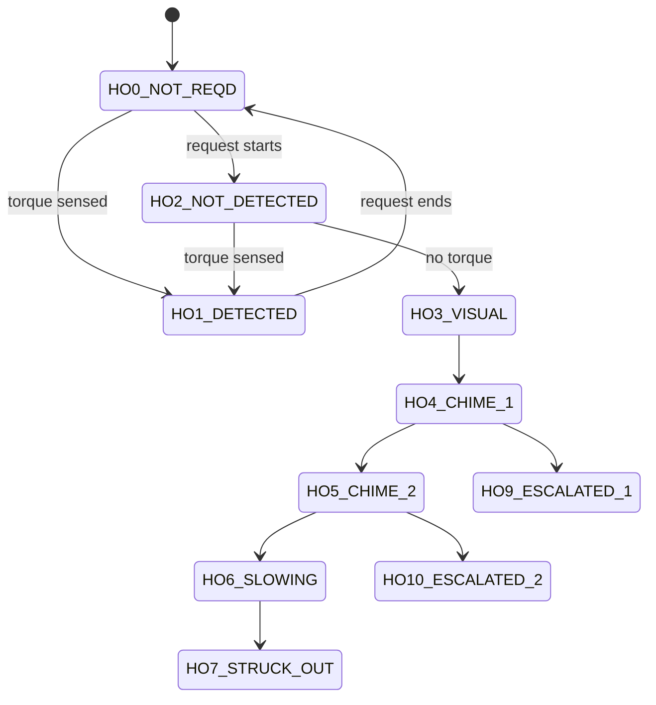

# joshwardell-model3dbc

## 1. Provenance

- Submodule path: `legacy/joshwardell-model3dbc`.
- Pinned gitlink: `160000 c56c113c353d09b1a5dd57677461f02fe8b7c6ca 0`. `git -C legacy/joshwardell-model3dbc rev-parse HEAD` returns the same SHA; `status --porcelain` is empty. Analyst did not mutate the submodule.
- Upstream: `https://github.com/joshwardell/model3dbc` (origin fetch/push).
- Version at pin: single commit `c56c113c353d09b1a5dd57677461f02fe8b7c6ca` = "Add files via upload", dated 2021-08-29. The DBC content therefore reflects ~2021 Model 3/Y firmware, not 2026 firmware.
- License: MIT (`LICENSE:1-3`, Copyright (c) 2019 Josh Wardell). Data-only repo; nothing to reimplement, but do not vendor the file into shipping directories.
- Analysis date: 2026-11-21.
- Replace mode: this document replaces the previous shallow summary in place. The pre-replace summary still exists in git history and is cited below as `git show HEAD:docs/legacy/joshwardell-model3dbc.md#<line>`. The pre-replace doc had YAML frontmatter (preserved byte-for-byte above, including the description line that is truncated mid-word at "most widel"; it carries no trailing whitespace) and **no** `## Upstream (...)` sections, so nothing of that kind was preserved.

Files read (coverage labeled per file):

- `Model3CAN.dbc` (4127 lines) — **STRUCTURAL-PARSE** of the whole file: header/NS_ (1-40), `BU_` nodes, and the full `BO_` frame inventory (159 frames), `SG_` count (2752), `CM_` (144), `VAL_` (930), `BA_`/`BA_DEF_` (52/58), placeholder-range count (255). Absence claims (IDs not present) were verified by regex sweep of the full `BO_` inventory, not by reading every line. Plus **RANGE-CITED** reads: 1-40, 97-134, 135-214, 396-510, 644-673, 743-772, 779-808, 860-952, 937-1036, 1068-1097, 1181-1212, 1325-1384, 1681-1694, 1892-1956, 2138-2182, 2216-2325, 2354-2398, 2539-2668, 2801-2845, 2981-3040, 3384-3398, 3559, 3563-3564, 3629-3630, 3735, 4057-4109, 4186, 4229-4230.
- `README.md` — **FULL-READ** (30 lines).
- `LICENSE` — **RANGE-CITED** 1-5 (license identification only).

Files explicitly NOT read: the remaining ~3,000 lines of `Model3CAN.dbc` outside the ranges above (chassis debug frames, charge-detail families, `DAS_object`/`DAS_lanes` payloads, remaining `VAL_` tables, `CM_` comment bodies, remaining `BA_` assignments) and `LICENSE` lines 6-21.

Our-side files read for the parity matrix (all CODE-READ): `firmware/lib/vehicle/can/ids.h:1-122`, `handler/variant/bits.h:1-58`, `handler/variant/hw4.h:1-169`, `handler/variant/hw3.h:55-134`, `handler/frame_readers.h:1-72`, `handler/bus/vehicle.h:1-535`, `handler/helpers.h:1-62`, `feature/telemetry/bms.h:1-585`, `feature/telemetry/tpms.h:1-93`, `feature/telemetry/powertrain.h:1-111`, `feature/telemetry/vehicle_config.h:1-120`, `feature/telemetry/fw_compat.h:1-105`, `feature/das/das_drive.h:17-163`, `feature/fsd/auto_lane_change.h:1-130`, `feature/fsd/nag.h:1-120`, `feature/fsd/region.h:1-127`, `feature/body/turn_signal.h:1-138`, `feature/drive/drive_context.h:40-139`, `feature/drive/drive_mode.h:1-149`, `feature/drive/stop.h:1-77`, `feature/drive/regen.h:1-60`, targeted bit-write greps across `feature/body/*.h` and `feature/comfort/*.h` (charge, lock, mirror, power, sentry, summon, track_mode, trunk, seat, wiper, display, light, air_recirc, seatbelt, precondition), `firmware/test/test_native_tpms/test_tpms.cpp:1-60`, test-name inventories of `test_native_bms`/`test_native_powertrain`, and the pre-replace `docs/legacy/joshwardell-model3dbc.md:1-50` (via `git show HEAD:`).

## 2. Executive verdict

This is not code — it is the community's most-cited Model 3/Y CAN signal catalog: one 4127-line DBC (159 frames, 2752 signals, 930 value tables) MIT-licensed by Josh Wardell, pinned at its 2021-08-29 upload commit. What it gives TeslaCANModder is an independent arbitration oracle for bit positions, scales, offsets and enums on the frames both projects touch — and that arbitration is genuinely productive: it confirms a large set of our BMS/0x273/0x334/0x3F8/0x3F5-status/0x7FF decodes bit-for-bit, explains constants we carry without rationale (precondition `0x05` = bits 0+2, ISA chime bit 13 = `DAS_suppressSpeedWarning`), and at the same time contradicts several of our load-bearing decodes (TPMS 0x219 layout/DLC, 0x118 gear/pedal position, 0x257 speed scale, 0x129 steering position, 0x352 energy layout, ALC stalk bits on 0x249, turn-signal request field direction, stop-mode enum values, DAS_control jerk scales). Two structural caveats govern everything: (1) the catalog is a 2021 snapshot — bits may have moved on 2026 firmware, so every contradiction is a capture-first item, not proof our side is wrong; (2) it documents the VC/diagnostic-bus view, so several IDs we use on the chassis harness (0x229, 0x249, 0x27D, 0x318, 0x392, 0x3F3) carry completely different payloads here, and 8 of our chassis IDs (0x370, 0x39B, 0x398, 0x488, 0x106, 0x115, 0x2AA, 0x3EE) are absent entirely. Adaptation is selective data arbitration, never code porting; the strongest candidates are decoding 0x31F as the real 8-byte TPMS frame, using 0x7FF m1 `GTW_dasHw` as a variant cross-check, and re-deriving the 0x2B9 jerk scales before DAS drive is trusted on a bench.

## 3. Evidence map

No TEST-READ evidence exists: this repo ships no tests. No CAPTURE evidence exists in this repo: it contains no logged frames, only definitions. Absence claims were verified by regex sweep of the full `BO_` inventory.

| Source file | Lines | What it proves | Grade |
| --- | --- | --- | --- |
| `Model3CAN.dbc` | 1-40 | VERSION/NS_/BS_ header; `BU_: Receiver ChassisBus VehicleBus PartyBus` — three logical buses plus a listener node | CODE-READ |
| `Model3CAN.dbc` | full inventory | 159 `BO_` frames, 2752 `SG_` signals, 144 `CM_`, 930 `VAL_`, 52 `BA_`; 255 signals carry placeholder `[0|0]` ranges; `GenMsgCycleTime` is defined `INT 0 0` so no frame period is populated anywhere | STRUCTURAL-PARSE |
| `Model3CAN.dbc` | 937-975 | 0x3FD `UI_autopilotControl` mux 0/1 bit map: bit 38 m0 = `UI_fsdStopsControlEnabled`, bit 19 m1 = `UI_applyEceR79`, bit 45 m1 = `UI_showLaneGraph`, bit 46 m1 = `UI_showTrackLabels`, bit 47 m1 = `UI_hardCoreSummon`; no m0 bit 46, no bit 59/60 anywhere (max defined bit 48) | CODE-READ |
| `Model3CAN.dbc` | 893-935 | 0x3F8 `UI_driverAssistControl` bit map: follow distance 45|3, drivingSide 40|2, handsOnRequirementDisable 14, driveOnMaps 13, hasDriveOnNav 48, followNavRoute 49, dasDeveloper 5, enableTripTelemetry 43 | CODE-READ |
| `Model3CAN.dbc` | 644-653, 3559, 3563-3564 | 0x2B9 `DAS_control` layout: setSpeed 0|12 ×0.1, accState 12|4, jerkMin 18|9 (0.03, −15.232), jerkMax 27|8 (0.059), accelMin/Max 35|9/44|9 (0.04, −15), counter 53|3, checksum 56|8; `VAL_` accState 4=ACC_ON, 13=ACC_CANCEL_GENERIC_SILENT | CODE-READ |
| `Model3CAN.dbc` | 743-769, 3629-3630 | 0x399 `DAS_status` ChassisBus: hands-on 42|4 with 16-state LC_HANDS_ON enum, autopilotState 0|4 with enum (3=ACTIVE_NOMINAL, 5=ACTIVE_NAV), autoLaneChangeState 46|5, `DAS_suppressSpeedWarning` 13|1, counter 52|4, checksum 56|8 | CODE-READ |
| `Model3CAN.dbc` | 2906-2979, 4229-4230 | 0x7FF `carConfig` mux map: `GTW_autopilot` m2 42|3 with tier enum (0=NONE, 1=HIGHWAY, 2=ENHANCED, 3=SELF_DRIVING, 4=BASIC), `GTW_dasHw` m1 40|3 range [3|4], `GTW_country` m1 16|16 | CODE-READ |
| `Model3CAN.dbc` | 447-485, 1083, 1090, 1693 | 0x273 actuator request bits (frunk 5, childLock 16, lock 17|3, brightness 32|8, powerOff 31, seats 42-51, honk 61, driveState 62, wiper 56|3, summonActive 4); 0x3B3 trunkRequest 1|1 + gloveboxRequest 0|1; 0x284 sentry bit 5 | CODE-READ |
| `Model3CAN.dbc` | 863-891, 4057 area VAL_ 1013 | 0x3F5 `VCFRONT_lighting`: indicatorLeftRequest 0|2, indicatorRightRequest 2|2 (1=ACTIVE_LOW, 2=ACTIVE_HIGH), hazardLightRequest 4|4, turnSignal status at 50|2/52|2 with 2="LIGHT_FAULT" | CODE-READ |
| `Model3CAN.dbc` | 396-413, 2839-2845 | TPMS is two frames: 0x219 `VCSEC_TPMSData` DLC 5, 2-bit wheel mux, pressure byte1 ×0.025 bar, temp byte2 −40; 0x31F `TPMSsensors` DLC 8 with interleaved `[FLp, FLt, FRp, FRt, RLp, RLt, RRp, RRt]` | CODE-READ |
| `Model3CAN.dbc` | 2149-2159, 4058 | 0x229 = 3-byte `GearLever` (VehicleBus, no checksum signal); 0x249 = 4-byte `SCCMLeftStalk`: CRC byte 0, counter byte1[3:0], turn stalk status 16|4 (UP_1=2, DOWN_1=6), washWipe at byte1[7:6] | CODE-READ |
| `Model3CAN.dbc` | 2589-2603, 4186 | 0x118 `DriveSystemStatus`: gear 21|3 (0=INVALID, 1=P, 2=R, 3=N, 4=D, 7=SNA), accelPedalPos 32|8 ×0.4, brakePedalState 19|2 | CODE-READ |
| `Model3CAN.dbc` | 2539-2544, 2655-2661 | 0x129 `SteeringAngle129` 16|14 (0.1, −819.2); 0x257 `DI_vehicleSpeed` 12|12 (0.08, −40) with checksum byte0/counter byte1[3:0] | CODE-READ |
| `Model3CAN.dbc` | 2647-2653, 2636-2645, 2605-2612, 1354-1359 | BMS family: 0x292 SOC fields (min 0|10, UI 10|10, max 20|10, avg 30|10); 0x312 pack temps 44|9/53|9 (0.25, −25); 0x352 all-11-bit ×0.1 energy fields, fullChargeComplete 63|1, no mux; 0x33A = `UI_rangeSOC` (UI_Range 0|10 **mi**, ratedWHpM 32|10, SOC 48|7) | CODE-READ |
| `Model3CAN.dbc` | 2381-2385, 2628-2634, 2981-2992, 2354-2356, 2358-2379, 2801-2805, 1181-1203 | 0x2D2 V/A limits; 0x252 power budgets; 0x332 brick min/max (m0 temps ×0.5−40, m1 voltages ×0.002); 0x3D2 lifetime totals ×0.001; 0x3F2 muxed kWh counters (m0-m3 8|32 ×0.001); 0x132 voltage ×0.01 + smooth current 16|16 (−0.1); 0x212 flags (precondAllowed 3|1, heatingWorthwhile 5|1, contactorState 8|3, hvState 16|3) | CODE-READ |
| `Model3CAN.dbc` | 1325-1352, 1338-1349, VAL_ 820 | 0x333 charge request bits (open 0, close 1, enable 2, termination 16|10); 0x334 `UI_powertrainControl`: pedalMap 5|2 (0=CHILL, 1=SPORT, 2=PERFORMANCE), stoppingMode 40|2 (0=STANDARD, 1=CREEP, 2=HOLD), regenTorqueMax 24|8 ×0.5, counter 52|4, checksum 56|8 | CODE-READ |
| `Model3CAN.dbc` | 97-103, 1068-1092, 1681-1693 | 0x082 `UI_requestActiveBatteryHeating` 2|1 + `UI_tripPlanningActive` 0|1 (so `0x05` = bits 0+2); 0x3B3 full signal list; 0x284 full signal list | CODE-READ |
| `Model3CAN.dbc` | 135-176, 1892-1956, 779-804, 3384-3395 | 0x102/0x103 latch status 4-bit fields (VAL_: 2=LATCH_CLOSED, 0=LATCH_SNA); 0x2E1 m0 frunkLatch 3|4, anyDoorOpen 50|1; 0x3A1 driverDoorStatus 31|1; latch enums | CODE-READ |
| `Model3CAN.dbc` | BO_ sweep | Absent: 0x045, 0x106, 0x115, 0x2AA, 0x370, 0x398, 0x39B, 0x3EE, 0x488 (verified by regex over all 159 BO_ lines — see negative anchor in section 16) | CODE-READ |
| `README.md` | 1-30 | Tool-oriented readme: points at SavvyCAN, CANBUS-Analyzer, TeslaX, jwardell CANserver; no protocol claims; typo "SFor" | CODE-READ |
| `legacy/krconv-tesla_can_decoding/README.md:27`, `legacy/jsamuel1-tesla_canlogjs/processing/canmsgtosignals.py:28`, `legacy/LeeGaHyeon-tesla_CAN_traffic_decode/[VERIFIED][1101]AUTO_DBC_PARSER.py:30` | single lines | The pre-replace doc's "referenced by multiple other projects" claim is real: all three named sibling submodules reference Model3CAN.dbc | CODE-READ |
| `git show HEAD:docs/legacy/joshwardell-model3dbc.md` | 1-50 | Pre-replace summary content for the contradiction table | CODE-READ |

## 4. Architecture and build surface

None found: no frame pipeline in this repo. There is no executable code, no entry point, no build system, no build flags, and no shared-core/platform split — the entire repo is one data file plus README and LICENSE. The catalog's only "architecture" is its DBC schema: 4 nodes (`Receiver`, `ChassisBus`, `VehicleBus`, `PartyBus`), per-frame transmitter assignment (`Model3CAN.dbc:1-7` header; every `BO_` line names `ChassisBus` or `VehicleBus` as transmitter — `PartyBus` is declared but transmits nothing), and 11-bit IDs stored as decimal with the hex form embedded in the message name (`BO_ 1021 ID3FDUI_autopilotControl`).

Intended consumption path (what the DBC is *for*):



## 5. Mechanism catalogue

There are no runtime mechanisms; the mechanisms below are the catalog's load-bearing data definitions that our firmware reads, writes, or arbitrates against. Every card's "Code path" is therefore the DBC location, because that is the only source. Upstream README makes no signal-level claim for any of them, so "Claim" cites the pre-replace summary where it said something.

### M1 — 0x3FD `UI_autopilotControl` bit map (FSD/nag mux frame)

- **Claim (README / summary):** None found — `README.md` makes no protocol claim; the pre-replace summary never names 0x3FD.
- **Code path:** `Model3CAN.dbc:937-975` (data definition; no executable code in repo).
- **Frame spec:** ID 1021/0x3FD, 8 bytes, ChassisBus. Mux = byte 0 bits[2:0]. m0: bit 38 `UI_fsdStopsControlEnabled`, bit 37 `UI_fsdVisualizationEnabled`, bit 45 `UI_homelinkNearby`. m1: bit 19 `UI_applyEceR79`, bit 45 `UI_showLaneGraph`, bit 46 `UI_showTrackLabels`, bit 47 `UI_hardCoreSummon`, bit 48 `UI_enableCabinCameraTelemetry`. No m0 bit 46; no bit 59 or 60 defined anywhere in the frame (max defined bit 48). No counter or checksum signal defined.
- **Gates and timing:** None found (no cycle-time attributes exist anywhere in the file).
- **State machine:** None found.
- **Tests:** None found (repo ships no tests).
- **Evidence grade:** CODE-READ.
- **Verdict:** CONFIRMED as a definition; it is the catalog's arbitration source for our `FSD_BIT_*` constants.
- **Adapt to TeslaCANModder?** already present — use as arbitration oracle only; see parity rows P2-P7.

### M2 — 0x3F8 `UI_driverAssistControl` bit map

- **Claim (README / summary):** None found.
- **Code path:** `Model3CAN.dbc:893-935` (definition).
- **Frame spec:** ID 1016/0x3F8, 8 bytes, ChassisBus. `UI_accFollowDistanceSetting` 45|3 (bits 45-47 = byte 5 bits[7:5]); `UI_drivingSide` 40|2; `UI_handsOnRequirementDisable` 14|1; `UI_driveOnMapsEnable` 13|1; `UI_hasDriveOnNav` 48|1; `UI_followNavRouteEnable` 49|1; `UI_dasDeveloper` 5|1; `UI_enableTripTelemetry` 43|1; plus summon/ULC/LSS fields. No counter or checksum signal defined.
- **Gates and timing:** None found.
- **State machine:** None found (`VAL_ 1016 UI_autopilotControlRequest` 0=LEGACY_LAT_CTRL/1=NEXT_GEN_CTRL at `Model3CAN.dbc:3711` is an enum, not a state machine).
- **Tests:** None found.
- **Evidence grade:** CODE-READ.
- **Verdict:** CONFIRMED as a definition.
- **Adapt to TeslaCANModder?** already present — our assist-toggle bits align; the 2-bit drivingSide field needs a second bit cleared (P11).

### M3 — 0x2B9 `DAS_control` layout + ACC enums

- **Claim (README / summary):** None found.
- **Code path:** `Model3CAN.dbc:644-653`, enums at `3559`, SNA markers at `3563-3564`.
- **Frame spec:** ID 697/0x2B9, 8 bytes, ChassisBus. setSpeed 0|12 (0.1 kph); accState 12|4; aebEvent 16|2; jerkMin 18|9 (scale 0.03, offset −15.232); jerkMax 27|8 (scale 0.059); accelMin 35|9 (0.04, −15); accelMax 44|9 (0.04, −15); counter 53|3 (byte 6 bits[7:5]); checksum 56|8 (byte 7). `VAL_ 697 DAS_accState`: 4=ACC_ON, 13=ACC_CANCEL_GENERIC_SILENT, 3=ACC_HOLD, 12/14 cancel variants, 5-11 APC (autopark) states, 15=FAULT_SNA.
- **Gates and timing:** None found.
- **State machine:** None found (16-value enum, no transitions encoded).
- **Tests:** None found.
- **Evidence grade:** CODE-READ.
- **Verdict:** CONFIRMED as a definition; positions and ACC enums match our builder, jerk scales do not (P21).
- **Adapt to TeslaCANModder?** already present — but re-derive jerk scales capture-first before bench-driving (P21, safety-relevant).

### M4 — 0x7FF `carConfig` mux (AP tier + DAS hardware)

- **Claim (README / summary):** None found; pre-replace summary never mentions 0x7FF.
- **Code path:** `Model3CAN.dbc:2906-2979`, tier enum at `4229-4230`.
- **Frame spec:** ID 2047/0x7FF, 8 bytes, VehicleBus. Mux = full byte 0 (`GTW_carConfigMultiplexer` 0|8, m0-m4). m2: `GTW_autopilot` 42|3 (byte 5 bits[4:2]) with enum 0=NONE, 1=HIGHWAY, 2=ENHANCED, 3=SELF_DRIVING, 4=BASIC; `GTW_restraintsHardwareType` 48|8. m1: `GTW_dasHw` 40|3 range [3|4] (byte 5 bits[2:0]); `GTW_country` 16|16; `GTW_rightHandDrive` 11|1. m3: `GTW_chassisType` 18|3, `GTW_mapRegion` 8|4, `GTW_wheelType` 48|7. No counter or checksum signal defined.
- **Gates and timing:** None found.
- **State machine:** None found.
- **Tests:** None found.
- **Evidence grade:** CODE-READ.
- **Verdict:** CONFIRMED as a definition; tier enum matches our readback exactly (P18).
- **Adapt to TeslaCANModder?** already present for the tier readback; `GTW_dasHw` is a candidate variant cross-check (P19).

### M5 — 0x399 `DAS_status` (hands-on state, ALC state, speed-warning suppress)

- **Claim (README / summary):** None found.
- **Code path:** `Model3CAN.dbc:743-769`, hands-on enum at `3629`, AP-state enum at `3630`.
- **Frame spec:** ID 921/0x399, 8 bytes, **ChassisBus**. `DAS_autopilotState` 0|4; `DAS_blindSpotRearLeft` 4|2; `DAS_blindSpotRearRight` 6|2; `DAS_fusedSpeedLimit` 8|5 (×5 kph/mph); `DAS_visionOnlySpeedLimit` 16|5; `DAS_suppressSpeedWarning` 13|1; `DAS_fleetSpeedState` 40|2; `DAS_autopilotHandsOnState` 42|4 (byte 5 bits[7:4]); `DAS_autoLaneChangeState` 46|5; counter 52|4 (byte 6 bits[7:4]); checksum 56|8 (byte 7).
- **Gates and timing:** None found.
- **State machine:** the 16-value hands-on enum at `3629` — 0 NOT_REQD, 1 DETECTED, 2 NOT_DETECTED, 3 VISUAL, 4/5 CHIME_1/2, 6 SLOWING, 7 STRUCK_OUT, 8 SUSPENDED, 9/10 ESCALATED_CHIME_1/2, 15 SNA. Transitions are inferred from naming only, not encoded upstream:



- **Tests:** None found.
- **Evidence grade:** CODE-READ (enum values); the transition edges above are UNVERIFIED (names only).
- **Verdict:** CONFIRMED as a definition; its frame/bit placement contradicts our 0x39B-based reads (P14-P17) while its enum values match our gate set.
- **Adapt to TeslaCANModder?** already present for the suppress bit (P13); hands-on/ALC/AP-state source frames are capture-first arbitration items.

### M6 — 0x273 `UI_vehicleControl` + 0x3B3/0x284/0x082/0x333 actuator request map

- **Claim (README / summary):** None found.
- **Code path:** `Model3CAN.dbc:447-485` (0x273), `1068-1092` (0x3B3), `1681-1693` (0x284), `97-103` (0x082), `1325-1336` (0x333).
- **Frame spec:** 0x273 ID 627, 8 bytes, VehicleBus, **no counter/checksum signals defined**: accessoryPowerRequest 0|1, frontFogSwitch 3|1, frunkRequest 5|1, childDoorLockOn 16|1, lockRequest 17|3, mirrorFoldRequest 24|2, mirrorHeatRequest 26|1, powerOff 31|1, displayBrightnessLevel 32|8 (×0.5, 0-127%), seat heat FL/FR/RL 42|2/44|2/46|2, rearCenter 48|2, rearRight 50|2, honkHorn 61|1, driveStateRequest 62|1, wiperRequest 56|3, summonActive 4|1. 0x3B3 ID 947 DLC 4: gloveboxRequest 0|1, trunkRequest 1|1, PIN bits 6-7. 0x284 ID 644 DLC 5: sentry bit 5. 0x082 ID 130: tripPlanningActive 0|1, requestActiveBatteryHeating 2|1. 0x333 ID 819 DLC 5: openChargePort 0|1, closeChargePort 1|1, chargeEnableRequest 2|1, termination 16|10 (0.1, 25-100%).
- **Gates and timing:** None found.
- **State machine:** None found.
- **Tests:** None found.
- **Evidence grade:** CODE-READ.
- **Verdict:** CONFIRMED as a definition; matches nearly all our 0x273-family builders (P23), contradicts our summon direction/start bits (P24).
- **Adapt to TeslaCANModder?** already present; capture-first on summon bit5/bit0 (P24) and trunk:close glovebox overlap (P25).

### M7 — 0x3F5 `VCFRONT_lighting` indicator/hazard requests and status

- **Claim (README / summary):** None found.
- **Code path:** `Model3CAN.dbc:863-891`, request/status enums in the `VAL_ 1013` block (`Model3CAN.dbc` around 3900; demonstrated in section 16 sweep output).
- **Frame spec:** ID 1013/0x3F5, 8 bytes, VehicleBus. `VCFRONT_indicatorLeftRequest` 0|2 (0=OFF, 1=ACTIVE_LOW, 2=ACTIVE_HIGH); `VCFRONT_indicatorRightRequest` 2|2 (same enum); `VCFRONT_hazardLightRequest` 4|4 (source enum: 1=BUTTON, 2=LOCK, 3=UNLOCK, 5=CRASH, 7=DAS, 8=UDS); `VCFRONT_turnSignalLeftStatus` 50|2 and `RightStatus` 52|2 (0=OFF, 1=ON, 2=LIGHT_FAULT, 3=SNA); `VCFRONT_simLatchingStalk` 59|2 (0=IDLE, 1=LEFT, 2=RIGHT). No counter or checksum signal defined.
- **Gates and timing:** None found.
- **State machine:** None found.
- **Tests:** None found.
- **Evidence grade:** CODE-READ.
- **Verdict:** CONFIRMED as a definition; contradicts our single-field turn-request encoding (P30) while confirming our status-byte reads (P31).
- **Adapt to TeslaCANModder?** already present for status decode; the request encoding is a capture-first fix candidate (P30, HIGH).

### M8 — BMS telemetry family (0x132, 0x212, 0x252, 0x292, 0x2D2, 0x312, 0x332, 0x352, 0x33A, 0x3D2, 0x3F2, 0x401)

- **Claim (README / summary):** None found.
- **Code path:** `Model3CAN.dbc:2801-2805` (0x132), `1181-1203` (0x212), `2628-2634` (0x252), `2647-2653` (0x292), `2381-2385` (0x2D2), `2636-2645` (0x312), `2981-2992` (0x332), `2605-2612` (0x352), `1354-1359` (0x33A), `2354-2356` (0x3D2), `2358-2379` (0x3F2), `2994-3040` (0x401).
- **Frame spec:** all VehicleBus. 0x132: voltage 0|16 ×0.01, smooth current 16|16 signed ×(−0.1), raw current 32|16 ×(−0.05) offset +822, charge hours 48|12. 0x212: preconditionAllowed 3|1, heatingWorthwhile 5|1, contactorState 8|3, hvState 16|3, state 32|4. 0x252: maxRegen 0|16 ×0.01 kW, maxDischarge 16|16 ×0.013 kW (as-written upstream scale — see P45 note), stationaryHeat 32|10 ×0.01, hvacBudget 50|10 ×0.02. 0x292: SOCmin 0|10, SOCUI 10|10, SOCmax 20|10, SOCavg 30|10 (all ×0.1%), beginningOfLifeEnergy 40|10, battTempPct 50|8 ×0.4. 0x2D2: minV 0|16 ×0.01, maxV 16|16 ×0.01, maxCharge 32|14 ×0.1 A, maxDischarge 48|14 ×0.128 A. 0x312: pack temps min 44|9, max 53|9 (0.25, −25); flow/dissipation in bytes 0-1. 0x332: mux 0|2; m0 temps ×0.5−40 at bytes 2-5; m1 voltages 2|12 and 16|12 ×0.002. 0x352: nominalFull 0|11, nominalRemaining 11|11, expected 22|11, ideal 33|11, toChargeComplete 44|11 (all ×0.1 kWh), buffer 55|8 ×0.1, fullChargeComplete 63|1; **no mux**. 0x33A: UI_Range 0|10 mi, UI_idealRange 16|10 mi, UI_ratedWHpM 32|10, UI_SOC 48|7, UI_uSOE 56|7. 0x3D2: discharge 0|32, charge 32|32 (×0.001 kWh). 0x3F2: mux 0|4; m0-m3 session totals 8|32 ×0.001; m4-m11 per-module 28-bit totals at 8|28/36|28. 0x401: brick voltages 16|16 ×0.0001, mux by byte 0.
- **Gates and timing:** None found.
- **State machine:** None found.
- **Tests:** None found.
- **Evidence grade:** CODE-READ.
- **Verdict:** CONFIRMED as a definition; agrees with most of our decodes and contradicts our 0x352/0x33A/legacy-0x312-temp decoders (P41-P44).
- **Adapt to TeslaCANModder?** already present; 0x352 and 0x33A re-derivation are capture-first items.

### M9 — TPMS pair (0x219 muxed 5-byte, 0x31F interleaved 8-byte)

- **Claim (README / summary):** None found.
- **Code path:** `Model3CAN.dbc:396-413` (0x219), `2839-2845` (0x31F).
- **Frame spec:** 0x219 ID 537, **DLC 5**, ChassisBus, wheel mux 0|2: pressure byte 1 ×0.025 bar, temperature byte 2 (−40 °C), battery voltage byte 3 (×0.01, +1.5 V), location nibble 32|3. 0x31F ID 799, DLC 8, ChassisBus: FLpressure byte 0, FLtemp byte 1, FR byte 2/3, RL byte 4/5, RR byte 6/7 (same ×0.025/−40 scales). Neither frame defines a counter or checksum.
- **Gates and timing:** None found.
- **State machine:** None found.
- **Tests:** None found.
- **Evidence grade:** CODE-READ.
- **Verdict:** CONFIRMED as a definition; contradicts our 0x219 8-byte grouped decoder on DLC, layout, and frame choice (P40, HIGH).
- **Adapt to TeslaCANModder?** candidate for future PR — decode 0x31F and/or the 5-byte 0x219 mux form; capture-first.

### M10 — Driver-input frames (0x249 SCCM stalk, 0x3C2 switch status, 0x118 DI status, 0x257 speed, 0x129 steering)

- **Claim (README / summary):** None found.
- **Code path:** `Model3CAN.dbc:2153-2159` (0x249 + `VAL_ 4058`), `2246-2307` (0x3C2), `2589-2603` (0x118 + `VAL_ 4186`), `2655-2661` (0x257), `2539-2544` (0x129).
- **Frame spec:** 0x249 ID 585, **DLC 4**, VehicleBus: `SCCM_leftStalkCrc` 0|8 (byte 0), `SCCM_leftStalkCounter` 8|4 (byte 1 bits[3:0]), `SCCM_highBeamStalkStatus` 12|2, `SCCM_washWipeButtonStatus` 14|2 (byte 1 bits[7:6]), `SCCM_turnIndicatorStalkStatus` 16|4 with enum UP_1=2, DOWN_1=6, SNA=9. 0x3C2 ID 962, DLC 8, VehicleBus, mux 0|2: m0 window/seat/horn/hazard/brake switches (max defined bit 62), m1 steering-wheel controls `VCLEFT_swcLeftPressed` 5|2, tilt 3|2/14|2, scroll ticks 16|6, right wheel 8|2/10|2/12|2/24|6, double-press 41|1/42|1, second-row seat switches 36-40. 0x118 ID 280: gear 21|3 (enum 0=INVALID, 1=P, 2=R, 3=N, 4=D, 7=SNA), accelPedalPos 32|8 (×0.4, 0-100%), brakePedalState 19|2, checksum 0|8 (byte 0), counter 8|4. 0x257 ID 599: DI_vehicleSpeed 12|12 (0.08 kph, −40), checksum byte 0, counter byte 1[3:0]. 0x129 ID 297: SteeringAngle129 16|14 (0.1°, −819.2), SteeringSpeed129 32|14 (0.5 D/s, −4096), sensor ABC nibbles 46-63.
- **Gates and timing:** None found.
- **State machine:** None found.
- **Tests:** None found.
- **Evidence grade:** CODE-READ.
- **Verdict:** CONFIRMED as definitions; they contradict our 0x249 injection shape, 0x118 gear/pedal reads, 0x257 scale and 0x129 position (P32-P38).
- **Adapt to TeslaCANModder?** capture-first arbitration on all five; 0x129 `SteeringSpeed129` is a bonus decode candidate.

## 6. Summary vs code contradiction table

The pre-replace summary is cited from git history (`git show HEAD:docs/legacy/joshwardell-model3dbc.md#<line>`), since this document replaced it. Upstream `README.md` makes no protocol claims to contradict; its only defects are cosmetic (typo "SFor", `README.md:17`).

| # | Pre-replace claim | What the pinned snapshot shows | Verdict |
| --- | --- | --- | --- |
| 1 | "Complete DBC file defining … hundreds of CAN IDs" (`git show HEAD:docs/legacy/joshwardell-model3dbc.md#35,#39`) | 159 frames / 2752 signals, and "complete" is false for our use: 0x370, 0x39B, 0x398, 0x488, 0x106, 0x115, 0x2AA, 0x3EE, 0x045 are absent (BO_ sweep, section 16 negative anchor). 159 is not "hundreds" either. | CONTRADICTED |
| 2 | "Our project's CAN message definitions should be validated against this" (`git show HEAD:docs/legacy/joshwardell-model3dbc.md#43`) | As a blanket rule this misleads: the catalog documents the diagnostic/VC bus view, so 0x229=GearLever, 0x249=SCCMLeftStalk (which is fine), 0x27D=CP_dcChargeLimits, 0x318=SystemTimeUTC, 0x392=BMS_packConfig, 0x3F3=UI_odo all collide with different payloads we route on the chassis/vehicle harness, and 8 of our chassis IDs do not exist here at all. Validation must be per-frame with bus context, not wholesale. | CONTRADICTED (as stated) |
| 3 | Frontmatter description ends mid-word: "This is one of the most widel" (`git show HEAD:docs/legacy/joshwardell-model3dbc.md#3`) | Inherited truncation, not a factual error; bytes preserved per replace-mode rules, flagged here instead of editing frontmatter. | STALE (kept verbatim) |
| 4 | "Authoritative Tesla Model 3/Y CAN signal definitions" (`git show HEAD:docs/legacy/joshwardell-model3dbc.md#47`) | Overstated for 2026 firmware: the pin is a 2021-08-29 upload, and 255 signals carry placeholder `[0|0]` ranges (STRUCTURAL-PARSE). Treat as an arbitration oracle, not authority. | PARTIAL |

Claims that checked out (recorded in the evidence map, not here): the cross-reference claim (`#39`) is real in all three sibling submodules; MIT license claim (`#22`) matches `LICENSE:1-3`; "used with SavvyCAN/CANBUS-Analyzer/TeslaX" matches `README.md:9-16`.

## 7. CAN frame and signal inventory

The catalog defines 159 frames. This table lists only the frames both sides touch (or whose absence matters to us) — a wholesale dump is forbidden by the analysis method. Period column: None found — `BA_DEF_ BO_ "GenMsgCycleTime" INT 0 0` caps the attribute at zero and no frame carries a populated cycle time, so no period data exists anywhere in the file. "R/W" is from our firmware's perspective. All rows are CODE-READ (DBC ranges cited); absence rows verified by BO_ sweep.

| ID (hex+dec) | Bus (DBC) | DLC | Key layout (bits) | Scale/units | Counter | Checksum | R/W | Grade |
| --- | --- | --- | --- | --- | --- | --- | --- | --- |
| 0x082 / 130 | Vehicle | 8 | tripPlanningActive 0, requestActiveBatteryHeating 2 | — | None found | None found | W (us: `precondition.h:25` writes 0x05) | CODE-READ |
| 0x102 / 258 | Vehicle | 8 | frontLatchStatus 0|4, rearLatchStatus 4|4 (2=closed, 0=SNA) | — | None found | None found | R (us: `drive_context.h:50-63`) | CODE-READ |
| 0x103 / 259 | Vehicle | 8 | latches 0|4/4|4, trunkLatchStatus 56|4 | — | None found | None found | R (us: `drive_context.h:70-93`) | CODE-READ |
| 0x118 / 280 | Vehicle | 8 | gear 21|3, brakePedalState 19|2, accelPedalPos 32|8 | gear enum; pedal ×0.4 % | 8|4 (byte 1[3:0]) | 0|8 (byte 0) | R (us: `powertrain.h:29-52`) | CODE-READ |
| 0x119 / 281 | Vehicle | **2** | windowRequestPercent 8|7, windowRequestType 4|2, per-window bits 0-3 | percent 0-127 | None found | None found | W (us: `ids.h:76` routes 0x119 on body bus) | CODE-READ |
| 0x129 / 297 | Vehicle | 8 | SteeringAngle129 16|14, SteeringSpeed129 32|14 | 0.1° offset −819.2; 0.5 D/s | None found | None found | R (us: `powertrain.h:59-63`) | CODE-READ |
| 0x132 / 306 | Vehicle | 8 | voltage 0|16, smoothCurrent 16|16, rawCurrent 32|16 | ×0.01 V; ×(−0.1) A; ×(−0.05) +822 A | None found | None found | R (us: `bms.h:18-43`) | CODE-READ |
| 0x175 / 373 | Chassis | 8 | FL 0|13, FR 13|13, RL 26|13, RR 39|13 | ×0.04 KPH | 52|4 | 56|8 | R (us: `ids.h:16`) | CODE-READ |
| 0x212 / 530 | Vehicle | 8 | precondAllowed 3, heatingWorthwhile 5, contactorState 8|3, hvState 16|3 | — | None found | None found | R (us: `bms.h:354-387`) | CODE-READ |
| 0x219 / 537 | Chassis | **5** | wheel mux 0|2; pressure 8|8, temp 16|8, batV 24|8 per mux | ×0.025 bar; −40 °C | None found | None found | R (us: `tpms.h:51-63` — layout conflicts) | CODE-READ |
| 0x249 / 585 | Vehicle | **4** | leftStalkCrc 0|8, counter 8|4, highBeam 12|2, washWipe 14|2, turnStalk 16|4 | stalk enum UP_1=2/DOWN_1=6 | 8|4 | 0|8 | W (us: `auto_lane_change.h:48-59` — conflicts) | CODE-READ |
| 0x252 / 594 | Vehicle | 8 | maxRegen 0|16, maxDischarge 16|16, heat 32|10, hvac 50|10 | ×0.01/×0.013/×0.01/×0.02 kW | None found | None found | R (us: `bms.h:147-184`) | CODE-READ |
| 0x257 / 599 | Vehicle | 8 | DI_vehicleSpeed 12|12, uiSpeed 24|9 | 0.08 kph offset −40 | 8|4 | 0|8 | R (us: `powertrain.h:18-22` — scale conflicts) | CODE-READ |
| 0x273 / 627 | Vehicle | 8 | frunk 5, childLock 16, lock 17|3, powerOff 31, brightness 32|8, seats 42-51, honk 61, driveState 62, wiper 56|3, summonActive 4 | brightness ×0.5 % | None found | None found | R+W (us: many builders, P23) | CODE-READ |
| 0x284 / 644 | Vehicle | 5 | sentry bit 5; factory/service/showroom/transport bits | — | None found | None found | W (us: `sentry.h:25`) | CODE-READ |
| 0x292 / 658 | Vehicle | 8 | SOCmin 0|10, SOCUI 10|10, SOCmax 20|10, SOCavg 30|10, BoLEnergy 40|10 | ×0.1 % / kWh | None found | None found | R (us: `bms.h:50-228`) | CODE-READ |
| 0x2B9 / 697 | Chassis | 8 | setSpeed 0|12, accState 12|4, jerkMin 18|9, jerkMax 27|8, accel 35|9/44|9 | 0.1 kph; jerk 0.03/−15.232, 0.059; accel 0.04/−15 | 53|3 | 56|8 | W (us: `das_drive.h:127-163`) | CODE-READ |
| 0x2D2 / 722 | Vehicle | 8 | minV 0|16, maxV 16|16, maxCharge 32|14, maxDischarge 48|14 | ×0.01 V; ×0.1 A; ×0.128 A | None found | None found | R (us: `bms.h:404-441`) | CODE-READ |
| 0x2E1 / 737 | Vehicle | 8 | mux 0|3; m0 frunkLatch 3|4, anyDoorOpen 50|1, hornOn 51|1 | — | None found | None found | R (us: `drive_context.h:100-119`) | CODE-READ |
| 0x2F3 / 755 | Vehicle | 5 | tempSetpointL/R 0|5/8|5, recirc 20|2, keepClimateOn 33|2 | ×0.5 °C offset 15 | None found | None found | R+W (us: `ids.h:48`, `climate.h:35`) | CODE-READ |
| 0x31F / 799 | Chassis | 8 | FLp 0|8, FLt 8|8, FRp 16|8, FRt 24|8, RLp 32|8, RLt 40|8, RRp 48|8, RRt 56|8 | ×0.025 bar; −40 °C | None found | None found | not decoded by us (candidate) | CODE-READ |
| 0x312 / 786 | Vehicle | 8 | dissipation 0|10, flowRequest 10|7, coolTarget 17|9, heatTarget 35|9, packTMin 44|9, packTMax 53|9 | ×0.25 °C offset −25 | None found | None found | R (us: `bms.h:288-347`) | CODE-READ |
| 0x313 / 787 | Vehicle | 8 | trackModeRequest 0|2, rotation 8|8, stability 16|8 | ×0.5 % | 52|4 | 56|8 | W (us: `track_mode.h:30`) | CODE-READ |
| 0x318 / 792 | Vehicle | 8 | **SystemTimeUTC**: year/month/sec/hour/day/min in bytes 0-5 | placeholder `[0|0]` ranges | None found | None found | R (us: `ids.h:52` calls it GTW_carState — ID conflict) | CODE-READ |
| 0x332 / 818 | Vehicle | **6** | mux 0|2; m0 temps 16|8/24|8/32|8/40|8; m1 cellVMax 2|12, cellVMin 16|12 | temps ×0.5 −40; volts ×0.002 | None found | None found | R (us: `bms.h:125-140,527-560`) | CODE-READ |
| 0x333 / 819 | Vehicle | 5 | open 0, close 1, chargeEnable 2, termination 16|10 | ×0.1 % 25-100 | None found | None found | W (us: `charge.h:38-44`) | CODE-READ |
| 0x334 / 820 | Vehicle | 8 | pedalMap 5|2, speedLimit 16|8, regenTorqueMax 24|8, stoppingMode 40|2, counter 52|4, checksum 56|8 | regen ×0.5 % | 52|4 | 56|8 | W (us: `drive_mode.h:109-110`, `stop.h:39-41`, `regen.h:31-32`) | CODE-READ |
| 0x33A / 826 | Vehicle | 8 | UI_Range 0|10 mi, idealRange 16|10 mi, ratedWHpM 32|10, SOC 48|7, uSOE 56|7 | miles; WHpM; % | None found | None found | R (us: `bms.h:81-280` — one decoder conflicts) | CODE-READ |
| 0x352 / 850 | Vehicle | 8 | nominalFull 0|11, nominalRemain 11|11, expected 22|11, ideal 33|11, toComplete 44|11, buffer 55|8, fullCharged 63|1 | ×0.1 kWh (buffer ×0.1) | None found | None found | R (us: `bms.h:92-118,448-484` — layout conflicts) | CODE-READ |
| 0x392 / 914 | Vehicle | 8 | **BMS_packConfig** mux 0|8; m1 moduleType 8|3, packMass 16|8, maxBusV 24|10 | mass +300 kg; V ×0.1 +375 | None found | None found | R (us: `fw_compat.h:56-94` decodes it as GTW fw version — ID conflict) | CODE-READ |
| 0x399 / 921 | **Chassis** | 8 | autopilotState 0|4, blindspot 4|2/6|2, suppressSpeedWarning 13|1, handsOnState 42|4, ALC state 46|5 | enums (VAL_ 3629/3630) | 52|4 | 56|8 | R (us: split across chassis ISA + vehicle blind-spot — see P13/P17) | CODE-READ |
| 0x3A1 / 929 | Vehicle | 8 | driverDoorStatus 31|1, driverBuckle 30|1, buckles 32-40, precondRequest 1|1 | — | 52|4 | 56|8 | R (us: `drive_context.h:126-130`) | CODE-READ |
| 0x3B3 / 947 | Vehicle | 4 | gloveboxRequest 0|1, trunkRequest 1|1, PIN 6|1/7|1 | — | None found | None found | W (us: `trunk.h:70,90`) | CODE-READ |
| 0x3C2 / 962 | Vehicle | 8 | mux 0|2; m0 horn 2, hazard 3, brake 4, window/seat switches, buckles 48|2/52|2/62|2; m1 swc buttons max bit 42 | switch enums (VAL_ 962 block) | None found | None found | W (us: `auto_lane_change.h:69-87` writes bits 48-59 — unmapped upstream) | CODE-READ |
| 0x3D2 / 978 | Vehicle | 8 | TotalDischarge 0|32, TotalCharge 32|32 | ×0.001 kWh | None found | None found | R (us: `bms.h:491-508`) | CODE-READ |
| 0x3F2 / 1010 | Vehicle | 8 | mux 0|4; m0-m3 totals 8|32; m4-m11 module 8|28/36|28 | ×0.001 kWh | None found | None found | R (us: `bms.h:515-520`) | CODE-READ |
| 0x3F3 / 1011 | **Chassis** | **3** | **UI_odo** 0|24 | ×0.1 km | None found | None found | W (us: `seatbelt.h:40-46` injects 8-byte buckle frame — ID conflict) | CODE-READ |
| 0x3F5 / 1013 | Vehicle | 8 | indicatorLeftRequest 0|2, indicatorRightRequest 2|2, hazardRequest 4|4, turnStatusL/R 50|2/52|2, simLatchingStalk 59|2 | request/status enums | None found | None found | R+W (us: `turn_signal.h:28-31,93-112` — request encoding conflicts) | CODE-READ |
| 0x3F8 / 1016 | Chassis | 8 | followDistance 45|3, drivingSide 40|2, handsOnReqDisable 14, dasDeveloper 5, driveOnMaps 13, hasDriveOnNav 48, followNav 49, tripTelemetry 43 | — | None found | None found | R+W (us: `hw4.h:83-126`) | CODE-READ |
| 0x3FD / 1021 | Chassis | 8 | mux 0|3; m0 bit38 fsdStopsControlEnabled, 37 visualization, 45 homelink; m1 bit19 applyEceR79, 45 showLaneGraph, 46 showTrackLabels, 47 hardCoreSummon, 48 cabinCamTelemetry | — | None found | None found | R+W (us: `hw4.h:128-168`) | CODE-READ |
| 0x401 / 1025 | Vehicle | 8 | mux byte 0; Brick0-2 16|16/32|16/48|16 per mux | ×0.0001 V | None found | None found | R (us: `ids.h:71`) | CODE-READ |
| 0x7FF / 2047 | Vehicle | 8 | mux byte 0; m2 GTW_autopilot 42|3, m1 GTW_dasHw 40|3, GTW_country 16|16, m3 mapRegion 8|4 | tier enum | None found | None found | R+W (us: `frame_readers.h:65-71`, `vehicle.h:485-505`) | CODE-READ |
| 0x045, 0x106, 0x115, 0x2AA, 0x370, 0x398, 0x39B, 0x3EE, 0x488 / (dec 69, 262, 277, 682, 880, 920, 923, 1006, 1160) | — | — | **absent from catalog** (BO_ sweep) | — | — | — | R/W on our side (`ids.h:15-72`) | CODE-READ |

## 8. Constants and tuning table

| Constant | Value | File:line | Meaning | Grade |
| --- | --- | --- | --- | --- |
| `UI_fsdStopsControlEnabled` | bit 38 (m0) | `Model3CAN.dbc:966` | The bit our `FSD_BIT_AP_ACTIVE` writes; upstream names it FSD-stops-control, and it is also the bit our `isFSDSelectedInUI` reads (`ids.h:119-121`) — read and write hit the same upstream signal | CODE-READ |
| `UI_applyEceR79` / our nag bit | bit 19 (m1) | `Model3CAN.dbc:940` vs `bits.h:42` | Our "ECE R79 hands-on nag disable" is upstream's `UI_applyEceR79` — the two projects agree this bit is the R79 control | CODE-READ |
| `UI_hardCoreSummon` | bit 47 (m1) | `Model3CAN.dbc:968` vs `bits.h:27` | Our `FSD_BIT_NAG_ORGANIC` "Summon EU unlock" matches upstream `hardCoreSummon` position | CODE-READ |
| m0 bits 46 / 59 / 60 | undefined / undefined / undefined | `Model3CAN.dbc:937-975` vs `bits.h:21-23` | Our mux-0 `FSD_BIT_EAP`(46)/`FSD_BIT_EVD`(59)/`FSD_BIT_DAS_DEV`(60) writes have no 2021 upstream representation (bit 46 is m1 `showTrackLabels`) | CODE-READ |
| `UI_accFollowDistanceSetting` | 45|3 | `Model3CAN.dbc:894` vs `ids.h:106-108` | Follow-distance field = byte 5 bits[7:5], same extraction we use | CODE-READ |
| `UI_drivingSide` | 40|2 | `Model3CAN.dbc:904` vs `bits.h:45` | 2-bit field; we clear only bit 41, upstream field starts at bit 40 — one bit short of a full LHD force | CODE-READ |
| `DAS_suppressSpeedWarning` | bit 13 | `Model3CAN.dbc:768` vs `bits.h:48-50` | Our ISA chime suppress byte1 bit5 (0x20) is upstream bit 13 of 0x399 — same bit, independent confirmation | CODE-READ |
| `DAS_autopilotHandsOnState` | 42|4 | `Model3CAN.dbc:748` vs `nag.h:47-50` | Upstream hands-on nibble = 0x399 byte5[7:4]; ours reads 0x39B byte5[5:2] — 2-bit shift and different frame, same 16-state enum values | CODE-READ |
| `DAS_jerkMin` scale | 0.03, −15.232 | `Model3CAN.dbc:652` vs `das_drive.h:149` (0.018, −9.1) | If upstream is right, our ±4.9 m/s³ jerk intent encodes to roughly −8.2/+8.5 m/s³ on the wire — beyond the ±5.0 fault threshold our own comment cites | CODE-READ |
| `DAS_jerkMax` scale | 0.059 | `Model3CAN.dbc:651` vs `das_drive.h:150` (0.034) | Same arbitration, jerk max path | CODE-READ |
| `GTW_autopilot` tier | 42|3, enum 0-4 | `Model3CAN.dbc:2912,4229` vs `frame_readers.h:20-21,65-71` | Tier nibble = byte5 bits[4:2]; enum identical on both sides including 4=BASIC | CODE-READ |
| `UI_pedalMap` | 5|2, 0=CHILL/1=SPORT/2=PERFORMANCE | `Model3CAN.dbc:1342` + VAL_ 820 vs `drive_mode.h:92-109` | Our drive-mode injection bits 6:5 match; our "Standard" = upstream "SPORT" | CODE-READ |
| `UI_stoppingMode` | 40|2, 0=STANDARD/1=CREEP/2=HOLD | `Model3CAN.dbc:1347` + VAL_ 820 vs `stop.h:17-19` | Position matches; our CREEP=0/ROLL=1 is flipped versus upstream CREEP=1/STANDARD(roll)=0 | CODE-READ |
| `UI_regenTorqueMax` | 24|8, ×0.5, 0-100% | `Model3CAN.dbc:1345` vs `regen.h:31` | Upstream field is byte 3; we write byte 2. Our raw 0-200 range matches a ×0.5 scale ×100% field exactly, which supports the scale, not the position | CODE-READ |
| precondition `0x05` | bits 0+2 | `Model3CAN.dbc:100,103` vs `precondition.h:25` | Our magic 0x05 = tripPlanningActive(0) + requestActiveBatteryHeating(2) — the catalog explains the constant | CODE-READ |
| sentry arm `0x20` | bit 5 | `Model3CAN.dbc:1693` vs `sentry.h:24-25` | Byte 0 bit 5 both sides | CODE-READ |
| trunk open/close | 0x02 / 0x03 | `Model3CAN.dbc:1083,1090` vs `trunk.h:70` | 0x02 = trunkRequest only (match); 0x03 = trunkRequest **plus** gloveboxRequest — our close command also trips the glovebox bit per catalog | CODE-READ |
| `UI_Range` / rated consumption | 0|10 mi / 32|10 WHpM | `Model3CAN.dbc:1356,1359` vs `bms.h:81-85,257-261` | 0x33A bytes 0-1 are range in miles, not Wh/km; our rated-consumption decode (×0.625) is exactly the mi→km conversion of `UI_ratedWHpM` | CODE-READ |
| TPMS scales | ×0.025 bar, −40 °C | `Model3CAN.dbc:406-413,2840-2845` vs `tpms.h:22-38` | Scale pair agrees on both upstream frames; frame choice/DLC does not | CODE-READ |
| `DI_vehicleSpeed` | 12|12, 0.08, −40 | `Model3CAN.dbc:2661` vs `powertrain.h:18-22` | Upstream speed field vs our bytes 2-3 signed ÷100 — different position, width, scale, offset | CODE-READ |
| `SteeringAngle129` | 16|14, 0.1, −819.2 | `Model3CAN.dbc:2544` vs `powertrain.h:59-63` | Upstream angle in bytes 2-3 (14-bit); ours reads bytes 0-1 (16-bit ÷10) | CODE-READ |
| `UI_gear` | 21|3, SNA=7 | `Model3CAN.dbc:2594` + VAL_ 4186 vs `powertrain.h:29-32` | Gear nibble position and SNA value both differ from our byte 0 bits[3:1] (our comment says 5=SNA; upstream says 7) | CODE-READ |

## 9. Failure modes and edge cases

This repo has no runtime, so there are no bus-off handlers, watchdogs, OTA paths, queue overflows or reboot states. The failure modes below are data-quality hazards that bite any consumer (including us). "Tested?" is uniformly None found — the repo ships no tests.

| Failure | Evidence | Handling code path | Tested? | Grade |
| --- | --- | --- | --- | --- |
| Placeholder ranges: 255 signals carry `[0|0]` (unusable min/max), e.g. all six `UTC*318` signals, `GTW_epasType`, `UIsentryMode284` | `Model3CAN.dbc:2139-2144` (shown), count via STRUCTURAL-PARSE sweep | None found | None found | CODE-READ |
| ID collisions across bus views: 0x229 (GearLever vs our EPAS harness), 0x249 (SCCM stalk vs our DI_steer), 0x27D (CP charge limits vs our APS_eacMonitor), 0x318 (SystemTimeUTC vs our GTW_carState), 0x392 (BMS_packConfig vs our GTW_version), 0x3F3 (UI_odo vs our seatbelt status) | `Model3CAN.dbc:2149-2151,2153-2159,487-492,2138-2144,2621-2626,860-861` vs `ids.h:17,40,18,52,60,69` | None found — consumer must know which bus it is on | None found | CODE-READ |
| No cycle-time data anywhere (`GenMsgCycleTime INT 0 0`, no populated BA_) | `Model3CAN.dbc` BA_DEF_ block | None found | None found | CODE-READ |
| Checksums named but never defined: most frames declare a `*Checksum` signal (e.g. `DAS_statusChecksum` 56|8) with no polynomial/algorithm in the file | `Model3CAN.dbc:761-762` and equivalents | None found | None found | CODE-READ |
| 0x273/0x3F5/0x3F8/0x3FD/0x7FF declare no counter/checksum at all — consumers cannot tell if the real vehicle protects these frames | `Model3CAN.dbc:447-485,863-891,893-935,937-975,2906-2979` | None found | None found | CODE-READ |
| 2021 snapshot vs 2026 firmware: bit assignments may have moved (e.g. no m0 bit 46 on 0x3FD, no 0x488 at all) | pin date 2021-08-29 (`git log`) | None found | None found | CODE-READ |

## 10. Test coverage map

None found: the repo contains no test files (`git -C legacy/joshwardell-model3dbc ls-files` → LICENSE, Model3CAN.dbc, README.md).

Critical untested paths, one risk line each:

- The catalog's own internal consistency (signal overlaps within a frame, mux validity, enum references) is unverified — a single `cantools` load would catch malformed entries, and nobody has recorded running one. Risk: a malformed entry silently decodes garbage in every downstream consumer.
- Our side compounds this: `firmware/test/test_native_tpms/test_tpms.cpp:14-45` asserts our own grouped 8-byte layout with synthetic data, so our TPMS tests pass regardless of what the car actually sends. A passing snapshot of our own decode is not an independent oracle.

## 11. Parity matrix with TeslaCANModder

Every row carries an upstream citation and a our-side CODE-READ citation. Rows marked `capture-first` need a listen-only bench capture (per `docs/checklists/can-review-checklist.md`) before anyone edits code — the catalog is a 2021 snapshot, so "contradicts" means the two disagree, not that our side is proven wrong. High-priority rows are flagged.

| # | Signal/frame | Upstream decode (cite) | Our decode (cite) | Delta | Action |
| --- | --- | --- | --- | --- | --- |
| P1 | 0x3FD mux index | `UI_autopilotControlIndex 0|3` `Model3CAN.dbc:938` | `readMuxID` via `ids.h` mux helpers, `hw4.h:133` | Identical (byte 0 bits[2:0]) | align — none needed |
| P2 | 0x3FD m0 bit 38 | `UI_fsdStopsControlEnabled` `Model3CAN.dbc:966` | `FSD_BIT_AP_ACTIVE` `bits.h:19`, set at `hw4.h:138`; read by `isFSDSelectedInUI` `ids.h:119-121` | Same bit; name delta; our UI-selected check reads the same bit we then set | align (name only) |
| P3 | 0x3FD m0 bits 46/59/60 | bit 46 is m1 `UI_showTrackLabels` `Model3CAN.dbc:974`; bits 59/60 undefined (max bit 48) | set on m0: `bits.h:21-23`, `hw4.h:140-141,143-144` | Upstream has no m0 46/59/60 in 2021 | capture-first |
| P4 | 0x3FD m1 bit 19 | `UI_applyEceR79` `Model3CAN.dbc:940` | `NAG_BIT_HANDS_ON_REQUIREMENT` `bits.h:42`, `hw4.h:42` | Same bit, consistent semantics (R79 hands-on control) | align — none needed |
| P5 | 0x3FD m1 bit 20 (ECE bypass) | no signal defined at m1 bit 20 | `region.h:94-100` clears bit 20 on mux 1 | Absent upstream; cannot arbitrate from this repo | capture-first |
| P6 | 0x3FD m1 bit 47 | `UI_hardCoreSummon` `Model3CAN.dbc:968` | `FSD_BIT_NAG_ORGANIC` `bits.h:27`, `hw4.h:43` | Same bit; both treat it as summon-related | align — none needed |
| P7 | 0x3FD m1 bit 45 lane graph | `UI_showLaneGraph` `Model3CAN.dbc:973` | `UI_BIT_LANE_GRAPH` `bits.h:36`, applied in mux-1 path `hw4.h:46-47` | Identical | align — none needed |
| P8 | 0x3F8 follow distance | `UI_accFollowDistanceSetting 45|3` `Model3CAN.dbc:894` | `readFollowDistance` `ids.h:106-108` | Identical (byte 5 bits[7:5]) | align — none needed |
| P9 | 0x3F8 assist toggles | bits 5/13/14/43/48/49 `Model3CAN.dbc:902-917` | `bits.h:33-39`, `hw4.h:100-119` | All six positions identical | align — none needed |
| P10 | 0x3F8 `UI_drivingSide` | 40|2 `Model3CAN.dbc:904` | `FSD_BIT_DRIVING_SIDE`=41 only, `bits.h:45`, `hw4.h:96-98` | We clear 1 of the 2 field bits — bit 40 keeps its old value | align: clear bits 40-41 as a field, capture-first |
| P11 | 0x399 speed-warning suppress | `DAS_suppressSpeedWarning 13|1` `Model3CAN.dbc:768` | ISA chime byte1 bit5 (=bit 13) `bits.h:48-50`, `hw4.h:74-75` | Identical bit; our HW4 gating unrepresented upstream (2021 has no HW4) | align — none needed |
| P12 | hands-on state source | 0x399 byte5[7:4] (42|4) + enum `Model3CAN.dbc:748,3629` | 0x39B byte5[5:2], `nag.h:47-50`, wired at `vehicle.h:130-132`; gate values 2-7,9,10 `nag.h:57-60` | Different frame AND 2-bit shift; our requesting-state set matches the upstream enum values exactly | capture-first (HIGH) |
| P13 | AP state/status source | 0x399 `DAS_autopilotState 0|4`, enum 2=AVAILABLE/3=ACTIVE_NOMINAL/5=ACTIVE_NAV `Model3CAN.dbc:749,3630` | 0x39B byte0[3:0] + byte1[7:4], `frame_readers.h:28-45`; our active range 3-5 `frame_readers.h:52-55` | Different frame; our label "3=ACTIVE_MIN_DRIVER" does not exist upstream | capture-first |
| P14 | ALC state source | 0x399 `DAS_autoLaneChangeState 46|5` `Model3CAN.dbc:744` | 0x39B byte4[4:0], `auto_lane_change.h:30-35` | Same width, different frame/position | capture-first |
| P15 | blind-spot levels | 0x399 bits 4|2/6|2, **ChassisBus** `Model3CAN.dbc:750-751` | decoded in vehicle-bus branch, `vehicle.h:171-176`, bits match `turn_signal.h:119-138` | Bit positions identical; bus routing differs | capture-first (bus routing) |
| P16 | 0x7FF AP tier | m2 `GTW_autopilot 42|3`, enum `Model3CAN.dbc:2912,4229` | `readGtwAutopilotTier` `frame_readers.h:65-71` | Identical incl. 4=BASIC | align — none needed |
| P17 | HW generation detect | 0x7FF m1 `GTW_dasHw 40|3` range [3|4] `Model3CAN.dbc:2925` | 0x398 byte0[7:6], `vehicle.h:438-452`; 0x398 absent from catalog | Different frame; upstream range hints values 3/4 = AP3/AP4 vs our field values 2/3 | capture-first; candidate cross-check |
| P18 | 0x2B9 field positions | `Model3CAN.dbc:645-653` | `buildDasControlFrame` `das_drive.h:127-163` | All 9 field positions identical (speed/acc/aeb/jerk/accel/counter/checksum) | align — none needed |
| P19 | 0x2B9 jerk scales | 0.03/−15.232 and 0.059 `Model3CAN.dbc:651-652` | 0.018/−9.1 and 0.034 `das_drive.h:149-150` | If upstream is right our wire jerk ≈ ±8.2-8.5 m/s³, above the ±5.0 fault threshold in our own comment `das_drive.h:31` | capture-first (HIGH, safety) |
| P20 | 0x2B9 ACC states | enum 4=ACC_ON, 13=ACC_CANCEL_GENERIC_SILENT `Model3CAN.dbc:3559` | `DAS_ACC_ON 4`, `DAS_ACC_CANCEL 13` `das_drive.h:38-39` | Identical | align — none needed |
| P21 | 0x273 actuator bits | frunk 5, childLock 16, lock 17|3, brightness 32|8, seats 42-51, honk 61, driveState 62, wiper 56|3, powerOff 31 `Model3CAN.dbc:448-485` | `trunk.h:50`, `lock.h:31-65`, `display.h:22`, `seat.h:32-80`, `power.h:22-54`, `wiper.h:33` | All positions identical | align — none needed |
| P22 | 0x273 summon bits | `UI_summonActive 4|1` `Model3CAN.dbc:480`; bit 5 = `UI_frunkRequest` `Model3CAN.dbc:460`; bit 0 = `UI_accessoryPowerRequest` `Model3CAN.dbc:448` | bit 4 summon active `summon.h:23`; bit 5 "direction reverse" `summon.h:38`; bit 0 "summon start" `summon.h:53` | Summon-active matches; upstream has no direction/start bits — our bit5/bit0 writes would hit frunk/accessory requests per catalog | capture-first (HIGH) |
| P23 | 0x3B3 trunk/glovebox | trunkRequest 1|1, gloveboxRequest 0|1 `Model3CAN.dbc:1083,1090` | open 0x02 `trunk.h:70`, glovebox 0x01 `trunk.h:90`, close 0x03 `trunk.h:70` | Open/glovebox match; close (0x03) also sets the glovebox bit per catalog | capture-first, then align |
| P24 | 0x284 sentry | `UIsentryMode284 5|1` `Model3CAN.dbc:1693` | 0x20 = bit 5 `sentry.h:24-25` | Identical | align — none needed |
| P25 | 0x082 precondition | tripPlanningActive 0|1 + requestActiveBatteryHeating 2|1 `Model3CAN.dbc:100,103` | `f.data[0] = 0x05` `precondition.h:25` | Identical (0x05 = bits 0+2) | align — none needed |
| P26 | 0x333 charge bits | open 0, close 1, enable 2 `Model3CAN.dbc:1329-1332` | enable bit 2 `charge.h:38-41`, unlatch bit 0 `charge.h:44` | Identical | align — none needed |
| P27 | 0x334 drive mode | `UI_pedalMap 5|2`, 0=CHILL/1=SPORT/2=PERFORMANCE `Model3CAN.dbc:1342` + VAL_ 820 | byte0[6:5] `drive_mode.h:92-110` | Identical; note our `docs/reference/commands.md` "data[1]" drive-mode table is stale versus both | align — none needed (code); fix our doc separately |
| P28 | 0x334 stop mode | `UI_stoppingMode 40|2`, 0=STANDARD/1=CREEP/2=HOLD `Model3CAN.dbc:1347` + VAL_ 820 | byte5[1:0] position `stop.h:38-41`; values CREEP=0/ROLL=1 `stop.h:17-19` | Position matches; our creep/roll values are flipped versus upstream enum | capture-first, then align |
| P29 | 0x334 regen level | `UI_regenTorqueMax 24|8` ×0.5 0-100% `Model3CAN.dbc:1345` | writes byte 2, raw 0-200 `regen.h:31` | Position off by one byte; our raw range fits the ×0.5 scale exactly | capture-first |
| P30 | 0x3F5 indicator requests | left 0|2, right 2|2, hazard 4|4 with source enum `Model3CAN.dbc:876-877,871` | single 2-bit field, LEFT=1/RIGHT=2, HAZARD=3 `turn_signal.h:15-31` | Contradicted: our TURN_RIGHT_3=2 writes the **left** field ACTIVE_HIGH; our HAZARD=3 writes a non-enum value into the left field | capture-first (HIGH), then rebuild request encoding |
| P31 | 0x3F5 turn status | `turnSignalLeftStatus 50|2`, Right 52|2, 2=LIGHT_FAULT `Model3CAN.dbc:890-891` + VAL_ 1013 | byte6[3:2]/[5:4], active when 1 or 2 `turn_signal.h:93-112` | Positions identical; we count FAULT(2) as "active blinking" | align: drop 2 from the active set after capture |
| P32 | 0x249 stalk injection | DLC 4; CRC byte0, counter byte1[3:0], turn stalk 16|4 (UP_1=2, DOWN_1=6) `Model3CAN.dbc:2153-2159,4058` | DLC 3; stalk bits at byte1[7:6] (0xC0 left / 0x40 right) `auto_lane_change.h:48-59` | Contradicted: per catalog our stalk bits land on `SCCM_washWipeButtonStatus` (14|2) and our frame is one byte short | capture-first (HIGH) |
| P33 | 0x3C2 yoke buttons | m1 swc signals end at bit 42; our written bits 48/55/56/50/58/59 unmapped `Model3CAN.dbc:2298-2307` | byte0=0x29 (m1 + unmapped bits), writes at `auto_lane_change.h:75-86` | Absent upstream (pre-yoke 2021 catalog); our pattern source is other legacy repos | capture-first |
| P34 | 0x118 gear | 21|3, 0=INVALID/1=P/2=R/3=N/4=D/7=SNA `Model3CAN.dbc:2594,4186` | byte0 bits[3:1], 5=SNA comment `powertrain.h:25-32` | Contradicted on position and SNA value | capture-first (HIGH) |
| P35 | 0x118 pedal | `DI_accelPedalPos 32|8` ×0.4 `Model3CAN.dbc:2590` | byte 1 raw `powertrain.h:39-42` | Contradicted on position and scale | capture-first |
| P36 | 0x118 brake state | `DI_brakePedalState 19|2` `Model3CAN.dbc:2591` | bits 20:19 `powertrain.h:49-52` | Identical | align — none needed |
| P37 | 0x257 speed | `DI_vehicleSpeed 12|12`, 0.08, −40 `Model3CAN.dbc:2661` | bytes 2-3 signed ÷100 `powertrain.h:18-22` | Contradicted on position/width/scale/offset | capture-first |
| P38 | 0x129 steering angle | `SteeringAngle129 16|14`, 0.1, −819.2 `Model3CAN.dbc:2544` | bytes 0-1 signed ÷10 `powertrain.h:59-63` | Contradicted on position/width/scale | capture-first |
| P39 | motor RPM frames | 0x106/0x115 absent from catalog (BO_ sweep) | `ids.h:33-34`, `powertrain.h:70-73` reads bytes 4-5 | Absent upstream — no arbitration possible from this repo | capture-first |
| P40 | TPMS decode | 0x219 = DLC 5, wheel-muxed; 0x31F = DLC 8 interleaved `Model3CAN.dbc:396-413,2839-2845` | 0x219 requires DLC 8 with grouped layout `[p,p,p,p,t,t,t,t]` `tpms.h:41-63`, wired at `vehicle.h:348-352` | Contradicted on DLC, layout, and frame choice; our grouped layout matches neither upstream frame | capture-first (HIGH); candidate: add 0x31F + 5-byte 0x219 |
| P41 | 0x292 SOC family | min 0|10, UI 10|10, max 20|10, avg 30|10, BoL 40|10 `Model3CAN.dbc:2648-2653` | `bms.h:50-54,191-228` | All five identical incl. scales | align — none needed |
| P42 | 0x312 pack temps | min 44|9, max 53|9, 0.25, −25 `Model3CAN.dbc:2644-2645` | `decodeBmsPackTMin/Max` identical `bms.h:332-347`; **but** a second wired decoder reads byte0/byte1 with −40 `bms.h:61-74` via `vehicle.h:101-102` | Upstream supports only the 44|9/53|9 family; byte0/byte1 carry dissipation/flow per catalog | capture-first; retire the byte0/1 temp path |
| P43 | 0x33A energy/range | `UI_Range 0|10` mi, `UI_ratedWHpM 32|10` `Model3CAN.dbc:1356,1359` | `decodeBmsWhPerKm` reads bytes 0-1 as Wh/km `bms.h:81-85`; range/rated decodes `bms.h:235-261` use ×1.6/×0.625 mi→km conversions | WhPerKm contradicted (bytes 0-1 are range); the mi→km family is consistent with upstream | align: drop `decodeBmsWhPerKm` after capture |
| P44 | 0x352 energy fields | all 11-bit ×0.1 kWh, no mux, fullCharged 63|1 `Model3CAN.dbc:2605-2612` | 16-bit ×0.02 fields at bytes 2-3/4-5/6-7, mux assumption, fullCharged bit 15 `bms.h:92-118,448-484`, wired `vehicle.h:207-226` | Wholesale layout contradiction | capture-first (HIGH) |
| P45 | 0x2D2 / 0x252 / 0x332 / 0x3D2 / 0x3F2(m0-m3) / 0x132 / 0x212 | `Model3CAN.dbc:2381-2385,2628-2634,2981-2992,2354-2356,2358-2379,2801-2805,1181-1203` | `bms.h:404-441,147-184,125-140,527-560,491-508,515-520,18-43,354-387` | All identical; minor notes: upstream 0x252 discharge scale is written 0.013 (likely an upstream typo), and our 0x3F2 read would smear m4-m11 28-bit module counters | align — none needed; add m4-m11 mask if we ever consume module counters |
| P46 | 0x392 frame meaning | `BMS_packConfig` mux m0/m1 `Model3CAN.dbc:2621-2626` | `decodeFwVersion` GTW fw version mux 0/1 `fw_compat.h:56-94` | Same ID, same bus, different content claim — cannot both be current | capture-first (HIGH) |
| P47 | 0x318 frame meaning | `SystemTimeUTC` `Model3CAN.dbc:2138-2144` | `CAN_ID_GTW_CAR_STATE` OTA detect `ids.h:52` | Same ID, different content claim | capture-first |
| P48 | 0x3F3 frame meaning | `UI_odo` DLC 3 ChassisBus `Model3CAN.dbc:860-861` | seatbelt emulation injects DLC 8 on vehicle bus `seatbelt.h:40-46`, `ids.h:69` | Same ID, different content/bus | capture-first (HIGH) |
| P49 | 0x229 / 0x27D on our chassis bus | `GearLever` / `CP_dcChargeLimits` `Model3CAN.dbc:2149-2151,487-492` | `CAN_ID_EPAS_HARNESS` / `CAN_ID_APS_EAC_MONITOR` chassis `ids.h:17-18` | Bus-view collision; DBC documents the VC bus, not the AP harness bus | ignore (catalog not applicable to chassis view); capture-first before any 0x229/0x27D change |
| P50 | door/frunk/any-door/driver-door | latch enums 2=closed `Model3CAN.dbc:140,3384`; frunk m0 3|4, anyDoor 50|1 `Model3CAN.dbc:1921,1908`; driverDoor 31|1 `Model3CAN.dbc:790` | `drive_context.h:50-63,90-119,126-130` | All positions identical; latch convention (2=closed, 0=SNA) identical | align — none needed |
| P51 | absent chassis IDs | 0x370, 0x39B, 0x398, 0x488, 0x045, 0x3EE, 0x2AA absent (BO_ sweep) | `ids.h:15-72` uses all seven | Catalog cannot arbitrate our nag echo (0x370), hands-on (0x39B), region (0x398), DAS steering (0x488), legacy paths | ignore for this repo; use other legacy repos + capture |

## 12. Surface inventory and security notes

None found — no transport surfaces. The repo exposes no serial/web/BLE commands, no endpoints, no services. It is three files.

Provenance/security findings:

- No hardcoded credentials, keys, or certificates anywhere in the repo (3 files, all reviewed at inventory level).
- No binaries, archives, or downloadable artifacts — nothing to sandbox.
- No dangerous build flags — there is no build.
- License is MIT (`LICENSE:1-3`), permissive for data reuse; GPL-3.0 repo compatibility is fine for ideas and constants, but the file itself must not be vendored into `firmware/` (see section 14).

## 13. Adaptation assessment

| Mechanism | Value | Cost | Risk | Evidence grade | Decision |
| --- | --- | --- | --- | --- | --- |
| M1 0x3FD bit map | Confirms/cross-checks our FSD bits; names bit 38/19/47/45 authoritatively | zero (read-only oracle) | low — 2021 snapshot | CODE-READ | already present — arbitration oracle only |
| M2 0x3F8 bit map | Confirms all our assist bits; exposes drivingSide 2-bit gap | one-line fix candidate | low | CODE-READ | candidate for future PR (P10 field clear) after capture |
| M3 0x2B9 layout | Confirms positions/ACC enums; flags jerk-scale safety question | small (constant re-derive + test oracle) | medium-high if unresolved (P19) | CODE-READ | candidate for future PR — capture-first, safety-relevant |
| M4 0x7FF tier/dasHw | Tier decode already matches; `GTW_dasHw` is a free HW cross-check | small decoder addition | low | CODE-READ | candidate for future PR (variant cross-check, P17) |
| M5 0x399 DAS_status | Confirms ISA bit 13; offers alternate hands-on/ALC/AP-state source | medium (dual-source decode + arbitration test) | medium — gating signals | CODE-READ | capture-first arbitration (P12-P15), then decide |
| M6 0x273 family | Confirms ~20 of our actuator bits; flags summon bit5/bit0 and trunk:close | small | medium (wrong-bit writes) | CODE-READ | capture-first (P22, P23), then align |
| M7 0x3F5 indicators | Fixes probable left/right flip in our injection; FAULT-in-active-set cleanup | small | high if unfixed (wrong-direction blinker) | CODE-READ | candidate for future PR — capture-first (P30, P31) |
| M8 BMS family | Confirms most decodes; contradicts 0x352/0x33A/legacy-temp paths | medium | medium (wrong telemetry, no safety impact) | CODE-READ | capture-first (P42-P44), then align |
| M9 TPMS pair | Real 8-byte TPMS frame (0x31F) + correct 0x219 form; our current decode likely never fires on real cars | small (new decoder + tests) | low (read-only telemetry) | CODE-READ | candidate for future PR (top pick, P40) |
| M10 driver-input frames | Correct gear/pedal/speed/steering/stalk references for our telemetry and ALC | medium | medium-high (wrong decodes feed AP gates) | CODE-READ | capture-first (P32-P38), then align |

Top 3 adaptation candidates: (1) M9 TPMS — decode 0x31F and/or the 5-byte 0x219 mux form; (2) M3/M19 jerk scales — re-derive DAS_control jerk encoding against the catalog before any bench drive; (3) M7/M4 — rebuild 0x3F5 indicator request encoding (left/right/hazard as separate fields) and add the `GTW_dasHw` variant cross-check.

## 14. Do-not-copy list

- `Model3CAN.dbc` as a whole — 322 KB catalog; vendoring it into `firmware/` bloats the ESP32 image and imports 255 placeholder `[0|0]` signals as if they were truth. Reason: size + data quality. Reference it in comments, cite `Model3CAN.dbc:line`.
- Signal names wholesale — e.g. adopting `UI_fsdStopsControlEnabled` or `ID3FDUI_autopilotControl` into our headers would collide with our established names and mask the semantic deltas recorded in P2-P7. Reason: naming collision arbitration loss.
- The 2021 bit assignments as current truth — 0x3FD m0 bits 46/59/60 do not exist upstream, yet our HW4 behavior demonstrably needs them on 2026 firmware; copying this catalog's map backwards would break us. Reason: staleness (pin date 2021-08-29).
- The `[0|0]` placeholder entries (255 of them, e.g. `Model3CAN.dbc:2139-2144` UTC fields, `UIsentryMode284 5|1` range `[0|0]` at `Model3CAN.dbc:1693`) — copying these into any decoder or UI yields unusable ranges. Reason: unverifiable data.
- The catalog's bus assignments for 0x229/0x249/0x27D/0x318/0x392/0x3F3 as applied to our X179 chassis harness — these IDs carry different payloads on the AP bus (P46-P49). Reason: wrong-bus routing.

## 15. History and evolution

The submodule's local history is exactly one commit: `c56c113 2021-08-29 "Add files via upload"`. There is no changelog, no tags, no branches to mine locally. "Add files via upload" means the pin was a GitHub web upload with no commit-message history, so nothing can be said from local evidence about what was tried, abandoned, or rolled back upstream. Network-only claims about the upstream repo's commit history (hundreds of later revisions, rename of frames, added HW4-era IDs) remain UNVERIFIED — verifying requires `git -C legacy/joshwardell-model3dbc fetch` plus network access, which this analysis did not perform.

What the snapshot itself implies historically: the catalog predates yoke steering-wheel button definitions (0x3C2 m1 stops at bit 42), predates our 0x39B/0x398/0x488 frames entirely, and already contains the AP-tier enum we depend on — so it matured through ~2021 firmware generations and stopped.

## 16. Re-verification recipe

```bash
OLD=c56c113c353d09b1a5dd57677461f02fe8b7c6ca
git -C legacy/joshwardell-model3dbc fetch --tags --prune
git -C legacy/joshwardell-model3dbc log --oneline $OLD..origin/main
git -C legacy/joshwardell-model3dbc diff --stat $OLD..origin/main
git ls-files -s legacy/joshwardell-model3dbc   # must still print: 160000 c56c113c353d09b1a5dd57677461f02fe8b7c6ca 0
```

If the gitlink differs from `160000 c56c113c353d09b1a5dd57677461f02fe8b7c6ca 0`, stop — this document describes the wrong version.

All anchors below were executed at write time (pwsh `Select-String`, identical ERE semantics and line numbers to `grep -nE`) and the expected hits confirmed. If line numbers drift more than ~10 after a bump, re-read the whole frame block; do not trust this document's numbers.

Upstream anchors (`cd legacy/joshwardell-model3dbc`):

```text
grep -nE '^BO_ 1021 ' Model3CAN.dbc
  -> 937: BO_ 1021 ID3FDUI_autopilotControl: 8 ChassisBus
grep -nE 'UI_fsdStopsControlEnabled|UI_hardCoreSummon|UI_applyEceR79' Model3CAN.dbc
  -> 940 (UI_applyEceR79 m1 19|1), 966 (UI_fsdStopsControlEnabled m0 38|1), 968 (UI_hardCoreSummon m1 47|1)
grep -nE '^BO_ (69|262|277|682|880|920|923|1006|1160) ' Model3CAN.dbc
  -> no output  (negative anchor: our chassis IDs 0x045/0x106/0x115/0x2AA/0x370/0x398/0x39B/0x3EE/0x488 absent)
grep -nE '^BO_ 537 |^BO_ 799 ' Model3CAN.dbc
  -> 396: BO_ 537 ID219VCSEC_TPMSData: 5 ChassisBus
  -> 2839: BO_ 799 ID31FTPMSsensors: 8 ChassisBus
grep -nE 'DAS_autopilotHandsOnState' Model3CAN.dbc
  -> 748 (42|4 signal), 3629 (VAL_ 921 enum with LC_HANDS_ON_* states)
grep -nE '^VAL_ 2047 GTW_autopilot ' Model3CAN.dbc
  -> 4229: VAL_ 2047 GTW_autopilot 4 "BASIC" 2 "ENHANCED" 1 "HIGHWAY" 0 "NONE" 3 "SELF_DRIVING" ;
grep -nE '^VAL_ 280 DI_gear ' Model3CAN.dbc
  -> 4186: VAL_ 280 DI_gear 4 "DI_GEAR_D" 0 "DI_GEAR_INVALID" 3 "DI_GEAR_N" 1 "DI_GEAR_P" 2 "DI_GEAR_R" 7 "DI_GEAR_SNA" ;
grep -nE 'DAS_jerkMin|DAS_jerkMax' Model3CAN.dbc
  -> 651 (DAS_jerkMax 27|8 x0.059), 652 (DAS_jerkMin 18|9 x0.03 offset -15.232), plus VAL_ 3563-3564 SNA
grep -nE '^BO_ 585 |SCCM_turnIndicatorStalkStatus' Model3CAN.dbc
  -> 2153 (BO_ 585 SCCMLeftStalk: 4), 2158 (turnIndicatorStalkStatus 16|4), 4058 (VAL_ with UP_1=2, DOWN_1=6)
```

Our-side drift anchors (run from repo root; the `already present`/`align` decisions above rest on these):

```text
grep -nE 'FSD_BIT_AP_ACTIVE|NAG_BIT_HANDS_ON_REQUIREMENT' firmware/lib/vehicle/can/handler/variant/bits.h
  -> 19: #define FSD_BIT_AP_ACTIVE 38
  -> 42: #define NAG_BIT_HANDS_ON_REQUIREMENT 19
grep -nE 'decodeGearState' firmware/lib/vehicle/can/feature/telemetry/powertrain.h
  -> 29 (definition), 77 (doc reference)
grep -nE 'readGtwAutopilotTier' firmware/lib/vehicle/can/handler/frame_readers.h
  -> 65 (definition; tier nibble byte5[4:2])
grep -nE 'decodeTpmsFrame' firmware/lib/vehicle/can/feature/telemetry/tpms.h
  -> 51 (8-byte grouped decoder), 74 (call site)
grep -nE 'TURN_RIGHT_3|TURN_LEFT_3' firmware/lib/vehicle/can/feature/body/turn_signal.h
  -> 18 (TURN_LEFT_3 = 1), 19 (TURN_RIGHT_3 = 2)
grep -nE 'STOP_CREEP|STOP_ROLL' firmware/lib/vehicle/can/feature/drive/stop.h
  -> 17 (STOP_CREEP = 0), 18 (STOP_ROLL = 1)
grep -nE 'readDasHandsOnState' firmware/lib/vehicle/can/handler/bus/vehicle.h firmware/lib/vehicle/can/feature/fsd/nag.h
  -> vehicle.h:132 (wired on 0x39B), nag.h:47 (reads byte5[5:2])
grep -nE 'DAS_JERK_MIN_MS3|DAS_JERK_MAX_MS3' firmware/lib/vehicle/can/feature/das/das_drive.h
  -> 56/57 (±4.9), 149/150 (scales 0.018/−9.1 and 0.034)
grep -nE 'decodeBmsTempMin|decodeBmsPackTMin' firmware/lib/vehicle/can/feature/telemetry/bms.h
  -> 61 (byte0 −40 family), 332 (bits 44-52 ×0.25 −25 family)
grep -nE 'buildStalkFrame' firmware/lib/vehicle/can/feature/fsd/auto_lane_change.h
  -> 48 (0x249 builder, DLC 3, stalk bits byte1[7:6])
grep -nE '0x31F|TPMSsensors' firmware/lib/vehicle/can/feature/telemetry/tpms.h firmware/lib/vehicle/can/ids.h
  -> no output  (negative anchor: we do not decode 0x31F anywhere)
```

## 17. Open questions and explicitly not investigated

- Pre-pin upstream history was NOT reviewed: the local clone contains a single upload commit, and no network fetch was performed. Everything about upstream evolution (later DBC revisions, HW4-era additions, frame renames) is UNVERIFIED.
- Whether the 2021 catalog's bit assignments still hold on 2026 firmware is UNVERIFIED for every contradiction row (P3, P5, P10, P12-P15, P19, P22-P23, P28-P32, P34-P35, P37-P38, P40, P42-P44, P46-P48). What would settle each: a listen-only bench capture of the live frame, compared against both layouts. None of these rows may drive a code change before that capture.
- Our 0x370-based hands-on read (`nag.h:47-50`) versus upstream 0x399 (P12): whether 0x370 byte5[5:2] carries the same LC_HANDS_ON enum on the EPAS frame is UNVERIFIED; a single parked capture with the nag killer disabled would answer it.
- Comparison against comma.ai opendbc (`tesla_can.dbc`) was not performed; the pre-replace doc's "widely adopted by … comma.ai opendbc" claim (`git show HEAD:docs/legacy/joshwardell-model3dbc.md#48`) is therefore UNVERIFIED here. opendbc would be the natural second oracle for the P12/P19/P32/P34 arbitrations.
- `cantools` compatibility ("can be directly used by cantools", `git show HEAD:docs/legacy/joshwardell-model3dbc.md#49`) was not executed; no Python environment was invoked. UNVERIFIED.
- The 255 `[0|0]` placeholder signals were counted but not individually reviewed; some may encode real values on the wire. UNVERIFIED which ones matter.
- `Model3CAN.dbc` lines outside the RANGE-CITED list in section 1 (~3,000 lines: DAS_object/lane/debug payloads, charge families, remaining VAL_/CM_ bodies) were not read; any claim about those frames would be new work, not this document.
- Our `commands.md`/`can-protocol.md` doc drift found incidentally (drive-mode "data[1]" table vs `drive_mode.h:109`; platform-ID table vs `vehicle_config.h:60-81`; "5=Neutral" comment vs `gearName`) is recorded here as inherited gaps — fixing those docs is separate work outside this repo's scope.
