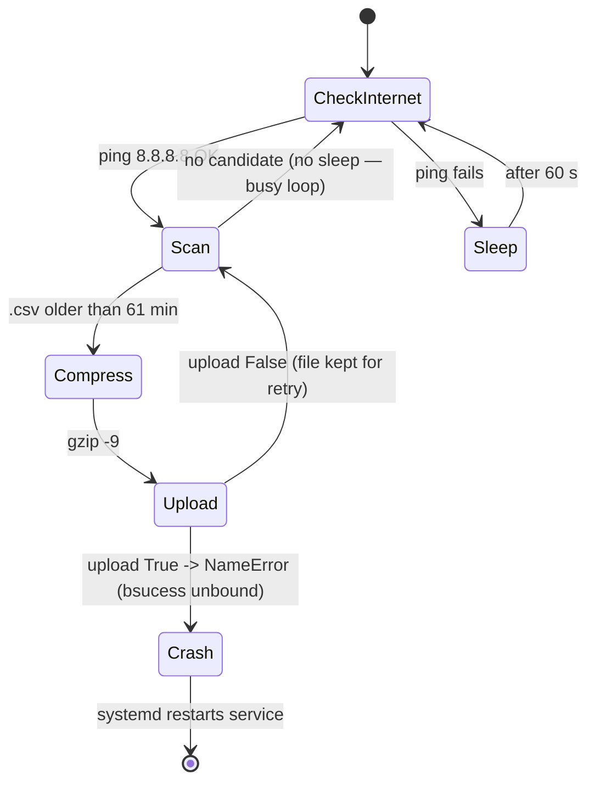
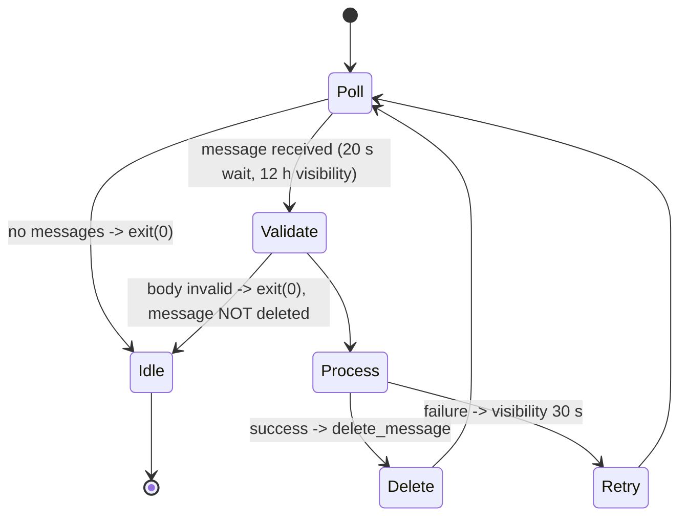

# jsamuel1-tesla_canlogjs

Deep-dive analysis produced by the `legacy-repo-deep-dive` skill (replace mode). The previous summary is preserved in git history; pre-replace claims in this document are cited as `git show HEAD:docs/legacy/jsamuel1-tesla_canlogjs.md` (line numbers refer to that blob, 57 lines total).

## 1. Provenance

- Submodule path: `legacy/jsamuel1-tesla_canlogjs`
- Pinned gitlink (canonical form from `git ls-files -s`): `160000 14983800bf0889d52385c514eec9aefe0d50d62c 0`
- `git -C legacy/jsamuel1-tesla_canlogjs rev-parse HEAD` → `14983800bf0889d52385c514eec9aefe0d50d62c` — matches the gitlink.
- `git -C legacy/jsamuel1-tesla_canlogjs status --porcelain` → empty (clean worktree).
- Upstream URL: `https://github.com/jsamuel1/tesla_canlogjs`
- License: MIT, "Copyright (c) 2020 Josh Samuel" (`LICENSE:1-3`).
- Analysis date: 2026-11-21.
- Snapshot shape: the submodule is a **shallow clone** (`git rev-parse --is-shallow-repository` → `true`) holding exactly one local commit, `1498380 2020-12-27 "trying to speed things up"` (the gitlink pin). Pre-pin upstream history was NOT reviewed.
- 35 tracked files (`git ls-files`), including hidden dirs `.vscode/`, `processing/.env`, and `.gitattributes`.

Git LFS caveat: `processing/.gitattributes:1` marks `Model3CAN.dbc` as LFS, so the committed blob of `processing/Model3CAN.dbc` is a 3-line LFS pointer (oid `sha256:fc244d4cb8a5b1bbf235b194fabfcdeebe58c2bf1ceffa3508e36e9a4f8bbf5d`, size 379180). The working-tree copy is the smudged real DBC (4692 lines). A clone without git-lfs yields a 131-byte pointer and `cantools.database.load_file` would fail. The root `.gitattributes:1-2` additionally routes `*.csv` and `*.txt` through LFS.

Files read (FULL-READ, whole file):

| File | Lines | Notes |
| --- | --- | --- |
| `rpi/can_capture.py` | 1-59 | capture loop |
| `rpi/can_upload.py` | 1-58 | upload loop |
| `rpi/install.sh` | 1-40 | systemd install |
| `processing/canmsgtosignals.py` | 1-249 | decode + SQS consumer |
| `processing/.env` | 1-4 | committed env file |
| `processing/Dockerfile` | 1-11 | container build |
| `processing/requirements.txt` | 1-5 | deps |
| `processing/samplemessage.json` | 1-84 | SQS event sample |
| `test/test_canmsgtosignals.py` | 1-50 | only real test |
| `utils/cleantimestreamdb.py` | 1-33 | destructive tool |
| `cdk/bin/cdk.ts`, `cdk/cdk.json`, `cdk/cdk.context.json`, `cdk/README.md`, `cdk/package.json`, `cdk/test/cdk.test.ts`, `cdk/lib/cdk-stack.ts`, `cdk/lib/cdk-grafana-stack.ts`, `cdk/lib/cdk-environment-stack.ts` | full | IaC |
| `.gitattributes`, `processing/.gitattributes` (via `git show`), `.gitignore`, `.vscode/settings.json`, `LICENSE`, `README.md` | full | meta |

Reading coverage for data files:

- `processing/Model3CAN.dbc` — **STRUCTURAL-PARSE**: 4692 lines, 148 `BO_` messages, 3172 `SG_` signals, 1062 `VAL_` tables (counted via script). ~20 cited line ranges read in full (the ranges cited in sections 7 and 11). Not read line-by-line beyond those ranges.
- `test/Model3CAN.dbc` — git blob is a 27-byte path note `../processing/Model3CAN.dbc` (read via `git show`; no trailing newline). The working-tree copy materialized as 379,180 bytes of DBC content, but all citations here refer to the git blob. Listed as a repo-hygiene oddity, not as a second DBC.

Files explicitly NOT read:

- `cdk/package-lock.json` (350 KB generated lockfile — no claims made from it)
- `cdk/tsconfig.json`, `cdk/jest.config.js`, `cdk/.gitignore`, `cdk/.npmignore`, `processing/.dockerignore` (build boilerplate — no claims made from them)
- `processing/__init__.py`, `test/__init__.py` (0-byte package markers, blob size 0)

Frontmatter preservation: the replaced doc's YAML frontmatter is preserved byte-for-byte **except** the description line (line 3) which carried inherited trailing whitespace — that trailing whitespace was stripped, per replace-mode instruction, and no other frontmatter byte was changed. The description text itself remains truncated mid-sentence ("stores") exactly as inherited. The replaced doc contained **no `## Upstream (...)` sections**, so nothing was preserved under that rule; its `# jsamuel1-tesla_canlogjs` H1 was kept as the document title.

## 2. Executive verdict

This repo is a passive, read-only Tesla Model 3 CAN logging pipeline from December 2020: a comma.ai White Panda on a Raspberry Pi 4 writes every frame from all three buses into hour-rotated CSV files (`rpi/can_capture.py`), a second loop gzips and uploads closed files to S3 (`rpi/can_upload.py`), and an AWS CDK stack (Timestream + SQS + ECS Fargate + Grafana) decodes each CSV against a 2020-vintage 148-message Model 3 DBC via `cantools` and stores per-signal records (`processing/canmsgtosignals.py`). It never transmits or mutates a single CAN frame — the whole value for TeslaCANModder is as (a) a proven capture/rotation pattern for bench tooling, (b) a per-row error-isolated decode-replay pattern, and (c) a 2020 DBC that acts as an era-cross-check oracle for our own decoders, where it both confirms several of our bit layouts (0x082, 0x292, 0x312, 0x3F8 follow-distance, 0x2B9, 0x7FF tier) and disagrees with others (0x257 speed, 0x118 gear/pedal, 0x129 steering angle, 0x219 TPMS, 0x249 stalk, and the 0x3FD mux-1 bit 19/20 labeling) — every disagreement is a capture-first backlog item, not a port. The cloud tier (SQS/Timestream/Grafana) is off-device and has no impact. Never port: the upload loop (first-success `NameError` crash, hardcoded credential placeholders), the record-batching code (a duplicate-write amplifier, section 9), and the committed `.env`.

## 3. Evidence map

No CAPTURE evidence exists in this repo: no captured CSV, frame dump, or decode output is shipped (`samplemessage.json` is an SQS event, not CAN data). TEST-READ evidence exists only for `test/test_canmsgtosignals.py` (one shallow assertion) and `cdk/test/cdk.test.ts` (a scaffold placeholder that cannot pass).

| Source file | Lines | What it proves | Grade |
| --- | --- | --- | --- |
| `rpi/can_capture.py` | 11-22 | USB-first Panda connect with WiFi fallback; both fail → `sys.exit(0)` | CODE-READ |
| `rpi/can_capture.py` | 33-43 | Hour-rotated CSV, header `[Bus, MessageID, Message, MessageLength, DateTime]`, row `[src, hex(id), 0x+hex, len(dat), isoformat]` | CODE-READ |
| `rpi/can_capture.py` | 45-55 | Per-bus counters (src 0/1/2), KeyboardInterrupt prints final counts | CODE-READ |
| `rpi/can_upload.py` | 12-14 | Hardcoded placeholder AWS credentials + bucket name | CODE-READ |
| `rpi/can_upload.py` | 31-42 | 61-minute age gate, `ping 8.8.8.8` connectivity check, `gzip -9` | CODE-READ |
| `rpi/can_upload.py` | 45-57 | Upload loop; `bsucess` NameError on first successful upload; no sleep while connected | CODE-READ |
| `rpi/install.sh` | 10-40 | systemd units with `WorkingDirectory=/backingfiles/canlog`, auto-start both scripts | CODE-READ |
| `processing/canmsgtosignals.py` | 24-29 | boto3 clients; DBC loaded once at import; TZ from env (may be None) | CODE-READ |
| `processing/canmsgtosignals.py` | 40-69 | Timestream table listing + auto-create, retention 8766 h / 73000 d | CODE-READ |
| `processing/canmsgtosignals.py` | 89-137 | CSV decode loop: skip header, per-row try/except isolation, batch cap 80, buggy flush at line 124 | CODE-READ |
| `processing/canmsgtosignals.py` | 140-183 | Signal→record extraction; multiplexer signals become dimensions; `'SNA'` skipped | CODE-READ |
| `processing/canmsgtosignals.py` | 185-215 | Fixed-path S3 download+gunzip; unused-in-CDK Lambda `handler()` | CODE-READ |
| `processing/canmsgtosignals.py` | 218-249 | SQS long-poll consumer, 12 h visibility, 30 s retry, `exit(0)` on invalid body | CODE-READ |
| `processing/.env` | 1-4 | AWS region, profile, SQS URL with account ID committed to the repo | CODE-READ |
| `processing/Dockerfile` | 1-11 | python:3.8-alpine + alpine edge repo; entrypoint runs the SQS consumer | CODE-READ |
| `test/test_canmsgtosignals.py` | 16-39 | Decodes 0x2E1 and multiplexed 0x2B3 from the DBC; asserts only `len(records) > 0` | TEST-READ |
| `utils/cleantimestreamdb.py` | 26-31 | Deletes every table in the named Timestream DB, no confirmation | CODE-READ |
| `cdk/lib/cdk-stack.ts` | 25-123 | Timestream DB, SQS queue, ECS Fargate task, S3 bucket (14-day expiry), CloudTrail S3 data events → ECS task + SQS | CODE-READ |
| `cdk/lib/cdk-stack.ts` | 37-75, 85-89 | taskRole policies with `resources: ['*']`; env hardcodes `TZ=Australia/Melbourne` | CODE-READ |
| `cdk/lib/cdk-grafana-stack.ts` | 139-182 | Grafana on Fargate with SecretsManager admin password, EFS volume, HTTPS ALB | CODE-READ |
| `cdk/test/cdk.test.ts` | 5-13 | Scaffold "Empty Stack" test; instantiates the stack without its required props | TEST-READ |
| `processing/Model3CAN.dbc` | 280-297, 461-470, 560-586, 708-731, 752-790, 3114-3127, 3235-3256, 2437-2451, 2683-2689, 3038-3043, 3070-3078, 3103-3112, 2255-2266 | 2020-vintage frame layouts used for the parity matrix | STRUCTURAL-PARSE |
| `README.md` | 9-22 | White Panda BOM, `/backingstore` claim, "paste your AWS access keys" instruction, Panda power warning | CODE-READ (doc file) |
| `LICENSE` | 1-3 | MIT, 2020 Josh Samuel | CODE-READ |

## 4. Architecture and build surface

Entry points:

- `rpi/can_capture.py` → `can_logger()` main loop (device-side capture)
- `rpi/can_upload.py` → `__main__` loop (device-side upload)
- `processing/canmsgtosignals.py` → `handler(event, context)` at `canmsgtosignals.py:208-215` (Lambda-shaped, not wired in CDK) and `__main__` SQS consumer at `canmsgtosignals.py:218-249` (the deployed path, per `Dockerfile:11`)
- `cdk/bin/cdk.ts:10-13` → three stacks: `CdkEnvironmentStack` (VPC `10.1.0.0/16`, `cdk-environment-stack.ts:9`), `CdkStack` (data pipeline), `CdkGrafanaStack` (visualization), all pinned to `eu-west-1`

Shared core vs platform port: there is no shared core — the `rpi/` scripts are standalone device code; `processing/` depends on `boto3`, `cantools`, `dateutil` (`requirements.txt:1-5`); `cdk/` is TypeScript AWS CDK v1 (`package.json:17` pins `aws-cdk 1.78.0`, modules `^1.80.0`).

Build flags: none. No feature gating, no variant selection. The only environment switches are `DEBUG` (`canmsgtosignals.py:19-21`), `TSDB_NAME`, `TZ`, `SQS_QUEUE_URL`, and `NOAWS=True` (`.env:1-4`).

Dependency boundaries: `panda` (USB/WiFi CAN, capture only), `boto3` (S3/SQS/Timestream), `cantools` (DBC decode), `dateutil` (tz handling). Nothing crosses back toward the car: **no frame TX path exists anywhere in this repo** (negative anchor A11 in section 16 — `grep` for `can_send|can_send_many|set_safety|0xAA` over `rpi/` returns nothing).

```mermaid
flowchart LR
    Car["Tesla CAN (buses 0/1/2)"] --> Panda["White Panda (USB, WiFi fallback)"]
    Panda --> Cap["can_capture.py<br/>hourly CSV rotation"]
    Cap --> CSV["canbus-YYYYMMDD-HHMMSS.csv"]
    CSV --> Up["can_upload.py<br/>gzip -9 + S3 (61-min age gate)"]
    Up --> S3["S3 bucket canlog<br/>(14-day lifecycle expiry)"]
    S3 --> CT["CloudTrail S3 data events"]
    CT --> ECS["ECS Fargate task per object"]
    CT --> SQS["SQS canlogFilesToProcess"]
    SQS --> Proc["canmsgtosignals.py<br/>SQS long-poll consumer"]
    ECS --> Proc
    Proc --> DBC["cantools + Model3CAN.dbc<br/>per-row error isolation"]
    DBC --> TS["Timestream tesla_canlogjs<br/>(80-record batches)"]
    TS --> Graf["Grafana (EFS, HTTPS ALB)"]
    classDef device fill:#1e3a5f,stroke:#4a7fb5,color:#fff
    class Cap,CSV,Up device
```



Note on the skill's RX → decode → mutate/gate → TX shape: **None found: no frame mutation, gate, or TX pipeline exists in this repo.** Every CAN byte flows one way: bus → CSV → cloud. That makes this repo a capture/decode reference only — nothing here can inform frame mutation safety directly.

## 5. Mechanism catalogue

### Hourly-rotated passive CAN capture

- **Claim (README / summary):** "captures CAN messages on a Raspberry Pi 4 using a comma.ai White Panda, stores them as CSV" (`git show HEAD:docs/legacy/jsamuel1-tesla_canlogjs.md`, line 15; `README.md:1-2`).
- **Code path:** `rpi/can_capture.py:9` — `can_logger()` → `Panda()` / `Panda("WIFI")` → `p.can_recv()` at `can_capture.py:40` → `csvwriter.writerow()` at `can_capture.py:43`. No TX call exists.
- **Frame spec:** None found — no frame is singled out; every ID on every bus is logged as `[src, hex(address), "0x"+dat.hex(), len(dat), datetime.now().isoformat()]` (`can_capture.py:42-43`).
- **Gates and timing:** file rotated every `timedelta(minutes=60)` (`can_capture.py:39`); filename stamped `canbus-%Y%m%d-%H%M%S.csv` (`can_capture.py:33`); no backpressure — `can_recv()` drains whatever the Panda buffer holds per iteration.
- **State machine:** None found — a single flat loop (open → write 60 min → close → reopen).
- **Tests:** None found — no test file references `can_capture.py`.
- **Evidence grade:** CODE-READ
- **Verdict:** CONFIRMED (hourly rotation, three-bus logging, DLC-as-length all verified in code)
- **Adapt to TeslaCANModder?** candidate for future PR — as a pattern for `tools/` bench capture and recorder export, never as firmware code.

### Age-gated gzip + S3 upload loop

- **Claim (README / summary):** "Monitors for completed CSV files, compresses with gzip, and uploads to AWS S3" (`git show HEAD:...md`, line 38).
- **Code path:** `rpi/can_upload.py:44-57` — `__main__` while-loop → `internet_connected()` at `can_upload.py:38` → `compress_file()` (`gzip -9`, `can_upload.py:40-42`) → `upload_to_aws()` at `can_upload.py:11-15` → `s3.upload_file` at `can_upload.py:21`.
- **Frame spec:** None found — file-level only.
- **Gates and timing:** file must be older than 61 minutes (`can_upload.py:31-35`) — a 1-minute margin past the capture's 60-minute close; connectivity checked by `ping -c 1 8.8.8.8`; 60-second sleep only in the offline branch (`can_upload.py:56-57`).
- **State machine:** see below.



- **Tests:** None found.
- **Evidence grade:** CODE-READ
- **Verdict:** PARTIAL — the described behavior exists, but the first successful upload raises `NameError` (`can_upload.py:52` references `bsucess` before any assignment; the short-circuit only avoids it when the upload fails), and the `os.remove` at `can_upload.py:55` is unreachable via the success path because the crash happens first. The summary's "uploads to AWS S3" is true only across crash-restart cycles.
- **Adapt to TeslaCANModder?** never port — crash-on-first-success, hardcoded credential placeholders (`can_upload.py:12-14`), busy-loop, ping-based connectivity.

### systemd capture/upload service install

- **Claim (README / summary):** "Sets up systemd services for auto-capture and upload" (`git show HEAD:...md`, line 39).
- **Code path:** `rpi/install.sh:3-5` copies both scripts to `/opt/canlogpi/`; `install.sh:10-22` and `install.sh:24-36` write `canlogpi.service` / `canlogpi_upload.service` with `PYTHONUNBUFFERED=1`; `install.sh:38-40` daemon-reloads and enables both.
- **Frame spec:** None found.
- **Gates and timing:** `WorkingDirectory=/backingfiles/canlog` (`install.sh:19,33`) — contradicts `README.md:12` which claims `/backingstore` (contradiction C2).
- **State machine:** None found.
- **Tests:** None found.
- **Evidence grade:** CODE-READ
- **Verdict:** PARTIAL (works, but `PYTHONUNBUFFERED=1` only affects stdout — CSV file writes remain OS-buffered, so abrupt power loss can drop the file tail).
- **Adapt to TeslaCANModder?** no impact — different platform (we run on ESP32 firmware, not Linux services).

### S3-object-event processing pipeline (CloudTrail → ECS task + SQS)

- **Claim (README / summary):** "processes them via an AWS Lambda + Timestream pipeline" (`git show HEAD:...md`, lines 15, 31, 40).
- **Code path:** `cdk/lib/cdk-stack.ts:102-110` bucket (public access blocked, 14-day expiry) → `cdk-stack.ts:112-113` CloudTrail logging all S3 data events → `cdk-stack.ts:117-119` `onCloudTrailWriteObject` → `EcsTask` target (`cdk-stack.ts:94-99`) and → `cdk-stack.ts:121-123` → `SqsQueue` target. The container is built from `../processing/` (`cdk-stack.ts:84`), i.e. the SQS consumer, not a Lambda. No Lambda construct exists anywhere in `cdk/` (negative anchor A12).
- **Frame spec:** None found.
- **Gates and timing:** task-per-object (taskCount 1); Fargate 2048 MiB / 1024 CPU (`cdk-stack.ts:78-82`); container env hardcodes `TZ=Australia/Melbourne` (`cdk-stack.ts:87`).
- **State machine:** None found (CDK declarative).
- **Tests:** `cdk/test/cdk.test.ts:5-13` — scaffold only; it constructs `CdkStack` without the required `props` and would throw `'Props needed'` (`cdk-stack.ts:20-22`). Asserts nothing real.
- **Evidence grade:** CODE-READ
- **Verdict:** CONTRADICTED — the deployed tier is ECS Fargate + SQS, not Lambda (contradiction C1). The Lambda-shaped `handler()` at `canmsgtosignals.py:208-215` exists in code but is not referenced by any stack.
- **Adapt to TeslaCANModder?** no impact — off-device cloud infrastructure.

### CSV → DBC decode → Timestream records

- **Claim (README / summary):** "decodes CAN messages using `cantools` + `Model3CAN.dbc`, and writes decoded signals to AWS Timestream" (`git show HEAD:...md`, line 40).
- **Code path:** `processing/canmsgtosignals.py:28` `cantools.database.load_file('Model3CAN.dbc')` → `CanMsgToTimestreamSignal.process_messages()` at `canmsgtosignals.py:89-137` → `dbc.get_message_by_frame_id(int(row[1],0))` + `msg.decode(a2b_hex(row[2][2:]))` at `canmsgtosignals.py:98-99` → `extract_signals_to_records()` at `canmsgtosignals.py:140-183` → `save_to_database()` at `canmsgtosignals.py:72-87`.
- **Frame spec:** None found at the code level — the frame catalog lives entirely in the DBC (STRUCTURAL-PARSE, section 7). Timestamp parsed as `%Y-%m-%dT%H:%M:%S.%f` (`canmsgtosignals.py:100`).
- **Gates and timing:** per-row try/except isolates decode failures: `KeyError` (unknown CAN ID) dropped silently (`canmsgtosignals.py:114-117`), `ValueError` logged and dropped (`canmsgtosignals.py:118-120`), any other exception logged with traceback (`canmsgtosignals.py:121-122`). Records buffered per table; batch flushed when `len(stored)+len(records) > 80` (`canmsgtosignals.py:107`).
- **State machine:** None found — a flat row loop with per-table buffers.
- **Tests:** `test_extract_signals_to_records` at `test/test_canmsgtosignals.py:29-39` — decodes hardcoded frames `0x2e1 / 0x010c03ff1f050000` and multiplexed `0x2b3 / 0x04adad8a8a000000` and asserts `len(records) > 0`; asserts nothing about record values, schema, SNA skipping, or the batching path.
- **Evidence grade:** CODE-READ (pipeline), TEST-READ (existence of records only)
- **Verdict:** PARTIAL — decode works as described, but the batching bookkeeping is broken (section 9 rows F6/F7): after the first threshold flush for a table, new records are appended to a rebound local list and orphaned while the stale dict list is re-saved, and the `% 1000` flush condition fires on nearly every row.
- **Adapt to TeslaCANModder?** candidate for future PR — the per-row error-isolation pattern for a `tools/` recorder-replay/decode utility; not the batching code.

### Timestream table management and retention

- **Claim (README / summary):** none — not mentioned in the old summary.
- **Code path:** `canmsgtosignals.py:40-51` paginated `list_tables` (MaxResults 20) → `ensure_table_exists()` at `canmsgtosignals.py:54-69` with `MemoryStoreRetentionPeriodInHours: 8766` and `MagneticStoreRetentionPeriodInDays: 73000` (`canmsgtosignals.py:62-63`), `ConflictException` tolerated.
- **Frame spec:** None found.
- **Gates and timing:** table cache refreshed only at consumer construction; one table per DBC message name (148 message names → up to 148 tables).
- **State machine:** None found.
- **Tests:** None found.
- **Evidence grade:** CODE-READ
- **Verdict:** CONFIRMED
- **Adapt to TeslaCANModder?** no impact — cloud-side storage concerns.

### SQS long-poll consumer with visibility retry

- **Claim (README / summary):** not described; the old summary says the processing happens in Lambda (`git show HEAD:...md`, line 31).
- **Code path:** `canmsgtosignals.py:218-249` — `sqs.receive_message` (MaxNumberOfMessages 1, `VisibilityTimeout=43200`, `WaitTimeSeconds=20`) at `canmsgtosignals.py:221-225` → `requestParameters_from_body()` at `canmsgtosignals.py:196-205` → `s3_download()` at `canmsgtosignals.py:242-243` → `sqs.delete_message` at `canmsgtosignals.py:245` or `change_message_visibility(VisibilityTimeout=30)` at `canmsgtosignals.py:249`.
- **Frame spec:** None found.
- **Gates and timing:** 12-hour visibility on receive, 30-second visibility on failure (fast redelivery); idle → `exit(0)` (`canmsgtosignals.py:226-227`).
- **State machine:** see below.



- **Tests:** None found.
- **Evidence grade:** CODE-READ
- **Verdict:** PARTIAL — retry works, but an invalid body exits without deleting the message (`canmsgtosignals.py:233-235`), so a poison message redelivers forever (section 9 row F10).
- **Adapt to TeslaCANModder?** no impact — cloud queue semantics; the poison-message lesson belongs in any future queue design (always delete or dead-letter on parse failure).

### Grafana visualization stack

- **Claim (README / summary):** not described in the old summary beyond "analysis".
- **Code path:** `cdk/lib/cdk-grafana-stack.ts:168-178` `ApplicationLoadBalancedFargateService` (desiredCount 1, HTTPS) → container `grafana/grafana` from registry with plugins `grafana-timestream-datasource,...` (`cdk-grafana-stack.ts:152`) → admin password from SecretsManager (`cdk-grafana-stack.ts:139-148`) → EFS volume mounted at `/var/lib/grafana` (`cdk-grafana-stack.ts:52-64,161-165`) → health check `/api/health` (`cdk-grafana-stack.ts:180-182`).
- **Frame spec:** None found.
- **Gates and timing:** requires `domainName`/`hostedZoneId`/`zoneName` context or the constructor throws (`cdk-grafana-stack.ts:26-28`); desiredCount pinned to 1 to avoid concurrent EFS writers (`cdk-grafana-stack.ts:173`).
- **State machine:** None found.
- **Tests:** None found.
- **Evidence grade:** CODE-READ
- **Verdict:** CONFIRMED
- **Adapt to TeslaCANModder?** no impact — off-device visualization; our client renders its own dashboards.

### Timestream table deleter (utils)

- **Claim (README / summary):** not mentioned.
- **Code path:** `utils/cleantimestreamdb.py:16-23` lists tables → `delete_all_tables()` at `cleantimestreamdb.py:26-28` deletes every table → hardcodes DB name `tesla_canlogjs` at `cleantimestreamdb.py:31`.
- **Frame spec:** None found.
- **Gates and timing:** none — no confirmation, no dry-run, no argument parsing.
- **State machine:** None found.
- **Tests:** None found.
- **Evidence grade:** CODE-READ
- **Verdict:** CONFIRMED
- **Adapt to TeslaCANModder?** never port — unguarded destructive delete-all pattern.

## 6. Summary vs code contradiction table

Pre-replace claims are cited from `git show HEAD:docs/legacy/jsamuel1-tesla_canlogjs.md` (the replaced 57-line doc), not from a live link.

| # | Summary / README claim | Code reality | Grade |
| --- | --- | --- | --- |
| C1 | "processes them via an AWS Lambda + Timestream pipeline" and architecture diagram "S3 → Lambda → DBC" (`git show HEAD:...md`, lines 15, 31; the doc's mermaid at lines 26-36) | The shipped CDK wires S3 writes to an **ECS Fargate task + SQS queue** via CloudTrail data events (`cdk/lib/cdk-stack.ts:94-99,117-123`, container from `cdk-stack.ts:84`); no Lambda construct exists in `cdk/` (anchor A12). The Lambda-shaped `handler()` exists at `canmsgtosignals.py:208-215` but is not referenced by any stack. | CODE-READ |
| C2 | "assumes a /backingstore folder exists" (`README.md:12`) | Both systemd units set `WorkingDirectory=/backingfiles/canlog` (`rpi/install.sh:19,33`). The README path does not exist in any script. | CODE-READ |
| C3 | DBC comment: `CM_ SG_ 599 UIspeed_signed257 "Vehicle Speed, .05 -25 for mph"` (`processing/Model3CAN.dbc:3624`) | The signal definition itself says `UIspeed_signed257 : 12|12@1- (0.08,-40) ... "KPH"` (`Model3CAN.dbc:3124`). The DBC's own comment is stale and disagrees with its signal line — treat all DBC comments in this file as untrusted. | STRUCTURAL-PARSE |

Agreements (hourly rotation, three-bus capture, DLC-as-length, MIT license, White Panda interface, cantools decode) are recorded in the evidence map, not here.

## 7. CAN frame and signal inventory

The repo is a generic logger: code references no specific CAN ID except the two frames exercised by the test. The DBC catalog itself is covered by the STRUCTURAL-PARSE row and is not dumped wholesale.

| ID (hex + dec) | Bus | Period | DLC | Byte/bit layout | Scale/units | Counter | Checksum | R/W | Grade |
| --- | --- | --- | --- | --- | --- | --- | --- | --- | --- |
| all IDs | 0/1/2 (Panda `src`) | as-received | actual `len(dat)` | CSV row `[src, hex(id), 0x+hex, len, ISO-8601]` (`rpi/can_capture.py:42-43`) | n/a | n/a | n/a | read-only | CODE-READ |
| 0x2E1 (737) `ID2E1VCFRONT_status` | VehicleBus (DBC) | not stated | 8 | mux `VCFRONT_statusIndex M : 0|3` [0..6]; test payload `0x010c03ff1f050000` decodes mux-1 signals (`Model3CAN.dbc:2437-2451`; `test/test_canmsgtosignals.py:21`) | per-signal (e.g. cabin temps ×0.5 −40 °C in sibling frames) | n/a | n/a | read (test only) | TEST-READ |
| 0x2B3 (691) `ID2B3VCRIGHT_logging1Hz` | VehicleBus (DBC) | 1 Hz (name) | 8 | mux `VCRIGHT_logging1HzIndex M : 0|4` [0..11]; e.g. `VCRIGHT_cabinTempBreathLevel m1 : 56|8 (0.5,-40)` (`Model3CAN.dbc:2255-2266`; test at `test_canmsgtosignals.py:22`) | temps ×0.5 −40 °C | n/a | n/a | read (test only) | TEST-READ |
| Catalog: `processing/Model3CAN.dbc` | mixed | mixed | mixed | STRUCTURAL-PARSE summary: 148 `BO_` messages, 3172 `SG_` signals, 1062 `VAL_` tables, 4692 lines; multiplexing used (e.g. `VCSEC_TPMSDataIndex M : 0|2`, `UI_autopilotControlIndex M : 0|3`); stored as a Git LFS pointer in the committed blob | | | | read (all, via cantools) | STRUCTURAL-PARSE |

No frames are mutated or injected anywhere in this repo.

## 8. Constants and tuning table

| Constant | Value | File:line | Meaning | Grade |
| --- | --- | --- | --- | --- |
| capture rotation window | 60 min | `rpi/can_capture.py:39` | one CSV per hour, filename stamped at open | CODE-READ |
| upload age gate | 61 min | `rpi/can_upload.py:33` | 1-minute margin past capture close so the in-progress file is never uploaded mid-write | CODE-READ |
| connectivity probe | `ping -c 1 8.8.8.8` | `rpi/can_upload.py:38` | gate for the upload loop; fails closed to 60 s sleep | CODE-READ |
| compression | `gzip -9` | `rpi/can_upload.py:41` | max compression before upload | CODE-READ |
| offline sleep | 60 s | `rpi/can_upload.py:57` | only the offline branch sleeps; online branch busy-loops | CODE-READ |
| Timestream batch cap | 80 records | `processing/canmsgtosignals.py:107` | comment says "max batch size for timestream" (service limit is 100; 80 is a conservative headroom) | CODE-READ |
| memory retention | 8766 h (~1 year) | `canmsgtosignals.py:62` | Timestream memory store retention per table | CODE-READ |
| magnetic retention | 73000 d (~200 years) | `canmsgtosignals.py:63` | Timestream magnetic store retention per table | CODE-READ |
| table page size | 20 | `canmsgtosignals.py:41` | `list_tables` MaxResults pagination | CODE-READ |
| SQS receive visibility | 43200 s (12 h) | `canmsgtosignals.py:224` | long visibility while a 12 h Fargate task may chew on a big CSV | CODE-READ |
| SQS long-poll wait | 20 s | `canmsgtosignals.py:225` | receive_message wait | CODE-READ |
| failure retry visibility | 30 s | `canmsgtosignals.py:249` | fast redelivery after a processing exception | CODE-READ |
| flush cadence | `line_num % 1000` | `canmsgtosignals.py:124` | intended "every 1000 rows"; as written truthy on every non-multiple → flushes nearly every row (bug, F7) | CODE-READ |
| timestamp parse | `%Y-%m-%dT%H:%M:%S.%f` | `canmsgtosignals.py:100` | must match `datetime.now().isoformat()` output from the capture script | CODE-READ |
| SNA sentinel | `'SNA'` | `canmsgtosignals.py:164-165` | cantools "signal not available" strings are skipped, not stored | CODE-READ |
| timezone | `Australia/Melbourne` | `cdk/lib/cdk-stack.ts:87` | hardcoded in the container env; absent TZ env → `dateutil.tz.gettz(None)` → naive timestamps (`canmsgtosignals.py:29-30`) | CODE-READ |
| Fargate sizing | 2048 MiB / 1024 CPU | `cdk-stack.ts:79-80` | per-object decode task | CODE-READ |
| S3 object expiry | 14 days | `cdk-stack.ts:108` | bucket lifecycle on raw CSVs | CODE-READ |
| Grafana desiredCount | 1 | `cdk-grafana-stack.ts:173` | prevents concurrent EFS writers | CODE-READ |

## 9. Failure modes and edge cases

No bus-off, watchdog, or OTA handling exists anywhere in this repo — the capture is passive and the failure surface is file/queue/service oriented. Panda-internal bus error handling was not inspected (UNVERIFIED, would require reading the `panda` library).

| # | Failure | Handling code path | Tested? | Grade |
| --- | --- | --- | --- | --- |
| F1 | Panda USB connect fails | WiFi retry, then `sys.exit(0)` (`rpi/can_capture.py:15-22`) — exit code 0 hides the failure from systemd | no | CODE-READ |
| F2 | Abrupt power loss mid-capture | no fsync/flush of the CSV file (`PYTHONUNBUFFERED=1` in `rpi/install.sh:17` affects stdout only) — tail rows lost | no | CODE-READ |
| F3 | First successful upload | `NameError` on `bsucess` (`rpi/can_upload.py:52`) — process crashes before `os.remove`; systemd restarts; file re-uploads next cycle | no | CODE-READ |
| F4 | Upload connected but idle | no sleep in the online branch (`can_upload.py:45-57`) — busy-loop directory scan | no | CODE-READ |
| F5 | ICMP blocked on network | `ping 8.8.8.8` fails forever → upload stalls in 60 s sleeps (`can_upload.py:38,56-57`) | no | CODE-READ |
| F6 | Per-table buffer overflow past 80 records | `stored_records = []` rebinds the local name, not the dict's list (`canmsgtosignals.py:110-112`) — new records orphaned, stale ~80-record list re-saved repeatedly → duplicate writes + record loss | no | CODE-READ |
| F7 | Row-count flush cadence | `if csvreader.line_num % 1000:` fires on every non-multiple (`canmsgtosignals.py:124-128`) → near-every-row Timestream write amplification | no | CODE-READ |
| F8 | Unknown CAN ID in CSV | `KeyError` → silently dropped row (`canmsgtosignals.py:114-117`) | no | CODE-READ |
| F9 | Decode size/parse error | `ValueError` logged and dropped; any other exception logged with row context (`canmsgtosignals.py:118-122`) | no | CODE-READ |
| F9a | DBC DLC vs captured DLC mismatch (e.g. DBC 0x219 DLC 5 vs 8-byte capture) | falls into F9 per-row isolation; row dropped | no | UNVERIFIED — would verify by running cantools (pinned version) on an 8-byte 0x219 capture |
| F10 | Malformed SQS body | `exit(0)` without deleting the message (`canmsgtosignals.py:233-235`) → message redelivers after visibility → poison-message crash loop | no | CODE-READ |
| F11 | Timestream rejects records | `RejectedRecordsException` logged in detail, records lost, no retry (`canmsgtosignals.py:79-87`) | no | CODE-READ |
| F12 | Processing exception after partial writes | visibility reset to 30 s → message redelivered → non-idempotent re-decode → duplicates (no dedup/idempotency key anywhere) (`canmsgtosignals.py:242-249`) | no | CODE-READ |
| F13 | Concurrent S3 download path | fixed `/tmp/tmpfile.csv.gz` (`canmsgtosignals.py:188`) — single-message-per-run container mitigates; Lambda reuse of a warm container would clobber | no | CODE-READ |

## 10. Test coverage map

- `test/test_canmsgtosignals.py` — `CanMsgToSignalsTests.test_extract_signals_to_records` (lines 29-39) loads `../processing/Model3CAN.dbc` via a CWD-relative path (line 18, breaks if run from another directory), decodes two hardcoded frames (0x2E1 mux frame, 0x2B3 multiplexed frame, lines 21-22), and asserts `len(records) > 0` (line 38). It verifies that record extraction runs; it does NOT assert record values, schema, multiplexer-dimension handling, SNA skipping, timezone handling, or any batching behavior. `pprint(records)` at line 39 is output, not assertion.
- `cdk/test/cdk.test.ts` — jest scaffold (lines 5-13) that instantiates `CdkStack` without its required props; the constructor throws `'Props needed'` (`cdk/lib/cdk-stack.ts:20-22`) so the test cannot pass as written, and its `Resources: {}` expectation contradicts the stack's actual resources. Dead scaffold, no signal value.

Critical paths with NO test (risk in one line):

- capture loop — hourly rotation and multi-bus counting never verified (silent data loss on file-close failure would go unnoticed)
- upload loop — NameError F3 untested; the pipeline's "uploads work" claim rests on no test at all
- decode batching — the two bookkeeping bugs F6/F7 shipped because nothing exercises a >80-record table or a >1000-row CSV
- SQS consumer — poison-message loop F10 untested
- table creation/retention — untested
- `utils/cleantimestreamdb.py` — destructive tool, zero tests

## 11. Parity matrix with TeslaCANModder

Grades: upstream citations are STRUCTURAL-PARSE (DBC line ranges read) unless a code file is cited; our-side citations are all CODE-READ from the files named. Rows without an our-side CODE-READ citation are marked SUMMARY-ONLY and cannot drive decisions — there are none: every row below cites our code. "capture-first" means the delta must be settled by a listen-only bench capture before any code changes.

| Signal/frame | Upstream decode (cite) | Our decode (cite) | Delta | Action |
| --- | --- | --- | --- | --- |
| 0x082 (130) `UI_tripPlanning` — active bits | DBC `UI_tripPlanningActive : 0|1`, `UI_requestActiveBatteryHeating : 2|1` (`Model3CAN.dbc:66-72`) | `firmware/lib/vehicle/can/feature/comfort/precondition.h:25` injects `data[0]=0x05` (bits 0+2) on `BUS_VEHICLE` | exact bit match — the DBC explains why 0x05 works | align (no change; keeps our byte) |
| 0x3FD (1021) mux index | DBC `UI_autopilotControlIndex M : 0|3` (`Model3CAN.dbc:752-753`) | `firmware/lib/core/types.h:63-65` `readMuxID()` reads byte 0 bits [2:0] | match | align |
| 0x3FD mux0 bit 38 | DBC `UI_fsdStopsControlEnabled m0 : 38|1` (`Model3CAN.dbc:781`) | `firmware/lib/vehicle/can/handler/variant/bits.h:19` `FSD_BIT_AP_ACTIVE 38`, set at `variant/hw4.h:138` | same bit, different label | align (label-only) |
| 0x3FD mux1 bit 19 | DBC `UI_applyEceR79 m1 : 19|1` (`Model3CAN.dbc:755`) | `bits.h:42` `NAG_BIT_HANDS_ON_REQUIREMENT 19`, cleared at `variant/hw3.h:42` | semantic conflict: 2020 DBC calls bit 19 the ECE-R79 apply bit; we treat bit 19 as the hands-on nag bit | capture-first |
| 0x3FD mux1 bit 20 | no signal at bit 20 in this DBC (mux1 range `Model3CAN.dbc:752-790`) | `bits.h:26` `FSD_BIT_NAG_ECE_R79 20`, applied at `hw3.h:49-50` | upstream absent — cannot confirm or refute our bit-20 ECE-R79 clear | capture-first |
| 0x3FD mux1 bit 47 | DBC `UI_hardCoreSummon m1 : 47|1` (`Model3CAN.dbc:783`) | `bits.h:27` `FSD_BIT_NAG_ORGANIC 47` "Summon EU unlock", set at `hw3.h:43` | same bit; DBC name `hardCoreSummon` matches our "Summon EU unlock" comment | align |
| 0x3F8 (1016) follow distance | DBC `UI_accFollowDistanceSetting : 45|3` [0..7+SNA] (`Model3CAN.dbc:709`, VAL_ at 4105) | `firmware/lib/vehicle/can/ids.h:106-108` reads data[5] bits [7:5]; maps at `feature/fsd/profile.h:43-58` (HW3 0-3, HW4 0-5) | bit position match; range delta — 2020 stalk had up to 7 settings, our HW4 map covers 0-5 | capture-first (range) |
| 0x3F8 bit 14 hands-on disable | DBC `UI_handsOnRequirementDisable : 14|1` (`Model3CAN.dbc:731`, VAL_ at 4116) | `bits.h:35` `UI_BIT_HANDS_ON_REQ_DISABLE 14`, set at `hw3.h:95` | match | align |
| 0x3F8 bit 5 dev mode | DBC `UI_dasDeveloper : 5|1` (`Model3CAN.dbc:717`) | `bits.h:33` `UI_BIT_DAS_DEVELOPER 5`, set at `hw3.h:100` | match | align |
| 0x3F8 bit 43 trip telemetry | DBC `UI_enableTripTelemetry : 43|1` (`Model3CAN.dbc:723`) | `bits.h:37` `UI_BIT_TRIP_TELEMETRY 43`, cleared at `hw3.h:105` | match | align |
| 0x3F8 bits 13/48/49 nav assist | DBC `UI_driveOnMapsEnable : 13|1`, `UI_hasDriveOnNav : 48|1`, `UI_followNavRouteEnable : 49|1` (`Model3CAN.dbc:718,732,727`) | `bits.h:34,38,39`, set together at `hw3.h:88-90` | match | align |
| 0x3F8 driving side | DBC `UI_drivingSide : 40|2` (`Model3CAN.dbc:719`) | `bits.h:45` `FSD_BIT_DRIVING_SIDE 41`, cleared for LHD at `hw3.h:83` | 1-bit offset — DBC field starts at bit 40 (2 bits), we write bit 41 | capture-first |
| 0x3F8 bit 45 lane graph | DBC puts `UI_showLaneGraph m1 : 45|1` on **0x3FD mux1** (`Model3CAN.dbc:788`) and reserves 0x3F8 bits 45-47 for the follow-distance dial (`Model3CAN.dbc:709`) | `hw3.h:47` and `hw4.h:47` set `UI_BIT_LANE_GRAPH 45` on the **0x3F8** frame | possible our-side mis-frame: writing 0x3F8 bit 45 collides with the dial readback in the 2020 layout | capture-first — flag as suspected our-side bug |
| 0x2B9 (697) `DAS_control` | DBC setSpeed 0\|12 ×0.1, accState 12\|4, jerkMin 18\|9 (0.03,−15.232), jerkMax 27\|8 (0.059), accelMin 35\|9 (0.04,−15), accelMax 44\|9 (0.04,−15), counter 53\|3, checksum 56\|8 (`Model3CAN.dbc:461-470`) | `firmware/lib/vehicle/can/feature/das/das_drive.h:107-118` — same fields; counter 53-55, checksum 56-63, ACC_ON=4 / CANCEL=13 at `das_drive.h:38-39` | counter/checksum/setSpeed/accState/accel match exactly; jerk factors differ (ours 0.018/−9.1 and 0.034) | align core; capture-first on jerk factors |
| 0x249 (585) `SCCM_leftStalk` | DBC DLC 4; `SCCM_leftStalkCrc : 0|8`, `SCCM_leftStalkCounter : 8|4`, `SCCM_turnIndicatorStalkStatus : 16|4` (`Model3CAN.dbc:2683-2689`) | `firmware/lib/vehicle/can/feature/fsd/auto_lane_change.h:48-58` — DLC 3; CRC in byte 0 over bytes 1-2 (`teslaCrc8`), counter byte 1 bits [3:0] (matches DBC 8\|4), stalk position byte 1 bits [7:6] | counter position + CRC-in-byte-0 match; DLC (4 vs 3) and stalk bit position (16\|4 vs byte1[7:6]) differ | capture-first |
| 0x219 (537) TPMS | DBC `VCSEC_TPMSData`, DLC **5**, ChassisBus, 2-bit mux m0-m3 per-tire, pressure 8\|8 ×0.025 bar, temp ×1 −40 (`Model3CAN.dbc:280-297`) | `firmware/lib/vehicle/can/feature/telemetry/tpms.h:43-62` — 8-byte flat `[p,p,p,p,t,t,t,t]` on the vehicle bus (`ids.h:39`) | layout, DLC, and bus all differ | capture-first — era or bus-mapping difference |
| 0x31F (799) `TPMSsensors` | DBC DLC 8, ChassisBus, interleaved pairs: FLp 0\|8, FLt 8\|8, FRp 16\|8, FRt 24\|8, RLp 32\|8, RRp 48\|8 (`Model3CAN.dbc:3249-3256`) | `tpms.h:43-62` flat pressures bytes 0-3, temps bytes 4-7 | same scales (0.025 bar, −40 °C), different byte order | capture-first |
| 0x257 (599) vehicle speed | DBC `UIspeed_signed257 : 12|12 (0.08,-40) KPH`, counter 8\|4, checksum 0\|8 (`Model3CAN.dbc:3122-3127`; stale comment at 3624, contradiction C3) | `firmware/lib/vehicle/can/feature/telemetry/powertrain.h:18-22` — signed 16-bit bytes 2-3 ×0.01 kph | layout and scale differ entirely | capture-first |
| 0x118 (280) `DI_state` | DBC `DI_gear : 21|3`, `DI_accelPedalPos : 32|8 (0.4,0)`, `DI_brakePedalState : 19|2` (`Model3CAN.dbc:3070-3078`) | `powertrain.h:29-32` gear byte 0 bits [3:1]; `powertrain.h:39-42` pedal byte 1 raw %; `powertrain.h:49-52` brake data[2] bits [4:3] = bits 20:19 | brake bits match; gear and pedal positions differ | capture-first (gear/pedal) |
| 0x129 (297) steering angle | DBC `SteeringAngle129 : 16|14 (0.1,-819.2)` (`Model3CAN.dbc:3038-3043`) | `powertrain.h:59-63` signed 16-bit bytes 0-1 ×0.1° | scale matches (0.1), bit position/width differ | capture-first |
| 0x132 (306) `HVBattAmpVolt` | DBC `BattVoltage132 : 0|16 (0.01,0) V`, `SmoothBattCurrent132 : 16|16 (-0.1,0) A` (`Model3CAN.dbc:3235-3239`) | `firmware/lib/vehicle/can/feature/telemetry/bms.h:18-33` — voltage bytes 0-1 ×0.01; current bytes 2-3 signed ×0.1 | voltage match; current sign convention differs (DBC factor −0.1 flips discharge sign, ours keeps negative=discharge) | capture-first (sign convention) |
| 0x292 (658) `BMS_SOC` | DBC SOCmin 0\|10, SOCUI 10\|10, SOCmax 20\|10, SOCave 30\|10, beginning-of-life energy 40\|10, all ×0.1 (`Model3CAN.dbc:3114-3120`) | `bms.h:50-54` (bits 0-9), `bms.h:191-228` (UI 10-19, max 20-29, avg 30-39, initial full 40-49) | full match across all four SoC fields | align |
| 0x312 (786) `BMSthermal` | DBC min pack temp 44\|9 (0.25,−25), max 53\|9, dissipation 0\|10 (0.02), flow 10\|7 (0.3), cool target 17\|9, heat target 35\|9 (`Model3CAN.dbc:3103-3112`) | `bms.h:288-347` — identical bits and scales (PackTMin 44-52, PackTMax 53-61, dissipation, flow 0.3, targets −25) | full match | align (note: our own `docs/reference/can-protocol.md` describes 0x312 temps as byte4/byte5 −40, which matches neither — our-side doc drift, see section 17) |
| 0x399 (921) | DBC `DAS_status`, ChassisBus, HW3-era: `DAS_autopilotHandsOnState : 42|4`, `DAS_autopilotState : 0|4`, checksum 56\|8, counter 52\|4 (`Model3CAN.dbc:560-586`) | `firmware/lib/vehicle/can/ids.h:21` `CAN_ID_ISA_SPEED 0x399` (HW4 ISA chime), `ids.h:63` `CAN_ID_BLIND_SPOT 0x399` (vehicle bus), and `handler/bus/chassis.h:70-73` comment: "HW3 excluded since 0x399 carries DAS_status on HW3 chassis bus" | era-consistent: our code already knows 0x399 is DAS_status on HW3 chassis | align (no change) |
| 0x175 (373) `WheelSpeed` | DBC FL 0\|13, FR 13\|13, RL 26\|13, RR 39\|13, ×0.04 kph, LE, counter 52\|4, checksum 56\|8 (`Model3CAN.dbc:2749-2755`) | `ids.h:16` "FL/FR/RL/RR 13-bit LE, 0.04 km/h" + `firmware/lib/vehicle/can/feature/telemetry/wheel_speeds.h:18` `decodeWheelSpeedFL` | match | align |
| 0x7FF (2047) `carConfig` | DBC `GTW_autopilot m2 : 42|3` on 8-byte muxed VehicleBus frame (`Model3CAN.dbc:3299-3306`) | `firmware/lib/vehicle/can/handler/frame_readers.h:65-71` `readGtwAutopilotTier()` — mux 2, byte 5 bits [4:2] | exact match (42\|3 = byte5 bits 2-4) | align |
| 0x2E1 (737) `VCFRONT_status` | DBC mux `VCFRONT_statusIndex M : 0|3` [0..6], 8 bytes (`Model3CAN.dbc:2437-2451`) | `handler/bus/vehicle.h:193-198` reads `frunkOpen` / `anyDoorOpen` at DLC ≥ 8 | same frame touched; our flags come from mux variants not individually cited here | align (no conflict observed) |
| 0x229 (553) | DBC `ID229GearLever: 3` VehicleBus, DLC 3 (`Model3CAN.dbc:2679`) — gear lever | `ids.h:17` `CAN_ID_EPAS_HARNESS 0x229` "EPAS_internalHarness (RX, CRC-8 protected)" | same ID, unrelated interpretation (gear lever vs EPAS harness) | capture-first |
| 0x370 (880), 0x398 (920), 0x39B (923), 0x392 (914), 0x488 (1160), 0x273 (627), 0x331 (817) | absent from the 2020 DBC (negative anchor A13) | our side decodes/injects all of these (`ids.h:59,62,64,60,43,26,53`) | upstream predates these frames | ignore — no parity possible |

## 12. Surface inventory and security notes

Surfaces exposed:

| Surface | Where | Semantics |
| --- | --- | --- |
| local file I/O | `rpi/can_capture.py:33-43` | writes hour-rotated CSVs to the working directory |
| S3 upload | `rpi/can_upload.py:17-29` | boto3 client with in-source credentials, bucket `bucket1`, prefix `canlog/` |
| ICMP probe | `rpi/can_upload.py:38` | outbound ping to 8.8.8.8 |
| S3 bucket | `cdk/lib/cdk-stack.ts:102-110` | receives raw CSVs; public access blocked; 14-day expiry |
| SQS queue `canlogFilesToProcess` | `cdk-stack.ts:29` | receives CloudTrail S3 PutObject events |
| ECS Fargate task | `cdk-stack.ts:78-99` | per-object decode task; no inbound ports |
| Grafana HTTPS ALB | `cdk-grafana-stack.ts:168-182` | internet-exposed UI on a Route53 domain; `/api/health` check; SecretsManager admin password |
| Timestream DB `tesla_canlogjs` | `cdk-stack.ts:25-27` | decoded signal store |

There is no serial/web/BLE command surface on the device side — the two rpi scripts have no command parser at all.

Security findings:

- **Hardcoded credential pattern:** `rpi/can_upload.py:12-14` embeds placeholder `access_key`/`secret_key`; `README.md:21` explicitly instructs the user to paste real AWS access keys into the source file. The committed values are dummies, but the pattern invites real-key leakage into a public fork.
- **Committed environment file:** `processing/.env:1-4` contains the AWS account ID (`546826240711`), region, profile name, and the SQS queue URL — infrastructure metadata that enables targeted enumeration. No secret keys in it, but the file pattern is a leak risk.
- **Personal/infra data in `samplemessage.json`:** real principal email `jsamuel@gmail.com` with full account ARN (lines 18-19), AWS-internal source IP `54.240.197.231` (line 40), bucket name and object key (lines 44-45).
- **Account ID also in `cdk/cdk.context.json:2`** and `.vscode/settings.json:2` leaks the author's local path (`/Users/sauhsoj/...`).
- **Overly broad IAM:** taskRole policies use `resources: ['*']` for S3 GetObject and Timestream writes (`cdk-stack.ts:38-52`), ECR/logs (`cdk-stack.ts:63-74`), and the Grafana read policy (`cdk-grafana-stack.ts:82-101`).
- **Unpinned container base:** `processing/Dockerfile:1,5` — `python:3.8-alpine` plus the alpine `edge/community` repository: rolling, non-reproducible, unvetted packages.
- **Positive findings:** S3 has `BlockPublicAccess.BLOCK_ALL` (`cdk-stack.ts:103`); Grafana admin password generated in SecretsManager (`cdk-grafana-stack.ts:139-148`); no secrets appear in CDK container env vars.
- No dangerous build flags; no untrusted archives are executed at build time.

## 13. Adaptation assessment

| Mechanism | Value | Cost | Risk | Evidence | Decision |
| --- | --- | --- | --- | --- | --- |
| Hourly-file-rotation passive capture | medium — proven pattern for long bench sessions, survives restart via systemd | low — `tools/` script, no firmware change | none — read-only | CODE-READ | candidate for future PR (pattern, not code) |
| Per-row error-isolated decode replay | medium — one bad frame never kills a replay pass; exactly what a `tools/` recorder-replay utility needs | low | none | CODE-READ | candidate for future PR |
| CSV interchange schema `[Bus, MessageID, Message, MessageLength, DateTime]` | low-medium — simple, human-readable export for the on-device recorder | low | none | CODE-READ | candidate for future PR (recorder export format decision) |
| 2020 DBC as era-cross-check oracle | high — already surfaced concrete deltas (0x257, 0x118, 0x129, 0x219, 0x249, 0x3FD bit19/20, 0x3F8 bit45) and confirmations (0x082, 0x292, 0x312, 0x2B9, 0x7FF, 0x3F8 dial bits) | low — read-only comparison | medium — era confusion; this DBC predates HW4-era layouts | STRUCTURAL-PARSE | capture-first backlog (validation list in section 11), never a port |
| ECS/SQS/Timestream/Grafana tier | none — off-device | — | — | CODE-READ | no impact |
| Record batching/flush logic | negative — duplicate-write amplifier (F6/F7) | — | high if copied | CODE-READ | never port |
| Upload loop | negative — NameError crash, busy-loop, ping dependency, credential placeholders | — | high | CODE-READ | never port |
| `utils/cleantimestreamdb.py` | none for us | — | destructive pattern | CODE-READ | never port |
| systemd install script | none — wrong platform | — | — | CODE-READ | no impact |

## 14. Do-not-copy list

| Item | File:line | Reason |
| --- | --- | --- |
| `bsucess = ... and bsucess` NameError pattern | `rpi/can_upload.py:52` | references an unbound variable on the first success path; crashes before cleanup |
| hardcoded credential placeholders + "paste your keys here" instruction | `rpi/can_upload.py:12-14`, `README.md:21` | credential-in-source pattern |
| buffer rebind instead of clear | `processing/canmsgtosignals.py:110-112` | `stored_records = []` orphans new records and re-saves stale ones — duplicate writes + record loss |
| `if line_num % 1000:` cadence check | `processing/canmsgtosignals.py:124` | truthy on every non-multiple — flushes nearly every row |
| `exit(0)` on invalid queue message without delete | `processing/canmsgtosignals.py:233-235` | poison-message crash loop |
| committed `.env` with account/queue metadata | `processing/.env:1-4` | infra metadata leak; file pattern invites real secrets |
| unguarded delete-all database tool | `utils/cleantimestreamdb.py:26-31` | no confirmation, no dry-run, hardcoded DB name |
| alpine `edge` repository in a production image | `processing/Dockerfile:5` | unpinned, rolling, non-reproducible base |
| scaffold test asserting an empty template for a non-empty stack | `cdk/test/cdk.test.ts:5-13` | dead test that cannot pass; false confidence |

## 15. History and evolution

The submodule's local `git log --all` contains exactly one commit:

- `1498380 2020-12-27 "trying to speed things up"` — this is also the gitlink pin.

The clone is shallow (`git rev-parse --is-shallow-repository` → `true`), so **no pre-pin upstream history was reviewed**; the single commit's numstat shows every file added at once (squashed import), meaning nothing about earlier iterations can be reconstructed locally. Claims about upstream issues/PRs are UNVERIFIED.

What the snapshot itself says about evolution:

- The commit message "trying to speed things up" correlates with the batching/flush code in `processing/canmsgtosignals.py:107-128` (80-record cap plus the `% 1000` flush). Whether those lines — and their two bookkeeping bugs (F6/F7) — were introduced by this commit cannot be verified locally: there is no parent commit to diff against. UNVERIFIED; would verify after `git fetch --unshallow` and `git show 1498380^..1498380 -- processing/canmsgtosignals.py`.
- Tooling era matches the date: `cdk/package.json:17` pins `aws-cdk 1.78.0` with `@aws-cdk/* ^1.80.0` (CDK v1, late 2020); the DBC is a 148-message subset, consistent with an early Josh Wardell Model 3 DBC revision rather than the later ~800-message catalogs. UNVERIFIED which exact upstream revision it corresponds to.
- `README.md:34` lists a setup step `cdk cdk` — no such CDK subcommand is known for v1; `cdk/package.json:11` defines an npm script named `cdk` that invokes the `cdk` CLI, which is the likely intended command. UNVERIFIED (would verify against `cdk --help` of aws-cdk 1.78.0).
- The Lambda-vs-ECS split (contradiction C1) suggests the author moved from a Lambda design to an always-on-visibility SQS consumer (the 12-hour `VisibilityTimeout` at `canmsgtosignals.py:224` is a workaround for Lambda's 15-minute cap), leaving the `handler()` behind as dead-but-compilable code. This reading is inference, not history — UNVERIFIED.

## 16. Re-verification recipe

```bash
OLD=14983800bf0889d52385c514eec9aefe0d50d62c
# The submodule is a shallow clone; unshallow first or the range commands fail:
git -C legacy/jsamuel1-tesla_canlogjs fetch --unshallow --tags --prune
git -C legacy/jsamuel1-tesla_canlogjs log --oneline $OLD..origin/main
git -C legacy/jsamuel1-tesla_canlogjs diff --stat $OLD..origin/main
git -C legacy/jsamuel1-tesla_canlogjs diff $OLD..origin/main -- rpi/ processing/ cdk/lib/ cdk/bin/ test/ utils/
git ls-files -s legacy/jsamuel1-tesla_canlogjs   # expect 160000 <full-sha> 0; compare to git -C legacy/jsamuel1-tesla_canlogjs rev-parse HEAD
```

All anchors below were executed at write time (GNU grep 3.12 via Git Bash) and their expected hits recorded. If line numbers drift more than ~10, re-read the whole function; do not trust this document's numbers.

Upstream anchors (run from `legacy/jsamuel1-tesla_canlogjs/`):

```text
grep -nE 'timedelta\(minutes=60\)' rpi/can_capture.py
  -> 39:        while datetime.now() < start_datetime + timedelta(minutes=60):
grep -nE 'can_recv|strftime|csvwriter\.writerow' rpi/can_capture.py
  -> 33 (file open), 37 (header row), 40 (can_recv), 42 (loop), 43 (row write)
grep -nE 'bsucess|minutes=61|8\.8\.8\.8' rpi/can_upload.py
  -> 33 (61-min gate), 38 (ping), 52 (bsucess NameError), 53 (if bsucess)
grep -nE 'database\.load_file' processing/canmsgtosignals.py
  -> 28:dbc = cantools.database.load_file('Model3CAN.dbc')
grep -nE 'line_num % 1000|stored_records = \[\]' processing/canmsgtosignals.py
  -> 110 (buffer rebind), 124 (flush-cadence bug)
grep -nE '8766|73000' processing/canmsgtosignals.py
  -> 62 (memory retention hours), 63 (magnetic retention days)
grep -nE 'VisibilityTimeout|WaitTimeSeconds=20' processing/canmsgtosignals.py
  -> 224 (43200), 225 (20), 249 (retry visibility 30)
grep -nE 'EcsTask|SqsQueue|onCloudTrailWriteObject|ContainerImage.fromAsset' cdk/lib/cdk-stack.ts
  -> 4 (imports), 84 (image from processing/), 94 (EcsTask), 100 (SqsQueue), 117+121 (both CloudTrail targets)
grep -nE 'filter=lfs' .gitattributes processing/.gitattributes
  -> .gitattributes:1 and :2 (*.csv, *.txt), processing/.gitattributes:1 (Model3CAN.dbc)
grep -nE '^BO_ 1021 |UI_autopilotControlIndex|UI_applyEceR79|UI_accFollowDistanceSetting|UI_handsOnRequirementDisable|VCSEC_TPMSDataIndex|DAS_controlCounter|DAS_controlChecksum|SteeringAngle129|UIspeed_signed257|BMSminPackTemperature|GTW_autopilot m2' processing/Model3CAN.dbc
  -> 281 (TPMS mux), 466+467 (DAS_control checksum/counter), 709 (follow distance 45|3), 731 (hands-on disable 14|1), 752 (BO_ 1021), 753 (mux index 0|3), 755 (UI_applyEceR79 m1 19|1), 3043 (SteeringAngle129 16|14), 3112 (BMSminPackTemperature 44|9), 3124 (UIspeed_signed257 12|12), 3306 (GTW_autopilot m2 42|3), plus CM_/VAL_ hits at 3624, 3863, 4105, 4116, 4130
```

Negative anchors (absence claims — expect NO output):

```text
grep -nE 'can_send|can_send_many|set_safety|0xAA' rpi/can_capture.py rpi/can_upload.py
  -> no output (the capture is passive; no TX or safety-mode call exists)
grep -nE 'Lambda|Function' cdk/lib/cdk-stack.ts cdk/bin/cdk.ts
  -> no output (contradiction C1: no Lambda construct in the shipped IaC)
grep -nE '^BO_ (880|920|923|914|1160|627|817) ' processing/Model3CAN.dbc
  -> no output (0x370, 0x398, 0x39B, 0x392, 0x488, 0x273, 0x331 absent from this DBC)
```

Our-side drift anchors (run from the repo root; the `already present`/`align` decisions rest on these):

```text
grep -nE 'FSD_BIT_AP_ACTIVE|FSD_BIT_NAG_ECE_R79|NAG_BIT_HANDS_ON_REQUIREMENT|FSD_BIT_NAG_ORGANIC|UI_BIT_LANE_GRAPH' firmware/lib/vehicle/can/handler/variant/bits.h
  -> 19 (AP_ACTIVE 38), 26 (NAG_ECE_R79 20), 27 (NAG_ORGANIC 47), 36 (LANE_GRAPH 45), 42 (HANDS_ON_REQUIREMENT 19)
grep -nE 'decodeVehicleSpeed|decodeGearState|decodeSteeringAngle' firmware/lib/vehicle/can/feature/telemetry/powertrain.h
  -> 18 (0x257 bytes 2-3 ×0.01), 29 (0x118 gear byte0 [3:1]), 59 (0x129 bytes 0-1 ×0.1)
grep -nE 'CAN_ID_TPMS|CAN_ID_ISA_SPEED|CAN_ID_BLIND_SPOT|CAN_ID_FSD_MUX|CAN_ID_FOLLOW_DIST' firmware/lib/vehicle/can/ids.h
  -> 21 (0x399 ISA), 24 (0x3F8), 25 (0x3FD), 39 (0x219), 63 (0x399 blind spot)
grep -nE 'readFollowDistance' firmware/lib/vehicle/can/ids.h
  -> 106 (data[5] bits [7:5])
grep -nE 'decodeBmsPackTMin|decodeBmsPackTMax|decodeBmsSoc\(' firmware/lib/vehicle/can/feature/telemetry/bms.h
  -> 50 (SoC bits 0-9), 332 (PackTMin), 343 (PackTMax)
grep -nE 'enable \? 0x05' firmware/lib/vehicle/can/feature/comfort/precondition.h
  -> 25 (0x082 data[0] = 0x05)
grep -nE 'readGtwAutopilotTier|GTW_TIER_SHIFT' firmware/lib/vehicle/can/handler/frame_readers.h
  -> 20 (shift 2), 65 (tier reader), 71 (byte5 bits [4:2])
grep -nE 'UI_BIT_LANE_GRAPH' firmware/lib/vehicle/can/handler/variant/hw3.h firmware/lib/vehicle/can/handler/variant/hw4.h
  -> hw3.h:47 and hw4.h:47 (lane graph written on the 0x3F8 frame — parity row 13)
grep -nE 'decodeTpmsFrame' firmware/lib/vehicle/can/feature/telemetry/tpms.h
  -> 51 (definition), 74 (call site) — 8-byte flat layout
```

## 17. Open questions and explicitly not investigated

Inherited gaps, stated so the next agent inherits them rather than the conclusions:

- **Pre-pin upstream history was NOT reviewed** — the submodule is a shallow clone with a single squashed commit. Everything about the project's evolution (section 15) beyond the snapshot itself is UNVERIFIED. First step for a future agent: `git fetch --unshallow` inside the submodule, then re-run the history section.
- Whether `processing/Model3CAN.dbc` matches a specific Josh Wardell Model3CAN release is UNVERIFIED (148 messages here vs the later ~800-message catalogs). Would verify by diffing against Wardell's DBC history.
- Whether the Lambda `handler()` path was ever actually deployed is UNVERIFIED (no Lambda construct in CDK; would need deployment history or the author's AWS state).
- cantools decode behavior on DLC mismatch (DBC 0x219 DLC 5 vs an 8-byte capture; DBC 0x249 DLC 4 vs our DLC-3 injection target) is UNVERIFIED — needs a pinned cantools version and a real capture.
- The 0x2E1 test frame (`0x010c03ff1f050000`) decodes mux 1 per the DBC, but which VCFRONT mux variant carries the frunk/door flags our firmware reads (`vehicle.h:193-198`) was not traced through the DBC — RANGE-CITED only.
- Our-side follow-ups surfaced by the parity matrix, all capture-first, none resolved here: 0x257/0x118/0x129 layout deltas, 0x219 layout and bus, 0x249 stalk bit position, 0x3FD mux-1 bit 19 vs 20 semantics, 0x3F8 bit 45 (lane graph vs dial collision — suspected our-side mis-frame), drivingSide bit 40 vs 41, 0x229 GearLever vs EPAS-harness naming, 0x132 current sign convention.
- Our-side doc drift noticed while building the matrix (out of scope for this repo, recorded for the backlog): `docs/reference/can-protocol.md` describes 0x312 pack temps as byte4/byte5 −40 while `firmware/lib/vehicle/can/feature/telemetry/bms.h:61-74` implements a byte0/byte1 −40 pair and `bms.h:332-347` implements the DBC-matching bits 44-52/53-61 ×0.25 −25 layout. The firmware/DBC pair agrees; the reference doc does not.
- Hardware notes from `README.md` (Panda power warning at line 18, harness warranty risk at line 17) were not investigated — no hardware was attached.
- `README.md:34`'s `cdk cdk` step is UNVERIFIED against aws-cdk 1.78.0's actual command set.
