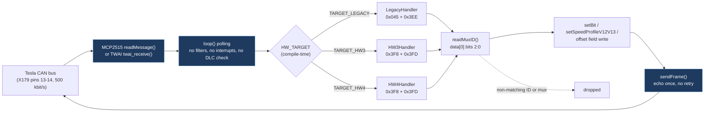
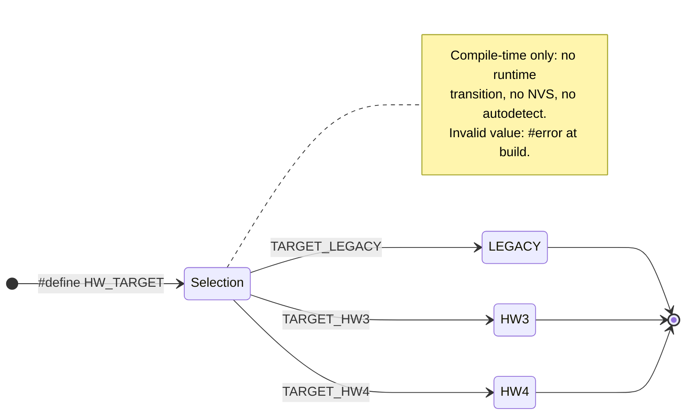

# juamiso-tesla-fsd-can-enabler

Deep-dive analysis, replace mode. The pre-replace summary still exists in git history; its claims are cited below as `git show HEAD:docs/legacy/juamiso-tesla-fsd-can-enabler.md#<line>`. The original doc carried YAML frontmatter (preserved above byte-for-byte) and no `## Upstream (...)` sections — there were none to preserve.

## 1. Provenance

- Submodule path: `legacy/juamiso-tesla-fsd-can-enabler`
- Pinned gitlink: `160000 174728d9a9cfbf288ab20338e5f03fc32d7d9bbd 0` (matches `git -C legacy/juamiso-tesla-fsd-can-enabler rev-parse HEAD`)
- Working tree: clean (`git -C legacy/juamiso-tesla-fsd-can-enabler status --porcelain` empty)
- Upstream URL: `https://github.com/juamiso/tesla-fsd-can-enabler`
- License: GPL-3.0 (README.md:238-240; GPL header blocks in 4 of 5 sketches; the UNO sketch has no license header — see section 6)
- Analysis date: 2026-11-21

Files read (upstream, all FULL-READ — the repo is 6 files, ~1500 lines total):

| File | Lines read | Coverage |
| --- | --- | --- |
| `README.md` | 1-240 | FULL-READ (read after code, for comparison) |
| `boards/ESP32_MCP2515/ESP32_MCP2515.ino` | 1-276 | FULL-READ |
| `boards/ESP32S3_TWAI/ESP32S3_TWAI.ino` | 1-293 | FULL-READ |
| `boards/FeatherM4CAN/FeatherM4CAN.ino` | 1-250 | FULL-READ |
| `boards/RP2040CAN/RP2040CAN.ino` | 1-243 | FULL-READ |
| `boards/UNO_MCP2515_CAN/UNO_MCP2515_CAN.ino` | 1-300 | FULL-READ |
| `.gitignore` | 1 | FULL-READ |

Files explicitly NOT read (upstream): none — `git -C legacy/juamiso-tesla-fsd-can-enabler ls-files` shows no hidden or additional directories. There are no vendored DBC/JSON catalogs; no STRUCTURAL-PARSE items exist.

TeslaCANModder files read for parity (all CODE-READ): `firmware/lib/vehicle/can/handler/variant/hw4.h` (1-169), `hw3.h` (1-155), `legacy.h` (1-84), `bits.h` (1-58), `firmware/lib/vehicle/can/feature/fsd/profile.h` (1-111), `offsets.h` (1-95), `firmware/lib/vehicle/can/ids.h` (1-122), `firmware/lib/vehicle/can/handler/helpers.h` (1-62), `handler/frame_readers.h` (1-72), `firmware/lib/core/types.h` (RANGE-CITED: 55-74 only).

No TEST-READ evidence exists: this repo ships no tests. No CAPTURE evidence exists in this repo.

## 2. Executive verdict

This is a 6-file Arduino sketch collection derived from the Starmixcraft/Tesla-OPEN-CAN-MOD project (README.md:3): one polling CAN read-mutate-echo loop, copy-pasted into five board variants (ESP32+MCP2515, ESP32-S3 TWAI, Feather M4, RP2040, UNO), with a compile-time variant switch (LEGACY/HW3/HW4) selecting one of three handler structs. The mechanisms that matter are the FSD mux (0x3FD/0x3EE) bit edits: bit 46 enable, bit 19 nag clear, HW4 bits 60/59/47, the HW3 speed-offset field in mux 2, and the follow-distance/stalk-to-profile mappings. Every one of those byte/bit layouts is already present in TeslaCANModder's `handleHW3`/`handleHW4`/`handleLegacy` with identical masks and scalings, so there is no core mechanism left to port. The genuine deltas are: upstream's always-on echo (no command surface, no gates, no NVS) versus our gated runtime-toggleable pipeline; upstream's unconditional bit-47 set on every HW4 mux-1 frame (ours couples bit 47 to nag suppression — a decoupled "Summon EU unlock" toggle is the one real adaptation candidate); and two documentation-only leads (pre-2026.2.3 HW4-firmware behaves as HW3; X652 alternate connector). The upstream README contradicts its own code in several places (legacy 28/29/30 speed-offset table has no code counterpart; `#define HW` example does not compile), so treat the README as SUMMARY-ONLY. Nothing here must be ported wholesale; nothing here is safe to install as-is (always-on mutation with zero safety gates).

## 3. Evidence map

| Source file | Lines | What it proves | Grade |
| --- | --- | --- | --- |
| `boards/ESP32_MCP2515/ESP32_MCP2515.ino` | 31-35 | Variant selection is `HW_TARGET` + numeric `TARGET_*` defines, not `#define HW` | CODE-READ |
| `boards/ESP32_MCP2515/ESP32_MCP2515.ino` | 59-65 | Mux read is `data[0] & 0x07`; FSD-selected read is `data[4]` bit 6 | CODE-READ |
| `boards/ESP32_MCP2515/ESP32_MCP2515.ino` | 67-82 | v12/v13 profile write mask `0x06` in byte 6; generic `setBit` | CODE-READ |
| `boards/ESP32_MCP2515/ESP32_MCP2515.ino` | 84-89 | TX is echo-once via `mcp.sendMessage`, error only printed | CODE-READ |
| `boards/ESP32_MCP2515/ESP32_MCP2515.ino` | 91-124 | Legacy handler: ID 69 stalk → profile; 0x3EE mux0 bit 46 + profile; mux1 bit 19 | CODE-READ |
| `boards/ESP32_MCP2515/ESP32_MCP2515.ino` | 126-181 | HW3 handler: 1016 fd map; mux0 offset read (`-30`, ×5, clamp 0-100) + bit 46 + profile; mux2 offset write | CODE-READ |
| `boards/ESP32_MCP2515/ESP32_MCP2515.ino` | 183-229 | HW4 handler: fd 5-level map; mux0 bits 46/60/59-cond (no byte-6 profile write); mux1 bit 19 clear + bit 47 set; mux2 byte 7 profile | CODE-READ |
| `boards/ESP32_MCP2515/ESP32_MCP2515.ino` | 253-260 | MCP2515 init: 500 kbps, MCP_8MHZ default, `setNormalMode` only — no acceptance filters | CODE-READ |
| `boards/ESP32_MCP2515/ESP32_MCP2515.ino` | 263-276 | Polling loop: read error → LED on + skip; no DLC check anywhere | CODE-READ |
| `boards/ESP32S3_TWAI/ESP32S3_TWAI.ino` | 46-50, 83-94 | TWAI wrapper struct; TX timeout 10 ms | CODE-READ |
| `boards/ESP32S3_TWAI/ESP32S3_TWAI.ino` | 258-278 | TWAI 500 kbps, `ACCEPT_ALL` filter, RX timeout 1 ms, install/start failures only early-return | CODE-READ |
| `boards/FeatherM4CAN/FeatherM4CAN.ino` | 218-237 | Boost + standby pins driven before MCP25625 init at 16 MHz | CODE-READ |
| `boards/RP2040CAN/RP2040CAN.ino` | 31-35, 209-231 | `CAN_STBY`/`CAN_RESET` defined but never driven in setup — standby gap vs Feather M4 | CODE-READ |
| `boards/UNO_MCP2515_CAN/UNO_MCP2515_CAN.ino` | 1-4, 71-88 | No license header; AVR `Serial.print` status helper replacing `printf` | CODE-READ |
| `README.md` | 37, 44-48, 61-69, 79-82 | Claims: ASS EU unlock, "Traffic Light and Stop Sign Control" trigger, `#define HW` selector, pre-2026.2.3 HW4 note | SUMMARY-ONLY |
| `README.md` | 84-112, 188-210, 238-240 | CAN details tables, speed profile tables, GPL-3.0 declaration | SUMMARY-ONLY (cross-checked per section 6) |
| `firmware/lib/vehicle/can/handler/variant/bits.h` | 19-27, 42 | Our named bit constants: 38, 39, 46, 59, 60, 47, 19 | CODE-READ |
| `firmware/lib/vehicle/can/handler/variant/hw3.h` | 114-154 | Our HW3 mux0/mux1/mux2 handling with `apGateOpen` gating | CODE-READ |
| `firmware/lib/vehicle/can/handler/variant/hw4.h` | 128-168 | Our HW4 mux0 bits 38/39/46/60/59, mux1 bit 19+47 via nag mode, gated mux2 | CODE-READ |
| `firmware/lib/vehicle/can/handler/variant/legacy.h` | 40-83 | Our legacy stalk map + 0x3EE handling with force/gate | CODE-READ |
| `firmware/lib/vehicle/can/feature/fsd/profile.h` | 17-58 | Our profile encoders and follow-distance maps | CODE-READ |
| `firmware/lib/vehicle/can/feature/fsd/offsets.h` | 17-50 | Our HW3 offset read/write, `-30` bias, ×5 clamp | CODE-READ |
| `firmware/lib/vehicle/can/ids.h` | 15-26, 106-122 | Our chassis CAN IDs, `readFollowDistance`, `isFSDSelectedInUI` | CODE-READ |
| `firmware/lib/core/types.h` | 63-66 | Our `readMuxID` (`MUX_MASK`) | CODE-READ |

## 4. Architecture and build surface

Entry point: Arduino `setup()` + `loop()` per sketch. There is no shared core — each of the five `.ino` files is a full standalone copy of the same handler trio; the only differences are the transport block (`MCP2515` object vs `TWAI` driver vs `std::unique_ptr<MCP2515>`), pin defines, and clock constant. Platform port and shared core are the same 250-300 lines, duplicated.

- Build flags: none beyond `HW_TARGET` (compile-time, hand-edited, default `TARGET_HW3` in all five sketches) and `ENABLE_APPROACHING_EMERGENCY_VEHICLE_DETECTION` (compile-time `true`, all five sketches).
- Dependency: `mcp2515` by autowp (README.md:149) on four boards; bare ESP-IDF `driver/twai.h` on ESP32-S3.
- No tests, no CI, no persistence, no command transport, no OTA path.
- Bus: single CAN lane at 500 kbit/s, X179 pins 13-14 (README.md:169-176); upstream has no multi-bus concept.



## 5. Mechanism catalogue

### Compile-time variant handler dispatch

- **Claim (README / summary):** "Select your hardware variant via the `#define HW` directive" (README.md:61, example at :157-159); pre-replace doc `git show HEAD:docs/legacy/juamiso-tesla-fsd-can-enabler.md#L47` says `#define HW`.
- **Code path:** `ESP32_MCP2515.ino:31-35` — `#define TARGET_LEGACY 1 / TARGET_HW3 2 / TARGET_HW4 3`, `#define HW_TARGET TARGET_HW3`; `setup()` at :243-251 assigns `handler` via `#if`; `loop()` at :273-275 calls `handler->handleMessage(frame)`; `#error` on invalid at :250.
- **Frame spec:** None found (dispatch layer, no frame access).
- **Gates and timing:** compile-time only. No runtime switching, no NVS, no vehicle auto-detection, no command to change variant.
- **State machine:** three mutually exclusive compile-time states; no runtime transitions exist.



- **Tests:** None found — repo ships no tests.
- **Evidence grade:** CODE-READ
- **Verdict:** PARTIAL (mechanism confirmed; the `#define HW` naming in README and pre-replace doc is wrong — see section 6)
- **Adapt to TeslaCANModder?** already present — ours is a runtime `Variant` enum (`firmware/lib/core/types.h:71-74`) with `variant:auto` detection and NVS persistence; strictly a superset.

### FSD activation echo gate (mux 0)

- **Claim (README / summary):** "FSD enable bit is set when Traffic Light and Stop Sign Control is enabled in the vehicle's Autopilot settings" (README.md:47, :79); pre-replace doc `git show HEAD:docs/legacy/juamiso-tesla-fsd-can-enabler.md#L55-L57` lists bit 46 per variant.
- **Code path:** `loop()` → `handleMessage()` → mux 0 branch → `isFSDSelectedInUI()` (`ESP32_MCP2515.ino:63-65`, `data[4]` bit 6) → `setBit(46, true)` → `sendFrame()` echo.
    - Legacy 0x3EE: `ESP32_MCP2515.ino:106-113` — `FSDEnabled` latched from the same mux-0 frame, then bit 46 + `setSpeedProfileV12V13` at :110-111.
    - HW3 0x3FD: :148-162 — reads UI offset steps, sets bit 46 + byte-6 profile at :159-160.
    - HW4 0x3FD: :204-211 — sets bit 46 (:205), bit 60 (:206), bit 59 if `ENABLE_APPROACHING_EMERGENCY_VEHICLE_DETECTION` (:207-209). No byte-6 profile write on HW4 mux 0.
- **Frame spec:** 0x3EE/0x3FD, DLC 8 assumed (never checked), mux in `data[0]` bits [2:0], FSD-selected flag `data[4]` bit 6, enable bit 46, HW4-only bits 60 and 59. No counter update, no checksum recomputation (negative anchor in section 16).
- **Gates and timing:** Legacy latches `FSDEnabled` per mux-0 frame (same-frame, no cross-frame staleness); HW3/HW4 gate on the same frame's `selected`. No AP-state gate, no speed gate, no user toggle — always-on when compiled in. Echo fires on every received mux-0 frame; no interval, no jitter, no pause windows.
- **State machine:** Legacy only: a one-bit `FSDEnabled` latch refreshed on each mux-0 frame; HW3/HW4 are stateless gates.
- **Tests:** None found.
- **Evidence grade:** CODE-READ (bit layout); the "Traffic Light and Stop Sign Control" trigger label is UNVERIFIED — the code only reads a bit, the UI-setting name would need a bench capture.
- **Verdict:** CONFIRMED for bits; PARTIAL for the trigger naming.
- **Adapt to TeslaCANModder?** already present — `handleHW3` mux 0 (`firmware/lib/vehicle/can/handler/variant/hw3.h:123-138`) and `handleHW4` mux 0 (`hw4.h:136-148`) with the same bit 46 plus additional bits 38/39 and `apGateOpen` gating.

### Nag suppression (mux 1)

- **Claim (README / summary):** "Nag suppression — clears the hands-on-wheel nag bit" (README.md:81); pre-replace doc `#L55-L57` says "clear nag bit 19".
- **Code path:** `ESP32_MCP2515.ino:115-118` (Legacy, 0x3EE mux 1) and `:164-167` (HW3, 0x3FD mux 1): `setBit(frame, 19, false)` → echo. HW4 at `:213-217`: clears bit 19 and additionally sets bit 47 on every mux-1 frame.
- **Frame spec:** 0x3EE/0x3FD mux 1, DLC 8 assumed; clears bit 19; HW4 sets bit 47. No counter/checksum update.
- **Gates and timing:** none — unconditional echo on every received mux-1 frame, regardless of FSD state, AP state, or driver input. No DAS hands-on-state awareness of any kind.
- **State machine:** None found — stateless per-frame echo.
- **Tests:** None found.
- **Evidence grade:** CODE-READ
- **Verdict:** CONFIRMED
- **Adapt to TeslaCANModder?** already present — ours clears the same bit 19 (`NAG_BIT_HANDS_ON_REQUIREMENT`, `firmware/lib/vehicle/can/handler/variant/bits.h:42`) but only when `nagModeUsesBit19(s.nagMode)` and `apGateOpen` (`hw3.h:140-145`, `hw4.h:150-155`); we also ship five richer nag modes upstream lacks. The HW4 bit-47 always-on behavior is the one delta — see section 11 row 8 and section 13.

### HW3 speed offset pipeline (UI steps read + mux 2 write)

- **Claim (README / summary):** "Adds speed-offset control via follow-distance" (README.md:66); README's own CAN table at :101, :103 disagrees with that phrasing.
- **Code path:** `ESP32_MCP2515.ino:149-150` — read `((data[3] >> 1) & 0x3F) - 30`, multiply ×5, `constrain(…, 0, 100)`; write path at `:169-175` — `data[0]` bits [7:6] get `speedOffset & 0x03`, `data[1]` bits [5:0] get `speedOffset >> 2`, then echo. Both paths gated on the same frame's `selected`.
- **Frame spec:** 0x3FD mux 0 read field: `data[3]` bits [6:1], bias −30, scale ×5 km/h, clamp 0-100. 0x3FD mux 2 write: 8-bit offset split across `data[0]` bits [7:6] + `data[1]` bits [5:0].
- **Gates and timing:** gated on FSD-selected in UI; otherwise no timing control — echo per received frame.
- **State machine:** None found — `speedOffset` is a scalar refreshed per mux-0 frame.
- **Tests:** None found.
- **Evidence grade:** CODE-READ
- **Verdict:** CONFIRMED (code); the "via follow-distance" phrasing is contradicted — the offset source is the 0x3FD mux-0 UI field, not the 1016 follow-distance frame.
- **Adapt to TeslaCANModder?** already present — `readHW3UiOffsetSteps` / `calculateHW3SpeedOffset` (`firmware/lib/vehicle/can/feature/fsd/offsets.h:31-50`, same −30 bias, ×5, clamp 0-100) and `writeHW3SpeedOffset` (`offsets.h:17-24`, identical field split).

### Speed profile mapping and writes (stalk / follow distance / HW4 5-level)

- **Claim (README / summary):** "Reads the follow-distance stalk setting; maps it dynamically to a speed profile" (README.md:52-53); legacy table "speed offset 28/29/30 → Chill/Normal/Hurry" (README.md:192-200); HW3/HW4 distance tables at :204-210; pre-replace doc `#L59` "speed profile in byte 6 bits 1-2".
- **Code path:**
    - Legacy stalk: `ESP32_MCP2515.ino:94-99` — ID 69 `data[1] >> 5`; `pos <= 1 → 2`, `pos == 2 → 1`, else `0`.
    - HW3 follow distance: :130-139 — ID 1016 `data[5]` bits [7:5]; `1→2, 2→1, 3→0`.
    - HW4 follow distance: :185-195 — same field; `1→3, 2→2, 3→1, 4→0, 5→4` (5 levels).
    - HW3 mux-0 UI-steps override: :152-157 — `rawOff` 0/1/2 → profile 0/1/2 (overrides the 1016-derived value when a 0x3FD mux-0 frame arrives).
    - Writes: v12/v13 byte 6 bits [2:1] (`:67-70`, mask `0x06`); HW4 mux 2 byte 7 bits [6:4] (`:219-223`, mask `0x07 << 4`), ungated — echoed on every mux-2 frame.
- **Frame spec:** 0x045 `data[1]` bits [7:5]; 0x3F8 `data[5]` bits [7:5]; 0x3FD mux-0 profile field byte 6 bits [2:1]; 0x3FD mux-2 (HW4) profile field byte 7 bits [6:4]. DLC never checked.
- **Gates and timing:** HW4 mux-2 profile echo has no `selected`/FSD gate — the only unconditional HW4 write besides mux-1. HW3 profile write rides the gated mux-0 path.
- **State machine:** `speedProfile` (default 1) updated by two independent frame sources on HW3 (1016 and mux-0 UI steps); last frame wins.
- **Tests:** None found.
- **Evidence grade:** CODE-READ
- **Verdict:** CONFIRMED for code; README's legacy 28/29/30 table is CONTRADICTED (no such constants or names exist in code — section 6); README's distance numbering (2-4 / 2-6) is off by one vs code cases (1-3 / 1-5).
- **Adapt to TeslaCANModder?** already present — identical maps in `firmware/lib/vehicle/can/feature/fsd/profile.h:43-47` (HW3) and `:54-58` (HW4, including level 4), identical encoders at `:17-23` and `:30-36`, identical stalk map in `legacy.h:40-53`.

### Board transport bring-up (MCP2515 / MCP25625 / TWAI)

- **Claim (README / summary):** hardware table README.md:114-126; "MCP2515 by autowp" :149; UNO "CS=D10, INT=D2" :124.
- **Code path:** ESP32: `ESP32_MCP2515.ino:40-51, 253-260` — CS=5, INT=4 (defined, polling only), `MCP_8MHZ` default, `setBitrate(CAN_500KBPS)` + `setNormalMode()`, no acceptance filters. ESP32-S3: `ESP32S3_TWAI.ino:258-278` — TWAI 500 kbps, `TWAI_FILTER_CONFIG_ACCEPT_ALL()`, TX timeout 10 ms (:90), RX timeout 1 ms (:278). Feather M4: `FeatherM4CAN.ino:218-237` — boost high + standby low driven, MCP25625 at `MCP_16MHZ`. RP2040: `RP2040CAN.ino:209-231` — `MCP_16MHZ`, but `CAN_STBY`/`CAN_RESET` defined (:31-35) and never driven. UNO: `UNO_MCP2515_CAN.ino:18-25` — CS=10, INT=2, `MCP_16MHZ` default.
- **Frame spec:** None found (transport layer).
- **Gates and timing:** polling tight loop; LED pin HIGH when no frame received, LOW on successful read (inverted-intuition cosmetic, `ESP32_MCP2515.ino:267-272`).
- **State machine:** None found.
- **Tests:** None found.
- **Evidence grade:** CODE-READ
- **Verdict:** CONFIRMED, with the RP2040 standby-pin gap noted in section 9.
- **Adapt to TeslaCANModder?** no impact — our transport is a multi-bus MCP2515 driver tree with health monitoring, filters, and a ring buffer; nothing here to reuse.

## 6. Summary vs code contradiction table

Pre-replace claims cite `git show HEAD:docs/legacy/juamiso-tesla-fsd-can-enabler.md#<line>` (the replaced summary still exists at HEAD). Upstream claims cite `README.md:<line>`.

| Claim | Code evidence | Verdict |
| --- | --- | --- |
| `git show HEAD:…md#L15` and `#L45`: "An Arduino UNO+MCP2515 variant is documented in the README but the sketch is not present in the repository" | `boards/UNO_MCP2515_CAN/UNO_MCP2515_CAN.ino` exists, 300 lines, present since initial commit 536f448 | CONTRADICTED |
| `git show HEAD:…md#L15`: "Supports four board variants" | five sketch directories in `git ls-files` (ESP32, ESP32-S3, FeatherM4, RP2040, UNO) | CONTRADICTED (count) |
| `git show HEAD:…md#L47`: "compile-time `#define HW` to select vehicle hardware variant" | `ESP32_MCP2515.ino:31-35` — `#define HW_TARGET` + `TARGET_LEGACY/TARGET_HW3/TARGET_HW4` numeric defines | PARTIAL (mechanism right, name wrong) |
| `git show HEAD:…md#L57`: "HW4: same as HW3 plus bit 60 (FSD V14), bit 47, 5-level speed profiles" | `ESP32_MCP2515.ino:183-229` — HW4 omits HW3's byte-6 profile write on mux 0 and the entire speed-offset mechanism (no `speedOffset`, no mux-2 offset write) | PARTIAL (HW4 is not HW3-plus; it drops the offset path) |
| `git show HEAD:…md#L22`: "License: GPL v3 (declared in source file headers)" | 4 of 5 sketches carry GPL header blocks; `UNO_MCP2515_CAN.ino:1-4` has none | PARTIAL |
| README.md:157-159: `#define HW HW3` | `ESP32_MCP2515.ino:33-35` — `#define HW_TARGET TARGET_HW3`; the README example does not compile | CONTRADICTED |
| README.md:192-200: Legacy profile selected by "speed offset (in km/h) 28/29/30 → Chill/Normal/Hurry" | `ESP32_MCP2515.ino:94-99, 106-113` — LegacyHandler selects a 2-bit profile from the ID 69 stalk; `grep -nE '== 28|== 29|== 30'` has no hits in any sketch; profile names absent from code | CONTRADICTED |
| README.md:204-210: profile distances "2/3/4" (HW3) and "2-6" (HW4) | `ESP32_MCP2515.ino:132-137` cases 1-3 and `:187-194` cases 1-5 — off by one vs the README display numbering | PARTIAL (README likely cites displayed distance; code uses raw field value) |
| README.md:66: "HW3 … Adds speed-offset control via follow-distance" | offset read from 0x3FD mux-0 `data[3]` bits [6:1] (`ESP32_MCP2515.ino:149-150`), not from the 1016 follow-distance frame; README's own table at :100-103 says the same | PARTIAL (internal README inconsistency) |
| README.md:47: trigger is the "Traffic Light and Stop Sign Control" Autopilot setting | code reads `data[4]` bit 6 (`ESP32_MCP2515.ino:63-65`) — a single bit; our `firmware/lib/vehicle/can/ids.h:114` labels the same bit STEERING_MODE = 5 (FSD selected) | PARTIAL (bit CONFIRMED, UI-setting label UNVERIFIED) |

The remainder of the pre-replace summary (CAN ID lists per variant, bit 46/19 positions, byte-6 bits 1-2 profile location, TWAI variant existence) was confirmed against code and is recorded in the evidence map instead.

## 7. CAN frame and signal inventory

All frames travel on the single 500 kbit/s CAN lane (X179 pins 13-14). Upstream declares no periods: every mutation is a pass-through echo retransmitted once per received frame — there is no periodic injection anywhere in the codebase. DLC is never validated before indexing.

| ID (hex / dec) | Bus | Period | DLC | Byte/bit layout | Scale / units | Counter | Checksum | R/W | Grade |
| --- | --- | --- | --- | --- | --- | --- | --- | --- | --- |
| 0x045 / 69 | single CAN | per-source (echo n/a) | ≥2 assumed | stalk position in `data[1]` bits [7:5] (`ESP32_MCP2515.ino:94-99`) | 3-bit position; map ≤1→2, 2→1, else→0 | not read | none | R | CODE-READ |
| 0x3EE / 1006 mux 0 | single CAN | echo per RX | 8 assumed | FSD-selected `data[4]` bit 6; writes bit 46 and profile `data[6]` bits [2:1] (`:106-113`) | profile 0-2 | mux in `data[0]` bits [2:0], preserved | none recomputed | R+W | CODE-READ |
| 0x3EE / 1006 mux 1 | single CAN | echo per RX | 8 assumed | clears bit 19 (`:115-118`) | — | preserved | none | R+W | CODE-READ |
| 0x3F8 / 1016 | single CAN | per-source | ≥6 assumed | follow distance `data[5]` bits [7:5] (`:130-131`, `:185-186`) | raw 1-3 (HW3), 1-5 (HW4) | not read | none | R | CODE-READ |
| 0x3FD / 1021 mux 0 (HW3) | single CAN | echo per RX | 8 assumed | reads `data[4]` bit 6, `data[3]` bits [6:1] (bias −30, ×5); writes bit 46, `data[6]` bits [2:1] (`:148-162`) | offset 0-100 km/h | preserved | none | R+W | CODE-READ |
| 0x3FD / 1021 mux 0 (HW4) | single CAN | echo per RX | 8 assumed | reads `data[4]` bit 6; writes bits 46, 60, 59-conditional (`:204-211`) | — | preserved | none | R+W | CODE-READ |
| 0x3FD / 1021 mux 1 | single CAN | echo per RX | 8 assumed | clears bit 19; HW4 also sets bit 47 (`:164-167`, `:213-217`) | — | preserved | none | R+W | CODE-READ |
| 0x3FD / 1021 mux 2 (HW3) | single CAN | echo per RX | 8 assumed | writes offset: `data[0]` bits [7:6] + `data[1]` bits [5:0] (`:169-175`) | 0-100 km/h | preserved | none | R+W | CODE-READ |
| 0x3FD / 1021 mux 2 (HW4) | single CAN | echo per RX | 8 assumed | writes profile `data[7]` bits [6:4] (`:219-223`) | profile 0-4 | preserved | none | R+W (ungated) | CODE-READ |

The mux bits in `data[0]` [2:0] are preserved implicitly on every write path (no write touches `data[0]` bits [2:0]; the mux-2 HW3 write touches only `data[0]` bits [7:6]).

## 8. Constants and tuning table

| Constant | Value | File:line | Meaning | Grade |
| --- | --- | --- | --- | --- |
| mux mask | `0x07` | `ESP32_MCP2515.ino:59-61` | 3-bit mux selector in `data[0]` bits [2:0] | CODE-READ |
| FSD-selected bit | `data[4]` bit 6 | `:63-65` | UI FSD-selected trigger gate | CODE-READ |
| FSD enable bit | 46 | `:110`, `:159`, `:205` | set on mux 0, all variants | CODE-READ |
| nag bit | 19 | `:116`, `:165`, `:214` | cleared on mux 1, all variants | CODE-READ |
| HW4 V14 bit | 60 | `:206` | set on HW4 mux 0 | CODE-READ |
| EVD bit | 59 | `:207-209` | HW4 emergency vehicle detection, gated by compile-time `ENABLE_APPROACHING_EMERGENCY_VEHICLE_DETECTION true` (`:49`) | CODE-READ |
| HW4 mux-1 extra bit | 47 | `:215` | set unconditionally on HW4 mux 1 | CODE-READ |
| v12/v13 profile mask | `0x06` | `:67-70` | profile in byte 6 bits [2:1] | CODE-READ |
| HW4 profile mask | `0x07 << 4` | `:220-221` | profile in byte 7 bits [6:4] | CODE-READ |
| offset bias | −30 | `:149` | centers the 6-bit UI offset field at zero | CODE-READ |
| offset scale / clamp | ×5, 0-100 | `:150` | steps → km/h | CODE-READ |
| offset field masks | `0b11000000` / `0b00111111` | `:170-173` | mux-2 split across `data[0]` bits [7:6] + `data[1]` bits [5:0] | CODE-READ |
| follow-distance mask | `0b11100000 >> 5` | `:131`, `:186` | field in `data[5]` bits [7:5] | CODE-READ |
| CAN bitrate | `CAN_500KBPS` | `:254` (and all boards) | single-lane bus speed | CODE-READ |
| MCP clock defaults | `MCP_8MHZ` (ESP32 `:46`) vs `MCP_16MHZ` (UNO `:25`, M4 `:234`, RP2040 `:227`) | per board | crystal-dependent; wrong value = no CAN | CODE-READ |
| TWAI timeouts | 10 ms TX / 1 ms RX | `ESP32S3_TWAI.ino:90`, `:278` | blocking poll/echo bounds | CODE-READ |
| serial debug | 115200 baud, `enablePrint` | `:37`, `:240` | print-only diagnostics, no command channel | CODE-READ |

## 9. Failure modes and edge cases

| Failure | Handling code path | Tested? | Grade |
| --- | --- | --- | --- |
| MCP2515 RX error | `ESP32_MCP2515.ino:265-270` — LED HIGH, return; no retry, no error counting, no bus-off recovery | no | CODE-READ |
| MCP2515 TX error | `:84-89` — print only, and only when `enablePrint` (silent with `enablePrint=false`); no retry, no queue, frame lost | no | CODE-READ |
| `setBitrate` failure | `:254-257` — prints "setBitrate failed" and continues into `setNormalMode()` anyway; no halt | no | CODE-READ |
| TWAI install/start failure | `ESP32S3_TWAI.ino:263-271` — early return from `setup()`; `loop()` keeps polling a dead driver forever (LED HIGH) with no reboot | no | CODE-READ |
| Short frame (DLC < 8) | none — handlers index `data[1]`..`data[7]` with no DLC guard; `can_frame` is a stack local in `loop()` so unwritten bytes carry garbage (`can_dlc` never referenced in the MCP2515 sketches) | no | CODE-READ (absence); the garbage-write consequence is UNVERIFIED |
| RP2040 MCP25625 standby | `RP2040CAN.ino:34` defines `CAN_STBY` but setup never drives it — vs `FeatherM4CAN.ino:223-224` which drives standby low; transceiver may remain in standby on that board | no | CODE-READ (absence); consequence UNVERIFIED |
| Bus overload | none — no acceptance filters (`setNormalMode` only, `:259`; TWAI `ACCEPT_ALL`, `ESP32S3_TWAI.ino:261`), full-bus polling, every mux-0/1/2 frame echoed back (doubles traffic on those IDs) | no | CODE-READ |
| OTA / reflash behavior | none found — no OTA path exists in any sketch | no | CODE-READ (absence) |
| Watchdog / brownout | none found — no watchdog registration, no brownout handling, no reboot state | no | CODE-READ (absence) |

## 10. Test coverage map

None found — this repo ships no tests, no CI, no assertions of any kind.

No TEST-READ evidence exists: this repo ships no tests. Critical paths with no test and the risk in one line: every bit mutation in sections 5-7 is untested — a wrong mask or bit index would be discoverable only on a live vehicle; the HW4 ungated mux-2 echo and the RP2040 standby gap are the two most likely silent failures.

## 11. Parity matrix with TeslaCANModder

Upstream citations use `boards/ESP32_MCP2515/ESP32_MCP2515.ino` as the canonical copy; the handler code is identical in all five sketches (verified by reading each in full). Every our-side citation below is a CODE-READ from this analysis session.

| Signal / frame | Upstream decode (cite) | Our decode (cite) | Delta | Action |
| --- | --- | --- | --- | --- |
| mux read `data[0]` bits [2:0] | `readMuxID` mask `0x07`, `ESP32_MCP2515.ino:59-61` | `readMuxID`, `firmware/lib/core/types.h:63-66` | identical | ignore |
| FSD-selected `data[4]` bit 6 | `isFSDSelectedInUI`, `:63-65` | `firmware/lib/vehicle/can/ids.h:119-122` | identical | ignore |
| mux-0 bit 46 (FSD enable) | `:110`, `:159`, `:205` | `FSD_BIT_EAP 46`, `bits.h:21` + `hw3.h:133`, `hw4.h:140`, `legacy.h:68` | identical | ignore |
| HW4 mux-0 bit 60 (FSD V14) | `:206` | `FSD_BIT_DAS_DEV 60`, `bits.h:23` + `hw4.h:141` | identical | ignore |
| HW4 mux-0 bit 59 (EVD) | `:207-209`, compile-time constant | `hw4.h:143-144`, runtime `s.evdEnabled` toggle + NVS | ours runtime-toggleable superset | ignore |
| mux-0 bits 38 / 39 | never set upstream | `hw4.h:138-139`, `hw3.h:131-132` (`FSD_BIT_AP_ACTIVE`, `FSD_BIT_CONTINUE_ON_GREEN`) | ours adds two bits upstream does not write | ignore (minimal-write comparison is UNVERIFIED, section 17) |
| mux-1 bit 19 nag clear | `:116`, `:165`, `:214`, unconditional | `bits.h:42` + `hw3.h:42`, `hw4.h:42`, `legacy.h:77`, gated by `nagModeUsesBit19` + `apGateOpen` | identical bit; ours gated | ignore (ours superset, 5 nag modes) |
| mux-1 bit 47 (HW4) | `:215`, set on every mux-1 echo | `FSD_BIT_NAG_ORGANIC 47`, `bits.h:27` + `hw4.h:43`, only during nag suppression | upstream decouples bit 47 from nag mode | align — candidate PR: separate "Summon EU unlock" toggle, gated by `docs/checklists/can-review-checklist.md` |
| HW3 offset read `data[3]` bits [6:1], bias −30 | `:149` | `readHW3UiOffsetSteps`, `offsets.h:31-35` | identical | ignore |
| HW3 offset scale ×5, clamp 0-100 | `:150` | `calculateHW3SpeedOffset`, `offsets.h:42-50` | identical | ignore |
| HW3 profile from UI steps (0-2) | `:152-157` | `hw3.h:125-127` | identical | ignore |
| HW3 mux-2 offset write | `:169-175` | `writeHW3SpeedOffset`, `offsets.h:17-24` | identical field split | ignore |
| v12/v13 profile write byte 6 bits [2:1] | `setSpeedProfileV12V13`, `:67-70` | `profile.h:17-23` | identical; ours DLC-guarded | ignore |
| HW4 mux-2 profile write byte 7 bits [6:4] | `:219-223` | `writeHW4SpeedProfile`, `profile.h:30-36` | identical mask | ignore |
| HW4 mux-2 gating | `:219-223`, ungated — echoes every mux-2 frame | `hw4.h:157`, requires `s.fsdEnabled && apGateOpen` | ours stricter | ignore |
| follow-distance read `data[5]` bits [7:5] | `:130-131`, `:185-186` | `readFollowDistance`, `ids.h:106-109` | identical | ignore |
| HW3 fd→profile map {1→2, 2→1, 3→0} | `:132-137` | `mapHW3FollowDistToProfile`, `profile.h:43-47` | identical | ignore |
| HW4 fd→profile map {1→3, 2→2, 3→1, 4→0, 5→4} | `:187-194` | `mapHW4FollowDistToProfile`, `profile.h:54-58` | identical, incl. level 4 | ignore |
| Legacy stalk map (0x045 `data[1]` bits [7:5]) | `:94-99` | `legacy.h:40-53` | identical | ignore |
| Legacy 0x3EE mux-0 gate | `:106-113`, same-frame `FSDEnabled` latch | `legacy.h:59-73`, `fsdAllowed` = `s.fsdEnabled && (force || UI)` + `apGateOpen`, plus UI-steps profile override | ours gated superset | ignore |
| DLC validation before indexing | none — `can_dlc` never checked | `profile.h:19`, `:32`, `offsets.h:19`, `legacy.h:43` all DLC-guarded | ours hardened | ignore |

## 12. Surface inventory and security notes

| Surface | Semantics | Notes |
| --- | --- | --- |
| Serial debug prints @115200 | one-line status lines per mux-0 frame (`ESP32_MCP2515.ino:120-122`, `:177-179`, `:225-227`), gated by `enablePrint` | print-only; no command parser, no input path of any kind |
| Compile-time `#define HW_TARGET` | hand-edited variant selection | the only configuration surface |
| Compile-time `ENABLE_APPROACHING_EMERGENCY_VEHICLE_DETECTION` | bit-59 on/off | hand-edited |

Provenance / security findings:

- Hardcoded credentials / keys / certs: none found.
- Untrusted archives / vendored code: none found.
- Dangerous build flags: none found — but the entire firmware is an always-on frame mutator with no runtime kill switch; removing it requires reflash. This is the safety-relevant property of the design, worth recording even though it is not a "flag".
- `UNO_MCP2515_CAN.ino:1-4` lacks the GPL header the other four sketches carry; repo-level GPL-3.0 (README.md:238-240) still applies. Attribute accordingly if anything is ever derived from that file.
- `FeatherM4CAN.ino:16` and `RP2040CAN.ino:16` use `#include "memory"` (quoted include of a standard header) — a portability wart, never copy.

## 13. Adaptation assessment

| Mechanism | Value | Cost | Risk | Evidence grade | Decision |
| --- | --- | --- | --- | --- | --- |
| Variant dispatch | low — we already have runtime switch + auto-detect | none | none | CODE-READ | already present (`firmware/lib/core/types.h:71-74` enum + variant commands) |
| FSD activation (mux 0) | none — bit-for-bit subset of ours | none | none | CODE-READ | already present (`hw3.h:123-138`, `hw4.h:136-148`, `legacy.h:63-73`); upstream's narrower write set {46, 60, 59} vs our {38, 39, 46, 60, 59} recorded as an open question, not a port |
| Nag suppression (mux 1) | low — ours has 6 modes vs upstream's 1 | none | none | CODE-READ | already present; the bit-47 decoupling is the only actionable delta |
| Bit-47 "Summon EU unlock" decoupling | medium — upstream sets bit 47 on every HW4 mux-1 echo, independent of nag state; ours only during nag suppression (`hw4.h:43`) | small PR: new state flag + status field + NVS key, reusing `applyHW4NagSuppressBits` plumbing | transport-visible CAN change — requires `docs/checklists/can-review-checklist.md` and a listen-only bench capture first | CODE-READ both sides | candidate for future PR |
| HW3 speed offset | none — identical encoding already shipped | none | none | CODE-READ | already present (`offsets.h:17-50`) |
| Profile mapping / writes | none — identical maps and masks already shipped, including HW4 level 4 | none | none | CODE-READ | already present (`profile.h:17-58`) |
| Pre-2026.2.3 HW4-firmware behaves as HW3 (README.md:69, code comment `ESP32_MCP2515.ino:33`) | medium — an autoswitch rule our `variant:auto` / fw-compat path could consume | small | wrong-variant injection on modern HW4 | SUMMARY-ONLY | never port on this evidence; capture-first backlog |
| X652 alternate connector for pre-2020 Model 3 (README.md:178-184) | low — one wiring paragraph for our hardware-setup guide | one doc edit | none | SUMMARY-ONLY | candidate for docs only, after user confirmation |
| Board transport variants (TWAI / Feather / RP2040 / UNO) | none — our hardware is ESP32 + MCP2515 multi-bus | — | — | CODE-READ | no impact |

## 14. Do-not-copy list

- `readMuxID` / `isFSDSelectedInUI` / `setSpeedProfileV12V13` / `setBit` inline helpers (all five sketches, e.g. `ESP32_MCP2515.ino:59-82`) — we already ship identical-behavior helpers (`firmware/lib/core/types.h:63-66`, `ids.h:119-122`, `profile.h:17-23`); copying would duplicate.
- The five-fold per-board copy-paste of the entire handler trio — the repo's core structural weakness; never replicate into our header-only lib tree.
- `UNO_MCP2515_CAN.ino:71-88` `printHandlerStatus` — AVR `Serial.print` workaround for a platform we do not target.
- `FeatherM4CAN.ino:16` / `RP2040CAN.ino:16` `#include "memory"` — non-standard quoted include of a standard header.
- `constrain(...)` Arduino-macro style (`ESP32_MCP2515.ino:150`) — we use the explicit `calculateHW3SpeedOffset` clamp instead.
- The entire always-on echo-without-gate design — upstream has no kill switch, no AP gate, no OTA guard; our gated pipeline is the safety property that must not be regressed while porting any behavior from this repo.

If any behavior above is ever ported: write `derived idea, independent implementation` with the upstream symbol/issue reference, use our `Frame`/`State` types and conventions, and recompute expected frames in tests rather than snapshotting our own output.

## 15. History and evolution

Mined from the submodule's local `git log` (all 4 commits, all dated 2026-03-30 — the repo is one day old at the pin):

| Commit | Subject | What it shows |
| --- | --- | --- |
| 536f448 | Initial commit: Tesla FSD CAN Bus Enabler | 7 files, 1557 insertions: all five board sketches + README in the first commit; the multi-board fork began life already complete |
| 69e1f20 | Update original repo link — moved to Tesla-OPEN-CAN-MOD | provenance note: the Starmixcraft origin repo moved to gitlab.com/Tesla-OPEN-CAN-MOD (README.md:3) |
| eef6e06 | Add CAN ID 69 stalk support, standardize HW selection, fix bugs | the only substantive code commit. Body: CAN 69 stalk reading "synced from upstream" into LegacyHandler on all boards; HW selection standardized to `TARGET_*`/`HW_TARGET`; fixed `handelMessage` typo (RP2040/FeatherM4); fixed stale `FSDEnabled` debug prints; simplified redundant `speedOffset` calc; made `handleMessage` pure virtual; removed RP2040-only `__attribute__((optimize("O3")))`; fixed an extra "1" in the ready message |
| 174728d (pinned HEAD) | Add CAN message details table to README | the CAN details tables at README.md:84-112 — the very tables whose Legacy 28/29/30 row contradicts the code (section 6) |

What was tried and rolled back: the `__attribute__((optimize("O3")))` on the RP2040 loop is the only approach visible in history that was added and then removed. Nothing else was abandoned; the project is a single-day snapshot with one cleanup commit.

Network-only claims (the mikegapinski commercial tool, the Canada-account FSD subscription workaround at README.md:27-33, the GitLab origin repo's own history) stay UNVERIFIED — they are not in this submodule's object database.

## 16. Re-verification recipe

Pinned SHA: `160000 174728d9a9cfbf288ab20338e5f03fc32d7d9bbd 0` (canonical form from `git ls-files -s legacy/juamiso-tesla-fsd-can-enabler`).

```bash
OLD=174728d9a9cfbf288ab20338e5f03fc32d7d9bbd
git -C legacy/juamiso-tesla-fsd-can-enabler fetch --tags --prune
git -C legacy/juamiso-tesla-fsd-can-enabler log --oneline $OLD..origin/main
git -C legacy/juamiso-tesla-fsd-can-enabler diff --stat $OLD..origin/main
git ls-files -s legacy/juamiso-tesla-fsd-can-enabler   # expect: 160000 174728d9a9cfbf288ab20338e5f03fc32d7d9bbd 0
```

Grep anchors. On this Windows host plain `grep` is not on PATH; `git grep -nE` (same ERE semantics) was used to demonstrate every anchor below — run from `legacy/juamiso-tesla-fsd-can-enabler/` for upstream rows and from the repo root for our-side rows. Every anchor was executed on 2026-11-21 and the shown expectation is the actual observed output.

Upstream anchors:

```text
git grep -nE 'frame\.can_id (==|!=) (69|1006|1016|1021)' -- boards/ESP32_MCP2515/ESP32_MCP2515.ino
  -> expect 6 hits: 94, 102, 130, 141, 185, 197
git grep -nE 'setBit\(frame, (19|46|47|59|60)' -- boards/ESP32_MCP2515/ESP32_MCP2515.ino
  -> expect 9 hits: 110, 116, 159, 165, 205, 206, 208, 214, 215
git grep -nE '\) - 30|constrain\(' -- boards/ESP32_MCP2515/ESP32_MCP2515.ino
  -> expect 2 hits: 149, 150
git grep -nE 'ENABLE_APPROACHING_EMERGENCY_VEHICLE_DETECTION' -- boards/ESP32_MCP2515/ESP32_MCP2515.ino
  -> expect 2 hits: 49, 207
git grep -nE '#define HW_TARGET' -- boards/
  -> expect 5 hits, one per sketch (ESP32S3:33, ESP32:35, FeatherM4:26, RP2040:26, UNO:14)
git grep -nE 'TWAI_TIMING_CONFIG_500KBITS|FILTER_CONFIG_ACCEPT_ALL' -- boards/ESP32S3_TWAI/ESP32S3_TWAI.ino
  -> expect 2 hits: 260, 261
git grep -nE 'CAN_STBY' -- boards/RP2040CAN/RP2040CAN.ino
  -> expect exactly 1 hit: 34 (proves standby is never driven on RP2040)
```

Upstream negative anchors (absence claims):

```text
git grep -nEi 'crc|checksum' -- boards/
  -> no output (no checksum recomputation anywhere; modified frames echoed as-is)
git grep -nE 'can_dlc' -- boards/ESP32_MCP2515/ESP32_MCP2515.ino boards/FeatherM4CAN/FeatherM4CAN.ino boards/RP2040CAN/RP2040CAN.ino boards/UNO_MCP2515_CAN/UNO_MCP2515_CAN.ino
  -> no output (no DLC validation in the MCP2515 handlers)
git grep -nE '== 28|== 29|== 30' -- boards/
  -> no output (README legacy 28/29/30 speed-offset table has no code counterpart)
git grep -nE 'Chill|Hurry|Sloth' -- boards/
  -> no output (profile names exist only in README prose)
```

Our-side drift anchors (the "already present" decisions rest on these):

```text
git grep -nE '#define FSD_BIT_(EAP|DAS_DEV|EVD|NAG_ORGANIC)' -- firmware/lib/vehicle/can/handler/variant/bits.h
  -> expect 4 hits: 21 (46), 22 (59), 23 (60), 27 (47)
git grep -nE 'writeHW4SpeedProfile|setSpeedProfileV12V13|mapHW(3|4)FollowDistToProfile' -- firmware/lib/vehicle/can/feature/fsd/profile.h
  -> expect 4 hits: 17, 30, 43, 54
git grep -nE 'readHW3UiOffsetSteps|calculateHW3SpeedOffset|writeHW3SpeedOffset' -- firmware/lib/vehicle/can/feature/fsd/offsets.h
  -> expect 3 hits: 17, 31, 42
git grep -nE 'evdEnabled' -- firmware/lib/vehicle/can/handler/variant/hw4.h
  -> expect 1 hit: 143
git grep -nE 'isFSDSelectedInUI|readFollowDistance' -- firmware/lib/vehicle/can/ids.h
  -> expect 2 hits: 106, 119
git grep -nE 'inline uint8_t readMuxID' -- firmware/lib/core/types.h
  -> expect 1 hit: 63
git grep -nE 'handleLegacy' -- firmware/lib/vehicle/can/handler/variant/legacy.h
  -> expect 1 hit: 38
```

If line numbers drift more than ~10, re-read the whole function; do not trust this document's numbers. Upstream history before the pinned SHA was not reviewed — only the pinned snapshot (the repo's entire history is 4 commits on 2026-03-30, so "before the pin" means the pre-fork Starmixcraft lineage, which is absent from this object database).

## 17. Open questions and explicitly not investigated

- Pre-pin upstream history: NOT reviewed — the submodule history begins at 536f448 (2026-03-30); the Starmixcraft/Tesla-OPEN-CAN-MOD lineage exists only as a GitLab URL (README.md:3) and is not in this object database. UNVERIFIED.
- Whether 0x3FD/0x3EE frames carry any vehicle-side counter/checksum expectation: neither upstream nor we recompute anything on these IDs; a listen-only bench capture would settle it. UNVERIFIED.
- The "Traffic Light and Stop Sign Control" trigger label (README.md:47): the bit (`data[4]` bit 6) is CODE-READ on both sides, but which UI setting it mirrors needs a capture toggling that setting. UNVERIFIED.
- Pre-2026.2.3 HW4-firmware → compile-as-HW3 rule (README.md:69, `ESP32_MCP2515.ino:33`): mechanism and rationale unknown; would need captures from both firmware generations. UNVERIFIED.
- Whether upstream's narrower HW4 mux-0 write set {46, 60, 59} is more or less detectable by Tesla tooling than our {38, 39, 46, 60, 59}: no capture or field evidence on either side. UNVERIFIED.
- README.md:37 "ASS (Actually Smart Summon) is no longer restricted by EU regulations" mapped to bit 47: the equivalence is inferred from our own `bits.h:27` comment ("Summon EU unlock"); upstream code sets bit 47 with no comment tying it to ASS. UNVERIFIED as mechanism equivalence.
- X652 connector pinout and applicability (README.md:178-184): README-only; not checked against Tesla service docs. UNVERIFIED.
- RP2040 standby gap: whether the Adafruit Feather RP2040 CAN works with `CAN_STBY` floating (board pull may hold it out of standby) — needs a bench test on that specific board. UNVERIFIED.
- mikegapinski / Tesla Android Diagnostic Tool and the Canada-account subscription workaround (README.md:3, :27-33): network-only product claims. UNVERIFIED, out of scope.
