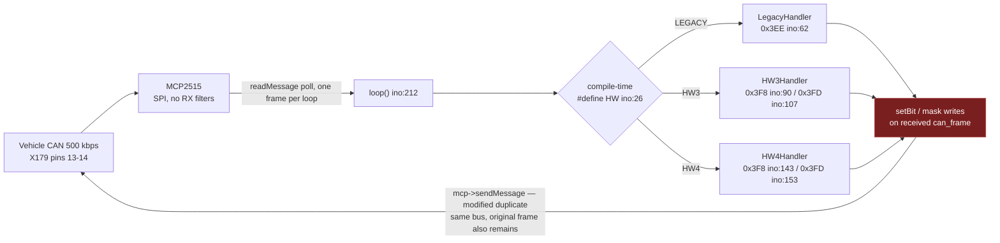
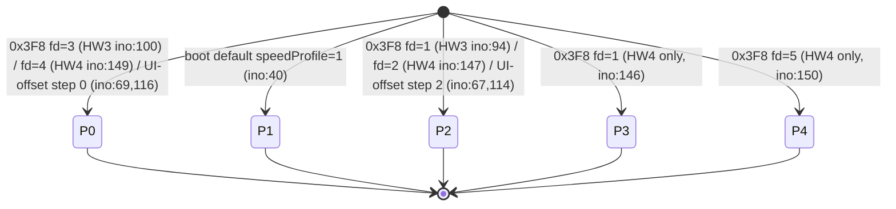

# jvanakker-tesla-fsd-can-mod

Deep-dive analysis (replace mode). The pre-replace summary is preserved in git history and cited below as `git show HEAD:docs/legacy/jvanakker-tesla-fsd-can-mod.md#<line>`.

## 1. Provenance

- Submodule path: `legacy/jvanakker-tesla-fsd-can-mod`
- Pinned gitlink (canonical form from `git ls-files -s`): `160000 5a258d9526e5790f4054b77687dd28c11df49d47 0`
- `git -C legacy/jvanakker-tesla-fsd-can-mod rev-parse HEAD` → `5a258d9526e5790f4054b77687dd28c11df49d47` (matches gitlink; worktree clean per `status --porcelain`)
- Upstream URL: `https://github.com/jvanakker/tesla-fsd-can-mod` (GitHub mirror of a GitLab original, per `README.md:4`)
- License: GPL-3.0, declared only in the source header `CanFeather.ino:2-13`. No `LICENSE` file exists in the repo.
- Analysis date: 2026-11-21
- Upstream files read (the repo contains exactly two files per `git ls-files`; no hidden or platform directories exist):

| File | Lines | Coverage |
| --- | --- | --- |
| `legacy/jvanakker-tesla-fsd-can-mod/CanFeather.ino` | 1-221 | FULL-READ |
| `legacy/jvanakker-tesla-fsd-can-mod/README.md` | 1-98 | FULL-READ |

- Files explicitly NOT read (upstream): none — the pinned snapshot has no other files.
- Our-side files read for parity:

| File | Lines | Coverage |
| --- | --- | --- |
| `firmware/lib/vehicle/can/handler/variant/hw4.h` | 1-169 | FULL-READ |
| `firmware/lib/vehicle/can/handler/variant/hw3.h` | 1-155 | FULL-READ |
| `firmware/lib/vehicle/can/handler/variant/legacy.h` | 1-84 | FULL-READ |
| `firmware/lib/vehicle/can/handler/variant/bits.h` | 1-58 | FULL-READ |
| `firmware/lib/vehicle/can/handler/helpers.h` | 1-62 | FULL-READ |
| `firmware/lib/vehicle/can/handler/frame_readers.h` | 1-72 | FULL-READ |
| `firmware/lib/vehicle/can/feature/fsd/profile.h` | 1-111 | FULL-READ |
| `firmware/lib/vehicle/can/feature/fsd/offsets.h` | 1-95 | FULL-READ |
| `firmware/lib/vehicle/can/ids.h` | 1-122 | FULL-READ |
| `firmware/lib/core/types.h` | 55-84 | RANGE-CITED |

- Our-side files NOT read: `firmware/lib/client/command/dispatch.h` (only grep hits at lines 498-598, unrelated assist-toggle features), `firmware/lib/vehicle/can/handler/dispatch.h`, `firmware/lib/vehicle/can/handler/filters.h`, `firmware/lib/vehicle/can/handler/bus/*.h` — outside the parity scope of this repo's mechanisms (routing/filters, not FSD bit logic).
- Replace-mode notes: the original doc had YAML frontmatter, preserved byte-for-byte above (its `description:` line is genuinely truncated mid-sentence — "The firmware i" — in the committed original; kept as-is). The original doc had **no** `## Upstream (...)` sections, so there was nothing to re-place after section 14. The original's line-by-line claims are cited from `git show HEAD:docs/legacy/jvanakker-tesla-fsd-can-mod.md`.
- Reading-coverage honesty: no large data files exist in this repo; both upstream files were read line-by-line in full.

## 2. Executive verdict

This repo is the smallest possible expression of the "FSD CAN mod" idea: one 221-line Arduino sketch (`CanFeather.ino`) on a single MCP2515-class board that passively polls one CAN bus, and for three frames (`0x3EE` legacy, `0x3F8`, `0x3FD`) re-transmits modified copies to set a handful of bits — bit 46 (plus bit 60 on HW4) for FSD enable on mux 0, bit 19 clear (plus bit 47 set on HW4) for nag suppression on mux 1, a follow-distance-to-profile mapping, a UI-scroll-offset-derived speed profile/offset tracker, and mux-2 injections (HW3 8-bit speed offset across bytes 0-1; HW4 3-bit profile in byte 7 bits [6:4]). Every one of those mechanisms already exists in TeslaCANModder's shipping firmware with byte-identical field layouts and strictly safer gating (`apGateOpen`, `fsdForce`, AP-First, DLC guards), so there is **no code to port** — the repo's remaining value is historical (provenance of the original Starmixcraft mod, reported dead on Tesla 2026.8.6+/2026.2.9.x+) and cautionary: its ungated, checksum-less, filter-less, duplicate-frame re-send model is exactly what our pipeline must not regress into. No TEST-READ or CAPTURE evidence exists for any upstream claim; the reported breakage on newer Tesla firmware is a network claim and stays UNVERIFIED.

## 3. Evidence map

No TEST-READ evidence exists: this repo ships no tests. No CAPTURE evidence exists in this repo.

| Source file | Lines | What it proves | Grade |
| --- | --- | --- | --- |
| `CanFeather.ino` | 21-26 | Three variant handlers selected at compile time via `#define HW` (`HW3` default); comment: HW4 needs FSDV14 compile since 2026.2.3 | CODE-READ (comment text itself is a claim, see §17) |
| `CanFeather.ino` | 37, 179, 183 | Single `MCP2515` instance, `std::unique_ptr<CarManagerBase>` dispatch | CODE-READ |
| `CanFeather.ino` | 45-47 | Mux read: `data[0] & 0x07` | CODE-READ |
| `CanFeather.ino` | 49-51 | FSD-UI gate: `data[4]` bit 6 | CODE-READ |
| `CanFeather.ino` | 53-56 | Legacy/HW3 profile write: `data[6]` bits [2:1], mask `0x06` | CODE-READ |
| `CanFeather.ino` | 60-85 | Legacy handler: `0x3EE` mux0 setBit 46 + profile, mux1 clear bit 19 | CODE-READ |
| `CanFeather.ino` | 87-139 | HW3 handler: `0x3F8` follow-distance map; `0x3FD` mux0/1/2 with offset tracking | CODE-READ |
| `CanFeather.ino` | 141-176 | HW4 handler: fd map 1-5, mux0 bits 46+60, mux1 bits 19 clear + 47 set, mux2 profile byte 7 | CODE-READ |
| `CanFeather.ino` | 189-195 | Single bus, `CAN_500KBPS`, `MCP_16MHZ`, normal mode, no RX filters | CODE-READ |
| `CanFeather.ino` | 199-210 | Bit-set helper (defined after its callers; Arduino auto-prototypes) | CODE-READ |
| `CanFeather.ino` | 212-221 | Polling loop: one frame per iteration, error → LED HIGH + return | CODE-READ |
| `CanFeather.ino` | whole file (grep) | No `dlc`/`can_dlc` check, no checksum/CRC code, no OTA/watchdog/bus-off handling, no WiFi/BLE | CODE-READ (absence, demonstrated anchors §16) |
| `README.md` | 4, 6, 8, 13 | Mirror credit, takedown/breakage warnings, pricing rationale | SUMMARY-ONLY |
| `README.md` | 17, 19, 23-29, 33-36, 40-46, 67, 85-94, 98 | Behavior/hardware/wiring claims compared in §6 | SUMMARY-ONLY |
| `git show HEAD:docs/legacy/jvanakker-tesla-fsd-can-mod.md` | 49-58 | Pre-replace summary's frame claims compared in §6 | SUMMARY-ONLY |

## 4. Architecture and build surface

- Entry points: Arduino `setup()` (`CanFeather.ino:182-196`) and `loop()` (`CanFeather.ino:212-221`). No other entry points; no commands, no services.
- Platform: board-agnostic except Adafruit `PIN_CAN_*` variant macros (`CanFeather.ino:31-35`); the "Feather M4 CAN / MCP25625" identity is a README claim (`README.md:40`), not enforced by code.
- Dependency: `mcp2515` library by autowp (`#include <mcp2515.h>`, `CanFeather.ino:18`; `README.md:67`). No other libraries.
- Build flags: single compile-time switch `#define HW HW3|HW4|LEGACY` (`CanFeather.ino:26`). No runtime variant detection.
- Shared core vs port: none — everything in one `.ino`; `CarManagerBase` (`CanFeather.ino:39-43`) is the only abstraction.
- Dependency boundaries: none — handlers call `mcp->sendMessage()` directly (`CanFeather.ino:74,78,121,125,132,159,164,169`).



Key structural fact: this is an intercept-and-duplicate model. The original frame is never suppressed; for every matching received frame a second, modified copy is transmitted (8 `sendMessage` call sites). Our firmware uses the same mutation-and-resend model on the chassis bus but adds gates (AP injection gate, AP-First), filters, DLC guards, and an OTA pause upstream never had.

## 5. Mechanism catalogue

### M1 — FSD enable injection (mux 0 of 0x3EE / 0x3FD)

- **Claim (README / summary):** `README.md:19` — checks whether "Traffic Light and Stop Sign Control" is enabled in Autopilot settings and treats it as the trigger to enable FSD by modifying bits and re-transmitting.
- **Code path:** `loop()` `CanFeather.ino:212-221` → `handelMessage()` (`:61` / `:89` / `:142`) → mux0 branch gated on `isFSDSelectedInUI()` (`:64`, `:110`, `:156`) → `setBit(frame, 46, true)` (`:72`, `:119`, `:157`) and on HW4 additionally `setBit(frame, 60, true)` (`:158`) → `mcp->sendMessage(&frame)` (`:74`, `:121`, `:159`).
- **Frame spec:** ID 1006 (0x3EE, Legacy) or 1021 (0x3FD, HW3/HW4), DLC never checked (assumed 8). Mux/counter in `data[0]` bits [2:0] (`:46`, mask `0x07`). UI gate = `data[4]` bit 6 (`:50`) i.e. frame bit 38. FSD enable write = frame bit 46 (byte 5 bit 6); HW4 also bit 60 (byte 7 bit 4). HW3/Legacy also rewrite profile bits `data[6]` [2:1] (`:73`, `:120`). No counter increment, no checksum (demonstrated absent, §16 anchor A5).
- **Gates and timing:** the only gate is the UI-selection bit. No AP-state gate, no park/summon gate, no rate limit — injects on every received mux0 frame at whatever cadence the car emits 0x3FD. No DLC guard before touching `data[3..7]`.
- **State machine:** None found (stateless per-frame mutation).
- **Tests:** None found.
- **Evidence grade:** CODE-READ.
- **Verdict:** CONFIRMED (bit-level behavior); the README gloss that bit 38 equals "TLSC enabled" is a naming claim — UNVERIFIED (what would verify: bench decode of `data[4]` bit 6 against the UI setting).
- **Adapt to TeslaCANModder?** already present — `hw3.h:123-138`, `hw4.h:136-148`, `legacy.h:63-73` write bit 46 plus (HW4) bits 38/39/60 and gate on `fsdEnabled && (fsdForce || fsdUI) && apGateOpen`. Ours is a superset.

### M2 — Nag bit clear (mux 1 of 0x3EE / 0x3FD)

- **Claim (README / summary):** `README.md:35` — "clears the hands-on-wheel nag bit".
- **Code path:** mux1 branch (`CanFeather.ino:76`, `:123`, `:161`) → `setBit(frame, 19, false)` (`:77`, `:124`, `:162`) → HW4 additionally `setBit(frame, 47, true)` (`:163`) → `mcp->sendMessage(&frame)` (`:78`, `:125`, `:164`).
- **Frame spec:** same frame family as M1; bit 19 = byte 2 bit 3. HW4 bit 47 = byte 5 bit 7. No checksum, no counter touch.
- **Gates and timing:** none at all — every received mux1 frame is re-sent modified, regardless of AP state. This is the "always-on" loud mode; our `nag:mode:legacy` counterpart.
- **State machine:** None found.
- **Tests:** None found.
- **Evidence grade:** CODE-READ.
- **Verdict:** CONFIRMED.
- **Adapt to TeslaCANModder?** already present — `applyHW3NagSuppressBits` (`hw3.h:40-53`) and `applyHW4NagSuppressBits` (`hw4.h:40-53`) clear bit 19, set bit 47, and add EAP/lane-graph/ECE-R79 edits, all gated on `nagModeUsesBit19` + `apGateOpen`. Ours is a superset.

### M3 — Follow-distance → speed profile mapping (0x3F8)

- **Claim (README / summary):** `README.md:19,34` — reads the follow-distance stalk setting and maps it to a speed profile; `README.md:29` — HW4 has an extended 5-level range.
- **Code path:** `handelMessage()` → `frame.can_id == 1016` (`CanFeather.ino:90` HW3, `:143` HW4) → `followDistance = (frame.data[5] & 0b11100000) >> 5` (`:91`, `:144`) → switch writes member `speedProfile` (`:92-104`, `:145-151`) → `return` (read-only; 0x3F8 is never re-transmitted).
- **Frame spec:** ID 1016 (0x3F8), field `data[5]` bits [7:5], values 0-5. HW3 map: 1→2, 2→1, 3→0 (`:93-103`). HW4 map: 1→3, 2→2, 3→1, 4→0, 5→4 (`:145-151`). Default cases leave the last profile untouched.
- **Gates and timing:** read-only, no gate, no DLC guard.
- **State machine:** profile value transitions (value-domain, not a temporal FSM):



- **Tests:** None found.
- **Evidence grade:** CODE-READ.
- **Verdict:** CONFIRMED; the 5-level claim for HW4 is confirmed by the `case 5: speedProfile = 4` branch (`:150`).
- **Adapt to TeslaCANModder?** already present — `readFollowDistance` (`ids.h:106-109`, same bits [7:5]), `mapHW3FollowDistToProfile` (`profile.h:43-47`, map `{-1,2,1,0}`), `mapHW4FollowDistToProfile` (`profile.h:54-58`, map `{-1,3,2,1,0,4}`) — byte-identical mappings, plus our `profileOverride` pin which upstream lacks.

### M4 — UI offset-step tracker (mux 0 `data[3]` field → profile + offset)

- **Claim (README / summary):** `README.md:34` — "Speed profile is derived from the scroll-wheel offset or follow-distance setting".
- **Code path:** mux0 branch → `off = (uint8_t)((frame.data[3] >> 1) & 0x3F) - 30` (`CanFeather.ino:65` Legacy, `:112` HW3) → profile switch `off==0/1/2 → profile 0/1/2` (`:66-71`, `:113-118`) → HW3 additionally `speedOffset = std::max(std::min(((uint8_t)((frame.data[3] >> 1) & 0x3F) - 30) * 5, 100), 0)` (`:111`). HW4 handler has no such field read at all.
- **Frame spec:** 6-bit field `data[3]` bits [6:1], bias −30, so raw 30 = zero step; steps range −30..+33 after int promotion. Offset scale: steps × 5, clamped [0,100]. Profile only tracks steps 0, 1, 2 (raw 30-32); other values leave the profile unchanged.
- **Gates and timing:** only evaluated under the mux0 FSD-UI gate; no DLC guard.
- **State machine:** profile states shown in M3.
- **Tests:** None found.
- **Evidence grade:** CODE-READ.
- **Verdict:** CONFIRMED for HW3/Legacy; PARTIAL for the README blanket claim — HW4 derives its profile only from 0x3F8, never from the offset field (no `data[3]` read in `HW4Handler`, `CanFeather.ino:141-176`).
- **Adapt to TeslaCANModder?** already present — `readHW3UiOffsetSteps` (`offsets.h:31-35`, identical field + bias −30), `calculateHW3SpeedOffset` (`offsets.h:42-50`, identical ×5 and [0,100] clamp), profile-from-steps at `hw3.h:125-127` and `legacy.h:65-67`.

### M5 — HW3 speed-offset injection (mux 2 of 0x3FD)

- **Claim (README / summary):** `git show HEAD:docs/legacy/jvanakker-tesla-fsd-can-mod.md#51` — "Mux 2 — speed offset encoding" (HW3).
- **Code path:** `HW3Handler` mux2 branch gated on the local UI flag (`CanFeather.ino:127`) → `data[0] &= ~0b11000000; data[1] &= ~0b00111111; data[0] |= (speedOffset & 0x03) << 6; data[1] |= speedOffset >> 2` (`:128-131`) → `mcp->sendMessage(&frame)` (`:132`).
- **Frame spec:** 0x3FD mux2; offset split 8-bit across `data[0]` bits [7:6] (low 2 bits) and `data[1]` bits [5:0] (high 6 bits). Mux bits [2:0] preserved (the `data[0]` mask only clears bits 6-7). Offset domain 0..100 (`:111`). No checksum recomputed.
- **Gates and timing:** gated on FSD-UI bit only; no DLC guard.
- **State machine:** None found.
- **Tests:** None found.
- **Evidence grade:** CODE-READ.
- **Verdict:** CONFIRMED.
- **Adapt to TeslaCANModder?** already present — `writeHW3SpeedOffset` (`offsets.h:17-24`) uses the identical byte/bit split; ours adds DLC ≥ 2 guard and `offsetOverride` pinning upstream lacks.

### M6 — HW4 profile injection (mux 2 of 0x3FD)

- **Claim (README / summary):** `git show HEAD:docs/legacy/jvanakker-tesla-fsd-can-mod.md#52` — HW4 "encodes 5-level speed profile in byte 7 bits 4-6".
- **Code path:** `HW4Handler` mux2 branch — **ungated**, no FSD-UI check (`CanFeather.ino:166`) → `data[7] &= ~(0x07 << 4); data[7] |= (speedProfile & 0x07) << 4` (`:167-168`) → `mcp->sendMessage(&frame)` (`:169`).
- **Frame spec:** 0x3FD mux2; 3-bit profile at `data[7]` bits [6:4], mask `0x70`. Values 0..4 in use. No offset write exists anywhere in the HW4 handler (no HW4 offset field at all).
- **Gates and timing:** none — every received mux2 frame is re-sent with the profile forced. No DLC guard before writing `data[7]`.
- **State machine:** None found.
- **Tests:** None found.
- **Evidence grade:** CODE-READ.
- **Verdict:** CONFIRMED (and it is the repo's most reckless path: unconditional injection).
- **Adapt to TeslaCANModder?** already present and safer — `writeHW4SpeedProfile` (`profile.h:30-36`, identical mask `0x70`) called only under `fsdEnabled && apGateOpen` (`hw4.h:157-159`). Our HW4 offset write (`hw4.h:160-164`, `data[1]` bits [5:0]) has **no upstream counterpart** in this repo — do not cite this repo as evidence for that field.

### M7 — Polling intercept-resend runtime (single bus, no filters, no guards)

- **Claim (README / summary):** `README.md:17` — "intercepts specific CAN bus messages"; `README.md:46` — 500 kbit/s.
- **Code path:** `setup()` → `mcp->reset()`, `setBitrate(CAN_500KBPS, MCP_16MHZ)`, `setNormalMode()` (`CanFeather.ino:191-194`) → `loop()` polls `readMessage()` one frame per iteration (`:214`), on any non-OK result sets LED HIGH and returns (`:215-218`), else LED LOW and dispatch (`:219-220`).
- **Frame spec:** all IDs accepted (no `setFilter` anywhere — demonstrated absent, §16 anchor A6); only 1006/1016/1021 acted upon.
- **Gates and timing:** no timing logic at all beyond boot `delay(1500)` (`:184`); injection cadence is fully driven by the vehicle's own 0x3FD emission rate.
- **State machine:** None found.
- **Tests:** None found.
- **Evidence grade:** CODE-READ.
- **Verdict:** CONFIRMED. Consequences: duplicate frames (original + modified, identical mux counter) on the bus for every match; no DLC validation; no OTA pause; no bus-off recovery; all state (profile, offset) is RAM-only and lost on reboot (`:40`, `:88`).
- **Adapt to TeslaCANModder?** no impact — our runtime (MCP2515 filters, ring buffer, 3 buses, `driverSend`, OTA guard on 0x318) is a strict superset. The anti-pattern to never regress into: unconditional re-send with no gate.

## 6. Summary vs code contradiction table

Only actual disagreements; agreements are in §3.

| # | Claim (source) | Code (citation) | Disposition |
| --- | --- | --- | --- |
| 1 | `README.md:28` — HW3 "Adds speed-offset control via follow-distance" | Follow-distance (`0x3F8`, `CanFeather.ino:90-105`) maps only the **profile**; the speed **offset** is read from the `0x3FD` mux0 UI field `data[3]` bits [6:1] (`:111-112`), a different frame and field | CONTRADICTED — README conflates the two sources |
| 2 | `git show HEAD:docs/legacy/jvanakker-tesla-fsd-can-mod.md#51` — for CAN 1021: "Mux 0 — sets FSD enable (bit 46), speed profile" stated for both HW3 and HW4 | HW4 mux0 sets bits 46 and 60 only and writes **no** profile (`CanFeather.ino:156-160`); profile write to `data[6]` bits [2:1] exists only in Legacy (`:73`) and HW3 (`:120`) | CONTRADICTED for HW4 |
| 3 | `git show HEAD:docs/legacy/jvanakker-tesla-fsd-can-mod.md#51` — for CAN 1021: "Mux 2 — speed offset encoding" stated variant-neutral | HW4 mux2 writes only the 3-bit profile in `data[7]` bits [6:4] (`CanFeather.ino:166-170`); no HW4 offset write exists anywhere in the file | CONTRADICTED for HW4 (line 52 of the old doc partially self-corrects, but the blanket statement is wrong) |

Frontmatter note: the preserved frontmatter's `description:` is truncated mid-sentence ("The firmware i") in the committed original; kept byte-for-byte per replace-mode rules, recorded here rather than edited. The frontmatter's platform claim (Feather M4 CAN, MCP25625) agrees with `README.md:40` — no staleness to record.

## 7. CAN frame and signal inventory

One row per frame the repo decodes, mutates, or injects. All frames are on the single (only) bus at 500 kbps; DLC is never checked anywhere in the file (demonstrated absent, §16 anchor A11). Frame periods are not stated anywhere in the repo — UNVERIFIED, a bench capture would settle them. No vendored DBC/JSON catalog exists.

| ID (hex+dec) | Bus | Period | DLC | Byte/bit layout | Scale/units | Counter | Checksum | R/W | Grade |
| --- | --- | --- | --- | --- | --- | --- | --- | --- | --- |
| 0x3EE / 1006 (Legacy) | only bus | UNVERIFIED | assumed 8 | mux `data[0]` [2:0]; UI gate `data[4]` bit 6; offset field `data[3]` [6:1]; FSD write bit 46; profile `data[6]` [2:1] (mux0); bit 19 clear (mux1) | offset steps bias −30; profile 0-2 | `data[0]` [2:0], preserved | none | R+W | CODE-READ |
| 0x3F8 / 1016 (HW3/HW4) | only bus | UNVERIFIED | assumed ≥ 6 | follow-distance `data[5]` bits [7:5] | stalk position 1-5 | n/a | n/a | R only (never re-transmitted) | CODE-READ |
| 0x3FD / 1021 mux 0 (HW3/Legacy) | only bus | UNVERIFIED | assumed 8 | as 0x3EE mux0; HW3 adds offset tracking `data[3]` [6:1] | steps ×5 → offset [0,100] | preserved | none | R+W | CODE-READ |
| 0x3FD / 1021 mux 0 (HW4) | only bus | UNVERIFIED | assumed 8 | UI gate `data[4]` bit 6; writes bits 46 and 60 only | — | preserved | none | R+W | CODE-READ |
| 0x3FD / 1021 mux 1 | only bus | UNVERIFIED | assumed 8 | clear bit 19; HW4 also sets bit 47 | — | preserved | none | R+W | CODE-READ |
| 0x3FD / 1021 mux 2 (HW3) | only bus | UNVERIFIED | assumed 8 | offset: `data[0]` [7:6] low 2 bits, `data[1]` [5:0] high 6 bits | 0-100 | mux bits preserved via mask | none | R+W | CODE-READ |
| 0x3FD / 1021 mux 2 (HW4) | only bus | UNVERIFIED | assumed 8 | profile: `data[7]` bits [6:4], mask `0x70` | 0-4 | preserved | none | R+W (ungated) | CODE-READ |

## 8. Constants and tuning table

| Constant | Value | File:line | Meaning | Grade |
| --- | --- | --- | --- | --- |
| `HW` | `HW3` (default compile target) | `CanFeather.ino:26` | compile-time variant selection | CODE-READ |
| FSDV14 threshold comment | 2026.2.3 | `CanFeather.ino:23` | "HW4 since Version 2026.2.3 uses FSDV14, before that compile for HW3, even for HW4 vehicles" | SUMMARY-ONLY (code comment, not verifiable from code; bench capture on pre-2026.2.3 HW4 would settle) |
| mux mask | `0x07` | `CanFeather.ino:46` | mux/counter in `data[0]` bits [2:0] | CODE-READ |
| UI FSD gate | `data[4]` bit 6 | `CanFeather.ino:50` | trigger bit read on mux0 (frame bit 38) | CODE-READ |
| profile mask/shift | `~0x06`, `<< 1` | `CanFeather.ino:54-55` | profile bits `data[6]` [2:1] | CODE-READ |
| follow-distance mask/shift | `0b11100000`, `>> 5` | `CanFeather.ino:91,144` | stalk field `data[5]` [7:5] | CODE-READ |
| HW3 fd→profile map | 1→2, 2→1, 3→0 | `CanFeather.ino:93-103` | follow-distance to profile | CODE-READ |
| HW4 fd→profile map | 1→3, 2→2, 3→1, 4→0, 5→4 | `CanFeather.ino:145-151` | 5-level profile mapping | CODE-READ |
| offset bias | −30 | `CanFeather.ino:65,112` | centers the 6-bit UI offset field at zero | CODE-READ |
| offset scale/clamp | ×5, [0,100] | `CanFeather.ino:111` | UI steps to speed offset | CODE-READ |
| steps→profile switch | 0→0, 1→1, 2→2 | `CanFeather.ino:66-71,113-118` | scroll position also drives profile | CODE-READ |
| HW3 offset encode masks | `0b11000000`, `0b00111111` | `CanFeather.ino:128-131` | 8-bit offset split across bytes 0-1 | CODE-READ |
| HW4 profile mask | `0x07 << 4` | `CanFeather.ino:167-168` | profile at `data[7]` bits [6:4] | CODE-READ |
| FSD/nag bit indices | 46, 19, 60, 47 | `CanFeather.ino:72,77,119,124,157-158,162-163` | the four mutated bits | CODE-READ |
| bitrate/clock | `CAN_500KBPS`, `MCP_16MHZ` | `CanFeather.ino:192` | bus speed and crystal profile | CODE-READ |

Trivial constants skipped per skill (LED/pin macros `CanFeather.ino:31-35`, boot `delay(1500)` `:184`, serial wait `:186-187`, `enablePrint` `:28`).

## 9. Failure modes and edge cases

| Failure | Handling code path | Tested? | Grade |
| --- | --- | --- | --- |
| RX error / no data (`readMessage != ERROR_OK`) | LED HIGH + return; error cause not classified (NODATA, overflow, bus-off all identical) `CanFeather.ino:215-218` | no | CODE-READ |
| No DLC validation | `data[3..7]` read/written without any `dlc` check (whole-file absence, §16 anchor A11) — short frames inject stale garbage bytes | no | CODE-READ |
| Duplicate-frame conflict | every matching RX emits a second modified frame with identical mux counter (`:74,78,121,125,132,159,164,169`); original never suppressed | no | CODE-READ |
| No RX filters | whole-bus load flows through one-frame-per-loop polling; heavy bus → injection latency | no | CODE-READ |
| OTA in progress | no handling at all (absence, §16 anchor A8) — injection continues during Tesla OTA | no | CODE-READ |
| Bus-off / controller fault | none — `mcp->reset()` only at boot `:191`; no recovery, no watchdog | no | CODE-READ |
| Power loss / reboot | all state RAM-only (`speedProfile=1` default `:40`, `speedOffset=0` `:88`); settings lost | no | CODE-READ |
| Dead base-member state | local `auto FSDEnabled` at `:109` shadows `CarManagerBase::FSDEnabled` (`:41`), which is never written; the base flag is dead state | no | CODE-READ |
| Build portability | `setBit()` defined at `:199` after its callers — works only because Arduino auto-prototypes `.ino`; a normal translation unit would not compile | no | CODE-READ |

Untested paths: every error branch above is untested — the repo ships no tests (§10), so all of this is CODE-READ only.

## 10. Test coverage map

None found — the repo ships no tests (no test files, no CI, no assertions anywhere).

Consequence: every frame-layout and bit-position claim in this document is CODE-READ but never executed against a real vehicle by any artifact in this repo; the only execution evidence would be a bench capture, which does not exist here. Highest-risk untested path: the ungated HW4 mux2 injection (M6) writing `data[7]` on frames of unknown DLC.

## 11. Parity matrix with TeslaCANModder

Every row carries an our-side CODE-READ citation read for this analysis. "Delta" directions are from upstream's perspective.

| Signal/frame | Upstream decode (cite) | Our decode (cite) | Delta | Action |
| --- | --- | --- | --- | --- |
| Mux/counter read, `data[0]` [2:0] mask `0x07` | `CanFeather.ino:45-47` | `readMuxID` `firmware/lib/core/types.h:63-66` (`MUX_MASK 0x07`, types.h:22) | none | ignore |
| FSD-UI gate, `data[4]` bit 6 | `CanFeather.ino:49-51` | `isFSDSelectedInUI` `firmware/lib/vehicle/can/ids.h:119-122` | none (ours adds DLC ≥ 5 guard) | ignore |
| Follow-distance field `data[5]` [7:5] | `CanFeather.ino:91,144` | `readFollowDistance` `ids.h:106-109` | none (ours adds DLC ≥ 6 guard) | ignore |
| HW3 fd→profile map | `CanFeather.ino:92-104` | `mapHW3FollowDistToProfile` `profile.h:43-47` (`{-1,2,1,0}`) | none — identical mapping | ignore |
| HW4 fd→profile map | `CanFeather.ino:145-151` | `mapHW4FollowDistToProfile` `profile.h:54-58` (`{-1,3,2,1,0,4}`) | none — identical mapping; ours adds `profileOverride` pin | ignore |
| UI offset field `data[3]` [6:1], bias −30 | `CanFeather.ino:65,111-112` | `readHW3UiOffsetSteps` `offsets.h:31-35` | none — identical field and bias | ignore |
| steps→offset ×5 clamp [0,100] | `CanFeather.ino:111` | `calculateHW3SpeedOffset` `offsets.h:42-50` | none — identical | ignore |
| steps 0..2 → profile | `CanFeather.ino:66-71,113-118` | `hw3.h:125-127`, `legacy.h:65-67` | none — identical | ignore |
| Mux0 FSD bits HW3 | bit 46 `CanFeather.ino:119` | bits 38+39+46 `hw3.h:131-133` (`bits.h:19-21`) | ours is a superset (adds 38, 39) | ignore |
| Mux0 FSD bits HW4 | bits 46+60 `CanFeather.ino:157-158` | bits 38+39+46+60 (+59 EVD) `hw4.h:138-144` | ours is a superset | ignore |
| Mux1 nag bits | clear 19 (HW3) / clear 19 + set 47 (HW4) `CanFeather.ino:124,162-163` | `applyHW3NagSuppressBits` `hw3.h:40-53` / `applyHW4NagSuppressBits` `hw4.h:40-53` (bits 19, 47, EAP 46, lane-graph 45, ECE-R79 20) | ours is a superset | ignore |
| HW3 offset encode, bytes 0-1 split | `CanFeather.ino:128-131` | `writeHW3SpeedOffset` `offsets.h:17-24` | none — byte-identical layout | ignore |
| HW4 profile encode, `data[7]` [6:4] mask `0x70` | `CanFeather.ino:167-168` | `writeHW4SpeedProfile` `profile.h:30-36` | none — identical mask | ignore |
| HW4 offset encode, `data[1]` [5:0] | **absent upstream** (no HW4 offset write in `CanFeather.ino`) | `hw4.h:160-164` (`HW4_OFFSET_FIELD_MASK 0x3F`, `bits.h:54`) | ours adds a field upstream never touches | capture-first — do not cite this repo as evidence for our HW4 offset field; validate on bench before trusting it |
| HW4 mux2 gating | none — writes on every mux2 frame `CanFeather.ino:166-170` | gated on `fsdEnabled && apGateOpen` `hw4.h:157` | ours safer; upstream behavior is an anti-pattern | ignore (keep ours) |
| Legacy 0x3EE bits | bit 46 + profile + bit 19 `CanFeather.ino:62-83` | `legacy.h:56-83` | identical bits; ours adds `apGateOpen`, `fsdForce`, `profileOverride` gates | ignore |
| Injection gates overall | UI bit only (M1) | `apGateOpen`, `apFirstEnabled`/`dasApState`, `fsdEnabled`, `fsdForce` (`hw3.h:117-123`, `hw4.h:131-136`) | ours is a strict safety superset | ignore |
| TX transport | `mcp->sendMessage`, single bus `CanFeather.ino:74` et al. | `driverSend(f, BUS_CHASSIS)` (e.g. `hw4.h:145,151,165`) with filters + ring buffer + OTA guard | same mutation-resend model, ours adds buses/guards | ignore |

No SUMMARY-ONLY rows: every our-side cell above was code-read during this analysis.

## 12. Surface inventory and security notes

- Serial (USB CDC): **debug output only**, 115200 baud (`CanFeather.ino:185`), printf lines at `:81`, `:135`, `:172`; toggle via compile-time `enablePrint` (`:28`). There is **no command input surface** — the sketch never reads Serial. No parsing, no auth, no injection surface exists.
- WiFi / BLE / HTTP / web: none (demonstrated absent, §16 anchor A9 — only hit is the GPL license URL in the header comment).
- Credentials / keys / certs: none — whole file read, nothing embedded.
- Dangerous build flag: `#define HW` (`CanFeather.ino:26`) — a wrong target silently writes HW3 bit layouts onto an HW4 car (and vice versa); no runtime guard exists. Ours auto-detects variant from 0x398 (`docs/reference/can-protocol.md` auto-detection; upstream has none).
- Operational security notes: no OTA pause (anchor A8) — frames are injected during Tesla OTA; duplicate-frame visibility makes the mod loud in any CAN trace (anti-detection claims in `README.md:6` are warnings, not mechanisms).
- Hardware/wiring claims (README-only, unverifiable from code): X179 pins 13/14 (`README.md:85-92`), cut the onboard 120 Ω termination (`README.md:94`), Feather M4 CAN board (`README.md:40`). Grade: SUMMARY-ONLY.

## 13. Adaptation assessment

| Mechanism | Value | Cost | Risk | Evidence | Decision |
| --- | --- | --- | --- | --- | --- |
| M1 FSD enable mux0 | none — we ship a superset with safer gates | re-porting would duplicate `hw3.h`/`hw4.h`/`legacy.h` | regression risk (lose apGate/fsdForce) | CODE-READ both sides | already present |
| M2 nag bit clear mux1 | none — we ship bit19/bit47 plus EAP/lane-graph/ECE-R79 with `nagMode` gating | duplication | regression (always-on nag clear) | CODE-READ both sides | already present |
| M3 follow-distance map | none — mappings are byte-identical; we add profile pinning | duplication | none beyond duplication | CODE-READ both sides | already present |
| M4 UI offset tracker | none — identical field/bias/scale/clamp | duplication | none | CODE-READ both sides | already present |
| M5 HW3 offset encode | none — identical byte split, ours adds DLC guard + override pin | duplication | none | CODE-READ both sides | already present |
| M6 HW4 profile encode | none — identical mask; our gating is strictly safer | duplication | high if we copied the ungated behavior | CODE-READ both sides | already present; never port the ungated variant |
| M7 polling runtime | negative reference value | n/a | anti-pattern (no filters, no guards, duplicates) | CODE-READ | no impact — keep our pipeline |
| Reported breakage on Tesla 2026.8.6 / 2026.2.9.x+ (`README.md:8`) | intel for our `fwcompat` WARN/FAIL thresholds | zero — documentation only | none | SUMMARY-ONLY (network claim) | capture-first: bench-confirm on those versions before changing any threshold; never act on SUMMARY-ONLY alone |

Net: zero mechanisms to port. The repo's usable outputs are the four provenance constants (bit indices 46/19/60/47, byte layouts already shipped) and the cautionary model of what a minimal mod looks like.

## 14. Do-not-copy list

| Item | File:line | Reason |
| --- | --- | --- |
| `setBit()` helper | `CanFeather.ino:199-210` | we already ship an equivalent (`firmware/lib/core/types.h:45-56`) that additionally refuses writes beyond `dlc` — a guard upstream's version lacks; port behavior, not this text |
| `LegacyHandler` / `HW3Handler` / `HW4Handler` struct names and the `handelMessage` (sic) virtual | `CanFeather.ino:21-23,39-43,60,87,141` | use our `Variant` enum (`types.h:71-76`) and `handleHW3`/`handleHW4`/`handleLegacy` dispatch; the upstream typo must not leak in |
| Raw fd→profile and steps→profile switch blocks | `CanFeather.ino:66-71,92-104,113-118,145-151` | we already express these as named map arrays (`profile.h:45,56`); copying switches would duplicate logic |
| Offset encode/decode expressions | `CanFeather.ino:111-112,128-131` | reimplemented independently in `offsets.h` — keep `derived idea, independent implementation` |
| `#include "memory"` (quoted system header) | `CanFeather.ino:16` | style error; never reproduce |
| The 2026.2.3 FSDV14 comment text | `CanFeather.ino:23` | cite as an upstream observation with attribution, do not copy the comment into shipping code as fact (SUMMARY-ONLY claim) |
| Whole-file import of `CanFeather.ino` into `firmware/` | — | skill rule: legacy files never enter shipping directories; GPL-3.0 compatibility does not excuse line-copying |

## 15. History and evolution

Local `git log` for the pinned snapshot (all 4 commits; there is no earlier local history):

| Commit | Date | Subject |
| --- | --- | --- |
| `31fd766` | 2026-03-29 | Add files via upload |
| `c4db1dc` | 2026-03-30 | Add credits for original repo on gitlab in README |
| `dda085b` | 2026-04-08 | Update README with warnings and status |
| `5a258d9` | 2026-04-08 | Textual fixes in updated Readme |

Reading of the history: the code was uploaded once (`31fd766`) and never touched again — every later commit is README-only. The two 2026-04-08 commits add the takedown/breakage warnings (`README.md:6,8`), which is how we know the author learned of the 2026.8.x breakage after the fact. Nothing was tried and rolled back in code; there is no code evolution to mine. The pre-pin claim chain (GitLab Starmixcraft original, its "Tesla open CAN mod" successor, the 500 € seller context at `README.md:13`) is entirely network narrative — UNVERIFIED from this repo; the referenced GitLab repo cannot be fetched from here and its takedown is only claimed (`README.md:6`).

## 16. Re-verification recipe

Pinned SHA (gitlink, canonical form): `160000 5a258d9526e5790f4054b77687dd28c11df49d47 0`.

```bash
OLD=5a258d9526e5790f4054b77687dd28c11df49d47
git -C legacy/jvanakker-tesla-fsd-can-mod fetch --tags --prune
git -C legacy/jvanakker-tesla-fsd-can-mod log --oneline $OLD..origin/main
git -C legacy/jvanakker-tesla-fsd-can-mod diff --stat $OLD..origin/main
git -C legacy/jvanakker-tesla-fsd-can-mod diff $OLD..origin/main -- CanFeather.ino README.md
git ls-files -s legacy/jvanakker-tesla-fsd-can-mod   # compare gitlink to rev-parse HEAD
```

Anchors (all demonstrated at write time with `grep -nE`, bash; expected hits pasted from the actual run):

```text
grep -nE 'can_id == 1021|can_id == 1016|can_id == 1006' CanFeather.ino
  -> 62, 90, 107, 143, 153 (the five dispatch branches)

grep -nE 'setBit\(frame, (46|19|60|47),' CanFeather.ino
  -> 72, 77, 119, 124, 157, 158, 162, 163 (the four mutated bits)

grep -nE 'MCP_16MHZ|CAN_500KBPS' CanFeather.ino
  -> 192 (bus config)

grep -nE '0x07 << 4|0b11100000' CanFeather.ino
  -> 91, 144 (follow-distance mask), 167 (HW4 profile mask)

grep -nE 'sendMessage' CanFeather.ino
  -> 74, 78, 121, 125, 132, 159, 164, 169 (all eight TX sites)

grep -nE 'crc|checksum|CRC' CanFeather.ino
  -> no output (no checksum recomputation anywhere)

grep -nE 'setFilter' CanFeather.ino
  -> no output (no RX filters)

grep -nEi 'ota|0x318|watchdog|bus.?off' CanFeather.ino
  -> no output (no OTA guard, no watchdog, no bus-off handling)

grep -nE '0x27D|DAS_control|steeringControl' CanFeather.ino
  -> no output (no DAS injection — this is not a drive-control mod)

grep -nE 'dlc|can_dlc' CanFeather.ino
  -> no output (no DLC validation anywhere)
```

Our-side drift anchors (the `already present` decisions rest on these):

```text
grep -nE 'FSD_BIT_AP_ACTIVE|FSD_BIT_EAP|FSD_BIT_DAS_DEV|NAG_BIT_HANDS_ON_REQUIREMENT' firmware/lib/vehicle/can/handler/variant/bits.h
  -> 19 (bit 38), 21 (bit 46), 23 (bit 60), 42 (bit 19)

grep -nE 'writeHW3SpeedOffset|readHW3UiOffsetSteps|calculateHW3SpeedOffset' firmware/lib/vehicle/can/feature/fsd/offsets.h
  -> 17, 31, 42

grep -nE 'isFSDSelectedInUI|readFollowDistance' firmware/lib/vehicle/can/ids.h
  -> 106, 119

grep -nE 'mapHW4FollowDistToProfile|writeHW4SpeedProfile|setSpeedProfileV12V13' firmware/lib/vehicle/can/feature/fsd/profile.h
  -> 17, 30, 54

grep -nE 'HW4_OFFSET_FIELD_MASK|HW4_OFFSET_PRESERVE_MASK' firmware/lib/vehicle/can/handler/variant/bits.h
  -> 53, 54

grep -nE 'MUX_MASK' firmware/lib/core/types.h
  -> 22 (0x07), 65
```

If line numbers drift more than ~10 (upstream or ours), re-read the whole function; do not trust this document's numbers. Upstream history before the pinned SHA: only the four commits listed in §15 exist locally, and all were reviewed; nothing earlier exists to review. The pre-replace version of this doc is recoverable with `git show HEAD:docs/legacy/jvanakker-tesla-fsd-can-mod.md`.

## 17. Open questions and explicitly not investigated

- UNVERIFIED — `README.md:8` claims the mod is dead on Tesla 2026.8.6, 2026.2.9.x+ and probably 2026.8.3. Network claim; a bench capture on those versions (or a CAN trace showing 0x3FD rejection) would settle it. Until then it must not drive any `fwcompat` threshold change.
- UNVERIFIED — `CanFeather.ino:23` comment: HW4 uses "FSDV14" since Tesla 2026.2.3, compile HW3 before that. A pre-2026.2.3 HW4 capture would settle it.
- UNVERIFIED — the semantic gloss that `data[4]` bit 6 equals "Traffic Light and Stop Sign Control enabled" (`README.md:19`); code proves only that the bit gates injection. Ours carries the same gloss ("STEERING_MODE = 5", `ids.h:114`), equally unproven from code.
- UNVERIFIED — 0x3EE/0x3F8/0x3FD frame periods; not stated anywhere in this repo (§7 rows carry UNVERIFIED periods).
- UNVERIFIED — whether DAS accepts the duplicate (original + modified) 0x3FD frames, or whether the duplicate ever causes a counter/checksum rejection on newer gateways; the file recomputes no checksums, so acceptance depends entirely on those frames having none (true per our `docs/reference/can-protocol.md`, but a bench capture is the settling evidence).
- Not investigated — the GitLab Starmixcraft original and the `juamiso-tesla-fsd-can-enabler` fork (the pre-replace doc at `git show HEAD:docs/legacy/jvanakker-tesla-fsd-can-mod.md#58` calls the fork "more complete"); cross-repo comparison is out of scope here and was not re-verified.
- Not investigated — pre-pin upstream history beyond the four local commits: none exists locally, and the referenced GitLab upstream is reportedly taken down (`README.md:6`), so the true origin history is unreachable from this repo.
- Not investigated — Arduino/Adafruit board-package behavior (`README.md:54-61`): the `PIN_CAN_*` macros resolve per board variant; no board package was read.
- Pre-pin history reviewed? Only the pinned snapshot's four commits (§15) — which is everything the submodule contains.
