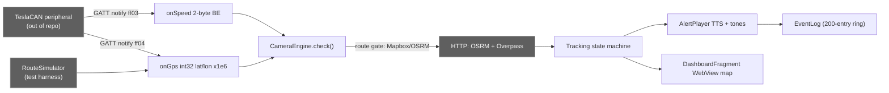
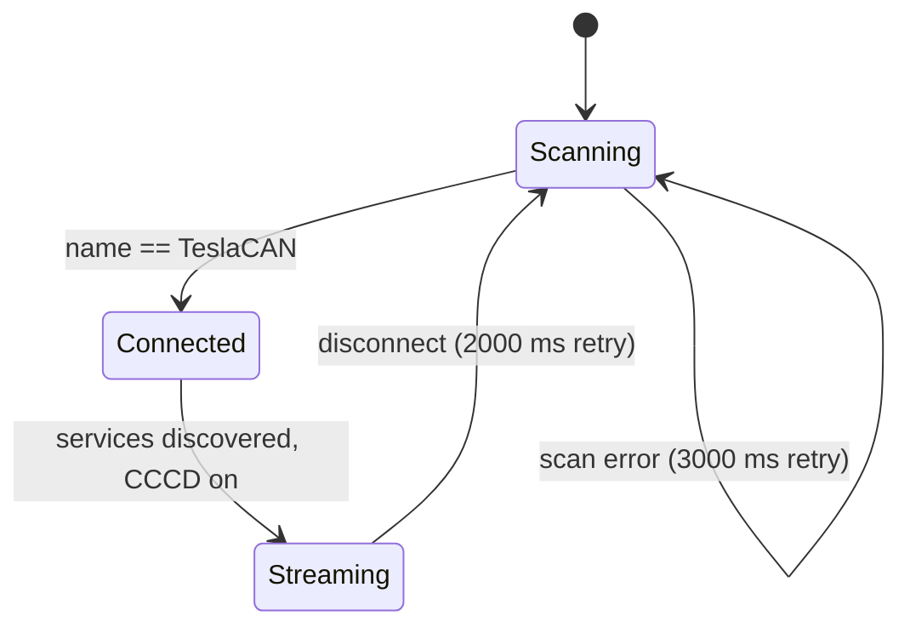
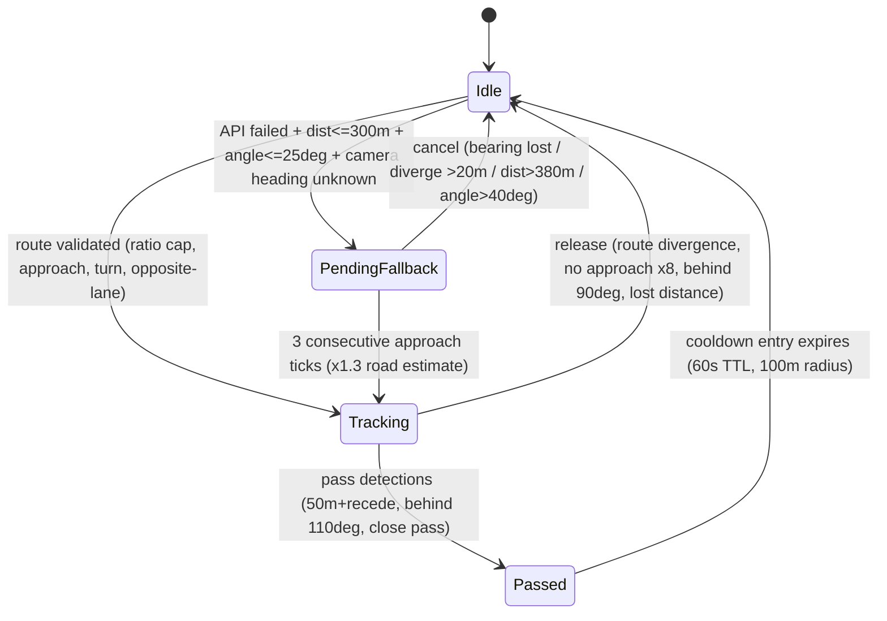

# kangbumhee-TLA-SpeedAlert

## 1. Provenance

- **Submodule path:** `legacy/kangbumhee-TLA-SpeedAlert`
- **Pinned gitlink (parent repo):** `160000 245b770ccb1ecc962f0c4153ed0859cbeefd17bd 0` (from `git ls-files -s legacy/kangbumhee-TLA-SpeedAlert`)
- **Submodule HEAD:** `245b770ccb1ecc962f0c4153ed0859cbeefd17bd` — matches the gitlink; `git status --porcelain` inside the submodule is empty.
- **Upstream URL:** `https://github.com/kangbumhee/TLA-SpeedAlert`
- **License:** None found. `git ls-files` shows no `LICENSE`/`COPYING` file and source files carry no license headers. Treat as all-rights-reserved: no code may be copied into TeslaCANModder regardless of GPL compatibility.
- **Analysis date:** 2026-11-21.
- **Mode:** Replace. The pre-replace summary is preserved in git history and is cited below as `git show HEAD:docs/legacy/kangbumhee-TLA-SpeedAlert.md` (pre-replace line numbers refer to that blob).
- **Preserved frontmatter:** kept byte-for-byte (LF blob). The `description` line carries no trailing whitespace (verified, length 133). Note: that description is truncated mid-sentence in the original — recorded in section 6, bytes unchanged.
- **Preserved `## Upstream (...)` sections:** None found — the pre-replace document contained no `## Upstream (...)` sections to preserve.
- **Defect of the replaced doc, not preserved:** the pre-replace doc had two `## Architecture` headings (old lines 17 and 37). Nothing of the old body was carried over.

**Files read (FULL-READ):**

| File | Lines read |
| --- | --- |
| `README.md` | 1-21 |
| `app/src/main/assets/README.txt` | 1-5 |
| `app/src/main/java/com/teslcan/app/BleService.kt` | 1-554 |
| `app/src/main/java/com/teslcan/app/CameraEngine.kt` | 1-958 |
| `app/src/main/java/com/teslcan/app/CameraDatabase.kt` | 1-590 |
| `app/src/main/java/com/teslcan/app/SafetyCode.kt` | 1-111 |
| `app/src/main/java/com/teslcan/app/AlertPlayer.kt` | 1-410 |
| `app/src/main/java/com/teslcan/app/RouteService.kt` | 1-375 |
| `app/src/main/java/com/teslcan/app/MapboxRouter.kt` | 1-51 |
| `app/src/main/java/com/teslcan/app/OverpassService.kt` | 1-224 |
| `app/src/main/java/com/teslcan/app/RouteSimulator.kt` | 1-374 |
| `app/src/main/java/com/teslcan/app/DrivingProfile.kt` | 1-59 |
| `app/src/main/java/com/teslcan/app/SettingsStore.kt` | 1-88 |
| `app/src/main/java/com/teslcan/app/EventLog.kt` | 1-73 |
| `app/src/main/java/com/teslcan/app/DbUpdater.kt` | 1-104 |
| `app/src/main/java/com/teslcan/app/FirmwareUpdater.kt` | 1-216 |
| `app/src/main/java/com/teslcan/app/AdManager.kt` | 1-224 |
| `app/src/main/java/com/teslcan/app/PromoManager.kt` | 1-4 |
| `app/src/main/java/com/teslcan/app/MainActivity.kt` | 1-180 |
| `app/src/main/java/com/teslcan/app/fragment/DashboardFragment.kt` | 1-378 |
| `app/src/main/java/com/teslcan/app/fragment/LogFragment.kt` | 1-74 |
| `app/src/main/java/com/teslcan/app/fragment/SettingsFragment.kt` | 1-344 |
| `app/src/main/AndroidManifest.xml` | 1-44 |
| `app/build.gradle.kts` | 1-87 |
| `build.gradle.kts`, `settings.gradle.kts`, `gradle.properties`, `gradle/wrapper/gradle-wrapper.properties`, `app/proguard-rules.pro`, `.gitignore` | full |
| `app/src/main/res/values/arrays.xml`, `values/themes.xml`, `values/colors.xml` | full |

**RANGE-CITED:** `app/src/main/java/com/teslcan/app/ScenarioWaypoints.kt` — lines 1-80 read in full; lines 81-378 are coordinate data rows and were not read line-by-line. List boundaries verified by grep: `BASIC` at line 12, `DENSE` at 75, `HIGHWAY` at 162, `JANGGI_GOCHON` at 287; 355 `ScenarioWp(37.…)` coordinate rows total. `local.properties` is gitignored (token storage, `.gitignore:15`) and not present.

**Files explicitly NOT read (no behavioral logic, declarative resources only):** `app/src/main/res/layout/activity_main.xml`, `layout/fragment_dashboard.xml`, `layout/fragment_log.xml`, `layout/fragment_settings.xml`, `menu/bottom_nav.xml`, `drawable/bg_alert_card.xml`, `drawable/bg_speed_limit_sign.xml`, `drawable/ic_launcher.xml`, `color/bottom_nav_color.xml`.

**Our-side files read for parity (CODE-READ):** `firmware/lib/io/ble/esp32/uuids.h` (1-17), `firmware/lib/io/ble/esp32/print.h` (1-66), `firmware/lib/io/ble/esp32/callbacks.h` (1-51), `firmware/lib/io/ble/esp32/ble_client.h` (1-269), `firmware/lib/client/command/dispatch.h` (speedalert absence + `Unknown command` path), `firmware/lib/vehicle/can/handler/bus/vehicle.h` (speed decode), `firmware/lib/vehicle/can/handler/bus/chassis.h` (GPS-speed decode), `firmware/lib/vehicle/can/feature/misc/can_sim.h` (simulation), `client/src/hardware/webEspFlasher.ts` (flasher), `client/src/components/transport/ConnectSheet.tsx` (BLE transport docs line), `packages/protocol/src/commands.ts` (speedAlert builder).

No TEST-READ evidence exists: this repo ships no tests. No CAPTURE evidence exists in this repo — every byte-level claim below is CODE-READ from source.

## 2. Executive verdict

A Korean-language Android (Kotlin) consumer app — not CAN firmware. It is a BLE GATT *client* that scans for an external peripheral named `TeslaCAN` (service `0000ff01…`), reads speed (2-byte big-endian km/h on `ff03`) and GPS (two int32 lat/lon ×1e-6 + satellites + fix flag on `ff04`) notifications, and raises phase-based speed-camera alerts from a Korean public-data camera CSV, validated against OSRM/Mapbox road routes to suppress opposite-lane and intersection false positives. The peripheral firmware is **not** in this repo, so the "CAN-to-BLE bridge" is asserted, not shown. The mechanisms that matter are behavioral: the two-tier zone alerting (500/300/100 m normal, 1000/600/500/300/100 m highway by camera limit), the tracking state machine with cooldowns, the multi-stage route validation gate, and the section-speed averaging. The mechanisms that must never be ported are the remote-ad TTS layer with its Apps Script device reporting, and the integrity-free BLE OTA flasher. For TeslaCANModder the transport is incompatible (we are Nordic UART Service + JSON lines, upstream expects ff01 binary characteristics — the pre-replace doc's "matching UUIDs" claim is wrong), so only pattern-level adaptation is on the table, and our own `speedalert:on/off` protocol commands remain firmware-unimplemented — the real actionable gap is on our side, not upstream's.

## 3. Evidence map

| Source file | Lines | What it proves | Grade |
| --- | --- | --- | --- |
| `BleService.kt` | 37-41 | Target device name `TeslaCAN`; service/char/CCCD UUIDs ff01/ff03/ff04/2902 | CODE-READ |
| `BleService.kt` | 379-383 | Speed payload = 2 bytes big-endian, no scale, km/h | CODE-READ |
| `BleService.kt` | 391-400 | GPS payload = int32 lat BE + int32 lon BE (÷1e6) + u8 sats + u8 fix flag | CODE-READ |
| `BleService.kt` | 326-328, 344-357 | Scan-fail restart 3000 ms; disconnect rescan 2000 ms | CODE-READ |
| `BleService.kt` | 407-437 | GPS-fix loss: engine reset, `GPS_LOST` event, TTS notice | CODE-READ |
| `CameraEngine.kt` | 44-92 | All load-bearing distance/angle/timing constants | CODE-READ |
| `CameraEngine.kt` | 89-90, 97-107 | Two zone tiers keyed on camera speed limit ≥80 | CODE-READ |
| `CameraEngine.kt` | 202-250 | Tracking start gate: road distance ≤ 1.2× max alert; zone pre-fire on late entry | CODE-READ |
| `CameraEngine.kt` | 294-339 | Heading-unknown fallback requires 3 consecutive approach ticks | CODE-READ |
| `CameraEngine.kt` | 341-363 | Bearing = 5-sample circular mean, min 5 km/h and 5 m move | CODE-READ |
| `CameraEngine.kt` | 499-522 | Road/straight ratio caps 2.0/2.5/3.0 by current speed; hard cap by camera limit | CODE-READ |
| `CameraEngine.kt` | 530-552, 553-563 | Approach-bearing filter (45°, 50 m lookback) and route-turn filter (50°) | CODE-READ |
| `CameraEngine.kt` | 564-609 | Overpass way query + opposite-lane/intersection rejection | CODE-READ |
| `CameraEngine.kt` | 615-654 | API-failure fallback gated at ≤300 m, ≤25°, heading-known immediate / unknown pending | CODE-READ |
| `CameraEngine.kt` | 682-796 | Pass detection (50 m + recede), behind-angle 110° release, route-divergence release | CODE-READ |
| `CameraEngine.kt` | 699-707, 809-827 | Section-speed integration from SECTION_IN to SECTION_OUT | CODE-READ |
| `CameraEngine.kt` | 855-870 | Phase mapping ≤100→4, ≤300→3, ≤500→2, ≤max→1; zone one-shot trigger | CODE-READ |
| `SafetyCode.kt` | 6-42, 87-96, 103-111 | KNSafetyCode-style enum (codes 0-106) and legacy cam_type mapping | CODE-READ |
| `CameraDatabase.kt` | 30, 38-75 | SQLite `cameras.db` v4; upgrade path drops table for old<3 | CODE-READ |
| `CameraDatabase.kt` | 95-106, 120-211 | UTF-8/MS949 charset sniff (64 KiB peek); header-mapped public CSV import | CODE-READ |
| `CameraDatabase.kt` | 157, 338 | Korea bounds filter lat 33-39, lon 124-132 | CODE-READ |
| `CameraDatabase.kt` | 575-590 | Road-direction column is deliberately mapped to null (heading unreliable) | CODE-READ |
| `AlertPlayer.kt` | 113-174 | TTS gate: no speech unless a zone was newly entered | CODE-READ |
| `AlertPlayer.kt` | 241-279, 281-315 | Overspeed tone loop (880/1200 Hz, 1.4 s) and pass chime (1047/1319 Hz) synthesized in-app | CODE-READ |
| `RouteService.kt` | 131-171, 177-192 | OSRM nearest bearing-snap opposite-lane compare; nearest failure keeps candidate | CODE-READ |
| `RouteService.kt` | 298-301 | Routing API failure → straight-line ×1.4 fallback result | CODE-READ |
| `OverpassService.kt` | 23-39, 67-107, 169-223 | Overpass way query (35 m radius, 12 s timeout, LRU 200) and way-based opposite-lane rules | CODE-READ |
| `FirmwareUpdater.kt` | 24-27, 94-97, 179-209 | Custom OTA service `fb1e4002…`, 512-byte chunks at 30 ms, ASCII `START:<size>`/`END`; integrity = size check only | CODE-READ |
| `AdManager.kt` | 19-22, 74-79, 198-216 | Remote ads.json TTS injection; Apps Script play reporting with hashed ANDROID_ID | CODE-READ |
| `DbUpdater.kt` | 15-18, 38-83 | Camera DB remote update from GitHub raw (`TLA_MAP` repo) | CODE-READ |
| `RouteSimulator.kt` | 18, 67-76, 226-268, 298-343 | 1 s tick simulator, 0.25-5× playback multiplier, curve-aware speed shaping | CODE-READ |
| `ScenarioWaypoints.kt` | 1-80 (RANGE-CITED) | Four real-road waypoint scenarios with per-segment speeds | CODE-READ |
| `DrivingProfile.kt` | 5-41 | `getDistances` defined but never called — dead tuning path | CODE-READ |
| `AndroidManifest.xml` | 4-15, 39-42 | Permission set; BleService foreground `connectedDevice` | CODE-READ |
| `app/build.gradle.kts` | 23-24, 43-53, 61 | BuildConfig-injected Mapbox/OSRM config; release signed with debug key | CODE-READ |
| `gradle.properties` | 14, 17 | `USE_MAPBOX=false` default; FOSSGIS OSRM base URL | CODE-READ |
| Pre-replace `docs/legacy/kangbumhee-TLA-SpeedAlert.md` | 41-42, 50-67 | Old summary claims checked in section 6 | SUMMARY-ONLY |

## 4. Architecture and build surface

Single-module Android app (Gradle Kotlin DSL, AGP 8.5.2, Kotlin 1.9.24, `minSdk 26`, `targetSdk 34`, `versionCode 6`, `versionName 1.0.5` — `app/build.gradle.kts:34-41`). No shared-core/platform-port split: everything lives in `app/src/main/java/com/teslcan/app`. Entry points: `MainActivity` (UI shell, binds `BleService`, `MainActivity.kt:135-171`) and `BleService` (foreground service, owns the whole pipeline, `BleService.kt:96-164`).

Build flags / injected config (`app/build.gradle.kts:43-53`): `USE_MAPBOX` (gradle property, default `false`), `MAPBOX_ACCESS_TOKEN` (from `local.properties`/env/gradle property; never committed), `OSRM_ROUTE_BASE_URL` (default `https://routing.openstreetmap.de/routed-car/route/v1/driving`, `gradle.properties:17`). Dependencies are AndroidX/Material only (`app/build.gradle.kts:81-86`) — all HTTP is raw `HttpURLConnection`, no OkHttp, no map SDK (map is a Leaflet WebView, `DashboardFragment.kt:252-377`).

This repo has no CAN frame pipeline. Its data flow is:



## 5. Mechanism catalogue

### 5.1 BLE GATT consumer and auto-reconnect

- **Claim (README / summary):** Pre-replace doc: "BLE foreground service; scans for a device named TeslaCAN with service UUID 0000ff01, subscribes to speed (0000ff03) and GPS (0000ff04)" (old line 41).
- **Code path:** `BleService.kt:293-329 startScan()` → `scanCb` (name match, line 317) → `connectGatt` → `gattCb.onServicesDiscovered` (360-366) → `enableNotify()` (516-527) → `onSpeed()`/`onGps()` (379-438).
- **Frame spec:** Not a CAN frame. Speed char `0000ff03`: 2 bytes, big-endian u16, km/h (line 381). GPS char `0000ff04`: 10 bytes — lat int32 BE ÷1e6 (393-394), lon int32 BE ÷1e6 (395-396), sats u8 at [8], fix = `data[9] != 0` (397-398). CCCD `00002902`.
- **Gates and timing:** Scan filtered by service UUID (`SCAN_MODE_LOW_LATENCY`, 295-296); connect only when advertised name equals `TeslaCAN` (317). GPS notify subscription delayed 500 ms after speed (365). Disconnect → rescan after 2000 ms (356); scan failure → restart after 3000 ms (327).
- **State machine:**



- **Tests:** None found.
- **Evidence grade:** CODE-READ.
- **Verdict:** CONFIRMED.
- **Adapt to TeslaCANModder?** no impact — our client is an Expo web app using Web Bluetooth with Nordic UART Service UUIDs (`client/src/components/transport/ConnectSheet.tsx:126`), and our peripheral side is NUS JSON lines (`firmware/lib/io/ble/esp32/uuids.h:11-17`).

### 5.2 Camera tracking state machine with two-tier zone alerting

- **Claim (README / summary):** Pre-replace doc: "phase-based alerting (500m/300m/100m), heading-aware scanning, section speed camera support, and cooldown logic" (old line 42).
- **Code path:** `BleService.checkCamera()` (440-514) → `CameraEngine.check()` (252-258) → `update()` (260-289) → `findAheadCamera()` (367-680) / `updateTracking()` (682-796) → `buildAlert()` (844-891) → `AlertPlayer.handleSafetyAlert()`.
- **Frame spec:** None found — pure in-app logic over `CameraRecord` rows.
- **Gates and timing:** Highway tier keyed on camera speed limit ≥80 (97-107): alert radius 1100 m / lost 1300 m / zones 1000-600-500-300-100; normal tier 500 m / 700 m / 500-300-100 (44-90). Candidates need type enabled (`DrivingProfile.isTypeEnabled`), limit>0 for speed-only types (382), not in cooldown (383), inside alert radius (386), within forward cone 25° (or 15° beyond 100 m when camera heading unknown, 391-399), and camera heading within 90° of course (401-411). Tracking start refused if road distance > 1.2× max alert (209-216). Zone entry fires once (`zoneFired`, 863-870); zones already inside at tracking start are consumed except the outermost, which replays once (230-242). Grace period 8000 ms before any pass/release judgment (719); pass declared at minDist < 50 m + recede ≥2 (723), straight-line < 30 m + recede ≥1 (727), behind-angle > 110° (732-748), recede ≥3 past 40 m (750), or 20 m recede past pass distance (754). Suspicious quick release (<5000 ms) registers a cooldown entry (777-790). Cooldown: 60 s TTL, 100 m capture radius (52, 87, 276, 893-894).
- **State machine:**



- **Tests:** None found.
- **Evidence grade:** CODE-READ.
- **Verdict:** CONFIRMED (the "500m/300m/100m" claim is incomplete — see section 6).
- **Adapt to TeslaCANModder?** candidate for future PR — pattern-level only, and only if we ever build a speed-camera alert client feature; our transport would carry the data as JSON status, not binary chars.

### 5.3 Route validation gate (Mapbox Directions / OSRM)

- **Claim (README / summary):** Pre-replace doc: "RouteService.kt — OSRM/Mapbox route processing" (old line 45).
- **Code path:** `CameraEngine.findAheadCamera()` thread (462-677) → `MapboxRouter.getRoute()` (17-31) → `RouteService.getRoute()` (54-63) → `executeRequest()` (238-296).
- **Frame spec:** None found — HTTPS JSON (Mapbox Directions v5 and OSRM `/route/v1/driving` share a parser, 11-14).
- **Gates and timing:** 15 s timeouts (19). Candidates sorted far-first, top 3 evaluated (448-453). Road/straight ratio caps: ≥80 km/h → 2.0, ≥40 → 2.5, else 3.0 (499-504); hard cap = tier alert distance (515-522); route must align with bearing within 60° over first 200 m (`RouteService.isRouteAlignedWithBearing`, 331-353); final-approach bearing within 45° using 50 m lookback (530-552); route turn angle ≤50° over segments ≥10 m (553-563, 920-939). API failure → fallback `RouteResult(straight × 1.4)` (`RouteService.kt:298-301`); engine-level straight-line tracking allowed only ≤300 m, ≤25°, with heading-known immediate accept or 3-tick pending confirmation (615-654, 294-339). Token redacted in logs (235-236); missing-token placeholder `YOUR_MAPBOX_PUBLIC_TOKEN` guarded (37, 212-213, 225).
- **State machine:** None found (stateless per-request validation feeding mechanism 5.2's states).
- **Tests:** None found.
- **Evidence grade:** CODE-READ.
- **Verdict:** CONFIRMED.
- **Adapt to TeslaCANModder?** no impact — our client is a vehicle control/monitor, not a navigation app; nothing in our stack routes.

### 5.4 Opposite-lane and intersection filter (Overpass ways + OSRM nearest)

- **Claim (README / summary):** None found in the pre-replace doc — this mechanism (HEAD commit `245b770`) is newer than the old summary.
- **Code path:** `CameraEngine.kt:564-609` → `OverpassService.queryWaysNearCameraBlocking()` (67-107) → `isOppositeLaneFromWays()` (169-223); fallback `RouteService.isOppositeLaneCamera()` (131-171).
- **Frame spec:** None found — Overpass QL `way(around:35,…)["highway"~"^(motorway|trunk|primary|secondary|tertiary|residential|unclassified)$"]` (75-80).
- **Gates and timing:** Query radius 35 m (70), 12 s timeout (24), LRU cache 200 keyed at ~1 km coordinate rounding (39-42). Rejection rules: camera heading vs bearing Δ>120° (176-182); oneway reverse-direction driving (191-201); opposed way closer by >5 m (203-220); intersection strictness when ≥3 ways and heading unknown — camera must sit within 30° of course (593-607). Empty result → OSRM nearest same/opposite snap compare (571-583): snaps within 3 m of each other or road-name mismatch → opposite lane (148-170). Nearest query failure keeps the candidate (`nearestSnapAcceptsBearing` returns true, 177-192).
- **State machine:** None found.
- **Tests:** None found.
- **Evidence grade:** CODE-READ.
- **Verdict:** CONFIRMED.
- **Adapt to TeslaCANModder?** no impact.

### 5.5 Section (average) speed camera

- **Claim (README / summary):** Pre-replace doc mentions "section speed camera support" (old line 42).
- **Code path:** `updateTracking()` (699-707) accumulates → `onCameraPassed()` (809-827) computes average → `AlertInfo(phase=4, isSection, sectionAvgSpeed)`.
- **Frame spec:** None found — derived purely from GPS fixes and time.
- **Gates and timing:** Entry only when a `SECTION_IN` camera is tracked and road distance < 100 m (699-704); distance integrated per tick as `speedKmh / 3.6` (705-707); average = `sectionDistance / elapsed × 3.6` at `SECTION_OUT` (810-811); overspeed = average > limit + threshold (817).
- **State machine:** None found (two latches: `sectionEntry`, `sectionEntryTime`).
- **Tests:** None found.
- **Evidence grade:** CODE-READ.
- **Verdict:** CONFIRMED.
- **Adapt to TeslaCANModder?** no impact — Korea-specific enforcement type with no analog in our CAN work.

### 5.6 Course bearing estimation (circular mean)

- **Claim (README / summary):** Pre-replace doc says "heading-aware scanning" (old line 42) without mechanism.
- **Code path:** `updateBearingInternal()` (341-363) → `bearingHistory` (5 samples) → sin/cos sums → `atan2` mean (348-355).
- **Frame spec:** None found.
- **Gates and timing:** Needs ≥5 km/h and ≥5 m movement per fix (81-82, 342-344); below 5 km/h history clears and bearing invalidates (357-360); history capped at 5 (91, 347). Simulation bearing override bypasses this (268-273).
- **State machine:** None found.
- **Tests:** None found.
- **Evidence grade:** CODE-READ.
- **Verdict:** CONFIRMED.
- **Adapt to TeslaCANModder?** no impact now — a clean pattern if we ever smooth GNSS tracks, but our firmware has no GNSS position source (only CAN `UI_gpsSpeed`, `firmware/lib/vehicle/can/handler/bus/chassis.h:48`).

### 5.7 Zone-gated TTS alerting, overspeed tone loop, pass chime

- **Claim (README / summary):** Pre-replace doc: "AlertPlayer.kt — Audio alert playback" (old line 44) — understates a full TTS engine plus synthesized tones.
- **Code path:** `handleSafetyAlert()` (358-382) → `handleAlert()` (113-174) → `buildMessage()` (201-239) → `TextToSpeech.speak` (169); tones via `playOverSpeedTone()` (261-279) and `playPassChime()` (281-315) through `playBuffer()` (317-339).
- **Frame spec:** None found (audio synthesis: overspeed = 0.5 s 880→1200 Hz sine at 0.7×volume, repeated every 1400 ms; chime = 1047 Hz 0.1 s + 1319 Hz 0.2 s with fade).
- **Gates and timing:** Korean TTS at 1.05 rate (64-65). Speech only when a zone was newly entered (`zoneTriggered == 0` → return, 147) and that zone is user-enabled (148, 190-199 — note 600 m reuses the 1000 m toggle). Same rounded distance within 3500 ms is deduplicated (37, 150-154). Overspeed tone loop runs only when actual speed ≥ limit + threshold (137-143) with threshold default +10 km/h (`SettingsStore.kt:41-43`). Night mode 22:00-06:00 scales volume ×0.7 (94-101). Audio focus `GAIN_TRANSIENT_MAY_DUCK` per utterance (341-355).
- **State machine:** None found (two booleans: `isOverSpeedWarning`, mute window).
- **Tests:** None found.
- **Evidence grade:** CODE-READ.
- **Verdict:** CONFIRMED.
- **Adapt to TeslaCANModder?** no impact — our client is Expo/web; no native TTS path in our stack.

### 5.8 Remote camera DB update

- **Claim (README / summary):** Not mentioned in the pre-replace doc (omission, not contradiction).
- **Code path:** `SettingsFragment` button (129-160) → `DbUpdater.checkAndUpdate()` (38-83) → `CameraDatabase.loadFromCsvString()` (263-319).
- **Frame spec:** None found — `version.json` (`{version,count}`) then full CSV text from `https://raw.githubusercontent.com/kangbumhee/TLA_MAP/main/` (15-18).
- **Gates and timing:** Version compare integer-only (55); CSV re-import deletes the whole table first (147, 265); timeouts 10 s/30 s (89-90).
- **State machine:** None found.
- **Tests:** None found.
- **Evidence grade:** CODE-READ.
- **Verdict:** CONFIRMED.
- **Adapt to TeslaCANModder?** no impact — we ship no device-side databases. The version.json-then-payload pattern is clean but unnecessary for us.

### 5.9 BLE OTA firmware updater (custom Nordic-style)

- **Claim (README / summary):** Not mentioned in the pre-replace doc (omission, not contradiction).
- **Code path:** `SettingsFragment` (175-191) → `FirmwareUpdater.checkAndUpdate()` (42-109) → `runOtaOnMain()` (131-159) → `OtaChunkSender.step` (179-209).
- **Frame spec:** Not a CAN frame. OTA service `fb1e4002-54ae-4a28-9f74-dfccb248601d`, data `fb1e4003…`, control `fb1e4004…` (24-26). Control writes are ASCII: `START:<totalSize>` then `END` (183, 190). Data writes are 512-byte binary chunks with `WRITE_TYPE_NO_RESPONSE` (27, 197-202).
- **Gates and timing:** Manifest `firmware.json` (`{version,url,size,changelog}`) from GitHub raw (22-23); semantic version compare (118-128); download size must equal manifest size (94-97); 800 ms delay after START, 30 ms between chunks (186, 208); all GATT writes serialized on the main handler.
- **State machine:** None found (single linear sender: START → chunks → END).
- **Tests:** None found.
- **Evidence grade:** CODE-READ.
- **Verdict:** CONFIRMED.
- **Adapt to TeslaCANModder?** never port — see sections 12 and 14: no checksum/signature beyond size, arbitrary remote origin, and it conflicts with our signed-release + Web Serial esptool-js flow (`client/src/hardware/webEspFlasher.ts:42,58`).

### 5.10 Route simulator (scripted-drive test harness)

- **Claim (README / summary):** Not mentioned in the pre-replace doc (omission, not contradiction).
- **Code path:** `SettingsFragment` controls (193-315) → `BleService.startSimulation()` (183-205) → `RouteSimulator.startPreset()/startRoute()` (85-163) → `tickRunnable` (226-268).
- **Frame spec:** None found — feeds the same `onLocationUpdate` callback shape as real BLE GPS (12 sats, fix=true, computed bearing).
- **Gates and timing:** 1 s nominal tick (18); playback multiplier clamped 0.25-5× with tick interval 100-4000 ms (67-76); four embedded real-road scenarios (`ScenarioWaypoints` BASIC/DENSE/HIGHWAY/JANGGI_GOCHON, lines 12/75/162/287) plus four OSRM city routes (139-142); speed override advances along the path by distance per tick (234-257); curve shaping drops speed ×0.5/×0.7/×0.85 at >60°/30°/15° bends (325-331); scenario speeds clamped 10-130 km/h (183).
- **State machine:** None found (running flag + index).
- **Tests:** None found.
- **Evidence grade:** CODE-READ.
- **Verdict:** CONFIRMED.
- **Adapt to TeslaCANModder?** already present at the analogous layer — our firmware ships device-side CAN simulation (`firmware/lib/vehicle/can/feature/misc/can_sim.h:24-31`, dispatched by `simu:start/simu:stop` at `firmware/lib/client/command/dispatch.h:778-782`). The actual gap upstream exposes: a *client-side* scripted replay for UI testing, which we do not have — pattern candidate for our client tests, not a port.

## 6. Summary vs code contradiction table

| # | Pre-replace claim (`git show HEAD:docs/legacy/kangbumhee-TLA-SpeedAlert.md`) | Code says | Grade |
| --- | --- | --- | --- |
| 1 | "phase-based alerting (500m/300m/100m)" (old line 42) | Two zone tiers: normal `500,300,100` and highway `1000,600,500,300,100`, keyed on camera speed limit ≥80 (`CameraEngine.kt:89-90,97-107`). The old text describes only the normal tier. | CODE-READ |
| 2 | "the BLE UUIDs match our project's BLE service design" / "matching UUIDs (ff01/ff03/ff04)" (old lines 60, 64) | Our peripheral is Nordic UART Service `6e400001-…` with RX/TX `6e400002/3` (`firmware/lib/io/ble/esp32/uuids.h:11-17`); no `0000ff01/ff03/ff04` exists anywhere in our tree (verified by grep). The UUIDs do not match. | CODE-READ |
| 3 | "Example of a real consumer app built on top of a CAN-to-BLE bridge" (old line 67) | The bridge peripheral is not in this repo; nothing here shows CAN decoding. What produces the ff03/ff04 payloads is out-of-repo. | UNVERIFIED — would need the `TLA_MAP`/peripheral repo or a BLE capture of the device |
| 4 | Frontmatter `description:` ends mid-sentence at "…then provides speed camera" | Truncated/stale frontmatter. Preserved byte-for-byte per replace-mode rules; flagged here instead of editing. | CODE-READ (blob bytes, length 133, no trailing whitespace) |

Omissions in the replaced doc (not contradictions): it does not mention the remote ad TTS layer and Apps Script reporting, the BLE OTA flasher, the remote DB updater, the route simulator, the Mapbox/OSRM token configuration, or the shallow-clone history. Treat any other surviving claim from the old summary as SUMMARY-ONLY until re-checked.

## 7. CAN frame and signal inventory

None found — this repo contains no CAN code. No CAN IDs are decoded, mutated, or injected anywhere (verified: `grep -rnE '0x3FD|can_id|CAN frame' app/src/main/java` → no output). The transport payloads the repo *does* define are BLE GATT characteristics, documented byte-exact in mechanism cards 5.1 and 5.9 and in section 8.

## 8. Constants and tuning table

| Constant | Value | File:line | Meaning | Grade |
| --- | --- | --- | --- | --- |
| `SERVICE_UUID` | `0000ff01-0000-1000-8000-00805f9b34fb` | `BleService.kt:38` | Peripheral service the app requires | CODE-READ |
| `CHAR_SPEED_UUID` / `CHAR_GPS_UUID` | `0000ff03…` / `0000ff04…` | `BleService.kt:39-40` | Speed / GPS notification characteristics | CODE-READ |
| `SCAN_RADIUS` | 1500 m | `CameraEngine.kt:44` | DB query bounding box | CODE-READ |
| `ALERT_DISTANCE_NORMAL/HIGHWAY` | 500 / 1100 m | `CameraEngine.kt:46-48` | Max tracking distance per tier | CODE-READ |
| `LOST_DISTANCE_NORMAL/HIGHWAY` | 700 / 1300 m | `CameraEngine.kt:49-50` | Drop tracking beyond this | CODE-READ |
| `HIGHWAY_SPEED_KMH` | 80 (camera limit) | `CameraEngine.kt:51,97-98` | Tier switch — camera's limit, not vehicle speed | CODE-READ |
| `ALERT_ZONES_NORMAL` | `500,300,100` | `CameraEngine.kt:89` | One-shot alert rings, normal roads | CODE-READ |
| `ALERT_ZONES_HIGHWAY` | `1000,600,500,300,100` | `CameraEngine.kt:90` | One-shot alert rings, highway tier | CODE-READ |
| `COOLDOWN_MS` | 60 000 ms | `CameraEngine.kt:52` | Passed-camera cooldown TTL | CODE-READ |
| `COOLDOWN_CAPTURE_RADIUS_M` | 100 m | `CameraEngine.kt:87,893-894` | Cooldown match radius | CODE-READ |
| `PASS_DISTANCE` | 50 m | `CameraEngine.kt:53` | Min approach for a pass verdict | CODE-READ |
| `FORWARD_TO_CAM_DEG` / `_UNKNOWN_HEADING_DEG` | 25° / 15° | `CameraEngine.kt:57-60` | Forward-cone half-angles; stricter past 100 m when heading unknown | CODE-READ |
| `APPROACH_LOOKBACK_M` / `APPROACH_MAX_BEARING_DIFF_DEG` | 50 m / 45° | `CameraEngine.kt:62-64,530-552` | Final-approach direction check | CODE-READ |
| `ROUTE_MAX_TURN_FOR_STRAIGHT_DEG` / `MIN_ROUTE_SEGMENT_FOR_TURN_M` | 50° / 10 m | `CameraEngine.kt:66-67,920-939` | Intersection-turn rejection | CODE-READ |
| `OVERPASS_WAY_QUERY_RADIUS_M` | 35 m | `CameraEngine.kt:70` / `OverpassService.kt:70` | OSM way query radius | CODE-READ |
| `INTERSECTION_MIN_WAYS_FOR_STRICT` / `_MAX_DEG` | 3 ways / 30° | `CameraEngine.kt:72-73,593-607` | Intersection strictness for unknown-heading cameras | CODE-READ |
| `FALLBACK_MAX_STRAIGHT_M` / `_MAX_ANGLE_DEG` / `_APPROACH_TICKS` / `_PENDING_DIVERGE_M` | 300 m / 25° / 3 / 20 m | `CameraEngine.kt:76-79` | API-fail straight-line tracking gate | CODE-READ |
| `BEHIND_ANGLE` | 110° | `CameraEngine.kt:80,732-748` | Camera behind course → passed | CODE-READ |
| `MIN_SPEED_FOR_BEARING` / `MIN_MOVE_FOR_BEARING` | 5 km/h / 5 m | `CameraEngine.kt:81-82` | Bearing update gates | CODE-READ |
| `TRACKING_GRACE_MS` / `TRACKING_SUSPICIOUS_QUICK_MS` | 8000 / 5000 ms | `CameraEngine.kt:83-85` | No-release grace; suspicious fast release cooldown | CODE-READ |
| `BEARING_HISTORY_SIZE` | 5 | `CameraEngine.kt:91` | Circular-mean window | CODE-READ |
| Road/straight ratio caps | 2.0 / 2.5 / 3.0 at ≥80 / ≥40 / else km/h | `CameraEngine.kt:499-504` | Detour rejection by current speed | CODE-READ |
| Tracking-start road gate | ×1.2 of tier alert distance | `CameraEngine.kt:209-216` | Refuse far-around routes | CODE-READ |
| Fallback road estimate | straight ×1.3 (engine) / ×1.4 (RouteService) | `CameraEngine.kt:326,616` / `RouteService.kt:299` | Pseudo road distance without API | CODE-READ |
| Speed payload | 2 bytes BE, km/h | `BleService.kt:381` | u16 big-endian | CODE-READ |
| GPS payload scale | int32 BE ÷1e6 degrees | `BleService.kt:393-400` | Plus sats u8, fix u8 nonzero | CODE-READ |
| Reconnect timers | 2000 ms disconnect / 3000 ms scan-fail | `BleService.kt:356,327` | Rescan cadence | CODE-READ |
| `overSpeedThreshold` default | +10 km/h | `SettingsStore.kt:41-43` | Overspeed judgment margin (UI max 30, `SettingsFragment.kt:58`) | CODE-READ |
| `minSpeakInterval` | 3500 ms | `AlertPlayer.kt:37` | TTS dedup window | CODE-READ |
| Night volume window | 22-06, ×0.7 | `AlertPlayer.kt:96-99` | Auto volume reduction | CODE-READ |
| Overspeed tone | 880→1200 Hz, 0.5 s, every 1400 ms | `AlertPlayer.kt:265-272,248` | Synthesized warning loop | CODE-READ |
| Pass chime | 1047 Hz + 1319 Hz, 0.35 s | `AlertPlayer.kt:286-307` | Pass confirmation | CODE-READ |
| Korea import bounds | lat 33-39, lon 124-132 | `CameraDatabase.kt:157,338` | CSV row filter | CODE-READ |
| Charset peek | 64 KiB, UTF-8 → MS949 | `CameraDatabase.kt:35,95-106` | Public CSV encoding sniff | CODE-READ |
| `EventLog` cap | 200 events | `EventLog.kt:21` | Ring size in SharedPreferences | CODE-READ |
| `CHUNK_SIZE` / OTA pacing | 512 B / 30 ms (+800 ms START) | `FirmwareUpdater.kt:27,186,208` | BLE OTA cadence | CODE-READ |
| Ads refresh / check | 300 s (min 60) / 30 s (first at 60 s) | `AdManager.kt:44,172,57,74` | Remote ad polling | CODE-READ |
| `TIMEOUT` (routing) | 15 s | `RouteService.kt:19` | HTTP timeout | CODE-READ |
| Overpass timeout / cache | 12 s / 200 entries | `OverpassService.kt:24,39` | Way query | CODE-READ |
| Sim tick / multiplier | 1 s / 0.25-5× | `RouteSimulator.kt:18,67-69` | Playback harness | CODE-READ |

Trivial constants skipped: UI colors, notification IDs, pin/format widths, `PEEK_BYTES` is included above only because it gates charset detection.

## 9. Failure modes and edge cases

| Failure | Handling code path | Tested? | Grade |
| --- | --- | --- | --- |
| BLE scan fails (`onScanFailed`) | `BleService.kt:326-328` — restart scan after 3000 ms | No | CODE-READ |
| GATT disconnect | `BleService.kt:344-357` — mark disconnected, reset engine, stop audio, rescan after 2000 ms; skipped during simulation (348) | No | CODE-READ |
| Missing BLUETOOTH permissions at connect/scan/notify | Every call wrapped in `try { … } catch (_: SecurityException) {}` — silently swallowed (`BleService.kt:300,321,342,525`) | No | CODE-READ |
| GPS fix lost | `BleService.kt:414-437` — invalidate course, reset engine, stop TTS, `GPS_LOST` event, spoken notice | No | CODE-READ |
| Routing API HTTP/JSON failure | `RouteService.kt:246-296` → `fallback()` ×1.4; engine gates fallback tracking at ≤300 m/≤25° or pending 3 ticks (`CameraEngine.kt:615-654`) | No | CODE-READ |
| Overpass failure | `OverpassService.kt:98-101` — empty list; engine falls back to OSRM nearest compare, then skips the filter (`CameraEngine.kt:577-583`) | No | CODE-READ |
| OSRM nearest failure | `RouteService.nearestSnapAcceptsBearing` returns true — candidate kept (`RouteService.kt:177-192`) | No | CODE-READ |
| Public CSV header mismatch | `importPublicCsvStreaming` returns -1 → caller falls back to legacy 5-column format (`CameraDatabase.kt:86-90,125-127`) | No | CODE-READ |
| CSV encoding ambiguity | 64 KiB UTF-8/MS949 sniff on `위도`/`카메라` markers (`CameraDatabase.kt:95-106`) | No | CODE-READ |
| DB schema old<3 | `DROP TABLE` + recreate — data loss by design (`CameraDatabase.kt:71-74`) | No | CODE-READ |
| OTA size mismatch | Abort with status message (`FirmwareUpdater.kt:94-97`); no checksum/signature beyond size | No | CODE-READ |
| TTS not ready / muted | All speech paths early-return (`AlertPlayer.kt:104,124,184`) | No | CODE-READ |
| Duplicate alert spam | Zone one-shot + 3500 ms dedup + 60 s cooldown (`CameraEngine.kt:863-870`, `AlertPlayer.kt:37,150-154`) | No | CODE-READ |

Untested error paths: every row above. Highest risk: the silent `SecurityException` swallows (a revoked permission makes the app look like it is scanning forever) and the DB `DROP TABLE` upgrade path.

## 10. Test coverage map

None found. `git ls-files` contains no test directory, no `*Test.kt`, no instrumented-test module; `app/build.gradle.kts:81-86` declares no test dependencies. The entire engine — pass detection, zone firing, fallback gates, section averaging — is validated only by live driving with the built in-app route simulator (section 5.10). Risk statement: the tracking state machine has at least nine release/pass branches (`CameraEngine.kt:723-793`) whose interactions (grace vs quick-release vs cooldown registration) are untested; any port would need to build an independent test oracle from scratch.

## 11. Parity matrix with TeslaCANModder

| Signal/frame | Upstream decode (cite) | Our decode (cite) | Delta | Action |
| --- | --- | --- | --- | --- |
| BLE GATT service + characteristics | `0000ff01` service, `ff03` speed, `ff04` GPS (`BleService.kt:38-40`) | Nordic UART Service `6e400001`, RX/TX `6e400002/3` (`firmware/lib/io/ble/esp32/uuids.h:11-17`) | Incompatible transports; no ff01 anywhere in our tree | ignore — upstream is a consumer of a different, out-of-repo peripheral |
| Vehicle speed delivery | 2-byte BE u16 km/h on `ff03` notifications (`BleService.kt:379-383`) | CAN `CAN_ID_VEHICLE_SPEED` → `decodeVehicleSpeed()` → `s.vehicleSpeed` (`firmware/lib/vehicle/can/handler/bus/vehicle.h:381-383`), serialized as JSON via `blePrint`→notify (`firmware/lib/io/ble/esp32/print.h:16-21`) | Binary char vs JSON lines; same data available | ignore — our client already consumes status JSON over NUS (`client/src/components/transport/ConnectSheet.tsx:126`) |
| GNSS position | int32 lat/lon ×1e-6 + sats + fix on `ff04` (`BleService.kt:391-400`) | No GNSS position anywhere in firmware; only CAN `UI_gpsSpeed` decode (`firmware/lib/vehicle/can/handler/bus/chassis.h:48`) | Upstream expects a peripheral that our hardware cannot be | capture-first — any future speed-camera client must source position from the phone, not our ESP32 |
| Speed-camera alert commands | Full in-app engine (mechanism 5.2) | Protocol builders exist: `speedAlert(on)` → `speedalert:on/off` (`packages/protocol/src/commands.ts:418`), documented (`docs/reference/commands.md`), test-asserted (`packages/protocol/test/commands/new-commands.test.ts:61-62`), but firmware dispatch has no handler — falls through to `sendError(F("Unknown command"))` (`firmware/lib/client/command/dispatch.h:1085`; `git log -S speedalert -- firmware` shows it never existed) | We advertise a command our firmware does not implement | align — decide implement-or-deprecate on our side; independent of upstream code |
| Firmware update path | Custom BLE OTA service `fb1e4002…`, ASCII START/END, 512 B chunks, size-only integrity (`FirmwareUpdater.kt:24-27,94-97,179-209`) | Web Serial + esptool-js flashing of merged release images (`client/src/hardware/webEspFlasher.ts:42,58`) | Different mechanism and trust model | ignore — never adopt upstream's integrity-free OTA (sections 12/14) |

All five rows have our-side CODE-READ citations; none are SUMMARY-ONLY.

## 12. Surface inventory and security notes

Surfaces exposed by the app:

| Surface | Direction | Semantics | Grade |
| --- | --- | --- | --- |
| BLE GATT client (scan/connect/subscribe) | Inbound data only | No inbound command surface from the vehicle; app is central | CODE-READ |
| `MainActivity` UI + 3 fragments | Local | Runtime permissions, settings, simulation, log viewer | CODE-READ |
| Foreground service notification | Local | Connection/GPS status text (`BleService.kt:529-553`) | CODE-READ |

Outbound network calls (all HTTPS):

| Endpoint | File:line | Purpose | Grade |
| --- | --- | --- | --- |
| `api.mapbox.com/directions/v5` (token-guarded) | `RouteService.kt:18,206-217` | Route validation | CODE-READ |
| `routing.openstreetmap.de/routed-car` (FOSSGIS OSRM, default) | `gradle.properties:17` | Route + nearest snapping | CODE-READ |
| `overpass-api.de/api/interpreter` | `OverpassService.kt:23` | OSM way queries | CODE-READ |
| `raw.githubusercontent.com/kangbumhee/TLA_MAP/main/version.json` + `cameras.csv` | `DbUpdater.kt:15-18` | Camera DB update | CODE-READ |
| `raw.githubusercontent.com/kangbumhee/TLA_MAP/main/firmware.json` + arbitrary `url` field | `FirmwareUpdater.kt:22-23,82` | OTA manifest and binary | CODE-READ |
| `raw.githubusercontent.com/kangbumhee/TLA_MAP/main/ads.json` | `AdManager.kt:19-20` | Remote TTS ad content | CODE-READ |
| Google Apps Script `script.google.com/macros/s/AKfycbx…/exec` | `AdManager.kt:22,198-216` | Ad-play reporting with hashed `ANDROID_ID`, package name, timestamp | CODE-READ |
| `unpkg.com/leaflet@1.9.4` + `tile.openstreetmap.org` in WebView | `DashboardFragment.kt:269-282` | Map rendering from CDN | CODE-READ |

Security and provenance findings:

- **OTA integrity is size-only.** The firmware binary is fetched from a URL inside a GitHub-hosted JSON manifest and flashed with only a length check (`FirmwareUpdater.kt:94-97`). No checksum, no signature, no HTTPS certificate pinning. Compromise of the `TLA_MAP` repo (or the URL field) bricks or owns the peripheral.
- **Remote-content TTS.** `ads.json` messages are spoken aloud through the car audio path; a compromised source has a direct audio-injection channel into the driver compartment (`AdManager.kt:86-96,106-128`).
- **Covert-ish telemetry.** Ad plays are reported with `ANDROID_ID.hashCode()` + package + timestamp to a hardcoded Apps Script endpoint (`AdManager.kt:202-207`) — not declared as telemetry anywhere in the UI.
- **Debug-signed release.** `release` builds sign with the debug keystore (`app/build.gradle.kts:56-61`) — no release key management.
- **No secrets committed.** Mapbox token deliberately kept out of git (`.gitignore:15`, `gradle.properties:8-13`); token redacted in logs (`RouteService.kt:235-236`). This part is done right.
- **License absent.** All code is unlicensed — see section 1; do not copy.

## 13. Adaptation assessment

| Mechanism | Value | Cost | Risk | Evidence grade | Decision |
| --- | --- | --- | --- | --- | --- |
| 5.1 BLE GATT consumer | Low — different transport (NUS) and stack (Expo) | Rewriting a native Android service we do not need | None | CODE-READ | no impact |
| 5.2 Tracking + two-tier zones | Medium — the best-engineered pattern here; zone rings + cooldown + pass detection are transferable to any proximity-alert feature | Client-side feature work in our Expo app | Needs position data we do not carry (see 5.6 row) | CODE-READ | candidate for future PR, gated on capture-first and on resolving our `speedalert` command gap |
| 5.3 Route validation gate | Low — navigation-domain logic we do not have | External API dependency we do not want | None | CODE-READ | no impact |
| 5.4 Opposite-lane/intersection filter | Low | Overpass dependency | None | CODE-READ | no impact |
| 5.5 Section-speed averaging | Low — Korea-specific enforcement | — | None | CODE-READ | no impact |
| 5.6 Bearing circular mean | Medium — clean, cheap smoothing pattern | Trivial to reimplement independently | None | CODE-READ | no impact now; pattern reference if GNSS ever enters our stack |
| 5.7 TTS alerting + tones | Low — no native TTS in our client | — | None | CODE-READ | no impact |
| 5.8 Remote DB update | Low — we ship no device databases | — | None | CODE-READ | no impact |
| 5.9 BLE OTA | Theoretically medium (OTA is nice) | High — new GATT service, chunk protocol, host-side tooling | Unacceptable — size-only integrity over an unsigned remote source | CODE-READ | never port; if we ever do BLE OTA it must be checksummed + signed and go through can-review-checklist |
| 5.10 Route simulator | Medium — scripted replay for UI testing is genuinely useful for our monitor screens | Medium — test harness in `client/tests/` | None | CODE-READ | already present at the device layer (`firmware/lib/vehicle/can/feature/misc/can_sim.h:24-31`); client-side replay is the pattern to consider, independently implemented |

Independent-implementation rule applies to all candidates: port behavior and constants, never source text; attribute the upstream symbol; recompute expected values in tests rather than snapshotting.

## 14. Do-not-copy list

| Item | File:line | Reason |
| --- | --- | --- |
| Apps Script reporting URL + `ANDROID_ID` hashing | `AdManager.kt:22,198-216` | Undisclosed telemetry; hardcoded personal-device identifier |
| Remote ad TTS pipeline | `AdManager.kt:86-128,139-159` | Remote-content-to-driver-audio injection channel |
| OTA chunk sender (`START:`/`END`, 512 B, no-response writes) | `FirmwareUpdater.kt:179-209` | Integrity-free flashing protocol; conflicts with our signed-release flasher flow |
| OTA manifest fetch + size-only acceptance | `FirmwareUpdater.kt:22-23,94-97` | Trusts a GitHub raw JSON's `url` field with peripheral ownership |
| ff01/ff03/ff04 GATT contract | `BleService.kt:38-41` | Conflicts with our NUS transport (`firmware/lib/io/ble/esp32/uuids.h:11`) |
| Raw `Thread { … }` + `Handler.post` orchestration | `CameraEngine.kt:462-677`, `AlertPlayer.kt:261-315` | Android-thread idiom that does not map to our C++ loop or React hooks; reinvent if any behavior is ported |
| `DROP TABLE` DB upgrade | `CameraDatabase.kt:71-74` | Silent data loss pattern |
| Release signing with debug key | `app/build.gradle.kts:61` | Broken release-key hygiene |
| Unlicensed code generally | whole tree | No LICENSE file — legal bar on verbatim copying, independent of GPL compatibility |

## 15. History and evolution

Mined from the submodule's local `git log` — the clone is **shallow** (21 commits, all dated 2026-04-18/19; `git rev-parse --is-shallow-repository` → true). Pre-2026-04-18 history was never fetched and is not reviewed here.

The visible history is a two-day false-positive suppression campaign, in order:

1. `94911bd` Mapbox legacy engine + SIGNAL/zero-limit handling; Gimpo sim scenario.
2. `3f676d1` runtime vehicle-speed override for simulation.
3. `a1fa941` limit=0 accepted only for non-speed-only types; OSRM URL; route API fallback.
4. `1e2bb04` 3-stage heading filter vs bearing; far-camera-first sorting.
5. `08d6041` stricter API-fail fallback; pending-approach state for heading=-1 cameras.
6. `13331e8` default OSRM switched to FOSSGIS (`routing.openstreetmap.de`) after instability of the project-osrm.org demo.
7. `df77b06` zone pre-fire when tracking starts already inside rings.
8. `92a5959` `USE_MAPBOX=false` made the default — Mapbox abandoned as the primary engine.
9. `e7fe5e0` reject routes whose final segment opposes vehicle bearing.
10. `b1ac97f` OSRM nearest+bearings for unknown camera heading; tighter forward cone.
11. `27da005` opposite-lane nearest compare; speed-based alert radius and zones.
12. `3ce28b3`/`ce8f39b` normal-road radius 500 m, then a hard 500 m road-distance cap.
13. `64f0811` **approach rollback:** alert/lost/zones re-keyed from *vehicle* speed to *camera* speed limit (`alertDistanceM(speedKmh)` → `alertDistanceForCam(camSpeedLimit)`), and the 600 m normal-road scan radius was reverted to a fixed 1500 m.
14. `a014329` v1.0.1 (versionCode 2) released, debug-signed.
15. `a925e87`→`6107ee1`→`dafcad9` progressively stricter approach/turn/opposite-lane gates; post-track cooldown for false targets.
16. `245b770` (pinned HEAD) Overpass OSM ways for opposite-lane and intersection filtering.

Dead code left behind by the reworks: `DrivingProfile.getDistances()` (`DrivingProfile.kt:5-41`) and `SettingsStore.distanceMode` (`SettingsStore.kt:37-39`) are no longer called by anything — the profile radio buttons in settings now write a preference the engine never reads. `AlertPlayer.handleAlert`'s `d1/d2` parameters are `@Suppress("UNUSED_PARAMETER")` leftovers of that same distance-mode system (`AlertPlayer.kt:120-121`).

Commit bodies carry `Made-with: Cursor`. No issues/PRs/network claims are cited here; nothing network-only was consulted.

## 16. Re-verification recipe

```bash
OLD=245b770ccb1ecc962f0c4153ed0859cbeefd17bd
git -C legacy/kangbumhee-TLA-SpeedAlert fetch --tags --prune
git -C legacy/kangbumhee-TLA-SpeedAlert log --oneline $OLD..origin/main
git -C legacy/kangbumhee-TLA-SpeedAlert diff --stat $OLD..origin/main
git -C legacy/kangbumhee-TLA-SpeedAlert diff $OLD..origin/main -- app/src/main/java/
git ls-files -s legacy/kangbumhee-TLA-SpeedAlert   # compare gitlink to rev-parse HEAD
```

Grep anchors (extended regex; run from the submodule root unless a repo-relative path is given). Every anchor was executed at write time with Git-for-Windows `grep.exe -nE`; expected hits pasted:

```text
grep -nE 'TARGET_DEVICE_NAME = "TeslaCAN"' app/src/main/java/com/teslcan/app/BleService.kt
  -> 37: private const val TARGET_DEVICE_NAME = "TeslaCAN"
grep -nE '0000ff01-0000-1000-8000-00805f9b34fb' app/src/main/java/com/teslcan/app/BleService.kt
  -> 38: val SERVICE_UUID: UUID = UUID.fromString("0000ff01-0000-1000-8000-00805f9b34fb")
grep -nE 'ALERT_ZONES_NORMAL|ALERT_ZONES_HIGHWAY' app/src/main/java/com/teslcan/app/CameraEngine.kt
  -> 89: private val ALERT_ZONES_NORMAL = intArrayOf(500, 300, 100)
  -> 90: private val ALERT_ZONES_HIGHWAY = intArrayOf(1000, 600, 500, 300, 100)
  -> 107: if (isHighwayCamera(camSpeedLimit)) ALERT_ZONES_HIGHWAY else ALERT_ZONES_NORMAL
grep -nE 'COOLDOWN_MS = 60_000L|TRACKING_GRACE_MS = 8000L|HIGHWAY_SPEED_KMH = 80' app/src/main/java/com/teslcan/app/CameraEngine.kt
  -> 51: HIGHWAY_SPEED_KMH = 80 / 52: COOLDOWN_MS = 60_000L / 83: TRACKING_GRACE_MS = 8000L
grep -nE 'fb1e4002-54ae-4a28-9f74-dfccb248601d|CHUNK_SIZE = 512' app/src/main/java/com/teslcan/app/FirmwareUpdater.kt
  -> 24: OTA_SERVICE = fb1e4002-… / 27: CHUNK_SIZE = 512
grep -nE 'overpass-api.de' app/src/main/java/com/teslcan/app/OverpassService.kt
  -> 23: private const val OVERPASS_URL = "https://overpass-api.de/api/interpreter"
grep -nE 'routing.openstreetmap.de' gradle.properties
  -> 17: OSRM_ROUTE_BASE_URL=https://routing.openstreetmap.de/routed-car/route/v1/driving
grep -nE 'SECTION_IN[(]92|"구간단속 시점"' app/src/main/java/com/teslcan/app/SafetyCode.kt
  -> 26: SECTION_IN(92, "구간단속 시점", 1),
```

Anchor-writing trap demonstrated live: `SECTION_IN\(92` under `grep -nE` fails with `Unmatched ( or \(` — in ERE a literal paren must be `[(]`, not `\(`. Plain `grep -n 'a\|b'` (BRE) alternation also never hits; always `-nE`.

Negative anchors (absence claims). Paths on the first line are submodule-root-relative; the other two run from the TeslaCANModder repo root:

```text
grep -rnE '0x3FD|can_id|CAN frame' app/src/main/java          -> no output (no CAN code in repo)
grep -rnE 'speedalert' firmware/lib/client/command/dispatch.h -> no output (run from repo root; command unimplemented, falls to Unknown command at dispatch.h:1085)
grep -nE '0000ff01|0000ff03|0000ff04' firmware/lib/io/ble/esp32/uuids.h -> no output (run from repo root; our peripheral is NUS, not ff01)
```

Our-side drift anchors (the `already present`/`align` decisions rest on these):

```text
grep -nE 'BLE_SERVICE_UUID' firmware/lib/io/ble/esp32/uuids.h
  -> 11: #define BLE_SERVICE_UUID "6e400001-b5a3-f393-e0a9-e50e24dcca9e"
grep -nE 'speedAlert' packages/protocol/src/commands.ts
  -> 418: speedAlert: (on: boolean) => (on ? "speedalert:on" : "speedalert:off"),
grep -nE 'Nordic UART' client/src/components/transport/ConnectSheet.tsx
  -> 126: Uses Web Bluetooth and the Nordic UART Service UUIDs documented in the BLE
grep -nE 'Unknown command' firmware/lib/client/command/dispatch.h
  -> 1085: sendError(F("Unknown command"));
grep -nE 'simu:start|CAN simulation' firmware/lib/client/command/dispatch.h
  -> 778/782: simu dispatch + "CAN simulation started/stopped" log
```

If line numbers drift by more than ~10 after an upstream bump, re-read the whole function; do not trust this document's numbers.

## 17. Open questions and explicitly not investigated

- **Peripheral firmware is out-of-repo (UNVERIFIED).** What device actually advertises `TeslaCAN`/ff01 and produces the speed/GPS payloads — CAN reader, phone relay, or something else — cannot be determined from this repo. Verifying it would need the author's `TLA_MAP` repo or a BLE capture of the peripheral. The pre-replace doc's "CAN-to-BLE bridge" framing (old line 67) inherits this gap.
- **Pre-pin upstream history was NOT reviewed.** The submodule clone is shallow (21 commits, 2026-04-18/19 only); `git fetch --unshallow` plus a re-read of the early CameraEngine would be required to judge what was tried before the false-positive campaign.
- **Remote endpoints not probed.** Whether `TLA_MAP`'s `version.json`, `cameras.csv`, `firmware.json`, and `ads.json` (and the Apps Script endpoint) are live was not tested — no network calls were made during this analysis. An HTTP GET of each URL would settle it.
- **App never built or run.** No Android SDK here; all behavior claims are static CODE-READ. The zone/pass state machine has no runtime confirmation.
- **Our `speedalert` firmware history:** `git log -S speedalert -- firmware` shows the command never existed in our firmware; whether the protocol builders were added aspirationally or with a planned handler in mind is a design-intent question only the original commit (`b096f1e`, protocol side) could answer — its message was not examined beyond the subject.
- **Layout XMLs not read** (declarative resources, no logic — see section 1 list). `ScenarioWaypoints.kt` lines 81-378 are coordinate data, RANGE-CITED only.
- **Korean public-data CSV format drift:** the header-mapping importer (`CameraDatabase.kt:120-145`) keys on exact Korean column names; whether current data.go.kr exports still match was not checked.
