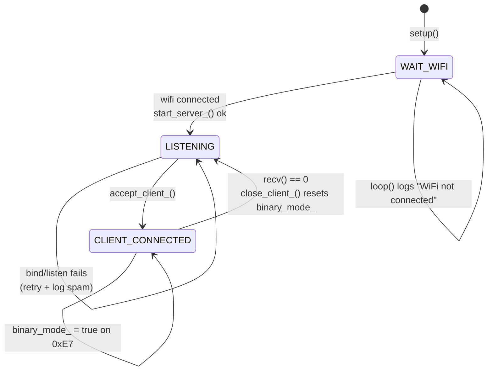

# krconv-tesla_can_decoding

Deep-dive analysis (replace mode). The prior shallow summary is preserved in git history: pre-replace claims below are cited as `git show HEAD:docs/legacy/krconv-tesla_can_decoding.md` with line numbers of that blob. The replaced doc had no `## Upstream (...)` sections to preserve.

## 1. Provenance

- **Submodule path:** `legacy/krconv-tesla_can_decoding`
- **Pinned gitlink (canonical form from `git ls-files -s`):** `160000 bfd0c486b1598a60d8ca80ed4f829217abfc6562 0`
- **Submodule HEAD:** `bfd0c486b1598a60d8ca80ed4f829217abfc6562` — matches gitlink. `git status --porcelain` inside the submodule: clean.
- **Upstream URL:** `https://github.com/krconv/tesla_can_decoding` (origin fetch/push)
- **License:** MIT, Copyright (c) 2025 Kodey Converse (`LICENSE:1-3`)
- **Analysis date:** 2026-11-21
- **Local history:** shallow clone — `.git/modules/legacy/krconv-tesla_can_decoding/shallow` exists; exactly one commit is reachable locally (`bfd0c48`, 2025-09-18, "Remove headers"). See section 15.
- **Files read (all FULL-READ, every line):**

| File (relative to submodule root) | Lines | Coverage |
| --------------------------------- | ----- | -------- |
| `esphome/components/gvret_tcp/gvret_tcp.h` | 1-83 | FULL-READ |
| `esphome/components/gvret_tcp/gvret_tcp.cpp` | 1-408 | FULL-READ |
| `esphome/components/gvret_tcp/__init__.py` | 1-34 | FULL-READ |
| `README.md` | 1-31 | FULL-READ (read after code, for comparison) |
| `LICENSE` | 1-21 | FULL-READ |

- **Files explicitly NOT read:** None found — `git ls-files` lists exactly the 5 files above; there are no hidden or platform subdirectories in this submodule (no `.github/`, no examples/, no DBC files).
- **Our-side reads (TeslaCANModder) are RANGE-CITED**, claims limited to the cited lines: `packages/protocol/src/commands.ts:63,420-425`; `packages/protocol/src/gating.ts:877-887`; `packages/protocol/src/reducer.ts:215-217,547-549`; `packages/protocol/src/types.ts:225-227,818-820`; `packages/protocol/test/commands/new-commands.test.ts:65-71`; `packages/protocol/test/integration/cross-check.test.ts:282-285`; `client/src/components/IntegrationPanel.tsx:95-101,122` (grep-anchored only); `firmware/lib/client/command/dispatch.h:130-136,1040-1086`; `firmware/lib/vehicle/can/feature/misc/stream.h:1-35`; `firmware/lib/io/serial/usb/esp32/common.h:560-599`; `firmware/lib/client/api/init.h:87-93` (grep-anchored); `firmware/lib/client/api/routes.h:44,298` (grep-anchored); `firmware/lib/core/types.h:381,563,749,774,839` (grep-anchored); `firmware/lib/io/wifi/esp32/state.h:64` (grep-anchored); `firmware/lib/io/wifi/esp32/board.h:55-58`; `firmware/lib/core/can/bus.h:1-36`; `firmware/lib/io/schemas/io.schema.json:158,928` (grep-anchored).
- **Frontmatter preservation:** kept byte-for-byte in content, including the description string that is truncated mid-word at "Generalized Vehicle Re". The description line carried **no trailing whitespace**, so the conditional whitespace strip did not apply. The only change is line endings: the original file was CRLF throughout; this rewrite normalizes the whole file to LF per doc hygiene. Recorded as a contradiction-table row, not edited in place.
- **Reading-grade note:** No TEST-READ evidence exists for the upstream repo: it ships no tests. No CAPTURE evidence exists in this repo.

## 2. Executive verdict

This repo is **not** a Tesla CAN decoding toolkit as its README claims — it is a single ESPHome external component (`gvret_tcp`) that bridges an ESPHome `canbus` instance to one unauthenticated TCP client using a GVRET-style binary protocol plus a custom CSV line format, for SavvyCAN-style desktop analysis. It decodes, mutates, and checksums **zero** Tesla frames; every Tesla byte is forwarded opaquely. The one mechanism that matters for TeslaCANModder is the raw-TCP GVRET bridge itself: our protocol package, client UI, and reference docs already declare `gvret:on/off/port:N` (`packages/protocol/src/commands.ts:420-425`, `docs/reference/commands.md:843-849`, `client/src/components/IntegrationPanel.tsx:95-101`) while the firmware contains **no** gvret symbols at all (`firmware/lib/client/command/dispatch.h:1085` fallthrough) — upstream is a working reference shape for closing that declared-but-empty surface, behind our AP injection gate and after a SavvyCAN bench capture. Two upstream implementation defects make verbatim porting unsafe: a stack buffer overflow in the default CSV encoder (dlc-8 records exceed the 32-byte record buffer) and a parser busy-hang on partially received `COMMAND_BUILD_CAN_FRAME` bytes. The client-to-bus injection path must never be ported as-is: it has no gate, no checksum, and its byte order conflicts with the GVRET spec as recalled (UNVERIFIED).

## 3. Evidence map

Upstream paths below are relative to `legacy/krconv-tesla_can_decoding/`. "HEAD doc" = `git show HEAD:docs/legacy/krconv-tesla_can_decoding.md`.

| Source file | Lines | What it proves | Grade |
| ----------- | ----- | -------------- | ----- |
| `esphome/components/gvret_tcp/gvret_tcp.cpp` | 16-33 | Full 15-entry GVRET `Command` enum, including `COMMAND_BUILD_CAN_FRAME = 0` and `COMMAND_ENABLE_BINARY_OUTPUT = 0xE7` | CODE-READ |
| `esphome/components/gvret_tcp/gvret_tcp.cpp` | 60-69 | Server start is gated on `global_wifi_component->is_connected()`; retries each `loop()` | CODE-READ |
| `esphome/components/gvret_tcp/gvret_tcp.cpp` | 166-180 | `forward_frame` uses `try_lock`; drops frames on mutex contention and at queue cap 256, counted in `tx_dropped_` | CODE-READ |
| `esphome/components/gvret_tcp/gvret_tcp.cpp` | 272-304 | `COMMAND_BUILD_CAN_FRAME` parses LE ID + ext bit31, builds a frame, fires `on_transmit_` trigger — never writes the bus itself | CODE-READ |
| `esphome/components/gvret_tcp/gvret_tcp.cpp` | 305-308 | `0xE7` sets `binary_mode_ = true` only; no return-to-CSV command exists | CODE-READ |
| `esphome/components/gvret_tcp/gvret_tcp.cpp` | 363-405 | Binary record `[F1][00][ts4 LE][id4 LE][DLC][data]` (no bus byte); CSV record uses millis, writes with no bound check | CODE-READ |
| `esphome/components/gvret_tcp/gvret_tcp.h` | 57-58, 68 | `MAX_BIN_RECORD = 19`; `MAX_CSV_RECORD = 32` labeled "conservative upper bound" — contradicted by CSV math (section 9); `MAX_TX_QUEUE = 256` | CODE-READ |
| `esphome/components/gvret_tcp/gvret_tcp.h` | 22-24, 62-63 | µs timestamps truncated to 32 bits (wrap ~71.6 min); defaults `port_{23}`, `bus_index_{0}` | CODE-READ |
| `esphome/components/gvret_tcp/__init__.py` | 7, 16-34 | ESPHome config schema: port (default 23), bus_index 0..255, `on_transmit` automation; depends on `canbus` | CODE-READ |
| `README.md` | 3, 5-10, 25 | Promises "various tools", scripts, "DBC-style workflows", "DBC definitions and decoding logic in this repo" — none exist in the pinned tree | CODE-READ (of the pinned tree; the README claim itself is SUMMARY-ONLY) |
| `LICENSE` | 1-3 | MIT, 2025 Kodey Converse | CODE-READ |
| HEAD doc | 34 | "MIT License (Copyright 2025 Kodey Converse)" — agrees with `LICENSE:1-3` | CODE-READ |
| HEAD doc | 46-53 | Lists only 4 of the 7 implemented commands; claims microsecond timestamps and SavvyCAN compatibility | SUMMARY-ONLY |
| `packages/protocol/src/commands.ts` | 63, 420-425 | Our side declares `gvret:on/off` and `gvret:port:1-65535` builders | CODE-READ |
| `packages/protocol/test/commands/new-commands.test.ts` | 65-71 | Our side tests the gvret command builders, including port bounds | TEST-READ |
| `packages/protocol/src/gating.ts` | 877-887 | Client gates `gvret:*` on the `gvret` state flag with "GVRET TCP gateway not supported by this firmware" | CODE-READ |
| `firmware/lib/client/command/dispatch.h` | 1085 | Firmware replies "Unknown command" for anything unmatched — `gvret:*` has no handler | CODE-READ |
| `firmware/lib/vehicle/can/feature/misc/stream.h` | 23-35 | Our streaming command `stream:on/off` exists and resets the counter on fresh enable | CODE-READ |
| `firmware/lib/io/serial/usb/esp32/common.h` | 568-585 | Our frame emission is JSON `{"t":"frame",...}` with ms timestamps and bus index | CODE-READ |
| `firmware/lib/client/api/init.h` | 87-88 | Our remote command surface is authenticated REST `POST /api/command` → wire dispatch | CODE-READ |

## 4. Architecture and build surface

- **Entry points:** ESPHome `Component` lifecycle — `setup()` (`gvret_tcp.cpp:56-58`), `loop()` (`gvret_tcp.cpp:60-160`), `dump_config()` (`gvret_tcp.cpp:162-164`); frame ingestion via `forward_frame()` called from a YAML `canbus.on_frame` lambda (`gvret_tcp.h:41`, HEAD doc line 42 agrees).
- **Shared core vs platform port:** single flat component, no port layer. All socket code is POSIX (`sys/socket.h`, `fcntl.h`) wrapped in `extern "C"` (`gvret_tcp.h:11-21`); the only ESP-IDF call is `esp_timer_get_time()` (`gvret_tcp.h:20-24`).
- **Build flags:** None found — no PlatformIO, no `platformio.ini`, no preprocessor feature gates. Integration is ESPHome external-component copy (`esphome/components/gvret_tcp/`).
- **Dependency boundary:** consumes only the `esphome/components/canbus` abstraction (`gvret_tcp.h:4`, `__init__.py:7`) and the WiFi component for the connect check (`gvret_tcp.cpp:3,7`). No MCP2515/TWAI driver code — the old doc's "ESP32 TWAI or MCP2515" (HEAD doc line 33) is framework context, SUMMARY-ONLY.
- **No CAPTURE evidence exists in this repo; no TEST-READ evidence exists: this repo ships no tests.**

```mermaid
flowchart LR
    Car["Tesla CAN<br/>(opaque bytes)"] --> ESPHome["ESPHome canbus<br/>(TWAI or MCP2515)"]
    ESPHome -->|on_frame lambda| Fwd["forward_frame()<br/>gvret_tcp.cpp:166"]
    Fwd -->|try_lock| Q["tx_queue_ cap 256<br/>drop on contention"]
    Q --> Loop["loop() batch drain<br/>2048-byte buffer"]
    Loop --> Enc{"binary_mode_?"}
    Enc -->|true| Bin["binary record [F1][00][ts][id][DLC][data]"]
    Enc -->|false| CSV["CSV line ms,id,ext,bus,dlc,data"]
    Bin & CSV --> TCP["TCP client (port 23)<br/>unauthenticated"]
    TCP -->|F1 00 ...| Rx["rx_buf_ parser<br/>7 commands handled"]
    Rx -->|BUILD_CAN_FRAME| Trig["on_transmit_ trigger"]
    Trig -->|YAML automation| ESPHome2["canbus.send_frame<br/>(user-wired, ungated)"]
    classDef up fill:#1e3a5f,stroke:#4a7fb5,color:#fff
    class Fwd,Q,Loop,Enc,Bin,CSV,TCP,Rx,Trig up
```



No Tesla frame decode, mutate, or checksum stage exists anywhere in this pipeline — the repo is a transport bridge.

## 5. Mechanism catalogue

### WiFi-gated single-client TCP server lifecycle

- **Claim (README / summary):** "GVRET TCP server" on port 23 (HEAD doc line 15); no lifecycle claims beyond that.
- **Code path:** `gvret_tcp.cpp:60-69` `loop()` → `start_server_()` (`gvret_tcp.cpp:182-211`) → `accept_client_()` (`gvret_tcp.cpp:213-225`) → `close_client_()` (`gvret_tcp.cpp:227-244`)
- **Frame spec:** None found (no CAN frame emitted by this mechanism).
- **Gates and timing:** server only starts once `global_wifi_component->is_connected()` (`gvret_tcp.cpp:62`); accept only when `client_fd_ < 0` (`gvret_tcp.cpp:71-73`); `listen(fd, 1)` backlog (`gvret_tcp.cpp:202`); both fds set `O_NONBLOCK` (`gvret_tcp.cpp:209-210, 220-221`); `SO_REUSEADDR` (`gvret_tcp.cpp:189`); bind/listen failure resets `server_fd_ = -1` and retries every loop with an `ESP_LOGI` each time (log spam, section 9).
- **State machine:** `WAIT_WIFI` → `LISTENING` → `CLIENT_CONNECTED`; disconnect (`recv()==0`, `gvret_tcp.cpp:264-266`) → `LISTENING` with `binary_mode_` reset (`gvret_tcp.cpp:234`) and queue/rx_buf cleared (`gvret_tcp.cpp:236-241`). No transition exists for WiFi loss after start — zombie socket path, see section 9.



- **Tests:** None found.
- **Evidence grade:** CODE-READ.
- **Verdict:** CONFIRMED.
- **Adapt to TeslaCANModder?** candidate (the raw-TCP transport is the piece our declared GVRET surface lacks; lifecycle can mirror our `wifiIsReady()` pattern, `firmware/lib/io/wifi/esp32/board.h:58`).

### Bounded queue frame-forwarding path

- **Claim (README / summary):** HEAD doc line 42/63: "queued with mutex protection", "queue and mutex for thread safety".
- **Code path:** `forward_frame()` `gvret_tcp.cpp:166-180` → `tx_queue_` (guarded by `q_mutex_`, `gvret_tcp.h:69-70`) → `loop()` drain `gvret_tcp.cpp:75-111` → `send_record_()` `gvret_tcp.cpp:246-251`.
- **Frame spec:** None found (passes `canbus::CanFrame` through untouched).
- **Gates and timing:** early-return when no client (`gvret_tcp.cpp:167`); `try_lock` — contention drops the frame and increments `tx_dropped_` (`gvret_tcp.cpp:177-179`); cap `MAX_TX_QUEUE = 256` with silent drop beyond (`gvret_tcp.h:68`, `gvret_tcp.cpp:170-171`); drain batches into a 2048-byte stack buffer (`gvret_tcp.cpp:76`); stats log every `30000000U` µs ≈ 30 s (`gvret_tcp.cpp:151-159`).
- **State machine:** None found (stateless between loop iterations).
- **Tests:** None found.
- **Evidence grade:** CODE-READ.
- **Verdict:** PARTIAL — mutex exists, but "protection" is drop-based: frames are silently discarded on contention and overflow by design.
- **Adapt to TeslaCANModder?** already present in spirit — our lock-free `FrameRingBuffer` (`firmware/lib/core/can/ring_buffer.h:31`) plus per-consumer sequence tracking already covers this; adopt only the drop-counter stats idea.

### Binary frame record encoder

- **Claim (README / summary):** HEAD doc line 53: "microsecond timestamps, 4-byte CAN ID, DLC, and up to 8 data bytes. Compatible with SavvyCAN's GVRET network mode".
- **Code path:** `encode_frame_()` `gvret_tcp.cpp:363-383` — `[GVRET_HEADER 0xF1][0x00][ts µs LE ×4][id LE ×4][DLC][data ≤8]`.
- **Frame spec:** ID 1021-class Tesla frames pass as raw bytes; no counter, no checksum (GVRET transport defines none); **no bus byte** after DLC, and the extended-ID flag (bit31) is never set on TX even for ext frames — asymmetric with the RX parser which honors bit31 (`gvret_tcp.cpp:283-284`).
- **Gates and timing:** timestamp from 32-bit-wrapped µs (`gvret_tcp.h:22-24`), wraps ~71.6 min; `MAX_BIN_RECORD = 19` (`gvret_tcp.h:57`) fits the caller's `rec[32]` exactly.
- **State machine:** None found.
- **Tests:** None found.
- **Evidence grade:** CODE-READ for the byte layout; SavvyCAN conformance is UNVERIFIED (spec recall says the GVRET record carries a bus byte after DLC — needs bench capture).
- **Verdict:** PARTIAL — encoding read and confirmed in code; wire compatibility not proven.
- **Adapt to TeslaCANModder?** candidate only after a SavvyCAN capture confirms the record layout.

### CSV record encoder (default mode, overflow bug)

- **Claim (README / summary):** HEAD doc line 42: "binary GVRET format or CSV format" — no format details given.
- **Code path:** `encode_frame_()` `gvret_tcp.cpp:384-404` — `snprintf("%u,%x,%u,%u,%u", ms, id, ext, bus, dlc)` + per-byte `",%x"` + `\r\n`.
- **Frame spec:** `ms,id_hex,ext,bus_index,dlc[,data_hex...]\r\n`; `ms = uptime_us_()/1000` (millis, `gvret_tcp.cpp:388`) — not microsecond as HEAD doc line 53 claims for encoding generally; bus is the static `bus_index_` config (`gvret_tcp.cpp:391`), not the frame's real bus.
- **Gates and timing:** None found.
- **State machine:** None found.
- **Tests:** None found.
- **Evidence grade:** CODE-READ.
- **Verdict:** CONTRADICTED (against its own sizing constant) — worst-case line for dlc-8 is 27..53 bytes while `MAX_CSV_RECORD = 32` (`gvret_tcp.h:58`) sizes both the snprintf staging buffer and the caller's `rec[32]` (`gvret_tcp.cpp:91`); `encode_frame_()` takes no capacity parameter and writes unbounded (`gvret_tcp.cpp:393-402`). Any dlc-8 CSV record with two-hex-digit data bytes (≥37 B) smashes the stack from the first frame; with single-hex data bytes overflow starts once `ms` reaches 5 digits (~100 s uptime, ≥33 B). See section 9.
- **Adapt to TeslaCANModder?** never port as-is; we already ship JSON streaming.

### GVRET control command parser

- **Claim (README / summary):** HEAD doc lines 46-51 list four supported commands.
- **Code path:** `loop()` RX ingestion `gvret_tcp.cpp:113-147` → `handle_control_command_()` `gvret_tcp.cpp:270-361`.
- **Frame spec:** handled commands: `0x00` BUILD_CAN_FRAME, `0x01` TIME_SYNC (reply `[F1][01][ts LE ×4]`, `gvret_tcp.cpp:315-321`), `0x06` GET_CAN_BUS_PARAMETERS (`gvret_tcp.cpp:333-348`), `0x07` GET_DEVICE_INFO (`gvret_tcp.cpp:322-332`), `0x09` KEEP_ALIVE (reply `[F1][09][DE][AD]`, `gvret_tcp.cpp:309-314`), `0x0C` GET_NUMBER_OF_BUSES (reply 1 bus, `gvret_tcp.cpp:349-354`), `0xE7` ENABLE_BINARY_OUTPUT (`gvret_tcp.cpp:305-308`).
- **Gates and timing:** bare `0xE7` accepted without the `0xF1` header (`gvret_tcp.cpp:121-125`); non-`0xF1` lead byte dropped one at a time with a warning (`gvret_tcp.cpp:127-131`); sub-2-byte buffer waits (`gvret_tcp.cpp:133-136`).
- **State machine:** `binary_mode_` false → true on `0xE7`, reset false on disconnect (`gvret_tcp.cpp:234`). Two states only.
- **Tests:** None found.
- **Evidence grade:** CODE-READ.
- **Verdict:** CONTRADICTED vs the old doc's "switch between binary and CSV" (one-way only), and internally unsafe: partial `BUILD_CAN_FRAME` bodies (buffer holding `F1 00` + 0..6 more bytes, or DLC-flagged data incomplete) return `true` without consuming (`gvret_tcp.cpp:274-276, 287-290`), so the `while (!rx_buf_.empty())` loop at `gvret_tcp.cpp:120` spins forever — busy-hang of the ESPHome main loop until watchdog; unknown commands are skipped 2 bytes (`gvret_tcp.cpp:355-359`), desyncing any command that carries a payload (e.g. `0x05` SETUP_CAN_BUS, `0x0B` ECHO_CAN_FRAME, both defined in the enum at `gvret_tcp.cpp:22,28` but unhandled).
- **Adapt to TeslaCANModder?** candidate shape, never the partial-frame logic — an independent implementation must return a wait-state on partial bodies and skip by a per-command length table.

### Client-to-bus injection path

- **Claim (README / summary):** HEAD doc line 48: "COMMAND_BUILD_CAN_FRAME (0x00) — Transmit a CAN frame from client to bus"; line 64: "Bidirectional".
- **Code path:** `handle_control_command_(0x00)` `gvret_tcp.cpp:272-304` → `GvretOnTransmitTrigger::fire()` (`gvret_tcp.h:29-32`) → user YAML automation → `canbus.send_frame` (`__init__.py:31-34`).
- **Frame spec:** client body `[F1][00][id LE ×4][b6][b7][data...]`; code reads `b6` as "flags" and `b7` as DLC (`gvret_tcp.cpp:273, 286`), data from offset 8; ext = bit31 of id, masked `0x1FFFFFFF`/`0x7FF` (`gvret_tcp.cpp:283-284`); RTR forced false (`gvret_tcp.cpp:296`). GVRET spec recall puts LEN at b6 and BUS at b7 — if correct, upstream swaps them (UNVERIFIED, needs SavvyCAN capture).
- **Gates and timing:** None found — no vehicle-state gate, no rate limit, no checksum (none defined by transport), no bus selection.
- **State machine:** None found.
- **Tests:** None found.
- **Evidence grade:** CODE-READ for the code path; byte-order conformance UNVERIFIED.
- **Verdict:** CONTRADICTED vs HEAD doc line 48 — the component never transmits to the bus itself; nothing reaches the wire unless the user wires `on_transmit` to `canbus.send_frame` in YAML.
- **Adapt to TeslaCANModder?** never port raw — our remote write path must stay `POST /api/command` → dispatch (`firmware/lib/client/api/init.h:87`) behind the AP injection gate (`firmware/lib/core/types.h:839`).

### ESPHome YAML registration

- **Claim (README / summary):** HEAD doc line 40 mentions "component registration with YAML config schema (port, bus_index, on_transmit automation trigger)".
- **Code path:** `__init__.py:16-34` — `CONFIG_SCHEMA` with `CONF_PORT` default 23 (`cv.port`), `CONF_BUS_INDEX` 0..255, `CONF_ON_TRANSMIT` automation; `to_code` wires setters and builds the automation.
- **Frame spec:** None found.
- **Gates and timing:** `DEPENDENCIES = ["canbus"]` (`__init__.py:7`).
- **State machine:** None found.
- **Tests:** None found.
- **Evidence grade:** CODE-READ.
- **Verdict:** CONFIRMED.
- **Adapt to TeslaCANModder?** no impact (ESPHome-config-specific; our equivalent is the serial-contract schema, which currently omits `gvret:*` entirely — `firmware/lib/io/schemas/io.schema.json:928` command enum).

## 6. Summary vs code contradiction table

Pre-replace citations use `git show HEAD:docs/legacy/krconv-tesla_can_decoding.md` (line numbers of that blob); upstream citations are file:line in the submodule.

| # | Claim | Reality (citation) | Verdict |
| - | ----- | ------------------ | ------- |
| 1 | Frontmatter description (HEAD doc line 3) ends mid-word at "(Generalized Vehicle Re" — 133-char truncated string | Preserved byte-for-byte per replace rules; recorded here instead of editing | Doc-shape defect (kept) |
| 2 | Frontmatter description (HEAD doc line 3) calls the repo "A collection of Tesla CAN decoding tools" | Pinned tree is one GVRET transport component; zero decoding code (`git grep -inE 'dbc' -- esphome/` → no output) | Stale frontmatter (kept) |
| 3 | HEAD doc line 48: "`COMMAND_BUILD_CAN_FRAME` (0x00) — Transmit a CAN frame from client to bus" | Component only fires the `on_transmit_` trigger (`gvret_tcp.cpp:301`); bus TX requires user YAML wiring to `canbus.send_frame` (`__init__.py:31-34`) | CONTRADICTED |
| 4 | HEAD doc line 51: "`COMMAND_ENABLE_BINARY_OUTPUT` (0xE7) — Switch between binary and CSV frame encoding" | One-way: sets `binary_mode_ = true` only (`gvret_tcp.cpp:305-308`); CSV is the default (`gvret_tcp.h:79`); reset happens only on disconnect (`gvret_tcp.cpp:234`) | CONTRADICTED |
| 5 | HEAD doc line 42 / 63: "queued with mutex protection", "queue and mutex for thread safety" | `try_lock` drop on contention and silent drop at 256-cap (`gvret_tcp.cpp:169-179`, `gvret_tcp.h:68`) — protection is statistical, frames are discarded by design | PARTIAL |
| 6 | HEAD doc line 53: "Frames are encoded with microsecond timestamps" | Binary mode yes (`gvret_tcp.cpp:367`); default CSV mode uses milliseconds (`gvret_tcp.cpp:388`) | PARTIAL |
| 7 | HEAD doc line 53: "Compatible with SavvyCAN's GVRET network mode" | Binary record omits the bus byte after DLC and never sets ext bit31 on TX (`gvret_tcp.cpp:366-382`); RX reads DLC at b7 (`gvret_tcp.cpp:286`). GVRET spec recall (bus byte after DLC, LEN at b6) says these deviate — but no capture exists to prove it | UNVERIFIED |
| 8 | Upstream `README.md:3,5-10`: repo "collects various tools", "Tools and scripts: capture, parse, filter", "DBC-style workflows" | `git ls-files` shows exactly LICENSE, README, and 3 component files; no scripts, no logs, no examples | CONTRADICTED |
| 9 | Upstream `README.md:25`: "DBC definitions and decoding logic in this repo reference and build upon..." | Zero DBC or decoding content anywhere in the pinned tree (`git grep -inE 'dbc' -- esphome/` → no output) | CONTRADICTED |
| 10 | In-code comment `gvret_tcp.h:58`: `MAX_CSV_RECORD = 32; // conservative upper bound per line` | dlc-8 CSV lines run 27..53 bytes; realistic Tesla dlc-8 traffic (two-hex data bytes) is ≥37 B from the first frame — 32 is not an upper bound, causing the section 9 overflow | CONTRADICTED |

Doc-shape notes (not code contradictions, preserved for the record): HEAD doc has duplicate `## Architecture` headings at its lines 17 and 36; the file was CRLF throughout before this rewrite.

## 7. CAN frame and signal inventory

Tesla decode/mutate/inject inventory: **None found** — this repo touches no Tesla CAN ID, decodes no signal, computes no counter/checksum. All rows below are GVRET transport records, not vehicle frames.

| Record / command | Direction | Layout (byte/bit) | DLC/length | Counter | Checksum | Read or write | Grade |
| ---------------- | --------- | ----------------- | --------- | ------- | -------- | ------------- | ----- |
| Binary CAN record | device → TCP client | `[F1][00][ts µs LE ×4][id LE ×4][DLC][data ≤8]` — id bit31 not set for ext frames, no bus byte | data ≤8 | None | None | write (encode_frame_, `gvret_tcp.cpp:365-383`) | CODE-READ |
| CSV CAN record (default) | device → TCP client | `ms,id_hex,ext,bus_index,dlc[,data_hex…]` + CRLF | data ≤8 | None | None | write (`gvret_tcp.cpp:384-404`) | CODE-READ |
| COMMAND_BUILD_CAN_FRAME `0x00` | TCP client → device | `[F1][00][id LE ×4][b6 "flags"][b7 "DLC"][data b7 bytes]`; ext = id bit31 | data ≤255 read as b7 | None | None | read (`gvret_tcp.cpp:272-304`) — fires trigger only | CODE-READ |
| COMMAND_TIME_SYNC `0x01` reply | device → TCP client | `[F1][01][ts µs LE ×4]` | 6 | None | None | write (`gvret_tcp.cpp:315-321`) | CODE-READ |
| COMMAND_KEEP_ALIVE `0x09` reply | device → TCP client | `[F1][09][DE][AD]` | 4 | None | None | write (`gvret_tcp.cpp:309-314`) | CODE-READ |
| COMMAND_GET_DEVICE_INFO `0x07` reply | device → TCP client | `[F1][07][build lo=0x01][build hi=0x00][eeprom=0x01][fileType 0|1][autoStart=0x00][singlewire=0x00]` | 8 | None | None | write (`gvret_tcp.cpp:322-332`) | CODE-READ |
| COMMAND_GET_CAN_BUS_PARAMETERS `0x06` reply | device → TCP client | `[F1][06][c0en|c0lo<<4][c0speed LE ×4=500000][c1en|c1lo<<4|sw<<6][c1speed LE ×4=0]` | 12 | None | None | write (`gvret_tcp.cpp:333-348`, hardcoded speed, TODO at 336) | CODE-READ |
| COMMAND_GET_NUMBER_OF_BUSES `0x0C` reply | device → TCP client | `[F1][0C][0x01]` | 3 | None | None | write (`gvret_tcp.cpp:349-354`) | CODE-READ |
| COMMAND_ENABLE_BINARY_OUTPUT `0xE7` | TCP client → device | `[F1][E7]` or bare `[E7]` | 1-2 | None | None | read (`gvret_tcp.cpp:121-125, 305-308`) | CODE-READ |

## 8. Constants and tuning table

| Constant | Value | File:line | Meaning | Grade |
| -------- | ----- | --------- | ------- | ----- |
| `GVRET_HEADER` | `0xF1` | gvret_tcp.cpp:13 | Every binary GVRET record/command lead byte | CODE-READ |
| `Command::COMMAND_BUILD_CAN_FRAME` | `0` | gvret_tcp.cpp:17 | Client→device CAN frame injection command | CODE-READ |
| `Command::COMMAND_TIME_SYNC` | `1` | gvret_tcp.cpp:18 | Timestamp sync reply (µs LE) | CODE-READ |
| `Command::COMMAND_SETUP_CAN_BUS` | `5` | gvret_tcp.cpp:22 | Defined, NOT handled — falls into 2-byte-skip desync | CODE-READ |
| `Command::COMMAND_GET_CAN_BUS_PARAMETERS` | `6` | gvret_tcp.cpp:23 | Bus config reply (hardcoded 500 kbps) | CODE-READ |
| `Command::COMMAND_GET_DEVICE_INFO` | `7` | gvret_tcp.cpp:24 | Device identification reply | CODE-READ |
| `Command::COMMAND_ECHO_CAN_FRAME` | `11` | gvret_tcp.cpp:28 | Defined, NOT handled — payload desync risk | CODE-READ |
| `Command::COMMAND_GET_NUMBER_OF_BUSES` | `12` | gvret_tcp.cpp:29 | Replies 1 bus | CODE-READ |
| `Command::COMMAND_ENABLE_BINARY_OUTPUT` | `0xE7` | gvret_tcp.cpp:32 | One-way binary-mode switch | CODE-READ |
| `MAX_BIN_RECORD` | `19` = 2+4+4+1+8 | gvret_tcp.h:57 | Binary record max length; exact fit | CODE-READ |
| `MAX_CSV_RECORD` | `32` | gvret_tcp.h:58 | CSV staging/record bound — **insufficient** (dlc-8 lines up to 53 B) | CODE-READ |
| `MAX_TX_QUEUE` | `256` | gvret_tcp.h:68 | Forward-queue cap; overflow silently dropped | CODE-READ |
| `port_` default | `23` | gvret_tcp.h:62, `__init__.py:19` | GVRET conventional port; matches our `gvretPort: 23` default | CODE-READ |
| `bus_index_` default/range | `0` / 0..255 | gvret_tcp.h:63, `__init__.py:20` | Static bus tag for CSV lines; no per-frame bus | CODE-READ |
| Stats interval | `30000000U` µs (~30 s) | gvret_tcp.cpp:151 | TX stats log cadence | CODE-READ |
| `can0_speed` | `500000` | gvret_tcp.cpp:336 | Hardcoded advertised bus speed, "TODO: adjust canbus config" — not read from the real canbus config | CODE-READ |
| Device info build/eeprom | `0x0001` / `0x01` | gvret_tcp.cpp:323-324 | Advertised firmware build and EEPROM version | CODE-READ |
| Keep-alive marker | `0xDE 0xAD` | gvret_tcp.cpp:310 | GVRET keep-alive reply payload | CODE-READ |
| Ext-ID masks | `0x80000000` / `0x1FFFFFFF` / `0x7FF` | gvret_tcp.cpp:283-284 | RX extended-frame flag and ID masks | CODE-READ |
| BUILD header_len | `8` = 2 cmd + 4 id + 1 flags + 1 DLC | gvret_tcp.cpp:273 | RX injection header size before data | CODE-READ |
| Batch TX buffer | `2048` B | gvret_tcp.cpp:76 | Per-loop drain batching | CODE-READ |
| RX read chunk | `128` B | gvret_tcp.cpp:114 | Per-loop nonblocking recv size | CODE-READ |
| `rx_buf_` reserve | `512` B | gvret_tcp.cpp:57 | Initial RX accumulation capacity (vector grows unbounded) | CODE-READ |
| Timestamp mask | `& 0xFFFFFFFFULL` | gvret_tcp.h:23 | 32-bit µs wrap at ~71.6 min | CODE-READ |

## 9. Failure modes and edge cases

| Failure | Handling code path | Tested? | Grade |
| ------- | ------------------ | ------- | ----- |
| CSV record overflows 32-byte stack buffer (`rec[32]`) for realistic dlc-8 traffic (≥37 B lines; ≥33 B once ms ≥ 5 digits) — stack corruption in `loop()` | `encode_frame_()` has no out-capacity parameter, writes unbounded (`gvret_tcp.cpp:393-402`); caller sized from `MAX_CSV_RECORD` (`gvret_tcp.cpp:91`, `gvret_tcp.h:58`) | No | CODE-READ (control-flow and size math; not runtime-reproduced) |
| Partial `COMMAND_BUILD_CAN_FRAME` body (2..7 buffered bytes, or DLC-declared data incomplete) busy-hangs `loop()` — returns `true` without consuming, `while (!rx_buf_.empty())` spins; no further `recv()` can occur inside the loop | `gvret_tcp.cpp:274-276` and `gvret_tcp.cpp:287-290` return true on partial; loop at `gvret_tcp.cpp:120-145` | No | CODE-READ (control-flow trace; not runtime-reproduced) |
| Unknown/unhandled command with payload (e.g. `0x05`, `0x0B`, both in the enum) desyncs the RX stream — only 2 bytes skipped | default branch `gvret_tcp.cpp:355-359` | No | CODE-READ |
| Queue overflow / mutex contention drops frames silently | `gvret_tcp.cpp:170-171, 177-179`; counted in `tx_dropped_`, surfaced only in ~30 s stats log `gvret_tcp.cpp:151-159` | No | CODE-READ |
| Clean client disconnect | `recv() == 0` → `close_client_()` resets `binary_mode_`, clears `rx_buf_` and queue (`gvret_tcp.cpp:264-266, 234-241`) | No | CODE-READ |
| WiFi drops while server is up — no teardown/reconnect path; `send()`/`recv()` fail silently, socket persists | no handler exists; WiFi check only runs while `server_fd_ < 0` (`gvret_tcp.cpp:61-69`) | No | CODE-READ |
| `bind()`/`listen()` failure retries every loop with an `ESP_LOGI` each iteration — log spam under persistent failure | `gvret_tcp.cpp:66, 185-207` | No | CODE-READ |
| 32-bit µs timestamp wraps (~71.6 min) — records/time-sync replies jump | `gvret_tcp.h:22-24` | No | CODE-READ |
| `rx_buf_` unbounded growth if a client streams garbage that never parses to completion — only the 1-byte-at-a-time malformed-header path shrinks it | `gvret_tcp.cpp:117, 127-131` | No | CODE-READ |
| Watchdog / bus-off / brownout handling | None found — no watchdog feed, no OTA hook, no power management anywhere in the component | No | CODE-READ (absence) |

## 10. Test coverage map

**No TEST-READ evidence exists: this repo ships no tests.** `git ls-files` returns no test files and `git grep -inE 'test|spec|unity'` inside the submodule matches only prose in `README.md:25` ("decoding logic"), which itself is contradicted (section 6 row 9).

Critical paths with **no test** (risk in one line each):

- Binary/CSV encoders — no test recomputes a record, so the CSV overflow shipped unnoticed; risk: stack corruption in the field.
- Partial-frame parser — no test feeds fragmented bytes, so the busy-hang shipped; risk: device watchdog resets mid-session.
- All seven command handlers — no byte-level assertions; risk: SavvyCAN incompatibilities invisible until bench use.
- Lifecycle (WiFi gate, accept, close) — no tests; risk: zombie-socket path unnoticed.

## 11. Parity matrix with TeslaCANModder

Our-side decode cites are CODE-READ unless marked TEST-READ.

| Signal / frame / feature | Upstream decode (cite) | Our decode (cite) | Delta | Action |
| ------------------------ | ---------------------- | ----------------- | ----- | ------ |
| GVRET TCP gateway feature | Full server: bind/accept/encode/commands (`gvret_tcp.cpp:56-251`, CODE-READ) | Declared but absent: builders `packages/protocol/src/commands.ts:420-425` (CODE-READ, plus TEST-READ `packages/protocol/test/commands/new-commands.test.ts:65-71`), gating `packages/protocol/src/gating.ts:878-887` (CODE-READ), firmware fallthrough `firmware/lib/client/command/dispatch.h:1085` (CODE-READ), serial-contract enum omits `gvret:*` (`firmware/lib/io/schemas/io.schema.json:928`, CODE-READ) | UI/protocol/docs/Tests fully wired client-side; firmware backend missing entirely | candidate — implement behind feature gate; SavvyCAN capture first |
| Frame record over the wire | Binary `[F1][00][ts µs][id][DLC][data]` no bus byte (`gvret_tcp.cpp:365-383`, CODE-READ) | JSON `{"t":"frame","dir","bus","id","seq","ms","ext":0,"dlc","d":hex}` (`firmware/lib/io/serial/usb/esp32/common.h:568-585`, CODE-READ), toggled by `stream.h:23-35` (CODE-READ) | Encoding and timestamps (µs vs ms) differ; ours carries real per-frame bus + seq + dir, ext hardcoded 0 | capture-first — do not replace our JSON stream; add GVRET binary as a parallel surface |
| Remote frame TX (client → bus) | Ungated `BUILD_CAN_FRAME` → trigger (`gvret_tcp.cpp:272-304`, CODE-READ); YAML wires bus write | REST `POST /api/command` → dispatch (`firmware/lib/client/api/init.h:87`, CODE-READ; `routes.h:298`), writes gated by AP injection gate (`firmware/lib/core/types.h:839`, CODE-READ) | Upstream has no gate, no auth on TCP; ours gates writes | never port raw — route any GVRET TX through our dispatch + gate |
| Port default and range | 23, `cv.port` 1..65535 (`gvret_tcp.h:62`, `__init__.py:19`, CODE-READ) | `gvretPort: 23` (`packages/protocol/src/reducer.ts:216`, CODE-READ), range 1..65535 (`packages/protocol/src/commands.ts:63`, CODE-READ; TEST-READ `new-commands.test.ts:68-71`) | Aligned | align (already) |
| Multi-bus labeling | One static `bus_index_` for all frames (`gvret_tcp.h:37`, `gvret_tcp.cpp:391`, CODE-READ) | Real bus 0/1/2 per frame (`firmware/lib/core/can/bus.h:12-26`, CODE-READ; `common.h:577` bus param) | Ours strictly richer; upstream can mislabel multi-bus captures | ignore (ours better) |
| Docs/protocol consistency sweep | n/a (upstream has no protocol contract) | `docs/reference/commands.md:843-849` kept in sync with builders by `packages/protocol/test/integration/cross-check.test.ts:282-285` (TEST-READ) | Our docs and tests already promise the feature; firmware is the only hole | candidate — implementation closes a documented promise |

## 12. Surface inventory and security notes

| Surface | Semantics | Citation | Notes |
| ------- | --------- | -------- | ----- |
| TCP server, default port 23 (`cv.port` 1..65535) | One client at a time; GVRET binary + CSV records; 7 control commands | `__init__.py:19`, `gvret_tcp.cpp:182-225` | **Unauthenticated** — any LAN peer can read every CAN frame the ESPHome canbus sees (privacy: GPS speed, vehicle state), no rate limit |
| `COMMAND_BUILD_CAN_FRAME` over the same TCP socket | Raw frame injection toward the bus **if** the user wires `on_transmit` → `canbus.send_frame` in YAML | `gvret_tcp.cpp:272-304`, `__init__.py:31-34` | No auth, no vehicle-state gate, no checksum — an open write path onto a safety-critical bus by configuration |
| `on_transmit` ESPHome automation | Arbitrary YAML automation fired per injected frame | `gvret_tcp.h:29-32`, `__init__.py:21,31-34` | Trusted-config surface only; not remote |
| ESPHome logs, tag `gvret_tcp` | Info/warn diagnostics incl. per-30 s TX stats | `gvret_tcp.cpp:12, 63, 128, 157` | Stats expose traffic volume, not contents |
| YAML config `port`, `bus_index`, `on_transmit` | Component configuration | `__init__.py:16-23` | Benign |

Security/provenance findings: no credentials, keys, or certs anywhere in the 5-file tree (verified by full read); no dangerous build flags; no untrusted archives. The only real exposure is the unauthenticated TCP read/inject surface above. `README.md:12-17` itself warns against interfering with safety-critical systems and about VIN/GPS privacy in shared logs.

## 13. Adaptation assessment

| Mechanism | Value | Cost | Risk | Evidence grade | Decision |
| --------- | ----- | ---- | ---- | -------------- | -------- |
| GVRET TCP server lifecycle (WiFi-gated, single client) | High — closes our client-visible dead toggle: UI `client/src/components/IntegrationPanel.tsx:95-101` renders a GVRET card dimmed on `state.gvret` which firmware can never set | Medium — first raw-TCP transport in `firmware/lib/io/` (today only Arduino `WebServer`, `firmware/lib/io/wifi/esp32/state.h:64`); must add `gvret`/`gvretPort`/`gvretClients` to status payloads (`packages/protocol/src/types.ts:225-227` already expects them) and extend `firmware/lib/io/schemas/io.schema.json` | Frame TX must pass AP gate + `docs/checklists/can-review-checklist.md` | CODE-READ | candidate for future PR |
| Bounded-queue forwarding with drop stats | Medium — lossless streaming we already have via `FrameRingBuffer` (`firmware/lib/core/can/ring_buffer.h:31`); drop counters are a nice diagnostic | Low — reuse our ring, add counters | Low | CODE-READ | candidate (counters only) |
| Binary record encoder shape | Medium — the actual bytes SavvyCAN would need | Low once verified | Wire-layout UNVERIFIED (bus byte?, ext bit31) | CODE-READ + UNVERIFIED spec recall | candidate, capture-first |
| CSV record encoder | None — we stream JSON; CSV adds no consumer | — | Stack overflow bug upstream | CODE-READ | never port |
| GVRET command parser (7 handlers) | Medium — SavvyCAN handshake (keep-alive, time sync, device info) | Medium — must fix partial-frame and skip-by-length bugs upstream lacks tests for | Busy-hang/desync if copied naively | CODE-READ | candidate (independent implementation only) |
| Client-to-bus injection path | None for us — writes already flow through gated REST dispatch | — | Ungated raw injection; never acceptable on our bus | CODE-READ | never port |
| ESPHome YAML registration | None — config surface is ESPHome-specific | — | — | CODE-READ | no impact |

## 14. Do-not-copy list

- `gvret_tcp.cpp:274-276` and `gvret_tcp.cpp:287-290` — partial-frame `return true` without consuming: busy-hangs the main loop. An independent parser must return a wait-state and re-enter on more bytes.
- `gvret_tcp.cpp:384-404` with `gvret_tcp.h:58` — CSV encoder with no out-capacity parameter behind a 32-byte bound that dlc-8 traffic exceeds: stack smash. If a line format is ever wanted, size from computed worst case (53 B + slack) or drop CSV entirely.
- `gvret_tcp.cpp:355-359` — unknown-command 2-byte skip: stream desync for payload-carrying commands. Skip by per-command length table instead.
- `gvret_tcp.cpp:365-383` — binary record without a bus byte and without ext bit31 on TX: shape conflicts with the GVRET spec as recalled (UNVERIFIED). Re-derive from a live SavvyCAN capture, not from this file.
- `gvret_tcp.cpp:61-69` — per-loop `ESP_LOGI` while unstarted/bind-failing: log-spam pattern; throttle or log once.
- Whole-file copying generally: MIT permits it, but repo policy forbids importing legacy files into shipping directories; port behavior and constants only, attribute as "derived idea, independent implementation (krconv/tesla_can_decoding gvret_tcp)", and keep an independent test oracle that recomputes records instead of snapshotting our own output.

## 15. History and evolution

- The local clone is **shallow**: one commit reachable, no tags, single branch `main` tracking `origin/main`.
- `bfd0c486b1598a60d8ca80ed4f829217abfc6562` — 2025-09-18 — "Remove headers".
- The lone commit is the root commit, yet its message says files were removed — meaning upstream history was squashed or force-pushed before (or at) this snapshot. What was removed is unknowable locally.
- The README (pinned at this SHA) still advertises tools, scripts, DBC-style workflows, and references "DBC definitions and decoding logic in this repo" — none of which exist in the tree. Most plausible reading: the "Remove headers" push stripped the repo down to just the `gvret_tcp` component (or the README described material that was never pushed). This is network-level speculation: **UNVERIFIED** — verifying requires `git fetch --unshallow` and/or the GitHub UI, which was not done (read-only analysis).
- No changelog, no tags, no release artifacts exist locally.
- What this history does establish: the component as pinned is a single-shot snapshot with no visible iteration, no rollback record, and no test history — treat every upstream behavioral claim as needing fresh verification.

## 16. Re-verification recipe

Pinned gitlink (canonical form): `160000 bfd0c486b1598a60d8ca80ed4f829217abfc6562 0`. Pinned submodule HEAD: `bfd0c486b1598a60d8ca80ed4f829217abfc6562`.

```bash
OLD=bfd0c486b1598a60d8ca80ed4f829217abfc6562
git -C legacy/krconv-tesla_can_decoding fetch --tags --prune
# local clone is shallow; to review history: git -C legacy/krconv-tesla_can_decoding fetch --unshallow
git -C legacy/krconv-tesla_can_decoding log --oneline $OLD..origin/main
git -C legacy/krconv-tesla_can_decoding diff --stat $OLD..origin/main
git ls-files -s legacy/krconv-tesla_can_decoding   # compare gitlink to rev-parse HEAD
git -C legacy/krconv-tesla_can_decoding status --porcelain   # must be empty
```

Grep anchors (`grep -nE`, run from `legacy/krconv-tesla_can_decoding/`). All anchors below were demonstrated at write time with `git grep -nE` from the repo root (this workspace's pwsh lacks GNU grep; identical ERE and line output). Expected hits are from the pinned SHA:

```text
grep -nE 'GVRET_HEADER = 0xF1' esphome/components/gvret_tcp/gvret_tcp.cpp -> 13: static constexpr uint8_t GVRET_HEADER = 0xF1;
grep -nE 'MAX_TX_QUEUE = 256' esphome/components/gvret_tcp/gvret_tcp.h -> 68: static constexpr size_t MAX_TX_QUEUE = 256;
grep -nE 'MAX_CSV_RECORD = 32' esphome/components/gvret_tcp/gvret_tcp.h -> 58: static constexpr size_t MAX_CSV_RECORD = 32; // conservative upper bound per line
grep -nE 'COMMAND_ENABLE_BINARY_OUTPUT = 0xE7' esphome/components/gvret_tcp/gvret_tcp.cpp -> 32: COMMAND_ENABLE_BINARY_OUTPUT = 0xE7
grep -nE 'can0_speed = 500000' esphome/components/gvret_tcp/gvret_tcp.cpp -> 336: const uint32_t can0_speed = 500000; // TODO: adjust canbus config
```

Negative anchors (absence claims, demonstrated at write time):

```text
git ls-files | grep -iE 'test|spec' -> no output (no tests ship)
git grep -inE 'dbc' -- esphome -> no output (no DBC content, despite README:25)
git grep -inE '0x3FD|0x370|mutate|crc|checksum' -- esphome -> no output (no Tesla frame logic anywhere)
```

Our-side drift anchors (the "declared but unimplemented" decisions rest on these; run from repo root, demonstrated at write time):

```text
git grep -nE 'gvret' -- firmware/lib -> no output (firmware still has zero gvret symbols)
git grep -nE 'gvret' -- firmware/lib/io/schemas/io.schema.json -> no output (not in the serial contract)
git grep -nE 'gvret: \(on: boolean\)' -- packages/protocol/src/commands.ts -> 421: gvret: (on: boolean) => (on ? "gvret:on" : "gvret:off"),
git grep -nE 'gvretPort: 23' -- packages/protocol/src/reducer.ts -> 216: gvretPort: 23,
git grep -nE '"Unknown command"' -- firmware/lib/client/command/dispatch.h -> 1085: sendError(F("Unknown command"));
git grep -nE 'streamEnabled && !prev' -- firmware/lib/vehicle/can/feature/misc/stream.h -> 30: if (s.streamEnabled && !prev)
```

If any line number drifts by more than ~10, re-read the whole function; do not trust this document's numbers. If the firmware anchors stop matching (a `gvret` symbol appears in `firmware/lib`), this document's parity verdicts are stale — re-run section 11.

## 17. Open questions and explicitly not investigated

- **SavvyCAN wire conformance — UNVERIFIED.** No capture exists anywhere in this repo. My recall of the GVRET serial protocol says the binary CAN record carries a **bus byte after DLC** and `BUILD_CAN_FRAME` carries LEN at byte 6 and BUS at byte 7; upstream omits the bus byte on TX (`gvret_tcp.cpp:366-383`) and reads DLC at byte 7 (`gvret_tcp.cpp:286`). If my recall is right, upstream has never actually interoperated with SavvyCAN frame-for-frame. Verify: connect SavvyCAN to a bench build, capture both directions, compare byte layouts against the collin80 GVRET firmware protocol.
- **Pre-pin upstream history was NOT reviewed** — it is not available locally (shallow clone, single root commit). `fetch --unshallow` plus a GitHub check would settle what "Remove headers" deleted and whether the README-promised DBC/scripts ever existed. Network claims stay UNVERIFIED.
- **Runtime confirmation of the CSV overflow and partial-frame busy-hang — UNVERIFIED as runtime behavior** (both are CODE-READ control-flow/size-math findings; neither was executed). Verify: dlc-8 CSV-mode send on target, and a fragmented `F1 00` write from a test client.
- **Extended-frame behavior — UNVERIFIED impact.** Binary TX never sets ext bit31 while the RX parser honors it (`gvret_tcp.cpp:283-284` vs `365-383`); moot for Tesla 11-bit IDs but latent for any 29-bit capture.
- **CSV dialect consumers — UNVERIFIED.** Whether SavvyCAN (or anything) accepts this CSV grammar (`ms,id,ext,bus,dlc,data`) is unknown; the header comment calls 32 bytes "conservative" suggesting it was never exercised with real dlc-8 traffic.
- **ESPHome `esp_timer.h` include compatibility — UNVERIFIED.** The `extern "C"` include of an ESP-IDF header (`gvret_tcp.h:19-21`) may break on non-ESP32 ESPHome targets; not investigated.
- **Not investigated:** ESPHome `canbus` component internals (out of scope of this submodule), the referenced external DBC repos (`README.md:27-31`), and whether the upstream repo's GitHub issues document SavvyCAN sessions.
