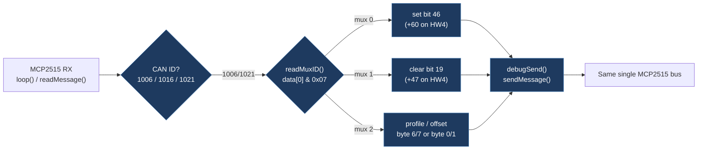
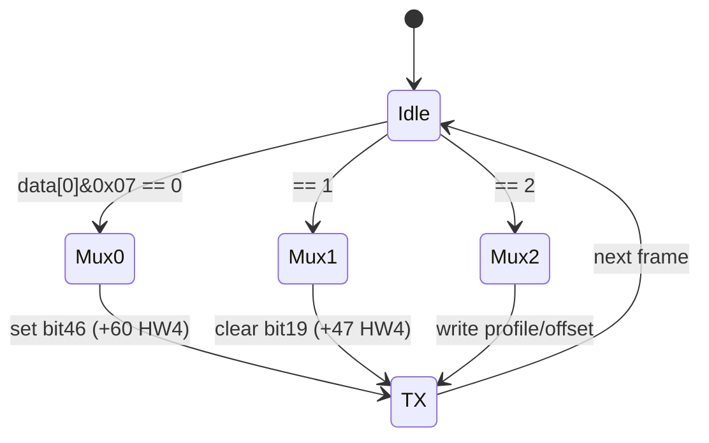

# linesoft2-tesla-fsd-can-mod-fork — deep analysis

## 1. Provenance

- **Repo path:** `legacy/linesoft2-tesla-fsd-can-mod-fork`.
- **SPECIAL PROVENANCE — CONVERTED FOLDER:** upstream is 404/dead. This is **not an active submodule and has no gitlink and no upstream fetch**. There are exactly two ordinary tracked files (mode `100644`, not `160000`). Do not apply the submodule SHA-match / `git -C ... fetch` procedure here.
- **Pinned identifier (canonical `git ls-files -s`, blob form — no gitlink exists):**
    - `100644 2772f2aec7b17f8daffd2d55f89ec3336ca4ebd2 0  legacy/linesoft2-tesla-fsd-can-mod-fork/CanFeather.ino`
    - `100644 0a3c3875b37c6776f955619482a01be83eb16583 0  legacy/linesoft2-tesla-fsd-can-mod-fork/README.md`
- **Upstream URL (from README L7, unreachable):** `https://gitlab.com/Starmixcraft/tesla-fsd-can-mod` (Starmixcraft original; this repo is its Chinese-localized fork).
- **License:** GPL-3.0 — README L9/L206, source header `CanFeather.ino:1-14`.
- **Analysis date:** 2026-11-21.
- **Files read (FULL-READ):** `CanFeather.ino` L1-246 (all 246 lines); `README.md` L1-206 (all 206 lines). Small repo: both files read in full, no RANGE-CITED coverage.
- **Our-side files read for parity (CODE-READ):** `firmware/lib/vehicle/can/handler/variant/hw3.h` L1-155, `hw4.h` L115-169, `legacy.h` L40-84, `bits.h` L1-58, `ids.h` L110-122, `firmware/lib/vehicle/can/feature/fsd/profile.h` L1-111, `offsets.h` L1-95, `firmware/lib/vehicle/can/feature/fsd/fsd.h` L1-58, `firmware/lib/core/types.h` L58-66.
- **Files explicitly NOT read:** none in the target repo (2 files, both fully read). Our-side files outside the list above (e.g. full `firmware/lib/vehicle/can/handler/` dispatch, BLE/WiFi surfaces, checksum helpers) were not read in this pass.
- **Replace-mode preservation:** existing YAML frontmatter (original L1-9) preserved byte-for-byte; inspection found **no trailing whitespace** on the description line, so no stripping was required. The original doc contained **no `## Upstream (...)` sections**, so there are no such sections to preserve. Pre-replace claims are cited below as `git show HEAD:docs/legacy/linesoft2-tesla-fsd-can-mod-fork.md` with the original line number. The frontmatter description is factually stale/truncated ("instead of t") and is recorded as a contradiction in §6 rather than edited.

## 2. Executive verdict

A two-file Arduino sketch fork of Starmixcraft's FSD CAN mod: a single-file MCP2515 polling loop that classifies incoming frames by CAN ID and 3-bit mux, then echoes a bit-modified copy back onto the bus. Three compile-time variants (`LEGACY`/`HW3`/`HW4`) implement FSD-enable bit setting (bit 46, plus 60 on HW4 mux0 and 47 on HW4 mux1), nag suppression (bit 19 clear), follow-distance→speed-profile mapping, and HW3 speed-offset encode. The mechanisms are real and code-grounded, but **every meaningful mechanism is already present in our firmware with stricter gating** (UI-entitlement gate, AP gate, DLC guards, checksum pipeline, persistence). Nothing here justifies a code port. The only residual value is documentation data: the Nano+MCP2515 pin map, the 2026-03-31 China gateway-lockout note, and the HW4/FSD-v14 minimum firmware note. Do not copy: unconditional FSD injection (the upstream UI-selection function is dead code), unguarded frame mutation, and unconditional re-transmit without checksum/counter maintenance.

## 3. Evidence map

| Source file | Lines | What it proves | Grade |
| --- | --- | --- | --- |
| `CanFeather.ino` | 16-17, 38 | `SPI.h` + `mcp2515.h` (autowp); single `MCP2515 mcp(CAN_CS)` instance | CODE-READ |
| `CanFeather.ino` | 20-25, 195-200 | Compile-time `#define HW HW3` selecting one handler via `#define` aliases; `handler` pointer set in `setup()` | CODE-READ |
| `CanFeather.ino` | 30-38, 201-212 | Nano pins `LED_PIN=9`, `CAN_CS=10`; 500 kbps, `MCP_8MHZ`, normal mode | CODE-READ |
| `CanFeather.ino` | 40-70 | Base struct with unimplemented virtual; `readMuxID` = `data[0]&0x07`; `isFSDSelectedInUI` = `(data[4]>>6)&0x1`; v12/v13 profile encode; generic `setBit` | CODE-READ |
| `CanFeather.ino` | 73-99 | Legacy ID 1006 mux0/1 behavior | CODE-READ |
| `CanFeather.ino` | 101-155 | HW3 IDs 1016/1021 mux0/1/2 behavior incl. offset | CODE-READ |
| `CanFeather.ino` | 157-192 | HW4 IDs 1016/1021 mux0/1/2 behavior | CODE-READ |
| `CanFeather.ino` | 231-245 | `debugSend()` → `mcp.sendMessage`; polling `loop()` with error LED | CODE-READ |
| `CanFeather.ino` | 215-229 | `printFrame()` body fully commented out — no frame hex debug in practice | CODE-READ |
| `README.md` | 1-3, 7-9 | Chinese localization, GPL-3.0, 2026-03-31 gateway lockout claim | SUMMARY-ONLY |
| `README.md` | 19-34, 146-169 | Nano/MCP2515 wiring, X179 pins 13/14, X652 1/2, cut 120 Ω termination | SUMMARY-ONLY |
| `README.md` | 75-98, 171-198 | Variant selection table, HW4≥2026.2.3 FSD-v14 note, speed profile tables | SUMMARY-ONLY |
| `README.md` | 41-43, 59, 100-124 | Internally inconsistent Feather/RP2040 hardware description | SUMMARY-ONLY |
| **our** `profile.h` | 17-58 | Our profile encoders + follow-distance maps (parity proof) | CODE-READ |
| **our** `offsets.h` | 17-50 | Our HW3 offset read/derive/write (parity proof) | CODE-READ |
| **our** `hw3.h`/`hw4.h`/`legacy.h` | 119-153 / 133-167 / 56-83 | Our FSD mux gating and bit sets (parity proof) | CODE-READ |
| **our** `bits.h` / `types.h` / `ids.h` | 18-54 / 58-66 / 110-122 | Our bit constants, mux read, UI-selection gate (parity proof) | CODE-READ |

No TEST-READ evidence exists: this repo ships no tests. No CAPTURE evidence exists in this repo. No DBC/JSON catalog exists, so no STRUCTURAL-PARSE coverage is needed.

## 4. Architecture and build surface

- **Entry points:** `setup()` (`CanFeather.ino:198-212`) initializes LED, Serial @115200 (1 s wait), resets MCP2515, sets 500 kbps/8 MHz, normal mode. `loop()` (`:236-246`) polls one frame per iteration.
- **Shared core vs platform port:** none — single monolithic `.ino`; one `CarManagerBase` base struct (`:40-44`) with three derived handlers (`:73`, `:101`, `:157`). No HAL, no split files.
- **Build selection:** Arduino IDE, compile-time `#define HW HW3` (`:25`) resolved via `#define LEGACY/HW3/HW4` aliases (`:20-22`). No PlatformIO env, no feature flags beyond `enablePrint` (`:27`).
- **Dependency boundary:** external `mcp2515.h` + `SPI.h` only; no internal protocol package.
- **Pipeline:** RX `mcp.readMessage` → ID filter → mux demux → unconditional bit mutation → `mcp.sendMessage` echo. No checksum, no counter, no DLC check, no AP/entitlement gate.



## 5. Mechanism catalogue

### M1 — Compile-time variant dispatch

- **Claim (README / summary):** "Hardware variant selected via `#define HW` at compile time"; LEGACY=1006, HW3/HW4=1016/1021 (`git show HEAD:docs/legacy/linesoft2-tesla-fsd-can-mod-fork.md` L42; README L77-85).
- **Code path:** `CanFeather.ino:20-25` macros → `:195-200` global `handler` → `:245` `handler->handelMessage(frame)`.
- **Frame spec:** None (selection only).
- **Gates and timing:** selected once at compile; no runtime detection.
- **State machine:** One-of-three static selection; no transitions.
- **Tests:** None found.
- **Evidence grade:** CODE-READ.
- **Verdict:** CONFIRMED.
- **Adapt to TeslaCANModder?** already present (our runtime variant detection supersedes compile-time selection).

### M2 — Mux demux + FSD enable injection

- **Claim (README / summary):** "FSD enable bit: Bit 46"; README "Checks if Traffic Light and Stop Sign Control is enabled … as a trigger" (pre-replace L47; README L66-69, L95).
- **Code path:** `CanFeather.ino:46-48` `readMuxID()` → `:75/:121/:169` ID branches → mux0 `:85/:132/:172` `setBit(...,46,true)`; HW4 adds `:173` `setBit(...,60,true)` → `:231-234` TX.
- **Frame spec:** ID 1006 (Legacy) / 1021 (HW3,HW4); mux = `data[0]&0x07`; mux0 sets bit 46 (byte 5 bit 6) and, HW4 only, bit 60 (byte 7 bit 4). No DLC guard, no checksum, no counter.
- **Gates and timing:** **None** — no `isFSDSelectedInUI()` call, no `fsdEnabled` flag, no AP gate; fires on every mux0 frame received.
- **State machine:**



- **Tests:** None found.
- **Evidence grade:** CODE-READ.
- **Verdict:** CONTRADICTED (claimed UI trigger is dead code; injection is unconditional).
- **Adapt to TeslaCANModder?** no impact — already present but **ours is stricter** (`hw3.h:119-137`, `hw4.h:133-148`, `legacy.h:56-73`: `fsdAllowed = s.fsdEnabled && (s.fsdForceEnabled || fsdUI)` plus AP gate). Do not copy the ungated version.

### M3 — Nag suppression (bit 19)

- **Claim (README / summary):** "Bit 19 cleared in mux index 1" (pre-replace L48; README L97).
- **Code path:** `:89-92` / `:136-139` / `:176-180` mux1 → `setBit(frame,19,false)` → `debugSend()`.
- **Frame spec:** ID 1006/1021 mux1; clears bit 19 (byte 2 bit 3). HW4 additionally sets bit 47 (byte 5 bit 7) at `:178`. No checksum update.
- **Gates and timing:** none; every mux1 frame echoed.
- **State machine:** see M2 diagram.
- **Tests:** None found.
- **Evidence grade:** CODE-READ.
- **Verdict:** CONFIRMED (bit 19), PARTIAL (HW4 extra bit 47 omitted from summary).
- **Adapt to TeslaCANModder?** already present (`bits.h:42` `NAG_BIT_HANDS_ON_REQUIREMENT 19`; `hw3.h:40-53`, `hw4.h:150-155`, `legacy.h:75-82`) — ours adds nag-mode selection, organic bit 47 and ECE R79 bypass.

### M4 — Follow-distance → speed profile mapping + v12/v13 encode (Legacy/HW3)

- **Claim (README / summary):** "Speed profile: Mapped from follow-distance stalk (3 levels) via bits in byte 6" (pre-replace L49; README L177-194).
- **Code path:** `:104-118` (HW3, ID 1016 `data[5]>>5`, map 1→2/2→1/3→0); `:78-84` + `:86` (Legacy, ID 1006 mux0 offset map, `setSpeedProfileV12V13`); encoder `:54-57` (`data[6] &= ~0x06; |= profile<<1`).
- **Frame spec:** profile 2-bit field, byte 6 bits [2:1]; 3 levels.
- **Gates and timing:** reads on ID 1016 (HW3) / ID 1006 mux0 (Legacy); write applies when corresponding mux0 arrives.
- **State machine:** mapping switch, no persistent states.
- **Tests:** None found.
- **Evidence grade:** CODE-READ.
- **Verdict:** CONFIRMED for Legacy/HW3; summary generalized it to all variants incorrectly.
- **Adapt to TeslaCANModder?** already present, byte-identical logic (`profile.h:17-23`, `43-47`; `hw3.h:69-77`, `legacy.h:40-53`).

### M5 — HW4 5-level profile mapping + byte-7 encode

- **Claim (README / summary):** README "HW4 — Extended speed-profile range (5 levels)" (L83, L189-195).
- **Code path:** `:159-167` ID 1016 `data[5]>>5` map 1→3/2→2/3→1/4→0/5→4; `:181-185` mux2 `data[7] &= ~(0x07<<4); |= (profile&0x07)<<4`.
- **Frame spec:** 3-bit profile in byte 7 bits [6:4], 5 values used. No DLC guard.
- **Gates and timing:** fires on 1016 and on mux2 of 1021.
- **State machine:** mapping switch.
- **Tests:** None found.
- **Evidence grade:** CODE-READ.
- **Verdict:** CONFIRMED — this is the part the pre-replace summary missed.
- **Adapt to TeslaCANModder?** already present, identical (`profile.h:30-36`, `54-58`; `hw4.h:157-165`).

### M6 — HW3 speed offset read, derive and mux2 write

- **Claim (README / summary):** not in pre-replace doc; README L177-183 (Legacy offset table) and L82.
- **Code path:** `:124-125` read `(data[3]>>1)&0x3F)-30`, offset = `constrain(steps*5,0,100)`; `:140-146` mux2 clears `data[0]` bits [7:6] and `data[1]` bits [5:0], writes `(offset&3)<<6` and `offset>>2`.
- **Frame spec:** 8-bit offset encoded as 2 high bits of byte 0 + 6 bits of byte 1; source bias −30, ×5, clamp [0,100].
- **Gates and timing:** derived on mux0, written on mux2.
- **State machine:** value carried in `HW3Handler::speedOffset`.
- **Tests:** None found.
- **Evidence grade:** CODE-READ.
- **Verdict:** CONFIRMED.
- **Adapt to TeslaCANModder?** already present, identical (`offsets.h:17-50`; `hw3.h:125-129`, `147-153`). Our HW4 mux2 also writes offset into `data[1]` bits [5:0] (`hw4.h:160-164`) — upstream HW4 has no offset write.

### M7 — Polling RX, error LED, unconditional echo TX

- **Claim (README / summary):** "Intercepts specific CAN bus messages … re-transmits them onto the vehicle bus" (README L61-64).
- **Code path:** `:236-245` `readMessage()` → error ⇒ `digitalWrite(LED,HIGH); return`, success ⇒ LED LOW → `handelMessage()`; `:231-234` `debugSend()` → `mcp.sendMessage(&frame)`.
- **Frame spec:** echoes the same `can_frame` object mutated in place; no new frame construction.
- **Gates and timing:** one frame per loop, no interval/rate limiting; no retry/backoff on error.
- **State machine:** 2-state LED indicator (error / OK).
- **Tests:** None found.
- **Evidence grade:** CODE-READ.
- **Verdict:** CONFIRMED.
- **Adapt to TeslaCANModder?** no impact — our health/LED/streaming diagnostics are richer; do not copy this loop.

### M8 — UI FSD-entitlement gate (declared, never called)

- **Claim (README / summary):** "Checks if 'Traffic Light and Stop Sign Control' is enabled … Uses this setting as a trigger for FSD" (README L66-69, L95); pre-replace L51 "Checks FSD UI selection via `(frame.data[4] >> 6) & 0x01`".
- **Code path:** `CanFeather.ino:50-52` defines `isFSDSelectedInUI()`; demonstrated anchor shows **no call site** anywhere in the repo.
- **Frame spec:** would read byte 4 bit 6 of 1021/1006 — never executed.
- **Gates and timing:** none, because the function is dead.
- **State machine:** None found.
- **Tests:** None found.
- **Evidence grade:** CODE-READ.
- **Verdict:** CONTRADICTED — entitlement/UI check absent from firmware.
- **Adapt to TeslaCANModder?** no impact / never copy this omission — ours calls the equivalent at `ids.h:119-122` from `hw3.h:120-121`, `hw4.h:134`, `legacy.h:60-61`.

## 6. Summary vs code contradiction table

| # | Pre-replace claim (`git show HEAD:docs/legacy/linesoft2-tesla-fsd-can-mod-fork.md`) | Code / README evidence | Verdict |
| --- | --- | --- | --- |
| C1 | L46: "CAN IDs monitored: 1006, 1016, 1021, **69 (steering wheel action request)**" | `CanFeather.ino` has no `can_id == 69`; only 1006 (`:75`), 1016 (`:104`,`:159`), 1021 (`:121`,`:169`) — anchor demonstrates no 69 hit | CONTRADICTED |
| C2 | L51: "Checks FSD UI selection via `(frame.data[4] >> 6) & 0x01`" | Function at `CanFeather.ino:50-52` has **zero call sites**; FSD bit set unconditionally at `:85`,`:132`,`:172` | CONTRADICTED |
| C3 | L47: "FSD enable bit: Bit 46 in the autopilot control frame" | True but incomplete: HW4 mux0 also sets bit 60 (`:173`), HW4 mux1 sets bit 47 (`:178`) | PARTIAL |
| C4 | L49: "Speed profile: … (3 levels) via bits in byte 6" | Only Legacy/HW3 (`:54-57`,`:86`,`:133`); HW4 uses 5 levels in byte 7 bits [6:4] (`:159-167`,`:181-185`) | PARTIAL / CONTRADICTED |
| C5 | L15/L29: "Arduino Nano" platform | README itself says FeatherWing/MCP25625 (`:59`), Feather M4 CAN (`:102`), Feather RP2040 CAN + RP2040 board package (`:116-124`); code pin defs are Nano-specific (`:30-32`). Summary reflects only the Chinese intro (README L11-33) | CONTRADICTED (README internally inconsistent) |
| C6 | Frontmatter L3: "adapted for Arduino Nano + MCP2515 hardware instead of t" | Truncated mid-word and stale vs README Feather sections; frontmatter preserved byte-for-byte per replace-mode rule | CONTRADICTED (stale, recorded not edited) |
| C7 | L15: "FSD functionality on vehicles with a valid FSD entitlement" (README L47 "must have an active FSD package") | No entitlement/UI check executed in firmware (see C2); entitlement is a README prerequisite, not a code gate | CONTRADICTED (code level) |
| C8 | L38: "base struct with virtual `handelMessage` method" | `CanFeather.ino:43` declares a non-pure virtual with **no definition** (no `= 0`); only derived overrides are used | PARTIAL (agreement + latent defect) |

## 7. CAN frame and signal inventory

Repo emits no DBC/JSON catalog; rows below are code-referenced frames only. Bus assignment is **not stated in the sketch** (one MCP2515 instance) — our docs map 1006/1021 to Chassis, but that mapping is not in this repo.

| ID (hex + dec) | Bus | Period | DLC | Byte/bit layout | Scale / units | Counter position | Checksum | Read or write | Grade |
| --- | --- | --- | --- | --- | --- | --- | --- | --- | --- |
| `0x3EE` / 1006 (Legacy FSD mux) | single MCP2515 (unspecified) | none — echo per RX | not checked | mux=`data[0]&0x07`; mux0: `data[3]` bits[6:1] bias −30 → profile, bit46, profile→`data[6]` bits[2:1]; mux1: bit19 clear | offset steps −30..+2, profile index 0..2 | none | none | RX → modified TX echo | CODE-READ |
| `0x3F8` / 1016 (follow distance / UI driver assist) | single MCP2515 (unspecified) | none — read only | not checked | `data[5]` bits[7:5] (`>>5`) → fd; Legacy reads `data[1]>>5` | fd 1..3 (HW3) / 1..5 (HW4) → profile index | none | none | read only (no echo) | CODE-READ |
| `0x3FD` / 1021 (FSD / autopilot control mux) | single MCP2515 (unspecified) | none — echo per RX | not checked | mux=`data[0]&0x07`; mux0 bit46 (+60 HW4), profile `data[6]` bits[2:1] HW3; mux1 bit19 clear (+47 HW4); mux2 HW3 offset `data[0]` bits[7:6] + `data[1]` bits[5:0], HW4 profile `data[7]` bits[6:4] | offset 0..100 (steps×5), profile HW3 0..2 / HW4 0..4 | none | none | RX → modified TX echo | CODE-READ |

Negative finding: no checksum, CRC, DLC guard or counter handling anywhere in `CanFeather.ino` (negative anchor demonstrated in §16).

## 8. Constants and tuning table

| Constant | Value | File:line | Meaning | Grade |
| --- | --- | --- | --- | --- |
| `CAN_CS` | 10 (D10) | `CanFeather.ino:32` | MCP2515 SPI chip-select | CODE-READ |
| `LED_PIN` | 9 (D9) | `CanFeather.ino:30-31` | Moved from D13 to avoid SPI SCK conflict | CODE-READ |
| `Serial baud` | 115200 | `CanFeather.ino:203` | Debug serial | CODE-READ |
| CAN bitrate / crystal | `CAN_500KBPS`, `MCP_8MHZ` | `CanFeather.ino:208` | Fixed 500 kbps, assumed 8 MHz | CODE-READ |
| `delay` / serial wait | 1500 / 1000 ms | `CanFeather.ino:202,205` | Startup timing | CODE-READ |
| Mux mask | `0x07` | `CanFeather.ino:47` | mux = byte0 bits[2:0] | CODE-READ |
| FSD enable bit | 46 | `CanFeather.ino:85,132,172` | byte5 bit6 | CODE-READ |
| HW4 extra mux0 bit | 60 | `CanFeather.ino:173` | byte7 bit4 | CODE-READ |
| Nag bit (clear) | 19 | `CanFeather.ino:90,137,177` | byte2 bit3 | CODE-READ |
| HW4 mux1 bit (set) | 47 | `CanFeather.ino:178` | byte5 bit7 | CODE-READ |
| FSD UI bit (dead) | `(data[4]>>6)&1` | `CanFeather.ino:50-52` | entitlement check — never called | CODE-READ |
| Profile mask / shift (v12/v13) | `0x06`, `<<1`, byte6 | `CanFeather.ino:55-56` | 2-bit profile | CODE-READ |
| HW4 profile mask / shift | `0x07<<4`, byte7 | `CanFeather.ino:182-183` | 3-bit profile | CODE-READ |
| HW3 offset field | `0b11000000`/`0b00111111` byte0/1 | `CanFeather.ino:141-144` | 2+6 bit offset | CODE-READ |
| Offset bias / scale / clamp | −30, ×5, [0,100] | `CanFeather.ino:124` | steps → offset | CODE-READ |
| Legacy offset bias | −30 | `CanFeather.ino:78` | data[3] field bias | CODE-READ |
| Follow-distance mask | `0b11100000>>5` | `CanFeather.ino:105,160` | byte5 bits[7:5] | CODE-READ |

## 9. Failure modes and edge cases

| Failure | Handling code path | Tested? | Grade |
| --- | --- | --- | --- |
| `readMessage()` error / bus-off | `CanFeather.ino:239-242`: LED HIGH + `return`; no retry, reset or bus-off recovery | No | CODE-READ |
| Short frame / DLC < required | No guard anywhere; `data[7]` (`:182`), `data[6]` (`:55`), `data[5]` (`:105`), `data[4]` (`:51`) read unconditionally | No | CODE-READ |
| `setBitrate` failure | `:209` prints message but `:210` still calls `setNormalMode()` | No | CODE-READ |
| Missing expected frame | State (`speedProfile`, `speedOffset`) simply retains last value; no timeout | No | CODE-READ |
| Checksum / counter integrity | None computed; echoed frames may be rejected by vehicle | No | CODE-READ |
| TX amplification | mux0/1/2 branches re-send every matching frame even if no bit changed; no rate limit | No | CODE-READ |
| OTA / update window | No handling | No | CODE-READ |
| Queue overflow | No queue (single-frame polling loop) | No | CODE-READ |
| Watchdog / brownout / reboot state | None; no persistence | No | CODE-READ |
| Base-class virtual call | `:43` virtual declared with no body and no `=0`; latent link error if ever called via base without override | No | CODE-READ |

## 10. Test coverage map

No test files exist — `git ls-files legacy/linesoft2-tesla-fsd-can-mod-fork` lists only `CanFeather.ino` and `README.md`.

- Tests present: **None found.**
- Untested critical paths and risk:
    - mux0/1/2 bit mutation for all three variants — wrong bit could enable/disable wrong feature silently.
    - offset and profile encode masks — a mask slip corrupts unrelated signal bits.
    - no checksum oracle — no independent frame validation at all.
    - error LED path — no evidence error recovery works.
    - wrong `#define HW` selection — injects wrong frames for the vehicle.

## 11. Parity matrix with TeslaCANModder

Every row has an our-side CODE-READ citation unless explicitly marked SUMMARY-ONLY.

| Signal / frame | Upstream decode/encode (cite) | Our decode/encode (cite) | Delta | Action |
| --- | --- | --- | --- | --- |
| 0x3FD mux0 FSD bits | `CanFeather.ino:121-135`, `:46,172-173` | `hw3.h:119-137`; `hw4.h:133-148`; `legacy.h:56-73`; `bits.h:19-23` | Same bits (46, +60 HW4); ours adds UI+fsdEnabled+AP gate + EAP/continue-on-green/EVD; upstream ungated | already present; ignore ungated path |
| 0x3FD mux1 nag bit19 | `CanFeather.ino:136-139`, `176-180` | `bits.h:42`; `hw3.h:40-53,140-145`; `hw4.h:150-155`; `legacy.h:75-82` | Ours adds nag-mode selection, bit47 organic, ECE R79 bypass | already present |
| HW4 bit47 set | `CanFeather.ino:178` | `bits.h:27`; `hw3.h:43` (`applyHW3NagSuppressBits`) | Semantics differ: upstream "HW4 mux1 nag extra", ours "organic / Summon EU unlock" | capture-first before any change |
| UI FSD selection gate | `CanFeather.ino:50-52` (defined, never called) | `ids.h:119-122`; `hw3.h:120-121`; `hw4.h:134`; `legacy.h:60-61` | Upstream dead; ours active gate | ignore upstream; never copy omission |
| v12/v13 profile encode | `CanFeather.ino:54-57` | `profile.h:17-23` | byte-identical logic; ours adds DLC guard | already present |
| HW4 profile encode | `CanFeather.ino:181-185` | `profile.h:30-36` | identical; ours adds DLC guard | already present |
| HW3 follow-distance map | `CanFeather.ino:104-118` | `profile.h:43-47`; `hw3.h:69-77` (`readFollowDistance`) | same map {1→2,2→1,3→0}; ours respects `profileOverride` | already present |
| HW4 follow-distance map | `CanFeather.ino:159-167` | `profile.h:54-58` | same map {1→3,2→2,3→1,4→0,5→4} | already present |
| HW3 offset read/derive | `CanFeather.ino:124-125` | `offsets.h:31-50`; `hw3.h:125-129` | identical (−30, ×5, clamp 0..100); ours respects override flags | already present |
| HW3 offset mux2 encode | `CanFeather.ino:140-146` | `offsets.h:17-24`; `hw3.h:147-153` | identical mask/shift; ours adds DLC guard | already present |
| HW4 mux2 offset write | absent in upstream | `hw4.h:160-164`; `bits.h:52-54` | ours has extra feature | no impact |
| 0x3EE Legacy FSD mux | `CanFeather.ino:75-99` | `legacy.h:56-83`; `ids.h:23` | ours gated + includes stalk handling | already present |
| 0x045 / 69 legacy stalk | absent in upstream (summary claims it — C1) | `legacy.h:40-54`; `ids.h` `CAN_ID_LEGACY_STALK` | ours has extra frame | no impact |
| Checksum / counter maintenance | none (`CanFeather.ino`, negative anchor §16) | not read in this pass — SUMMARY-ONLY row, cannot drive decision | unknown | ignore until our-side checksum code is read |

## 12. Surface inventory and security notes

- **Serial:** debug output only at 115200 (`CanFeather.ino:203`, `:93-96`, `:147-152`, `:186-189`). `printFrame()` (`:215-229`) fully commented out — no frame hex despite `enablePrint`. No command parser, no RPC, no input handling.
- **Web / BLE / REST:** none found.
- **CAN:** one MCP2515; RX all frames, TX echo of mutated 1006/1021. No filtering config shown beyond ID comparison.
- **Credentials / keys / certs:** none found.
- **Dangerous build flags:** `#define HW HW3` (`:25`) — a wrong choice injects variant-incompatible frames; `enablePrint` (`:27`) debug toggle.
- **Safety findings:** FSD injection has no entitlement or AP gate (C2/C7); frame re-transmit has no checksum/counter maintenance; README L169 instructs cutting onboard 120 Ω termination (hardware-mutating instruction); README L49-55 suggests transferring vehicle to a foreign-region Tesla account to obtain FSD subscription (legal/policy concern — **do not copy into our docs**).

## 13. Adaptation assessment

| Mechanism | Value | Cost | Risk | Grade | Decision |
| --- | --- | --- | --- | --- | --- |
| M1 compile-time variant dispatch | low (ours has runtime detect) | low | wrong-variant injection | CODE-READ | no impact |
| M2 ungated FSD injection | none | low | **high** — safety | CODE-READ | never port |
| M3 bit19 nag clear | none (already ours, richer) | low | medium | CODE-READ | already present |
| M4/M5 profile encode + maps | none (byte-identical in ours) | low | low | CODE-READ | already present |
| M6 HW3 offset derive/write | none (byte-identical in ours) | low | low | CODE-READ | already present |
| M7 polling/error LED | low (ours richer diagnostics) | low | low | CODE-READ | no impact |
| M8 dead UI gate | none (ours has active gate) | n/a | high if copied | CODE-READ | never copy omission |
| Nano+MCP2515 wiring data (README L19-34) | documentation only | trivial | none | SUMMARY-ONLY | candidate (docs reference only) |
| 2026-03-31 China gateway lockout (README L3) | telemetry/region data point | trivial | none | SUMMARY-ONLY | candidate (SUMMARY-ONLY backlog) |
| HW4≥2026.2.3 FSD-v14 note (README L85) | firmware-compat data point | trivial | none | SUMMARY-ONLY | candidate (SUMMARY-ONLY backlog) |

Top 3 adaptation candidates (all low-cost, none require firmware change): (1) Nano+MCP2515/X179 wiring reference for docs; (2) 2026-03-31 China gateway-lockout observation; (3) HW4/FSD-v14 minimum-firmware note. None may drive a code decision until upgraded past SUMMARY-ONLY (independent capture / vendor confirmation).

## 14. Do-not-copy list

- `CanFeather.ino:85,132,172` — unconditional FSD bit 46 injection; reason: no entitlement/AP gate, unsafe.
- `CanFeather.ino:50-52` — dead `isFSDSelectedInUI()` pattern (declared, never called); reason: misleading, and our active gate at `ids.h:119-122` must stay the source of truth.
- `CanFeather.ino:54-57,141-146,182-185` — unguarded frame mutation (`data[6]/data[7]/data[0]/data[1]` with no DLC check); reason: our `profile.h:19,32` and `offsets.h:19` guard DLC.
- `CanFeather.ino:231-234` — `debugSend()` unconditional re-transmit without checksum/counter; reason: can produce invalid frames; our checksum/counter pipeline and `can-review-checklist.md` apply.
- `CanFeather.ino:215-229` — fully commented-out `printFrame()`; reason: dead code.
- `CanFeather.ino:40-44` — non-pure virtual without body; reason: latent link error, use our type conventions.
- `CanFeather.ino:20-25,30-38` — upstream identifiers and Nano-specific pins (`LEGACY/HW3/HW4`, `handelMessage`, `can_frame`, `mcp`, D9/D10); reason: use our names, `Frame`, `State`, tab/Allman style; pin map is hardware-specific.
- `CanFeather.ino:208` — fixed `MCP_8MHZ` assumption; reason: our clock auto-detect/profile commands supersede.
- `README.md:49-55` — foreign-region account/transfer workaround; reason: legal/policy, not engineering.
- `README.md:169` — "cut onboard 120 Ω termination"; reason: hardware-mutating instruction, keep out of our docs.

## 15. History and evolution

- Converted folder, no submodule-local `git log`. Parent-repo history only:
    - `79e659c` (2026-04-16) "feat: add multiple legacy submodules …" — added `legacy/linesoft2-tesla-fsd-can-mod-fork` as a gitlink (1 line).
    - `ee1571f` (2026-11-20) "chore(legacy): update submodules and preserve dead upstreams as tracked folders" — removed the gitlink and preserved the two files as ordinary tracked blobs (246 + 206 lines). This is the 404 conversion event.
- In-repo evolution visible in the preserved snapshot: Chinese localization + 2026-03-31 gateway-lockout warning (`README.md:1-9`); HW4/FSD-v14 minimum firmware 2026.2.3 (`CanFeather.ino:22`, `README.md:85`); LED moved D13→D9 to avoid SPI SCK conflict (`CanFeather.ino:30-31`).
- No evidence of abandoned/rolled-back approaches beyond the LED pin change. Pre-404 upstream history (Starmixcraft fork commits, issues, PRs) **not reviewed**; any network-only claim is UNVERIFIED.

## 16. Re-verification recipe

This is a converted folder: **no upstream fetch is possible** (upstream 404). Use parent-repo blob IDs + file hashes + grep anchors. Pinned blobs (from `git ls-files -s legacy/linesoft2-tesla-fsd-can-mod-fork`): `2772f2aec7b17f8daffd2d55f89ec3336ca4ebd2` (ino), `0a3c3875b37c6776f955619482a01be83eb16583` (README). Baseline SHA-256 at analysis time:

```text
2533f25fc378d2eb64e2837e4e958b26e5b33b1314435f3c30bef1a8dd9db540  legacy/linesoft2-tesla-fsd-can-mod-fork/CanFeather.ino
80a63bebe38a40e4948cbd72e5dc57e3ff3c6be9e519739573f8e2fa2124ab1d  legacy/linesoft2-tesla-fsd-can-mod-fork/README.md
```

Commands (run from repo root; if a future bump reintroduces a submodule, append the skill's `git -C ... fetch/log/diff` steps):

```bash
git ls-files -s legacy/linesoft2-tesla-fsd-can-mod-fork   # expect the two 100644 blob SHAs above
git log --oneline -- legacy/linesoft2-tesla-fsd-can-mod-fork  # expect ee1571f, 79e659c
git status --porcelain -- legacy/linesoft2-tesla-fsd-can-mod-fork docs/legacy/linesoft2-tesla-fsd-can-mod-fork.md  # expect empty
sha256sum legacy/linesoft2-tesla-fsd-can-mod-fork/CanFeather.ino legacy/linesoft2-tesla-fsd-can-mod-fork/README.md  # expect hashes above
```

Grep anchors — all executed at write time on this tree using `git grep -nE` (equivalent to `grep -nE`; this Windows shell has no standalone `grep`). Expected hits:

```text
git grep -nE 'isFSDSelectedInUI' -- legacy/linesoft2-tesla-fsd-can-mod-fork/CanFeather.ino
  -> exactly 1 hit: :50 (definition only; no call site)
git grep -nE 'can_id == (69|1006|1016|1021)' -- legacy/linesoft2-tesla-fsd-can-mod-fork/CanFeather.ino
  -> 5 hits: :75 (1006), :104 (1016), :121 (1021), :159 (1016), :169 (1021); no 69
git grep -nE 'setBit\(frame, (19|46|47|60)' -- legacy/linesoft2-tesla-fsd-can-mod-fork/CanFeather.ino
  -> 8 hits: :85/:132/:172 (46), :90/:137/:177 (19), :173 (60), :178 (47)
git grep -nE 'CAN_500KBPS|MCP_8MHZ|CAN_CS|LED_PIN' -- legacy/linesoft2-tesla-fsd-can-mod-fork/CanFeather.ino
  -> :30/:31 (LED_PIN 9 / commented 13), :32/:38 (CAN_CS 10), :208 (500K/8MHz), :201/:240/:243 (LED usage)
git grep -nE '0b11000000|0b00111111|0x07 << 4|0x3F\) - 30' -- legacy/linesoft2-tesla-fsd-can-mod-fork/CanFeather.ino
  -> :78/:124/:125 (offset bias), :141/:142 (HW3 masks), :182 (HW4 profile mask)
git grep -nE 'checksum|crc|CRC|0xAA' -- legacy/linesoft2-tesla-fsd-can-mod-fork/CanFeather.ino
  -> no output (negative anchor: no checksum/CRC/binary framing)
```

Our-side drift anchors (pin by symbol, not just line number):

```text
git grep -nE 'isFSDSelectedInUI\(f\)' -- firmware/lib/vehicle/can/handler/variant/hw3.h
  -> :120 (active gate; not dead)
git grep -nE 'FSD_BIT_EAP +46|FSD_BIT_NAG_ORGANIC +47|FSD_BIT_DAS_DEV +60|NAG_BIT_HANDS_ON_REQUIREMENT +19' -- firmware/lib/vehicle/can/handler/variant/bits.h
  -> :21, :27, :23, :42 respectively
git grep -nE 'CAN_ID_FSD_MUX|CAN_ID_LEGACY_FSD_MUX' -- firmware/lib/vehicle/can/ids.h
  -> :25 (0x3FD), :23 (0x3EE)
git grep -nE 'setSpeedProfileV12V13|writeHW4SpeedProfile|mapHW3FollowDistToProfile|mapHW4FollowDistToProfile' -- firmware/lib/vehicle/can/feature/fsd/profile.h
  -> :17, :30, :43, :54
git grep -nE 'writeHW3SpeedOffset|readHW3UiOffsetSteps|calculateHW3SpeedOffset' -- firmware/lib/vehicle/can/feature/fsd/offsets.h
  -> :17, :31, :42
git grep -nE 'inline uint8_t readMuxID' -- firmware/lib/core/types.h
  -> :63
```

If line numbers drift more than ~10, re-read the whole function; do not trust this document's numbers. Pre-pin upstream history was **not** reviewed and cannot be (404). Everything UNVERIFIED is listed in §17.

## 17. Open questions and explicitly not investigated

- UNVERIFIED: upstream Starmixcraft history before the pinned snapshot — repo is 404, no fetch possible. What would verify it: a surviving mirror/archive of `gitlab.com/Starmixcraft/tesla-fsd-can-mod`.
- UNVERIFIED: whether the 2026-03-31 China gateway lockout (README L3) is temporary/permanent or firmware-version-specific. What would verify it: independent capture from a China-market vehicle.
- UNVERIFIED: hardware target conflict — README Chinese section says Nano, English section says Feather/RP2040; which target the preserved `CanFeather.ino` was actually flashed on. What would verify it: photos/bill-of-materials or a post-conversion upstream commit (unavailable).
- UNVERIFIED: exact bit semantics of HW4 bit 60 / bit 47 in current Tesla firmware; ours labels them DAS_DEV / organic-Summon-EU-unlock. What would verify it: listen-only bench capture with logged UI states.
- UNVERIFIED: whether echoed mutated frames without checksum recalculation are accepted by the vehicle. What would verify it: bench capture of TX and subsequent vehicle response.
- UNVERIFIED: bus assignment (Chassis vs Vehicle) for 1006/1021 in this single-MCP2515 sketch. What would verify it: wiring diagram / capture (our docs map 0x3EE and 0x3FD to Chassis, but that is our-side knowledge, not this repo's evidence).
- Not investigated: full our-side CAN dispatch pipeline, checksum helpers, BLE/WiFi surfaces, and protocol package — outside this repo's scope.
- No tests and no captures exist in this repo; all adaptation decisions rest on CODE-READ plus our-side CODE-READ only.
