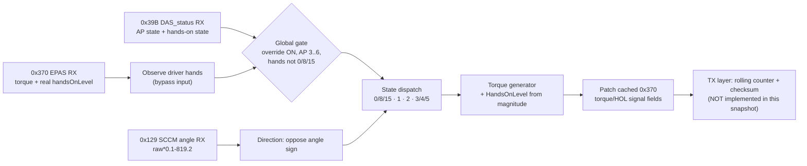
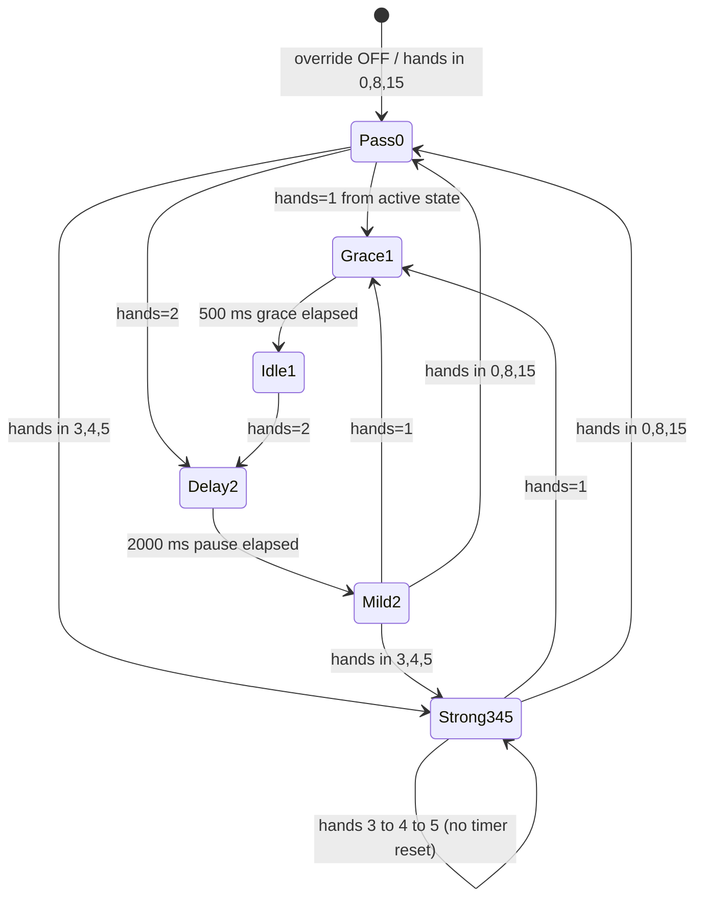

# linuchoicoegwangsu / soft-nag-bypass

## 1. Provenance

- **Submodule path:** `legacy/linuchoicoegwangsu-soft-nag-bypass/`.
- **SPECIAL PROVENANCE:** this is a **CONVERTED folder with no active submodule entry** — a preserved local research copy, not a live git submodule. `git ls-files -s legacy/linuchoicoegwangsu-soft-nag-bypass` reports three regular `100644` blob entries, **no `160000` gitlink**. Consequently `git -C legacy/linuchoicoegwangsu-soft-nag-bypass rev-parse HEAD` walks up to the **parent** repo (`7d90b9a32fb07b7cb9fa07538d06d3c87936112b`, "chore(legacy): pin 135 additional Tesla-drug fork snapshots as submodules") and `remote -v` reports the parent `https://github.com/babico/TeslaCANModder.git`. Those are parent-repo facts, **not** this upstream's SHA or URL.
- **Pinned snapshot identity:** no upstream commit SHA exists in this tree. Pin by parent-tracked blob SHAs (verbatim from `git ls-files -s`):
    - `100644 dd5f7235c615646840c72bdd324f7830bb954bcd 0 legacy/linuchoicoegwangsu-soft-nag-bypass/STEERING_TORQUE_CORE_SNIPPET.md`
    - `100644 78407c1b983892d089db9b4fcf6231c216c84879 0 legacy/linuchoicoegwangsu-soft-nag-bypass/STEERING_TORQUE_INJECTION_GUIDE-v1.md`
    - `100644 572a06eb9793ba35f11aee24fcada5442d4e457c 0 legacy/linuchoicoegwangsu-soft-nag-bypass/STEERING_TORQUE_INJECTION_GUIDE-v2.md`
- **Upstream URL:** none recorded in the folder. `docs/legacy/README.md:19` records source as `- (local)`; the existing frontmatter says "no upstream remote". No upstream fetch performed, per instruction.
- **License:** no LICENSE file in folder. Parent repo is GPL-3.0; upstream license **UNVERIFIED** (no artifact ships here to check).
- **Analysis date:** 2026-11-21.
- **Files read (FULL-READ):** `STEERING_TORQUE_CORE_SNIPPET.md:1-407` (407 lines), `STEERING_TORQUE_INJECTION_GUIDE-v1.md:1-317` (317 lines), `STEERING_TORQUE_INJECTION_GUIDE-v2.md:1-375` (375 lines).
- **Files read (RANGE-CITED):** pre-replace summary `docs/legacy/linuchoicoegwangsu-soft-nag-bypass.md:1-178` via `git show HEAD:docs/legacy/linuchoicoegwangsu-soft-nag-bypass.md`; `docs/legacy/README.md:19`; `docs/legacy/COMPARISON.md:92`; `docs/legacy/nicolozak-nag-killer.md:391,473`.
- **Our-side files read (CODE-READ, RANGE-CITED unless noted):** `firmware/lib/vehicle/can/feature/fsd/nag.h:1-524` (FULL-READ), `firmware/lib/vehicle/can/feature/fsd/nag/math.h:1-52` (FULL-READ), `firmware/lib/vehicle/can/handler/bus/vehicle.h:110-154,312-345,395-402`, `firmware/lib/vehicle/can/handler/frame_readers.h:1-60`, `firmware/lib/vehicle/can/feature/telemetry/powertrain.h:50-74`, `firmware/lib/vehicle/can/checksum.h:55-80`, `firmware/lib/vehicle/can/ids.h:17,20,36,59,64`, `firmware/lib/core/types.h:826-843`, `firmware/test/test_native_nag_organic/test_nag_organic.cpp:205-299,334-393` plus a grep of all `void test_` / `RUN_TEST` names (RANGE-CITED).
- **Files explicitly NOT read:** nothing under `legacy/` other than the three listed files; no upstream history (none exists locally); no `docs/legacy/deep/` companion; no network issues/PRs. No hidden dot-directories exist in the folder (`ls -la` shows exactly three files plus `.` and `..`).
- **Preserve list:** existing YAML frontmatter reproduced byte-for-byte in content (lines 1-9; no trailing whitespace on the description line, so nothing to strip); no `## Upstream (...)` section existed in the pre-replace doc, so none to preserve. Whole file normalized to LF per hygiene rule.

## 2. Executive verdict

This "repo" is a three-file **documentation-only research snapshot**: two porting guides (v1, v2) and one Markdown-fenced C++ reference extract of an EPAS steering-torque/HandsOnLevel injection algorithm for Tesla nag suppression. There is no build system, no CAN driver, no tests, no captures, and no checksum implementation — the snippet deliberately omits frame parsing and counter/checksum finalization. The load-bearing mechanisms are the AP-state gate (3..6), the hands-on state dispatch (0/8/15 pass-through, 1 grace-hold, 2 mild random walk, 3/4/5 shared strong ramp-and-hold), the raw torque convention (center 2048, 0.01 Nm/raw, ±0.5–2.0 Nm mild, 2.1 Nm strong peak), the magnitude-derived HandsOnLevel (≥2.0 Nm→2, ≥1.0 Nm→1), and the driver-feedback bypass on incoming HandsOnLevel != 0. **Every one of these behavior/constant sets is already present in our firmware** (`firmware/lib/vehicle/can/feature/fsd/nag.h`) as `NAG_MODE_ORGANIC`; the pre-replace doc's "not implemented" comparison compared this research against our **natural** mode, not our organic mode, so it is stale. The remaining real gaps are an incoming-checksum validation gate (asserted by both guides, absent in both the snippet and our shipped path), an independent checksum test oracle, and a CONFIRMED decode discrepancy on steering angle (upstream offset-based `raw*0.1-819.2` vs our signed `int16/10`). Nothing is a verbatim port candidate; at most one or two guarded, capture-first adaptations.

## 3. Evidence map

No `CAPTURE` evidence exists in this repo (no captured frames or decode tool output). No `TEST-READ` evidence exists in this repo (it ships no test files); `TEST-READ` rows below are **our side** only.

| Source file | Lines | What it proves | Coverage | Grade |
| --- | --- | --- | --- | --- |
| `STEERING_TORQUE_CORE_SNIPPET.md` | 1-407 | Full C++ reference extract: global state variables, gate helpers, timers, state dispatch, both torque generators, angle decode, CanA/CanB routing. Explicitly omits CAN parse/packing and counter/checksum finalization (21-25). | FULL-READ | CODE-READ |
| `STEERING_TORQUE_INJECTION_GUIDE-v1.md` | 1-317 | v1 algorithm: AP 3-6, 2 s state-2 delay, 1 s state-3 delay, bipolar ±2.0 Nm sweep at 1000 ms cycle, `abs(angle)>5°` stop gate, level thresholds `>1.5`/`>1.0`. | FULL-READ | SUMMARY-ONLY |
| `STEERING_TORQUE_INJECTION_GUIDE-v2.md` | 1-375 | v2 algorithm: 500 ms state-1 grace, level-2 latch, states 3/4/5 grouped, unipolar 0→2.1 Nm ramp with 1500 ms cycle, angle gate "currently disabled", optional ID 82 path. | FULL-READ | SUMMARY-ONLY |
| `git show HEAD:docs/legacy/linuchoicoegwangsu-soft-nag-bypass.md` | 1-178 | Pre-replace summary; source of contradiction-table claims. | RANGE-CITED | SUMMARY-ONLY |
| `docs/legacy/README.md`, `docs/legacy/COMPARISON.md`, `docs/legacy/nicolozak-nag-killer.md` | 19 / 92 / 391,473 | "local" source label; HIGH relevance tag; network-only @Linu guide/1.8 Nm warning called UNVERIFIED. | RANGE-CITED | SUMMARY-ONLY |
| `firmware/lib/vehicle/can/feature/fsd/nag.h` | 1-524 | Our organic/natural/feifan/legacy/safe strategies, all timing/raw constants, gate logic, state machine, frame apply. | FULL-READ | CODE-READ |
| `firmware/lib/vehicle/can/feature/fsd/nag/math.h` | 1-52 | xorshift32 PRNG; Gaussian helper. | FULL-READ | CODE-READ |
| `firmware/lib/vehicle/can/handler/bus/vehicle.h` | 110-154,312-345,395-402 | DAS/angle decode call sites; 0x370 echo pipeline and driver-hands capture. | RANGE-CITED | CODE-READ |
| `firmware/lib/vehicle/can/handler/frame_readers.h` | 1-60 | 0x39B AP-state/status nibble positions. | RANGE-CITED | CODE-READ |
| `firmware/lib/vehicle/can/feature/telemetry/powertrain.h` | 50-74 | Our steering-angle decode: signed big-endian int16 / 10. | RANGE-CITED | CODE-READ |
| `firmware/lib/vehicle/can/checksum.h` | 55-80 | Our 0x370 checksum = sum(bytes 0..6) + 0x70 + 0x03. | RANGE-CITED | CODE-READ |
| `firmware/lib/vehicle/can/ids.h` | 17,20,36,59,64 | CAN IDs 0x229, 0x389, 0x129, 0x370, 0x39B. | RANGE-CITED | CODE-READ |
| `firmware/lib/core/types.h` | 826-843 | `apGateOpen()` semantics. | RANGE-CITED | CODE-READ |
| `firmware/test/test_native_nag_organic/test_nag_organic.cpp` | 205-299,334-393 + all test names | Our assertions for 500 ms grace, 2 s pause, 3/4/5 equivalence, byte-level apply, checksum recompute (non-independent oracle at 390-391). | RANGE-CITED | TEST-READ |

## 4. Architecture and build surface

- **Entry points:** none. Three Markdown files. The C++ extract defines `FeaturesController::` member functions but has no `main()`, no build files, no library target, no CMake/PlatformIO/Arduino project.
- **Shared core vs platform port:** the snippet claims portability by being a plain algorithm extract; it depends on Arduino `millis()` and `random(-12,13)`, and on project globals (`g_torqueOverrideEnabled`, `g_handsOverrideBypassEnabled`, `g_epasChannelAEnabled`). Those are **not** defined in the folder — provenance of their semantics is SUMMARY-ONLY.
- **Build flags:** none found.
- **Dependency boundaries:** CAN frame parsing/bit packing, counter/checksum finalization, BLE/dashboard handling and UI/catalog code are explicitly out of scope (`STEERING_TORQUE_CORE_SNIPPET.md:21-25`). Therefore no frame shape can be fully reconstructed from this snapshot.
- **Data flow (as documented in the two guides §6 and embodied in the snippet):**



## 5. Mechanism catalogue

### M1 — Global injection enable gate

- **Claim (README / summary):** both guides require override ON + `DAS_autopilotState ∈ {3,4,5,6}`; v2 adds "hands not 0/8/15" and checksum/counter validation; v1 also requires `|angle| ≤ 5°`.
- **Code path:** `STEERING_TORQUE_CORE_SNIPPET.md:88-92` `isTorqueOverrideApState()` → gate use at `:193`, `:287`.
- **Frame spec:** no frame built here; gate reads 0x39B signals by callback (`:141-145`, `:147-189`).
- **Gates and timing:** AP state 3..6 inclusive; `g_torqueOverrideEnabled`; bypass; pause windows. No timing.
- **State machine:** see M2.
- **Tests:** None found (no tests in this repo).
- **Evidence grade:** CODE-READ.
- **Verdict:** CONFIRMED for AP-range and override gates; checksum gate CONTRADICTED by code absence (see §6).
- **Adapt to TeslaCANModder?** already present (`nagEchoShouldEcho`, `nag.h:126-160`) — no new port.

### M2 — HandsOnState dispatch and pass-through states

- **Claim (README / summary):** states 0/8/15 and (in v1) 1 are pure pass-through; v2 makes 1 a grace state.
- **Code path:** `STEERING_TORQUE_CORE_SNIPPET.md:216-224` (state 1), `:226-239` (state 2), `:243-251` (3/4/5), fall-through `:253-254`; generators `:307-316`, `:318-357`, `:359-385`.
- **Frame spec:** none built; returns original torque/HOL raw on pass-through.
- **Gates and timing:** M1 gate first; then per-state timers (M3/M4/M6).
- **State machine:**



- **Tests:** None found (no tests in this repo).
- **Evidence grade:** CODE-READ.
- **Verdict:** CONFIRMED (v2 shape); v1 shape CONTRADICTED by v2 code — see §6.
- **Adapt to TeslaCANModder?** already present (`nagOrganicTick`, `nag.h:301-342`).

### M3 — State-1 500 ms grace hold

- **Claim (README / summary):** on drop from an active state to 1, hold last generated torque and spoofed HOL for 500 ms; then pass through original (v2 §4, guide lines 177-190).
- **Code path:** `STEERING_TORQUE_CORE_SNIPPET.md:101-107` `isHandsState1GraceActive()`; capture at `:151-155`; clear at `:156-160`; apply at `:217-220` and `:310-313`.
- **Frame spec:** held values are raw torque (center 2048) and HOL uint8; not a new frame.
- **Gates and timing:** `g_handsState1EnterMs != 0 && millis() - enter < 500UL`. Capture only when `g_torqueOverrideEnabled` and previous state != 1.
- **State machine:** see M2.
- **Tests:** None found here. Our side: `test_tick_state1_grace_hold_returns_true_within_500ms` at `firmware/test/test_native_nag_organic/test_nag_organic.cpp:211-220` asserts held raw 2150/level 1 at 400 ms; `test_tick_state1_returns_false_after_500ms_grace` at `:222-227`.
- **Evidence grade:** CODE-READ (upstream), TEST-READ (our side).
- **Verdict:** CONFIRMED.
- **Adapt to TeslaCANModder?** already present (`NAG_ORG_STATE1_GRACE_MS 500UL`, `nag.h:74,308-313`).

### M4 — State-2 2 s delay + mild random walk

- **Claim (README / summary):** wait 2000 ms, then random-walk torque opposite steering sign inside ±0.5–2.0 Nm by small steps, clamped.
- **Code path:** `STEERING_TORQUE_CORE_SNIPPET.md:122-127` delay predicate; `:318-357` generator; clamp `:339-344`.
- **Frame spec:** raw ranges +0.5..+2.0 Nm = `2098..2248`; -2.0..-0.5 Nm = `1848..1998`; center 2048; scale 100 raw/Nm (`:27-32`, `:331-336`).
- **Gates and timing:** pause `millis() - g_handsState2EnterMs < 2000UL`; step `random(-12,13)` → [-12,+12] raw/frame; re-center if walk leaves range.
- **State machine:** see M2.
- **Tests:** None found here. Our side: `test_tick_state2_returns_false_during_2s_pause` at `test_nag_organic.cpp:229-234`; `..._with_walk_in_range` at `:236-247`; direction flip at `:249-261`.
- **Evidence grade:** CODE-READ (upstream), TEST-READ (our side).
- **Verdict:** CONFIRMED.
- **Adapt to TeslaCANModder?** already present (`NAG_ORG_STATE2_PAUSE_MS 2000UL`, mild raw constants `nag.h:73,80-83`, `nagOrgComputeState2Torque` `:223-250`).

### M5 — State-2 level-2 latch (anti-chatter hold)

- **Claim (README / summary):** when mild torque first crosses the level-2 threshold, hold torque and HOL=2 for 1000 ms (v2 §4, guide lines 238-243).
- **Code path:** `STEERING_TORQUE_CORE_SNIPPET.md:347-355` latch; `:230-236` and `:324-327` hold application; reset on leaving state 2 at `:167-173`.
- **Frame spec:** `g_state2HoldHandsLevel = 2`; `absRaw >= 200` threshold; hold torque raw captured at crossing.
- **Gates and timing:** crossing edge `level2Active && !g_state2Level2WasActive`; hold `now + 1000UL`; checked with `millis() < g_state2HoldUntilMs`.
- **State machine:** see M2.
- **Tests:** None found here. Our side: state-change clearing at `test_nag_organic.cpp:170-176` (test name read only, body not read — TEST-READ by name).
- **Evidence grade:** CODE-READ.
- **Verdict:** CONFIRMED.
- **Adapt to TeslaCANModder?** already present (`NAG_ORG_STATE2_HOLD_MS 1000UL`, `nag.h:78,238-248`).

### M6 — States 3/4/5 strong ramp-and-hold group

- **Claim (README / summary):** v2 — 1 s pause on group entry; no reset on 3↔4↔5; then 1500 ms cycle: ramp 0→2.1 Nm over first 500 ms, hold 2.1 Nm remaining 1000 ms; direction opposes angle.
- **Code path:** `STEERING_TORQUE_CORE_SNIPPET.md:109-120` group + pause predicates; `:175-185` group transition memory; `:359-385` generator.
- **Frame spec:** `magnitudeRaw = 210` (2.1 Nm); phase `activeMs % 1500UL`; ramp `phase*210/500`; output raw `2048 + direction*magnitude`.
- **Gates and timing:** pause 1000 ms; cycle 1500 ms; ramp 500 ms; hold 1000 ms; `state3Active` continuity flag (`:284`, `:367`).
- **State machine:** see M2.
- **Tests:** None found here. Our side: `test_tick_state3_returns_false_during_1s_pause` at `test_nag_organic.cpp:263-268`; `..._with_ramp` at `:270-283` (asserts raw ≈2048 at pause end, ≈2153 mid-ramp, ≥2258 hold); group equivalence at `:285-294`.
- **Evidence grade:** CODE-READ (upstream), TEST-READ (our side).
- **Verdict:** CONFIRMED for v2; v1 bipolar sweep CONTRADICTED — see §6.
- **Adapt to TeslaCANModder?** already present (`nagOrgComputeStrongTorque`, `nag.h:255-269`, constants `:75-77,84`).

### M7 — HandsOnLevel from torque magnitude

- **Claim (README / summary):** v2 — `|torque| ≥ 2.0 Nm → 2`, `≥ 1.0 Nm → 1`, else 0; state 2's level-2 hold overrides.
- **Code path:** `STEERING_TORQUE_CORE_SNIPPET.md:227-251` (both state 2 and 3/4/5 branches), threshold lines `:234-235`, `:247-248`.
- **Frame spec:** raw-abs thresholds `abs(g_lastGeneratedTorqueRaw - 2048) >= 200` → level 2, `>= 100` → level 1. Signal slot per guide DBC `39|2@0+` on 0x370 (v2 guide `:104-107`).
- **Gates and timing:** level derived from last generated torque raw; no extra timing except M5 hold.
- **State machine:** see M2.
- **Tests:** None found here. Our side: `test_level_from_raw_threshold_2nm` / `_1nm` / `_below_1nm` at `test_nag_organic.cpp:297-315` (names; bodies not read).
- **Evidence grade:** CODE-READ (upstream), TEST-READ (our side).
- **Verdict:** CONFIRMED for v2; v1 thresholds `>1.5`/`>1.0` CONTRADICTED.
- **Adapt to TeslaCANModder?** already present (`nagOrgLevelFromRaw`, `nag.h:166-174`, thresholds `:86-87`).

### M8 — Driver-feedback bypass

- **Claim (README / summary):** if real incoming `EPAS3P_handsOnLevel != 0` and bypass feature enabled, stop injection and pass originals through (v2 §3, §4; v1 item 6/§3).
- **Code path:** `STEERING_TORQUE_CORE_SNIPPET.md:199-206` (`patchHandsOnLevel`), `:294-298` (`generateOrganicTorque`); observation on active EPAS path at `:267-277`.
- **Frame spec:** feedback value is HOL raw on the EPAS frame (DBC `39|2@0+` → byte 4 bits[7:6]); non-zero means "driver may be steering".
- **Gates and timing:** `g_handsOverrideBypassEnabled && g_lastEpasHandsOnRaw != 0`. Disabling feature resets torque raw to 2048 but not `g_lastEpasHandsOnRaw`.
- **State machine:** see M2 (bypass outranks all states).
- **Tests:** None found here. Our side: `test_organic_gate_rejects_when_driver_bypass_and_real_hands_on` / `..._accepts_when_driver_bypass_but_real_hands_zero` at `test_nag_organic.cpp:127-143` (names; bodies not read).
- **Evidence grade:** CODE-READ (upstream), TEST-READ (our side).
- **Verdict:** CONFIRMED.
- **Adapt to TeslaCANModder?** already present (`nag.h:154-155`; real HOL capture `vehicle.h:325`; command `nag:bypass:*` `nag.h:514-520`).

### M9 — Steering-angle direction and the disabled >5° pause

- **Claim (README / summary):** v1 — `|angle| > 5°` stops injection; v2 — angle gate retained but "currently disabled in code"; direction opposite angle sign in both.
- **Code path:** direction `STEERING_TORQUE_CORE_SNIPPET.md:329-336` (state 2), `:380-382` (strong); decode `:402-405`. Disabled gate `:94-99` (`return false`) with comment "currently disabled by request"; call sites `:209`, `:301`.
- **Frame spec:** DBC `SCCM_steeringAngle 16|14@1+ (0.1,-819.2)` on ID 297; decode `deg = val*0.1 - 819.2`.
- **Gates and timing:** no angle-based pause active; sign `> 0.0f` → negative torque, else positive.
- **State machine:** see M2.
- **Tests:** None found here. Our side: `test_tick_state2_walk_flips_direction_with_steering_sign` at `test_nag_organic.cpp:249-261`.
- **Evidence grade:** CODE-READ (upstream), TEST-READ (our side).
- **Verdict:** CONFIRMED for v2/disabled; v1 5° gate CONTRADICTED by `return false`.
- **Adapt to TeslaCANModder?** direction already present (`nag.h:225-226,267`). Decode **delta** needs capture-first decision — see §11.

### M10 — State-transition memory and timer resets

- **Claim (README / summary):** store last hands state, three entry timers, last raw, last HOL, state-1 hold pair, state-2 hold triple; clear appropriately (both guides §5).
- **Code path:** declarations `STEERING_TORQUE_CORE_SNIPPET.md:37-82`; reset logic `:147-189`; strong-group no-reset at `:178-185`; disable cleanup `:129-139`.
- **Frame spec:** not applicable (state only).
- **Gates and timing:** capture on rising edge into state, clear on leaving; disable (`setTorqueOverrideEnabled(false)`) clears spoof flag, last HOL, state-3 target marker and torque raw, **but does not clear entry timers**.
- **State machine:** see M2.
- **Tests:** None found here. Our side: `test_on_state_change_*` five tests at `test_nag_organic.cpp:146-203` (names; bodies not read).
- **Evidence grade:** CODE-READ.
- **Verdict:** CONFIRMED with noted cleanup gap (timers survive feature disable).
- **Adapt to TeslaCANModder?** already present (`nagOrganicOnStateChange`, `nag.h:179-218`); our disable path clears timers via the same helper on next state change only — UNVERIFIED whether mode toggle clears them immediately (see §17).

### M11 — Raw torque encoding and deferred counter/checksum finalization

- **Claim (README / summary):** `raw = 2048 + Nm*100` with 12-bit signal packing `19|12@0+`; guides instruct "let the transmission layer handle counter/checksum" and "checksum failure must prevent injection" (v1 §6-7, v2 §6-7).
- **Code path:** snippet convention comment `STEERING_TORQUE_CORE_SNIPPET.md:27-32`; explicit omission list `:21-25`. **No packing code and no checksum code exist in the snippet.**
- **Frame spec:** HOL DBC `39|2@0+` → byte 4 bits[7:6]; torque DBC `19|12@0+` → byte 2 low nibble + byte 3. Counter position **None found**; checksum formula **None found**.
- **Gates and timing:** none in snippet; claimed checksum gate in guides is SUMMARY-ONLY.
- **State machine:** None found.
- **Tests:** None found.
- **Evidence grade:** SUMMARY-ONLY (guide claim) / CODE-READ (documented absence in snippet).
- **Verdict:** PARTIAL — encoding convention CONFIRMED; checksum-fail gate CONTRADICTED by absence in the only code artifact.
- **Adapt to TeslaCANModder?** encoding already present (`nagEchoApply`, `nag.h:457-487`; independent byte assertions `test_nag_organic.cpp:358-379`). Checksum-fail gate is a genuine backlog candidate (§13).

### M12 — Optional alternate EPAS path (CanA/CanB, ID 82)

- **Claim (README / summary):** v2 documents an optional legacy/test EPAS frame on Chassis CAN ID 82 with identical signal DBCs; v1 has no such path.
- **Code path:** `STEERING_TORQUE_CORE_SNIPPET.md:257-277` (`patchHandsOnLevelCanA/B`, `observeEpasHandsOnLevelCanA/B`), `:392-400` (`generateOrganicTorqueCanA/B`); selector `g_epasChannelAEnabled`.
- **Frame spec:** ID 82 (0x52), Chassis CAN, DLC **None found**, DBCs `19|12@0+` / `39|2@0+`; period/counter/checksum **None found**.
- **Gates and timing:** A enabled → A path for torque/HOL, B used only for observation; B enabled → inverse.
- **State machine:** see M2.
- **Tests:** None found.
- **Evidence grade:** CODE-READ (snippet), SUMMARY-ONLY (ID 82 bus attribution from v2 guide).
- **Verdict:** CONFIRMED as code path; frame identity UNVERIFIED (no parser/packer in snapshot).
- **Adapt to TeslaCANModder?** never port — our EPAS target is 0x370 on Vehicle bus (`ids.h:59`); ID 82 is documented as UI_tripPlanning in our CAN IDs reference.

## 6. Summary vs code contradiction table

| # | Pre-replace claim (citation) | Code / other-doc evidence | Verdict |
| --- | --- | --- | --- |
| C1 | "Our nag.h natural mode" column used for every "Not implemented" row — state 1 grace, state 2 pause, level-2 hold, strong pause, ramp-and-hold, driver bypass (`git show HEAD:docs/legacy/linuchoicoegwangsu-soft-nag-bypass.md#152-164`) | Our `nag.h` implements all of them under **organic** mode: `:74,73,78,75-77,244,154` plus `nagOrganicTick` `:301-342`. Natural mode (`:349-381`) is a separate Gaussian-tremor strategy. | CONTRADICTED — wrong target mode; entire comparison table stale. |
| C2 | "State 1 grace hold — Not implemented" (`...md#155`) | `NAG_ORG_STATE1_GRACE_MS 500UL` at `nag.h:74`, applied `:308-313`. | CONTRADICTED |
| C3 | "State 2 initial pause — Not implemented" (`...md#156`) | `NAG_ORG_STATE2_PAUSE_MS 2000UL` at `nag.h:73`, applied `:320-321`. | CONTRADICTED |
| C4 | "State 2 hold at level 2 — Not implemented" (`...md#158`) | `NAG_ORG_STATE2_HOLD_MS 1000UL` at `nag.h:78`, latch `:241-248`. | CONTRADICTED |
| C5 | "States 3-5 initial pause / ramp-and-hold — Not implemented" (`...md#159-160`) | `nag.h:75-77,84` + `nagOrgComputeStrongTorque` `:255-269`. | CONTRADICTED |
| C6 | "Driver bypass — Not implemented" (`...md#162`) | `nag.h:154-155` + real-HOL capture `vehicle.h:325` + `nag:bypass` cmd `nag.h:514-520`. | CONTRADICTED |
| C7 | "AP state gate: our = DAS_autopilotHandsOnState != 0,8" (`...md#163`) | Organic gate has **both** AP 3..6 (`:148-149`) and hands 0/8/15 exclusion (`:151-152`). | PARTIAL — compared against natural mode again. |
| C8 | "Steering angle gate: \|angle\| > 5° stops injection (v1) / disabled (v2)" (`...md#164`) | v1 guide `:114,126,314` indeed says 5°; v2 guide `:145` says disabled; snippet `shouldPauseTorqueForSteeringAngle()` returns false at `:94-99`. | CONFIRMED (docs self-consistent across versions) — but v1 behavior is not in any shipped code artifact. |
| C9 | "C++ snippet is directly portable to our ESP32 firmware with minor adaptation" (`...md#148`), "nearly drop-in portable" (`...md#168`) | Snippet is Markdown-fenced by design (`:5`), omits CAN parse/packing/counter/checksum (`:21-25`), uses Arduino `random()` (`:342`) and `millis()`; our implementation uses xorshift32 (`nag/math.h:22-28`). | CONTRADICTED — behavior/constants portable, source is not. |
| C10 | "all three documents agree on the required CAN signals" (`...md#36`) | v2 guide adds optional Chassis ID 82 path (`:63-71,109-116`) and snippet has CanA/CanB routing (`:257-277,392-400`); v1 has neither. | CONTRADICTED |
| C11 | v2 guide: "checksum failure must prevent injection" (`:17,375`) and pre-replace overview repeats state-machine framing without this gap (`...md#15`) | Snippet explicitly omits checksum finalization (`:23`) and has no validation branch; our `vehicle.h:318-345` echo path has no incoming-checksum validation (negative anchor §16 O10 → no output). | CONTRADICTED in both artifacts — gate is documentation-only. |
| C12 | v1 state 3 = bipolar sweep -2.0→+2.0→-2.0 at 1000 ms cycle with `>1.5`/`>1.0` HOL thresholds (v1 guide `:212-242`) | v2 guide `:261-287` and snippet `:359-385` = unipolar 0→2.1 Nm ramp + hold, 1500 ms cycle, `≥2.0`/`≥1.0` thresholds. | CONTRADICTED across versions — v2 supersedes v1. |
| C13 | Frontmatter calls this "the most detailed public specification of DAS-aware organic torque injection" — retained byte-for-byte | Accurate as research description; our shipped `nag.h` now carries the same detail plus grip excursions (`nag.h:274-295`) and independent tests. | STALE BUT RETAINED — frontmatter preserved per user instruction; record here rather than edit. |
| C14 | "The most actionable research document... directly portable" (`...md#166-168`) | Every mechanism is already present in our `nag.h`; remaining actionable item is the checksum-fail gate, which this repo does not implement. | CONTRADICTED — value is confirmatory, not a port backlog. |

## 7. CAN frame and signal inventory

One row per frame the repo decodes, mutates or injects. DLC/period/counter/checksum values not present in any of the three files are marked explicitly; nothing is inferred from our code for upstream rows.

| ID (hex+dec) | Bus | Period | DLC | Byte/bit layout | Scale/units | Counter position | Checksum | Read or write | Grade |
| --- | --- | --- | --- | --- | --- | --- | --- | --- | --- |
| 0x39B / 923 `DAS_status` | Private CAN (guides), unspecified in snippet | None found | None found | `DAS_autopilotState`, `DAS_autopilotHandsOnState` — bit positions **None found** in this repo | Enum 0..15 / 3..6 | None found | None found | read | CODE-READ (signal names), SUMMARY-ONLY (bus) |
| 0x370 / 880 `EPAS3P_sysStatus` | Private CAN (guides) | None found | None found | `EPAS3P_torsionBarTorque` DBC `19\|12@0+` → data[2] bits[3:0] + data[3]; `EPAS3P_handsOnLevel` DBC `39\|2@0+` → data[4] bits[7:6] | center 2048, 100 raw/Nm (0.01 Nm/LSB); HOL enum 0/1/2 | None found (deferred to TX layer) | None found (deferred to TX layer) | read + mutate (in-guide, not in snippet) | CODE-READ (ratio + DBC strings), SUMMARY-ONLY (mutation claim) |
| 0x129 / 297 `SCCM_steeringAngle` | Private CAN | None found | None found | DBC `16\|14@1+ (0.1,-819.2)` — code uses `val*0.1 - 819.2` (`:403-405`) | degrees, 0.1/LSB, -819.2 offset | None found | None found | read | CODE-READ |
| 0x52 / 82 alternate EPAS path | Chassis CAN (v2 guide only) | None found | None found | same two DBCs as 0x370 in v2 guide `:63-71,109-116` | same as 0x370 | None found | None found | read + mutate (optional) | CODE-READ (snippet routing), SUMMARY-ONLY (frame identity) |

No vendored DBC/JSON catalog exists in this folder; the DBC strings above are quoted from prose and were read in full.

## 8. Constants and tuning table

| Constant | Value | File:line | Meaning | Grade |
| --- | --- | --- | --- | --- |
| raw center | `2048` | `STEERING_TORQUE_CORE_SNIPPET.md:28-32,50` | zero-torque raw for EPAS torsion bar | CODE-READ |
| raw scale | `100` raw/Nm | `STEERING_TORQUE_CORE_SNIPPET.md:29,69-70` | `raw = 2048 + Nm*100` | CODE-READ |
| AP state window | `3..6` | `...CORE_SNIPPET.md:90-91` | global injection allow window | CODE-READ |
| hands idle states | `0, 8, 15` | `...CORE_SNIPPET.md:288-289` | no-injection set | CODE-READ |
| state-1 grace | `500UL ms` | `...CORE_SNIPPET.md:106` | hold after drop from active state | CODE-READ |
| state-2 delay | `2000UL ms` | `...CORE_SNIPPET.md:126` | mild-torque entry pause | CODE-READ |
| mild positive band | `2098..2248` raw | `...CORE_SNIPPET.md:331-332` | +0.5..+2.0 Nm | CODE-READ |
| mild negative band | `1848..1998` raw | `...CORE_SNIPPET.md:334-335` | -2.0..-0.5 Nm | CODE-READ |
| mild random step | `random(-12, 13)` | `...CORE_SNIPPET.md:342` | ±12 raw/frame clamp | CODE-READ |
| state-2 level-2 latch | `1000UL ms` | `...CORE_SNIPPET.md:351` | anti-chatter hold at level 2 | CODE-READ |
| level-2 threshold | `absRaw >= 200` | `...CORE_SNIPPET.md:234,247,349` | 2.0 Nm | CODE-READ |
| level-1 threshold | `absRaw >= 100` | `...CORE_SNIPPET.md:235,248` | 1.0 Nm | CODE-READ |
| strong group | `{3,4,5}` | `...CORE_SNIPPET.md:109-113` | shared ramp-and-hold group | CODE-READ |
| strong initial pause | `1000UL ms` | `...CORE_SNIPPET.md:119` | group-entry no-injection window | CODE-READ |
| strong cycle | `1500UL ms` | `...CORE_SNIPPET.md:374` | ramp+hold period | CODE-READ |
| strong ramp window | `phase < 500` | `...CORE_SNIPPET.md:376-377` | ramp portion of cycle | CODE-READ |
| strong peak | `210` raw | `...CORE_SNIPPET.md:375` | 2.1 Nm magnitude | CODE-READ |
| v1 strong cycle (superseded) | `1000` ms, ±2.0 Nm, `1.5` HOL cutoff | `STEERING_TORQUE_INJECTION_GUIDE-v1.md:225-241` | abandoned bipolar sweep | SUMMARY-ONLY |
| v1 steering pause (superseded) | `5.0` deg | `...GUIDE-v1.md:114,126,314` | angle stop gate, later disabled | SUMMARY-ONLY |
| angle decode | `0.1`, `-819.2` | `...CORE_SNIPPET.md:404` | `deg = raw*0.1 - 819.2` | CODE-READ |
| state-3 target marker init | `1` | `...CORE_SNIPPET.md:46,135,179,183` | historical variable, not used by current HOL math | CODE-READ |

## 9. Failure modes and edge cases

| Failure | Handling code path | Tested? | Grade |
| --- | --- | --- | --- |
| Bus-off / MCP2515 error | None found — no bus driver in repo | No | CODE-READ (absence) |
| Watchdog / reboot state | None found — no `setup()`/persistence; all state is static RAM, resets to zeros/2048/0xFF (`...CORE_SNIPPET.md:37-86`) | No | CODE-READ |
| OTA update pause | None found | No | CODE-READ (absence) |
| Queue / ring overflow | None found | No | CODE-READ (absence) |
| Brownout / partial NVS write | None found (no storage in repo) | No | CODE-READ (absence) |
| Incoming checksum failure | Guides say "do not inject" (v1 `:317`, v2 `:375`); snippet has no check and no checksum code (`:21-25`) | No | SUMMARY-ONLY (claim) / CODE-READ (absence) |
| Missing DAS frame / stale state | No freshness timestamp; `g_das_autopilot_state` and `g_das_hands_on_state` persist across missing frames (`:84-86`) | No | CODE-READ |
| `millis()` wraparound | Naive subtraction `< 500UL/1000UL/2000UL`; unsigned subtraction tolerates one wrap if frame interval < window, but `millis() < g_state2HoldUntilMs` (`:230,324`) fails across wrap | No | CODE-READ |
| Driver hands-on during injection | Bypass at `:202-206,295-298` only if `g_handsOverrideBypassEnabled`; default value not in repo | No | CODE-READ |
| Feature disabled mid-active-state | `setTorqueOverrideEnabled(false)` clears spoof memory but not entry timers (`:129-139`) | No | CODE-READ |
| Short / malformed EPAS frame | None found — no DLC guard in snippet; our side has `f.dlc >= 8` at `nag.h:459` | Upstream No / our Yes (`test_apply_ignores_short_frame`, `test_nag_organic.cpp:394-406`) | CODE-READ / TEST-READ |
| Steering angle sign inversion | Direction chosen from decoded sign (`:333-336,380`); correctness of decode convention unverified | Direction tested on our side (`test_nag_organic.cpp:249-261`); decode correctness not tested | CODE-READ / UNVERIFIED |

## 10. Test coverage map

- **This repo:** none. No test file, no harness, no assertions, no fixture frames. `ls` of the converted folder shows exactly three Markdown files. No `TEST-READ` and no `CAPTURE` evidence exists here.
- **Our side (for the same behaviors), `firmware/test/test_native_nag_organic/test_nag_organic.cpp`:**
    - Gate parameters and rejections: `:75-143` (mode arg, not enabled, DAS not seen, AP range, idle hands states, bypass on/off).
    - State-change memory: `:146-203` (state-1 capture/clear, state-2 pause start, strong-group entry/no-reset/clear).
    - State machine timing: `:205-294` (500 ms grace boundaries, 2 s pause, walk range and direction flip, 1 s strong pause, ramp progression to ~2258, 3/4/5 equivalence).
    - Level thresholds: `:297-315`.
    - Grip excursion cadence: `:317-332`.
    - Frame apply byte shape: `:336-406` (counter byte 6 increment/wrap, Motorola 19|12 encoding with preserved high nibble, HOL bits[7:6], checksum recompute, short-frame guard).
    - Legacy/natural/feifan apply and commands: `:408-686`.
- **Critical paths with NO test:**
    - Incoming-checksum validation on 0x370 before echo — absent in code and therefore untested; risk: corrupted frame echoed with recomputed checksum, laundering bad data.
    - Independent checksum oracle: `test_apply_organic_recomputes_checksum` computes `expected = nagChecksum(f.data)` with the **same helper** as production (`test_nag_organic.cpp:390-391`); a wrong formula would pass. Need a hard-coded expected value from a real frame.
    - Freshness gate for 0x39B DAS state — no test, no code.
    - Steering-angle decode convention against a real captured 0x129 frame — no test, no capture.
    - `millis()` wraparound across the level-2 hold window — no test.

## 11. Parity matrix with TeslaCANModder

Every row has an our-side CODE-READ citation; rows without one would be SUMMARY-ONLY and could not drive a decision.

| Signal/frame | Upstream decode/mutate (cite) | Our decode/mutate (cite) | Delta | Action |
| --- | --- | --- | --- | --- |
| DAS autopilot state (0x39B/923) | callback `onDasAutopilotState`, AP 3..6 (`...CORE_SNIPPET.md:141-145,90-91`) | `readDASAutopilotState` byte1 bits[7:4] (`frame_readers.h:42-45`), assigned `vehicle.h:134`, gated `nag.h:148-149` | Same enum window; bit layout stated only on our side | align |
| DAS hands-on state (0x39B/923) | callback + `{0,8,15}` idle, `{3,4,5}` strong (`...CORE_SNIPPET.md:147-189,288-289,112`) | `readDasHandsOnState` from 0x39B byte5 bits[5:2] (`nag.h:47-50`), `vehicle.h:132`; strong group `nag.h:67-70` | Same semantics; our helper doc comment says "from 0x370 byte 5 bits[5:2]" (`nag.h:43`) while call site passes 0x39B — stale comment | align (fix comment only) |
| Real driver HOL feedback (0x370 byte4 bits[7:6]) | `g_lastEpasHandsOnRaw != 0` bypass (`...CORE_SNIPPET.md:55,202,267-277`) | `s.nagOrganicRealHandsOn = (f.data[4] >> 6) & 0x03` (`vehicle.h:325`), bypass `nag.h:154-155` | Equivalent | align |
| EPAS torsion bar torque 19\|12@0+ (0x370) | center 2048, 100 raw/Nm (`...CORE_SNIPPET.md:27-32,331-336`) | `NagTorque.preserveData2High` writes data[2] low nibble + data[3] (`nag.h:111-114,468-475`) | Equivalent packing; our 12-bit clamp to 0x0FFF at `:471-472` has no upstream counterpart | align |
| EPAS HandsOnLevel 39\|2@0+ (0x370) | magnitude thresholds 200/100 raw (`...CORE_SNIPPET.md:234-235,247-248`) | `nagOrgLevelFromRaw` + `data[4]` bits[7:6] write (`nag.h:166-174,483`) | Equivalent | align |
| 0x370 rolling counter | deferred to TX layer; position **None found** | byte 6 low nibble for organic/feifan, byte 1 for legacy/safe/natural (`nag.h:111,462-465`) | Our side adds concrete counter behavior; upstream does not specify it | ignore (no upstream contract to align) |
| 0x370 checksum | deferred to TX layer; no formula, no incoming validation (`...CORE_SNIPPET.md:23`; guides `:317`/`:375`) | `nagChecksum` = sum(bytes 0..6)+0x70+0x03 (`checksum.h:67-75`), applied `nag.h:486`; **no incoming validation** (`vehicle.h:318-345`, negative anchor §16 O10) | Both sides lack the documented fail-closed gate | candidate (capture-first) |
| Steering angle (0x129/297) | `deg = raw*0.1 - 819.2`, DBC `16\|14@1+` (`...CORE_SNIPPET.md:402-405`) | `int16 big-endian / 10.0f`, no offset (`powertrain.h:59-63`), assigned `vehicle.h:399`, ID comment `ids.h:36` | Different endianness, signedness, scale and offset; sign can disagree | capture-first (do not change on docs alone) |
| AP injection gate | none in upstream | `s.apGateOpen()` extra gate before echo (`vehicle.h:327`; `types.h:837-842`) | Our side stricter | ignore |
| State-1 grace / state-2 pause / strong pause | 500 / 2000 / 1000 ms (`...CORE_SNIPPET.md:106,126,119`) | `NAG_ORG_*` constants `nag.h:73-75` | Identical | already present |
| Mild/strong torque bands | 2098/2248/1848/1998, peak 210 (`...CORE_SNIPPET.md:331-336,375`) | `nag.h:80-84` | Identical | already present |
| Grip excursion overlay | None found | `nagOrgApplyGripExcursion` every 125..225 frames, 3..5 frame burst, base 2350 raw ±20 (`nag.h:85,274-295`) | Our extension beyond research | ignore |
| Alternate EPAS ID 82 | optional path (`...CORE_SNIPPET.md:257-277,392-400`; v2 guide `:63-71`) | no such path; 0x82 is UI_tripPlanning in our CAN references | Conflicting frame identity | never port |

## 12. Surface inventory and security notes

- **Transport surfaces:** None found. No serial commands, BLE NUS characteristics, REST endpoints, dashboards or CLI flags in any of the three files. The snippet's header says BLE/dashboard command handling and UI/catalog code are intentionally omitted (`:24-25`). The only user-facing concepts are internal callbacks (`setTorqueOverrideEnabled`, `onDasAutopilotState`, `onDasHandsOnState`) and project globals (`g_handsOverrideBypassEnabled`, `g_epasChannelAEnabled`) whose origin is outside this snapshot.
- **Provenance / security findings:**
    - No hardcoded credentials, keys, certs, tokens or URLs found. No untrusted archives; only plain Markdown.
    - Dangerous pattern: the algorithm is an explicit **driver-detection bypass** — it spoofs EPAS torque and hands-on level while AP is active, and can disable itself on real driver input only if an optional flag is set. Porting must preserve the driver-bypass path and run `docs/checklists/can-review-checklist.md` plus a listen-only bench capture before any frame-mutation change.
    - The snippet stores synthetic output in static globals with no persistent storage and no fault guard; a stuck state (e.g., DAS frame loss) keeps injecting from stale state — safety-relevant.
    - No dangerous build flags found (none exist).
    - License of upstream source **UNVERIFIED**; reuse behavior/constants with attribution only, never source text.

## 13. Adaptation assessment

| # | Mechanism | Value | Cost | Risk | Grade | Decision |
| --- | --- | --- | --- | --- | --- | --- |
| M1 | Global gate | low (already built) | none | none | CODE-READ | already present |
| M2 | State dispatch | low | none | none | CODE-READ | already present |
| M3 | State-1 grace | low | none | none | CODE-READ / TEST-READ | already present |
| M4 | State-2 mild walk | low | none | none | CODE-READ / TEST-READ | already present |
| M5 | Level-2 latch | low | none | none | CODE-READ | already present |
| M6 | Strong ramp-and-hold | low | none | none | CODE-READ / TEST-READ | already present |
| M7 | HOL magnitude thresholds | low | none | none | CODE-READ / TEST-READ | already present |
| M8 | Driver bypass | medium (safety confirmation) | none | low if kept | CODE-READ / TEST-READ | already present |
| M9 | Angle direction | low | none | decode delta unresolved | CODE-READ / TEST-READ | already present; decode capture-first |
| M10 | Transition memory | medium (timer-cleanup gap) | low | low | CODE-READ | candidate for future PR: clear timers on `nag:mode:off` / feature disable |
| M11 | Encoding + checksum split | high for the **validation gate** only | medium | high if wrong checksum logic | SUMMARY-ONLY (gate), CODE-READ (encoding) | candidate for future PR: validate incoming 0x370 checksum before echo; requires capture + can-review checklist |
| M12 | Alternate ID 82 path | none | medium | high (wrong frame on wrong bus) | CODE-READ / SUMMARY-ONLY | never port |

## 14. Do-not-copy list

| Item (file:line) | Reason |
| --- | --- |
| Verbatim C++ source from `STEERING_TORQUE_CORE_SNIPPET.md:8-407` | GPL/license provenance UNVERIFIED; skill requires derived idea, independent implementation. Port constants/behavior only, with our `Frame`/`State`/tabs/Allman style. |
| Arduino `random(-12, 13)` (`...CORE_SNIPPET.md:342`) | Not available in our ESP-IDF build path; we use `_nagXorshift() % 25 - 12` (`nag.h:231`). |
| Direct `millis()` calls throughout snippet (`:106,119,126,151,165,180,321,373`) | Our handlers pass `nowMs` explicitly for deterministic tests (`nagEchoCompute(s, mode, nowMs)`, `nag.h:412`). |
| `FeaturesController::` class scope and project globals (`:85-86,129-145,130,202,259-277`) | No such class in our code; would create a parallel mutation path instead of extending `nagEcho*`. |
| ID 82 alternate EPAS path (`:257-277,392-400`; v2 guide `:63-71`) | Our 0x82 is UI_tripPlanning; wrong bus/frame. |
| v1 bipolar ±2.0 Nm sweep (v1 guide `:212-231`) | Superseded by v2 unipolar ramp-and-hold; reintroducing it would regress our `nagOrgComputeStrongTorque`. |
| v1 5° steering pause (v1 guide `:114,126,314`) | Explicitly disabled in v2 code (`:94-99`); re-enabling needs a capture and safety review. |
| `g_targetHandsOnLevelForState3` (`:46,135,179,183`) | Dead marker retained from older project — current HOL math is magnitude-derived; copying adds dead state. |
| "TX layer will finalize counter/checksum" assumption (`:21-25`; guides §6-7) | Our `nagEchoApply` must do both itself (`nag.h:457-487`); assuming a downstream finalizer would produce unchecksummed frames. |
| Snippet's `abs(static_cast<int32_t>(...))` pattern without DLC guard (`:233,245,279`) | Our frame mutation must keep `f.dlc < 8` early return (`nag.h:459-460`). |

## 15. History and evolution

- **Submodule history:** none available — converted folder, no local git repository of its own; `git -C ... log` resolves to the parent repo. Pre-pin upstream history was **not** reviewed (see §17).
- **Parent snapshot context:** parent commit `7d90b9a32fb07b7cb9fa07538d06d3c87936112b` ("pin 135 additional Tesla-drug fork snapshots as submodules") is the snapshot anchor; the three blob SHAs in §1 are the only version identifiers.
- **Documented v1 → v2 evolution (from the artifacts themselves, SUMMARY-ONLY unless code-confirmed):**
    - v1: state 1 pure idle, state 2 mild walk with 1.0 Nm HOL cutoff, state 3 bipolar ±2.0 Nm sweep on a 1000 ms cycle with `>1.5` HOL cutoff, `|angle| > 5°` stop gate.
    - v2: state 1 gains 500 ms grace, state 2 gains level-2 latch, states 3/4/5 share one group and unipolar ramp-hold (1500 ms cycle, 2.1 Nm peak), angle gate disabled "by request" (snippet `:95`), optional ID 82 path added.
    - Snippet is **v2-aligned** on every checkable point (CODE-READ), with one leftover historical variable (`g_targetHandsOnLevelForState3`).
- **Rollbacks / abandonments:** v1→v2 changes above are the only visible evolution; no changelog, commit list, or abandoned branch exists in the folder.
- **Network-only claims:** the @Linu guide and "pinned DO NOT GO OVER 1.8 Nm" warning are called UNVERIFIED in `docs/legacy/nicolozak-nag-killer.md:391,473`; no issue, PR, Discord thread or upstream release was fetched. All such claims stay UNVERIFIED here.

## 16. Re-verification recipe

Pinned identity is three parent-tracked blobs, not a submodule gitlink. No fetch is possible or required (converted local folder, no upstream URL).

```bash
OLD_SNIPPET=dd5f7235c615646840c72bdd324f7830bb954bcd
OLD_V1=78407c1b983892d089db9b4fcf6231c216c84879
OLD_V2=572a06eb9793ba35f11aee24fcada5442d4e457c
git ls-files -s legacy/linuchoicoegwangsu-soft-nag-bypass
git cat-file -p $OLD_SNIPPET | sha256sum
git cat-file -p $OLD_V1 | sha256sum
git cat-file -p $OLD_V2 | sha256sum
git -C legacy/linuchoicoegwangsu-soft-nag-bypass status --porcelain   # walks up to parent: expect unrelated M/?? lines
git log -1 --format='%H %s'                                          # parent snapshot: 7d90b9a32fb07b7cb9fa07538d06d3c87936112b
```

Expected SHA256 of current file bytes (verified at write time):

```text
STEERING_TORQUE_CORE_SNIPPET.md 9f396644ba41d98ec4c0fa31748246c3556780060a97f1ad97c6742c178b61cb
STEERING_TORQUE_INJECTION_GUIDE-v1.md 6f65b4d7e58a766d94922416001c7ad646aebdf02b271a22debca797715fe10f
STEERING_TORQUE_INJECTION_GUIDE-v2.md 3472051d7b05bb5b2584f39a37942e15eba825c637760c48f20c5f66c422ea9f
```

If a future upstream appears, add the standard bump check (`OLD=<sha>; git -C <path> fetch --tags --prune; git -C <path> log --oneline $OLD..origin/main`), then re-read every cited function. If line numbers drift more than ~10, re-read the whole function; do not trust this document's numbers.

Grep anchors — all run at write time with `grep -nE`; outputs below are actual hits:

```text
U1  grep -nE '< 500UL|< 2000UL|< 1000UL|g_state2HoldUntilMs = now \+ 1000UL' legacy/linuchoicoegwangsu-soft-nag-bypass/STEERING_TORQUE_CORE_SNIPPET.md
    -> 106 (500UL), 119 (1000UL), 126 (2000UL), 351 (hold +1000UL)
U2  grep -nE 'minRaw = 2098|maxRaw = 2248|minRaw = 1848|maxRaw = 1998|random\(-12, 13\)' legacy/linuchoicoegwangsu-soft-nag-bypass/STEERING_TORQUE_CORE_SNIPPET.md
    -> 331,332,334,335,342
U3  grep -nE 'magnitudeRaw = 210|activeMs % 1500UL|phase < 500' legacy/linuchoicoegwangsu-soft-nag-bypass/STEERING_TORQUE_CORE_SNIPPET.md
    -> 374,375,376
U4  grep -nE 'g_das_autopilot_state >= 3|g_das_autopilot_state <= 6|g_lastEpasHandsOnRaw != 0' legacy/linuchoicoegwangsu-soft-nag-bypass/STEERING_TORQUE_CORE_SNIPPET.md
    -> 90,91,202,295
U5  grep -nE '0\.1f\) - 819\.2f|16\|14@1\+' legacy/linuchoicoegwangsu-soft-nag-bypass/STEERING_TORQUE_CORE_SNIPPET.md legacy/linuchoicoegwangsu-soft-nag-bypass/STEERING_TORQUE_INJECTION_GUIDE-v2.md
    -> CORE 403,404; v2 128
U6  grep -nE '0xAA|XOR|CANFRAME|nagChecksum|computeChecksum|CRC8' legacy/linuchoicoegwangsu-soft-nag-bypass/*.md
    -> NO OUTPUT (negative anchor: no framing/checksum implementation)
U7  grep -nE 'phase = activeMs % 1000|-2\.0 \+ \(phase|1\.5' legacy/linuchoicoegwangsu-soft-nag-bypass/STEERING_TORQUE_INJECTION_GUIDE-v1.md
    -> 225,228,236 (superseded v1 sweep)
U8  grep -nE 'Message ID: 82|CAN: Chassis CAN' legacy/linuchoicoegwangsu-soft-nag-bypass/STEERING_TORQUE_INJECTION_GUIDE-v2.md
    -> 66,67,112,113
O1  grep -nE 'NAG_ORG_(STATE2_PAUSE_MS|STATE1_GRACE_MS|STRONG_PAUSE_MS|STRONG_CYCLE_MS|STRONG_RAMP_MS|STATE2_HOLD_MS|RAW_CENTER|RAW_MILD_MIN_POS|RAW_MILD_MAX_POS|RAW_MILD_MIN_NEG|RAW_MILD_MAX_NEG|RAW_STRONG_PEAK|LEVEL2_THRESHOLD|LEVEL1_THRESHOLD)' firmware/lib/vehicle/can/feature/fsd/nag.h
    -> 73-87 (all constants)
O2  grep -nE 'dasApState < 3|dasApState > 6|dasHandsOnState == 0|nagOrganicDriverBypass' firmware/lib/vehicle/can/feature/fsd/nag.h
    -> 148,151,154,516
O3  grep -nE '_nagXorshift\(\) % 25|phase \* NAG_ORG_RAW_STRONG_PEAK' firmware/lib/vehicle/can/feature/fsd/nag.h
    -> 231,264
O4  grep -nE 'counterByte|preserveData2High|data\[4\] & ~0xC0u|nagChecksum\(f.data\)' firmware/lib/vehicle/can/feature/fsd/nag.h
    -> 111,112,464,465,468,483,486
O5  grep -nE 'CAN_ID_DAS_STATUS|readDasHandsOnState|readDASAutopilotState|decodeSteeringAngle|nagOrganicRealHandsOn = \(f.data' firmware/lib/vehicle/can/handler/bus/vehicle.h
    -> 130,132,134,325,399
O6  grep -nE 'raw / 10.0f' firmware/lib/vehicle/can/feature/telemetry/powertrain.h
    -> 62
O7  grep -nE 'CAN_ID_EPAS_TORQUE|CAN_ID_DAS_STATUS|CAN_ID_STEERING_ANGLE' firmware/lib/vehicle/can/ids.h
    -> 36,59,64
O8  grep -nE 'nagOrgExcFrames = |nagOrgFramesUntilExc = |NAG_ORG_RAW_EXC_BASE' firmware/lib/vehicle/can/feature/fsd/nag.h
    -> 85,279,289,290,291
O9  grep -nE 'nagChecksum\(f\.data\) *==|validateChecksum|checksumValid' firmware/lib/vehicle/can/handler/bus/vehicle.h firmware/lib/vehicle/can/feature/fsd/nag.h
    -> NO OUTPUT (negative anchor: no incoming checksum validation)
```

Hygiene self-check run at write time: `grep -nP ' +$'` against the rewritten file → no output; blank lines present above/below every `##`/`###` heading and around every fence; LF endings only.

## 17. Open questions and explicitly not investigated

- **No CAPTURE evidence** for any frame, timing window, or torque waveform on either side. Frame periods and DLCs in §7 are unknown because the snapshot has no parser or catalog.
- **Pre-pin upstream history was NOT reviewed** — none exists locally; no upstream URL. All network-only claims (@Linu guide, 1.8 Nm safety warning, issues/PRs/Discord) remain UNVERIFIED.
- **Checksum-fail gate** asserted by both guides is unimplemented in both artifacts. What exact validation is required (recompute-and-compare on 0x370? CRC-8 magic table at `crc8.h:57` vs additive `nagChecksum` at `checksum.h:67`?) needs a real capture and a can-review decision.
- **Steering-angle decoding discrepancy**: upstream offset-based 14-bit Intel decode vs our signed big-endian `/10`. Which matches the vehicle's 0x129 frame? Needs a labeled capture; do not "fix" on documentation alone.
- **Upstream license** unverified — no LICENSE artifact in the converted folder.
- **`g_epasChannelAEnabled` default** and the true identity/bus of ID 82 — no code in this snapshot defines the flag, and the frame identity conflicts with our CAN reference. Not investigated beyond the CODE-READ of the routing functions.
- **`g_handsOverrideBypassEnabled` default** — if it defaults off, the safety bypass is inert; value not present in this repo.
- **Millisecond wraparound** in the level-2 hold comparison `millis() < g_state2HoldUntilMs` — untested both sides.
- **Our-side timer cleanup on mode change** — `nag:mode:off` calls `resetHandlerLogFlags()/saveSettings()/applyFilters()` (`nag.h:502-511`) but it was not verified that organic timers reset immediately; parity row M10 flags this.
- **Independent checksum test oracle** — our test at `test_nag_organic.cpp:390-391` reuses the production helper; no hard-coded expected checksum from a real frame exists.
- **Grip excursion provenance** (`nag.h:274-295`, every 125-225 frames, base 2350 raw ±20) is our extension; this research snapshot says nothing about it, so its tuning is UNVERIFIED against a capture.
- **Does `DAS_autopilotHandsOnState` bit position agree?** Our helper reads 0x39B byte5 bits[5:2] (`nag.h:47-50`) while its doc comment says 0x370 byte5 bits[5:2] (`nag.h:43`); which one is correct was not re-verified against a frame.
