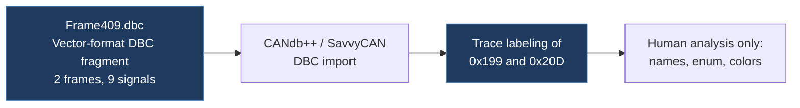

# mcirish-TeslaModelS_RefreshCAN.dbc

Deep-dive analysis per the `legacy-repo-deep-dive` contract. This is a data-only catalog repo: two files, one commit, zero code. The analysis below is deliberately honest about that — there is no pipeline to diagram and no test to read.

## 1. Provenance

- **Submodule path:** `legacy/mcirish-TeslaModelS_RefreshCAN.dbc`
- **Pinned gitlink (canonical form):** `160000 0bdd9b6420fada5692f0d20bcfcf1231ac01af1c 0`
- **Upstream URL:** <https://github.com/mcirish/TeslaModelS_RefreshCAN.dbc> (fetch/push, `origin`)
- **License:** None found — `git -C legacy/mcirish-TeslaModelS_RefreshCAN.dbc ls-files` shows exactly two files (`Frame409.dbc`, `README.md`); no LICENSE, no license header, no license statement in the README.
- **Analysis date:** 2026-11-21
- **Mode:** Replace (this doc supersedes the prior shallow summary). The pre-replace summary still exists in git history; its claims are cited below as `git show HEAD:docs/legacy/mcirish-TeslaModelS_RefreshCAN.dbc.md#<line>`.
- **Frontmatter preservation:** preserved byte-for-byte from the pre-replace doc (lines 1–9 of the HEAD blob). The description line carries no trailing whitespace (verified raw-byte scan of the HEAD blob: zero trailing spaces/tabs on all 58 lines), so no strip was needed. The inherited description text ends mid-sentence ("Contains a single DBC") — kept as-is, per the replace-mode rule that preserved bytes are not edited. One mechanical change: the pre-replace file used CRLF line endings throughout; this rewrite uses LF per repo hygiene.
- **Upstream sections preserved:** None found — the pre-replace doc contained no `## Upstream (...)` sections, so there was nothing to carry forward.
- **Other pre-replace defects dropped with the rewrite:** the old doc had two `## Architecture` headings (blob lines 17 and 34).

**Files read:**

| File | Lines | Coverage label |
| --- | --- | --- |
| `legacy/mcirish-TeslaModelS_RefreshCAN.dbc/Frame409.dbc` | 1–65 (entire file, 1999 bytes) | FULL-READ |
| `legacy/mcirish-TeslaModelS_RefreshCAN.dbc/README.md` | 1–2 (entire file) | FULL-READ |
| `firmware/lib/vehicle/can/ids.h` (our side) | 1–122 | FULL-READ |
| `firmware/lib/vehicle/can/handler/bus/vehicle.h` (our side) | 1–535 | FULL-READ |
| `firmware/lib/vehicle/can/feature/telemetry/vehicle_config.h` (our side) | 1–142 | FULL-READ |
| `packages/protocol/src/decoder.ts` (our side) | 1–60 | RANGE-CITED |
| `tools/lib/canExport.js` (our side) | 1–80 | RANGE-CITED |

**Files explicitly NOT read:** none on the upstream side — `git -C legacy/mcirish-TeslaModelS_RefreshCAN.dbc ls-files` returns exactly the two files above; there are no hidden dot-directories, no CI, no `.github/`. On our side, `client/src/docs/_generated-docs.ts` was inspected by grep only (it is an auto-generated mirror of the pre-replace doc text and must not be hand-edited; it will refresh on the next docs regeneration).

## 2. Executive verdict

This repo is a placeholder for Model S Refresh CAN reverse-engineering, and it contains almost nothing: a 65-line Vector-format DBC fragment (`Frame409.dbc`) defining exactly two frames — 0x199/409 with four 6-bit corner ride-height signals tiled across bits 40–63 plus five unnamed placeholder bytes, and 0x20D/525 with a 2-bit ride-height selector enum (raw 0–3 mapped Very_High/High/Medium/Low, physical scale ×5) — plus a two-line README saying "Place Holder". There is no code, no pipeline, no capture, no test, and no license. Nothing here should be ported as-is: both layouts are single-sourced, their units are literally `"tbd"`, they carry no counter/checksum/period/bus attributes, the DBC formally flags both frames as 29-bit extended IDs (almost certainly a CANdb++ import artifact on an 11-bit Tesla bus), and they describe Model S/X air suspension, which our Model 3/Y-focused pipeline intentionally does not decode. The only durable value is the 6-bit-per-corner packing scheme of frame 409 as a starting hypothesis if Model S/X support is ever added — capture-first, never copy.

## 3. Evidence map

| Source file | Lines | What it proves | Grade |
| --- | --- | --- | --- |
| `Frame409.dbc` | 36 | `BO_ 2147484057 Vector__XXXMsg409: 8` — message "Msg409", DLC 8, sender `Vector__XXX`; 2147484057 = 0x80000000 + 0x199, so the Vector extended-frame flag is set over ID 409 dec | CODE-READ |
| `Frame409.dbc` | 37–41 | Five 8-bit unsigned little-endian placeholder signals `Sig1..Sig5` at start bits 0/8/16/24/32 (bytes 0–4), scale 1, offset 0, bogus range `[0\|1]`, empty unit | CODE-READ |
| `Frame409.dbc` | 42–45 | Four 6-bit unsigned LE signals `Height_LF/RF/LR/RR` at start bits 40/46/52/58, scale 1, offset 0, unit `"tbd"` — contiguous tiling of bits 40–63 (bytes 5–7) with no gaps or overlap | CODE-READ |
| `Frame409.dbc` | 47 | `BO_ 2147484173 Vector__XXXMsg525: 8` — ID 525 dec = 0x20D with extended flag, DLC 8 | CODE-READ |
| `Frame409.dbc` | 48 | `Sig352`: start bit 36, 2 bits, LE, unsigned, scale **5**, offset 0, range `[0\|15]`, unit `"Selected"` — byte 4 bits 4–5; physical = raw×5 → 0/5/10/15 | CODE-READ |
| `Frame409.dbc` | 65 | `VAL_` enum for Sig352: raw 0=Very_High, 1=High, 2=Medium, 3=Low | CODE-READ |
| `Frame409.dbc` | 4–33, 50–64 | Stock Vector `NS_` template; the only attributes are display colors (`GenMsgBackgroundColor/ForegroundColor`) and repeated tool cruft (`matchingcriteria`/`filterlabeling` ×5). No `CM_` comment, no `SG_MUL_VAL_` mux, no `GenMsgCycleTime` period, no CRC/checksum attribute anywhere in the file | CODE-READ |
| `README.md` | 1–2 | Author declares it a "Place Holder for CAN bus signal reverse engineering efforts" — the README makes no claim about any frame | CODE-READ |
| submodule `git ls-files` / `git log --all` | — | Repo = 2 files, 1 branch (`main`), 0 tags, 1 total commit; no LICENSE, no code, no tests, no CI | CODE-READ |
| `git show HEAD:docs/legacy/mcirish-TeslaModelS_RefreshCAN.dbc.md#L32` | — | Pre-replace claim "License: None" — agrees with the empty license situation above (this is an agreement, listed here as evidence) | SUMMARY-ONLY |

Reading coverage: `Frame409.dbc` and `README.md` were both FULL-READ. No TEST-READ evidence exists: this repo ships no tests. No CAPTURE evidence exists in this repo — neither frame layout has ever been validated against a bus capture here.

## 4. Architecture and build surface

None found: no frame pipeline in this repo. There is no executable code, no build system, no dependencies, and no shared-core/platform split — only a static DBC fragment. For context, the artifact's intended consumption path (inferred from the Vector dialect, not implemented anywhere in this repo):



Format note relevant to us: the file is written in the same Vector DBC dialect our own exporter produces — `tools/lib/canExport.js:55` falls back to the `Vector__XXX` node name and `tools/lib/canExport.js:62` emits the same `SG_` line shape. Our exporter honestly marks its placeholder layouts as unknown (`tools/lib/canExport.js:38–39`); this upstream file shows the inverse failure mode — real bit positions, but bogus `[0|1]` ranges, `"tbd"` units, and an extended-ID flag artifact.

## 5. Mechanism catalogue

### Frame 409 (0x199) corner ride-height layout

- **Claim (README / summary):** README makes no frame claim. Pre-replace doc: "air suspension ride height sensors (Frame 409)" (`git show HEAD:docs/legacy/mcirish-TeslaModelS_RefreshCAN.dbc.md#L15`, `#L41`).
- **Code path:** `Frame409.dbc:36` `BO_` definition → `:42–45` `SG_` signal definitions. Static catalog — no runtime path exists.
- **Frame spec:** ID 0x199 (409 dec; DBC stores 0x80000199), DLC 8, bus unknown (`BU_` empty, no bus attribute). Bytes 0–4: five 8-bit placeholder signals `Sig1..Sig5` at start bits 0/8/16/24/32, scale 1, unit empty. Bytes 5–7: four contiguous 6-bit unsigned LE heights — `Height_LF` start bit 40 (byte 5 bits 0–5), `Height_RF` start bit 46 (byte 5 bits 6–7 + byte 6 bits 0–3), `Height_LR` start bit 52 (byte 6 bits 4–7 + byte 7 bit 0), `Height_RR` start bit 58 (byte 7 bits 2–7). All scale 1, offset 0, unit `"tbd"`. Counter position: None found. Checksum: None found.
- **Gates and timing:** None found (no `GenMsgCycleTime`, no mux, no conditions).
- **State machine:** None found.
- **Tests:** None found — the repo ships no tests.
- **Evidence grade:** CODE-READ
- **Verdict:** PARTIAL — the bit layout is concrete and internally consistent (the four 6-bit fields tile bits 40–63 with no gap or overlap), but the "air suspension ride height" semantics are naming inference only: the file contains no comments and marks every Height unit `"tbd"`.
- **Adapt to TeslaCANModder?** no impact — Model S/X air suspension is outside our Model 3/Y target; capture-first reference if Model S/X support is ever added.

### Frame 525 (0x20D) ride-height selector enum

- **Claim (README / summary):** README makes no frame claim. Pre-replace doc: "Suspension ride height selector ... values: 0=Very_High, 1=High, 2=Medium, 3=Low" (`git show HEAD:docs/legacy/mcirish-TeslaModelS_RefreshCAN.dbc.md#L47–48`).
- **Code path:** `Frame409.dbc:47` `BO_` definition → `:48` `SG_` definition → `:65` `VAL_` enum table. Static catalog.
- **Frame spec:** ID 0x20D (525 dec; DBC stores 0x8000020D), DLC 8, bus unknown. `Sig352`: start bit 36, 2 bits, LE, unsigned → byte 4 bits 4–5. Scale 5, offset 0, range `[0|15]`, unit `"Selected"` → physical values 0/5/10/15. Raw enum: 0=Very_High, 1=High, 2=Medium, 3=Low (`:65`). The other 62 bits are undefined. Counter position: None found. Checksum: None found.
- **Gates and timing:** None found.
- **State machine:** None found — the four enum values are signal states, not a machine with transitions.
- **Tests:** None found.
- **Evidence grade:** CODE-READ
- **Verdict:** CONFIRMED as a DBC definition — the enum and value list match the pre-replace doc exactly, and the definition additionally carries a ×5 scale the old summary omitted. The "suspension selector" semantics remain naming inference (unit `"Selected"` only).
- **Adapt to TeslaCANModder?** no impact — same Model S/X scope argument; possible reference for a future MS ride-height UI control.

## 6. Summary vs code contradiction table

Pre-replace claims cited from git history: `git show HEAD:docs/legacy/mcirish-TeslaModelS_RefreshCAN.dbc.md#<line>`.

| Pre-replace claim | Code says | Verdict |
| --- | --- | --- |
| `#L15` "one for air suspension ride height sensors (Frame 409)" | Zero `CM_` comment lines exist in the file; all four Height signals carry unit `"tbd"` (`Frame409.dbc:42–45`); the README claims nothing about frames (`README.md:2`) | PARTIAL — the layout is real, but "air suspension" is unevidenced interpretation inherited from the old summary; downgrade to SUMMARY-ONLY until a capture confirms it |
| `#L42–45` "`Height_LF` — Left front ride height (6 bits, offset 40)" etc. | The DBC start bits are 40/46/52/58 with physical offset component **0** (`(1,0)` at `Frame409.dbc:42–45`) | CONTRADICTED — conflates the DBC start-bit field with the decode offset; treating 40/46/52/58 as physical offsets would corrupt any decode; correct physical = raw × 1 + 0 |
| `#L48` "Sig352 — 2-bit signal at offset 36" | Start bit 36, offset 0, and scale **5** (`(5,0)` at `Frame409.dbc:48`) | CONTRADICTED — same start-bit/offset conflation, plus it omits the ×5 scale (physical values are 0/5/10/15, range `[0\|15]`) |
| `#L41`, `#L47` "CAN ID 409 (0x199)" / "CAN ID 525 (0x20D)" | `BO_` values are 2147484057 / 2147484173 = 0x80000000 + ID — the extended-frame flag is set (`Frame409.dbc:36,47`) | PARTIAL — the dec/hex mapping is correct, but the summary hides that the file formally declares 29-bit extended-ID frames; on an 11-bit-standard Tesla bus this is almost certainly a CANdb++ import artifact. Unverified either way |
| `#L15` "one for a suspension-related selector (Frame 525)" | The signal is `Vector__XXXMsg525Sig352`, unit `"Selected"` (`Frame409.dbc:48`); nothing ties it to suspension | PARTIAL — inference presented as fact |

Agreements (not contradictions, recorded in section 3): "License: None" (`#L32`), "Plus 5 undefined 8-bit signals in bytes 0–4" (`#L46` vs `Frame409.dbc:37–41`), the enum value list (`#L48` vs `:65`), and "Very minimal content" (`#L15`).

## 7. CAN frame and signal inventory

Catalog note: `Frame409.dbc` is a 65-line data catalog, FULL-READ, and the table below lists **every** frame it defines (both of them) — nothing is dumped wholesale. The repo contains no code that decodes, mutates, or injects anything; both entries are pure definitions, so the "read or write" column is "definition only".

| ID (hex + dec) | Bus | Period | DLC | Byte/bit layout | Scale / units | Counter | Checksum | Read or write | Grade |
| --- | --- | --- | --- | --- | --- | --- | --- | --- | --- |
| 0x199 (409) | unknown — `BU_` empty, no bus attribute | None found | 8 | Bytes 0–4: five 8-bit placeholders (start bits 0/8/16/24/32). Bytes 5–7: four contiguous 6-bit unsigned LE heights — LF start 40, RF start 46, LR start 52, RR start 58 | Heights: scale 1, offset 0, unit `"tbd"`; placeholders: scale 1, unit empty | None found | None found | Definition only — repo never decodes or transmits | CODE-READ |
| 0x20D (525) | unknown | None found | 8 | Byte 4 bits 4–5 (start bit 36): 2-bit selector; remaining 62 bits undefined | Scale 5, offset 0, range 0–15, unit `"Selected"`; raw enum 0=Very_High, 1=High, 2=Medium, 3=Low | None found | None found | Definition only | CODE-READ |

## 8. Constants and tuning table

| Constant | Value | File:line | Meaning | Grade |
| --- | --- | --- | --- | --- |
| Sig352 scale | 5 | `Frame409.dbc:48` | Physical = raw × 5 → selector positions 0/5/10/15; the pre-replace doc omitted this entirely | CODE-READ |
| Height start bits | 40 / 46 / 52 / 58 | `Frame409.dbc:42–45` | Contiguous 6-bit tiling of bits 40–63 (bytes 5–7) | CODE-READ |
| Height width | 6 bits per corner | `Frame409.dbc:42–45` | Four corners packed with no gaps or overlap | CODE-READ |
| Extended-ID flag | 0x80000000 (BO_ values 0x80000199, 0x8000020D) | `Frame409.dbc:36,47` | Vector DBC convention: `BO_` ID bit 31 marks extended frames — artifact or intent unknown on an 11-bit Tesla bus | CODE-READ |
| Placeholder ranges | min/max 0–1 on 8-bit signals | `Frame409.dbc:37–41` | Authoring defect: any real traffic byte above 1 will be flagged out-of-range by importing tools | CODE-READ |

## 9. Failure modes and edge cases

This is a static data artifact — the rows below are the data-quality failure modes an importer inherits.

| Failure | Handling in repo | Tested? | Grade |
| --- | --- | --- | --- |
| No `CM_` frame/signal comments — semantics live only in signal names, all Height units are `"tbd"` | None found — nothing validates semantics | None found | CODE-READ |
| min/max `[0\|1]` on the five 8-bit placeholder signals | None found — importing tools will report out-of-range errors for any real byte value above 1 | None found | CODE-READ |
| No counter, no checksum, no cycle-time, no mux attributes on either frame | None found — the DBC cannot validate, schedule, or integrity-check these frames against live captures | None found | CODE-READ |
| Extended-ID flag set on both `BO_` entries | None found — tools filtering on 29-bit extended IDs will silently miss 11-bit standard traffic for 0x199/0x20D if the flag is an import artifact | None found | CODE-READ |

## 10. Test coverage map

None found — the repo ships no tests. No TEST-READ evidence exists.

Critical untested path, stated as risk: both frame layouts are single-sourced from one author's DBC entry with zero capture validation and zero tooling to catch typos. Any decode built from this file inherits all four failure modes of section 9 unverified.

## 11. Parity matrix with TeslaCANModder

No frame-level overlap exists between this repo and our shipping decode pipeline, so there is nothing to arbitrate byte-for-byte. The Model S/X context matters, though: our target platform is Model 3/Y, which ships coil suspension — a dedicated ride-height frame set is a legitimate MS/X platform difference, not a decode gap on our side.

| Signal / frame | Upstream definition (cite) | Our decode (cite) | Delta | Action |
| --- | --- | --- | --- | --- |
| 0x199 corner ride heights | `Frame409.dbc:36,42–45` — four 6-bit LE heights, bits 40–63, scale 1, unit `"tbd"` | Absent, verified: full ID catalog `firmware/lib/vehicle/can/ids.h:15–78` (read 1–122) lists no 0x199; vehicle-bus dispatch `firmware/lib/vehicle/can/handler/bus/vehicle.h:47–535` has no branch for it | We decode nothing at this ID | Ignore — MS/X air suspension, out of Model 3/Y scope |
| 0x20D ride-height selector | `Frame409.dbc:47–48,65` — 2-bit at bit 36, scale 5, raw enum 0–3 | Absent, verified: same two our-side citations, plus demonstrated negative greps over `firmware/lib`, `packages/protocol/src`, `tools/lib` (section 16, anchors A6/A8) | We decode nothing at this ID | Ignore — same scope argument |
| Vehicle model identity (context row) | Upstream implies Model S Refresh via repo name only — no file content states a model | `firmware/lib/vehicle/can/feature/telemetry/vehicle_config.h:55–85` decodes the 0x398 platform nibble including `VEHICLE_MODEL_S` (`:64`) and `VEHICLE_MODEL_X` (`:67`) | We can *recognize* an MS/X platform but decode no suspension frames for it | Ignore until a Model S capture exists |

## 12. Surface inventory and security notes

- **Transport surfaces:** None found — no serial, BLE, web, or any other command surface; the repo exposes two data files and nothing else.
- **Provenance / security findings:** no credentials, keys, certificates, archives, or build flags anywhere in the two files. The one real trap is data-shape, not security: the extended-ID flag (section 9) will misroute imports of this DBC against standard-11-bit captures.
- **License:** None found. Unlicensed content — this is the strongest reason to treat the file as a reference and never copy its text into shipping code (see section 14).
- **Upstream hygiene observation:** `README.md:2` carries trailing whitespace ("efforts.  "); legacy is read-only, so it stays as-is.

## 13. Adaptation assessment

| Mechanism | Value | Cost | Risk | Evidence grade | Decision |
| --- | --- | --- | --- | --- | --- |
| Frame 409 height layout | Low — MS/X-only feature; our pipeline targets Model 3/Y coil suspension | Low — one decode branch plus State fields | Medium — single-sourced, unit `"tbd"`, no capture validation; a wrong scale would surface garbage heights silently | CODE-READ (layout), no CAPTURE | No impact now; capture-first reference if Model S/X support is ever added |
| Frame 525 selector enum | Low — MS UI convenience only | Low | Medium — same single-source caveat; the ×5 scale needs capture proof before any use | CODE-READ, no CAPTURE | No impact now; same capture-first condition |
| Vector DBC authoring conventions (as data-format lesson) | Informational | Zero | None | CODE-READ both sides | Already present — our `tools/lib/canExport.js:38–39` already flags its placeholder layouts as unknown instead of inventing ranges; keep that honesty |

## 14. Do-not-copy list

- `Frame409.dbc:37–41` — placeholder signals `Sig1..Sig5` with `[0|1]` ranges on 8-bit fields: tool cruft; copying imports the authoring defect into any decoder.
- `Frame409.dbc:50–64` — `BA_DEF_`/`BA_` display-color attributes and the five-times-repeated `matchingcriteria`/`filterlabeling` definitions: pure CANdb++ cruft, zero semantic value.
- `Frame409.dbc` wholesale — the repo is unlicensed (no LICENSE file); no text from it may be copied into shipping code. Port only behavior/layout, re-derived from captures with independent verification, with attribution of the idea and `derived idea, independent implementation` on any resulting work.
- `README.md:1–2` — no technical content; nothing to copy in either direction.

## 15. History and evolution

Mined from the submodule's local `git log` (no network claims):

- Exactly one commit across all refs (`git log --all` → 1 line): `0bdd9b6420fada5692f0d20bcfcf1231ac01af1c`, 2023-11-08 15:08:15 -0500, "Add files via upload", author mcirish `<mail2tom2@gmail.com>`. It is the root commit.
- One branch (`main`, plus `origin/main`), zero tags.
- Nothing was tried, abandoned, or rolled back in the visible history — there is no history before the pin. The commit is a GitHub web-UI bulk upload ("Add files via upload"), consistent with a one-shot share of a CANdb++ export.
- Network-only context (issues, PRs, upstream discussions): not investigated; any such claim would be UNVERIFIED.

## 16. Re-verification recipe

Pinned snapshot: `160000 0bdd9b6420fada5692f0d20bcfcf1231ac01af1c 0` (gitlink form from `git ls-files -s legacy/mcirish-TeslaModelS_RefreshCAN.dbc`; matches `git -C legacy/mcirish-TeslaModelS_RefreshCAN.dbc rev-parse HEAD`, clean working tree at analysis time).

```bash
OLD=0bdd9b6420fada5692f0d20bcfcf1231ac01af1c
git ls-files -s legacy/mcirish-TeslaModelS_RefreshCAN.dbc   # compare gitlink to rev-parse HEAD
git -C legacy/mcirish-TeslaModelS_RefreshCAN.dbc rev-parse HEAD
git -C legacy/mcirish-TeslaModelS_RefreshCAN.dbc status --porcelain
git -C legacy/mcirish-TeslaModelS_RefreshCAN.dbc fetch --tags --prune
git -C legacy/mcirish-TeslaModelS_RefreshCAN.dbc log --oneline $OLD..origin/main
git -C legacy/mcirish-TeslaModelS_RefreshCAN.dbc diff --stat $OLD..origin/main
```

The upstream file is tiny; if the bump adds anything beyond these two anchors' lines, re-read the whole file.

**Upstream anchors** (run from inside `legacy/mcirish-TeslaModelS_RefreshCAN.dbc`; all demonstrated at write time):

```text
grep -nE 'BO_ 2147484057|BO_ 2147484173' Frame409.dbc
  -> expect lines 36 and 47 (the BA_ line 64 also matches 2147484057 for the color attribute)

grep -nE 'Height_(LF|RF|LR|RR)' Frame409.dbc
  -> expect lines 42-45 with start bits 40|46|52|58, width 6, unit "tbd"

grep -nE 'Sig352' Frame409.dbc
  -> expect line 48 (SG_ definition, scale (5,0)) and line 65 (VAL_ enum)

grep -nE '\(5,0\)' Frame409.dbc
  -> expect exactly line 48 (the x5 selector scale)

grep -nE 'Place Holder' README.md
  -> expect line 2 (note: upstream line carries trailing whitespace; do not "fix" it)
```

**Upstream negative anchors** (absence claims, demonstrated at write time — exit 1, no output):

```text
grep -nE '^SG_MUL_VAL_|^CM_|GenMsgCycleTime|CRC|checksum' Frame409.dbc -> no output
  (no comments, no mux, no period attribute, no checksum anywhere outside the NS_ template block)
```

**Our-side drift anchors** (the "absent from our decode" decisions rest on these; run from repo root, demonstrated at write time):

```text
git grep -nE '0x199|0x20D' -- firmware/lib/vehicle/can/ids.h            -> no output (neg, exit 1)
git grep -nE '0x199|0x20D' -- firmware/lib packages/protocol/src tools/lib -> no output (neg, exit 1)
git grep -nE 'CAN_ID_FSD_MUX' -- firmware/lib/vehicle/can/ids.h         -> expect line 25 (positive control that the grep style hits this file)
git grep -nE 'VEHICLE_MODEL_S' -- firmware/lib/vehicle/can/feature/telemetry/vehicle_config.h
  -> expect lines 20, 38, 64, 116 (Model S recognized as a platform, no suspension decode)
git grep -nE 'Height_LF|Msg525Sig352|Vector__XXX' -- firmware/lib packages/protocol/src tools client/src
  -> expect only client/src/docs/_generated-docs.ts:8517 (auto-generated mirror of the pre-replace doc)
     and tools/lib/canExport.js:55,62 (our own exporter's Vector-dialect fallbacks) — no decoder hits
```

If line numbers drift by more than ~10, re-read the whole file/section; do not trust this document's numbers. Pre-pin upstream history: none exists — the pinned SHA is the root commit, so there was nothing before the pin to review.

## 17. Open questions and explicitly not investigated

UNVERIFIED items (each names what would settle it):

- Whether 0x199/0x20D appear on Model 3/Y buses at all, or with different content — no M3/Y capture was consulted; our `docs/reference/can-ids.md` lists neither ID. A chassis/vehicle capture from a Model 3/Y would settle it.
- Physical scale and units of the four Height signals — unit is literally `"tbd"`, scale 1. An MS Refresh capture correlated with a known ride height would settle it.
- Whether the extended-ID flag (0x80000000) is intended or a CANdb++ import artifact — a raw 11-bit capture of 0x199/0x20D would settle it.
- Which bus carries these frames on a Model S Refresh — the DBC has an empty `BU_` and no bus attribute.
- The "air suspension" semantics of frame 409 and the "suspension selector" semantics of frame 525 — naming inference only (no `CM_` comments).

Explicitly not investigated:

- Upstream GitHub issues/PRs/discussions (network-only claims stay UNVERIFIED).
- `client/src/docs/_generated-docs.ts` regeneration timing — it mirrors the pre-replace doc text and is auto-generated; it was not hand-edited here.
- Side observation found during parity work, out of this repo's scope but recorded so it is not lost: our own `docs/reference/can-protocol.md` 0x398 platform-ID table (1=Model 3, 2=Model Y, 3=Model S, 4=Model X) disagrees with the code at `firmware/lib/vehicle/can/feature/telemetry/vehicle_config.h:63–71` (1=Model S, 2=Model X, 3=Model 3, 4=Model Y). UNVERIFIED which mapping is correct — needs a 0x398 capture from a vehicle of known model; flagged for the firmware team, not fixed in this doc.
