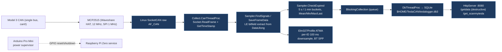
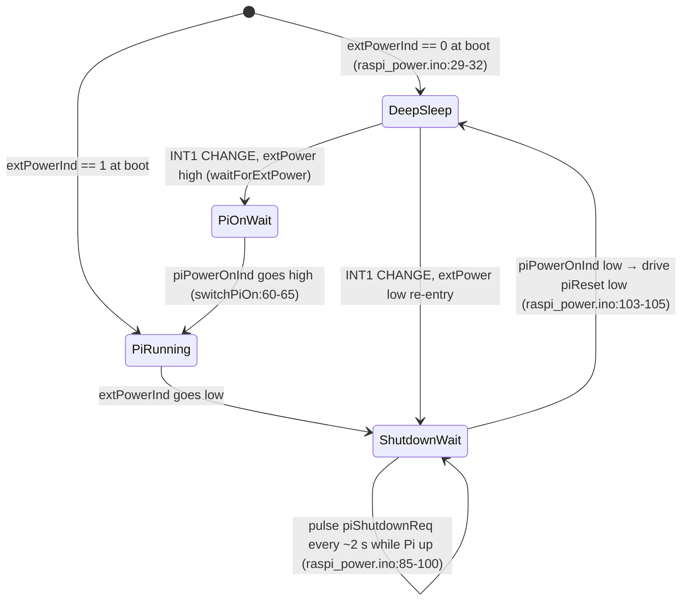

# mgerczuk-TeslaCANPi

## 1. Provenance

- Submodule path: `legacy/mgerczuk-TeslaCANPi`
- Pinned gitlink (canonical form from `git ls-files -s`): `160000 c9b82d3a97a922b617d739aee0ec30e4a5192cb4 0`
- `git -C legacy/mgerczuk-TeslaCANPi rev-parse HEAD`: `c9b82d3a97a922b617d739aee0ec30e4a5192cb4` (matches gitlink)
- `git -C legacy/mgerczuk-TeslaCANPi status --porcelain`: empty (clean worktree)
- Last commit: `c9b82d3` — `Doku update` — Martin <martin@gerczuk.de> — 2020-12-10T18:42:46+01:00
- Upstream URL: `https://github.com/mgerczuk/TeslaCANPi`
- License: Apache-2.0 (LICENSE, verified by reading the file; vendored exceptions in section 12)
- Nested submodules (checked out, both external dependencies):
    - `VisualStudio/Mono.BlueZ` @ `d9e3797195fb40d286219a3a579263d67a15b12d` (`https://github.com/mgerczuk/Mono.BlueZ.git`)
    - `VisualStudio/DbcParser/model3dbc` @ `c61be330c24e252ec5e422d050394a1345f5e181` (`https://github.com/joshwardell/model3dbc.git`, contains `Model3CAN.dbc`)
- Analysis date: 2026-11-21
- Mode: **replace**. The pre-replace summary is cited below as `git show HEAD:docs/legacy/mgerczuk-TeslaCANPi.md#<line>`. The replaced file had YAML frontmatter (preserved above byte-for-byte; no description-line trailing whitespace was present to strip; file line endings normalized CRLF→LF per output hygiene). The pre-replace doc contained **no** `## Upstream (...)` sections (verified by grep — no matches), so none were preserved. The pre-replace blob is `13590536e2858cda2e5a9feebdf6c082b6b1bb25` (`git hash-object` of `HEAD:docs/legacy/mgerczuk-TeslaCANPi.md`).

Files read (full, with line ranges):

| File | Lines read | Coverage label |
| --- | --- | --- |
| `VisualStudio/TeslaCAN/Program.cs` | 1-69 | FULL-READ |
| `VisualStudio/TeslaCAN/CanDB/Model3.cs` | 1-39 | FULL-READ |
| `VisualStudio/TeslaCAN/CanDB/Json.cs` | 1-117 | FULL-READ |
| `VisualStudio/TeslaCAN/CanDB/Model3CAN.json` | 1-1480, 2780-3022 full; middle (1481-2779) pattern-verified CellVoltages mux repetition | RANGE-CITED |
| `VisualStudio/TeslaCAN/SocketCAN/Frame.cs` | 1-96 | FULL-READ |
| `VisualStudio/TeslaCAN/SocketCAN/Socket.cs` | 1-164 | FULL-READ |
| `VisualStudio/TeslaCAN/SocketCAN/CanEndPoint.cs` | 1-34 | FULL-READ |
| `VisualStudio/TeslaCAN/SocketCAN/Convert.cs` | 1-46 | FULL-READ |
| `VisualStudio/TeslaCAN/SocketCAN/SocketAddress.cs` | 1-52 | FULL-READ |
| `VisualStudio/TeslaCAN/TeslaLogger/Collect.cs` | 1-109 | FULL-READ |
| `VisualStudio/TeslaCAN/TeslaLogger/Sampler.cs` | 1-337 | FULL-READ |
| `VisualStudio/TeslaCAN/TeslaLogger/DbId.cs` | 1-170 | FULL-READ |
| `VisualStudio/TeslaCAN/TeslaLogger/Database.cs` | 1-189 | FULL-READ |
| `VisualStudio/TeslaCAN/TeslaLogger/HttpServer.cs` | 1-268 | FULL-READ |
| `VisualStudio/TeslaCAN/TeslaLogger/ValueBase.cs` | 1-60 | FULL-READ |
| `VisualStudio/TeslaCAN/TeslaLogger/ValueInt.cs` | 1-72 | FULL-READ |
| `VisualStudio/TeslaCAN/TeslaLogger/ValueUInt.cs` | 1-70 | FULL-READ |
| `VisualStudio/TeslaCAN/Elm327/Elm327Bluetooth.cs` | 1-114 | FULL-READ |
| `VisualStudio/TeslaCAN/Elm327/Elm327Profile.cs` | 1-250 | FULL-READ |
| `VisualStudio/TeslaCAN/Elm327/BluezAgent.cs` | 1-74 | FULL-READ |
| `VisualStudio/TeslaCAN/Syslog.cs` | 1-88 | FULL-READ |
| `VisualStudio/TeslaCAN/SQLite.cs` | 1-40 only (vendored third-party sqlite-net, no Tesla logic) | RANGE-CITED |
| `VisualStudio/TeslaCANTests/TeslaLogger/SamplerTests.cs` | 1-236 | FULL-READ |
| `Arduino/raspi_power.ino` | 1-126 | FULL-READ |
| `VisualStudio/DbcParser/Program.cs` | 1-182 | FULL-READ |
| `VisualStudio/DbcParser/DbcParserExt.cs` | 1-36 | FULL-READ |
| `VisualStudio/DbcParser/Network.cs` | 1-170 | FULL-READ |
| `VisualStudio/DbcParser/Dbc.g4` | 1-20 (ANTLR grammar header) | RANGE-CITED |
| `VisualStudio/DbcParser/model3dbc/Model3CAN.dbc` | BO_ header lines only (148 messages, DLCs) | STRUCTURAL-PARSE |
| `VisualStudio/TeslaCAN/TeslaCAN.csproj`, `TeslaCANTests.csproj`, `packages.config` × 3 | build refs | FULL-READ |
| `VisualStudio/Linux Service/TeslaCAN.service` | 1-9 | FULL-READ |
| `.gitmodules` | 1-8 | FULL-READ |
| `README.md` | 1-64 | FULL-READ (read after code, for comparison) |
| `LICENSE` | 1-3 | RANGE-CITED |

Files explicitly NOT read:

- `VisualStudio/TeslaCAN/Release.zip` (823 KB binary blob in-tree; never extracted — provenance unknown)
- `VisualStudio/Mono.BlueZ/**` (nested submodule, generic BlueZ D-Bus bindings; file list taken, no source read)
- `VisualStudio/DbcParser/model3dbc/Model3CAN.dbc` beyond BO_ headers (vendored 148-message catalog; STRUCTURAL-PARSE only)
- `Fritzing/power-rtc.fzz`, `Fritzing/power-rtc.png`, `Images/*.jpg` (binary hardware images)
- `VisualStudio/TeslaCAN/www/w3.css` (static W3.CSS asset, 23 KB)
- `.gitignore` (standard Visual Studio template, skimmed)
- `VisualStudio/TeslaCAN/SQLite.cs` beyond line 40 (vendored MIT sqlite-net, 146 KB)
- `App.config`, `AssemblyInfo.cs`, `TeslaCAN.sln` project GUIDs (non-load-bearing)

## 2. Executive verdict

A 2020 Raspberry Pi Zero CAN **logger** for Model 3: a Mono/.NET 4.6.1 service reads raw SocketCAN frames from a single `can0` bus, decodes 29 messages out of a DBC-derived embedded JSON catalog using little-endian bitfield extraction, aggregates signals into 5-second and 1-minute buckets, stores them in SQLite, and exposes them via an unauthenticated HTTP server plus a partial ELM327-over-Bluetooth-SPP emulation tuned for ScanMyTesla. An Arduino Pro Mini supervises Pi power. The repo is strictly passive on CAN — there is no frame mutation, no injection, no TX path at all, and no checksum/counter validation. Its durable value to TeslaCANModder is threefold: (1) a DBC-derived, unit-tested little-endian decode table that can serve as a capture checklist against our decoders, which read the same frames big-endian — a systematic contradiction worth a bench capture before either side is trusted; (2) the 0x401 CellVoltages layout (108 cells, mux 0-35) for a frame we filter but never decode; (3) the derived-SoC formula from already-decoded 0x352 inputs. Its HTTP self-update endpoint, auto-accept Bluetooth pairing, and destructive-read endpoints are anti-patterns to record, never port.

## 3. Evidence map

| Source file | Lines | What it proves | Grade |
| --- | --- | --- | --- |
| `Program.cs` | 29-61 | Composition root: Database → Collect → HttpServer → Elm327Bluetooth; SIGTERM thread stops all four | CODE-READ |
| `SocketCAN/Frame.cs` | 52 | `DataUlong` = `BitConverter.ToUInt64` over raw bytes → little-endian decode basis | CODE-READ |
| `SocketCAN/Frame.cs` | 86-94 | Linux `can_frame` struct: `can_id`@0, `can_dlc`@4, `data`@8 | CODE-READ |
| `SocketCAN/Socket.cs` | 42-47 | AF_CAN `SOCK_RAW` socket creation via Mono `Syscall.socket` | CODE-READ |
| `SocketCAN/Socket.cs` | 88-95 | `GetTimeStamp()` throws `NotSupportedException` on 64-bit OS (debug leftover `// test...`) | CODE-READ |
| `SocketCAN/Socket.cs` | 110-121 | RX-only surface: `ReadFrame`, no send/write method; SIOCGSTAMP=0x8906, SIOCGIFINDEX=0x8933 | CODE-READ |
| `TeslaLogger/Collect.cs` | 46-55 | Binds hardcoded interface `can0`; two background threads | CODE-READ |
| `TeslaLogger/Collect.cs` | 57-72, 93-95 | Stop path: 500 ms join, then `Thread.Abort()` fallback | CODE-READ |
| `CanDB/Model3.cs` | 25-35 | Runtime loads embedded resource `TeslaCAN.CanDB.Model3CAN.json` — not a DBC | CODE-READ |
| `CanDB/Json.cs` | 89-116 | `Signal` model has no `Fkt` or cycle field → JSON `"Fkt"` values silently dropped | CODE-READ |
| `CanDB/Json.cs` | 83-87 | `DbCycle` enum defined; no other usage in tree (dead code) | CODE-READ |
| `CanDB/Model3CAN.json` | 1-1480, 2780-3022 | 29 PDUs with BitPos/BitSize/Factor/Offset/Unit/TeslaloggerDbKey | CODE-READ |
| `TeslaLogger/Sampler.cs` | 29-31 | 5 s / 1 min bucket constants (`TicksPer5Sec`, `TicksPer1Min`) | CODE-READ |
| `TeslaLogger/Sampler.cs` | 52-68 | Mux-aware signal selection (`FindSignals`) | CODE-READ |
| `TeslaLogger/Sampler.cs` | 81-102 | Bucket expiry, "Unused data" silent drop at 1-min boundary | CODE-READ |
| `TeslaLogger/Sampler.cs` | 283-286 | Derived SoC: `(nominalRemaining - buffer) / (nominalFullPack - buffer) * 100` | CODE-READ |
| `TeslaLogger/ValueUInt.cs` | 34-39 | Little-endian bitfield extract: `(data >> BitPos) & mask` | CODE-READ |
| `TeslaLogger/ValueInt.cs` | 34-41 | Sign extension via `signMask`; 57-59: `Factor < 0` swaps Min/MaxIndex | CODE-READ |
| `TeslaCANTests/TeslaLogger/SamplerTests.cs` | 30-94 | `CheckExpiredTest`: 5 s/1 min bucket emission, Speed mean 55.0, ChargeTotal 20.5, DischargeTotal 10.5 | TEST-READ |
| `TeslaCANTests/TeslaLogger/SamplerTests.cs` | 96-154 | `FindSignalsTest`: 0x332 mux0/mux1 signal sets, 0x3D2 signals, unknown ID → 0 signals | TEST-READ |
| `TeslaCANTests/TeslaLogger/SamplerTests.cs` | 156-198 | `MinMaxTest`: 0x332 mux0 temp layout (mux<<2, num, temp×2 with +40), Min/MaxIndex tracking | TEST-READ |
| `TeslaCANTests/TeslaLogger/SamplerTests.cs` | 200-234 | `SaveFrameDataTest`: 0x3D2 LE u32 ×0.001 kWh decode (0x2710→10000 raw) | TEST-READ |
| `TeslaLogger/Database.cs` | 31-40 | SQLite open at `$HOME/TeslaCAN/teslalogger.db3`, auto-create table | CODE-READ |
| `TeslaLogger/Database.cs` | 129-159 | `SQLite3.Result.Busy` retry loops without backoff | CODE-READ |
| `TeslaLogger/Database.cs` | 59-99 | Destructive read: `GetRecord`/`GetOldestRecords` paired with delete | CODE-READ |
| `TeslaLogger/HttpServer.cs` | 68 | Binds `http://*:8080/` with no authentication | CODE-READ |
| `TeslaLogger/HttpServer.cs` | 143-177 | `/getdata?limit=N` (default 10) returns then deletes records | CODE-READ |
| `TeslaLogger/HttpServer.cs` | 209-247 | `/update` downloads ZIP from hardcoded `https://gitlab.fritz.box/...` and extracts over install dir | CODE-READ |
| `TeslaLogger/HttpServer.cs` | 121-133 | Listener restart on Socket/IO/HttpListener(500) errors only | CODE-READ |
| `Elm327/Elm327Bluetooth.cs` | 29-31 | SPP UUID `00001101-...-00805F9B34FB`, BlueZ object paths | CODE-READ |
| `Elm327/Elm327Bluetooth.cs` | 44-47, 78-81 | 60 s DBus startup wait; adapter Discoverable=true, Pairable=true | CODE-READ |
| `Elm327/Elm327Profile.cs` | 33 | Self-described scope: "Really simple ELM327 emulation. Just good enough to make ScanMyTesla work..." | CODE-READ |
| `Elm327/Elm327Profile.cs` | 59-107 | AT subset: ATZ, ATE, ATS, ATH, ATCAF, ATSP/ATSPA/ATSPB/ATSPC, ATMA/STM, STFAP, STDI | CODE-READ |
| `Elm327/Elm327Profile.cs` | 160-223 | ATMA opens second raw CAN socket; per-ID `DownSampler`, `BlockTimeMillis = 100` | CODE-READ |
| `Elm327/BluezAgent.cs` | 53-56 | `RequestConfirmation` logs and returns — pairing auto-accepted | CODE-READ |
| `Arduino/raspi_power.ino` | 3-7, 27-52, 108-126 | Power supervisor pins, deep sleep via INT1 CHANGE, re-arm loop | CODE-READ |
| `DbcParser/Program.cs` | 32-75 | Offline tool reads `model3dbc/Model3CAN.dbc`, writes JSON | CODE-READ |
| `DbcParser/Program.cs` | 78-95 | `CreateSignal` does not carry `TeslaloggerDbKey`/`Fkt` — regeneration would strip them | CODE-READ |
| `DbcParser/Network.cs` | 52-63 | DBC `startBit`/`length` parsed; `Byteorder` parsed at line 54 but never used | CODE-READ |
| `DbcParser/model3dbc/Model3CAN.dbc` | BO_ headers | 148 messages on node `VehicleBus`; DLC source for inventory | STRUCTURAL-PARSE |
| `TeslaCAN.csproj` | 38-56, 82, 86-93 | .NET 4.6.1; Newtonsoft 12.0.3, SharpZipLib 1.2.0, Mono.Posix; JSON+w3.css embedded; dbus-sharp/Mono.BlueZ.DBus project refs | CODE-READ |
| `TeslaCANTests.csproj` | compile items | Only `SamplerTests.cs` is tested | CODE-READ |
| `Linux Service/TeslaCAN.service` | 1-9 | systemd unit, no `User=` (runs as root) | CODE-READ |
| `README.md` | 1-64 | Hardware BOM, Raspbian buster, MCP2515 overlay 12 MHz/int 25/SPI 1 MHz, gpio-poweroff 17, gpio-shutdown 27, DS3231 | SUMMARY-ONLY |
| `LICENSE` | 1-3 | Apache-2.0 | CODE-READ |

No CAPTURE evidence exists in this repo: the TEST-READ asserts use synthetic hand-built frames, and no recorded vehicle trace ships in-tree. Every real-vehicle truth claim below is therefore CODE-READ/TEST-READ at best; frame-shape validation requires an independent bench capture.

## 4. Architecture and build surface

Entry point: `Program.Main` (`Program.cs:29-61`) — opens SQLite, starts `Collect` (CAN reader + DB writer threads), `HttpServer` (:8080), `Elm327Bluetooth` (BlueZ DBus loop), then blocks on a SIGTERM watcher that stops everything.

Shared core vs port: the whole tree is the port (Mono on Raspbian/armv6, `libc` P/Invoke for AF_CAN, BlueZ DBus via nested submodule). Build flags: none — plain MSBuild `.csproj`, .NET Framework 4.6.1, AnyCPU, no conditional compilation beyond vendored `#if WINDOWS_PHONE` blocks in SQLite.cs. Dependency boundary: everything Tesla-specific lives under `TeslaCAN/`; generic infrastructure is vendored (`SQLite.cs`, `Dbc.g4`) or nested-submoduled (`Mono.BlueZ`, `model3dbc`).

There is no mutate/gate/TX stage: `Socket.cs` exposes only `ReadFrame` (`Socket.cs:110-113`); grep for `Send|WriteFrame|sendmsg|CANWrite` in `SocketCAN/Socket.cs` returns nothing (demonstrated in section 16). The pipeline is RX → decode → aggregate → store → serve.



## 5. Mechanism catalogue

### SocketCAN raw RX collector

- **Claim (README / summary):** `git show HEAD:docs/legacy/mgerczuk-TeslaCANPi.md#40` — "starts database, CAN data collector, HTTP server, and Bluetooth ELM327 interface".
- **Code path:** `Collect.cs:46-55` — `Collect.Start()` → `new Socket(SOCK_RAW, Raw)` → `GetIfIndex("can0")` → `Bind` → `CanThreadProc` loop (`Collect.cs:74-96`) → `Sampler`.
- **Frame spec:** raw Linux `can_frame` (`Frame.cs:86-94`), no ID filtering in userspace — every frame on the bus is read and timestamped per-frame via `SIOCGSTAMP` ioctl (`Socket.cs:86-95`).
- **Gates and timing:** none — reads as fast as the bus delivers; no bus-off handling, no frame storm guard.
- **State machine:** None found — single read loop, `stopped` bool.
- **Tests:** None found — `Collect` has no test.
- **Evidence grade:** CODE-READ
- **Verdict:** CONFIRMED
- **Adapt to TeslaCANModder?** no impact — our MCP2515 driver + ring-buffer pipeline already covers RX; upstream's `Thread.Abort()` stop path is a do-not-copy.

### DBC-derived JSON bitfield decoder

- **Claim (README / summary):** `git show HEAD:docs/legacy/mgerczuk-TeslaCANPi.md#61` — "Parses frames using DBC definitions".
- **Code path:** `Model3.cs:25-35` (load embedded `Model3CAN.json`) → `Sampler.FindSignals` (`Sampler.cs:52-68`) → `ValueUInt.GetUIntValue` / `ValueInt.GetIntValue` (`ValueUInt.cs:34-39`, `ValueInt.cs:34-41`).
- **Frame spec:** little-endian: value = `(DataUlong >> BitPos) & ((1 << BitSize) - 1)`; signed extension for `SignalType.Signed`; physical = `raw * Factor + Offset`. Mux frames match `Multiplex.SignalName` value before selecting `Multiplex.Signals`. The runtime artifact is JSON, not DBC — DBC→JSON conversion is the separate offline `DbcParser` tool.
- **Gates and timing:** unknown CAN IDs return an empty signal list (`Sampler.cs:54`); no checksum or counter validation anywhere (all 29 frames decode on trust).
- **State machine:** None found.
- **Tests:** `FindSignalsTest` at `SamplerTests.cs:96-154` (mux selection, unknown ID → 0); `SaveFrameDataTest` at `SamplerTests.cs:200-234` (0x3D2 LE u32); `MinMaxTest` at `SamplerTests.cs:156-198` (0x332 mux0 layout, mux at bits 0-1 of byte 0, temps raw×0.5−40).
- **Evidence grade:** CODE-READ + TEST-READ
- **Verdict:** PARTIAL — decode math confirmed against synthetic frames; "parses using DBC definitions" is overstated (see section 6).
- **Adapt to TeslaCANModder?** candidate — the JSON layouts are a capture checklist against our big-endian decoders (section 11); port behavior (LE extraction is already our `Frame`-level convention question), never the C# code.

### 5 s / 1 min bucket aggregation with derived metrics

- **Claim (README / summary):** not mentioned in the pre-replace doc — discovered in code.
- **Code path:** `Sampler.cs:46-50` (`Start` aligns boundaries) → `SaveFrameData` → `CheckExpired` (`Sampler.cs:81-102`) → `GetFields` (`Sampler.cs:109-335`).
- **Frame spec:** None found — operates on decoded values, not frames.
- **Gates and timing:** 5 s buckets for fast signals (speed, voltage, current, power, torque, flows); 1 min buckets for slow ones (odometer, energy counters, SoC set, cell temps/voltages extremes). Consumption only emitted when `|speed.Mean| > 0.1` (`Sampler.cs:198-199`).
- **State machine:** two deadline registers (`next5Sec`, `next1Min`) re-armed from `Ticks / TicksPer5Sec + 1`.
- **Tests:** `CheckExpiredTest` at `SamplerTests.cs:30-94` — asserts exact bucket timestamps, exactly one message at the 5 s boundary containing only Speed, two records at the 1 min boundary (ChargeTotal 20.5 kWh, DischargeTotal 10.5 kWh via `Last`), Speed 55.0 via `Mean`.
- **Evidence grade:** CODE-READ + TEST-READ
- **Verdict:** CONFIRMED
- **Adapt to TeslaCANModder?** candidate — the Min/Max/Last-per-bucket with index-tracked "which cell was the hottest" pattern (`Sampler.cs:113-141`) is a good fit for our MQTT/status down-sampling; the silent drop at `Sampler.cs:96-100` is not.

### SQLite telemetry store with destructive reads

- **Claim (README / summary):** `git show HEAD:docs/legacy/mgerczuk-TeslaCANPi.md#41` — "SQLite database for CAN data storage".
- **Code path:** `Database.cs:31-40` (open/create) → `InsertRecords` (`Database.cs:51-57`) → `GetRecord`/`GetOldestRecords` (`Database.cs:59-99`).
- **Frame spec:** None found — rows are `(Timestamp, DbId, double Val)` triples (`Database.cs:167-187`), Timestamp indexed.
- **Gates and timing:** DB thread is the only writer; all access under `dbLock`.
- **State machine:** None found.
- **Tests:** None found.
- **Evidence grade:** CODE-READ
- **Verdict:** CONFIRMED (storage); the design is queue-to-DB, poll-and-delete for retrieval.
- **Adapt to TeslaCANModder?** no impact — we have no on-device SQL; if we ever add offline buffering, keep read-until-acked semantics, never delete-on-read (section 14).

### Unauthenticated HTTP telemetry/update server

- **Claim (README / summary):** `git show HEAD:docs/legacy/mgerczuk-TeslaCANPi.md#40,47` — "HTTP server", "Static CSS asset served by the built-in HTTP server".
- **Code path:** `HttpServer.cs:60-141` (`HttpThreadProc`, `HttpListener` on `http://*:8080/`) → per-path handlers.
- **Frame spec:** None found — JSON out only; `/getdata` returns `Database.GetUploadData` groups (`HttpServer.cs:159-165`), `/get_scanmytesla` returns one record group prefixed `0\r\n<now>\r\n` (`HttpServer.cs:249-258`).
- **Gates and timing:** `limit` query param default 10, `int.Parse` unvalidated (`HttpServer.cs:147-157`); records are deleted after a successful `/getdata` send (`HttpServer.cs:164-165`).
- **State machine:** restart-on-error loop limited to `SocketException`, `IOException`, `HttpListenerException` code 500 (`HttpServer.cs:121-133`); anything else rethrows and kills the HTTP thread.
- **Tests:** None found.
- **Evidence grade:** CODE-READ
- **Verdict:** CONFIRMED — and worse than the summary admits: no auth, plus a self-update endpoint.
- **Adapt to TeslaCANModder?** never port the `/update` mechanism; the destructive `/getdata` contract is also a do-not-copy (section 14). Our REST API already covers non-destructive telemetry.

### ELM327-over-SPP emulation with downsampled ATMA

- **Claim (README / summary):** `git show HEAD:docs/legacy/mgerczuk-TeslaCANPi.md#44,62` — "ELM327 Bluetooth protocol implementation", "Provides ELM327 Bluetooth interface for external app compatibility".
- **Code path:** `Elm327Bluetooth.cs:49-82` (register SPP profile + agent, make adapter discoverable/pairable) → `Elm327Profile.NewConnection` (`Elm327Profile.cs:232-241`) → `Run` command loop (`Elm327Profile.cs:42-120`) → `MonitorAll` (`Elm327Profile.cs:160-202`).
- **Frame spec:** ATMA output line = `{Id:X3}` + hex data bytes, CRLF-terminated, `\r>` prompt; headers/spaces/echo toggles honored (`Elm327Profile.cs:64-90`); banner `PiCan v1.0` on ATZ (`Elm327Profile.cs:61`).
- **Gates and timing:** per-ID downsample `DownSampler.CheckTime` with `BlockTimeMillis = 100` (`Elm327Profile.cs:206`, first frame passes immediately via `blockedUntil = Now-1min` at `Elm327Profile.cs:212`); monitor exits when the client sends any byte (`Elm327Profile.cs:168-180`).
- **State machine:** connected flag; `RequestDisconnection` clears it; exceptions in `Run` clear it too (`Elm327Profile.cs:115-119`).
- **Tests:** None found.
- **Evidence grade:** CODE-READ
- **Verdict:** PARTIAL — real and working by author admission only "good enough to make ScanMyTesla work" (`Elm327Profile.cs:33`); the summary's "external app compatibility" overstates a ~10-command subset.
- **Adapt to TeslaCANModder?** candidate — our firmware ships no ELM327 handler at all (see parity row 16 in section 11), and `docs/reference/commands.md` already advertises `elm327:on/off` without firmware backing; the 100 ms per-ID throttle is the portable idea.

### Arduino Pi power supervisor

- **Claim (README / summary):** `git show HEAD:docs/legacy/mgerczuk-TeslaCANPi.md#52` — "monitors external power, controls Pi startup/shutdown via GPIO, enters deep sleep when no power".
- **Code path:** `raspi_power.ino:108-126` (`loop`) → `waitForExtPower` (`raspi_power.ino:42-52`, INT1 CHANGE interrupt wakes `SLEEP_MODE_PWR_DOWN`) → `switchPiOn` (`raspi_power.ino:54-70`) / `switchPiOff` (`raspi_power.ino:79-106`).
- **Frame spec:** None found — pure GPIO. Pins: `piPowerOnInd=2`, `extPowerInd=3`, `piReset=4`, `piShutdownReq=8`, `powerLed=9` (`raspi_power.ino:3-7`); reset line mirrors power-on indicator at boot (`raspi_power.ino:14-18`).
- **Gates and timing:** shutdown request = 200 ms active-low pulse (`raspi_power.ino:72-77`), repeated every ~2 s while the Pi still reports power (`raspi_power.ino:85-100`); `switchPiOn` blocks with a 200 ms LED blink until the Pi raises its power-on line (`raspi_power.ino:60-65`).
- **State machine:**



- **Tests:** None found — no test harness; hardware-only verification.
- **Evidence grade:** CODE-READ
- **Verdict:** CONFIRMED
- **Adapt to TeslaCANModder?** no impact — different problem domain (ESP32-S has no Pi to supervise); concept of a hard reset line under external power sense is not applicable to our board.

### DBC → JSON offline converter

- **Claim (README / summary):** `git show HEAD:docs/legacy/mgerczuk-TeslaCANPi.md#48` — "DBC file parser library".
- **Code path:** `DbcParser/Program.cs:30-75` — ANTLR grammar (`Dbc.g4`) → `Network` (`Network.cs:151-164`) → JSON `Message`/`Signal` objects → `Model3CAN-out.json`.
- **Frame spec:** passthrough of DBC `startBit`/`length`/factor/offset/unit into JSON BitPos/BitSize (`Network.cs:52-63`, `DbcParser/Program.cs:83-94`).
- **Gates and timing:** runs offline at build/authoring time; error listener swallows syntax errors silently (`DbcParser/Program.cs:159-180`).
- **State machine:** None found.
- **Tests:** None found.
- **Evidence grade:** CODE-READ
- **Verdict:** PARTIAL — works as a converter but is lossy: `CreateSignal` never copies `TeslaloggerDbKey`/`Fkt`, so re-running it against the shipped JSON would strip every TeslaLogger mapping (`DbcParser/Program.cs:78-95`); `Byteorder` is parsed (`Network.cs:54`) and then ignored.
- **Adapt to TeslaCANModder?** no impact — our protocol data is authored TypeScript, and we would use a real DBC toolchain, not this lossy path.

## 6. Summary vs code contradiction table

Pre-replace claims are cited from git history, not from a live link: `git show HEAD:docs/legacy/mgerczuk-TeslaCANPi.md#<line>`.

| # | Pre-replace claim | Code evidence | Verdict |
| --- | --- | --- | --- |
| 1 | Frontmatter `description:` ends mid-word "The system incl" (line 3) | Frontmatter preserved byte-for-byte per policy; the truncation is recorded here, not edited | Stale frontmatter (kept, flagged) |
| 2 | "Parses frames using DBC definitions" (line 61) | `Model3.cs:27-33` loads an embedded JSON resource at runtime; DBC parsing is a separate offline tool (`DbcParser/Program.cs:32`) whose output is not the shipped file verbatim (see row 5) | CONTRADICTED — runtime artifact is JSON, not DBC |
| 3 | "Provides ELM327 Bluetooth interface for external app compatibility" (line 62) | `Elm327Profile.cs:33` — "Just good enough to make ScanMyTesla work"; command set is a ~10-AT subset (`Elm327Profile.cs:59-107`) | PARTIAL — generality overstated |
| 4 | "The DBC parser, SocketCAN bindings, and ELM327 Bluetooth implementation are well-architected reference implementations" (line 66) | `BluezAgent.cs:53-56` (pairing auto-accepted), `HttpServer.cs:68` (no-auth bind `*:8080`), `HttpServer.cs:209-231` (self-update from a hardcoded private host), `Socket.cs:88` (64-bit throw with `// test...` leftover) | CONTRADICTED as a blanket claim — concrete defects listed in sections 9/12 |
| 5 | "Data is compatible with the TeslaLogger project" (line 15) | `README.md:2` — "can be pulled by a **modifed** TeslaLogger"; no TeslaLogger-side patch exists in this repo | PARTIAL — the required TeslaLogger modification is neither shipped nor described |
| 6 | "DbcParser/ — DBC file parser library" (line 48) implies the shipped JSON is its output | `DbcParser/Program.cs:78-95` — `CreateSignal` drops `TeslaloggerDbKey`/`Fkt`, so the shipped `Model3CAN.json` (which contains both) cannot be the direct, current output of this tool | CONTRADICTED — provenance chain has a manual step |

Agreements that were verified and are recorded in the evidence map instead: Apache-2.0 license (LICENSE), MCP2515 12 MHz overlay + SPI 1 MHz (`README.md:37-38`), entry-point composition (`Program.cs:36-44`), systemd unit (`TeslaCAN.service`).

## 7. CAN frame and signal inventory

All 29 PDUs decoded from the embedded `Model3CAN.json` (decimal IDs as stored; bus = the single `can0` interface; the DBC sender node for all of them is `VehicleBus`). DLCs from `Model3CAN.dbc` BO_ headers (STRUCTURAL-PARSE). The repo transmits nothing — every row is read-only. No frame in this catalog carries a counter or checksum field in the decode, and none is validated. Period column: None found — the JSON carries no cycle metadata (`DbCycle` enum at `Json.cs:83-87` is dead code).

| ID (hex+dec) | Bus | Period | DLC | Byte/bit layout (LE) | Scale/units | Counter | Checksum | R/W | Grade |
| --- | --- | --- | --- | --- | --- | --- | --- | --- | --- |
| 0x108 (264) `RearDriveTorqueRPM` | can0 | None found | 8 | RearTorqueActual @27:13s; RearAxleRPM @40:16s | ×2 NM; ×0.1 RPM | None | None | R | CODE-READ |
| 0x118 (280) `DriveSystemStatus` | can0 | None found | 8 | DI_brakePedalState @19:2; DI_accelPedalPos @32:8 | 0..2; ×0.4 % | None | None | R | CODE-READ |
| 0x129 (297) `SteeringAngle` | can0 | None found | 8 | SteeringAngle @16:14u | ×0.1, off −819.2, D/S | None | None | R | CODE-READ |
| 0x132 (306) `HVBattAmpVolt` | can0 | None found | 8 | BattVoltage @0:16u; SmoothBattCurrent @16:16s | ×0.01 V; ×−0.1 A | None | None | R | CODE-READ |
| 0x186 (390) `FrontDriveTorqueRPM` | can0 | None found | 8 | FrontTorqueActual @27:13s; FrontAxleRPM @40:16s | ×2 NM; ×0.1 RPM | None | None | R | CODE-READ |
| 0x1D5 (469) `FrontTorque` | can0 | None found | 8 | FrontTorque @24:13s | ×0.25 NM | None | None | R | CODE-READ |
| 0x1D8 (472) `RearTorque` | can0 | None found | 8 | RearTorque @24:13s | ×0.25 NM | None | None | R | CODE-READ |
| 0x20C (524) `VCRIGHT_hvacRequest` | can0 | None found | 7 | hvacEvapEnabled @11:1; tempEvaporator @13:11; tempEvaporatorTarget @24:8; blowerSpeedRPMReq @32:10 | ×1; ×0.1 off−40 C; ×0.2 C; ×5 RPM | None | None | R | CODE-READ |
| 0x241 (577) `VCFRONT_coolant` | can0 | None found | 7 | coolantFlowBatActual @0:9; coolantFlowPTActual @22:9 | ×0.1 LPM both | None | None | R | CODE-READ |
| 0x252 (594) `BMS_powerAvailable` | can0 | None found | 8 | BMS_maxRegenPower @0:16; BMS_maxDischargePower @16:16 | ×0.01 kW both | None | None | R | CODE-READ |
| 0x257 (599) `UIspeed` | can0 | None found | 8 | UIspeed_signed @12:12 | ×0.08, off −40, KPH | None | None | R | CODE-READ |
| 0x261 (609) `_12vBattStatus` | can0 | None found | 8 | v12vBattVoltage @0:12; v12vBattTemp @16:16s; v12vBattAH @32:14s; v12vBattCurrent @48:16s | ×0.00544368 V; ×0.01 C; ×0.005 AH; ×0.005 A | None | None | R | CODE-READ |
| 0x266 (614) `RearInverterPower` | can0 | None found | 8 | RearPower @0:11s | ×0.5 kW | None | None | R | CODE-READ |
| 0x292 (658) `BMS_SOC` | can0 | None found | 8 | SOCmin @0:10; SOCUI @10:10; SOCmax @20:10; SOCave @30:10 | ×0.1 % all | None | None | R | CODE-READ |
| 0x2C1 (705) `VCFront10hz` | can0 | None found | 8 | mux `logging10HzIndex` @0:3; m1: radiatorFanRPMTarget @16:10; m2: coolantValveAngleActual @8:11 | ×10 rpm; ×0.25 off−100 deg | mux @0:3 | None | R | CODE-READ |
| 0x2D2 (722) `BMSVAlimits` | can0 | None found | 8 | MinVoltage @0:16; MaxVoltage @16:16; MaxChargeCurrent @32:14; MaxDischargeCurrent @48:14 | ×0.01 V; ×0.01 V; ×0.1 A; ×0.128 A | None | None | R | CODE-READ |
| 0x2E5 (741) `FrontInverterPower` | can0 | None found | 8 | FrontPower @0:11s | ×0.5 kW | None | None | R | CODE-READ |
| 0x315 (789) `RearInverterTemps` | can0 | None found | 8 | TempInvPCB @0:8; TempInverter @8:8; TempStator @16:8; TempInvHeatsink @32:8 | ×1 off−40 C all | None | None | R | CODE-READ |
| 0x321 (801) `VCFRONT_sensors` | can0 | None found | 8 | tempCoolantBatInlet @0:10; tempCoolantPTInlet @10:11; tempAmbient @24:8; tempAmbientFiltered @40:8 | ×0.125 off−40; ×0.125 off−40; ×0.5 off−40; ×0.5 off−40, C | None | None | R | CODE-READ |
| 0x332 (818) `BattCellMinMax` | can0 | None found | 6 | mux `BattCellMultiplexer` @0:2; m0: TempMaxNum @2:4, TempMinNum @8:4, TempMax @16:8, TempMin @24:8; m1: BrickVoltageMax @2:12, BrickVoltageMin @16:12, VMaxNum @32:7 off+1, VMinNum @40:7 off+1 | temps ×0.5 off−40 C; brick V ×0.002 V; nums ×1 (+1 cell index) | mux @0:2 | None | R | CODE-READ + TEST-READ (`MinMaxTest`, `FindSignalsTest`) |
| 0x352 (850) `BMS_energyStatus` | can0 | None found | 8 | nominalFullPack @0:11; nominalEnergyRemaining @11:11; expectedEnergyRemaining @22:11; idealEnergyRemaining @33:11; energyBuffer @55:8 | ×0.1 kWh all | None | None | R | CODE-READ |
| 0x376 (886) `FrontInverterTemps` | can0 | None found | 8 | TempInvPCB @0:8; TempInverter @8:8; TempStator @16:8; TempInvHeatsink @32:8 | ×1 off−40 C all | None | None | R | CODE-READ |
| 0x381 (897) `VCFRONT_logging1Hz` | can0 | None found | 8 | mux `logging1HzIndex` @0:5; m0: targetPTActiveCool @16:8, targetPTPassive @24:8, targetBatActiveCool @32:7, targetBatPassive @40:7 off−20, targetBatActiveHeat @48:7; m2: coolantValveRadBypass @56:7 | temps ×1 off−40/off−25/off−40 C; bypass ×1 % | mux @0:5 | None | R | CODE-READ |
| 0x395 (917) `RearOilPump` | can0 | None found | 8 | RearOilFlowActual @16:8; RearOilPumpFluidTemp @24:8 | ×0.06 LPM; ×1 off−40 C | None | None | R | CODE-READ |
| 0x396 (918) `FrontOilPump` | can0 | None found | 8 | FrontOilFlowActual @16:8; FrontOilPumpFluidTemp @24:8 | ×0.06 LPM; ×1 off−40 C | None | None | R | CODE-READ |
| 0x3B6 (950) `odometer` | can0 | None found | 4 | Odometer @0:32 | ×0.001 KM | None | None | R | CODE-READ |
| 0x3D2 (978) `TotalChargeDischarge` | can0 | None found | 8 | TotalDischargeKWh @0:32; TotalChargeKWh @32:32 | ×0.001 kWh both | None | None | R | CODE-READ + TEST-READ (`SaveFrameDataTest`, `CheckExpiredTest`) |
| 0x3F2 (1010) `BMSCounters` | can0 | None found | 8 | mux `BMSCountersIndex` @0:3; m0: totalACcharge @8:32; m1: totalDCcharge @8:32; m2: totalRegenCharge @8:32; m3: totalDriveDischarge @8:32 | ×0.001 kWh all | mux @0:3 | None | R | CODE-READ |
| 0x3FE (1022) `brakeTemps` | can0 | None found | 5 | BrakeTempFL @0:10; FR @10:10; RL @20:10; RR @30:10 | ×1 off−40 C all | None | None | R | CODE-READ |
| 0x401 (1025) `CellVoltages` | can0 | None found | 8 | mux `MultiplexSelector` @0:2 (0..35); per mux: StatusFlags @8:8 (m0 only) + 3× cells @16:16, @32:16, @48:16 | cell ×0.0001 V; 108 cells mapped to TeslaLogger keys 101-208 | mux @0:2 | None | R | CODE-READ (RANGE-CITED middle muxes 2-30, pattern verified) |

Vendored catalog note: `VisualStudio/DbcParser/model3dbc/Model3CAN.dbc` contains 148 messages (STRUCTURAL-PARSE, BO_ header count); only the 29 above are shipped in the JSON decoder. The 119 dropped messages were never explained in-tree.

## 8. Constants and tuning table

| Constant | Value | File:line | Meaning | Grade |
| --- | --- | --- | --- | --- |
| `TicksPer5Sec` | 5 × 10⁷ | `Sampler.cs:30` | 5 s aggregation bucket | CODE-READ + TEST-READ (bucket boundary assertions) |
| `TicksPer1Min` | 6 × 10⁸ | `Sampler.cs:31` | 1 min aggregation bucket | CODE-READ + TEST-READ |
| `BlockTimeMillis` | 100 | `Elm327Profile.cs:206` | ATMA per-ID downsample window (max ~10 frames/s/ID on the wire) | CODE-READ |
| `SppProfileUuid` | `00001101-0000-1000-8000-00805F9B34FB` | `Elm327Bluetooth.cs:29` | Bluetooth SPP profile UUID | CODE-READ |
| Downsample init | `blockedUntil = Now − 1 min` | `Elm327Profile.cs:212` | First frame of each ID passes immediately | CODE-READ |
| UIspeed | 12 bits @12, ×0.08, off −40 | `Model3CAN.json:341-344` | Vehicle speed decode (50 raw-units per 4 km/h) | CODE-READ + TEST-READ (55.0 mean assertion) |
| SmoothBattCurrent | 16 bits @16 signed, ×−0.1 | `Model3CAN.json:120-129` | Negative factor: discharge reads positive raw — flips `MinIndex/MaxIndex` semantics (`ValueInt.cs:57-59`) | CODE-READ |
| v12vBattVoltage | ×0.00544368 | `Model3CAN.json:362` | Oddly precise 12 V battery scale; likely fitted, not derived | CODE-READ |
| MaxDischargeCurrent | ×0.128 | `Model3CAN.json:598` | 0x2D2 discharge current limit scale | CODE-READ |
| Derived SoC | `(nomRemain − buffer) / (nomFull − buffer) × 100` | `Sampler.cs:283-286` | "True" SoC excluding the anti-brick buffer | CODE-READ |
| BatteryPower | `amp.Mean × volt.Mean / 1000` | `Sampler.cs:191` | kW from V×A | CODE-READ |
| Consumption gate | `Math.Abs(speed.Mean) > 0.1` | `Sampler.cs:198-199` | Wh/km only emitted when moving | CODE-READ |
| Stop join timeout | 500 ms | `Collect.cs:61`, `HttpServer.cs:53` | Thread-abort / listener-stop fallback threshold | CODE-READ |
| DBus startup wait | 60 × 1000 ms | `Elm327Bluetooth.cs:44` | Bluetooth init patience | CODE-READ |
| `/getdata` default limit | 10 | `HttpServer.cs:147` | Records per destructive poll | CODE-READ |
| `SIOCGSTAMP` / `SIOCGIFINDEX` | 0x8906 / 0x8933 | `Socket.cs:118, 121` | Linux ioctl constants for per-frame timestamps and interface lookup | CODE-READ |
| `can_frame` layout | id@0, dlc@4, data@8 | `Frame.cs:86-94` | Wire struct mirror; 16-byte read size | CODE-READ |
| MCP2515 overlay | oscillator=12000000, interrupt=25, spimaxfrequency=1000000 | `README.md:37-38` | Hardware tuning (older HATs differ, per the README itself) | SUMMARY-ONLY |
| Arduino pins | 2, 3, 4, 8, 9 | `raspi_power.ino:3-7` | Pi-power-in, ext-power-in, pi-reset, shutdown-req, LED | CODE-READ |
| Shutdown pulse | 200 ms active-low, repeat ~2 s | `raspi_power.ino:74-77, 85-100` | Clean-shutdown request cadence | CODE-READ |

## 9. Failure modes and edge cases

| Failure | Handling code path | Tested? | Grade |
| --- | --- | --- | --- |
| 64-bit OS present | `Socket.GetTimeStamp()` throws `NotSupportedException` with a `// test...` leftover comment (`Socket.cs:88`) — called per frame in the CAN loop (`Collect.cs:83`), so the whole collector dies on any 64-bit host | No | CODE-READ |
| Stop while blocked in socket read | 500 ms join, then `canThread.Abort()`; comment admits "Closing socket does not reliably work" (`Collect.cs:61-67`) | No | CODE-READ |
| SQLite busy | `InsertRecord`/`DeleteRecord` retry forever on `SQLite3.Result.Busy`, no backoff (`Database.cs:129-159`) | No | CODE-READ |
| Values not consumed by `GetFields` at the 1-min boundary | Silently cleared after a stdout-only `***** Unused data *****` print (`Sampler.cs:96-100`) — logged to stdout, not syslog | No | CODE-READ |
| Corrupted / injected CAN frame | No checksum, counter, or plausibility validation anywhere — any bytes decode silently | No | CODE-READ (absence, negative anchors in section 16) |
| HTTP listener error | Restart loop only for `SocketException`, `IOException`, `HttpListenerException` 500; anything else rethrows and the HTTP thread dies (`HttpServer.cs:121-140`) | No | CODE-READ |
| `/update` failure (hardcoded host `gitlab.fritz.box` unreachable) | Exception string printed into the response page (`HttpServer.cs:227-231`); no rollback since extraction happens in place | No | CODE-READ |
| DBus/BlueZ unavailable | Startup exception captured, rethrown after the 60 s wait — process exits at construction (`Elm327Bluetooth.cs:39-47`) | No | CODE-READ |
| ELM327 client disconnect mid-ATMA | Reader thread flips `running`; exceptions in `Run` set `connected=false` (`Elm327Profile.cs:115-119, 168-180`) | No | CODE-READ |
| Unhandled exception anywhere | Logged to syslog, then process death (`Program.cs:63-67`) | No | CODE-READ |
| Arduino: Pi never powers down | `switchPiOff` pulses shutdown forever, LED blinking; no timeout, no forced cut (`raspi_power.ino:85-100`) | No | CODE-READ |
| Brownout / power flap | INT1 CHANGE re-arm loop handles both edges; debounce absent — a glitch can trigger a full Pi shutdown cycle (`raspi_power.ino:108-126`) | No | CODE-READ |
| DBC syntax error in offline parser | Error listener swallows all syntax errors silently (`DbcParser/Program.cs:159-180`) | No | CODE-READ |
| Bus-off / CAN error frames | None found — no error-frame handling, no bus health reporting | No | CODE-READ |

## 10. Test coverage map

Test files: exactly one — `TeslaCANTests/TeslaLogger/SamplerTests.cs` (the test project compiles no other test source; verified in `TeslaCANTests.csproj` compile items).

| Test | File:line | What it actually asserts |
| --- | --- | --- |
| `CheckExpiredTest` | `SamplerTests.cs:30-94` | Nothing emitted before the 5 s boundary; exactly one Speed record (mean 55.0) at the boundary with exact timestamp; ChargeTotal 20.5 / DischargeTotal 10.5 (Last, ×0.001) only at the 1 min boundary |
| `FindSignalsTest` | `SamplerTests.cs:96-154` | 0x332 mux0 → temp signal set, mux1 → brick-voltage set; 0x3D2 → TotalDischargeKWh+TotalChargeKWh; unknown ID 0xFFF → 0 signals |
| `MinMaxTest` | `SamplerTests.cs:156-198` | 0x332 mux0 byte layout (mux in bits 0-1, nums, temps raw×2 encoding +40); Min/MaxIndex tracking and `AtIndex` for "which cell" reporting |
| `SaveFrameDataTest` | `SamplerTests.cs:200-234` | 0x3D2 little-endian u32 extraction into ValueUInt raw lists (0x2710 → 10000) |

Critical paths with NO test:

- SocketCAN layer — risk: the 64-bit timestamp throw and the abort-based stop path are only discoverable in production.
- `HttpServer` — risk: destructive `/getdata` and the self-update path are unguarded behavior.
- `Database` — risk: busy-retry livelock under concurrent readers.
- ELM327 profile — risk: protocol regressions against ScanMyTesla are invisible until field use.
- Arduino sketch — risk: no harness possible in-tree; power-cycle behavior unverified here.
- `DbcParser` — risk: silent syntax-error swallowing plus the TeslaloggerDbKey-stripping regeneration trap.

## 11. Parity matrix with TeslaCANModder

Upstream = this repo. Our side = TeslaCANModder firmware. Reading both columns as CODE-READ unless a grade is stated. All upstream citations are `legacy/mgerczuk-TeslaCANPi/` relative; our citations are repo-root relative.

| # | Signal/frame | Upstream decode (cite) | Our decode (cite) | Delta | Action |
| --- | --- | --- | --- | --- | --- |
| 1 | 0x257 speed | `Model3CAN.json:333-348` — 12 bits @12, ×0.08, off −40 (LE) | `firmware/lib/vehicle/can/feature/telemetry/powertrain.h:18-22` — bytes 2-3 big-endian signed, ÷100 | Bit position, width, scale, offset AND byte order all differ | capture-first |
| 2 | 0x118 accelerator pedal | `Model3CAN.json:53-65` — bits 32-39, ×0.4 % | `powertrain.h:39-42` — `data[1]` raw 0-100 % | Field location and scale differ | capture-first |
| 3 | 0x118 brake pedal state | `Model3CAN.json:41-50` — bits 19-20 | `powertrain.h:49-52` — `(data[2] >> 3) & 0x03`, documented as bits 20:19 | Same field | align (no change) |
| 4 | 0x129 steering angle | `Model3CAN.json:68-95` — 14 bits @16, ×0.1, off −819.2 (LE) | `powertrain.h:59-63` — bytes 0-1 big-endian signed 16, ÷10 | Byte pair, width, offset differ | capture-first |
| 5 | 0x106 rear motor | `Model3CAN.json:21-31` — RearAxleRPM 16 bits @40, ×0.1 (LE, torque also decoded) | `powertrain.h:70-73` — bytes 4-5 big-endian, ×1 | Position, scale, byte order differ; upstream also decodes torque @27 ×2 | capture-first |
| 6 | Front motor RPM frame | `Model3CAN.json:135-163` — 0x186 FrontAxleRPM @40 ×0.1 | `firmware/lib/vehicle/can/ids.h:34` — 0x115 `DI_frontMotorRPM` | Different CAN ID for the same logical signal | capture-first |
| 7 | 0x132 pack V/A | `Model3CAN.json:105-131` — LE u16 @0 ×0.01 V; s16 @16 ×−0.1 A | `firmware/lib/vehicle/can/feature/telemetry/bms.h:18-33` — big-endian, ×0.01 V, ×0.1 A (positive-discharge sign) | Byte order differs; current sign convention differs (negative factor vs comment) | capture-first |
| 8 | 0x292 SoC set | `Model3CAN.json:431-490` — four 10-bit fields @0/@10/@20/@30, ×0.1 | `bms.h:50-54, 191-217` — `((data[0]&0x03)<<8)|data[1]` style reads | Ours is a byte-swapped interpretation of the same bits; SoCUI/SoCMax/SoCAvg also read differently | capture-first |
| 9 | 0x332 mux1 cell V min/max | `Model3CAN.json:812-868` — Vmax @2:12, Vmin @16:12, ×0.002 (LE) | `bms.h:125-140` — BE window `((data[0]&0x3F)<<6)|(data[1]>>2)` includes the 2-bit mux in the value | Byte order differs; our raw appears mux-contaminated | capture-first (suspected our-side defect) |
| 10 | 0x332 mux0 cell temps | `Model3CAN.json:753-808` — TempMax @16:8, TempMin @24:8, ×0.5 off−40 | `bms.h:527-540` — `data[2]`/`data[3]` ×0.5 off−40 | Same field position, same scale | align (no change); ours additionally decodes model temps @32/@48, upstream does not |
| 11 | 0x352 energy status | `Model3CAN.json:887-963` — unmuxed 11-bit fields ×0.1 kWh | `bms.h:92-118` + `handler/bus/vehicle.h:207-226` — mux-gated (nibble @0), big-endian 16-bit ×0.02 | Structural conflict: upstream has no mux on 0x352, different widths and scales | capture-first |
| 12 | 0x252 power limits | `Model3CAN.json:298-330` — regen @0:16, discharge @16:16, ×0.01 kW | `bms.h:147-162` — BE u16 ×0.01 kW | Scale matches, byte order differs | capture-first |
| 13 | 0x2D2 bus/current limits | `Model3CAN.json:549-605` — ×0.01 / ×0.01 / ×0.1 / ×0.128 | `bms.h:404-441` — same four scales, big-endian reads | All scales match (incl. the odd 0.128), byte order differs | capture-first |
| 14 | 0x3D2 lifetime kWh | `Model3CAN.json:1213-1246` — LE u32 @0/@32, ×0.001 kWh | `bms.h:491-508` — BE u32 @0-3/@4-7, ×0.001 kWh | Scale and field split match, byte order differs | capture-first |
| 15 | 0x3F2 muxed kWh counters | `Model3CAN.json:1248-1347` — mux 0-3: AC/DC/regen/drive discharge, LE u32 @8 ×0.001 | `handler/bus/vehicle.h:294-316` + `bms.h:515-520` — mux 0-3 with identical semantics, BE u32 @1-4 ×0.001 | Mux semantics and scale match exactly; byte order differs | capture-first |
| 16 | 0x401 cell voltages | `Model3CAN.json:1407-3022` — mux 0-35 × 3 cells, 16 bits @16/@32/@48, ×0.0001 V, 108 cells | `firmware/lib/vehicle/can/ids.h:71` defines the ID and `handler/filters.h:131` filters it in, but no decode exists (no handler branch) | We accept the frame and discard it | candidate for future PR |
| 17 | Derived SoC from energy fields | `Sampler.cs:283-286` — `(nomRemain−buffer)/(nomFull−buffer)×100` | `firmware/lib/core/types.h:418-419, 466` — inputs `bmsNominalFullPack`/`bmsNominalRemaining`/`bmsEnergyBuffer` are decoded but no derived SoC is computed | We have the inputs, not the derivation | candidate for future PR |
| 18 | ELM327 emulation | `Elm327Profile.cs:33-120` — partial AT set over SPP | `firmware/` — no ELM327 code at all (grep `elm327` in `firmware/` returns nothing) while `docs/reference/commands.md` advertises `elm327:on/off` | Documented-but-unimplemented on our side | candidate for future PR (or fix the docs) |

Systematic observation (CODE-READ both sides): every overlapping multi-byte signal is decoded big-endian by us and little-endian by upstream. Upstream's convention is DBC-derived (`model3dbc` startBit semantics, `Network.cs:52-63`) and exercised by unit tests on synthetic frames; ours is uniform but lacks any decode test (grep of `firmware/test/` for these decoders returns nothing). Two docs agreeing would still not settle this — a listen-only bench capture must, per `docs/checklists/can-review-checklist.md`, before any alignment PR.

## 12. Surface inventory and security notes

| Surface | Endpoint / mechanism | Semantics | Security note |
| --- | --- | --- | --- |
| HTTP | `GET /` (`HttpServer.cs:190-207`) | Version page, link to `/update` | No auth on everything below |
| HTTP | `GET /w3.css` (`HttpServer.cs:179-188`) | Embedded stylesheet | Read-only |
| HTTP | `GET /getdata?limit=N` (`HttpServer.cs:143-177`) | Oldest N record groups as JSON, then **deletes** them (`Database.DeleteRecords`) | Destructive read; `limit` via unvalidated `int.Parse` (400 on garbage) |
| HTTP | `POST /get_scanmytesla` (`HttpServer.cs:249-258`) | One record group in ScanMyTesla-ish framing `0\r\n<now>\r\n{json}`, then deletes | Destructive read |
| HTTP | `GET /update` (`HttpServer.cs:209-247`) | Downloads `Release.zip` from hardcoded `https://gitlab.fritz.box/root/teslacan/...` (author's private host), extracts over the install dir with FastZip, no signature, no version check | Unauthenticated remote code install path; in practice the dead host makes it a self-DoS, but the mechanism is the finding |
| Bluetooth SPP | ELM327 profile (`Elm327Bluetooth.cs:49-82`) | Adapter `Discoverable=true`, `Pairable=true`; pairing confirmation auto-accepted (`BluezAgent.cs:53-56`) | Any nearby device can pair and stream the full CAN bus via ATMA (read-only leak) |
| systemd | `TeslaCAN.service` | Auto-start `/home/pi/TeslaCAN/TeslaCAN.exe` | No `User=` — runs as root; the whole HTTP/BT surface is root-owned |

Provenance and license findings:

- `VisualStudio/TeslaCAN/Release.zip` — 823 KB binary blob committed in-tree, provenance unknown, never extracted during this analysis. Do not trust or redistribute it.
- `VisualStudio/TeslaCAN/SQLite.cs` — vendored sqlite-net (Krueger Systems, **MIT**, `SQLite.cs:1-20`) inside an otherwise Apache-2.0 tree: license mixing to record if code were ever reused (it must not be).
- `VisualStudio/DbcParser/Dbc.g4` — vendored ANTLR DBC grammar (Peter Vranken 2015, **LGPL-3**, `Dbc.g4:1-10`). Same caveat.
- Hardcoded credentials/keys: None found (grep for `password|secret|apikey|token` over `.cs`/`.ino`/`.config` returns only parser-token false positives).
- Dangerous build flags: None found (plain MSBuild, no post-build scripts).

## 13. Adaptation assessment

| Mechanism | Value | Cost | Risk | Evidence | Decision |
| --- | --- | --- | --- | --- | --- |
| LE bitfield decode table (29 frames) | Cross-check oracle for our big-endian decoders | Low (read-only comparison) | Medium — layouts are synthetic-test-verified, not capture-verified | CODE-READ + TEST-READ | capture-first: bench-listen both decoders against a real vehicle before changing a single `decodeBms*` line; requires `docs/checklists/can-review-checklist.md` |
| 0x401 CellVoltages decode (108 cells, mux 0-35, ×0.0001 V) | Fills a frame we already filter (`filters.h:131`) but discard; ScanMyTesla/TeslaLogger cell numbering (keys 101-208) already mapped upstream | Low-medium (one handler branch + State buffer + JSON out) | Medium — layout is CODE-READ + upstream-test-adjacent only, no capture in-tree | CODE-READ | candidate for future PR, capture-first, can-review checklist required |
| Derived SoC `(nomRemain−buffer)/(nomFull−buffer)×100` | "True" SoC metric from inputs we already decode (`types.h:418-419, 466`) | Trivial (one inline + one JSON field) | Low (pure math on already-decoded floats, no frame change) | CODE-READ upstream; CODE-READ our inputs | candidate for future PR — pure derived value, no CAN mutation |
| ELM327 ATMA per-ID 100 ms downsample | Our docs promise `elm327:on/off` with no firmware behind it; if we ever ship ScanMyTesla compat, the throttle shape matters (BLE/serial bandwidth) | Medium (new transport surface) | Medium — transport-visible feature, needs contract + tests | CODE-READ | candidate for future PR; do not build on the auto-accept pairing model |
| Bucket aggregation with index-tracked extremes ("hottest cell #") | Nice pattern for MQTT/`status:live` down-sampling | Medium | Low | CODE-READ + TEST-READ | candidate for future PR (pattern only, independent implementation) |
| SQLite persistence | We do not need on-device SQL | — | — | CODE-READ | no impact |
| HTTP self-update | Never | — | High | CODE-READ | never port (section 14) |
| Auto-accept Bluetooth pairing | Never | — | High | CODE-READ | never port (section 14) |
| Destructive HTTP reads | Never | — | High (silent data loss) | CODE-READ | never port (section 14) |
| Arduino power supervisor | Different hardware domain | — | — | CODE-READ | no impact |

## 14. Do-not-copy list

| Item | File:line | Reason |
| --- | --- | --- |
| Self-update endpoint (ZIP download + in-place extract) | `HttpServer.cs:209-247` | Unauthenticated remote code install path; no signature, no rollback |
| Pairing auto-accept | `BluezAgent.cs:53-56` | Any device can pair; full bus readable over SPP |
| Destructive read-after-send | `HttpServer.cs:164-165`, `Database.cs:59-99` | Silent data loss on client disconnect mid-poll |
| 64-bit throw debug leftover | `Socket.cs:88` | `// test...` guard kills the collector on 64-bit hosts |
| `Thread.Abort()` stop path | `Collect.cs:61-67` | Unclean shutdown; comment admits socket close is unreliable |
| Infinite SQLite-busy retry without backoff | `Database.cs:129-159` | Livelock under contention |
| Silent 1-min value drop | `Sampler.cs:96-100` | Data loss path with stdout-only diagnostics |
| Byteorder-ignored DBC import | `Network.cs:52-63` | Motorola-ordered DBC signals would silently mis-decode |
| Lossy DBC→JSON regeneration | `DbcParser/Program.cs:78-95` | Re-running strips `TeslaloggerDbKey`/`Fkt` from the shipped catalog |
| Vendored `SQLite.cs` | `SQLite.cs:1-20` | MIT third-party blob; license mixing; never import into shipping dirs |
| Vendored `Dbc.g4` | `Dbc.g4:1-10` | LGPL-3 third-party grammar |
| `Release.zip` | `VisualStudio/TeslaCAN/Release.zip` | Opaque binary committed to git; provenance unknown |
| Silent ANTLR error swallowing | `DbcParser/Program.cs:159-180` | Malformed DBC parses "successfully" |

## 15. History and evolution

- The submodule clone is **shallow**: `git -C legacy/mgerczuk-TeslaCANPi rev-parse --is-shallow-repository` → `true`; the local log contains exactly one commit — `c9b82d3 Doku update` (Martin <martin@gerczuk.de>, 2020-12-10). No earlier history is available locally, so nothing can be said from evidence about what was tried and rolled back before that date.
- No changelog file exists in-tree (`README.md` has no history section).
- The one visible commit message ("Doku update") is documentation-only, implying the code was already considered final by 2020-12-10.
- The hardcoded update URL (`HttpServer.cs:220`, `gitlab.fritz.box`) plus the GitHub remote suggests the project once lived on the author's private GitLab and was mirrored to GitHub — UNVERIFIED; would need the upstream GitHub commit list or a network fetch of `gitlab.fritz.box` (likely dead) to confirm.
- The `DbId.cs` commented-out wishlist (`DbId.cs:64-158` — HVAC, rated range, pump flow, drive ratio, etc.) shows signals the author considered mapping to TeslaLogger keys but never implemented; combined with 148 DBC messages vs 29 shipped, the catalog was trimmed to what the modified TeslaLogger puller consumed. UNVERIFIED intent — inferred from the enum comments only.

## 16. Re-verification recipe

Pinned snapshot:

```bash
OLD=c9b82d3a97a922b617d739aee0ec30e4a5192cb4
git ls-files -s legacy/mgerczuk-TeslaCANPi   # expect: 160000 c9b82d3a97a922b617d739aee0ec30e4a5192cb4 0
git -C legacy/mgerczuk-TeslaCANPi rev-parse HEAD   # expect: same SHA
git -C legacy/mgerczuk-TeslaCANPi fetch --tags --prune
git -C legacy/mgerczuk-TeslaCANPi log --oneline $OLD..origin/main   # note: local clone is shallow; fetch may be needed first
git -C legacy/mgerczuk-TeslaCANPi diff --stat $OLD..origin/main
git -C legacy/mgerczuk-TeslaCANPi diff $OLD..origin/main -- VisualStudio/TeslaCAN/ Arduino/ VisualStudio/DbcParser/
```

On Windows, `grep` is not on PATH; use `git grep -nE` or `C:\Program Files\Git\usr\bin\grep.exe`. All anchors below were run at write time (2026-11-21) against the pinned SHA and the expected hits pasted from real output. Paths are relative to the submodule root unless prefixed.

Upstream anchors:

```text
grep -nE 'BlockTimeMillis = 100' VisualStudio/TeslaCAN/Elm327/Elm327Profile.cs
  -> 206: private const int BlockTimeMillis = 100;
grep -nE 'TicksPer5Sec|TicksPer1Min' VisualStudio/TeslaCAN/TeslaLogger/Sampler.cs
  -> 30: internal const long TicksPer5Sec = 5L * TicksPerSecond;
  -> 31: internal const long TicksPer1Min = 1L * 60 * TicksPerSecond;   (plus uses at 48-49, 88, 93-94)
grep -nE 'nominalRemaining.Last - energyBuffer.Last|nominalFullPack.Last - energyBuffer.Last' VisualStudio/TeslaCAN/TeslaLogger/Sampler.cs
  -> 285: (nominalRemaining.Last - energyBuffer.Last) /
  -> 286: (nominalFullPack.Last - energyBuffer.Last) * 100.0);
grep -nE '"Id": 599' VisualStudio/TeslaCAN/CanDB/Model3CAN.json
  -> 333: "Id": 599,
grep -nE 'gitlab.fritz.box' VisualStudio/TeslaCAN/TeslaLogger/HttpServer.cs
  -> 220: "https://gitlab.fritz.box/root/teslacan/raw/master/Software/TeslaCAN/Release.zip",
grep -nE 'Is64BitOperatingSystem' VisualStudio/TeslaCAN/SocketCAN/Socket.cs
  -> 88: if (Environment.Is64BitOperatingSystem) throw new NotSupportedException(); // test...
grep -nE 'GetIfIndex\("can0"\)' VisualStudio/TeslaCAN/TeslaLogger/Collect.cs VisualStudio/TeslaCAN/Elm327/Elm327Profile.cs
  -> Collect.cs:49: var index = socket.GetIfIndex("can0");
  -> Elm327Profile.cs:163: var index = socket.GetIfIndex("can0");
grep -nE 'SppProfileUuid' VisualStudio/TeslaCAN/Elm327/Elm327Bluetooth.cs
  -> 29: private const string SppProfileUuid = "00001101-0000-1000-8000-00805F9B34FB";
  -> 53: profileManager.RegisterProfile(ProfilePath, SppProfileUuid, new Dictionary<string, object>());
grep -nE 'case "ATMA"|case "STFAP"|PiCan v1.0' VisualStudio/TeslaCAN/Elm327/Elm327Profile.cs
  -> 61: Write(strm, "PiCan v1.0\r");
  -> 92: case "ATMA":
  -> 97: case "STFAP":
grep -nE 'DeleteRecords|delete data after' VisualStudio/TeslaCAN/TeslaLogger/HttpServer.cs
  -> 164: // delete data after successful send!
  -> 165: database.DeleteRecords(canRecords);
```

Upstream negative anchors:

```text
grep -nE 'Fkt' VisualStudio/TeslaCAN/CanDB/Json.cs
  -> no output (Signal model has no Fkt field; JSON "Fkt" values are dead metadata)
grep -nE 'Send|WriteFrame|sendmsg|CANWrite' VisualStudio/TeslaCAN/SocketCAN/Socket.cs
  -> no output (no CAN transmit path exists anywhere in the repo)
```

Our-side drift anchors (the `capture-first` rows above rest on these):

```text
grep -nE 'decodeBmsVoltage' firmware/lib/vehicle/can/feature/telemetry/bms.h
  -> 18: inline float decodeBmsVoltage(const uint8_t *data)
  -> 42: return decodeBmsVoltage(data) * decodeBmsCurrent(data) * 0.001f; // kW
grep -cE 'data\[0\] << 8' firmware/lib/vehicle/can/feature/telemetry/bms.h
  -> 4  (big-endian read pattern count in bms.h; other BE reads use << 24 / (&0x03) << 8 forms)
grep -nE 'CAN_ID_BMS_BRICK_V' firmware/lib/vehicle/can/ids.h
  -> 71: #define CAN_ID_BMS_BRICK_V 0x401 // 1025 — BMS_brickVoltages (RX, cell V multiplexed)
grep -nE 'CAN_ID_BMS_KWH_MUX' firmware/lib/vehicle/can/handler/bus/vehicle.h
  -> 295: if (f.id == CAN_ID_BMS_KWH_MUX && f.dlc >= 5)
grep -nE 'decodeVehicleSpeed' firmware/lib/vehicle/can/feature/telemetry/powertrain.h
  -> 18: inline float decodeVehicleSpeed(const uint8_t *data)
grep -rnE 'elm327' firmware/
  -> no output (ELM327 is documented in docs/reference/commands.md but not implemented in firmware)
grep -nE 'CAN_ID_BMS_BRICK_V' firmware/lib/vehicle/can/handler/filters.h
  -> 131: CAN_ID_BMS_BRICK_V,   (frame is accepted by the filter but no decode handler exists)
```

If line numbers drift more than ~10, re-read the whole function; do not trust this document's numbers.

## 17. Open questions and explicitly not investigated

- **Pre-pin upstream history was NOT reviewed.** The submodule clone is shallow with a single local commit (`c9b82d3`, 2020-12-10); everything before it — including whether earlier commits contained different decode layouts or a transmit path — is inaccessible locally and remains UNVERIFIED. Fetching `origin/main` history would settle it.
- **No vehicle capture exists in this repo**, so every frame layout in section 7 is CODE-READ/TEST-READ against synthetic frames only. The systematic LE-vs-BE contradiction with our firmware (section 11) can only be settled by a listen-only bench capture per `docs/checklists/can-review-checklist.md`. Until then, treat both sides' layouts as UNVERIFIED for real-vehicle use.
- Why only 29 of the 148 `Model3CAN.dbc` messages were shipped, and which modified-TeslaLogger version consumed the output, is UNVERIFIED — the `DbId.cs` commented wishlist (`DbId.cs:64-158`) is the only in-tree hint.
- The README's own hedged claim "The data is the same (?) as the ScanMyTesla app uses" (`README.md:2`) was never resolved in-tree; the `/get_scanmytesla` framing (`HttpServer.cs:249-258`) was accepted by the author's setup but no ScanMyTesla-side verification exists here.
- `VisualStudio/TeslaCAN/Release.zip` contents were never inspected (declared, not read). Its relationship to the `/update` flow is inferred from `HttpServer.cs:215-225` only.
- Whether any 2020-era Model 3 firmware differences (pre-2021 DBC era) make these layouts stale for current vehicles: not investigated; the DBC vendoring date suggests a 2019-2020 vehicle generation.
- `Mono.BlueZ` internals were not read (file list only); the SPP profile semantics were taken from the consuming code in `Elm327*`.
- Whether the 12 MHz oscillator note ("older versions of the CAN HAT may use a different frequency", `README.md:34`) affects any decode: no — oscillator choice is MCP2515 timing, not payload layout — but the hardware claim itself stays SUMMARY-ONLY.
