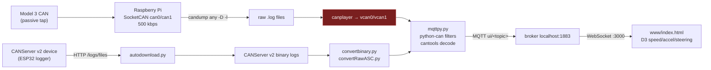
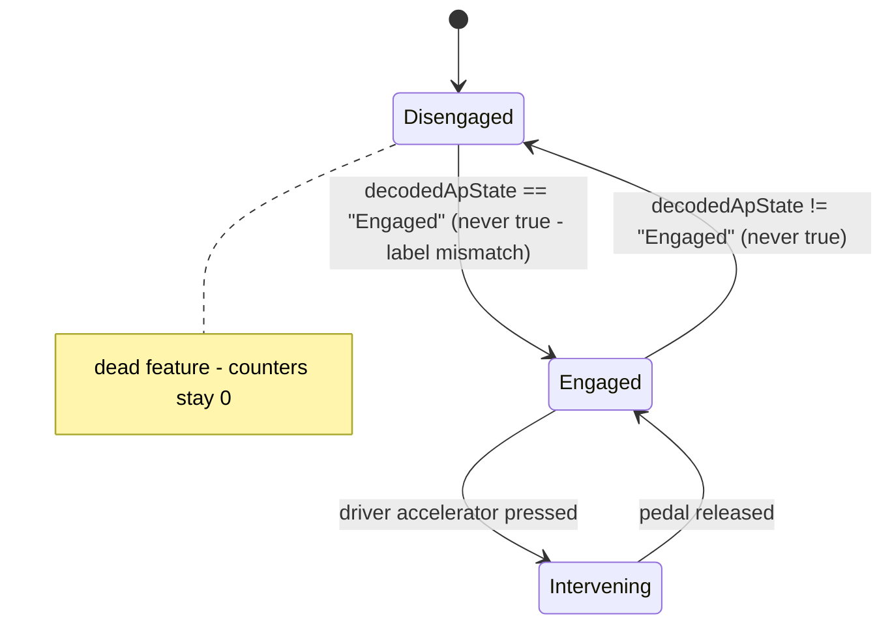

# mhpetiwala-TeslaCAN

Deep analysis, replace mode. The pre-replace summary exists in git history; its claims are cited below as `git show HEAD:docs/legacy/mhpetiwala-TeslaCAN.md`.

## 1. Provenance

- **Submodule path:** `legacy/mhpetiwala-TeslaCAN`
- **Pinned gitlink:** `160000 4e91e2600c2830673868f8c8bcd697816435799b 0` (`git ls-files -s legacy/mhpetiwala-TeslaCAN`); matches `git -C legacy/mhpetiwala-TeslaCAN rev-parse HEAD`; worktree clean (`git status --porcelain` empty).
- **Upstream URL:** https://github.com/mhpetiwala/TeslaCAN (origin, fetch+push).
- **License:** MIT, `LICENSE:1-21` — copyright line names **Chuck Cook 2022**, not mhpetiwala. Upstream code also self-attributes: `scripts/mqttpy.py:6` "Created by Chuck Cook on Jan 28 2022"; `www/index.html:255-257` credits k-korn/tm3-can-logger base plus Chuck Cook @chazman and Matthew Driver @matthew_driver.
- **Analysis date:** 2026-11-21.
- **Mode note:** replace mode; frontmatter above preserved byte-for-byte (the inherited `description:` line ends mid-word at "DBC fil" — kept as-is, see section 6). The replaced doc contained **no `## Upstream (...)` sections**, so none were re-appended.
- **Local git history:** single commit — `4e91e26 2022-09-04 "Update for Matthew"` (`git log -1`). Evolution evidence lives in committed `.bak` snapshots, not in history (section 15).

**Files read (coverage label per file):**

- `LICENSE` (1-21, FULL-READ), `README.md` (1 line, FULL-READ — it is only `# TeslaCAN`, zero claims), `scripts/can_setup.sh` (1-30, FULL-READ), `scripts/canlogging.sh` (1-12, FULL-READ), `scripts/canplay.sh` (1-52, FULL-READ), `scripts/convert.sh` (1-16, FULL-READ), `scripts/mqttpy.py` (1-409, FULL-READ), `scripts/streamlog.py` (1-56, FULL-READ), `scripts/convertRawASC.py` (1-134, FULL-READ), `scripts/convertbinary.py` (1-122, FULL-READ), `scripts/autodownload.py` (1-215, FULL-READ), `scripts/dbcScratchpad.txt` (1-34, FULL-READ), `scripts/fsdtest.dbc` (1-209, FULL-READ), `www/index.html` (1-1049, FULL-READ), `www/graph.html` (1-130, FULL-READ), `www/fading_tail.html` (1-346, FULL-READ).
- `scripts/Model3CAN.dbc` — STRUCTURAL-PARSE: full `BO_` inventory (159 frames), targeted block reads for every code-referenced frame (lines 104-123, 295-321, 742-773, 892-932, 2137-2152, 2348-2357, 2538-2547, 2588-2605, 2654-2665, 2748-2757, 2791-2800, 3629-3630, 3614-3630 range for `VAL_` rows, cycle-time `BA_` block 3314-3363). Claims limited to structure plus the cited ranges.
- `scripts/testraw.log` — RANGE-CITED (header bytes only; 20 MB binary). `scripts/testoutasc.log` — RANGE-CITED (first 200 000 lines ID-histogrammed; targeted whole-file `Select-String` for ` 528#`, ` 399#`, ` 257#`; 1 524 935 lines total).
- `www/index_old.html`, `www/index_july23.html`, `www/index_jul30.bak`, `www/index_Jul31.bak`, `www/indexaug19.html`, `www/index.bak.html`, `www/index.new` — RANGE-CITED (grep-sampled: title, subscribe topic, port, steering-visual and fading-tail markers, attribution lines; not read line-by-line).
- `legacy/MatthewDriver-TeslaCAN` twin — read only for fork comparison: full `git ls-files`, byte-hash compare of all 31 common files, `git diff --no-index` on `www/index.html` (first 60 hunk lines), README. RANGE-CITED otherwise.

**Files explicitly NOT read:** `SteeringDemo.mp4` (4.5 MB binary video, no text extraction attempted), `www/js/d3.v5.min.js`, `www/js/jquery-3.4.1.min.js`, `www/js/paho-mqtt-min.js`, `www/js/underscore-umd-min.js` (third-party minified libraries), the remainder of `scripts/testoutasc.log` beyond the samples above, the remainder of `scripts/Model3CAN.dbc` beyond the cited blocks, and all of `legacy/MatthewDriver-TeslaCAN` outside the comparison listed above.

**Our-side files read for parity (all CODE-READ, full reads unless noted):** `firmware/lib/vehicle/can/ids.h` (1-122), `firmware/lib/vehicle/can/handler/variant/bits.h` (1-58), `firmware/lib/vehicle/can/handler/variant/hw4.h` (1-169), `firmware/lib/vehicle/can/feature/fsd/nag.h` (1-524), `firmware/lib/vehicle/can/feature/telemetry/powertrain.h` (1-111), `firmware/lib/vehicle/can/handler/frame_readers.h` (1-72), `firmware/lib/vehicle/can/checksum.h` (1-75), `firmware/lib/vehicle/can/feature/fsd/isa_chime.h` (1-40), `firmware/lib/vehicle/can/feature/fsd/region.h` (80-119 excerpt), `firmware/lib/vehicle/can/handler/bus/vehicle.h` (120-149 excerpt), `firmware/lib/vehicle/can/handler/filters.h` (100-129 excerpt).

## 2. Executive verdict

A passive Tesla Model 3 CAN logging and visualization stack for Raspberry Pi + SocketCAN, in the Chuck Cook / Matthew Driver lineage: a CANServer v2 binary-log converter, a cantools+MQTT decode bridge (`mqttpy.py`), candump capture/replay shell scripts, a large community `Model3CAN.dbc` (159 frames), a small FSD-era DBC (`fsdtest.dbc` + `dbcScratchpad.txt` covering 0x259/0x373/0x374/0x399/0x3FD), and a D3/MQTT dashboard. This submodule is a one-day-older snapshot of MatthewDriver-TeslaCAN (30/31 files byte-identical; only `www/index.html` differs). It never mutates vehicle frames — the only TX is log replay onto virtual `vcan0/vcan1` and a UDP frame streamer. Two committed defects make parts of it unrunnable as-is (CRLF shell scripts; a `hex()`-vs-int filter bug), and its flagship AP disengage/intervention counter is dead code (choice-label mismatch). What matters for TeslaCANModder: an independent 2022-era bit-map oracle that **confirms 10+ of our `bits.h` constants exactly** (0x3F8 bits 5/13/14/43/45-47/48/49, 0x399 bit 13 suppress-warning, hands-on 42\|4 position) while flagging real deltas to capture-first (speed/gear/pedal/steer decodes, 0x39B-vs-0x399 DAS frame, EPAS 0x370-vs-0x373/0x374). Candidates: the CANServer v2 log parser for `tools/`, and `fsdtest.dbc` as a capture-first cross-check oracle. Never port: the UDP replay streamer, the delete-after-download loop, and the broken AP counter logic.

## 3. Evidence map

| source file                | lines      | what it proves                                                                  | grade       |
| -------------------------- | ---------- | ------------------------------------------------------------------------------ | ----------- |
| scripts/mqttpy.py          | 53-65      | RX filter list: 0x101,0x108,0x111,0x118,0x129,0x145,0x257,0x318,0x399,0x3B6     | CODE-READ   |
| scripts/mqttpy.py          | 91-125     | per-ID dispatch to decode handlers; 0x399 accepted only from vcan0/can0          | CODE-READ   |
| scripts/mqttpy.py         | 310-356    | AP engage/disengage/intervene counter logic; `6: 'Engaged'` mapping             | CODE-READ   |
| scripts/Model3CAN.dbc     | 3630       | `VAL_ 921 DAS_autopilotState 6 "ACTIVE_FSD"` — the label mqttpy's dict lacks     | CODE-READ   |
| scripts/convertbinary.py  | 14-122     | CANServer v2 binary format: 22-byte magic, 0xCD/0xCE/0xCF records                | CODE-READ   |
| scripts/convertRawASC.py  | 101-108    | filter `if hex(frameid) in msgIDs:` — string-vs-int, never true                  | CODE-READ   |
| scripts/autodownload.py   | 129-215    | polls CANServer HTTP API, downloads then **deletes** server log files           | CODE-READ   |
| scripts/streamlog.py      | 10-56      | UDP datagrams `<i b` header; 0x528 big-endian Unix time; skips first 500k lines   | CODE-READ   |
| scripts/can_setup.sh      | 27-30      | can0/can1 at 500 kbps; listen-only variant commented out                        | CODE-READ   |
| scripts/canplay.sh        | 14, 48     | `if [[ ... ]]` + CRLF — `bash -n` parse error (demonstrated, section 16)         | CODE-READ   |
| scripts/Model3CAN.dbc     | 893-932    | 0x3F8 UI_driverAssistControl bit layout (dasDeveloper 5\|1 etc.)                 | CODE-READ   |
| scripts/fsdtest.dbc       | 38-48, 64-76, 78-104, 106-158 | 0x259/0x373/0x374/0x399/0x3FD signal layouts                  | CODE-READ   |
| scripts/dbcScratchpad.txt  | 4-16, 22-34 | EPAS3P 0x373 + EPAS3S 0x372(882→BO_ says 884) redundant-rack notes               | CODE-READ   |
| scripts/testoutasc.log     | sampled    | real capture: `399#` 8-byte on can0 + 3-byte short on can1; `528#62090CE7`       | CAPTURE     |
| scripts/testraw.log        | header     | 20 MB CANServer v2 binary log begins `CANSERVER_v2_CANSERVER`                    | CAPTURE     |
| www/index.html            | 254-345    | dashboard pipeline: paho MQTT WS :3000, `ui/#` subscribe, D3 plots               | CODE-READ   |
| www/index.html (variants) | grep-sampled | steering visual appears only in indexaug19.html and later snapshots             | RANGE-CITED |
| legacy/MatthewDriver diff | hash+diff  | 30/31 files byte-identical; only www/index.html differs (209+/285-)              | CODE-READ   |

No TEST-READ evidence exists: this repo ships no tests. No further CAPTURE evidence exists beyond the two log files sampled above. The two DBC catalogs are STRUCTURAL-PARSE as wholes: `scripts/Model3CAN.dbc` (159 `BO_` frames, 42 `GenMsgCycleTime` entries, vendored community data of mixed provenance) and `scripts/fsdtest.dbc` (5 frames, FSD-era).

## 4. Architecture and build surface

Entry points: `scripts/canlogging.sh` (candump capture), `scripts/autodownload.py` (pull CANServer logs), `scripts/convertbinary.py` / `convertRawASC.py` (binary→ASC), `scripts/canplay.sh` (replay via canplayer onto vcan), `scripts/mqttpy.py` (decode→MQTT, long-running), `www/index.html` (browser dashboard). No build system, no firmware, no Makefile — plain scripts on a Raspberry Pi host. Dependencies: python-can, cantools, paho-mqtt, can-utils (candump/canplayer), iproute2, d3/jQuery/paho JS libs vendored under `www/js/`.



The only TX surface is `canplayer` onto **virtual** vcan buses (red) — no code path writes onto the physical vehicle bus. There is no mutation/gate stage between decode and publish; this repo is strictly RX → decode → display.

## 5. Mechanism catalogue

### CANServer v2 binary log parser

- **Claim (README / summary):** None found — README is one line; old doc says only "Log converters" (`git show HEAD:docs/legacy/mhpetiwala-TeslaCAN.md`, line 43).
- **Code path:** `scripts/convertbinary.py:16-122` — `open()` → header check `b'CANSERVER_v2_CANSERVER'` (:22) → record loop → `print()` ASC lines. Duplicated nearly verbatim inside `scripts/autodownload.py:15-127` and `scripts/convertRawASC.py:7-134`.
- **Frame spec:** file header = 22-byte magic `CANSERVER_v2_CANSERVER`. Records: `0xCD` mark (1-byte big-endian length + ASCII string; splits output file at :58-74), `0xCE` time sync (8-byte little-endian uint64 epoch µs at :76-83), `0xCF` frame (5 bytes `struct.unpack('<2cHB')`: 16-bit LE ms offset, uint16 CAN ID, last byte = `busid<<4 | dlc` at :85-106). Output line: `(time) canN III#HEX`.
- **Gates and timing:** frame time = lastSyncTime + offset×1000 (:106); DLC clamped 0..8 (:99-102).
- **State machine:** None found (stateless stream parser).
- **Tests:** None found — repo ships no tests.
- **Evidence grade:** CODE-READ.
- **Verdict:** CONFIRMED (format fully specified in code; header bytes verified against `scripts/testraw.log`).
- **Adapt to TeslaCANModder?** candidate — an offline parser for this format would let `tools/` ingest chuckcook/CANServer bench captures (independent implementation, no code copy).

### cantools + MQTT decode bridge (mqttpy.py)

- **Claim (README / summary):** old doc says the MQTT publisher "is not present in this fork" (`git show HEAD:docs/legacy/mhpetiwala-TeslaCAN.md`, line 47) — see section 6.
- **Code path:** `scripts/mqttpy.py:401-409` `run()` → `connect_mqtt()` (:68-79) → `listenToCan()` (:82-135) → per-ID handler → `publish_mqtt()` (:138-153) → broker `localhost:1883`, topic base `"ui"` (:26-28).
- **Frame spec:** 10 filtered IDs (see inventory, section 7); decodes via `cantools` `db.decode_message` against `/home/pi/scripts/Model3CAN.dbc` (:24).
- **Gates and timing:** odometer throttled to 1 publish/second via `getTimeDelayed(timestamp_3B6, 1)` (:120-125); 0x399 only accepted from channel vcan0/can0 (:116-118).
- **State machine:** intended AP-counter flow below. The transition labeled "broken" never fires because `translateResponse` returns `'Unkown_Response'` for every `DAS_autopilotState` value — see Verdict.



- **Tests:** None found.
- **Evidence grade:** CODE-READ (bug), CAPTURE (0x399 dual-length frames confirmed in log).
- **Verdict:** CONTRADICTED — `localDict` maps `6: 'Engaged'` (:313) but `Model3CAN.dbc:3630` labels value 6 `"ACTIVE_FSD"`; cantools returns the choice **string**, which never equals int key 6, so `translateResponse` (:370-374) returns `'Unkown_Response'` (typo included) forever. `ApEngaged`, `ApDisengageCounter`, `ApInterveneCounter` (:35-39, :327-350) can never update; the dashboard "Engaged"/counter cards are dead. The `DAS_autopilotHandsOnState` lookup **does** work because its dict keys match the DBC's `LC_HANDS_ON_*` labels (:312, Model3CAN.dbc:3629).
- **Adapt to TeslaCANModder?** already present — our firmware ships an MQTT telemetry bridge (`firmware/lib/vehicle/can/feature/misc/mqtt_bridge.h`); do not port this Python bridge or its broken counter logic.

### SocketCAN capture + vcan replay pipeline

- **Claim (README / summary):** old doc: "SocketCAN interface setup", "CAN data capture via candump" (lines 40-41).
- **Code path:** `scripts/can_setup.sh:18-30` (modprobe vcan; vcan0/vcan1; can0/can1 up at 500 kbps) → `scripts/canlogging.sh:12` (`candump any -D -l > /home/pi/logs/<stamp>.log`) → `scripts/canplay.sh:44` (`canplayer vcan0=can1 vcan1=can0 -l <loops> -I <logfile>`).
- **Frame spec:** passthrough — no frame is decoded or mutated; replay maps log bus can1→vcan0 and can0→vcan1 (`canplay.sh:39`).
- **Gates and timing:** user prompts for loops and format; kills running `mqttpy.py` before replay (`canplay.sh:9`).
- **State machine:** None found.
- **Tests:** None found.
- **Evidence grade:** CODE-READ.
- **Verdict:** CONTRADICTED (runnability) — all four shell scripts carry CRLF line endings (verified byte pairs: 30/12/51/16), so on Linux the shebang and `[[ ]]` tokens break; `bash -n scripts/canplay.sh` fails with `syntax error in conditional expression: unexpected token ']]'` at line 14, and line 48 additionally has `[[ $killmqtt = "Y"]]` with a missing space. As committed, none of the shell scripts run on the target host.
- **Adapt to TeslaCANModder?** no impact — our bench tooling is ESP32-side; a vcan replay harness is a possible low-priority `tools/` idea, but port nothing from these scripts.

### CANServer auto-download loop (autodownload.py)

- **Claim (README / summary):** None found in old doc (file unmentioned).
- **Code path:** `scripts/autodownload.py:129-215` — poll `http://192.168.1.48/stats` → `GET /logs/load` (active file) → `GET /logs/files?offset=N` (paginated) → `GET /logs/files/download?id=` → `POST /logs/files/delete` with the downloaded id (:184-186) → embedded converter (:15-127) → sleep 60 s (30 s when server down).
- **Frame spec:** None found (transport-level tool).
- **Gates and timing:** skips the actively-written log file (:151-153); 60/30 s poll cadence (:207-213).
- **State machine:** two-state loop (server-alive vs server-missing), no third state.
- **Tests:** None found.
- **Evidence grade:** CODE-READ.
- **Verdict:** PARTIAL — HTTP flow is complete and internally consistent (same converter as `convertbinary.py` but with the **correct** `if frameid in msgIDs:` filter at :111, proving the `convertRawASC.py` variant is the broken copy), but it deletes server-side data after every download with no local verification — a data-loss pattern.
- **Adapt to TeslaCANModder?** never port the delete-after-download pattern; the endpoint choreography is CANServer-specific.

### UDP frame streamer (streamlog.py)

- **Claim (README / summary):** None found.
- **Code path:** `scripts/streamlog.py:15-56` — `socket(AF_INET, SOCK_DGRAM, IPPROTO_UDP)` → `sendFrame()` packs `('<ib', id, len)` header (:11) + raw payload to `teslacan.local:1883` UDP (:6-7); first datagram is `sendFrame(0x528, pack('>I', int(time.time())))` (:18).
- **Frame spec:** UDP payload = 4-byte LE int32 CAN ID + 1-byte DLC + data bytes. Special frame 0x528 (DLC 4, big-endian Unix seconds, `Model3CAN.dbc:2146-2147` labels it `ID528UnixTime`); 0x528 frames inside the log are skipped on replay (:52-54).
- **Gates and timing:** skips the first 500 000 log lines (:26-27); sleeps 0.5 s on >100 000 timestamp jumps (time resync heuristic, :38-40), otherwise 1 ms per frame (:42).
- **State machine:** None found.
- **Tests:** None found.
- **Evidence grade:** CODE-READ (protocol), CAPTURE (`528#62090CE7` = epoch 1644760295 in `scripts/testoutasc.log`).
- **Verdict:** PARTIAL — sender is fully specified, but **no receiver for this format exists anywhere in the repo**; the target device firmware ("teslacan.local") is absent, so the wire contract is unverifiable end-to-end.
- **Adapt to TeslaCANModder?** never port — undocumented receiver, unvalidated wire format, synthetic frame injection over the network.

### MQTT web dashboard (www/index.html)

- **Claim (README / summary):** old doc: "MQTT + D3.js real-time dashboard" (line 44).
- **Code path:** `www/index.html:430-447` `MQTTconnect()` → subscribe `"ui/#"` (:431) → `onMessageArrived()` (:417-426) → `showValue()` (:362-405) → topic-value DOM updates + `updateDataset()` (:355-360) → plot loops: long-accel (:629-652), lat-jerk (:654-680), fading-tail G-G (:782-824), steering wheel (:943-963).
- **Frame spec:** topic protocol, not CAN: `ui/<name>` with `"value;#RRGGBB"` color suffix for `custom_*` topics; `custom_accel` carries `lat;long;vert;color` (:235-237, :376-381).
- **Gates and timing:** redraw 50 ms (accel/jerk), 100 ms (tail), 20 ms (steering) (:298-308,322); Gaussian smoothing degree 10 (:281, :965-1002); AP-engaged color flip driven by the (broken) `custom_ap-state` topic (:382-391).
- **State machine:** None found beyond the ap_engaged boolean.
- **Tests:** None found; a static test-data mode exists (`MQTT_enabled=false`, :264, :449-490) but expects `test_accel_data.json` files that this fork does not ship (see section 6).
- **Evidence grade:** CODE-READ.
- **Verdict:** CONFIRMED as a passive display; note its data source is only as good as the broken publisher upstream of it.
- **Adapt to TeslaCANModder?** already present — our client has its own monitor/dashboard surfaces; the fading-tail G-G plot is aesthetic only.

### FSD-era DBC scratchpad (fsdtest.dbc + dbcScratchpad.txt)

- **Claim (README / summary):** None found in old doc (both files unmentioned).
- **Code path:** None found — no code loads `fsdtest.dbc`; `mqttpy.py:24` loads only `Model3CAN.dbc`. This pair is read-only reference data.
- **Frame spec:** `fsdtest.dbc` defines 0x259 APP_status, 0x374/0x373 EPAS3S/EPAS3P_sysStatus, 0x399 DAS_status, 0x3FD UI_autopilotControl (mux m0/m1). `dbcScratchpad.txt:4-16` documents EPAS3P 0x373 torque/handsOn/counter/checksum and `:22-34` the EPAS3S twin at 882/0x372 (the `fsdtest.dbc` BO_ ids are 884/883 — an internal 882-vs-884 discrepancy between the two files), plus the note that Tesla dropped the redundant steering controller.
- **Gates and timing:** None found.
- **State machine:** None found.
- **Tests:** None found.
- **Evidence grade:** CODE-READ (layout), CAPTURE absent — no log in this repo contains 0x373/0x374/0x3FD payloads to cross-check (0x399/0x318/0x528 do appear).
- **Verdict:** PARTIAL — internally consistent with `Model3CAN.dbc` for 0x399 and 0x3FD, but nothing executes it; EPAS3P/EPAS3S IDs conflict with the name reuse in our own tree (section 11) and are unvalidated by capture.
- **Adapt to TeslaCANModder?** candidate — as a **capture-first cross-check oracle** for our `bits.h` constants, never as importable data.

## 6. Summary vs code contradiction table

| # | summary claim (pre-replace) | code reality | verdict |
| - | --------------------------- | ------------ | ------- |
| 1 | `git show HEAD:docs/legacy/mhpetiwala-TeslaCAN.md` line 47: "`scripts/mqttpy.py` (MQTT publisher) is not present in this fork, unlike in MatthewDriver-TeslaCAN" | `scripts/mqttpy.py:1-409` exists in `git ls-files`, is byte-identical (SHA-256) to MatthewDriver's copy, and is the pipeline's core decode bridge | CONTRADICTED |
| 2 | line 38-45: "Largely identical to MatthewDriver-TeslaCAN, with some scripts absent:" followed by a list of `can_setup.sh`, `canlogging.sh`, `Model3CAN.dbc`, `convertbinary.py`, `convertRawASC.py`, `index.html`, `SteeringDemo.mp4` | every listed file exists (`git ls-files`); the only files genuinely absent vs MatthewDriver are `www/test_accel_data.json`, `www/test_accel_data_short.json`, `.DS_Store` | CONTRADICTED (list mislabels presence as absence) |
| 3 | lines 55-59: "No additional value beyond what MatthewDriver-TeslaCAN provides … no meaningful modifications" | 30/31 common files byte-identical, but `www/index.html` differs (209 insertions/285 deletions): mhpetiwala is the older snapshot (2022-09-04) with `MQTT_enabled=true` (line 264) while MatthewDriver HEAD (2022-09-05, "new colcour scheme") moved to test-mode + speed plot. The doc also never mentions `fsdtest.dbc`/`dbcScratchpad.txt`, the only FSD-specific artifacts | PARTIAL — "mirror" right for scripts, wrong for dashboard; value judgment superseded by this analysis |
| 4 | frontmatter `description:` line (preserved above) ends mid-word "…DBC fil" and says "fork/mirror" | inherited truncation; fork claim confirmed by hash comparison (row 3) | Stale frontmatter kept byte-for-byte per skill; recorded, not edited |
| 5 | upstream README `README.md:1` ("# TeslaCAN") | carries zero technical claims — nothing to contradict, and nothing to trust | No contradiction; README is empty of content |

Upstream header-comment claims checked and **confirmed** (not contradictions): `mqttpy.py:311` "BO_ 921 ID399DAS_status: 8 ChassisBus" matches `Model3CAN.dbc:743`; `mqttpy.py:116` "can1 sending short data" matches capture (`399#000000` 3-byte on can1, 8-byte on can0); `mqttpy.py:157` GPS comment matches `Model3CAN.dbc:2349`.

## 7. CAN frame and signal inventory

All rows are decodes/publishes from the mqttpy pipeline or reference layouts from the two DBCs; nothing here is written to a physical vehicle bus. "read" = decoded for display. DBC catalogs as wholes: `Model3CAN.dbc` = STRUCTURAL-PARSE (159 frames); `fsdtest.dbc` = STRUCTURAL-PARSE (5 frames). Periods from `BA_ "GenMsgCycleTime"` (Model3CAN.dbc:3314-3363).

| ID (hex+dec)         | bus      | period            | DLC | byte/bit layout (signal\|len@endian) | scale/units | counter | checksum | R/W | grade |
| -------------------- | -------- | ----------------- | --- | ------------------------------------ | ----------- | ------- | -------- | --- | ----- |
| 0x04F / 79 GPSLatLong | Chassis | 1000 ms (:3325)  | 8  | GPSLatitude04F 0\|28@1-, GPSLongitude04F 28\|28@1-, accuracy 57\|7@1+ | 1e-6 deg; 0.2 m | None found | None found | read (handler disabled at mqttpy.py:89-90) | CODE-READ (DBC 2349-2352) |
| 0x101 / 257 RCM_inertial1 | Chassis | None found | 8 | yawRate 0\|16@1-, pitchRate 16\|15@1-, rollRate 31\|15@1- | ×0.0001/0.00025 rad/s | 52\|4 (byte6 lo nibble) | 56\|8 (byte7) | read | CODE-READ (DBC 105-113; mqttpy.py:193-204) |
| 0x108 / 264 DIR_torque | Vehicle | 10 ms (:3356) | 8 | torqueChecksum 0\|8, torqueCounter 8\|4, torqueCommand 12\|13@1-, torqueActual 27\|13@1-, axleSpeed 40\|16@1-, slavePedalPos 56\|8 | ×2 Nm; ×0.1 RPM; ×0.4 % | 8\|4 (byte1 lo nibble) | 0\|8 (**byte0**) | read | CODE-READ (DBC 2792-2800; mqttpy.py:207-219) |
| 0x111 / 273 RCM_inertial2 | Chassis | None found | 8 | longAccel 0\|16@1-, lateralAccel 16\|16@1-, verticalAccel 32\|16@1- | ×0.00125 m/s²; ×0.101972 → G (mqttpy.py:228-233) | 52\|4 | 56\|8 | read | CODE-READ (DBC 115-123; mqttpy.py:222-252) |
| 0x118 / 280 DriveSystemStatus | Vehicle | 10 ms (:3342) | 8 | checksum 0\|8, counter 8\|4, gear 21\|3, accelPedalPos 32\|8, brakePedalState 19\|2 | ×0.4 %; gear enums | 8\|4 | 0\|8 (byte0) | read | CODE-READ (DBC 2589-2603; mqttpy.py:168-190) |
| 0x129 / 297 SteeringAngle | Vehicle | 10 ms (:3338) | 8 | SteeringAngle129 16\|14@1+, SteeringSpeed129 32\|14@1+, sensor bytes 6-7 | ×0.1 deg, −819.2 offset | None found | None found | read | CODE-READ (DBC 2539-2544; mqttpy.py:255-264) |
| 0x145 / 325 ESP_status | Chassis | None found | 8 | checksum 0\|8, counter 8\|4, driverBrakeApply 29\|2, brakeApply 31\|1, brakeTorqueTarget 51\|13 | ×2 Nm | 8\|4 | 0\|8 (byte0) | read | CODE-READ (DBC 296-320; mqttpy.py:267-282) |
| 0x257 / 599 DIspeed | Vehicle | 20 ms (:3347) | 8 | checksum 0\|8, counter 8\|4, DI_vehicleSpeed 12\|12@1-, DI_uiSpeed 24\|9 | ×0.08 kph, −40 offset; ×0.62 → mph (mqttpy.py:291) | 8\|4 | 0\|8 (byte0) | read | CODE-READ (DBC 2655-2661; mqttpy.py:285-298); absent from `testoutasc.log` sample |
| 0x318 / 792 SystemTimeUTC | Vehicle | None found | 8 | UTCyear b0, UTCmonth b1, UTCseconds b2, UTChour b3, UTCday b4, UTCminutes b5 | yr/mo/sec/hr/dy/min | None found | None found | read | CODE-READ (DBC 2138-2144; mqttpy.py:301-307); CAPTURE — 1249 frames in first 200k log lines |
| 0x399 / 921 DAS_status | Chassis | None found | 8 | autopilotState 0\|4, fusedSpeedLimit 8\|5, suppressSpeedWarning 13\|1, handsOnState 42\|4, autoLaneChangeState 46\|5, counter 52\|4, checksum 56\|8 | ×5 kph/mph | 52\|4 (byte6 lo nibble) | 56\|8 (byte7) | read | CODE-READ (DBC 743-769; mqttpy.py:310-356); CAPTURE — 8-byte on can0, 3-byte short on can1 |
| 0x3B6 / 950 odometer | Vehicle | 1000 ms (:3352) | 4 | Odometer3B6 0\|32@1+ | ×0.001 km | None found | None found | read (1 Hz throttle, mqttpy.py:120-125) | CODE-READ (DBC 2749-2750; mqttpy.py:359-367) |
| 0x528 / 1320 UnixTime | Vehicle | ~1 s observed | 4 | UnixTimeSeconds528 7\|32@0+ (big-endian) | Unix seconds | None found | None found | read; **synthetic TX** in streamlog.py:18 | CODE-READ (DBC 2146-2147); CAPTURE — `528#62090CE7` = 1644760295 |
| 0x259 / 601 APP_status | ETH label | None found | 8 | watchdogState 0\|3, fusedState 3\|2, factorySummonStatus 6\|4, summonUnavailableReason 14\|5, fsdSuspendState 19\|2, fsdRevokeStrikeoutCount 21\|3, counter 52\|4, checksum 56\|8 | enums (VAL_ 160-166) | 52\|4 | 56\|8 | reference only — no consuming code | CODE-READ (fsdtest.dbc:38-48) |
| 0x373 / 883 EPAS3P_sysStatus | ETH label | None found | 8 | steeringRackForce 1\|10@0+, steeringFault 2\|1, handsOnLevel 38\|2, torsionBarTorque 19\|12@0+, sysStatusCounter 48\|4, sysStatusChecksum 56\|8 | ×50 N; ×0.01 Nm −20.5 offset | 48\|4 (byte6 lo nibble) | 56\|8 (byte7) | reference only | CODE-READ (fsdtest.dbc:64-76; dbcScratchpad.txt:4-16) |
| 0x374 / 884 EPAS3S_sysStatus | ETH label | None found | 8 | identical layout to EPAS3P (redundant controller) | same | 48\|4 | 56\|8 | reference only | CODE-READ (fsdtest.dbc:50-62) |
| 0x3FD / 1021 UI_autopilotControl | Chassis (Model3CAN.dbc:937) | None found | 8 | mux index 0\|3; m0: smartSetSpeedOffset 25\|6, fsdVisualizationEnabled 37\|1, fsdStopsControlEnabled 38\|1, fsdContinueOnGreenWithCIPV 39\|1, enableFullSelfDriving 46\|1, hasFullSelfDriving 47\|1, fsdBetaRequest 51\|1, fullSelfDrivingSuspended 52\|1; m1: driverMonitorConfirmation 17\|1, applyEceR79 19\|1, enableMapStops 20\|1, apmv3Branch 40\|3, enableCabinCamera 43\|1, showLaneGraph 45\|1, showTrackLabels 46\|1, hardCoreSummon 47\|1, autoTurnSignalMode 52\|1 | booleans | mux 0\|3 (byte0 lo bits) | mux-valid 63\|1 per mux | reference only | CODE-READ (fsdtest.dbc:106-158) |
| 0x3F8 / 1016 UI_driverAssistControl | Chassis | None found | 8 | dasDeveloper 5\|1, driveOnMapsEnable 13\|1, handsOnRequirementDisable 14\|1, enableTripTelemetry 43\|1, accFollowDistanceSetting 45\|3, hasDriveOnNav 48\|1, followNavRouteEnable 49\|1, drivingSide 40\|2, visionOnlyStops 60\|1 | booleans; follow-dist 0-7 | None found | None found | reference only (parity-critical, section 11) | CODE-READ (Model3CAN.dbc:893-932) |

`dbcScratchpad.txt` names the EPAS3S frame as 882 decimal while `fsdtest.dbc` defines it as 884 — recorded here rather than silently reconciled.

## 8. Constants and tuning table

| constant | value | file:line | meaning | grade |
| -------- | ----- | --------- | ------- | ----- |
| CANServer magic header | `b'CANSERVER_v2_CANSERVER'` (22 bytes) | scripts/convertbinary.py:22 | format gate; wrong header aborts with exit(1) | CODE-READ |
| record tags | 0xCD mark / 0xCE timesync / 0xCF frame | scripts/convertbinary.py:58,76,85 | record-type discriminator bytes | CODE-READ |
| DLC/bus nibble split | len = `b & 0x0F`, bus = `(b & 0xF0) >> 4` | scripts/convertbinary.py:97-98 | 0xCF record byte 5 field split | CODE-READ |
| MQTT broker/topic | `localhost:1883`, base `"ui"` | scripts/mqttpy.py:26-28 | unauthenticated local broker; every card topic is `ui/<name>` | CODE-READ |
| odometer throttle | 1 s | scripts/mqttpy.py:123 | publish odometer at most 1 Hz | CODE-READ |
| m/s²→G factor | 0.101972 | scripts/mqttpy.py:229-233 | inertial accel unit conversion | CODE-READ |
| km/h→mph factor | 0.62 | scripts/mqttpy.py:291 | speed card units | CODE-READ |
| CAN bitrate | 500000 ×2 | scripts/can_setup.sh:29-30 | can0/can1 500 kbps (listen-only variant commented at :27-28) | CODE-READ |
| replay bus map | `vcan0=can1 vcan1=can0` | scripts/canplay.sh:39 | canplayer channel remap | CODE-READ |
| streamlog skip | 500000 lines | scripts/streamlog.py:26 | jump past log preamble before streaming | CODE-READ |
| streamlog resync threshold | 100000 (timestamp delta) | scripts/streamlog.py:38 | treats >100 s jumps as time resync, sleeps 0.5 s | CODE-READ |
| UDP frame header | `pack('<ib', id, len(data))` | scripts/streamlog.py:11 | 4-byte LE id + 1-byte DLC + payload | CODE-READ |
| time frame | 0x528, `pack('>I', time.time())` | scripts/streamlog.py:18 | synthetic 4-byte BE Unix epoch frame | CODE-READ |
| CANServer address | `192.168.1.48` | scripts/autodownload.py:1 | hardcoded LAN IP (canserver.local commented out) | CODE-READ |
| poll cadence | 60 s up / 30 s down | scripts/autodownload.py:207-213 | retry loop timing | CODE-READ |
| smoothing degree | 10 | www/index.html:281 | Gaussian window for accel plots | CODE-READ |
| accel/jerk/tail/steer redraw | 50/50/100/20 ms | www/index.html:298,302,308,322 | per-plot redraw intervals | CODE-READ |
| G caps | 0.8 G (x and y), 10 G jerk axes | www/index.html:304-305,312-313 | plot clamps via mysin() | CODE-READ |
| Model 3 steering ratio | 10 | www/index.html:326 | tyre graphic rotates steering_angle/10 | CODE-READ |
| follow-dist field | `UI_accFollowDistanceSetting 45\|3` | scripts/Model3CAN.dbc:894 | 0-7 stalk setting (parity row 3) | CODE-READ |
| handsOnState field | `42\|4@1+` | scripts/fsdtest.dbc:83 | 4-bit DAS hands-on request state | CODE-READ |
| EPAS torque field | `19\|12@0+ (0.01,-20.5)` | scripts/fsdtest.dbc:76 | Motorola 12-bit torsion bar torque | CODE-READ |

## 9. Failure modes and edge cases

| failure | handling code path | tested? | grade |
| ------- | ------------------ | ------- | ----- |
| Shell scripts cannot run on Linux (CRLF; `bash -n` parse error at canplay.sh:14; second `]]` defect at :48) | None found — no fallback; scripts fail at parse | No | CODE-READ (demonstrated) |
| convertRawASC.py filter never matches (`hex(frameid)` vs int list) | silently emits **nothing**; :104-105 also print both decimal and hex id (debug residue) | No | CODE-READ |
| AP engage/disengage counters dead (label `ACTIVE_FSD` vs int key 6) | generic exception handler at mqttpy.py:129-132 prints and continues; counters stay 0 | No | CODE-READ |
| Short 0x399 frames on can1 would raise cantools DecodeError | channel guard at mqttpy.py:116-118 drops them before decode; CAPTURE confirms 3-byte frames exist | No | CODE-READ |
| month=0 in 0x318 (DBC `[0|0]` ranges, uninitialized value) | `calendar.month_name[0]` IndexError inside SystemTimeUTC → caught by the same generic handler (:129-132); date card sticks at last value | No | CODE-READ (inferred path, not reproduced) |
| CANServer unreachable | autodownload.py:210-213 catches URLError, sleeps 30 s, retries forever | No | CODE-READ |
| Mid-file header (`C` byte) misdetected | converter seeks back 21 bytes and re-syncs (convertbinary.py:38-57) | No | CODE-READ |
| Malformed lines in streamlog replay | None found — no try/except; a short line crashes the script | No | CODE-READ |
| MQTT publish failure | only prints to stdout (mqttpy.py:150-151); no retry, no backpressure | No | CODE-READ |
| convertRawtoASC called as an imported module | `original_stdout`/`lastSyncTime` only defined under `__main__` (convertRawASC.py:120,127-128) → NameError if imported | No | CODE-READ |

No bus-off/watchdog/brownout handling exists anywhere: none of this code touches an MCU; it is host-side tooling. Untested error paths: every row above.

## 10. Test coverage map

Test files: None found — this repo ships no tests of any kind.

Critical paths with no test, and the risk in one line each: the CANServer parser's byte-layout claims (risk: silent misparse of every future capture); the AP counter logic (risk: shipped dead, nobody noticed — proof that untested logic rots); the 0x399 dual-length channel guard (risk: cantools exceptions on real buses); the UDP streamer wire format (risk: unpaired sender with no receiver); the MQTT topic protocol (risk: dashboard silently stalls on any rename).

## 11. Parity matrix with TeslaCANModder

Our-side citations are CODE-READ from the files listed in section 1; upstream citations from this submodule. "align" = bit-level agreement; "capture-first" = disagreement or single-source claim needing a bench capture before any action.

| signal/frame | upstream decode (cite) | our decode (cite) | delta | action |
| ------------ | ---------------------- | ----------------- | ----- | ------ |
| DAS hands-on request state | 0x399 DAS_status, handsOnState 42\|4@1+ (fsdtest.dbc:83; Model3CAN.dbc:748) | 0x39B, byte 5 bits[5:2] = bit 42, 4 bits (nag.h:47-50; vehicle.h:130-132; ids.h:64 `CAN_ID_DAS_STATUS 0x39B`) | same bit position and width, **different frame ID** (0x399 chassis 2022 vs 0x39B vehicle today) | capture-first |
| speed-warning suppress bit | 0x399 `DAS_suppressSpeedWarning : 13\|1` "Suppress_Speed_Warning" (fsdtest.dbc:103,192) | ISA chime suppress byte 1 bit 5 = bit 13, mask 0x20 (bits.h:48-50; hw4.h:74) | identical bit | align |
| follow-distance setting | 0x3F8 `UI_accFollowDistanceSetting : 45\|3` (Model3CAN.dbc:894) | byte 5 bits[7:5] (ids.h:106-109 `readFollowDistance`) | identical field | align |
| driver-assist toggles (developer, nav, hands-off, telemetry) | 0x3F8 bits 5, 13, 14, 43, 48, 49 (Model3CAN.dbc:902-917) | `UI_BIT_DAS_DEVELOPER 5`, `UI_BIT_DRIVE_ON_MAPS 13`, `UI_BIT_HANDS_ON_REQ_DISABLE 14`, `UI_BIT_TRIP_TELEMETRY 43`, `UI_BIT_HAS_DRIVE_ON_NAV 48`, `UI_BIT_FOLLOW_NAV_ROUTE 49` (bits.h:33-39; hw4.h:95-124) | six identical bits | align |
| driving-side field | 0x3F8 `UI_drivingSide : 40\|2` (Model3CAN.dbc:904) | `FSD_BIT_DRIVING_SIDE 41`, cleared for LHD (hw4.h:97) | ours writes only the high bit of the 2-bit field | align (field position matches; note our constant names one bit) |
| FSD mux m0 activation bits | m0 bit 39 ContinueOnGreen, bit 46 enableFullSelfDriving, bit 38 fsdStopsControlEnabled (fsdtest.dbc:119-123) | `FSD_BIT_AP_ACTIVE 38`, `FSD_BIT_CONTINUE_ON_GREEN 39`, `FSD_BIT_EAP 46` set (bits.h:19-21; hw4.h:138-140) | bits 39/46 agree; bit 38 semantics differ (ours "AP active" vs upstream "stops control") | capture-first on bit 38 |
| FSD mux m1 lane-graph / summon bits | m1 bit 45 UI_showLaneGraph, bit 47 UI_hardCoreSummon (fsdtest.dbc:149,151) | `UI_BIT_LANE_GRAPH 45` set, `FSD_BIT_NAG_ORGANIC 47` set "Summon EU unlock" (hw4.h:43,47; bits.h:27,36) | identical bits, matching intent | align |
| FSD mux m1 bit 19 (nag clear) | m1 bit 19 `UI_applyEceR79` (fsdtest.dbc:131) | `NAG_BIT_HANDS_ON_REQUIREMENT 19` cleared as nag disable (bits.h:42; hw4.h:42) | same bit, divergent named purpose | capture-first |
| ECE R79 bypass bit | m1 bit 20 `UI_enableMapStops` (fsdtest.dbc:132) | `setBit(f, 20, false)` in applyEceR79Bypass (region.h:94-99) | ours clears a bit upstream labels MapStops | capture-first |
| EPAS source frame | EPAS3P at 883/0x373, EPAS3S at 884/0x374; handsOnLevel 38\|2 = byte4 bits[7:6]; counter 48\|4; torque 19\|12@0 bytes1-2 Motorola (fsdtest.dbc:64-76) | 0x370 `CAN_ID_EPAS_TORQUE // EPAS3P_sysStatus` (ids.h:59) — same **name**, different ID; our echo writes handsOnLevel byte4 bits[7:6] (nag.h:483), counter byte 1 or byte 6 (nag.h:462-465), torque bytes 2-3 (nag.h:470-480) | handsOnLevel position identical; frame ID and torque byte-pair differ | capture-first |
| vehicle speed | 0x257 `DI_vehicleSpeed 12\|12@1- (0.08,-40)` (Model3CAN.dbc:2661) | bytes 2-3 signed ÷100 (powertrain.h:18-22) | byte position and scale both differ | capture-first |
| gear state | 0x118 `DI_gear 21\|3` = byte2 bits[7:5] (Model3CAN.dbc:2594) | byte 0 bits[3:1] (powertrain.h:29-32) | different byte | capture-first |
| accelerator pedal | 0x118 `DI_accelPedalPos 32\|8 (0.4,0)` = byte4 ×0.4 (Model3CAN.dbc:2590) | byte 1, 0-100 linear (powertrain.h:39-42) | different byte and scale | capture-first |
| steering angle | 0x129 `SteeringAngle129 16\|14 (0.1,-819.2)` = bytes2-3 (Model3CAN.dbc:2544) | bytes 0-1 signed ÷10 (powertrain.h:59-63) | different byte pair | capture-first |
| AP state nibble | 0x399 `DAS_autopilotState 0\|4` byte0 (fsdtest.dbc:84) | 0x39B byte 1 bits[7:4] (frame_readers.h:42-45) | different frame and byte | capture-first |
| 0x318 semantics | SystemTimeUTC Y/M/D/h/m/s (Model3CAN.dbc:2138-2144; mqttpy.py:301-307) | `CAN_ID_GTW_CAR_STATE 0x318 // GTW_carState (RX)` OTA guard (ids.h:52) | same ID, unrelated payload claim | ignore (both plausibly true per era) |
| odometer 0x3B6 | 0\|32@1+ ×0.001 km, 1 Hz (Model3CAN.dbc:2749-2750; mqttpy.py:359-367) | None found — no 0x3B6 in ids.h:15-78 (full read) | we do not decode it | ignore |
| Unix-time 0x528 | 7\|32@0+ BE seconds + synthetic TX (streamlog.py:18) | None found — no 0x528 in ids.h | we do not decode or inject it | ignore |
| FSD revoke/suspend state 0x259 | APP_status fsdSuspendState 19\|2, strikeout 21\|3 (fsdtest.dbc:42-43) | None found — no 0x259 in ids.h | we do not track FSD suspension | capture-first if FSD-revoke telemetry ever matters |

No SUMMARY-ONLY rows: every row above carries an our-side CODE-READ citation.

## 12. Surface inventory and security notes

| surface | endpoint / semantics | cite |
| ------- | -------------------- | ---- |
| MQTT broker (TCP 1883, localhost, no auth) | `ui/<topic>` publishes from mqttpy.py; any LAN client can subscribe/inject | mqttpy.py:26-28,142 |
| MQTT over WebSocket (port 3000) | dashboard subscribes `ui/#`; connects to `window.location.hostname` | www/index.html:267-268,431-446 |
| CANServer HTTP API (LAN, no auth) | GET `/stats`, `/logs/load`, `/logs/files?offset=`, `/logs/files/download?id=`; POST `/logs/files/delete` | autodownload.py:134-186 |
| UDP 1883 on `teslacan.local` | frame stream `<ib`-header datagrams; receiver unknown | streamlog.py:6-15 |
| SocketCAN can0/can1 (500 kbps) | normal node, **not** listen-only in committed config (variant commented out) | can_setup.sh:27-30 |
| vcan0/vcan1 | replay targets only | can_setup.sh:20-24; canplay.sh:39 |
| external fetch | `https://wwwdev.via.farm/static/accel_data1.json` in the fading-tail demo (dead domain, third-party) | www/fading_tail.html:36 |

Security/provenance findings: no credentials, keys, or certs anywhere (negative anchor A4, section 16); no `.env`-style files. Risky behaviors: delete-after-download on the CANServer (autodownload.py:184-186); a non-listen-only Pi node on the car bus (can_setup.sh:29-30); synthetic frame injection over the network (streamlog.py:18); hardcoded LAN IP (autodownload.py:1). Committed `.bak`/dated HTML snapshots expose only dev history — no secrets. `SteeringDemo.mp4` is a demo video, unreviewed (binary).

## 13. Adaptation assessment

| mechanism | value | cost | risk | evidence | decision |
| ---------- | ----- | ---- | ---- | -------- | -------- |
| CANServer v2 binary parser | lets `tools/` ingest a real community capture format (chuckcook/CANServer logs incl. the 20 MB sample here) | ~120 lines as an independent Node ESM parser in `tools/` | low — offline, no vehicle surface | CODE-READ + CAPTURE (header verified) | candidate for future PR |
| fsdtest.dbc + Model3CAN.dbc 0x3F8/0x399 layouts | independent 2022 oracle confirming 10+ of our `bits.h` constants; cross-check for can-review captures | zero code; use as reference during bench QA | low if treated as oracle only — frame-shape claims need capture, not doc agreement | CODE-READ | candidate (oracle role only) |
| vcan replay harness pattern | bench replay of candump logs against a decoder under test | medium — needs Linux host tooling we do not ship | none to vehicle | CODE-READ | no impact (defer; our recorder/simu already covers ESP32-side needs) |
| mqttpy MQTT bridge | already present: `firmware/lib/vehicle/can/feature/misc/mqtt_bridge.h` | — | — | CODE-READ (ours) | already present |
| dashboard visuals | client already has monitor surfaces | — | — | CODE-READ | already present |
| autodownload loop | CANServer-specific; delete-after-download is a data-loss pattern | — | destructive | CODE-READ | never port |
| streamlog UDP streamer | sender with no in-repo receiver; unverified wire contract | — | unvalidated injection | CODE-READ | never port |

## 14. Do-not-copy list

| item | file:line | reason |
| ---- | --------- | ------ |
| AP-state mapping `6: 'Engaged'` | scripts/mqttpy.py:313 | dead feature — never matches cantools choice strings; porting it imports a bug |
| `translateResponse` typo fallback `'Unkown_Response'` | scripts/mqttpy.py:374 | masks the mapping failure as a display value |
| broken msgIDs filter | scripts/convertRawASC.py:103 | `hex(frameid)` string vs int list — filter never fires |
| CRLF shell scripts + `[[ ... ]]` defects | scripts/canplay.sh:14,48 (and all 4 `scripts/*.sh`) | unrunnable on the Linux host they target |
| delete-after-download HTTP flow | scripts/autodownload.py:184-186 | destroys remote data with no local verification |
| synthetic 0x528 time-frame injection | scripts/streamlog.py:18 | fabricates a bus frame; never wire to a live bus without a listen-only capture first |
| wholesale DBC import | scripts/Model3CAN.dbc (whole), scripts/fsdtest.dbc (whole) | community data of mixed provenance; verify each signal against capture before shipping it in `packages/protocol` |

## 15. History and evolution

Local history is a single commit: `4e91e26 2022-09-04 "Update for Matthew"` — a snapshot pin, not a development history. The development story is preserved as **committed dated snapshots inside `www/`**: `index_old.html` (no k-korn attribution line, no steering visual) → `index_july23.html` / `index_jul30.bak` / `index_Jul31.bak` (k-korn attribution added, fading tail expanded) → `indexaug19.html` (steering-wheel visual first appears) → `index.new` / `index.html` (current, full steering visual). RANGE-CITED via grep markers (title, subscribe, port, steering/tail hits).

Relationship to the sibling submodule: MatthewDriver-TeslaCAN pins `80a82e5 2022-09-05 "new colcour scheme"`, one day **later** than this pin, with 30/31 common files byte-identical (SHA-256). The one differing file, `www/index.html`, shows MatthewDriver diverging forward (speed plot, jerk card, `MQTT_enabled=false` test mode) while mhpetiwala froze the running configuration (`MQTT_enabled=true`). What was tried and kept: the fading-tail G-G plot persisted across every snapshot; what was never finished: the AP intervention counter (TODO at mqttpy.py:1-3, plus the dead mapping). Nothing was rolled back — there is no multi-commit history to mine. Network-only claims (GitHub issues/PRs): none consulted; anything beyond the pinned snapshot is UNVERIFIED.

## 16. Re-verification recipe

```bash
OLD=4e91e2600c2830673868f8c8bcd697816435799b
git -C legacy/mhpetiwala-TeslaCAN fetch --tags --prune
git -C legacy/mhpetiwala-TeslaCAN log --oneline $OLD..origin/main
git -C legacy/mhpetiwala-TeslaCAN diff --stat $OLD..origin/main
git ls-files -s legacy/mhpetiwala-TeslaCAN   # expect: 160000 4e91e2600c2830673868f8c8bcd697816435799b 0
git -C legacy/mhpetiwala-TeslaCAN rev-parse HEAD   # must equal the gitlink SHA
```

Anchors — every one demonstrated at write time (git-bash `grep -nE` on this checkout). If line numbers drift more than ~10 after a bump, re-read the whole function; do not trust this document's numbers.

Upstream anchors:

```text
grep -nE 'DAS_autopilotHandsOnState' scripts/fsdtest.dbc        -> 83: SG_ ... 42|4@1+ ... ; 179: VAL_ 921 ...
grep -nE 'UI_applyEceR79|UI_hardCoreSummon|UI_showLaneGraph' scripts/fsdtest.dbc
                                                                -> 131: 19|1 m1 ; 149: 45|1 m1 ; 151: 47|1 m1
grep -nE 'EPAS3P_handsOnLevel|EPAS3P_sysStatusCounter|EPAS3P_torsionBarTorque' scripts/fsdtest.dbc
                                                                -> 68: 38|2 ; 75: 48|4 ; 76: 19|12@0+
grep -nE 'CANSERVER_v2_CANSERVER' scripts/convertbinary.py      -> 22: header compare
grep -nE "6: 'Engaged'" scripts/mqttpy.py                       -> 313: the dead mapping
grep -nE 'can_id.: 0x101' scripts/mqttpy.py                     -> 55: {"can_id": 0x101, ...}
grep -nE 'frameid in msgIDs' scripts/convertRawASC.py           -> 103: if hex(frameid) in msgIDs:
grep -nE 'VAL_ 921 DAS_autopilotState' scripts/Model3CAN.dbc    -> 3630: ... 6 "ACTIVE_FSD" ...
grep -nE 'UI_dasDeveloper|UI_handsOnRequirementDisable|UI_hasDriveOnNav' scripts/Model3CAN.dbc
                                                                -> 902: 5|1 ; 916: 14|1 ; 917: 48|1
grep -nE '^BO_ 1016 ' scripts/Model3CAN.dbc                     -> 893: BO_ 1016 ID3F8UI_driverAssistControl: 8
grep -nE 'pack' scripts/streamlog.py                            -> 11: pack('<ib', id, len(data)) ; 18: pack('>I', ...)
```

Upstream negative anchors:

```text
grep -nE '0xAA|XOR' scripts/mqttpy.py                            -> no output (no binary framing anywhere)
grep -nE '^BO_ (601|883) ' scripts/Model3CAN.dbc                 -> no output (APP_status/EPAS3P exist only in fsdtest.dbc)
grep -rnE 'fsdtest' scripts/mqttpy.py www/index.html             -> no output (nothing consumes fsdtest.dbc)
```

Our-side drift anchors (the `align`/`already present` decisions rest on these):

```text
grep -nE 'NAG_BIT_HANDS_ON_REQUIREMENT' firmware/lib/vehicle/can/handler/variant/bits.h
                                                                -> 42: #define ... 19
grep -nE 'CAN_ID_EPAS_TORQUE|CAN_ID_DAS_STATUS ' firmware/lib/vehicle/can/ids.h
                                                                -> 59: 0x370 EPAS3P comment ; 64: 0x39B
grep -nE 'readDasHandsOnState|f.data\[5\] >> 2' firmware/lib/vehicle/can/feature/fsd/nag.h
                                                                -> 47: ; 49: ((f.data[5] >> 2) & 0x0F)
grep -nE 'ISA_CHIME_SUPPRESS_MASK' firmware/lib/vehicle/can/handler/variant/bits.h
                                                                -> 50: 0x20
grep -nE 'setBit\(f, 20, false\)' firmware/lib/vehicle/can/feature/fsd/region.h
                                                                -> 98: setBit(f, 20, false);
grep -nE 'raw / 100.0f' firmware/lib/vehicle/can/feature/telemetry/powertrain.h
                                                                -> 21: return raw / 100.0f;
grep -nE 'CAN_ID_DAS_STATUS' firmware/lib/vehicle/can/handler/bus/vehicle.h
                                                                -> 130: decode wiring for 0x39B
grep -nE 'mqtt_bridge' firmware/lib/vehicle/can/feature/misc/mqtt_bridge.h
                                                                -> 1: our already-present MQTT bridge
```

Our-side negative anchor:

```text
grep -nE '0x3B6|0x528|CAN_ID_ODOMETER|CAN_ID_UNIX' firmware/lib/vehicle/can/ids.h
                                                                -> no output (we decode neither 0x3B6 nor 0x528)
```

## 17. Open questions and explicitly not investigated

- **Pre-pin upstream history was not reviewed.** The local clone contains exactly one commit; anything before 2022-09-04 (including the Chuck Cook Jan 2022 lineage that `mqttpy.py:6` and the LICENSE name) is UNVERIFIED from this checkout. Fetching upstream tags/branches would settle it.
- Whether the `teslacan.local` UDP receiver firmware exists anywhere (the streamlog wire contract has no in-repo consumer) — UNVERIFIED; finding the companion device repo would verify it.
- Whether 0x373/0x374 EPAS3P/EPAS3S frames actually appear on any live Tesla (redundant-rack era) — UNVERIFIED; a listen-only chassis/vehicle capture on a HW3/HW4 car would settle both the ID and the torque byte-pair question (parity rows: EPAS source frame, torsionBarTorque 19\|12@0).
- The `dbcScratchpad.txt:22` vs `fsdtest.dbc:50` discrepancy (EPAS3S at 882 vs 884 decimal) — recorded, unresolved.
- Whether mqttpy's AP counters ever worked with some other DBC revision whose `VAL_` differed — UNVERIFIED; would require running the pinned file pair, which I did not do.
- `legacy/MatthewDriver-TeslaCAN` was compared only at file-list/hash/`index.html`-diff level; its own deep-dive doc remains the place for its dashboard-era findings.
- `SteeringDemo.mp4` not viewed (binary video); `testoutasc.log` sampled, not fully read (RANGE-CITED); four minified vendored JS libs not read.
- No network resources (GitHub issues, PRs, releases) were consulted for any claim in this document.
