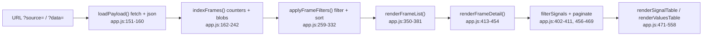

# mikegapinski-tesla-can-explorer

## 1. Provenance

- **Snapshot type:** converted folder, **not a live submodule**. `git ls-files -s legacy/mikegapinski-tesla-can-explorer` returns 25 regular blobs (`100644 <sha> 0`), **no `160000` gitlink**; `Test-Path legacy/mikegapinski-tesla-can-explorer/.git` is `false`. `git -C legacy/mikegapinski-tesla-can-explorer rev-parse HEAD` returns `7d90b9a32fb07b7cb9fa07538d06d3c87936112b`, which is exactly the parent repo HEAD — git walked up out of the folder. That value is **not** a legacy-repo SHA and is not used as one here.
- **Upstream URL:** `https://github.com/mikegapinski/tesla-can-explorer` (commented-out `[submodule]` block, `.gitmodules:16-20`). Upstream returns **404** per `docs/legacy/upstream-review-2026-06-20.md:28`; the submodule entry was commented out in `.gitmodules`, removed from `.git/config` and `.git/modules/`, and the working tree preserved. **No upstream fetch is possible.** No last-known SHA is recorded in either doc and none is recoverable from the folder (no local git history); provenance therefore rests on file inventory + hashes below.
- **License:** 0BSD, `LICENSE:1-14`, Copyright (c) 2026 Michał Gapiński.
- **Analysis date:** 2026-11-21.
- **Files read (FULL-READ):** `app.js:1-745`, `index.html:1-227`, `enable_portal_source.sh:1-163`, `README.md:1-55`, `LICENSE:1-14`, `data/vapi_can_digest_mcu2.json`, `data/vapi_can_digest_mcu3.json` (whole files, small).
- **Files RANGE-CITED / STRUCTURAL-PARSE:** the five `data/can_frames_decoded_all_values*.json` catalogs (18–24 MB each; top-level schema, `generated_utc`, `dataset_source`, `source_files`, `limitations`, `counts`, `sources_processed`, `vapi_digest.counts`, first frame/signal, plus targeted ID lookups only); the five `vapi_eth_signal_aliases*.csv` and five `can_frames_decoded_enum_values*.csv` (header + first rows only); the remaining three tiny digest JSONs parsed for `counts`. No catalog was read end-to-end.
- **Files explicitly NOT read:** `styles.css` (presentation only), the full body of every large JSON/CSV, the upstream repository (404), any pre-conversion upstream history.
- **Folder inventory:** `LICENSE`, `README.md`, `app.js`, `index.html`, `styles.css`, `enable_portal_source.sh`, plus 20 files under `data/`. No hidden directories; `data/` is the only subdirectory.
- **Replace-mode preservation:** YAML frontmatter is kept byte-for-byte. Line 3 is truncated at `comprehen` and carries **no** trailing whitespace (verified in both the working tree and `git show HEAD:docs/legacy/mikegapinski-tesla-can-explorer.md` by hex dump), so nothing was stripped. The existing `## Upstream (2026-06-20)` section is preserved verbatim at the end of this document. Pre-replace claims are cited as `git show HEAD:docs/legacy/mikegapinski-tesla-can-explorer.md#<line>`.

## 2. Executive verdict

A static, browser-only research portal with no vehicle transport: it fetches one of four locally vendored decoded-signal catalogs (577–1,728 frames, 36,504–41,395 signals each), indexes them client-side, and offers token search, bus/module/enum filters, five sort modes, and paged enum-label tables with VAPI alias/digest overlays. The mechanisms that matter are the signal/enum naming datasets, the VAPI alias attribution, and the search/filter interaction model; none of them touch frame bytes. Our client already ships converted copies of all four datasets (`client/src/assets/can-decoder/legacy_*.json`) and decodes frames from them (`client/src/hooks/useDecoderDatasets.ts:4-7,58-96`, `client/src/AppExperience.tsx:194`), so dataset ingestion is **already present**. The real candidates are (a) surfacing enum labels plus `enum_map_symbol` / `possible_values_note` through `describeDecodedFrame`, (b) exposing dataset provenance/freshness (`generated_utc`, firmware, source library), and (c) reusing the two-stage search model in the in-app docs screen. Must not be ported: any address-to-name mapping taken without its bus qualifier (the Model 3 catalogs are `ETH`-only; the same numeric ID names a different frame on `CH`/`PT`), any claim that these datasets validate bit positions / scaling / checksums (none are present), the Google Analytics embed, and the in-place `app.js` patch script.

## 3. Evidence map

| Source file | Lines | What it proves | Grade |
| --- | --- | --- | --- |
| `legacy/.../app.js` | 3-21 | Four `DATA_SOURCES` (mcu2, mcu3, modelsx_amd, modelsx_intel), `DEFAULT_SOURCE_KEY = "mcu2"` | CODE-READ |
| `legacy/.../app.js` | 78-126 | `?source=` validated against source keys; `?data=` arbitrary URL override wins and disables selector | CODE-READ |
| `legacy/.../app.js` | 128-149 | Lowercase whitespace tokenization; key = `bus_name\|bus_id\|address_dec\|frame_name`; module = prefix before `_` | CODE-READ |
| `legacy/.../app.js` | 151-160 | `fetch(url)` + `response.json()`; no timeout, no abort, no schema check | CODE-READ |
| `legacy/.../app.js` | 162-242 | Index builds per-frame counts and search blobs; yields to event loop every 20 frames | CODE-READ |
| `legacy/.../app.js` | 259-332 | Bus/module/enumerated filters; five sort modes; 130 ms input debounce wired at 596-603 | CODE-READ |
| `legacy/.../app.js` | 387-454, 456-558 | Signal blob search, page clamp, pagination, expandable enum-value tables | CODE-READ |
| `legacy/.../app.js` | 573-584, 673-743 | Loading/fatal overlay; init reads dataset metadata; VAPI stat prefers digest count | CODE-READ |
| `legacy/.../index.html` | 9-17, 79-160, 203-225 | Google tag embed; all UI controls; loading overlay; `<template>`; `app.js` entry | CODE-READ |
| `legacy/.../enable_portal_source.sh` | 1-163 | CLI patches `DATA_SOURCES` / `DEFAULT_SOURCE_KEY` in `app.js` in place via embedded Python | CODE-READ |
| `legacy/.../README.md` | 9-55 | Upstream scope claims Model 3 only; run via `python3 -m http.server 8080` | SUMMARY-ONLY |
| `docs/legacy/mikegapinski-tesla-can-explorer.md` (pre-replace) | 15-60 | Existing summary's reuse/staleness claims | SUMMARY-ONLY |
| `legacy/.../LICENSE` | 1-14 | 0BSD text | CODE-READ |
| `legacy/.../data/can_frames_decoded_all_values*.json` | schema + targeted lookups | Catalog shape: `bus_name`, `bus_id`, `address_dec`, `address_hex`, `frame_name`, `message_index`, `declared_signal_count`, `signals[{signal_index, signal_name, enum_map_symbol, possible_values, possible_values_note, vapi_alias, vapi_source}]`; no bit/scale/counter/checksum fields | STRUCTURAL-PARSE |
| `legacy/.../data/can_frames_decoded_enum_values*.csv` | header + first rows | Columns `bus_name,bus_id,address_dec,address_hex,frame_name,signal_name,enum_map_symbol,value_dec,value_hex,label` | STRUCTURAL-PARSE |
| `legacy/.../data/vapi_eth_signal_aliases*.csv` | header + first rows | Columns `bus_name,address_hex,frame_name,signal_name,vapi_alias`; values like `ETH_ADSP_eCallMicrophoneStatus` | STRUCTURAL-PARSE |
| `legacy/.../data/vapi_can_digest*.json` | whole (small) | `vapi_eth_tokens`, `vapi_map_symbols`, `vapi_name_maps`, `db_signals_total`, `db_signals_annotated_with_vapi_alias`, `vapi_tokens_unmatched_to_db_signals` | CODE-READ |
| `packages/protocol/src/decoder.ts` | 3-99 | Our `DecoderDataset` types, `buildDecoderIndex`, `describeDecodedFrame`, `KNOWN_CAN_IDS` | CODE-READ |
| `client/src/hooks/useDecoderDatasets.ts` | 4-7, 29-96, 98-150 | Our four imported legacy datasets; `address_dec` coerced to `id`; bus/bus_id/message_index dropped | CODE-READ |
| `client/src/AppExperience.tsx` | 173-229, 855, 923, 1070 | Client calls `describeDecodedFrame(decoderIndex, frame.id)` in live views | CODE-READ |

No TEST-READ evidence exists: this repo ships no test files (25 tracked files, none under a test path). No CAPTURE evidence exists: no captured frames or decode-tool output are bundled. Reading-coverage note: the large JSON catalogs and CSVs are STRUCTURAL-PARSE only; assertions about their contents are limited to schema, metadata blocks, first records, and the targeted ID lookups in sections 7 and 11.

## 4. Architecture and build surface

- **Entry point:** `index.html:225` loads `./app.js`; `app.js:745` calls `init()`.
- **Build:** none. No `package.json`, bundler, transpiler, or compile step. Hosting recipe is `python3 -m http.server 8080` (`README.md:24-38`); assets are fetched relative to the served directory (`app.js:6,10,14,18`).
- **Shared core vs platform port:** no such split. One browser JS file plus four JSON catalogs and five CSV sidebar artifacts; all "core" logic is in `app.js`.
- **Build flags:** None found.
- **Dependency boundaries:** same-origin `fetch` of JSON only (`app.js:155`); one external script, Google Tag Manager (`index.html:10`); no npm packages, no CAN driver, no native code.
- **CAN data flow (RX → decode → mutate/gate → TX):** None found: no frame pipeline in this repo. The portal never opens a CAN device, builds a frame, or injects anything (negative anchors in section 16).

The only data flow present is the browsing UI:



## 5. Mechanism catalogue

### Data-source selector and URL override

- **Claim (README / summary):** README documents only `?source=mcu2` and `?source=mcu3` (`README.md:30-38`); the existing summary says all four variants exist (`git show HEAD:docs/legacy/mikegapinski-tesla-can-explorer.md#29-33`).
- **Code path:** `app.js:3-21` → `getSelectionFromQuery()` `app.js:78-98` → `initSourceSelector()` `app.js:108-126` → `init()` `app.js:673-675`; selector change → `applySourceToQuery()` `app.js:100-106` → `window.location.assign`.
- **Frame spec:** None found (no CAN frame is built).
- **Gates and timing:** `source` accepted only if it is a `DATA_SOURCES` key, else `mcu2` (`app.js:81-83`); `data` override takes precedence and hard-disables the `<select>` with a title explaining why (`app.js:84-90,122-125`). Selecting a new source performs a full page navigation, discarding all search state.
- **State machine:** four selection states — default key, explicit valid key, arbitrary `?data=` override, selector-disabled override.

```mermaid
stateDiagram-v2
    [*] --> Default: no query params
    Default --> Explicit: ?source=<valid key>
    Explicit --> Override: ?data=<url> present
    Default --> Override: ?data=<url> present
    Override --> Explicit: selector changed (full reload, ?data deleted)
    Override --> Default: selector changed with default key
    Explicit --> Explicit: selector changed (full reload)
```

- **Tests:** None found.
- **Evidence grade:** CODE-READ.
- **Verdict:** CONFIRMED (README understates the source count; recorded in section 6).
- **Adapt to TeslaCANModder?** already present (our `useDecoderDatasets` has the four datasets and `setDecoderDatasetId`); the missing piece is deep-linkable source selection, which is a low-value candidate.

### Two-stage token search with filters and five sort modes

- **Claim (README / summary):** "Search across frame names, addresses, signals, enum maps, enum labels, and VAPI aliases" (`README.md:42`); "search/filter/sort across frames, signals, enums, and VAPI aliases" (`git show HEAD:docs/legacy/mikegapinski-tesla-can-explorer.md#26`).
- **Code path:** `tokenize()` `app.js:128-134` → `frameKey()` / `getModuleName()` `app.js:136-149` → `indexFrames()` builds `frame.__search` and `frame.__labelSearch` `app.js:180-220` → `frameMatches()` `app.js:259-284` → `sortFrames()` `app.js:286-314` → `applyFrameFilters()` `app.js:316-332`.
- **Frame spec:** None found.
- **Gates and timing:** token semantics are AND (`app.js:274-282`); a token matches either the frame/signal blob or the enum-label blob; bus filter compares the exact `"<bus_name> (<bus_id>)"` string; 130 ms debounce on global search (`app.js:596-603`), immediate on the other controls (`app.js:605-608`). Sort modes: `address`, `name`, `signals`, `enums`, `vapi`; tiebreak is `address_dec` (`app.js:286-314`).
- **State machine:** None found.
- **Tests:** None found.
- **Evidence grade:** CODE-READ.
- **Verdict:** CONFIRMED.
- **Adapt to TeslaCANModder?** candidate for the in-app docs screen; we have no frame/enum browse UI (only per-frame decode lookups in `AppExperience.tsx:194`), so this is a UX gap rather than a decoder gap.

### Indexed signal table with paged enum expansion

- **Claim (README / summary):** "Expand per-signal decoded values directly in the frame detail view" (`README.md:45`).
- **Code path:** `getSignalSearchBlob()` `app.js:387-400` → `filterSignals()` `app.js:402-411` → `renderFrameDetail()` `app.js:413-454` → `renderSignalPagination()` `app.js:456-469` → `renderSignalTable()` `app.js:471-526` → `renderValuesTable()` `app.js:528-558`; row expand toggles `state.expandedSignalKeys` at `app.js:655-670`; pager wiring `app.js:631-653`.
- **Frame spec:** None found. Displayed signal fields: `signal_index`, `signal_name`, `enum_map_symbol`, `vapi_alias` + `vapi_source`, `possible_values.length`, `possible_values_note`; expanded rows show `value_dec`, `value_hex`, `label` (`app.js:488-505,532-542`).
- **Gates and timing:** page size from `<select>` options 100/200/500 (`index.html:154-158`), default 200 (`app.js:59,626,732`); stale page clamped to `totalPages` (`app.js:444-448`); search blob cached on the signal object (`app.js:388-399`).
- **State machine:** None found.
- **Tests:** None found.
- **Evidence grade:** CODE-READ.
- **Verdict:** CONFIRMED.
- **Adapt to TeslaCANModder?** candidate: `describeDecodedFrame` in `packages/protocol/src/decoder.ts:55-69` already returns `name`/`values` but drops `enum_map_symbol` and `possible_values_note`; extending it is the cheap reuse path.

### VAPI alias and digest attribution overlay

- **Claim (README / summary):** "VAPI CAN digest reveals Tesla's internal signal-to-API mapping" (`git show HEAD:docs/legacy/mikegapinski-tesla-can-explorer.md#57`); related VAPI artifacts listed at `README.md:17-22`.
- **Code path:** per-signal alias capture `app.js:191-205`; sources label `app.js:691-708`; VAPI stat `app.js:719-730`; digest files `data/vapi_can_digest*.json`.
- **Frame spec:** None found. The digest carries counts only (e.g. mcu2: `vapi_eth_tokens: 792`, `vapi_map_symbols: 1532`, `vapi_name_maps: 473`, `db_signals_total: 40484`, `db_signals_annotated_with_vapi_alias: 792`, `vapi_tokens_unmatched_to_db_signals: 0`); per-signal aliases live in the JSON `vapi_alias` field (e.g. `ETH_ADSP_eCallMicrophoneStatus`) and in `vapi_eth_signal_aliases*.csv`.
- **Gates and timing:** the on-screen VAPI stat prefers `payload.vapi_digest.counts.db_signals_annotated_with_vapi_alias` when it is a finite non-negative number, otherwise falls back to the per-signal count (`app.js:721-729`).
- **State machine:** None found.
- **Tests:** None found.
- **Evidence grade:** CODE-READ.
- **Verdict:** CONFIRMED.
- **Adapt to TeslaCANModder?** candidate for provenance/freshness metadata only; the alias strings themselves carry no new frame semantics for our firmware.

### Local source-enabling patch helper

- **Claim (README / summary):** listed as "Portal launch helper script" (`git show HEAD:docs/legacy/mikegapinski-tesla-can-explorer.md#38`).
- **Code path:** `enable_portal_source.sh:36-64` argument parse → `81-87` dataset existence warning → `89-161` embedded Python regex patch of the `DATA_SOURCES` block and optional `DEFAULT_SOURCE_KEY`, ending in `app_js.write_text(...)` at line 157.
- **Frame spec:** None found.
- **Gates and timing:** requires `--source-key` and `--label` (`66-70`); default URL is `./data/can_frames_decoded_all_values_<key>.json` (`72-74`); local `./data/` path produces a warning, not a hard failure (`81-87`); `set -euo pipefail` at line 2.
- **State machine:** None found.
- **Tests:** None found.
- **Evidence grade:** CODE-READ.
- **Verdict:** CONFIRMED.
- **Adapt to TeslaCANModder?** never port: it rewrites checked-in application source in place with no backup or test, which conflicts with our generated-file and lint gates.

### Static hosting with third-party analytics

- **Claim (README / summary):** static web app on any HTTP server (`git show HEAD:docs/legacy/mikegapinski-tesla-can-explorer.md#19`); `python3 -m http.server 8080` (`README.md:26-28`).
- **Code path:** `index.html:9-17` loads Google Tag Manager and calls `gtag('config','G-H6QTPY0Q7N')`; `app.js:151-160` fetches same-origin JSON.
- **Frame spec:** None found.
- **Gates and timing:** analytics script is `async` and unconditional (`index.html:10`).
- **State machine:** None found.
- **Tests:** None found.
- **Evidence grade:** CODE-READ.
- **Verdict:** CONFIRMED.
- **Adapt to TeslaCANModder?** never port the analytics embed; hosting pattern is no impact.

## 6. Summary vs code contradiction table

| # | Claim (pre-replace / README) | Code or schema evidence | Verdict |
| --- | --- | --- | --- |
| 1 | `git show HEAD:docs/legacy/mikegapinski-tesla-can-explorer.md#45` — datasets include "bit positions, scaling factors, and enum value maps" | Signal schema at `legacy/.../data/can_frames_decoded_all_values_mcu2.json` (STRUCTURAL-PARSE) has `signal_index`, `signal_name`, `enum_map_symbol`, `possible_values`, `possible_values_note`, `vapi_alias`, `vapi_source` only; negative anchor for `start_bit\|bit_position\|scale_factor\|checksum\|counter` in `app.js` yields no output (section 16) | CONTRADICTED — enum maps yes, bit positions/scaling no |
| 2 | `git show HEAD:docs/legacy/mikegapinski-tesla-can-explorer.md#51` — "authoritative signal definitions that can validate and extend our own CAN protocol documentation" | All Model 3 dataset frames are `bus_name: "ETH"` (STRUCTURAL-PARSE of all three Model 3 catalogs); our firmware taps `CH`/`PT`/`BDY` physical buses (`KNOWN_CAN_IDS`, `packages/protocol/src/decoder.ts:72-94`). Same numeric IDs name different frames across the two namespaces | CONTRADICTED as stated — usable only with bus qualification plus a capture |
| 3 | `README.md:9-15` — "Vehicle: `Model 3`" with only mcu2/mcu3 variants | `app.js:12-19` adds `modelsx_amd` and `modelsx_intel`; those catalogs exist and carry 579/1,728 frames | CONTRADICTED — README understates variant coverage |
| 4 | `README.md:13` — "Sources: `libQtCarCANData.so`, `libQtCarVAPI.so`" | `sources_processed` in the JSONs lists only `libQtCarVAPI.so.1.0.0`; `libQtCarCANData.so` is hardcoded in `app.js:692` and `index.html:31`; `source_files` point at derived `messages.csv` / `signals.csv` / `enum_maps.csv` under `/Volumes/Untitled/squashfs-root/can_re/output/` | PARTIAL — VAPI extraction confirmed, CANData extraction not evidenced in-repo |
| 5 | `git show HEAD:docs/legacy/mikegapinski-tesla-can-explorer.md#42` — reference database "from firmware binaries", implying direct CAN frame definitions | Dataset `limitations` field explicitly says numeric/bitfield signals are not fully decoded and possible values are complete only for signals linked to `Diag_*_map` tables | PARTIAL — coverage is enum-oriented, not a full frame definition set |
| 6 | `client/src/docs/_generated-docs.ts:5769` (stale generated copy of an older summary) — "covering all signal names, bit positions, enum values, and VAPI aliases" | Same schema evidence as row 1; no bit fields exist | CONTRADICTED — inherited stale generated-doc text, kept here as a cross-reference finding |

Agreements (not contradictions, listed for completeness): 0BSD license (`LICENSE:1-14` vs `git show HEAD:docs/legacy/mikegapinski-tesla-can-explorer.md#22`); "no direct CAN interaction" (`git show HEAD:docs/legacy/mikegapinski-tesla-can-explorer.md#21` vs negative anchors); firmware `2026.2` (`dataset_source` in all five JSONs); sponsor and disclaimer text (`README.md:5,7`, `index.html:34-50,198-200`).

## 7. CAN frame and signal inventory

**Catalog summary (STRUCTURAL-PARSE, not dumped):** five vendored decoded-signal catalogs. Frame/signal/enum-row counts: mcu2 `577 / 40,484 / 62,007`; mcu3 `577 / 40,484 / 62,007`; combined `577 / 40,484 / 62,007`; Model S/X AMD `579 / 36,504 / 55,744`; Model S/X Intel `1,728 / 41,395 / 87,635`. All generated 2026-02-23/24/25 UTC, firmware `2026.2`. The Model 3 and combined catalogs contain only `ETH` frames; Model S/X Intel spans `BDY, BFT, CH, ETH, PT, TH`. The five enum CSVs and five alias CSVs are row-oriented exports of the same fields.

For every row below, **period, DLC, byte/bit layout, scale/units, counter position and checksum are `None found`** — the catalogs carry no timing, layout, scaling or integrity metadata. Access is `read` (decode/label only); this repo never writes a frame.

| ID (hex+dec) | Bus (catalog) | Period | DLC | Byte/bit layout | Scale/units | Counter | Checksum | Read/write | Grade |
| --- | --- | --- | --- | --- | --- | --- | --- | --- | --- |
| `0x3FD` / 1021 — `UI_autopilotControl` (74 signals) | ETH (Model 3, all variants) | None found | None found | None found; mux-like signal `UI_autopilotControlIndex` with enum 0..7 + `0xFFFFFFFF` sentinel | None found | None found | None found | read | STRUCTURAL-PARSE |
| `0x2B9` / 697 — `DAS_control` (9 signals) | ETH (all), CH + PT (S/X Intel) | None found | None found | None found | None found | None found | None found | read | STRUCTURAL-PARSE |
| `0x488` / 1160 — `DAS_steeringControl` (5 signals) | CH (S/X Intel) | None found | None found | None found | None found | None found | None found | read | STRUCTURAL-PARSE |
| `0x27D` / 637 — `APS_eacMonitor` (3 signals) | CH (S/X Intel) | None found | None found | None found | None found | None found | None found | read | STRUCTURAL-PARSE |
| `0x370` / 880 — `SCS_alertMatrix2` (64 signals, Model 3 ETH) vs `EPAS_sysStatus` (11 signals, S/X Intel CH) | ETH / CH | None found | None found | None found | None found | None found | None found | read | STRUCTURAL-PARSE |
| `0x39B` / 923 — `DAS_status` (26 signals, S/X Intel CH/ETH) vs `PMREL_alertMatrix2` (6 signals, S/X AMD ETH) | CH, ETH | None found | None found | None found | None found | None found | None found | read | STRUCTURAL-PARSE |
| `0x219` / 537 — `VCSEC_TPMSData` (45 signals, ETH) / `DAS_pscControl` (CH) / `BMS_status` (PT) | ETH, CH, PT | None found | None found | None found | None found | None found | None found | read | STRUCTURAL-PARSE |
| `0x257` / 599 — `DI_speed` (11 signals, ETH) / `DI_cruise` (PT) / `THC_RCCMVehicleHVInfo` (BFT) | ETH, PT, BFT | None found | None found | None found | None found | None found | None found | read | STRUCTURAL-PARSE |
| `0x118` / 280 — `DI_systemStatus` (21 signals, ETH) / `DI_torque2` (CH) | ETH, CH | None found | None found | None found | None found | None found | None found | read | STRUCTURAL-PARSE |
| `0x106` / 262 — `DI_torque1` (7 signals) | ETH, PT | None found | None found | None found | None found | None found | None found | read | STRUCTURAL-PARSE |
| `0x273` / 627 — `UI_vehicleControl` (39 signals, ETH / 2 signals, S/X Intel ETH) | ETH | None found | None found | None found | None found | None found | None found | read | STRUCTURAL-PARSE |
| `0x334` / 820 — `UI_powertrainControl` (18 signals, ETH) / `EPB_alertMatrix1` (CH) | ETH, CH, PT | None found | None found | None found | None found | None found | None found | read | STRUCTURAL-PARSE |
| `0x331` / 817 — `EPAS3P_info` (10 signals ETH / 9 signals CH) | ETH, CH | None found | None found | None found | None found | None found | None found | read | STRUCTURAL-PARSE |
| `0x392` / 914 — `BMS_packConfig` (ETH) / `EPAS3P_dtcMatrix` (S/X Intel CH/ETH) | ETH, CH | None found | None found | None found | None found | None found | None found | read | STRUCTURAL-PARSE |
| `0x398` / 920 — `EPASTS_alertMatrix` (271 signals, ETH) / `GTW_carConfig2` (PT) / `TUNER_RequestTextData` (BDY, ETH) | ETH, PT, BDY | None found | None found | None found | None found | None found | None found | read | STRUCTURAL-PARSE |
| `0x3F8` / 1016 — `DI_state2` (14 signals, CH) / `DCDC_alertMatrix1` (ETH) | CH, ETH, PT | None found | None found | None found | None found | None found | None found | read | STRUCTURAL-PARSE |
| `0x3F5` / 1013 — `DIS_dtcMatrix` (29 signals) | PT (S/X Intel) | None found | None found | None found | None found | None found | None found | read | STRUCTURAL-PARSE |

Representative enum payloads (STRUCTURAL-PARSE of the mcu2 catalog): `UI_autopilotControlIndex` → 0..7 plus `4294967295`/`0xFFFFFFFF` (blank label); `UI_autopilotDrivingProfile` → `0 CHILL`, `1 NORMAL`, `2 ASSERTIVE`, plus the same sentinel — three real values, not four. Signal `possible_values_note` can read `No enum map in this binary (numeric/bitfield signal or unresolved metadata).`

## 8. Constants and tuning table

| Constant | Value | File:line | Meaning | Grade |
| --- | --- | --- | --- | --- |
| `DEFAULT_SOURCE_KEY` | `"mcu2"` | `app.js:21` | Dataset used when no query param is present | CODE-READ |
| Global-search debounce | `130` ms | `app.js:600-602` | Delay before frame re-filter on each keystroke | CODE-READ |
| Default signal page size | `200` (options `100`, `200`, `500`) | `app.js:59,626,732`; `index.html:154-158` | Rows rendered per signal table page | CODE-READ |
| Index yield interval | every `20` frames | `app.js:229-232` | `setTimeout(..., 0)` to keep UI responsive during indexing | CODE-READ |
| VAPI stat override | `db_signals_annotated_with_vapi_alias` from digest | `app.js:721-728` | Digest count wins over per-signal count when finite and `>= 0` | CODE-READ |
| Google tag ID | `G-H6QTPY0Q7N` | `index.html:10,16` | Third-party analytics identifier | CODE-READ |
| Local HTTP port | `8080` | `README.md:27` | Documented `python3 -m http.server` port | SUMMARY-ONLY |
| Dataset firmware tag | `2026.2` | all five JSON `dataset_source` | Provenance of extracted signal/enum data | CODE-READ |
| Enum sentinel | `4294967295` / `0xFFFFFFFF` | mcu2 JSON `UI_autopilotControlIndex`, `UI_autopilotDrivingProfile` | "unset/unknown" enum value used by extracted tables | STRUCTURAL-PARSE |

## 9. Failure modes and edge cases

| Failure | Handling code path | Tested? | Grade |
| --- | --- | --- | --- |
| HTTP error fetching dataset | `app.js:156-158` throws `Failed to load <url>: HTTP <status>`; caught at `735-742` and shown in the fatal overlay | No — no tests in repo | CODE-READ |
| Malformed JSON / wrong schema | `response.json()` rejection or non-array `payload.frames` falls through to `[]` (`app.js:680`) with no user-facing warning | No | CODE-READ |
| Arbitrary `?data=` URL fails (CORS, mixed content, 404) | Same generic catch at `app.js:735-742`; message tells user to start a local server even when data is remote | No | CODE-READ |
| No network timeout / abort | `fetch(url)` at `app.js:155` has no `AbortController`; loader overlay can hang indefinitely | No | CODE-READ |
| Missing DOM node after markup change | `els.globalSearch.addEventListener` at `app.js:596` and several siblings are unguarded; only `dataSource` and a few labels are null-checked | No | CODE-READ |
| Stale signal page after filter | Clamped to `totalPages` at `app.js:444-448`, reset on frame selection at `564-567` | No | CODE-READ |
| Large-dataset UI blocking | Yields every 20 frames (`app.js:229-232`); no Web Worker; full payload and per-signal caches kept in memory | No | CODE-READ |
| Bus-off / watchdog / OTA pause / queue overflow / brownout state | None found — no CAN transport exists in this repo | N/A | CODE-READ |

## 10. Test coverage map

No test files exist (verified by `git ls-files legacy/mikegapinski-tesla-can-explorer`: 25 files, none under a test path). Accordingly there is no TEST-READ evidence for any mechanism above.

Critical untested paths and their risk:

- `getSelectionFromQuery` precedence (`app.js:78-98`) — a bad `?data=` value silently replaces a valid source; risk: confusing or failing deep links.
- `frameMatches` / `sortFrames` (`app.js:259-314`) — token-AND and enum-label fallback have no oracle; risk: false-negative search results go unnoticed.
- Pagination clamp and row expansion (`app.js:444-448,655-670`) — risk: stale selection after query changes.
- `escapeHtml` (`app.js:65-72`) — risk: a regression in this hand-rolled escaper would create DOM XSS because `innerHTML` is used throughout (`app.js:361-525`).
- Null-element resilience (`app.js:596` et al.) — risk: a minor markup edit throws before `init()` finishes.

## 11. Parity matrix with TeslaCANModder

Our-side citations are CODE-READ of `packages/protocol/src/decoder.ts`, `client/src/hooks/useDecoderDatasets.ts`, `client/src/AppExperience.tsx`, or the shipped decoder assets. Rows without such a citation would be SUMMARY-ONLY and are omitted.

| Signal/frame | Upstream decode (cite) | Our decode (cite) | Delta | Action (align / capture-first / ignore) |
| --- | --- | --- | --- | --- |
| `0x3FD` / 1021 frame identity | `UI_autopilotControl`, ETH, 74 signals; mux signal `UI_autopilotControlIndex` 0..7 (`can_frames_decoded_all_values_mcu2.json`, STRUCTURAL-PARSE) | `KNOWN_CAN_IDS[1021] = "FSD Control (HW3/HW4)"` (`packages/protocol/src/decoder.ts:93`); id derived from `address_dec` (`useDecoderDatasets.ts:69`) | Semantically related but names differ; no mux/bit data on our side to confirm bit 19/38/46/60 edits | capture-first |
| `0x2B9` / 697 `DAS_control` | 9 signals, ETH + CH/PT (`can_frames_decoded_all_values_modelsx_intel.json`, STRUCTURAL-PARSE) | Shipped in `client/src/assets/can-decoder/legacy_mcu2.json` and coerced at `useDecoderDatasets.ts:66-81`; not in `KNOWN_CAN_IDS` | We carry the labels but no period/DLC/bit layout; firmware injection timing cannot be checked here | capture-first |
| `0x488` / 1160 `DAS_steeringControl` | 5 signals, CH (S/X Intel catalog) | Shipped via S/X Intel asset (`useDecoderDatasets.ts:46-47`); no `KNOWN_CAN_IDS` entry | Same limitation as above; no counter/checksum field | capture-first |
| `0x370` / 880 frame name | `SCS_alertMatrix2` on Model 3 ETH; `EPAS_sysStatus` on S/X Intel CH (STRUCTURAL-PARSE of two catalogs) | `KNOWN_CAN_IDS[880] = "EPAS3P_sysStatus (Nag Killer)"` (`decoder.ts:87`) | Bus-dependent name collision with our nag-killer identity; cannot resolve from catalogs alone | capture-first |
| `0x219` / 537 TPMS | `VCSEC_TPMSData`, 45 signals, ETH (mcu2/mcu3 catalog) | `KNOWN_CAN_IDS` has no 537 entry; asset shipped (`useDecoderDatasets.ts:66-81`) | Our docs decode TPMS pressure/temp from bytes 0..7; catalog offers labels only, no scaling | capture-first |
| `0x257` / 599 speed | `DI_speed` (ETH), `DI_cruise` (PT) | No `KNOWN_CAN_IDS` entry; asset shipped | Name agrees semantically with our "vehicle speed"; no scale/offset data | capture-first |
| `0x118` / 280 gear/pedal | `DI_systemStatus` (ETH), `DI_torque2` (CH) | No `KNOWN_CAN_IDS` entry; asset shipped | Our docs call this `DI_state`; different name, no bit layout | capture-first |
| `0x273` / 627 vehicle control | `UI_vehicleControl`, 39 signals (ETH) | `KNOWN_CAN_IDS[627] = "UI_vehicleControl"` (`decoder.ts:77`) | Name aligns exactly | align |
| `0x334` / 820 powertrain control | `UI_powertrainControl`, 18 signals (ETH) | `KNOWN_CAN_IDS[820] = "UI_powertrainControl"` (`decoder.ts:85`) | Name aligns exactly | align |
| `0x392` / 914 firmware version | `BMS_packConfig` (ETH), `EPAS3P_dtcMatrix` (S/X CH) | No `KNOWN_CAN_IDS` entry for 914; docs call it `GTW_version` | Direct name conflict with our FW-compat feature; catalog cannot arbitrate | capture-first |
| `0x398` / 920 car config | `EPASTS_alertMatrix` (ETH), `GTW_carConfig2` (PT) | `KNOWN_CAN_IDS[920] = "GTW_carConfig (HW Detect)"` (`decoder.ts:88`) | Direct name conflict; region/platform bit layout absent from catalog | capture-first |
| `0x331` / 817 AP config | `EPAS3P_info` (ETH/CH) | No `KNOWN_CAN_IDS` entry for 817; docs call it `DAS_autopilotConfig` | Name conflict; no bit data | capture-first |
| `0x2AA` air recirc | Catalog contains ETH frames only for Model 3; targeted lookup found no 682 match | `KNOWN_CAN_IDS` has no 682 entry; firmware injects 0x2AA per commands reference | No upstream evidence here — do not infer absence from a partial lookup | ignore |
| `UI_autopilotDrivingProfile` enum | 3 real values `CHILL / NORMAL / ASSERTIVE` + sentinel (mcu2 catalog) | Our protocol exposes four profiles 0..3 via command docs/profile state | Possible 3-vs-4 profile domain delta; needs a captured 0x3FD mux2 frame before any change | capture-first |

No row above drives a firmware mutation decision: every candidate is gated on an independent bus-qualified capture plus `docs/checklists/can-review-checklist.md`.

## 12. Surface inventory and security notes

| Surface | Semantics | Grade |
| --- | --- | --- |
| `GET ./data/can_frames_decoded_all_values_*.json` | Same-origin fetch of the selected catalog (`app.js:151-160`) | CODE-READ |
| `?source=<key>` | Selects one of four built-in datasets; invalid values fall back to `mcu2` (`app.js:78-83`) | CODE-READ |
| `?data=<url>` | Arbitrary fetch override; disables the source selector (`app.js:84-90,122-125`) | CODE-READ |
| DOM controls | Data-source select, global search, bus filter, module filter, enumerated-only checkbox, five-way sort, signal search, page-size select, first/prev/next/last pager, expandable signal rows (`index.html:79-160`; `app.js:586-671`) | CODE-READ |
| `enable_portal_source.sh --source-key --label [--json-url] [--set-default]` | Local CLI that rewrites `app.js` in place (`enable_portal_source.sh:36-64,89-161`) | CODE-READ |
| Google Tag Manager `G-H6QTPY0Q7N` | Unconditional `async` third-party script (`index.html:9-17`) | CODE-READ |
| Serial / BLE / WiFi REST device commands | None found — no transport, no command dispatch, no frame injection | CODE-READ |

Security and provenance findings:

- No hardcoded credentials, API keys, certificates, or private keys found in any tracked file.
- `escapeHtml()` (`app.js:65-72`) is applied to every catalog-derived value interpolated into `innerHTML` (`app.js:361-525`); this is the only XSS barrier and is untested (section 10).
- `?data=` is an unvalidated URL passed straight to `fetch` (`app.js:84-89,155`). In a browser this is bounded by CORS/mixed-content rules, but it is still an untrusted-input sink; the generic error path at `app.js:737-741` does not distinguish remote fetch failures.
- Third-party analytics (`index.html:9-17`) is a privacy consideration; sponsor links use `target="_blank" rel="noopener noreferrer"` (`index.html:38-48`), which is correct.
- No `eval`, no dynamic script injection, no dangerous build flags; the only mutating tool is the local patch script, which writes checked-in source with no backup (`enable_portal_source.sh:157`).
- Dataset `source_files` embed absolute paths from the author's extraction host (`/Volumes/Untitled/squashfs-root/...`, `/Users/mgapinski/Downloads/...`), confirming firmware-binary extraction but not reproducible from this folder.

## 13. Adaptation assessment

| Mechanism | Value | Cost | Risk | Evidence grade | Decision |
| --- | --- | --- | --- | --- | --- |
| Four-source dataset selector + URL override | Low — our client already has four datasets and a selector | Low if limited to a deep-link param | Full-page reload discards state (`app.js:100-106`) | CODE-READ | already present (deep-link gap is backlog) |
| Two-stage token search, filters, sorts | Medium — improves in-app docs browsing of large catalogs | Medium — new UI state and tests | False-negative searches without an oracle | CODE-READ | candidate for future PR (docs screen only) |
| Paged enum expansion + `possible_values_note` surfacing | Medium-high — our `describeDecodedFrame` drops both fields | Low — extend `DecoderSignal`/`DecodedEntry` in `packages/protocol/src/decoder.ts:3-8,34-69` | None to frame bytes | CODE-READ | candidate for future PR (top pick) |
| VAPI alias / digest attribution | Low-medium — provenance and freshness display only | Low | Digest counts are annotations, not frame truth | CODE-READ | candidate for metadata display |
| Enum CSV / alias CSV artifacts | Low — same data already inside the JSON catalogs | Low | Duplicate data sources can drift | STRUCTURAL-PARSE | ignore |
| In-place `app.js` patch helper | Low | n/a | Mutates checked-in source, no backup/test | CODE-READ | never port |
| Google Analytics embed | None for an offline-first tool | n/a | Privacy / third-party dependency | CODE-READ | never port |
| Dataset ingestion itself | High | Already paid | Stale firmware tag (`2026.2`) if treated as current | CODE-READ | already present — add freshness gate |

## 14. Do-not-copy list

- `legacy/mikegapinski-tesla-can-explorer/app.js:65-72` — hand-rolled `escapeHtml`; React already escapes by default. Reason: duplicate, untested security primitive.
- `legacy/mikegapinski-tesla-can-explorer/app.js:100-106` — `window.location.assign` full reload for a selector change. Reason: our client keeps dataset choice in React state (`useDecoderDatasets.ts:99`).
- `legacy/mikegapinski-tesla-can-explorer/app.js:138` — `frameKey` / `__key` / `__search` mutation of loaded objects. Reason: upstream identifiers and in-place monkeypatching; use our `buildDecoderIndex` shape.
- `legacy/mikegapinski-tesla-can-explorer/index.html:9-17` — Google Tag Manager snippet. Reason: third-party tracking, no product need.
- `legacy/mikegapinski-tesla-can-explorer/enable_portal_source.sh:89-161` — regex-rewrite of `app.js` and `write_text`. Reason: destructive source mutation, no test or backup.
- All 20 files under `legacy/mikegapinski-tesla-can-explorer/data/` — reason: converted research assets; our converted copies already live in `client/src/assets/can-decoder/` and must not be duplicated or imported into shipping source trees.
- Upstream frame names as authoritative IDs (e.g. `SCS_alertMatrix2` for `0x370`, `BMS_packConfig` for `0x392`). Reason: bus-namespace collisions documented in sections 6, 7 and 11; an independent capture is required.

## 15. History and evolution

The converted folder has **no local git history** (`legacy/mikegapinski-tesla-can-explorer/.git` does not exist; `git -C ... rev-parse HEAD` resolves to the parent repo). No changelog, release notes, or commit messages are present. All history-adjacent facts come from `.gitmodules:16-20` and `docs/legacy/upstream-review-2026-06-20.md:24-28`: upstream returned 404, the submodule block was commented out and working-tree files preserved on 2026-06-20. What was tried, abandoned, or rolled back upstream is therefore **not recoverable locally**. Any claim about upstream issues, PRs, or pre-conversion commit activity is UNVERIFIED; verifying it would require the repo to be restored or an archived mirror to be found.

## 16. Re-verification recipe

Upstream fetch is impossible (404, no gitlink, no local `.git`), so re-verification is hash-and-anchor based. The canonical gitlink form from `git ls-files -s` cannot be produced — record the 25 blob SHAs instead; examples: `app.js` `6e322744b82bbaf0da4d25a1bde2474f91cf200d`, `index.html` `90a9a3be495b2d6c5029ff8f634254160a63b986`, `enable_portal_source.sh` `fe2af1f0b33937968062183e197e10a33f7780fd`, `README.md` `2b6f5c16a97b1034de7d0ddf36075393ffc74601`, `data/vapi_can_digest_mcu2.json` `7d3f3b7ebc83fee5da7abe32c571092ced056725`. SHA-256 of the code files at analysis time (PowerShell `Get-FileHash -Algorithm SHA256`): `app.js` `E11C09C20B48A1D889FD21E1D347B16C09EF12D4C0918B09EE2E5D46CAF60791`, `index.html` `C1A541FB48989242E744751437A35DD92EBE4B33EB311717C6039052411C2C09`, `enable_portal_source.sh` `49C09FECBFF999CF9DE6CA35EB16165300B2A15F037D2D1BD140B3A9E02E4032`.

```bash
# Re-inventory the converted folder (expect 25 regular blobs, no 160000 entry).
git ls-files -s legacy/mikegapinski-tesla-can-explorer

# Recompute code hashes (PowerShell):
# Get-FileHash -Algorithm SHA256 app.js,index.html,enable_portal_source.sh
```

Every anchor below was run at write time with `grep -nE` (Git Bash `usr/bin/grep.exe`); pasted expectations are observed output.

```text
# Legacy-side anchors (cwd: repo root)
grep -nE 'const DATA_SOURCES|DEFAULT_SOURCE_KEY|modelsx_intel:' legacy/mikegapinski-tesla-can-explorer/app.js
  -> 3:const DATA_SOURCES = { ; 16:  modelsx_intel: { ; 21:const DEFAULT_SOURCE_KEY = "mcu2";
grep -nE '\}, 130\)|frameFilterTimer = setTimeout' legacy/mikegapinski-tesla-can-explorer/app.js
  -> 600: ...setTimeout(() => { ; 602:    }, 130);
grep -nE 'signalPageSize = 200|signalPageSize.value\) \|\| 200' legacy/mikegapinski-tesla-can-explorer/app.js
  -> 626: ...|| 200; ; 732: ...|| 200;
grep -nE 'await fetch|response[.]json' legacy/mikegapinski-tesla-can-explorer/app.js
  -> 155: const response = await fetch(url); ; 159: return response.json();
grep -nE 'sources_processed' legacy/mikegapinski-tesla-can-explorer/app.js
  -> 693: const processed = Array.isArray(payload.sources_processed) ; 694: ? payload.sources_processed
grep -nE 'googletagmanager|G-H6QTPY0Q7N' legacy/mikegapinski-tesla-can-explorer/index.html
  -> 10: <script async src="https://www.googletagmanager.com/gtag/js?id=G-H6QTPY0Q7N"> ; 16: gtag('config', 'G-H6QTPY0Q7N');
grep -nE 'python3 -m http[.]server 8080' legacy/mikegapinski-tesla-can-explorer/README.md
  -> 27: python3 -m http.server 8080
grep -nE '"address_hex": "0x3FD"' legacy/mikegapinski-tesla-can-explorer/data/can_frames_decoded_all_values_mcu2.json
  -> 385075:      "address_hex": "0x3FD",
grep -nE 'start_bit|bit_position|scale_factor|checksum|counter' legacy/mikegapinski-tesla-can-explorer/app.js
  -> no output (negative anchor: no bit-layout/scaling/integrity logic)
grep -nE 'MCP2515|Serial|WebSocket|navigator[.]bluetooth|CAN bus' legacy/mikegapinski-tesla-can-explorer/app.js legacy/mikegapinski-tesla-can-explorer/index.html
  -> no output (negative anchor: no CAN transport)

# Our-side drift anchors (already-present decisions depend on these)
grep -nE 'LEGACY_DECODED_DATASET_SOURCES|legacy_mcu2|coerceLegacyDecoderDataset' client/src/hooks/useDecoderDatasets.ts
  -> 4: import legacyMcu2Payload ... ; 29: const LEGACY_DECODED_DATASET_SOURCES ... ; 58: function coerceLegacyDecoderDataset(
grep -nE 'KNOWN_CAN_IDS|buildDecoderIndex|describeDecodedFrame' packages/protocol/src/decoder.ts
  -> 44: export function buildDecoderIndex ... ; 55: export function describeDecodedFrame ... ; 72: export const KNOWN_CAN_IDS ...
grep -nE '880:|920:|1021:' packages/protocol/src/decoder.ts
  -> 87: 880: "EPAS3P_sysStatus (Nag Killer)", ; 88: 920: "GTW_carConfig (HW Detect)", ; 93: 1021: "FSD Control (HW3/HW4)",
grep -nE 'describeDecodedFrame|useDecoderDatasets' client/src/AppExperience.tsx
  -> 5: import { describeDecodedFrame ... ; 8: import { useDecoderDatasets ... ; 174: useDecoderDatasets(); ; 194: const decoded = describeDecodedFrame(decoderIndex, frame.id);
```

If line numbers drift more than ~10, re-read the whole function; do not trust this document's numbers. Pre-conversion upstream history was **not** reviewed (see section 15), and no upstream history can be fetched from this folder.

## 17. Open questions and explicitly not investigated

- No last-known upstream SHA exists in `.gitmodules`, the review doc, or the folder; the converted snapshot cannot be pinned by commit, only by the blob/SHA-256 hashes in section 16.
- Whether the datasets' `ETH` bus frames map to any X179 physical-bus frame at the same numeric ID — UNVERIFIED; needs a bus-qualified bench capture. This blocks every frame-mutation decision in section 11.
- Whether the catalogs contain bit positions, scaling, counters or checksums in any field not sampled by STRUCTURAL-PARSE — UNVERIFIED; a full end-to-end parse would settle it.
- Whether `?data=` was ever exercised with a remote URL, and whether the page is actually served from a path that permits it — UNVERIFIED.
- Whether firmware `2026.2` data still matches the vehicles our firmware targets in 2026 — UNVERIFIED.
- Whether our `client/src/assets/can-decoder/legacy_*.json` files are byte-identical to these catalogs modulo formatting — only `generated_utc`, `dataset_source`, `counts` and the first frame were compared; full equivalence UNVERIFIED.
- `styles.css` was not read; visual behavior beyond the control inventory is not analyzed.
- Upstream issues, PRs, release history, and any pre-conversion commit activity were not reviewed and cannot be fetched (404).

## Upstream (2026-06-20)

Upstream GitHub repo returns **404** (deleted or renamed). Submodule entry commented out in `.gitmodules`; `[submodule]` section removed from `.git/config`; entry removed from `.git/modules/`. Working tree files preserved for local reference. The decoded CAN datasets from firmware 2026.2 are still usable locally even without the live repo. Re-check the URL periodically in case the repo is restored. See `docs/legacy/upstream-review-2026-06-20.md`.
