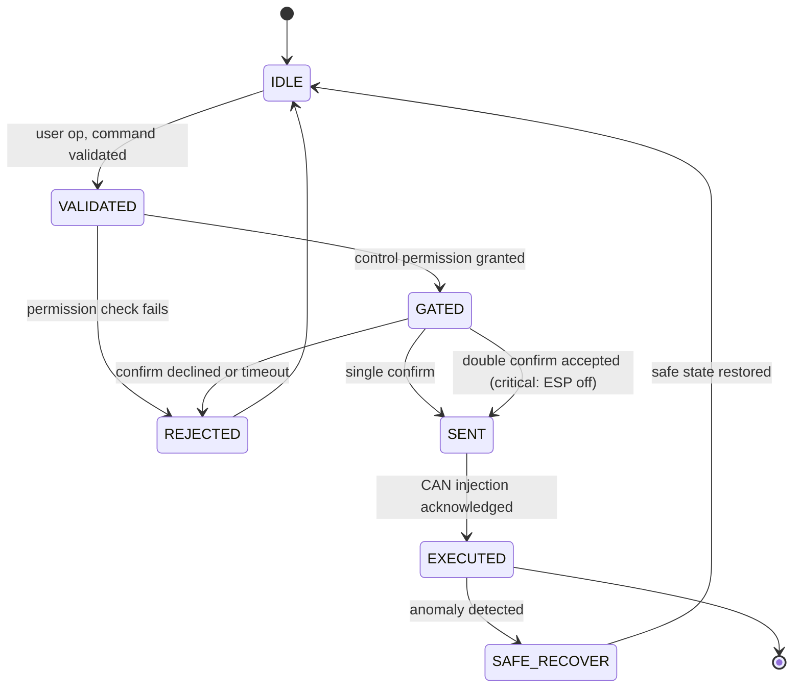

# monster-xxx-tesla-can-controller

## 1. Provenance

- **Submodule path:** `legacy/monster-xxx-tesla-can-controller`
- **Pinned gitlink (canonical):** `160000 dba35974c23af95b7c65900998b31a94045c7a5e 0` — matches `git -C legacy/monster-xxx-tesla-can-controller rev-parse HEAD`; working tree clean (`status --porcelain` empty). The pin is the **root commit** of the submodule (`rev-list --max-parents=0 --all` returns only this SHA).
- **Upstream URL:** https://github.com/monster-xxx/tesla-can-controller
- **License:** MIT, `LICENSE:1-3` — "Copyright (c) 2026 monster-xxx" (`LICENSE:1` anchor confirmed).
- **Analysis date:** 2026-11-21.
- **Repo shape:** the pinned snapshot is **documentation-only**. `git -C legacy/monster-xxx-tesla-can-controller ls-files` returns exactly 4 files; there is no source, build, or test file anywhere in the tree (no hidden directories exist — inventory was taken via `git ls-files`, not a glob).

**Files read (upstream, all FULL-READ — every line):**

| File | Lines | Coverage |
| --- | --- | --- |
| `LICENSE` | 1-21 | FULL-READ |
| `tesla-can-controller/README.md` | 1-210 | FULL-READ |
| `tesla-can-controller/docs/architecture.md` | 1-409 | FULL-READ |
| `tesla-can-controller/docs/hardware_spec.md` | 1-467 | FULL-READ |

**Files explicitly NOT read:** none — the pinned snapshot contains no other files. The content of the **beyond-pin commit** `7ef553f7824b040c16787e9d6f3d12e55a0e9fb9` (origin/main, tagged `v1.1.0`, dated 2026-03-22) was **not** read; only its commit message and diffstat were inspected for the history section. All 4 pinned files are written in Chinese.

**Our-side files read for the parity matrix (section 11):** `firmware/lib/vehicle/can/feature/telemetry/powertrain.h` (1-111, FULL-READ), `firmware/lib/vehicle/can/feature/telemetry/tpms.h` (1-75, RANGE-CITED), `firmware/lib/vehicle/can/feature/telemetry/bms.h` (60-134 and 440-494, RANGE-CITED), `firmware/lib/core/driver/common.h` (13-67, RANGE-CITED), `firmware/lib/vehicle/can/feature/comfort/precondition.h` (1-56, FULL-READ), `firmware/lib/io/ble/esp32/uuids.h` (1-17, FULL-READ), `firmware/lib/vehicle/ble/feature/session.h` (1-120, RANGE-CITED), `firmware/lib/vehicle/can/ids.h` (RANGE-CITED via grep anchors), `firmware/lib/core/can/bus.h` (RANGE-CITED via grep anchors), `packages/protocol/src/commands.ts` (grep-anchored).

**Replace-mode bookkeeping:** the pre-replace doc had **no `## Upstream (...)` sections** (verified: `git show HEAD:docs/legacy/monster-xxx-tesla-can-controller.md` contains no match for `Upstream`), so there was nothing to preserve beyond the frontmatter. The frontmatter above is byte-for-byte the original, with one permitted change: the description line's inherited trailing space (after "…three devices - an") was stripped. Note the description text is itself truncated mid-sentence; preserved as-is per the skill, recorded as a staleness row in section 6. The pre-replace summary still exists in git history and is cited below as `git show HEAD:docs/legacy/monster-xxx-tesla-can-controller.md#<line>`.

## 2. Executive verdict

This submodule is a **design-phase proposal, not code**: a Chinese-language spec for a three-device Tesla Model Y accessory system — an M5Dial (ESP32-S3) LVGL controller, an ESP32-C6 dual-channel CAN reader (2× SN65HVD230, TWAI), and an ESP32 WS2812 ambient-light controller — linked by an ECDH+AES-256-GCM encrypted BLE fabric, with its own README declaring "状态: 方案设计阶段" (status: design phase, `README.md:210`). Nothing in the pinned snapshot can be executed, tested, or ported as code; every upstream claim in this document is SUMMARY-ONLY by construction. The three DBC decode claims (`0x1A6` speed, `0x352` battery, `0x108` gear) contradict both our CODE-READ decoders (`0x257`, `0x132`/`0x292`/`0x352`, `0x118`) and must never be imported. The genuine value is architectural reference material: the encrypted-BLE security design, the dual-speed CAN hardware idea, and the double-confirm control gate concept — plus one hard operational fact: upstream moved to real firmware **one commit after our pin** (`7ef553f`, tagged `v1.1.0`, +2316 lines including a vendored `tesla-vehicle-command` tree with Windows-incompatible path lengths), so any submodule bump changes this repo's character completely and warrants a fresh deep-dive.

## 3. Evidence map

No CODE-READ, TEST-READ, or CAPTURE evidence exists **for upstream claims**: the pinned snapshot contains no source files, no tests, and no captures. Every upstream row below is SUMMARY-ONLY (design text). Our-side rows in section 11 carry CODE-READ grades.

| Source file | Lines | What it proves | Grade |
| --- | --- | --- | --- |
| `LICENSE` | 1-21 | Upstream is MIT, (c) 2026 monster-xxx | SUMMARY-ONLY |
| `README.md` | 1-12 | Project scope: monitoring, light control, ESP-off "drift mode", battery preheat, 0-100 test, WS2812, M5Dial UI | SUMMARY-ONLY |
| `README.md` | 15-32 | Planned three-device topology, encrypted BLE links | SUMMARY-ONLY |
| `README.md` | 37-62 | Planned (nonexistent) directory tree with `software/`, `hardware/`, `resources/` | SUMMARY-ONLY |
| `README.md` | 64-75 | Hardware BOM: M5Dial, ESP32-C6 + 2× SN65HVD230, ESP32 + 12V WS2812 | SUMMARY-ONLY |
| `README.md` | 87-93 | DBC source: joshwardell/model3dbc; ESP-IDF toolchain | SUMMARY-ONLY |
| `README.md` | 120-166 | Feature checklists per device (all unchecked, design) | SUMMARY-ONLY |
| `README.md` | 168-180 | Safety mechanisms: double-confirm, auto-recover, permission tiers, ECDH+AES-256-GCM, signed OTA | SUMMARY-ONLY |
| `README.md` | 206-210 | Status: 方案设计阶段 (design phase), dates 2026-03-21 | SUMMARY-ONLY |
| `architecture.md` | 14-43 | System composition and comm topology (CAN hub via OBD-II, 500 kbps) | SUMMARY-ONLY |
| `architecture.md` | 47-99 | Per-device interfaces; device B dual CAN: CAN0 500 kbps, CAN1 125 kbps | SUMMARY-ONLY |
| `architecture.md` | 104-143 | BLE GATT design (NUS UUIDs + NOTIFY char), `ble_packet_t` framing, crypto suite, anti-replay, 24 h rotation | SUMMARY-ONLY |
| `architecture.md` | 145-177 | DBC snippets (BO_ 422 / 850 / 264) and 7-step CAN processing flow | SUMMARY-ONLY |
| `architecture.md` | 277-307 | Data-flow designs (acquisition, control, ambient light) | SUMMARY-ONLY |
| `architecture.md` | 309-333 | Latency budgets and reliability targets | SUMMARY-ONLY |
| `architecture.md` | 374-403 | Four-phase milestone plan (16 weeks) | SUMMARY-ONLY |
| `hardware_spec.md` | 5-14 | Hardware overview table | SUMMARY-ONLY |
| `hardware_spec.md` | 63-101 | Device B: ESP32-C6, TWAI, power chain 12V→5V→3.3V, 2 A fuse | SUMMARY-ONLY |
| `hardware_spec.md` | 116-165 | Device C: WS2812B 12V, 74HC245 level shift, ~20 W peak | SUMMARY-ONLY |
| `hardware_spec.md` | 169-213 | OBD-II pin 6/14 access, 120 Ω optional termination, BLE ranges | SUMMARY-ONLY |
| `hardware_spec.md` | 215-266 | Power sequencing and sleep/wake design | SUMMARY-ONLY |
| `hardware_spec.md` | 268-305 | Protection circuits: 18 V TVS, fuses, EMC | SUMMARY-ONLY |
| `hardware_spec.md` | 307-349 | Planned test matrix (eye diagram, BER, temp cycling, vibration) | SUMMARY-ONLY |
| `hardware_spec.md` | 351-378 | BOM with prices ($119.3 total) | SUMMARY-ONLY |

## 4. Architecture and build surface

**None found: no build surface exists.** There are no entry points, no build files, no source, no build flags, no dependency manifests at the pin. The design *describes* three separate ESP-IDF projects (device A `esp32s3`, device B `esp32c6`, device C `esp32` — `README.md:95-111`), a FreeRTOS/TWAI/mbedTLS/LVGL middleware stack per device (`architecture.md:200-243`), and the joshwardell model3dbc as external protocol input (`README.md:87-88`). Dependency boundaries are design-level only.

Planned frame pipeline (design intent — every node SUMMARY-ONLY, `architecture.md:168-177`):


The TX side is a hole in the design: no injected frame is ever given an ID, byte layout, counter, or checksum. Compare our shipping pipeline (`firmware/lib/core/can/` ring buffer → variant handlers → feature mutation/TX), which is CODE-READ but out of scope here.

## 5. Mechanism catalogue

### Encrypted BLE inter-device link

- **Claim (README / summary):** all three devices communicate over "encrypted BLE"; `README.md:174` "BLE通信使用ECDH+AES-256-GCM加密"; pre-replace doc `git show HEAD:docs/legacy/monster-xxx-tesla-can-controller.md#43` says "AES-256-GCM encrypted BLE between all devices".
- **Code path:** None found — no implementation exists; the only "code" is the illustrative `ble_packet_t` struct at `architecture.md:117-127` (header `0xAA`, version `0x01`, device_id, message_type, sequence u16, data_length u16, `data[248]`, checksum, footer `0x55`).
- **Frame spec:** BLE GATT service `6E400001-B5A3-F393-E0A9-E50E24DCCA9E` with RX `…0002`, TX `…0003`, and an extra NOTIFY characteristic `…0004` (`architecture.md:106-112`). On-air packet 259 bytes max (248 payload + 11 overhead).
- **Gates and timing:** ECDH P-256 key exchange → HKDF-SHA256 session key → AES-256-GCM with 128-bit tag (`architecture.md:132-137`); anti-replay via sequence + timestamp (`:140`); forward secrecy per session; 24 h automatic key rotation (`:142`).
- **State machine:** None found (handshake states are not specified).
- **Tests:** None found.
- **Evidence grade:** SUMMARY-ONLY.
- **Verdict:** UNVERIFIED — design text only. One engineering concern (UNVERIFIED): a 259-byte packet exceeds the default 23-byte ATT MTU and assumes MTU/DLE negotiation, which the design never mentions.
- **Adapt to TeslaCANModder?** already present for the vehicle-facing leg: our Tesla BLE session does ECDH P-256 + HKDF + AES-128-GCM (`firmware/lib/vehicle/ble/feature/session.h:81,184,239,269`). The inter-device (peer) encryption is **not** implemented in our firmware; the advertised `bleencrypt` surface exists only in protocol/client code (section 11 row 5). Upstream adds nothing portable beyond the NOTIFY-characteristic idea.

### CAN RX decode pipeline

- **Claim (README / summary):** device B reads CAN, parses Tesla DBC, tracks vehicle state (`README.md:156-160`); pre-replace doc `#52` claims "Vehicle data decoded: speed, battery SOC, gear position, tire pressure".
- **Code path:** None found — the pipeline is a 7-step prose list: raw RX → ID whitelist filter → DBC parse → unit conversion/range check → multi-message aggregation → state machine update → BLE encrypt+compress (`architecture.md:169-177`).
- **Frame spec:** None found (see the DBC card below for the three decoded frames).
- **Gates and timing:** CAN→UI latency budget < 50 ms, BLE leg < 20 ms (`architecture.md:313-317`).
- **State machine:** None found.
- **Tests:** None found.
- **Evidence grade:** SUMMARY-ONLY.
- **Verdict:** UNVERIFIED.
- **Adapt to TeslaCANModder?** already present — our ring buffer + consumers + variant handler dispatch covers the same stages with CODE-READ backing; the aggregation stage ("multi-message association") has no concrete design worth porting.

### DBC signal decode set (0x1A6 / 0x352 / 0x108)

- **Claim (README / summary):** "Tesla DBC协议解析" (`README.md:157`); the snippets claim speed on ID 0x1A6, battery on 0x352, gear on 0x108.
- **Code path:** None found — three inline DBC-style snippets at `architecture.md:149-166`, attributed to the joshwardell model3dbc that `README.md:88` tells the reader to clone.
- **Frame spec:** `BO_ 422 Speed_Info` (0x1A6): `VehicleSpeed 7|16@1+ (0.01,0) km/h`, `WheelSpeed_FL 23|16`, `WheelSpeed_FR 39|16`. `BO_ 850 BMS_Info` (0x352): `BatteryVoltage 7|16@1+ (0.1,0) V`, `BatteryCurrent 23|16@1- (0.1,-3276.8) A`, `SOC 39|8@1+ (0.5,0) %`. `BO_ 264 Gear_Info` (0x108): `GearPosition 7|3@1+`, `VAL_ 0 Park 1 Reverse 2 Neutral 3 Drive 4 Sport 5 Low 6 Manual 7 Invalid`. No counters, no checksums, no periods.
- **Gates and timing:** None found.
- **State machine:** None found.
- **Tests:** None found.
- **Evidence grade:** SUMMARY-ONLY.
- **Verdict:** CONTRADICTED against our CODE-READ decoders (section 11 rows 1-3) — different IDs, different bit layouts, different gear encodings. Whether these snippets actually exist in joshwardell/model3dbc is UNVERIFIED (external repo, not checked); our own decode is sufficient to discard them.
- **Adapt to TeslaCANModder?** never port.

### Control command safety gate (double confirm + permission tiers)

- **Claim (README / summary):** "关键操作（关闭ESP）需要双重确认" — critical operations (ESP-off) require double confirmation; view vs control permission tiers; "异常时自动恢复安全状态" auto-recovery (`README.md:171-173`); control flow: user op → validation → permission check → safety confirm → encrypt → device B → CAN conversion (`architecture.md:289-297`).
- **Code path:** None found — design intent only.
- **Frame spec:** None found — the CAN command format is never specified.
- **Gates and timing:** control command latency budget < 100 ms (`architecture.md:317`).
- **State machine:** planned states implied by `architecture.md:289-297` (design intent, SUMMARY-ONLY):



- **Tests:** None found.
- **Evidence grade:** SUMMARY-ONLY.
- **Verdict:** UNVERIFIED as an implementation; the concept is sound and already present in our shipping gates (AP injection gate, DAS arm/disarm, summon-inject gate, drive speed cap).
- **Adapt to TeslaCANModder?** already present at the firmware level; the *client-side double-confirm UX pattern* for dangerous commands is a low-cost candidate (section 13).

### WS2812 ambient light chain (device C)

- **Claim (README / summary):** 12 V WS2812 RGB strip control, PWM dimming, BLE remote (`README.md:162-166`); pre-replace doc `#67` "Ambient light control via WS2812 RGB strips".
- **Code path:** None found — hardware chain design only: ESP32 RMT (8 channels) → 74HC245 level shift (3.3 V→12 V, 24 mA/channel, <10 ns) → WS2812B 12 V strip, 800 Kbps single-wire protocol, >30 fps at 60 LEDs, ~20 W peak (`hardware_spec.md:131-165`).
- **Frame spec:** None found (not CAN; WS2812 timing is a LED protocol, not a vehicle frame).
- **Gates and timing:** brightness sensor auto-dim, temperature sensor overheat protection, π-filter + 3 A self-resetting fuse + 18 V TVS (`hardware_spec.md:96-98,149-165`).
- **State machine:** None found.
- **Tests:** None found.
- **Evidence grade:** SUMMARY-ONLY.
- **Verdict:** UNVERIFIED; out of our hardware domain (we ship no LED hardware).
- **Adapt to TeslaCANModder?** no impact.

### Dual-speed CAN hardware plan (device B)

- **Claim (README / summary):** pre-replace doc `#33` "Dual SN65HVD230 transceivers on ESP32-C6 (CAN0 500kbps, CAN1 125kbps) via TWAI" — accurate to the design (`architecture.md:68-70`).
- **Code path:** None found — hardware design: 2× SN65HVD230 on the ESP32-C6 TWAI controller, OBD-II pins 6/14 access, optional 120 Ω termination, shielded twisted pair < 1 m (`hardware_spec.md:169-213`).
- **Frame spec:** None found.
- **Gates and timing:** CAN0 500 kbps "powertrain", CAN1 125 kbps "body/infotainment" (bus attribution only in the pre-replace doc `#50`; `architecture.md:69-70` says high-speed/low-speed without naming domains).
- **State machine:** None found.
- **Tests:** None found.
- **Evidence grade:** SUMMARY-ONLY.
- **Verdict:** UNVERIFIED — and the 125 kbps body-bus claim is unsubstantiated against any Tesla body-CAN speed we have captured; our three MCP2515 buses all run 500 kbps (`firmware/lib/core/driver/common.h:31`).
- **Adapt to TeslaCANModder?** never enable a 125 kbps lane on this evidence; capture-first if a low-speed bus is ever explored.

### Feature checklist with no mechanism detail

- **Claim (README / summary):** ESP-off "drift mode" (`README.md:9,138,393`), pilot light + pulse high beam (`README.md:151-152`), battery preheating (`README.md:9,140`), 0-100 km/h acceleration test with history (`README.md:10,150,391`), VIN/DCDC/brake-temp display, regen power (`README.md:131-149`).
- **Code path:** None found.
- **Frame spec:** None found — not one of these features is tied to a CAN ID, bit, or burst anywhere in the snapshot.
- **Gates and timing:** None found (ESP-off is only marked as needing double confirm).
- **State machine:** None found.
- **Tests:** None found.
- **Evidence grade:** SUMMARY-ONLY.
- **Verdict:** UNVERIFIED — pure roadmap.
- **Adapt to TeslaCANModder?** per-feature verdicts in section 13; ESP-off is never-port, 0-100 test is a candidate (built on our existing decode), the rest are no impact / already present.

## 6. Summary vs code contradiction table

Pre-replace claims are cited from git history (`git show HEAD:docs/legacy/monster-xxx-tesla-can-controller.md#<line>`), not as live links.

| Pre-replace / upstream claim | Reality at the pin | Verdict |
| --- | --- | --- |
| `git show HEAD:…md#46` — "`docs/hardware_spec.md` is referenced in descriptions but does not exist in the repository" | The file **exists**: `tesla-can-controller/docs/hardware_spec.md`, 467 lines, tracked by `git ls-files` | CONTRADICTED |
| `git show HEAD:…md#15` — "Provides vehicle monitoring … advanced controls … performance testing, and ambient lighting effects" | Nothing is provided; upstream's own README says status is 方案设计阶段 (design phase, `README.md:210`) and every feature checkbox is unchecked | CONTRADICTED (overstated) |
| `git show HEAD:…md#32` — "Language: C++ (ESP-IDF framework)" under Technical Details | Zero source files exist at the pin; C++/ESP-IDF is the *planned* language only | CONTRADICTED (implies shipped code) |
| `git show HEAD:…md#52` — "Vehicle data decoded: speed, battery SOC, gear position, tire pressure" | Nothing is decoded; worse, tire pressure has **no frame spec anywhere** in the snapshot (negative anchor A9: `0x219` never appears in upstream docs) | CONTRADICTED |
| Frontmatter `description` (preserved above) — truncated mid-sentence ("…three devices - an") and thin vs the repo's actual three-device design | Kept byte-for-byte minus inherited trailing space, per replace-mode rules; this row records the staleness instead of editing it | STALE (provenance note) |
| Upstream `README.md:37-62` — project tree lists `docs/software_design.md`, `docs/protocol_spec.md`, `docs/api_reference.md`, `software/`, `hardware/`, `resources/` | None of these exist in the commit that added the README; the pin has exactly 4 files | Upstream self-inconsistency (aspirational tree) |
| Upstream `architecture.md:151-165` — speed @ 0x1A6, battery @ 0x352, gear @ 0x108 with `0=Park…3=Drive` | Our CODE-READ: speed @ 0x257 bytes 2-3 signed ×100 (`powertrain.h:18-22`), battery @ 0x132/0x292 with 0x352 as energy status (`bms.h`, `ids.h:58`), gear @ 0x118 bits 3:1 with `1=P…4=D` (`powertrain.h:29-32`) | CONTRADICTED (cross-repo; full rows in section 11) |

## 7. CAN frame and signal inventory

All rows are decode-only design claims; the snapshot specifies no frame the repo mutates or injects (no TX frame ever gets an ID). No vendored DBC/JSON catalog exists at the pin — the three frames below are inline design snippets, not a catalog file.

| ID (hex+dec) | Bus | Period | DLC | Byte/bit layout | Scale/units | Counter | Checksum | R/W | Grade |
| --- | --- | --- | --- | --- | --- | --- | --- | --- | --- |
| 0x1A6 (422) `Speed_Info` | unspecified (CAN0 implied) | unspecified | 8 | `VehicleSpeed 7\|16@1+`; `WheelSpeed_FL 23\|16@1+`; `WheelSpeed_FR 39\|16@1+` | ×0.01 km/h, 0..655.35 | unspecified | unspecified | read (design) | SUMMARY-ONLY |
| 0x352 (850) `BMS_Info` | unspecified | unspecified | 8 | `BatteryVoltage 7\|16@1+`; `BatteryCurrent 23\|16@1-`; `SOC 39\|8@1+` | 0.1 V; 0.1 A signed, −3276.8 offset; 0.5 % | unspecified | unspecified | read (design) | SUMMARY-ONLY |
| 0x108 (264) `Gear_Info` | unspecified | unspecified | 8 | `GearPosition 7\|3@1+` | ×1, 0..7; VAL_ 0=Park, 1=Reverse, 2=Neutral, 3=Drive, 4=Sport, 5=Low, 6=Manual, 7=Invalid | unspecified | unspecified | read (design) | SUMMARY-ONLY |

Each of these conflicts with our shipping decodes — see section 11 rows 1-3 before doing anything with them.

## 8. Constants and tuning table

All values are design text; none is validated by code or capture. Trivial constants (wire colors, PCB dimensions, BOM prices, connector pinouts) are omitted.

| Constant | Value | File:line | Meaning | Grade |
| --- | --- | --- | --- | --- |
| BLE packet header / footer | `0xAA` / `0x55` | `architecture.md:118,126` | Framing start/end bytes of `ble_packet_t` | SUMMARY-ONLY |
| BLE protocol version | `0x01` | `architecture.md:119` | Wire format version | SUMMARY-ONLY |
| Device IDs | `0x01` A, `0x02` B, `0x03` C | `architecture.md:120` | Source/destination addressing | SUMMARY-ONLY |
| BLE payload capacity | 248 bytes | `architecture.md:124` | Max `data[]` per packet | SUMMARY-ONLY |
| GATT service UUID | `6E400001-B5A3-F393-E0A9-E50E24DCCA9E` | `architecture.md:106` | NUS-standard service | SUMMARY-ONLY |
| NOTIFY characteristic | `6E400004-…` (RX `…0002`, TX `…0003`) | `architecture.md:107-111` | Extra push channel beyond NUS pair | SUMMARY-ONLY |
| Crypto suite | ECDH P-256 → HKDF-SHA256 → AES-256-GCM | `architecture.md:133-135` | Inter-device confidentiality | SUMMARY-ONLY |
| GCM tag | 128-bit | `architecture.md:136` | Auth tag length | SUMMARY-ONLY |
| Key rotation | 24 h | `architecture.md:142` | Automatic key refresh | SUMMARY-ONLY |
| Anti-replay | sequence + timestamp | `architecture.md:140` | Replay protection inputs | SUMMARY-ONLY |
| CAN0 / CAN1 speeds | 500 kbps / 125 kbps | `architecture.md:69-70` | Dual-bus bit rates | SUMMARY-ONLY |
| CAN→UI / BLE / control latency | < 50 ms / < 20 ms / < 100 ms | `architecture.md:313-317` | End-to-end timing budgets | SUMMARY-ONLY |
| WS2812 data rate | 800 Kbps | `hardware_spec.md:136` | LED protocol bit rate | SUMMARY-ONLY |
| CAN termination | 120 Ω optional | `hardware_spec.md:205` | Bus stub termination | SUMMARY-ONLY |
| TVS clamp | 18 V | `hardware_spec.md:272` | Vehicle-12V surge protection | SUMMARY-ONLY |
| Vehicle-12V fuse | 2 A fast-blow | `hardware_spec.md:90` | Device B supply protection | SUMMARY-ONLY |

## 9. Failure modes and edge cases

No TEST-READ evidence exists: this repo ships no tests — every row below is untested by definition, and all handling is design text.

| Failure | Handling (design reference) | Tested? | Grade |
| --- | --- | --- | --- |
| Anomaly during control op | "异常时自动恢复安全状态" — auto-recover to safe state | no | SUMMARY-ONLY |
| BLE link loss | "断线重连" — reconnect listed as device B comm module duty (`architecture.md:230`) | no | SUMMARY-ONLY |
| CAN error frames | Listed only as a *test item* (`hardware_spec.md:334`); no handling design exists | no | SUMMARY-ONLY |
| OTA tampering | "OTA升级需要数字签名验证" — signed firmware required (`README.md:175`) | no | SUMMARY-ONLY |
| Power faults (OV/OC/thermal) | 18 V TVS + fuses + thermal shutdown design (`hardware_spec.md:268-289`) | no | SUMMARY-ONLY |
| Wrong power sequencing | Order specified (B → C → A up, reverse down, `hardware_spec.md:231-242`); no enforcement mechanism designed | no | SUMMARY-ONLY |
| BLE replay attack | sequence + timestamp anti-replay (`architecture.md:140`) | no | SUMMARY-ONLY |

Not mentioned anywhere in the snapshot: bus-off recovery, brownout behavior, watchdog timeout handling (the watchdog appears only as a HAL component name, `architecture.md:242`), missing-frame timeouts, and queue-overflow handling. None found — these are inherited gaps.

## 10. Test coverage map

No test files exist. No TEST-READ evidence exists: this repo ships no tests.

Planned test matrix (design text, `hardware_spec.md:307-349`, `architecture.md:336-353`):

- Electrical: 9-16 V input range, <100 mV ripple, >80% efficiency
- Signal integrity: CAN eye diagram, BLE RSSI, BER < 10⁻⁶
- Environmental: −20…70 °C ×10 cycles, 40 °C/95%RH/96 h, 3-axis vibration, CE/FCC EMC
- CAN: baud verification at 125k/250k/500k/1M, error-frame handling, bus load, long-distance
- BLE: connection stability, throughput, multi-device, interference
- Tools named: CANoe/CANalyzer vehicle simulator, Unity unit-test framework (`architecture.md:350-352`)

Critical paths with no test: all of them — there is no code to test. The risk is zero for us directly, but any future submodule bump that lands the `7ef553f` firmware tree must be re-evaluated from scratch, including whether its BLE reassembler/scheduler have any tests at all.

## 11. Parity matrix with TeslaCANModder

Every our-side citation below is CODE-READ (symbol + line verified in this session; drift anchors in section 16). Upstream citations are SUMMARY-ONLY by necessity (docs-only repo). Rows 1-3 drive the never-port decisions in section 13.

| Signal/frame | Upstream decode (cite) | Our decode (cite) | Delta | Action |
| --- | --- | --- | --- | --- |
| Vehicle speed | `0x1A6` Speed_Info, bit 7, 16 LE, ×0.01 km/h (`architecture.md:151-153`) | `0x257` bytes 2-3, signed 16 BE, ×100 (`firmware/lib/vehicle/can/feature/telemetry/powertrain.h:18-22`, `ids.h:42`) | Different ID and layout; upstream unsupported by any capture | ignore — capture-first only if ever revisited |
| Battery V / I / SoC | `0x352` BMS_Info single frame: V bit 7 ×0.1, I bit 23 signed ×0.1, SOC bit 39 ×0.5% (`architecture.md:157-160`) | V/I from `0x132` BMS_hvBusStatus, SoC from `0x292` BMS_socStatus; `0x352` is BMS_energyStatus (mux 0/1 energy kWh fields) (`bms.h:88-118,443-484`, `ids.h:58`) | Same ID, completely different meaning; upstream's single-frame battery layout conflicts with our decoders | ignore |
| Gear position | `0x108` GearPosition 3 bits @ bit 7, `0=Park…3=Drive, 4=Sport…` (`architecture.md:163-165`) | `0x118` DI_state byte 0 bits 3:1, `0=invalid, 1=P, 2=R, 3=N, 4=D, 5=SNA` (`powertrain.h:29-32`, `ids.h:35`) | Different ID, bit position, and value table | ignore |
| Tire pressure | "胎压" display claim only, no frame anywhere (`README.md:8,146`; negative anchor A9) | `0x219` VCSEC_TPMSData: pressure raw ×0.025 bar, temp raw−40 °C (`tpms.h:12-63`) | Upstream has no spec to compare | ignore |
| Encrypted BLE | Inter-device ECDH P-256 + HKDF-SHA256 + AES-256-GCM, 24 h rotation (`architecture.md:130-143`) | Vehicle-facing Tesla BLE session: ECDH P-256 + HKDF + **AES-128-GCM** (`session.h:81,184,239,269`); inter-device `bleencrypt` surface exists only in protocol/client (`packages/protocol/src/commands.ts:466`) with **no firmware implementation** (negative anchor B8) | Different target (peers vs vehicle), different key size, and our advertised peer-encryption feature is unimplemented in firmware | no impact now; if the firmware gap is ever filled, treat upstream as design reference only |
| NUS GATT UUIDs | Service `6E400001`, RX `…0002`, TX `…0003`, NOTIFY `…0004` (`architecture.md:106-112`) | Service `6e400001`, RX `…0002`, TX `…0003` (`firmware/lib/io/ble/esp32/uuids.h:11-17`) | Identical base UUIDs; upstream plans one extra NOTIFY characteristic | ignore (the NOTIFY idea is trivial if ever wanted) |
| CAN bus bit rates | CAN0 500 kbps + CAN1 125 kbps dual channel (`architecture.md:69-70`) | All MCP2515 buses 500 kbps (`firmware/lib/core/driver/common.h:20-31`) | Upstream adds an unsubstantiated 125 kbps body bus | never enable on SUMMARY-ONLY; capture-first if explored |
| Bus count / topology | 2 channels via 2× SN65HVD230 on TWAI (`architecture.md:68-70`) | 3 buses, `BUS_MAX 3`, `busActive()` gating (`firmware/lib/core/can/bus.h:26,36`) | Different transceiver family (SPI MCP2515 vs TWAI) and count | ignore |
| Battery preconditioning | Feature checkbox only ("电池预热", `README.md:9,140`) | `0x082` UI_tripPlanning TX, `data[0]=0x05`, ~500 ms re-injection burst (`precondition.h:19-27`, `ids.h:30`) | Ours is implemented; upstream has no frame spec | already present |
| ESP-off "drift mode" | Checkbox + double-confirm mention (`README.md:9,138,393`) | No counterpart (negative anchor C2: no stability-control code in `firmware/lib`) | — | never port (safety-critical, zero evidence) |
| 0-100 km/h acceleration test | Checkbox with history (`README.md:10,150,391`) | No counterpart in firmware/client/protocol (negative anchor C3) | — | candidate for future PR — client-side math over our existing `0x257` speed decode; zero upstream code exists to port, so it would be an independent implementation |

## 12. Surface inventory and security notes

Upstream exposes **no implemented transport surface** — there is no code at the pin. Planned surfaces:

| Surface | Semantics (design) | Cite | Grade |
| --- | --- | --- | --- |
| BLE GATT (NUS-like) | Service `6E400001`, RX write, TX notify, extra NOTIFY push char; A↔B, A↔C links | `architecture.md:104-112` | SUMMARY-ONLY |
| UART debug | Device B debug interface | `architecture.md:77` | SUMMARY-ONLY |
| USB-C | Device A power + debug + Grove/TF-card | `hardware_spec.md:27-29` | SUMMARY-ONLY |
| OTA update | Device C, digitally signed | `architecture.md:262`, `README.md:175` | SUMMARY-ONLY |

Provenance/security findings:

- **No hardcoded credentials or keys** exist at the pin — there is nothing to hardcode them in. The security design (ECDH, anti-replay, signed OTA) is text only.
- **MIT license** (`LICENSE:1`) — attribution requirement if any text is ever reused; we must not reuse the frame claims regardless.
- **Beyond-pin hazard:** commit `7ef553f` (tag `v1.1.0`) vendors the official Tesla `tesla-vehicle-command` tree, triple-nested as `tesla-can-controller/tesla-vehicle-command-main/tesla-vehicle-command-main/tesla-vehicle-command-main/examples/m5dial-idf/…` with component paths that exceed Windows MAX_PATH — local git operations already emitted "Filename too long" warnings when inspecting it. A submodule bump on Windows needs long-path handling, and the vendored tree brings a second upstream license (not yet read; UNVERIFIED).
- No dangerous build flags: no build files exist at all.

## 13. Adaptation assessment

| Mechanism | Value | Cost | Risk | Evidence | Decision |
| --- | --- | --- | --- | --- | --- |
| Encrypted BLE inter-device link | low-medium — we already ship ECDH+GCM for the vehicle leg; peer-encryption gap is real but unproven demand | high — new transport layer + pairing UX | medium — key management on three devices | SUMMARY-ONLY | no port now; revisit only if `bleencrypt` firmware work is ever scheduled; upstream is a design reference, not a source |
| CAN RX decode pipeline | none — ours is implemented and CODE-READ-backed | — | — | SUMMARY-ONLY | already present |
| DBC decode set (0x1A6/0x352/0x108) | negative — contradicted IDs/encodings | — | high if trusted | SUMMARY-ONLY + our CODE-READ counter-evidence | never port |
| Control command safety gate (double confirm) | medium — good UX hygiene for destructive commands (e.g. `power:off`, summon) | low — client confirm-flow only, no CAN change | low | SUMMARY-ONLY concept; our firmware gates already present (CODE-READ: AP gate/DAS arm semantics in dispatch) | candidate for future PR (client-side double-confirm pattern, independent implementation) |
| WS2812 ambient light chain | none for this project | — | — | SUMMARY-ONLY | no impact |
| Dual-speed CAN (125 kbps body bus) | unknown — no evidence any Tesla bus we touch runs 125 kbps | high — MCP2515 re-config + bus rewiring | high — wrong-speed bus bricks comms | SUMMARY-ONLY | never on this evidence; capture-first if ever explored |
| 0-100 km/h acceleration test | medium — pure client feature, read-only telemetry | low — client timer over existing speed decode | none to CAN (no mutation) | concept SUMMARY-ONLY; our `0x257` decode CODE-READ | candidate for future PR — independent implementation, no upstream code exists to port |
| ESP-off "drift mode" | none — disables stability control on public roads | — | severe — safety and legal | SUMMARY-ONLY checkbox | never port |
| Pilot light / pulse high beam / battery preheat checkboxes | covered or unspecified | — | — | SUMMARY-ONLY | no impact / already present (precondition) |

## 14. Do-not-copy list

- `architecture.md:117-127` — the `ble_packet_t` struct. It is an unimplemented sketch (and its 259-byte on-air size ignores MTU negotiation). If encrypted peer BLE is ever built, implement independently and state "derived idea, independent implementation".
- `architecture.md:149-166` — the three DBC snippets. IDs, bit layouts, and the gear value table all contradict our CODE-READ decoders. Never import, even as documentation.
- `README.md:37-62` — the planned project tree. Aspirational; none of it exists at the pin. Do not cite it as evidence of code.
- `hardware_spec.md:351-378` — BOM with prices. Stale by nature; useless as engineering input.
- Beyond-pin `7ef553f` vendored `tesla-vehicle-command` tree — a different upstream (Tesla official) with its own license (unread, UNVERIFIED); never copy into shipping directories regardless, per repo policy on `legacy/`.

## 15. History and evolution

Mined from the submodule's local `git log` (no network claims):

| Commit | Date | Subject | Content |
| --- | --- | --- | --- |
| `dba35974c23af95b7c65900998b31a94045c7a5e` (root, our pin) | 2026-03-21 | "Add Tesla CAN controller documentation" | 1107 insertions: LICENSE + 3 design docs. Docs-only. |
| `7ef553f7824b040c16787e9d6f3d12e55a0e9fb9` (origin/main, NOT our pin) | 2026-03-22 | "feat(security): enable NVS encryption for private key storage" | +2316 lines: vendored `tesla-vehicle-command` with an `m5dial-idf` example — `app_main.cpp` (1094 lines), `ble_reassembler` (184+93), `message_scheduler` (256+151), `storage.cpp` (139), CHANGELOG/DEPLOYMENT/README, `sdkconfig.defaults`. Tag `v1.1.0` points here. |

Interpretation: the project went from pure design to real firmware **the day after the docs landed**. Nothing was abandoned or rolled back (only two commits exist). All statements about `7ef553f`'s code content beyond its message and diffstat are UNVERIFIED — its files were not read; the Windows path-length warnings were observed while inspecting its diffstat.

## 16. Re-verification recipe

Pinned gitlink: `160000 dba35974c23af95b7c65900998b31a94045c7a5e 0`. Every anchor below was executed at write time (2026-11-21) with the shown result. Commands use `git grep -nE` because GNU `grep` is not on PATH in pwsh on this machine; from Git Bash, plain `grep -nE` on the same paths yields the same lines. If line numbers drift more than ~10, re-read the whole function/file — do not trust this document's numbers.

```bash
OLD=dba35974c23af95b7c65900998b31a94045c7a5e
git -C legacy/monster-xxx-tesla-can-controller fetch --tags --prune
git -C legacy/monster-xxx-tesla-can-controller log --oneline $OLD..origin/main
#   expect: 7ef553f "feat(security): enable NVS encryption for private key storage" (as of 2026-11-21)
git -C legacy/monster-xxx-tesla-can-controller diff --stat $OLD..origin/main
#   expect: +2316 lines under tesla-can-controller/tesla-vehicle-command-main/…/examples/m5dial-idf/
git ls-files -s legacy/monster-xxx-tesla-can-controller
#   expect: 160000 dba35974c23af95b7c65900998b31a94045c7a5e 0
#   If the gitlink differs, STOP: this doc describes the wrong version.
```

Upstream anchors (run inside `legacy/monster-xxx-tesla-can-controller`):

```text
git grep -nE '0xAA|0x55' -- tesla-can-controller/docs/architecture.md
  -> expect :118 (header 0xAA) and :126 (footer 0x55)
git grep -nE '6E400001|6E400004' -- tesla-can-controller/docs/architecture.md
  -> expect :106 (service UUID) and :111 (NOTIFY char)
git grep -nE 'AES-256-GCM|HKDF|ECDH' -- tesla-can-controller/docs/architecture.md
  -> expect :33, :133 (ECDH), :134 (HKDF-SHA256), :135 (AES-256-GCM)
git grep -nE 'BO_ 422|BO_ 850|BO_ 264' -- tesla-can-controller/docs/architecture.md
  -> expect :151 (Speed_Info), :157 (BMS_Info), :163 (Gear_Info)
git grep -nE '500kbps|125kbps' -- tesla-can-controller/docs/architecture.md
  -> expect :27, :69 (500kbps) and :70 (125kbps)
git grep -nE 'SN65HVD230' -- tesla-can-controller/docs/hardware_spec.md
  -> expect :9, :11, :79, :359, :385
git grep -nE 'joshwardell|model3dbc' -- tesla-can-controller/README.md
  -> expect :88 (clone instruction) and :201 (acknowledgement)
git grep -nE 'MIT' -- LICENSE
  -> expect :1 "MIT License"
git ls-files
  -> expect exactly 4 files: LICENSE, tesla-can-controller/README.md,
     tesla-can-controller/docs/architecture.md, tesla-can-controller/docs/hardware_spec.md
```

Upstream negative anchors:

```text
git grep -nE '0x257|0x118|0x219|0x132|0x292' -- tesla-can-controller/docs/
  -> no output: our CAN IDs never appear upstream; the decode sets are disjoint
git grep -nE 'ESP-IDF' -- tesla-can-controller/docs/architecture.md
  -> no output as a build reference: ESP-IDF appears only in README.md (:81-92) as install steps,
     never as a shipped build
```

Our-side drift anchors (run from the repo root):

```text
git grep -nE 'decodeVehicleSpeed|decodeGearState' -- firmware/lib/vehicle/can/feature/telemetry/powertrain.h
  -> expect :18 (speed, 0x257 bytes 2-3 signed x100) and :29 (gear, 0x118 bits 3:1)
git grep -nE 'CAN_500KBPS' -- firmware/lib/core/driver/common.h
  -> expect :31 (all MCP2515 buses at 500 kbps)
git grep -nE 'BLE_SERVICE_UUID|BLE_TX_UUID' -- firmware/lib/io/ble/esp32/uuids.h
  -> expect :11 and :17 (NUS 6e400001/6e400003, no 0004 NOTIFY char)
git grep -nE 'MBEDTLS_ECP_DP_SECP256R1|_encKey' -- firmware/lib/vehicle/ble/feature/session.h
  -> expect :81, :126 (P-256), :184, :239, :269 (_encKey[16], AES-128-GCM via HKDF)
git grep -nE 'CAN_ID_TPMS' -- firmware/lib/vehicle/can/feature/telemetry/tpms.h
  -> expect :12 (0x219)
git grep -nE 'CAN_ID_PRECONDITION |CAN_ID_DI_STATE |CAN_ID_VEHICLE_SPEED |CAN_ID_BMS_ENERGY_ST ' -- firmware/lib/vehicle/can/ids.h
  -> expect :30 (0x082), :35 (0x118), :42 (0x257), :58 (0x352)
git grep -nE 'bleEncrypt' -- packages/protocol/src/commands.ts
  -> expect :466 (bleencrypt:on/off command builder)
git grep -cE '0x352' -- firmware/lib/vehicle/can/feature/telemetry/bms.h
  -> expect 7 (our 0x352 is BMS_energyStatus, not a V/I/SOC frame)
git grep -nE '0x05|500 ms' -- firmware/lib/vehicle/can/feature/comfort/precondition.h
  -> expect :17 (500 ms re-injection) and :25 (data[0]=0x05)
git grep -nE 'define BUS_MAX|busActive\(' -- firmware/lib/core/can/bus.h
  -> expect :26 (BUS_MAX 3) and :36 (busActive gate)
```

Our-side negative anchors (absence claims the decisions rest on):

```text
git grep -niE 'bleencrypt' -- firmware/lib firmware/src
  -> no output: the advertised Encrypted BLE Multi-Device feature has no firmware implementation
git grep -niE 'drift|stabilit|tract.*control' -- firmware/lib
  -> no output: no ESP-off / stability-control-disable code exists on our side
git grep -niE 'zero.?to.?hund|acceleration.?test|0.?100.?test' -- client/src packages/protocol/src
  -> no output: no 0-100 test feature exists on our side (candidate row in section 11)
```

## 17. Open questions and explicitly not investigated

- **Beyond-pin firmware was NOT analyzed.** `7ef553f` (v1.1.0) contains the first real code — an m5dial-idf example with BLE reassembly, message scheduling, and NVS-encrypted key storage. Only its message and diffstat were read. A submodule bump must trigger a fresh deep-dive; this document deliberately describes only the pinned docs-only snapshot.
- **Windows checkout of the bumped tree is UNVERIFIED** — paths under the triple-nested `tesla-vehicle-command-main` exceed MAX_PATH (warnings observed during diffstat inspection). Long-path enablement or `core.longpaths` will be needed, and content integrity after such checkouts should be verified.
- **Provenance of upstream's DBC IDs (0x1A6, 0x108, 0x352 layout) is UNVERIFIED** — whether joshwardell/model3dbc actually defines them was not checked (external repo). Our CODE-READ decoders already contradict them, which is sufficient to discard them, but the exact source of the upstream error is unknown.
- **MTU feasibility of the 259-byte BLE packet is UNVERIFIED** — the design never mentions ATT MTU or DLE negotiation; a bench check would settle it if the link design is ever referenced.
- **License of the vendored `tesla-vehicle-command` tree in `7ef553f` is UNVERIFIED** (not read; Tesla's official repos are typically Apache-2.0, but that was not confirmed here).
- **Pre-pin upstream history was trivially reviewed:** the pinned SHA is the root commit, so there is no earlier history to miss. This is stated to close the usual gap — no pre-pin commits exist.
- **Frontmatter staleness is preserved, not fixed:** the inherited description is truncated mid-sentence and stays byte-for-byte (minus its trailing whitespace) per replace-mode rules; see section 6.
- **The pre-replace doc's `## Upstream (...)` preserve list was empty** — verified via `git show HEAD:docs/legacy/monster-xxx-tesla-can-controller.md`; nothing was dropped.
