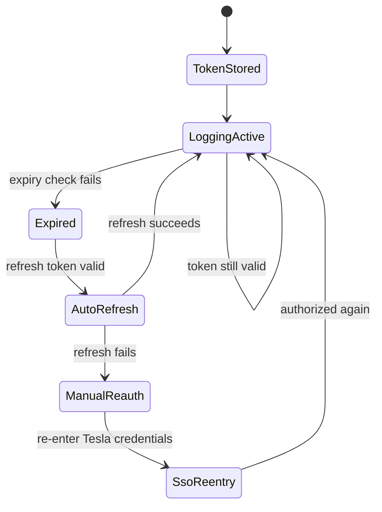

# mveplus/tesla-model3-resources

Deep-dive analysis, **replace mode** (skill: `legacy-repo-deep-dive`). The pre-replace summary remains recoverable as `git show HEAD:docs/legacy/mveplus-tesla-model3-resources.md` and is cited that way below.

## 1. Provenance

| Field | Value |
| ----- | ----- |
| Submodule | `legacy/mveplus-tesla-model3-resources` |
| Pinned gitlink | `160000 10541bdb49150f8bdcc5dcf5ad3f07a4e72934a3 0` |
| `rev-parse HEAD` | `10541bdb49150f8bdcc5dcf5ad3f07a4e72934a3` (matches gitlink) |
| Worktree status | clean (`status --porcelain` empty) |
| Upstream URL | https://github.com/mveplus/tesla-model3-resources.git (branch `main`) |
| License | None found — no LICENSE file is tracked; treat as reference-only, do not copy prose (section 14) |
| Analysis date | 2026-11-21 |
| Repo shape | single tracked file: `README.md`, 237 lines, 10,668 bytes (per `git ls-files`; no hidden dirs, no `.github/`, no CI, no code) |

Frontmatter preservation: the original frontmatter is preserved byte-for-byte (5 fields, LF, no trailing whitespace was present, so nothing needed stripping). Preserve list: the pre-replace doc contained **no** `## Upstream (...)` sections (`grep -nE '^## Upstream'` → no output at write time), so there was nothing to re-append after section 14.

Files read (coverage labels per skill; upstream has exactly one file):

| File | Coverage | Lines |
| ---- | -------- | ----- |
| `legacy/mveplus-tesla-model3-resources/README.md` | FULL-READ (entire file) | 1-237 |
| Initial-commit stub, `git show 2eb7be34cf6ec88b0680a978e9348c3a8bf8b7b7:README.md` | FULL-READ (entire file, 2 lines) | — |
| `firmware/lib/vehicle/can/feature/misc/mqtt_bridge.h` | FULL-READ | 1-88 |
| `firmware/test/test_native_mqtt/test_mqtt.cpp` | FULL-READ | 1-127 |
| `packages/protocol/src/commands.ts` | RANGE-CITED | 65, 450-469 |
| `firmware/lib/core/types.h` | RANGE-CITED | 716-717, 790-791 |
| `firmware/lib/client/command/messages.h` | RANGE-CITED | 200-201, 450-451 |
| `firmware/lib/vehicle/ble/feature/vcsec.h` | RANGE-CITED | 1-60 |
| Pre-replace doc via `git show HEAD:docs/legacy/mveplus-tesla-model3-resources.md` | FULL-READ (compared against code) | 1-59 |

Files explicitly NOT read: upstream — nothing else exists (`git ls-files` returns one path). TeslaCANModder side — only the ranges listed above were opened; the rest of `firmware/`, `client/`, `packages/`, `tools/` is out of scope for this analysis.

## 2. Executive verdict

This repo is a 237-line curated **link catalog** for Tesla Model 3 owners: official Fleet API resources, community loggers (TeslaMate, TeslaLogger), Home Assistant and monitoring tooling, SDKs, plus two mermaid diagrams describing TeslaMate setup. It contains **zero code, zero CAN content, zero tests** — there is nothing to port at byte level, and every flow it depicts is SUMMARY-ONLY prose about third-party products. Its only real value to TeslaCANModder is as an ecosystem checklist: it confirms the third-party integration surfaces worth covering are MQTT telemetry, HA discovery, and Fleet-adjacent telemetry — all of which our repo already names in `docs/reference/commands.md`. The parity work below surfaced two genuine **our-side** gaps that stand independent of this upstream: our MQTT bridge is a config/gate skeleton with no broker client or publish loop, and our `ha:*` command family has protocol builders and tests but no firmware handler. Both are our own candidates for future PRs, not ports from this repo. Nothing here may be copied verbatim (unlicensed).

## 3. Evidence map

Grade mapping for this documentation-only repo: `README.md` is the sole artifact, so claims about **what the repo contains/links** are CODE-READ (direct read of the artifact); claims about **how external products behave** remain SUMMARY-ONLY because no implementation exists anywhere in this repo. No TEST-READ evidence exists: this repo ships no tests. No CAPTURE evidence exists in this repo.

| Source | Lines | What it proves | Grade |
| ------ | ----- | -------------- | ----- |
| `git -C legacy/mveplus-tesla-model3-resources ls-files` | — | exactly one tracked file (`README.md`); no code, tests, CI, or LICENSE exist | CODE-READ |
| `README.md` | 1-3 | repo purpose: curated official + community resources for Model 3 owners, infra-engineer slant | CODE-READ |
| `README.md` | 5-10 | five advertised content pillars (official, community, infra, dev, auth flows) | CODE-READ |
| `README.md` | 22-73 | TeslaMate auth flow mermaid: Fleet API OAuth branch, legacy-token branch, refresh/re-auth loop | SUMMARY-ONLY |
| `README.md` | 77-102 | TeslaMate security topology mermaid: reverse proxy + TLS, env-var/Docker-secret tokens, PostgreSQL isolation | SUMMARY-ONLY |
| `README.md` | 107-109 | official links incl. `teslamotors/vehicle-command` and Fleet API portal | CODE-READ |
| `README.md` | 118-124 | data logger links (TeslaMate, Teslemetry, TeslaLogger) + docker one-liner with inline `user:pass` placeholder | CODE-READ |
| `README.md` | 127-129 | HA integration (`alandtse/tesla`) and TeslaJS links | CODE-READ |
| `README.md` | 138-139, 180 | `teslamotors/fleet-telemetry` link; `auth.tesla.com` labeled "Token Generator" at 139 and "SSO portal" at 180 | CODE-READ |
| `README.md` | 206-218 | docker quick-start: curl-fetched compose file, `cp .env.example .env` at 211, UI on port 4000 | CODE-READ |
| `README.md` | 229-233 | curation policy: maintained within 12 months, documented, community-verified | CODE-READ |
| `README.md` | whole file | no CAN, DBC, or hex-dump content anywhere (demonstrated negative anchor, section 16) | CODE-READ |
| `firmware/lib/vehicle/can/feature/misc/mqtt_bridge.h` | 13-18, 26-73, 81-88 | our MQTT feature = command parsing (`executeMqttCmd`) + publish gate (`mqttShouldPublish`) + constants; topic prefix `"teslacanmodder/"`; no broker client | CODE-READ |
| `firmware/lib/core/types.h` | 716-717, 790-791 | our state fields `mqttLastPublishMs`, `mqttConnected` (init false), defaults port 1883 / interval 2000 | CODE-READ |
| `firmware/lib/client/command/messages.h` | 200-201, 450-451 | status payloads serialize `mqtt` and `mqttConnected` booleans | CODE-READ |
| `firmware/test/test_native_mqtt/test_mqtt.cpp` | 32-111 | 8 Unity tests: on/off/broker/port/interval parsing, publish-gate timing, disabled gate, host-length rejection | TEST-READ |
| `packages/protocol/src/commands.ts` | 65, 457-463 | `ha:on/off/discovery/interval` builders; interval gated 500-60000 ms with RangeError | CODE-READ |
| `packages/protocol/test/commands/new-commands.test.ts` | 101-105 | ha command serialization asserted (`ha:on`, `ha:off`, `ha:discovery`, `ha:interval:1000/5000`) | TEST-READ |
| `firmware/lib` + `firmware/src` (negative grep) | — | no `ha:discovery`/homeassistant handler, no `PubSubClient`/`mqttConnect(`, no `fleet[-_]telemetry` anywhere in firmware, protocol src, or tools | CODE-READ |
| `git ls-files -s legacy/` | — | `legacy/teslamotors-vehicle-command` tracked separately at gitlink `160000 0a582da430c4aca6d397fb6cbed5d4d6bb380125 0`; no teslamate/alandtse/prometheus submodule exists | CODE-READ |

## 4. Architecture and build surface

None found: no frame pipeline in this repo.

- Entry point: `README.md` alone — 12 H2 sections (demonstrated anchor in section 16), two mermaid fences, one bash fence.
- No build system, no shared core vs platform split, no dependency boundaries, no feature-gating flags. The "architecture" is document structure only.
- Because there is no RX → decode → mutate/gate → TX path, the skill's data-flow diagram is not applicable; the only stateful content (the token lifecycle) is diagrammed inside mechanism card M1.

## 5. Mechanism catalogue

This repo ships no executable code, so there are **0 code mechanisms** and **3 doc-level mechanisms**. All three are upstream prose with no implementation to confirm against, so every card grades SUMMARY-ONLY and no card can drive an adaptation decision by itself.

### M1 — TeslaMate authentication flow (doc-level)

- **Claim (README / summary):** README:20-73 depicts TeslaMate setup with two auth branches (Fleet API OAuth via a registered developer app, or a legacy token from a third-party generator), token storage, and an expiry → refresh → manual-re-auth loop.
- **Code path:** None found — no code in this repo; diagram lives entirely at README:22-73.
- **Frame spec:** None found — no CAN/frame content.
- **Gates and timing:** doc-level only: redirect URI `https://localhost:4040/auth/tesla/callback` (README:30), web UI `http://localhost:4000` (README:40), token-expiry branch (README:58-60), refresh-success branch (README:62-64).
- **State machine:** 4+ states, redrawn here (paraphrased, not copied) from README:58-65:



- **Tests:** None found.
- **Evidence grade:** SUMMARY-ONLY.
- **Verdict:** UNVERIFIED — the flow text was not checked against TeslaMate's own docs or a live deployment; nothing in-repo can confirm it.
- **Adapt to TeslaCANModder?** no impact — describes third-party product setup, not our firmware.

### M2 — TeslaMate security topology (doc-level)

- **Claim (README / summary):** README:75-102 recommends reverse proxy with TLS termination, tokens in env vars / Docker secrets, and PostgreSQL auth + network isolation around the TeslaMate container.
- **Code path:** None found — static diagram at README:77-102.
- **Frame spec:** None found.
- **Gates and timing:** None found.
- **State machine:** None found — static topology, no states or transitions.
- **Tests:** None found.
- **Evidence grade:** SUMMARY-ONLY.
- **Verdict:** UNVERIFIED.
- **Adapt to TeslaCANModder?** no impact — generic self-hosting hardening background; relevant only if we ever document a broker deployment for our `mqtt:*` bridge.

### M3 — Docker quick-start deployment (doc-level)

- **Claim (README / summary):** README:203-218: fetch the official compose file with curl, `cp .env.example .env`, `docker-compose up -d`, browse to port 4000.
- **Code path:** None found.
- **Frame spec:** None found.
- **Gates and timing:** None found — no timing content.
- **State machine:** None found.
- **Tests:** None found.
- **Verdict:** UNVERIFIED — commands were not executed; step 2 references a `.env.example` this repo does not track (see contradiction C4).
- **Evidence grade:** SUMMARY-ONLY.
- **Adapt to TeslaCANModder?** never port — the curl-fetched compose file (README:208) and inline placeholder credentials (README:122) are patterns our guides must not replicate.

## 6. Summary vs code contradiction table

Only actual contradictions are listed; the pre-replace doc's descriptive sections (its lines 19-40) verified accurate against the repo and are recorded in the evidence map instead. Pre-replace citations use `git show HEAD:docs/legacy/mveplus-tesla-model3-resources.md` (worktree content was identical to HEAD at analysis time, so line numbers match).

| # | Claim | Claim source | Reality (code/inventory) | Verdict |
| - | ----- | ------------ | ------------------------ | ------- |
| C1 | TeslaMate "publishes a well-known MQTT topic tree (`teslamate/cars/$id/$field`)" presented as repo-derived content | `git show HEAD:docs/legacy/mveplus-tesla-model3-resources.md` → line 45 | the README contains no MQTT topic schema anywhere (negative anchor `cars/|\$id|\$field` → no output); it only links TeslaMate's MQTT doc at README:165 | CONTRADICTED (attribution error) |
| C2 | "add `ha:discovery` as an alias/reimplementation of our existing `ha:discovery`", implying a working firmware HA discovery payload | `git show HEAD:docs/legacy/mveplus-tesla-model3-resources.md` → line 48 | self-contradictory (proposes adding a command it calls existing), and our firmware has no `ha:` handler at all (negative anchor, section 16); `ha:discovery` exists only as a protocol builder (`packages/protocol/src/commands.ts:458`) with a serialization test (`new-commands.test.ts:103`) | CONTRADICTED |
| C3 | `auth.tesla.com` is a "Tesla Auth Token Generator" | `README.md:139` | the same URL is labeled "Official Single Sign-On portal" at README:180; the SSO portal is not a token generator | CONTRADICTED (internal label conflict) |
| C4 | quick-start step 2: `cp .env.example .env` | `README.md:211` | the repo tracks no `.env.example` — `git ls-files` returns only `README.md` | CONTRADICTED (references a nonexistent file) |

## 7. CAN frame and signal inventory

None found. The repo decodes, mutates, or injects nothing: no CAN IDs, no DBC, no JSON signal catalog, no bit layouts. There is also no vendored catalog file to label STRUCTURAL-PARSE — demonstrated by the negative anchor `grep -nE '\bCAN\b|\bDBC\b|0x[0-9A-Fa-f]+' README.md` → no output (section 16).

## 8. Constants and tuning table

None found. No constant in this repo shapes a frame, a gate, or a timing window. The only numeric content is deployment ephemera — callback port 4040 (README:30), web UI port 4000 (README:40, 217), a Postgres URL placeholder (README:122) — plus the curation rule "updated within last 12 months" (README:230). None is load-bearing for TeslaCANModder.

## 9. Failure modes and edge cases

None found. No code means no error paths, no bus-off handling, no watchdog, no OTA behavior, no queue overflow, no missing-frame timeouts. The only failure branch anywhere is doc-level: refresh-token failure → "Manual Re-authentication Required" → SSO re-entry (README:62-65), which is untestable here and untested everywhere.

## 10. Test coverage map

None found. No TEST-READ evidence exists: this repo ships no tests, no CI configuration, no build step. Critical path with no test: all of it — the repo has no executable behavior to test.

## 11. Parity matrix with TeslaCANModder

Upstream touches no CAN signal, so parity is ecosystem-surface only. Every row carries an our-side CODE-READ (or TEST-READ) citation; no row is SUMMARY-ONLY on our side. Rows 1-2 are also where the real adaptation work lives — it is **our-side completion**, not a port.

| Surface | Upstream (cite, grade) | TeslaCANModder (cite, grade) | Delta | Action |
| ------- | --------------------- | --------------------------- | ----- | ------ |
| MQTT vehicle telemetry → broker | TeslaMate MQTT integration link, README:165 — SUMMARY-ONLY (link only, no payload or topic spec in-repo) | `executeMqttCmd` parses `mqtt:on/off/broker:/port:/interval:` (`mqtt_bridge.h:26-73`, CODE-READ); publish gate `mqttShouldPublish` (`mqtt_bridge.h:81-88`, CODE-READ); state defaults 1883/2000 (`types.h:790`); gate tests (`test_mqtt.cpp:80-99`, TEST-READ); **no broker client or publish loop exists** (negative anchor, section 16) | ours is a config/gate skeleton without a publisher; upstream describes a finished third-party logger we cannot verify from here | capture-first — finish our own publish path first; topic-shape alignment with TeslaMate cannot be decided from a SUMMARY-ONLY link |
| HA MQTT discovery | alandtse/tesla HA integration link, README:127 — SUMMARY-ONLY | builders `commands.ts:457-463` (CODE-READ) + serialization tests `new-commands.test.ts:101-105` (TEST-READ); firmware handler absent (negative anchor, section 16) | `ha:discovery` serializes in our client but firmware has no handler, so the command cannot work against real firmware today | align — our internal gap; fix (implement or remove) independently of this repo |
| Fleet telemetry streaming | `teslamotors/fleet-telemetry` links, README:138 and 169 — SUMMARY-ONLY | none — no `fleet[-_]telemetry` hit across `firmware/lib`, `packages/protocol/src`, `tools` (negative anchor, section 16) | upstream item is a server-side product outside firmware scope | ignore |
| Vehicle command CLI / Go lib | `teslamotors/vehicle-command` links, README:107 and 154 — SUMMARY-ONLY | already tracked as its own submodule `legacy/teslamotors-vehicle-command` (gitlink `160000 0a582da430c4aca6d397fb6cbed5d4d6bb380125 0`, CODE-READ); shipping BLE stack independently implements VCSEC message builders (`firmware/lib/vehicle/ble/feature/vcsec.h:5-8`, CODE-READ) | none — the reference is already curated separately, and our BLE path is an independent implementation | ignore (already present via separate submodule; see that submodule's own analysis) |

## 12. Surface inventory and security notes

Transport surfaces: None found. The repo exposes no serial, BLE, or web endpoints — it is a document.

Security and provenance notes:

| Item | Location | Finding |
| ---- | -------- | ------- |
| Inline DB credentials | README:122 — `postgresql://user:pass@db/teslamate` in a docker one-liner | placeholder, not a leak; anti-pattern to emulate in our docs |
| Remote compose fetch | README:208 — `curl -o docker-compose.yml https://raw.githubusercontent.com/...` | unverified remote file executed as a deployment; supply-chain pattern our guides must not replicate |
| Token-generator advice | README:34 ("Use Third-party Token Generator") and README:139 (mislabeled "Token Generator") | credential-handling guidance that conflicts with the same README's Fleet API migration link (README:192); ToS-risky, do not propagate |
| Keys, certs, archives, build flags | whole repo | none found — no secrets tracked, no binary archives, no build system at all |

## 13. Adaptation assessment

| Mechanism / idea | Value | Cost | Risk | Evidence | Decision |
| ---------------- | ----- | ---- | ---- | -------- | -------- |
| M1 auth flow doc | low — third-party product setup | zero | confusion, ToS conflation | SUMMARY-ONLY | no impact |
| M2 security topology | low-medium — hardening background for a future broker-deployment guide | zero | none | SUMMARY-ONLY | no impact |
| M3 docker quick-start | none for firmware | zero | unsafe-pattern propagation (C4, curl fetch) | SUMMARY-ONLY | never port |
| MQTT topic alignment (pre-replace doc idea, inspired by README:165) | medium — but blocked: our bridge has no publisher yet, and the upstream link adds no spec | medium | payload churn on a feature that cannot emit today | our side CODE-READ, upstream SUMMARY-ONLY | candidate for future PR — as our-side completion of the publish loop first, not a port from this repo |
| HA discovery format verification (pre-replace doc idea) | medium — our `ha:*` family is currently dead weight in firmware | low | none | our side CODE-READ + TEST-READ, upstream SUMMARY-ONLY | candidate for future PR — implement or remove the firmware side; the HA 2024+ payload question only matters after a handler exists |
| Fleet telemetry bridge | low for firmware | high — server infrastructure | scope creep | SUMMARY-ONLY | never port (out of firmware scope) |

## 14. Do-not-copy list

| Item | Location | Reason |
| ---- | -------- | ------ |
| Both mermaid diagrams | README:22-73, 77-102 | unlicensed repo; copying into GPL-3.0 docs creates untraceable provenance — and the content describes TeslaMate, not TeslaCANModder; redraw independently if ever needed |
| Docker one-liner with inline credentials | README:122 | `user:pass` inline credential pattern |
| Quick-start block | README:206-218 | curl-fetched compose file, plus references a nonexistent `.env.example` (C4) |
| Token-generator guidance | README:34, 139 | mislabeled/ToS-risky auth advice (C3) |
| Any prose at all | whole repo | no LICENSE file is tracked — ideas and link targets are fine to reference, text is not; write `derived idea, independent implementation` if any behavior is ever adopted |

## 15. History and evolution

Mined from the submodule's local git log (no network claims used). The entire history is two commits on `main`, both 2025-09-21 (+0100), author `mveplus`:

| SHA | Time | Subject | Content |
| --- | ---- | ------- | ------- |
| `2eb7be34cf6ec88b0680a978e9348c3a8bf8b7b7` | 12:17:05 | Initial commit | 2-line stub README (`# tesla-model3-resources` + one description sentence) |
| `10541bdb49150f8bdcc5dcf5ad3f07a4e72934a3` | 12:29:26 | Doc: Init docs | rewrote the stub into the 237-line catalog (+237/-2) — the pinned gitlink |

Nothing was tried and abandoned; no approaches were rolled back; no tags exist. The pack holds exactly 6 objects (2 commits + 2 trees + 2 blobs), so there is no hidden history. Because the pin is the second of exactly two commits, **pre-pin history review is complete** — the only earlier state is the stub above.

## 16. Re-verification recipe

Pinned gitlink (canonical form): `160000 10541bdb49150f8bdcc5dcf5ad3f07a4e72934a3 0`.

```bash
OLD=10541bdb49150f8bdcc5dcf5ad3f07a4e72934a3
git -C legacy/mveplus-tesla-model3-resources fetch --tags --prune
git -C legacy/mveplus-tesla-model3-resources log --oneline $OLD..origin/main   # expect: no output at analysis date
git -C legacy/mveplus-tesla-model3-resources diff --stat $OLD..origin/main   # README.md only — the sole tracked file
git -C legacy/mveplus-tesla-model3-resources status --porcelain             # expect: empty
git ls-files -s legacy/mveplus-tesla-model3-resources                        # expect: 160000 10541bdb49150f8bdcc5dcf5ad3f07a4e72934a3 0
```

Anchors below were **all demonstrated at write time (2026-11-21)** from the repo root. On this Windows workspace grep is the Git-bundled binary (`C:\Program Files\Git\usr\bin\grep.exe`); note that pwsh argument passing mangles `\(` — use `[(]` for literal parens, as in NEG-3.

```text
# upstream anchors — legacy/mveplus-tesla-model3-resources/README.md
grep -nE 'Fleet Telemetry' legacy/mveplus-tesla-model3-resources/README.md
  -> expect hits at 138 (fleet-telemetry repo link) and 169 (docker link)
grep -nE 'auth\.tesla\.com' legacy/mveplus-tesla-model3-resources/README.md
  -> expect hits at 139 (mislabeled "Token Generator") and 180 (SSO portal)
grep -nE '^## ' legacy/mveplus-tesla-model3-resources/README.md
  -> expect exactly 12 headings at 5, 12, 20, 75, 104, 115, 160, 176, 188, 203, 227, 235
grep -nE 'mermaid' legacy/mveplus-tesla-model3-resources/README.md
  -> expect hits at 22 and 77 (the two fences)

# upstream negative anchors (absence claims)
grep -nE '\bCAN\b|\bDBC\b|0x[0-9A-Fa-f]+' legacy/mveplus-tesla-model3-resources/README.md
  -> no output (no CAN/DBC/hex content anywhere — section 7)
grep -nE 'cars/|\$id|\$field' legacy/mveplus-tesla-model3-resources/README.md
  -> no output (no MQTT topic schema — contradiction C1)

# our-side anchors (parity rows rest on these)
grep -nE 'MQTT_TOPIC_PREFIX' firmware/lib/vehicle/can/feature/misc/mqtt_bridge.h
  -> expect line 18: #define MQTT_TOPIC_PREFIX "teslacanmodder/"
grep -nE 'mqttShouldPublish' firmware/lib/vehicle/can/feature/misc/mqtt_bridge.h firmware/test/test_native_mqtt/test_mqtt.cpp
  -> expect mqtt_bridge.h:81 (definition) and test_mqtt.cpp:87, 88, 89, 98 (assertions)
grep -nE 'haDiscovery|homeAssistant|haInterval' packages/protocol/src/commands.ts
  -> expect hits at 65 (gating 500-60000), 457, 458, 459 (builders)
grep -nE 'VCSEC' firmware/lib/vehicle/ble/feature/vcsec.h
  -> expect hits from line 5 (brief) through the constants block at 24-45

# our-side negative anchors
grep -rnE 'PubSubClient|mqttConnect[(]' firmware/lib firmware/src
  -> no output (no broker client exists — parity row 1)
grep -rnE 'ha:discovery|homeassistant|Home Assistant' firmware/lib firmware/src firmware/test
  -> no output (no firmware ha: handler — parity row 2, contradiction C2)
grep -rnE 'fleet[-_]telemetry' firmware/lib packages/protocol/src tools
  -> no output (parity row 3)
```

If line numbers drift more than ~10 lines, re-read the whole function or file; do not trust this document's numbers. Our-side `already present`/absence decisions rest on the negative anchors above — re-run them after any WiFi-transport or dispatch change.

## 17. Open questions and explicitly not investigated

- Upstream beyond the pin: not fetched; any newer commits on GitHub are UNVERIFIED — the fetch/log block in section 16 settles it in one command.
- External products' actual behavior — TeslaMate's real MQTT topic schema (including the pre-replace doc's `teslamate/cars/$id/$field` claim), alandtse/tesla's discovery payload, fleet-telemetry's wire format: not investigated; this repo only links them, and no teslamate/alandtse/prometheus submodule exists in our `legacy/` tree to check against (verified via `git ls-files -s legacy/`).
- The pre-replace doc's line 27 pairing of TeslaMate with our `smt:*` (ScanMyTesla SPP bridge) is unsupported by the README — TeslaMate is described only as an API/MQTT logger (README:118-122, 165). Dropped from this analysis; nothing to verify against in-repo.
- Our-side: `mqttConnected` is serialized in status (`messages.h:200-201`) but nothing in `firmware/lib` or `firmware/src` ever sets it true, and `mqttShouldPublish` has no production caller. Whether a broker client is planned elsewhere is UNVERIFIED; re-run the `PubSubClient|mqttConnect[(]` negative anchor after any WiFi-transport change before trusting parity row 1.
- Pre-pin upstream history: fully reviewed — see section 15; nothing exists below the two-line stub.
