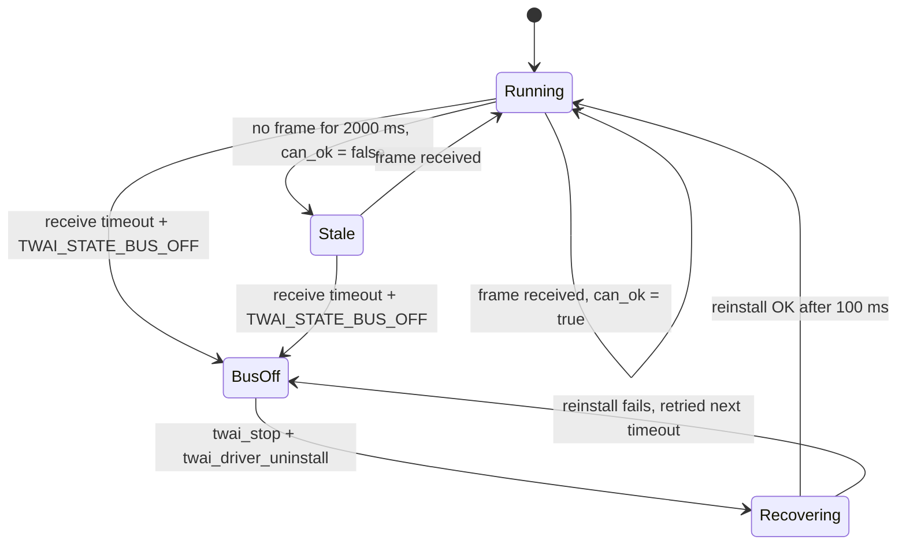

# nicholasyangyang-ESP32-dash-direct

Deep-dive analysis per `.opencode/skills/legacy-repo-deep-dive/SKILL.md` (replace mode). The pre-replace summary still exists in git history; stale pre-replace claims are cited below as `git show HEAD:docs/legacy/nicholasyangyang-ESP32-dash-direct.md#<line>`.

## 1. Provenance

- **Submodule path:** `legacy/nicholasyangyang-ESP32-dash-direct`
- **Pinned gitlink (canonical):** `160000 3ff1c05664656af3f68d74493a075265f8e13dfb 0` — matches `git -C legacy/nicholasyangyang-ESP32-dash-direct rev-parse HEAD`; worktree clean (`status --porcelain` empty)
- **Upstream URL:** https://github.com/nicholasyangyang/ESP32-dash-direct
- **License:** None found — no LICENSE/COPYING file in `git ls-files` (14 tracked files). All adaptation below must be behavior-level reimplementation, never code copying.
- **Analysis date:** 2026-11-21
- **Pinned commit:** `3ff1c05 UI: remove SOC/range/temp/regen, add 120px custom speed font, golden ratio layout` — the only commit in the local clone (not a shallow file; the local history contains exactly one commit, so pre-pin history is unavailable locally)
- **Files read (FULL-READ, with ranges):**
    - `main/main.c` (1-29), `main/can_direct.h` (1-36), `main/can_direct.c` (1-200), `main/ui.h` (1-5), `main/ui.c` (1-301), `main/bsp.h` (1-233), `main/bsp.c` (1-536)
    - `CMakeLists.txt` (1-3), `main/CMakeLists.txt` (1-4), `main/idf_component.yml` (1-6), `partitions.csv` (1-4), `sdkconfig.defaults` (1-17), `.gitignore` (1-4), `README.md` (1-356, read after the code, to compare)
- **Files read (STRUCTURAL-PARSE):** `main/lv_font_speed_120.c` — 1621 lines of generated LVGL glyph data; read lines 1-60 (header: "Auto-generated LVGL font: SF NS 120px, digits 0-9 only, 4bpp") plus final 30 lines (font descriptor: `line_height = 89`, `base_line = 1`, bpp 4). Claims limited to structure; the bitmap bytes were not read line-by-line.
- **Files explicitly NOT read:** none — every tracked file is covered above. Untracked build outputs (`build/`, `managed_components/`, `dependencies.lock` are gitignored) do not exist in the submodule worktree. ESP-IDF managed dependencies (lvgl ~8.3.0, esp_lvgl_port ~1.4.0, esp_lcd_touch_ft5x06 ~1.0.6) are not vendored, so their internals are UNVERIFIED from this snapshot.
- **Preserved sections:** frontmatter preserved byte-for-byte from the pre-replace doc (HEAD blob is LF; description line carries no trailing whitespace, so nothing was stripped). The pre-replace doc contained **no `## Upstream (...)` sections**, so there is nothing to carry forward after section 14.

## 2. Executive verdict

This is a small, single-purpose ESP32-S3 (ESP-IDF) CAN dashboard: one TWAI lane at 500 kbps, an accept-all RX filter, six HW4 frames decoded into a lock-free global struct, rendered by LVGL onto a 320x240 ST7789 at a 16 ms timer. There is no frame mutation, no TX, no transport surface beyond log output — `git grep -nE 'twai_transmit'` over `can_direct.c` returns nothing. Its value to TeslaCANModder is almost entirely in its HW4 decode constants (0x257 UI speed, 0x118 gear, 0x219 TPMS, 0x3F5 lights, 0x212 charge flag, 0x399 AP state), and three of those (0x257, 0x118, 0x219) **contradict our shipping decoders at the bit-layout level** — both sides cannot be right, and neither side has a capture in this repo, so every decode delta below is capture-first, not port-first. The bus-off reinstall-recovery and the 2 s RX-liveness flag are mechanisms we already have in stronger form (MCP2515 EFLG poll + per-bus diag counters). The LVGL/ST7789 display stack and the vendored SZP board support code have no impact on our product shape and must not be ported (upstream license is absent).

## 3. Evidence map

No TEST-READ evidence exists: this repo ships no tests. No CAPTURE evidence exists in this repo; all vehicle-truth claims about bit layouts rest on the author's stated DBC cross-check (joshwardell/model3dbc + tesla-can-explorer fw 2026.2), which is not vendored and therefore UNVERIFIED here — the CODE-READ grades below prove what the code does, not what the car sends.

| Source file | Lines | What it proves | Grade |
| ----------- | ----- | -------------- | ----- |
| `main/can_direct.c` | 9-10 | TWAI pins: TX=GPIO10, RX=GPIO11 | CODE-READ |
| `main/can_direct.c` | 38-134 | `parse_frame()` decodes exactly 6 IDs: 0x257, 0x118, 0x212, 0x3F5, 0x219, 0x399; `default: break` for the rest | CODE-READ |
| `main/can_direct.c` | 43-57 | 0x257: `DI_uiSpeed` 24\|9 from `d[3] \| ((d[4]&0x01)<<8)`, units bit 33, mph→kph `*1.60934f`; precise `DI_vehicleSpeed` 12\|12 (`raw*0.08-40`) computed but only ESP_LOGD'd | CODE-READ |
| `main/can_direct.c` | 61-69 | 0x118: gear = `(d[2]>>5)&0x07`, raw 1..4 remapped to 0-based, else 0xFF | CODE-READ |
| `main/can_direct.c` | 73-77 | 0x212: charging = bit 29 → `(d[3]>>5)&0x01` | CODE-READ |
| `main/can_direct.c` | 80-105 | 0x3F5: indicator/hazard/beam status extraction, `==1` for indicators and beams, `!=0` for hazard | CODE-READ |
| `main/can_direct.c` | 108-118 | 0x219: corner index `d[0]&0x03`, pressure `d[1]*0.025f` bar — one corner per frame | CODE-READ |
| `main/can_direct.c` | 122-128 | 0x399: `DAS_autopilotState = d[0]&0x0F`, engaged when 3/4/5 | CODE-READ |
| `main/can_direct.c` | 137-146, 195-199 | TWAI install: 500 kbps, accept-all filter, `rx_queue_len 32`, normal mode; RX task on core 0, prio 5, stack 4096 | CODE-READ |
| `main/can_direct.c` | 149-192 | RX loop: 200 ms receive timeout, 5 s stats log, 2 s liveness flag, bus-off recovery via stop/uninstall/100 ms/reinstall | CODE-READ |
| `main/can_direct.h` | 15-30 | `dashboard_state_t` has 14 fields; no range/SOC/temp/regen fields exist | CODE-READ |
| `main/ui.c` | 20, 89-119, 144-301 | `SPLIT_Y 206`, 16 ms LVGL refresh timer, 222/2/96 px panel layout, 120 px digits-only speed font | CODE-READ |
| `main/ui.c` | 128-143 | Stale self-documenting comment block claiming y=148 golden-ratio split and font48 speed | CODE-READ |
| `main/bsp.c` | 46-64, 123-129, 169-212, 234-401 | Vendored SZP board bring-up: QMI8658 (with infinite WHO_AM_I retry loop), PCA9557, LEDC backlight, ST7789 panel, FT5x06 touch with warn-and-continue | CODE-READ |
| `main/main.c` | 10-29 | Boot order: I2C → PCA9557 → LVGL → UI → `can_direct_start()`; no QMI8658/camera/display-brightness calls — that code is dead in this app | CODE-READ |
| `main/lv_font_speed_120.c` | 1-3, tail | Generated font, digits only, 4bpp, `line_height 89` | STRUCTURAL-PARSE |
| `sdkconfig.defaults` | 1-17 | ESP32-S3 target, 16 MB flash, octal PSRAM 80 MHz, LV_COLOR_16_SWAP, Montserrat 12/16/24/48 enabled | CODE-READ |
| `main/idf_component.yml` | 1-6 | Dependency pins: lvgl ~8.3.0, esp_lvgl_port ~1.4.0, esp_lcd_touch_ft5x06 ~1.0.6, IDF ≥5.2.0 | CODE-READ |
| `README.md` | 55-56, 84-102, 145-197, 209-228, 261-292 | Documents pins, a 3-panel layout, and range/SOC/temp/regen decodes that the pinned code no longer contains | CODE-READ (as evidence of staleness) |
| Negative anchors (run 2026-11-21) | — | `git grep -nE 'twai_transmit'` → no output; `git grep -nE 'can_ok' main/ui.c` → no output; `git grep -nE '0x33A|0x292|0x321|0x312|0x252|0x334' main/can_direct.c` → no output; `git grep -inE 'crc|checksum|counter' main/can_direct.c` → no output; `git grep -inE 'wifi|bluetooth|http' main/` → no output | CODE-READ |

## 4. Architecture and build surface

- **Entry point:** `app_main()` at `main/main.c:10` — I2C init → PCA9557 init → LVGL start → `ui_init()` (empty) → `ui_show_dashboard()` → `can_direct_start()`.
- **Shared core vs platform port:** there is no core/port split. `can_direct.c` is the entire vehicle layer; `bsp.c`/`bsp.h` are a vendored board package (header comment line 1: "Copied from ref/szpi-s3-esp/08-lcd_lvgl/main/esp32_s3_szp.h — Tesla dashboard BSP"); `ui.c` is the view.
- **Build flags:** none — no `Kconfig`, no project-specific options; `sdkconfig.defaults` hard-pins ESP32-S3 + PSRAM + LVGL fonts. Single CMake target `dash_direct` (`CMakeLists.txt:3`), sources registered flat in `main/CMakeLists.txt:1-4`. Partition table: nvs 0x6000 + factory 0x400000 (`partitions.csv:2-4`).
- **Dependency boundary:** everything vehicle-facing sits in one RX task; the UI consumes only `g_state`. LVGL/esp_lvgl_port/FT5x06 are external managed components, not vendored.
- **CAN pipeline:** RX-only — there is no mutate/gate/TX stage.

```mermaid
flowchart LR
    Car["Tesla HW4 CAN, 500 kbps<br/>(single lane, one bus)"] --> XCVR["external CAN transceiver<br/>(SN65HVD230 class, README claim)"]
    XCVR --> TWAI["ESP32-S3 TWAI controller<br/>TX=IO10 RX=IO11, accept-all filter"]
    TWAI --> Rx["can_rx_task, core 0 prio 5<br/>twai_receive, 200 ms timeout"]
    Rx --> Parse["parse_frame()<br/>0x257 0x118 0x212 0x3F5 0x219 0x399"]
    Parse --> State["g_state, lock-free single writer"]
    State --> Ui["ui_refresh LVGL timer 16 ms"]
    Ui --> Lcd["ST7789 320x240, SPI + PSRAM buffer"]
    classDef stage fill:#1e3a5f,stroke:#4a7fb5,color:#fff
    class TWAI,Rx,Parse,State,Ui,Lcd stage
```



No frame is ever mutated or transmitted: `twai_transmit` appears nowhere in the tree (negative anchor above), and no counter/checksum helper exists (`crc|checksum|counter` over `can_direct.c` → no output).

## 5. Mechanism catalogue

### TWAI direct RX pipeline

- **Claim (README / summary):** direct TWAI reception, no WiFi/network needed (README:5).
- **Code path:** `main/can_direct.c:195` `can_direct_start()` → `twai_install_and_start()` (137) → `xTaskCreatePinnedToCore(can_rx_task, "can_rx", 4096, NULL, 5, NULL, 0)` (199) → `twai_receive(&msg, 200 ms)` (158) → `parse_frame()` (162).
- **Frame spec:** not a frame producer; consumes all standard IDs via `TWAI_FILTER_CONFIG_ACCEPT_ALL()` (142) at `TWAI_TIMING_CONFIG_500KBITS()` (141), `rx_queue_len 32` (140), `TWAI_MODE_NORMAL` (139) with TX unused.
- **Gates and timing:** 200 ms receive timeout (158); 5 s stats log window counting total/0x257/0x118 frames (166-175); 2 s silence threshold flips `can_ok` false (177-178).
- **State machine:** None found (steady RX loop; see the bus-off card for the recovery states).
- **Tests:** None found (repo ships no tests).
- **Evidence grade:** CODE-READ
- **Verdict:** CONFIRMED
- **Adapt to TeslaCANModder?** no impact — our hardware uses MCP2515 over SPI on the X179 connector, not the ESP32 TWAI controller; only the accept-all-vs-filtered contrast is informative (we use variant-filtered masks).

### HW4 six-frame decode set

- **Claim (README / summary):** "Extensive CAN signal parsing" listing 10 IDs (README:113-292; pre-replace doc `git show HEAD:docs/legacy/nicholasyangyang-ESP32-dash-direct.md#46-59`).
- **Code path:** `main/can_direct.c:38` `parse_frame(id, dlc, d)` — a `switch` with exactly six cases: 0x257 (43), 0x118 (61), 0x212 (73), 0x3F5 (80), 0x219 (108), 0x399 (122). The four extra IDs of the old claim (0x33A, 0x292, 0x252, 0x334) plus 0x321/0x312 exist only in the README — negative anchor `git grep -nE '0x33A|0x292|0x321|0x312|0x252|0x334' main/can_direct.c` → no output.
- **Frame spec:** see section 7 inventory; all six are read-only extracts with per-case DLC gates, no counters, no checksums.
- **Gates and timing:** none beyond DLC gates — decodes run on every matching frame.
- **State machine:** None found.
- **Tests:** None found.
- **Evidence grade:** CODE-READ (what the code does); the vehicle-truth of each bit layout is UNVERIFIED (no capture; DBC sources not vendored).
- **Verdict:** PARTIAL — the decode set is real but far narrower than README and the pre-replace doc claim.
- **Adapt to TeslaCANModder?** candidate — per-signal, capture-first; three IDs conflict with our shipping decoders (section 11).

### Bus-off detection and full driver reinstall recovery

- **Claim (README / summary):** "Bus-off 恢复 ... twai_stop() → twai_driver_uninstall() → 延时 100ms → 重新安装并启动" (README:338-346).
- **Code path:** `main/can_direct.c:180-189` — inside the receive-timeout branch: `twai_get_status_info(&st)` → if `TWAI_STATE_BUS_OFF` → `ESP_LOGW` → `twai_stop()` (184) → `twai_driver_uninstall()` (185) → `vTaskDelay(100 ms)` (186) → `twai_install_and_start()` (187).
- **Frame spec:** None found (control path, not a frame).
- **Gates and timing:** the bus-off check only runs on a `twai_receive` timeout (the `else` branch at 176), so detection latency is bounded by the 200 ms receive timeout; recovery wait is a fixed 100 ms; no retry cap, no backoff.
- **State machine:** RUNNING / STALE / BUS_OFF / RECOVERING — see below.
- **Tests:** None found.
- **Evidence grade:** CODE-READ
- **Verdict:** CONFIRMED
- **Adapt to TeslaCANModder?** already present — our `driverPollBusErrors()` (`firmware/lib/core/driver/common.h:204-220`) polls MCP2515 EFLG per active bus, and on `EFLG_TXBO` resets the controller, re-runs bitrate fallback and restores normal mode, with an atomic event counter (`driverGetAndResetBusOffEvents()`, same file 192-199; surfaced as `busOffCount` in `firmware/lib/client/command/messages.h:242`).



### RX-liveness flag (can_ok)

- **Claim (README / summary):** "`can_ok` 状态实时反映总线健康" (README:346).
- **Code path:** `main/can_direct.c:163-164` sets `g_state.can_ok = true` on any frame; 177-178 clears it after 2000 ms without RX. Declared in `main/can_direct.h:29`.
- **Frame spec:** None found.
- **Gates and timing:** 2000 ms fixed threshold, evaluated only on receive timeout.
- **State machine:** two states (fresh/stale) — not expanded here.
- **Tests:** None found.
- **Evidence grade:** CODE-READ
- **Verdict:** PARTIAL — the flag is maintained, but nothing consumes it: `git grep -nE 'can_ok' main/ui.c` → no output. It is a dead output at the pinned commit.
- **Adapt to TeslaCANModder?** already present — our per-bus health/diag state (`firmware/lib/core/types.h:363-364`, `busOffCount`; detection flags in `firmware/lib/core/driver/common.h`) is stronger and actually surfaced to clients.

### Lock-free single-writer state handoff

- **Claim (README / summary):** "无锁设计：g_state 字段均为 float/bool（32-bit 对齐），单写多读" (README:45); pre-replace doc repeated it (`git show HEAD:docs/legacy/nicholasyangyang-ESP32-dash-direct.md#42`).
- **Code path:** writer `can_rx_task` via `parse_frame()` writes `g_state` (`main/can_direct.c:12` definition; `main/can_direct.h:32-33` contract comment); readers `ui_refresh()` via the 16 ms LVGL timer (`main/ui.c:89-119`). No mutex/queue anywhere.
- **Frame spec:** None found.
- **Gates and timing:** None found (no synchronization primitive at all).
- **State machine:** None found.
- **Tests:** None found.
- **Evidence grade:** CODE-READ
- **Verdict:** PARTIAL — the pattern exists, but the "fields are 32-bit aligned" half is false as stated: `gear` is `uint8_t` and `charging`…`can_ok` are `bool` (`main/can_direct.h:17-29`). Single-byte and 32-bit stores are atomic on Xtensa LX7, so the design works by accident of ISA, not by the documented alignment rule.
- **Adapt to TeslaCANModder?** already present — our lock-free 256-entry ring buffer with per-consumer sequence tracking (`firmware/lib/core/can/` ring buffer design) is the equivalent mechanism with overflow detection, which this repo lacks.

### LVGL dashboard render (16 ms timer, 120 px font, SPLIT_Y 206 layout)

- **Claim (README / summary):** README shows a 3-panel layout (180/76/60 px) with SOC bar, Range, OutTemp, BattTemp, Regen (README:84-102); commit message says "golden ratio layout".
- **Code path:** `main/ui.c:144` `ui_show_dashboard()` builds: left speed/gear panel 222x206 (163-170), speed label with `lv_font_speed_120` at y=39 (174-180), gear row P/R/N/D at y=168 (183-189), 2 px vertical separator at x=222 (192-198), TPMS panel 96x206 at x=224 (201-257), horizontal separator at `SPLIT_Y` (269-275), status bar 320x91 with 7 icons (279-295). `ui_refresh()` (89-119) rewrites speed/gear/icon/TPMS from `g_state` on a 16 ms `lv_timer` (151, 298).
- **Frame spec:** None found (view layer).
- **Gates and timing:** refresh period 16 ms (~60 Hz); `lvgl_port_lock(0)` guards screen building (146) — a failed lock aborts silently.
- **State machine:** two-entry re-entry guard: if `scr_dash` already exists, reload it and re-create the timer only if missing (148-154).
- **Tests:** None found.
- **Evidence grade:** CODE-READ
- **Verdict:** CONTRADICTED — the shipped layout is 222/2/96 with a 120 px font and split at y=206 (`main/ui.c:20`); the README panels, the "golden ratio" wording, and even the in-file comment block ("横线在黄金分割点 y=148", "speed (font48)", "Status bar height = 240 - 148 = 92px", `main/ui.c:128-143`) describe a layout that no longer exists.
- **Adapt to TeslaCANModder?** no impact — our device has no local display; the client app is our UI surface.

### Vendored SZP board bring-up (ST7789 / FT5x06 / PCA9557 / QMI8658 / camera)

- **Claim (README / summary):** README pins table (60-77) documents the LCD/I2C/touch wiring.
- **Code path:** `main/bsp.c:10-23` I2C master; 123-129 `pca9557_init()` (LCD CS via IO expander); 169-212 LEDC 10-bit 5 kHz backlight; 234-289 ST7789 over SPI3 (80 MHz pixel clock, `main/bsp.h:170`), color invert + swap_xy + mirror (274-276); 306-336 LVGL display add with PSRAM buffer, single-buffered (318-332); 339-364 FT5x06 touch; 369-373 touch failure → `ESP_LOGW` and continue without touch.
- **Frame spec:** None found.
- **Gates and timing:** None found beyond init ordering in `main/main.c:13-15`.
- **State machine:** None found.
- **Tests:** None found.
- **Evidence grade:** CODE-READ
- **Verdict:** PARTIAL — functional for the SZP-ESP32-S3 board, but large parts are dead code in this app: `main.c` never calls `qmi8658_init`, `bsp_lcd_init`, `lcd_draw_pictrue`, `pa_en`, or the camera path (negative anchor: `git grep -nE 'qmi8658_init|bsp_lcd_init|lcd_draw_pictrue' main/main.c main/ui.c main/can_direct.c` → no output). `qmi8658_init` contains an infinite retry loop (`main/bsp.c:50-55`: `while (id != 0x05) { delay 1 s; re-read }`) that would hang boot if ever called without the sensor. The registered touch indev has no consumers — `git grep -nE 'lv_obj_add_event_cb|lv_event' main/ui.c` → no output.
- **Adapt to TeslaCANModder?** never port — board-specific, license-absent upstream, and our hardware path (MCP2515 + X179 + transports) shares nothing with it.

## 6. Summary vs code contradiction table

| # | Claim (source) | Code reality (citation) | Verdict |
| - | -------------- | ----------------------- | ------- |
| 1 | Pre-replace doc lists 0x33A, 0x292, 0x252, 0x334 as parsed (`git show HEAD:docs/legacy/nicholasyangyang-ESP32-dash-direct.md#56-59`), README documents full decodes for 0x33A/0x292/0x321/0x312/0x252/0x334 (README:145-197, 209-228) and a 17-field `g_state` (README:272-292) | `parse_frame()` has only six cases (`main/can_direct.c:40-133`); `dashboard_state_t` has 14 fields (`main/can_direct.h:15-30`); negative anchors return no output for both the IDs and the field names. Commit 3ff1c05 removed these decodes and the README was never updated | CONTRADICTED — README and pre-replace doc are stale for six of ten claimed signals |
| 2 | README display layout: panels 180/76/60 px, SOC bar, Range, OutTemp, BattTemp, Regen (README:84-102, 104-109) | Panels are 222/2/96 px, no SOC/range/temp/regen elements exist (`main/ui.c:162-257`) | CONTRADICTED |
| 3 | In-file comment: "横线在黄金分割点 y=148", "speed (font48)", "Status bar height = 240 - 148 = 92px" (`main/ui.c:129-143`); commit message says "golden ratio layout" | `SPLIT_Y` is 206 (`main/ui.c:20`), speed uses the 120 px font (`main/ui.c:176`), status bar is 91 px (`main/ui.c:277-281`) | CONTRADICTED — stale self-comment; even the commit message overstates (206 is a bottom-34-px layout per `main/ui.c:19`, not a 240/φ≈148 split) |
| 4 | README pin table: "CAN RX = IO10, CAN TX = IO11" (README:55-56) | `#define CAN_TX_PIN GPIO_NUM_10` / `#define CAN_RX_PIN GPIO_NUM_11` (`main/can_direct.c:9-10`) | CONTRADICTED — README swapped TX/RX relative to the code's own naming; wiring from the README table would cross the transceiver lines |
| 5 | Pre-replace doc: "0x219 VCSEC_TPMSData — TPMS pressures (4 wheels)" (`git show HEAD:docs/legacy/nicholasyangyang-ESP32-dash-direct.md#55`) | One corner per frame: index `d[0]&0x03`, pressure `d[1]` (`main/can_direct.c:108-118`) | PARTIAL — "4 wheels" is delivered across multiple muxed frames, not one all-corners frame; the old phrasing invites the wrong layout (and conflicts with our own 4-at-once decode, section 11) |
| 6 | "g_state fields are 32-bit aligned" (README:45; `git show HEAD:docs/legacy/nicholasyangyang-ESP32-dash-direct.md#42`) | `gear` is `uint8_t`, six fields are `bool` (`main/can_direct.h:17-29`) | PARTIAL — atomic by ISA accident, false as an alignment statement |
| 7 | "can_ok 状态实时反映总线健康" (README:346) | Flag maintained (`main/can_direct.c:164,177-178`) but no consumer: `git grep -nE 'can_ok' main/ui.c` → no output | PARTIAL — true at state level, dead at display level |
| 8 | `CONFIG_LV_FONT_MONTSERRAT_48=y` (`sdkconfig.defaults:15`) | No font48 usage remains in `ui.c` (removed with the old layout; grep for `montserrat_48` in `ui.c` → no output) | Minor stale build config — wasted flash |
| 9 | Frontmatter/pre-replace overview: "renders real-time vehicle data" (`git show HEAD:docs/legacy/nicholasyangyang-ESP32-dash-direct.md#15`) | Accurate — RX → decode → render at 16 ms (`main/can_direct.c:149-192`, `main/ui.c:89-119`) | Confirmed; frontmatter kept byte-for-byte, no staleness row needed |

Only contradictions are listed; agreements are in the evidence map. Because rows 1-5 show the README and the pre-replace doc drifting from the code, the rest of both documents must be treated as SUMMARY-ONLY until re-checked.

## 7. CAN frame and signal inventory

All rows are read-only decodes on the single TWAI lane (chassis-side tap per README architecture; the repo has no bus-table concept). "DLC gate" is the code's minimum-DLC check, not the on-wire DLC. Periods: None found in code — the 5 s stats window (`main/can_direct.c:166-175`) only shows continuous traffic. No frame is mutated or injected; no counters or checksums are handled anywhere (negative anchors in section 3).

| ID (hex+dec) | Bus | Period | DLC gate | Byte/bit layout | Scale/units | Counter | Checksum | R/W | Grade |
| ------------ | --- | ------ | -------- | --------------- | ----------- | ------- | -------- | --- | ----- |
| 0x257 (599) DI_speed | single TWAI lane | None found | ≥5 | `DI_uiSpeed` bits 24\|9 LE: `d[3]` + `d[4]` bit0; units bit 33: `d[4]` bit1; `DI_vehicleSpeed` bits 12\|12 LE: `(d[1]>>4) \| (d[2]<<4)` | UI integer; 0=mph → ×1.60934 kph, 1=kph; precise path raw×0.08−40 kph (computed, display-unused) | none | none | R | CODE-READ |
| 0x118 (280) DI_systemStatus | single TWAI lane | None found | ≥3 | `DI_gear` bits 21\|3: `d[2]` bits 7:5 | raw 0=SNA 1=P 2=R 3=N 4=D; stored 0-based, 0xFF invalid (`can_direct.c:66`) | none | none | R | CODE-READ |
| 0x212 (530) BMS_status | single TWAI lane | None found | ≥4 | `BMS_chargeRequest` bit 29: `d[3]` bit 5 | 1 = charging | none | none | R | CODE-READ |
| 0x3F5 (1013) VCFRONT_vehicleLights | single TWAI lane | None found | ≥7 | indicatorL bits 0\|2 (`d[0]` 1:0), indicatorR bits 2\|2 (`d[0]` 3:2), hazard bits 4\|4 (`d[0]` 7:4), lowBeamL/R bits 28\|2, 30\|2 (`d[3]` 5:4, 7:6), highBeamL/R bits 32\|2, 34\|2 (`d[4]` 1:0, 3:2) | `==1` on for indicator/beam, `!=0` for hazard | none | none | R | CODE-READ |
| 0x219 (537) VCSEC_TPMSData | single TWAI lane | None found | ≥2 | corner index `d[0]` bits 1:0 (0=FL 1=FR 2=RL 3=RR); pressure `d[1]` | pressure ×0.025 bar | none | none | R | CODE-READ |
| 0x399 (921) DAS_status | single TWAI lane | None found | ≥1 | `DAS_autopilotState` bits 0\|4: `d[0]` 3:0 | 3=ACTIVE_NOMINAL, 4=RESTRICTED, 5=NAV_AP → engaged | none | none | R | CODE-READ |

No vendored DBC/JSON catalog exists in this repo, so no STRUCTURAL-PARSE catalog row is needed; the DBC references in comments (`main/can_direct.c:6,14-36`) are the only catalog traces and are UNVERIFIED (sources not vendored).

## 8. Constants and tuning table

| Constant | Value | File:line | Meaning | Grade |
| -------- | ----- | --------- | ------- | ----- |
| `CAN_TX_PIN` / `CAN_RX_PIN` | GPIO_NUM_10 / GPIO_NUM_11 | `main/can_direct.c:9-10` | TWAI pin assignment; note README:55-56 swaps these names | CODE-READ |
| TWAI bitrate | 500 kbps (`TWAI_TIMING_CONFIG_500KBITS`) | `main/can_direct.c:141` | Tesla chassis CAN rate | CODE-READ |
| `rx_queue_len` | 32 | `main/can_direct.c:140` | driver RX queue depth (default is 10) — overflow behavior not handled explicitly | CODE-READ |
| `twai_receive` timeout | 200 ms | `main/can_direct.c:158` | bounds bus-off detection latency and the liveness check cadence | CODE-READ |
| liveness threshold | 2000 ms | `main/can_direct.c:177` | silence window before `can_ok = false` | CODE-READ |
| bus-off recovery delay | 100 ms | `main/can_direct.c:186` | wait between uninstall and reinstall | CODE-READ |
| stats log window | 5000 ms | `main/can_direct.c:168` | periodic ESP_LOGI of total/0x257/0x118 counters | CODE-READ |
| rx task | core 0, prio 5, stack 4096 | `main/can_direct.c:199` | sole writer placement | CODE-READ |
| mph→kph | 1.60934 | `main/can_direct.c:53` | unit conversion for the displayed UI speed | CODE-READ |
| precise speed scale | raw ×0.08 − 40.0 kph | `main/can_direct.c:51` | `DI_vehicleSpeed` scale/offset (log-only at pinned HEAD) | CODE-READ |
| gear raw window | 1..4 valid, else 0xFF | `main/can_direct.c:66` | DBC raw 0=SNA is collapsed into the invalid marker | CODE-READ |
| AP engaged values | 3 / 4 / 5 | `main/can_direct.c:127` | `DAS_autopilotState` values treated as engaged | CODE-READ |
| TPMS pressure scale | ×0.025 bar | `main/can_direct.c:111` | per-corner pressure byte scale | CODE-READ |
| TPMS color thresholds | <2.0 or >3.5 red; <2.5 or >3.1 orange; else green | `main/ui.c:78-84` | display-only warning bands; tuning UNVERIFIED against any tire spec | CODE-READ (existence) / UNVERIFIED (values) |
| `SPLIT_Y` | 206 | `main/ui.c:20` | horizontal split; derived as 240−34 (status strip 24 px font + 5 px margins, comment at 19), not the 240/φ≈148 the stale comment claims | CODE-READ |
| UI refresh period | 16 ms | `main/ui.c:151,298` | ~60 Hz LVGL timer | CODE-READ |
| speed font | `lv_font_speed_120`, line_height 89, digits 0-9, 4bpp | `main/lv_font_speed_120.c` (head/tail) | display-only; regenerable from any font tool | STRUCTURAL-PARSE |
| backlight PWM | 10-bit @ 5 kHz | `main/bsp.c:182-188` | LEDC config; display-only | CODE-READ |
| pixel clock | 80 MHz | `main/bsp.h:170` | SPI3 ST7789 bus; board-specific | CODE-READ |

Trivial pin masks and formatting widths omitted.

## 9. Failure modes and edge cases

| Failure | Handling code path | Tested? | Grade |
| ------- | ------------------ | ------- | ----- |
| TWAI bus-off (e.g. bus unplugged/replugged) | timeout branch → `twai_get_status_info` → `TWAI_STATE_BUS_OFF` → stop/uninstall/100 ms/reinstall (`main/can_direct.c:180-189`) | No — repo ships no tests | CODE-READ |
| RX silence (car asleep, wiring fault) | `can_ok = false` after 2000 ms (`main/can_direct.c:176-178`); UI never reads the flag (negative anchor), so the dashboard shows last-known values indefinitely | No | CODE-READ |
| Initial `twai_driver_install`/`twai_start` failure | `ESP_ERROR_CHECK` abort at `main/can_direct.c:197` → device reboot loop; no retry | No | CODE-READ |
| Reinstall failure during bus-off recovery | logged implicitly by absence of "TWAI recovered" (`main/can_direct.c:187-188`); loop retries on next timeout — no retry cap, no backoff | No | CODE-READ |
| RX queue overflow (32 frames, `main/can_direct.c:140`) | not handled — no `twai_get_status_info().rx_msg_lost` check anywhere | No | CODE-READ (absence) |
| Torn state reads across cores | none — single-writer/multi-reader without locks; relies on Xtensa atomic byte/word stores; `uint8_t gear` contradicts the documented 32-bit-alignment rationale (`main/can_direct.h:15-30`, README:45) | No | CODE-READ |
| Touch controller absent/broken | `bsp_touch_new` failure → `ESP_LOGW` + continue without touch (`main/bsp.c:369-373`) | No | CODE-READ |
| QMI8658 sensor absent (if init were called) | infinite `while (id != 0x05)` retry loop (`main/bsp.c:50-55`) — boot hang; currently dead code because `main.c` never calls it | No | CODE-READ |
| PSRAM allocation failure for bitmap ops | `ESP_LOGE` + return (`main/bsp.c:408-413`, 425-428) — degraded render, no retry | No | CODE-READ |
| Task watchdog / brownout | None found in app code; IDF defaults in sdkconfig.defaults carry no explicit WDT tuning — behavior UNVERIFIED | No | UNVERIFIED |

## 10. Test coverage map

None found — the repo ships no test files (`git ls-files`: no test/ directory, no *_test.c, no CI config).

Critical paths with NO test, and the risk in one line:

- `parse_frame()` bit math (6 IDs) — a wrong mask silently corrupts every displayed value; nothing would catch it.
- gear remap 1..4→0-based with 0xFF fallback (`main/can_direct.c:66`) — an off-by-one swaps P and R on screen, a safety-relevant display error.
- bus-off recovery path — only provable on hardware; a failed reinstall bricks reception until reboot.
- mph/kph branch (`main/can_direct.c:53`) — wrong branch shows ~1.6x speed in metric cars.
- lock-free handoff — torn-read behavior unproven on paper only.

## 11. Parity matrix with TeslaCANModder

Every row cites both sides' code (our side CODE-READ). These rows are the core finding of this analysis: three of our shipping decoders disagree with upstream's DBC-derived layouts, and our own test oracle (`can_sim.h`) encodes with our own decoders' convention, so it verifies internal consistency, not vehicle truth (`firmware/lib/vehicle/can/feature/misc/can_sim.h:78-91` encodes 0x257 big-endian ×100 and 0x118 gear at `data[0]` bits 3:1 — precisely what our decoders read).

| Signal/frame | Upstream decode (cite) | Our decode (cite) | Delta | Action |
| ------------- | ---------------------- | ----------------- | ----- | ------ |
| 0x257 speed | UI integer `DI_uiSpeed` 24\|9 + units bit 33; precise `DI_vehicleSpeed` 12\|12 (×0.08−40) computed, log-only (`main/can_direct.c:47-53`) | `decodeVehicleSpeed()`: signed BE16 `data[2]<<8\|data[3]` ÷100 (`firmware/lib/vehicle/can/feature/telemetry/powertrain.h:18-22`) | Incompatible bit positions and scales — both cannot be the on-wire truth; upstream's 12\|12 matches the joshwardell DBC convention it cites; ours matches only our own simulator | capture-first — one bench capture of 0x257 settles it; then align whichever side is wrong (walk `docs/checklists/can-review-checklist.md` if our decode changes, since `powertrain` JSON is transport-visible) |
| 0x118 gear | `DI_gear` 21\|3 → `(d[2]>>5)&0x07`, raw 1..4 (`main/can_direct.c:64-66`) | `decodeGearState()`: `(data[0]>>1)&0x07`, values 1=P..4=D (`firmware/lib/vehicle/can/feature/telemetry/powertrain.h:29-32`, enum comment at 27) | Incompatible bit positions for the same enumeration — same conflict shape as 0x257 | capture-first — same capture, same adjudication |
| 0x219 TPMS | index-muxed: corner `d[0]&0x03`, pressure `d[1]` ×0.025 bar, DLC ≥2 (`main/can_direct.c:108-118`) | all-4-pressures `data[0..3]` + temps `data[4..7]` (−40 °C), DLC ≥8 (`firmware/lib/vehicle/can/feature/telemetry/tpms.h:51-63`) | Same CAN ID, contradictory frame layouts, both labeled VCSEC_TPMSData; one of the two decode sets will return garbage on a real car | capture-first — highest-priority row; a real 0x219 capture identifies the mux layout immediately |
| 0x212 charging | `BMS_chargeRequest` bit 29 → `(d[3]>>5)&0x01` (`main/can_direct.c:73-77`) | disjoint signals from the same frame: precond-allowed bit 3, heating-worthwhile bit 5, contactor bits 8-10, HV state bits 16-18, min temp byte 7 (`firmware/lib/vehicle/can/feature/telemetry/bms.h:354-397`) | no overlap — upstream adds a signal we do not decode | capture-first then candidate — one extra decode into our BMS telemetry block if the capture confirms bit 29 |
| 0x3F5 lights | read-only status decode: indicators 0\|2/2\|2 ==1, hazard 4\|4 !=0, low beams 28\|2/30\|2, high beams 32\|2/34\|2 (`main/can_direct.c:88-100`) | write-only request injection: byte[0] bits 1:0, enum 1=left 2=right 3=hazard, 3-frame 100 ms burst (`firmware/lib/vehicle/can/feature/body/turn_signal.h:15-31, 42-52`) | complementary directions on one frame; request value semantics agree (1=left, 2=right, 3=hazard), but we never decode the status/beam bits | candidate for future PR — read-only status fields (low/high beam, indicator, hazard) for the client; no TX, low risk |
| 0x399 AP state | `DAS_autopilotState` `d[0]&0x0F`, engaged = 3/4/5 (`main/can_direct.c:122-128`) | 0x399 is ISA speed chime on HW4 chassis (`firmware/lib/vehicle/can/ids.h:21`, inference at `firmware/lib/vehicle/can/handler/bus/chassis.h:70-81`) and blind-spot monitor on HW3 (`firmware/lib/vehicle/can/ids.h:63`) | same ID, different claimed meaning and bus placement; upstream implies chassis-bus DAS_status on HW4, which our HW4 path treats as the ISA chime frame | capture-first — a HW4 chassis capture of 0x399 byte0 vs our `DAS_ISA` interpretation must precede any AP-state decode |
| bus-off recovery | stop/uninstall/100 ms/reinstall on detected `TWAI_STATE_BUS_OFF` (`main/can_direct.c:180-189`) | MCP2515 `EFLG_TXBO` poll → reset → bitrate fallback → normal mode, atomic counter surfaced as `busOffCount` (`firmware/lib/core/driver/common.h:204-220`, `firmware/lib/client/command/messages.h:242`) | equivalent intent, different controller | already present — ours also counts and reports; nothing to port |

Deliberately excluded: 0x33A, 0x292, 0x252, 0x334, 0x321, 0x312 — upstream decodes for these no longer exist at the pinned commit (README-only), so there is no upstream CODE-READ to pair with; they are contradiction-table items, not parity rows.

## 12. Surface inventory and security notes

- **USB serial (log-only):** `ESP_LOGI/W/D` via IDF console (`main.c:23`, `can_direct.c:170,183,188,198`). No input parsing, no command channel — the firmware never reads bytes.
- **BLE / WiFi / HTTP / MQTT:** None found — `git grep -inE 'wifi|bluetooth|http' main/` → no output. The "no network" claim (README:5) is CODE-READ-confirmed.
- **Touch input:** FT5x06 indev registered (`main/bsp.c:377-383`) but no widget handles events (negative anchor, section 5 card 7) — a surface with no semantics.
- **CAN TX:** none — RX-only, `TWAI_MODE_NORMAL` but `twai_transmit` never called.
- **Provenance/security findings:** no hardcoded credentials, keys, certs, or tokens anywhere; no OTA code; `sdkconfig.defaults` sets no dangerous flags (no flash encryption bypass, no monitor-on-boot). The only standing caution is the missing license (section 1) and the README pin-table TX/RX swap (contradiction 4), which is a miswiring hazard for anyone building from the README.

## 13. Adaptation assessment

| Mechanism | Value | Cost | Risk | Evidence grade | Decision |
| --------- | ----- | ---- | ---- | -------------- | -------- |
| 0x257 speed decode constants | potentially corrects our powertrain speed | small: one function + capture session | medium: transport-visible JSON changes; our client/tests consume `powertrain.speed` | CODE-READ both sides, no CAPTURE | capture-first, then candidate for future PR — do not port on upstream word alone |
| 0x118 gear decode constants | same adjudication value as 0x257 | small | medium: same | CODE-READ both sides | capture-first, then candidate |
| 0x219 TPMS layout | our TPMS decode may be reading the wrong layout entirely | small once captured | medium: `tpms` command output changes | CODE-READ both sides | capture-first — highest priority of the three |
| 0x3F5 light-status decode | new read-only client status fields (beams, indicators, hazard) | small: pure decode into State | low: no TX, no mutation | CODE-READ | candidate for future PR (extend `firmware/lib/vehicle/can/feature/body/turn_signal.h` with a decode sibling) |
| 0x212 `chargeRequest` bit 29 | charge-state status field | tiny | low | CODE-READ | candidate after capture |
| 0x399 AP-engaged decode | client-visible AP state | small | medium: collides with our HW4 ISA-chime interpretation of the same ID | CODE-READ | capture-first — not a port until bus placement is proven |
| bus-off reinstall recovery | we already recover + count + report | — | — | CODE-READ both sides | already present |
| 2 s liveness flag | already covered by per-bus diag + client health views | — | — | CODE-READ | already present |
| TWAI-native single-lane bring-up | our MCP2515 + X179 architecture is the product; TWAI is a different hardware thesis | — | — | CODE-READ | no impact |
| LVGL/ST7789 display + vendored SZP BSP | no display in our product; license absent upstream | — | — | CODE-READ | never port |

## 14. Do-not-copy list

| Item | File:line | Reason |
| ---- | --------- | ------ |
| `qmi8658_init()` retry loop | `main/bsp.c:50-55` | infinite `while (id != 0x05)` with 1 s delays — boot hang if the sensor is absent; already dead code here |
| vendored `bsp.c`/`bsp.h` wholesale | `main/bsp.c:1`, `main/bsp.h:1` | copied from a third-party board vendor (`ref/szpi-s3-esp/08-lcd_lvgl`), board-specific, and upstream repo carries no license |
| `lv_font_speed_120.c` bitmap table | `main/lv_font_speed_120.c` (whole file) | 160 KB generated glyph data; regenerate from a font tool instead of copying |
| gear 0-based remap convention | `main/can_direct.c:63-66` | collapses DBC raw 0=SNA into 0xFF and shifts P..D to 0..3, hiding the wire encoding; our code keeps raw DBC-style codes (`powertrain.h:27` enum 1=P..4=D) — keep ours |
| README signal tables as a data source | `README.md:113-292` | stale at the pinned commit (contradictions 1-5); only the six in-code decodes are CODE-READ-graded |

## 15. History and evolution

The local clone contains exactly one commit — the pinned snapshot:

```text
3ff1c05 UI: remove SOC/range/temp/regen, add 120px custom speed font, golden ratio layout
```

What this single data point establishes:

- **What was abandoned:** the SOC/range/outside-temp/battery-temp/regen decodes (0x33A, 0x292, 0x321, 0x312, 0x252, 0x334) and their UI panels — removed in the same commit that added the 120 px font. The README (and the pre-replace doc) still describe the removed feature set, so the README's "extensive parsing" era ended with this commit.
- **What was added:** the 120 px digits-only font, the 222/2/96 layout, and the `SPLIT_Y 206` split. The commit message calls it "golden ratio", but the shipped constant derives from a 34 px bottom strip (`main/ui.c:19-20`), not 240/φ — the golden-ratio wording survived from the pre-commit y=148 design that the in-file comment block still documents (`main/ui.c:129-143`).
- **What was NOT reviewed:** everything before this commit — pre-pin upstream history is not present locally (single-commit clone, not a `.git/shallow` file), so the earlier architecture iterations (WiFi-based `ESP32-can` / `Esp32-dashboard` siblings mentioned in README:350-356) are network-only knowledge and stay UNVERIFIED.

## 16. Re-verification recipe

Pinned gitlink (canonical form): `160000 3ff1c05664656af3f68d74493a075265f8e13dfb 0`.

```bash
OLD=3ff1c05664656af3f68d74493a075265f8e13dfb
git -C legacy/nicholasyangyang-ESP32-dash-direct fetch --tags --prune
git -C legacy/nicholasyangyang-ESP32-dash-direct log --oneline $OLD..origin/main
git -C legacy/nicholasyangyang-ESP32-dash-direct diff --stat $OLD..origin/main
git -C legacy/nicholasyangyang-ESP32-dash-direct diff $OLD..origin/main -- main/
git ls-files -s legacy/nicholasyangyang-ESP32-dash-direct   # compare gitlink to rev-parse HEAD
```

Anchors below were demonstrated at write time (2026-11-21) with `git grep -nE` because this Windows host has no `grep.exe` on PATH; `grep -nE <pattern> <file>` is the POSIX equivalent and must produce the same hits. If line numbers drift more than ~10 after a bump, re-read the whole function; do not trust this document's numbers.

Upstream anchors:

```text
git grep --no-index -nE 'CAN_TX_PIN|CAN_RX_PIN' main/can_direct.c
  -> can_direct.c:9:#define CAN_TX_PIN  GPIO_NUM_10
  -> can_direct.c:10:#define CAN_RX_PIN GPIO_NUM_11
git grep --no-index -nE 'SPLIT_Y' main/ui.c
  -> ui.c:20:#define SPLIT_Y     206  (plus 9 usage/comment hits)
git grep --no-index -nE 'DI_uiSpeed|DAS_autopilotState|1\.60934f|0\.025f' main/can_direct.c
  -> hits at can_direct.c:17,18,36,44,45,53,111,123
git grep --no-index -nE 'twai_transmit' main/can_direct.c      -> no output (RX-only)
git grep --no-index -nE 'can_ok' main/ui.c                    -> no output (flag unused by UI)
git grep --no-index -nE '0x33A|0x292|0x321|0x312|0x252|0x334' main/can_direct.c -> no output (decodes removed)
git grep --no-index -nE 'range_km|soc_pct|temp_outside_c|batt_max_temp_c|regen_kw|regen_pct' main/can_direct.h -> no output
git grep --no-index -inE 'crc|checksum|counter' main/can_direct.c -> no output (no integrity handling)
git grep --no-index -inE 'wifi|bluetooth|http' main/          -> no output (no network surface)
```

Our-side drift anchors (the `already present` and `capture-first` decisions rest on these):

```text
git grep -nE 'decodeVehicleSpeed' firmware/lib/vehicle/can/feature/telemetry/powertrain.h
  -> powertrain.h:18:inline float decodeVehicleSpeed(const uint8_t *data)
git grep -nE 'decodeGearState' firmware/lib/vehicle/can/feature/telemetry/powertrain.h
  -> powertrain.h:29:inline uint8_t decodeGearState(const uint8_t *data)
git grep -nE 'decodeTpmsFrame' firmware/lib/vehicle/can/feature/telemetry/tpms.h
  -> tpms.h:51:inline void decodeTpmsFrame(...)
git grep -nE 'driverPollBusErrors' firmware/lib/core/driver/common.h
  -> driver/common.h:204:void driverPollBusErrors()
git grep -nE 'setTurnSignalRequest' firmware/lib/vehicle/can/feature/body/turn_signal.h
  -> turn_signal.h:28:inline void setTurnSignalRequest(Frame &f, TurnSignalRequest req)
git grep -rnE 'DI_uiSpeed|uiSpeed' firmware/lib  -> no output (we never decode the UI-speed signal)
```

## 17. Open questions and explicitly not investigated

- **Pre-pin upstream history was not reviewed** — it does not exist locally (single-commit clone). The pre-pin evolution (alleged WiFi-based siblings per README:350-356) is network-only and UNVERIFIED. Verifying it needs a full upstream clone: `git clone https://github.com/nicholasyangyang/ESP32-dash-direct` and `git log --reverse`.
- **No CAPTURE evidence anywhere in this analysis.** The three conflicting decodes (0x257, 0x118, 0x219) and the 0x399/0x212 candidates all require a listen-only bench capture on a real HW4 vehicle before any TeslaCANModder change. No capture file for this repo exists in `legacy/` or `docs/`.
- **Upstream's DBC cross-check is UNVERIFIED:** joshwardell/model3dbc and tesla-can-explorer (fw 2026.2) are cited in comments (`main/can_direct.c:6,14`) but not vendored; their current contents were not fetched. Confirming the 12\|12/21\|3/muxed-0x219 layouts against those sources is a cheap next step short of a capture.
- **`DAS_autopilotState` values 3/4/5** (`main/can_direct.c:127`) vs our `dasApState {3,4,5,6}` gating (documented for nag-organic in `docs/reference/commands.md`) — different frames (their 0x399 vs our 0x39B), possibly different enumerations; not investigated whether they share semantics.
- **esp_lvgl_port task core pinning (Core 1)** — claimed by README:30-35 and the pre-replace doc (`git show HEAD:docs/legacy/nicholasyangyang-ESP32-dash-direct.md#38`), but the managed component is not vendored, so the claim is UNVERIFIED from this snapshot.
- **`can_ok` deadness intentional?** — flag exists, UI ignores it; whether the author planned a "no CAN" indicator is unknowable from one commit.
- **`rx_msg_lost` handling** — the TWAI driver tracks RX queue overflow; upstream never reads it; loss behavior under bus load is uncharacterized (UNVERIFIED — would need a hardware load test).
- **README pin-table swap (contradiction 4)** — which of README table vs code constants matches the author's actual wiring is UNVERIFIED without the hardware or upstream photos; the code is authoritative for the firmware, the README may be authoritative for the transceiver silk labels.
