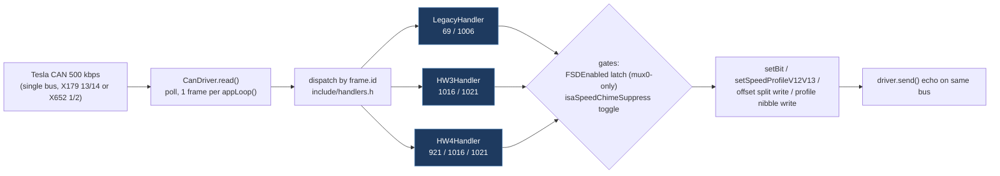
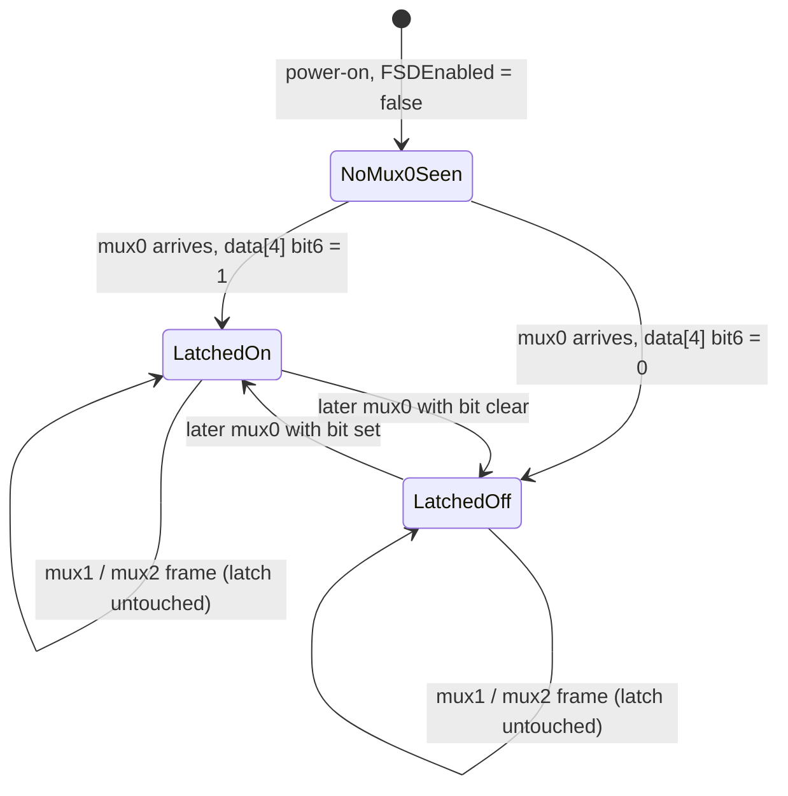

# nicholasyangyang-my-tt

Deep-dive analysis per `.opencode/skills/legacy-repo-deep-dive/SKILL.md` (replace mode). This doc replaces the former summary; pre-replace claims are cited as `git show HEAD:docs/legacy/nicholasyangyang-my-tt.md` (63-line version, still in git history).

## 1. Provenance

- **Submodule path:** `legacy/nicholasyangyang-my-tt`
- **Pinned gitlink:** `160000 980f68dddaa0872a723304ad94aaa7dead4c3530 0` (matches `git -C legacy/nicholasyangyang-my-tt rev-parse HEAD`; `status --porcelain` empty at analysis time)
- **Upstream URL:** https://github.com/nicholasyangyang/my-tt (origin, fetch/push)
- **License:** GPL-3.0 (LICENSE, full text present; header verified lines 1–5, RANGE-CITED for the remainder — standard FSF boilerplate). Bundled library `autowp/arduino-mcp2515` is MIT; README.md:299–320 carries its license text.
- **Analysis date:** 2026-11-21
- **Replace-mode preservation:** YAML frontmatter above preserved byte-for-byte (hex-verified; the description line carries **no** trailing whitespace, so no strip was needed). The pre-replace doc contained **no `## Upstream (...)` sections** — nothing else to preserve.
- **Files read (all FULL-READ, every line, via `git ls-files` inventory including dotfiles):**
    - `RP2040CAN.ino` 1–58 (Arduino entry point)
    - `src/main.cpp` 1–32 (PlatformIO entry point)
    - `include/app.h` 1–46, `include/can_driver.h` 1–10, `include/can_frame_types.h` 1–10, `include/can_helpers.h` 1–27, `include/handlers.h` 1–157
    - `include/drivers/mcp2515_driver.h` 1–39, `mock_driver.h` 1–23, `same51_driver.h` 1–38, `stm32_bxcan_driver.h` 1–81, `twai_driver.h` 1–62
    - `platformio.ini` 1–43, `my_monitor.py` 1–23, `.gitignore` 1–4
    - `test/test_native_helpers/test_helpers.cpp` 1–158, `test/test_native_hw3/test_hw3_handler.cpp` 1–152, `test/test_native_hw4/test_hw4_handler.cpp` 1–253, `test/test_native_legacy/test_legacy_handler.cpp` 1–124
    - `README.md` 1–320, `README2.md` 1–130 (ODrive guide, Chinese)
    - `lib/README` 1–46 and `test/README` 1–11 (PlatformIO boilerplate)
- **Files explicitly NOT read:** `LICENSE` lines 6–553 (GPL boilerplate after verified header).
- **History reviewed:** all 29 local commits' log messages; diffs deep-read for `1c0a89a` (FSDEnabled shadowing fix) and `90303e8` (legacy stalk rework) only.
- **No hidden directories were skipped:** the repo has no dot-directories in `git ls-files` beyond `.gitignore` itself (unlike past audits' `.firmware/` trap).

## 2. Executive verdict

"CanFeather"/my-tt is a minimal, single-bus, event-driven Tesla FSD CAN enabler: it polls one CAN bus, dispatches each frame to a compile-time-selected variant handler (Legacy/HW3/HW4), flips a handful of bits on the FSD mux frame (0x3EE or 0x3FD), the follow-distance frame (0x3F8 or stalk 0x045), and the HW4 ISA chime frame (0x399), and echoes the mutated frame back on the same bus. The mechanisms that matter — bit46/bit19/bit47/bit59/bit60 edits, the v12/v13 profile field, the HW3 offset field, the HW4 5-level profile map, and the additive ISA checksum — are **all already present in TeslaCANModder with byte-identical encodings** (see §11); the only upstream material of real interest is a README-level heuristic (HW4 hardware on FSD v13 should run the HW3-style handler, README.md:48) and two hardware-doc leads (X652 alternate connector, 16 MHz MCP2515 profile). Must not be ported: the always-on `constexpr` EVD mutation, the ungated HW4 mux-2 injection, and any edit-source-to-configure workflow. No capture evidence exists anywhere in this repo; every frame-shape claim below rests on CODE-READ + TEST-READ only.

## 3. Evidence map

No CAPTURE evidence exists in this repo: there are no bus logs, no decoded traces, no fixtures. TEST-READ evidence exists via four native Unity suites (59 assertions total).

| source file | lines | what it proves | grade |
| ----------- | ----- | -------------- | ----- |
| `include/handlers.h` | 13–14 | EVD forced on by `constexpr bool enableEmergencyVehicleDetection = true`; ISA chime default off | CODE-READ |
| `include/handlers.h` | 24–54 | LegacyHandler: 0x045 stalk→profile, 0x3EE mux0 bit46+profile, mux1 bit19 | CODE-READ |
| `include/handlers.h` | 56–104 | HW3Handler: 0x3F8 fd→profile, 0x3FD mux0 bit46+offset-steps, mux2 offset field | CODE-READ |
| `include/handlers.h` | 106–157 | HW4Handler: 0x399 chime, 0x3F8 5-level fd→profile, 0x3FD mux0 bits 46/60/59, mux1 bits 19/47, mux2 profile | CODE-READ |
| `include/can_helpers.h` | 5–16 | mux = data[0]&0x07; FSD UI bit = data[4] bit6; v12/13 profile = data[6] bits[2:1] | CODE-READ |
| `include/app.h` | 24–46 | poll loop: one `read()` per iteration, LED on idle, handler dispatch | CODE-READ |
| `include/drivers/mcp2515_driver.h` | 12–18 | 500 kbps @ MCP_16MHZ crystal, normal mode, no filters configured | CODE-READ |
| `include/drivers/same51_driver.h` | 8–16 | native MCAN 500 kbps, standby/boost pin setup | CODE-READ |
| `include/drivers/stm32_bxcan_driver.h` | 24–52 | bxCAN 500 kbps (42 MHz, prescaler 6, 11TQ/2TQ), accept-all filter, AutoBusOff on | CODE-READ |
| `include/drivers/twai_driver.h` | 11–58 | TWAI 500 kbps, bus-off detect + full reinstall recovery | CODE-READ |
| `include/drivers/mock_driver.h` | 6–23 | test capture vector for `sent` frames | CODE-READ |
| `RP2040CAN.ino` | 21–45 | board+variant selected by editing `#define` lines; **no `DRIVER_TWAI` branch** | CODE-READ |
| `src/main.cpp` | 10–19 | same three-driver `#if` ladder, `#error` on anything else (incl. `-DDRIVER_TWAI`) | CODE-READ |
| `platformio.ini` | 1–43 | 5 envs; `esp32_twai` passes `-DDRIVER_TWAI` that no entry point consumes | CODE-READ |
| `test/test_native_helpers/test_helpers.cpp` | 10–158 | setBit/readMuxID/isFSDSelectedInUI/setSpeedProfileV12V13 byte semantics | TEST-READ |
| `test/test_native_legacy/test_legacy_handler.cpp` | 21–121 | stalk map, 0x3EE mux0/mux1 sends, bit46/profile/bit19 assertions | TEST-READ |
| `test/test_native_hw3/test_hw3_handler.cpp` | 21–149 | fd map, latch regression, mux0/1/2 gates and send counts | TEST-READ |
| `test/test_native_hw4/test_hw4_handler.cpp` | 21–250 | 5-level fd map, bits 46/60/59, bit19+47, mux2 profile, ISA checksum 0xD1 oracle | TEST-READ |
| `README.md` | 38–48, 220–235 | variant table, FSD v13-on-HW4 heuristic, profile table | SUMMARY-ONLY |
| `README2.md` | 1–130 | ODrive/STM32 wiring (SN65HVD232D, ST-Link), Chinese | SUMMARY-ONLY |
| `my_monitor.py` | 1–23 | passive pyserial tee at 115200, `os.system("stty sane")` | CODE-READ |

## 4. Architecture and build surface

- **Entry points:** `RP2040CAN.ino` (Arduino IDE, board+variant chosen by uncommenting `#define` at lines 21–31) and `src/main.cpp` (PlatformIO, same choice via `-D` build flags). Both call `appSetup()`/`appLoop()` in `include/app.h`.
- **Shared core vs platform port:** all vehicle logic lives in `include/handlers.h` behind the 3-method `CanDriver` interface (`init/read/send`, `include/can_driver.h:5–10`); four implementations under `include/drivers/` (MCP2515/SPI, SAME51 MCAN, STM32 bxCAN, ESP32 TWAI) plus `MockDriver` for tests.
- **Build flags:** `DRIVER_MCP2515|DRIVER_SAME51|DRIVER_STM32_BXCAN|DRIVER_TWAI`, `HW4|HW3|LEGACY`, `NATIVE_BUILD` (guards Arduino includes for host tests), `-DPIN_LED=PB2`, `-DHAL_CAN_MODULE_ENABLED`, `-DUSBCON -DUSBD_USE_CDC` (platformio.ini:35–42).
- **Dependency boundaries:** only external lib is `autowp/arduino-mcp2515` (MIT) and `Adafruit CAN`/`CANSAME5x`; STM32 driver uses HAL directly, no library.
- **Single bus, no filters:** every driver accepts all IDs (no MCP2515 filter config, bxCAN accept-all bank, TWAI accept-all); the handler layer is the only filter.



No periodic injection, no jitter, no DAS-state gate, no counter increment: every TX is a mutated echo of a just-received frame, with data[0] low 3 bits (mux) passed through unchanged.

## 5. Mechanism catalogue

### Legacy stalk → speed profile (0x045)

- **Claim (README / summary):** `git show HEAD:docs/legacy/nicholasyangyang-my-tt.md` line 59 — stalk read on 0x045 for profile mapping. CONFIRMED.
- **Code path:** `include/handlers.h:28–33` — `LegacyHandler::handleMessage()` → `frame.data[1] >> 5` → `speedProfile` member → used later by mux0 handler. No TX.
- **Frame spec:** ID 69/0x045, read-only; stalk position = byte 1 bits[7:5]; code comment documents byte-1 raw values 0x00/0x21/0x42/0x64/0x85/0xA6/0xC8 = Pos1..Pos7 (handlers.h:26–27).
- **Gates and timing:** none — every 0x045 frame updates the profile; no DLC check on `data[1]`.
- **State machine:** None found (pure per-frame mapping).
- **Tests:** `test_legacy_stalk_pos0/1_sets_profile_2`, `..._pos2_sets_profile_1`, `..._pos3_sets_profile_0` at `test/test_native_legacy/test_legacy_handler.cpp:21–48`.
- **Evidence grade:** CODE-READ + TEST-READ.
- **Verdict:** CONFIRMED.
- **Adapt to TeslaCANModder?** already present — `firmware/lib/vehicle/can/handler/variant/legacy.h:40–53`, identical `>> 5` map, ours adds `profileOverride` pin and `dlc >= 2` guard.

### Legacy FSD mux (0x3EE)

- **Claim (README / summary):** `git show HEAD:...md` line 60 — mux read, bit 46 set, profile written, bit 19 cleared. CONFIRMED.
- **Code path:** `include/handlers.h:35–52` — `readMuxID()` → mux0: `setBit(frame, 46, true)` + `setSpeedProfileV12V13()` + `driver.send()`; mux1: `setBit(frame, 19, false)` + send.
- **Frame spec:** ID 1006/0x3EE, DLC 8 assumed; mux = data[0] bits[2:0]; FSD-selected UI bit = data[4] bit 6; enable bit 46 (data[5] bit 6); profile = data[6] bits[2:1]; nag bit 19 (data[2] bit 3). No counter increment, no checksum.
- **Gates and timing:** mux0 TX gated on `FSDEnabled` latch; mux1 TX **ungated** (sends on every mux1 frame).
- **State machine:** the FSDEnabled latch (see cross-variant card below).
- **Tests:** `test_legacy_fsd_*`, `test_legacy_nag_suppression_clears_bit19_on_mux1` at `test/test_native_legacy/test_legacy_handler.cpp:52–97`.
- **Evidence grade:** CODE-READ + TEST-READ.
- **Verdict:** CONFIRMED.
- **Adapt to TeslaCANModder?** already present — `legacy.h:56–83`; ours adds AP-injection gate, `fsdEnabled`/`fsdForce` state and offset-steps profile tracking.

### HW3 FSD mux + follow distance (0x3F8, 0x3FD)

- **Claim (README / summary):** `git show HEAD:...md` line 65 — bit 46, bit 19, offset in mux 2. CONFIRMED with omissions (mux0 also writes profile; mux1 also always sends).
- **Code path:** `include/handlers.h:60–96` — fd read `(data[5] & 0xE0) >> 5` → profile {1→2, 2→1, 3→0}; mux0: offset-steps read `(data[3] >> 1) & 0x3F) - 30` → profile map {2→2, 1→1, 0→0} and `speedOffset = clamp(steps*5, 0, 100)`; `setBit(46)` + `setSpeedProfileV12V13` + send; mux1: bit19 clear + send; mux2: offset split write `data[0] bits[7:6] = off&0x03`, `data[1] bits[5:0] = off>>2` + send.
- **Frame spec:** 0x3F8 byte5 bits[7:5] fd (read-only); 0x3FD mux data[0] bits[2:0]; offset field data[3] bits[6:1] biased −30; profile data[6] bits[2:1]; bits 46, 19 as above. No counter/checksum handling.
- **Gates and timing:** mux0 gated on latch; mux1 ungated; mux2 gated on latch (handlers.h:90).
- **State machine:** latch + `speedOffset` member updated on every gated mux0.
- **Tests:** 11 tests incl. latch regression pair at `test/test_native_hw3/test_hw3_handler.cpp:21–131`.
- **Evidence grade:** CODE-READ + TEST-READ.
- **Verdict:** CONFIRMED.
- **Adapt to TeslaCANModder?** already present — `hw3.h:65–155`, `feature/fsd/profile.h:43–47`, `feature/fsd/offsets.h:17–50`; encodings byte-identical.

### HW4 FSD mux + follow distance + EVD (0x3F8, 0x3FD)

- **Claim (README / summary):** `git show HEAD:...md` line 71 — bit 46, EVD bit 59, bits 19+47, profile in mux2 byte 7 bits[6:4]. CONFIRMED; doc omitted bit 60.
- **Code path:** `include/handlers.h:110–157` — fd map {1→3, 2→2, 3→1, 4→0, 5→4}; mux0: `setBit(46)`, `setBit(60)`, `setBit(59)` (EVD, always — constexpr true); mux1: bit19 clear + bit47 set; mux2: `data[7] = (data[7] & ~0x70) | (profile & 0x07) << 4`.
- **Frame spec:** 0x3FD as HW3 plus bit 60 (data[7] bit 4), bit 59 (data[7] bit 3), bit 47 (data[5] bit 7), HW4 profile = data[7] bits[6:4] (3-bit, values 0–4).
- **Gates and timing:** mux0 gated on latch; mux1 ungated; **mux2 ungated** — profile injected even when FSD was never selected in the UI.
- **State machine:** latch only.
- **Tests:** 20 tests at `test/test_native_hw4/test_hw4_handler.cpp:21–250`, incl. `test_hw4_fsd_mux0_sets_bits_46_and_60`, `..._sets_emergency_bit59`.
- **Evidence grade:** CODE-READ + TEST-READ.
- **Verdict:** CONFIRMED.
- **Adapt to TeslaCANModder?** already present — `hw4.h:65–169`; ours additionally sets bits 38/39 and gates bit 59 behind the `evd:on` command (default false, `firmware/lib/core/types.h:780`), which is strictly safer than upstream's always-on constexpr.

### HW4 ISA speed chime suppression (0x399)

- **Claim (README / summary):** `git show HEAD:...md` line 69/83 — suppression with checksum recalculation. CONFIRMED.
- **Code path:** `include/handlers.h:110–118` — `data[1] |= 0x20`; `sum = Σ data[0..6] + (921 & 0xFF) + (921 >> 8)`; `data[7] = sum & 0xFF`; send; early `return`.
- **Frame spec:** ID 921/0x399, data[1] bit 5 = suppress flag, data[7] = additive checksum (ID bytes 0x99+0x03 included).
- **Gates and timing:** opt-in only — `isaSpeedChimeSuppress` defaults false (handlers.h:14,107); no DLC guard; incoming frame not validated before rewrite.
- **State machine:** None found (toggle + echo).
- **Tests:** `test_hw4_isa_suppress_*` at `test/test_native_hw4/test_hw4_handler.cpp:172–220`, incl. an independent checksum oracle (`0x10`,`0x05` input → `0xD1` expected at line 196–212).
- **Evidence grade:** CODE-READ + TEST-READ.
- **Verdict:** CONFIRMED.
- **Adapt to TeslaCANModder?** already present — `hw4.h:70–81` + `checksum.h:47–56` `computeHW4IsaChecksum()` (identical formula), plus DLC≥8 guard and `isa-chime:on` command.

### FSDEnabled latch (cross-variant gating mechanism)

- **Claim (README / summary):** not documented pre-replace; README.md:58 only says "FSD enable bit is set when Traffic Light and Stop Sign Control is enabled".
- **Code path:** `include/handlers.h:37,72,131` — `if (index == 0) FSDEnabled = isFSDSelectedInUI(frame);` in all three handlers; latch consumed at handlers.h:38,73–74,90,132.
- **Frame spec:** n/a — pure internal state keyed off mux0 data[4] bit 6.
- **Gates and timing:** latch updated **only on mux0**; mux1/mux2 frames never touch it. Pre-fix history: commit `1c0a89a` shows the old code declared `auto FSDEnabled = isFSDSelectedInUI(frame);` on **every** 0x3FD frame, shadowing the member — a mux2 frame with data[4] bit6 clear silently disabled the offset injection for that frame. Tests `test_hw3_fsd_enabled_only_set_on_mux0` / `test_hw4_fsd_enabled_only_set_on_mux0` are the regression guards.
- **State machine:**



- **Tests:** `test_hw3_fsd_enabled_only_set_on_mux0` (test_hw3_handler.cpp:52–68), `test_hw3_fsd_disabled_on_mux0_prevents_mux2_send` (:70–84), HW4 equivalents (test_hw4_handler.cpp:58–72).
- **Evidence grade:** CODE-READ + TEST-READ.
- **Verdict:** CONFIRMED (bug history verified from `git show 1c0a89a`).
- **Adapt to TeslaCANModder?** no impact — our handlers re-evaluate `isFSDSelectedInUI(f)` per frame and never latch (`hw3.h:120–121`, `hw4.h:134`), so the shadowing bug class is structurally impossible on our side; the latch-freshness regression idea is already covered by our `firmware/test/test_native_variant_gating/`.

## 6. Summary vs code contradiction table

| # | claim | cited from | code reality | verdict |
| - | ----- | ---------- | ------------ | ------- |
| 1 | ESP32 TWAI presented as a supported platform ("Platform: … ESP32 (TWAI)" line 36; mermaid `HW -->|ESP32| TWAI` line 25) | `git show HEAD:docs/legacy/nicholasyangyang-my-tt.md` lines 25, 36, 38 | `RP2040CAN.ino:35–45` and `src/main.cpp:10–19` have no `DRIVER_TWAI` branch — both hit `#error`; the `esp32_twai` env (platformio.ini:22–26) cannot compile. Driver file exists but is unreachable from any shipped entry point. | CONTRADICTED |
| 2 | Frontmatter description reads "…multiple hardware platforms (Adafruit Feather RP2040" — truncated mid-parenthesis, omits M4 CAN Express and ODrive/STM32 | `git show HEAD:docs/legacy/nicholasyangyang-my-tt.md` line 3 (preserved frontmatter, kept byte-for-byte per replace rules) | Repo actually ships MCP2515 + SAME51 + bxCAN + TWAI drivers (4 platforms). Staleness recorded here rather than edited into frontmatter. | STALE-BY-PRESERVATION |
| 3 | "ASS (Actually Smart Summon) is no longer restricted by EU regulations" presented as firmware function | `README.md:19` | No handler touches any summon/ASS frame; the only EU-flavored mutation is unnamed bit 47 on 0x3FD mux1 (handlers.h:142). README never connects ASS to bit 47. | CONTRADICTED as an implemented feature; the bit47↔ASS link is UNVERIFIED |

Pre-replace claims verified as accurate (recorded in §3/§5 rather than here): CAN ID tables (69/1006/1016/1021/921), bit positions, stalk byte-1 read, HW4 5-level profile, ISA checksum recalculation, GPL-3.0 license, file-list descriptions.

## 7. CAN frame and signal inventory

No DBC/JSON catalog is vendored; all five frames are code-referenced.

| ID (hex+dec) | bus | period | DLC | byte/bit layout | scale/units | counter | checksum | R/W | grade |
| ----------- | --- | ------ | --- | -------------- | ----------- | ------- | -------- | --- | ----- |
| 0x045 (69) STW_ACTN_RQ | single bus | not stated | assumed ≥2 | stalk pos = data[1] bits[7:5] | positions 0–6 | none handled | none | R only | CODE-READ |
| 0x3EE (1006) DAS mux | single bus | not stated (echo of RX) | 8 assumed | mux data[0][2:0]; UI-FSD data[4][6]; enable bit46=data[5][6]; profile data[6][2:1]; nag bit19=data[2][3] | profile 0–2 | mux passthrough only | none | R + mutated-TX | CODE-READ |
| 0x3F8 (1016) follow distance | single bus | not stated | ≥6 | fd = data[5] bits[7:5] | fd 1–3 (HW3), 1–5 (HW4) | none | none | R only | CODE-READ |
| 0x3FD (1021) FSD mux | single bus | not stated (echo of RX) | 8 assumed | mux data[0][2:0]; UI-FSD data[4][6]; bit46 data[5][6]; bit47 data[5][7]; bit19 data[2][3]; bit59 data[7][3]; bit60 data[7][4]; HW3 offset data[3][6:1] (−30 bias) and mux2 split data[0][7:6]+data[1][5:0]; HW4 profile data[7][6:4] | offset km/h steps×5 clamp 0–100; profile 0–4 | mux passthrough only | none | R + mutated-TX | CODE-READ |
| 0x399 (921) ISA speed alert | single bus | not stated (echo of RX) | 8 | suppress flag data[1] bit5 | boolean | none | data[7] = (Σ data[0..6] + 0x99 + 0x03) & 0xFF | R + mutated-TX | CODE-READ |

## 8. Constants and tuning table

| constant | value | file:line | meaning | grade |
| -------- | ----- | --------- | ------- | ----- |
| `enableEmergencyVehicleDetection` | `true` (constexpr) | include/handlers.h:13 | forces bit 59 on every HW4 mux0 echo | CODE-READ |
| `DEFAULT_ISA_SPEED_CHIME_SUPPRESS` | `false` | include/handlers.h:14 | ISA chime suppression is opt-in | CODE-READ |
| `speedProfile` default | 1 | include/handlers.h:17 | boot profile before any stalk/fd frame | CODE-READ |
| mux mask | 0x07 | include/can_helpers.h:6 | data[0] bits[2:0] mux | CODE-READ |
| FSD UI bit | data[4]>>6 | include/can_helpers.h:10 | "Traffic Light & Stop Sign Control" proxy | CODE-READ |
| v12/v13 profile field | data[6] bits[2:1] | include/can_helpers.h:14–15 | Legacy/HW3 profile write | CODE-READ |
| HW3 fd→profile | 1→2, 2→1, 3→0 | include/handlers.h:62–67 | follow-distance mapping | CODE-READ |
| HW4 fd→profile | 1→3, 2→2, 3→1, 4→0, 5→4 | include/handlers.h:121–126 | 5-level mapping incl. "Sloth"=4 | CODE-READ |
| legacy stalk→profile | ≤1→2, 2→1, else→0 | include/handlers.h:29–32 | 0x045 mapping | CODE-READ |
| HW3 offset bias | −30 on 6-bit field | include/handlers.h:74–75 | centers UI offset at zero | CODE-READ |
| HW3 offset scale | steps×5, clamp [0,100] | include/handlers.h:74 | km/h offset value | CODE-READ |
| HW3 mux2 split | data[0][7:6]=off&0x03, data[1][5:0]=off>>2 | include/handlers.h:91–94 | 8-bit offset across two bytes | CODE-READ |
| HW4 profile field | data[7] bits[6:4], 3-bit | include/handlers.h:146–147 | mux2 profile write | CODE-READ |
| ISA suppress mask | 0x20 on data[1] | include/handlers.h:111 | chime suppress flag | CODE-READ |
| ISA checksum ID contribution | (921&0xFF)+(921>>8) = 0x99+0x03 | include/handlers.h:114 | additive checksum includes both ID bytes | CODE-READ |
| MCP2515 clock | CAN_500KBPS @ MCP_16MHZ | include/drivers/mcp2515_driver.h:14 | 16 MHz crystal assumption (ours: 8 MHz hardware + `canclock:auto`) | CODE-READ |
| bxCAN timing | 42 MHz APB1, prescaler 6, BS1 11TQ, BS2 2TQ | include/drivers/stm32_bxcan_driver.h:5,25–29 | 500 kbps on ODrive STM32F405 | CODE-READ |
| TWAI queues / tx timeout | rx 32, tx 16, 10 ms | include/drivers/twai_driver.h:13–14,42 | only queue-depth tuning in repo | CODE-READ |

## 9. Failure modes and edge cases

| failure | handling code path | tested? | grade |
| ------- | ------------------ | ------- | ----- |
| TWAI bus-off | `isBusOff()` → `recover()` = stop + uninstall + full re-`init()` inline in the read/send path (twai_driver.h:47–58) | no | CODE-READ |
| bxCAN bus-off | hardware auto-recovery via `AutoBusOff = ENABLE` (stm32_bxcan_driver.h:31) | no | CODE-READ |
| MCP2515 / SAME51 bus-off | None found — no error-state read, no CANINTF inspection | no | CODE-READ |
| CAN init failure | prints "CAN init failed" and continues inert (app.h:32–34); no retry, no LED signal | no | CODE-READ |
| Frame loss under load | single-frame polling per `appLoop()` (app.h:38–46); MCP2515 has only 2 RX buffers; no overflow flag checked anywhere | no | CODE-READ |
| Self-echo amplification | avoided only by hardware: all drivers run normal (non-loopback) mode (mcp2515_driver.h:16, stm32_bxcan_driver.h:26, twai_driver.h:12) so own TX is not re-received | no | CODE-READ |
| Short-frame reads | LegacyHandler reads `data[1]` with no DLC check (handlers.h:29); MCP2515 driver memcpy's 8 bytes regardless of `can_dlc` (mcp2515_driver.h:25) | no | CODE-READ |
| Print-storm stall | `enablePrint` defaults **true** (handlers.h:19) → blocking 115200 `Serial.printf` on every gated mux0 (handlers.h:48–51,98–100,151–153) can throttle the poll loop on a live bus | no | CODE-READ |
| Stale latch | `FSDEnabled` never times out — persists across drive sessions until the next mux0 contradicts it | no (latch behavior tested, staleness not) | CODE-READ |
| Watchdog / OTA / brownout | None found — no WDT feed, no OTA detection, no reboot-state handling anywhere in the tree | no | CODE-READ (negative anchors in §16) |

## 10. Test coverage map

- `test/test_native_helpers/test_helpers.cpp` (18 tests): setBit bit/index math incl. bits 0/7/8/19/46/60, readMuxID masking, FSD-UI bit isolation, v12/v13 profile field clear/set/preserve.
- `test/test_native_legacy/test_legacy_handler.cpp` (10 tests): stalk map 4 positions, mux0 send/no-send on UI bit, bit46 set, profile written to data[6], mux1 bit19 cleared, unrelated ID ignored.
- `test/test_native_hw3/test_hw3_handler.cpp` (11 tests): fd map 1/2/3 + default, **latch regression pair** (mux2 still sends when latch on; mux2 blocked when mux0 saw FSD off), mux0 bit46, mux1 bit19, unrelated ID, exact send counts.
- `test/test_native_hw4/test_hw4_handler.cpp` (20 tests): 5-level fd map, latch regression, mux0 bits 46+60+59, no-send when UI off, mux1 bits 19 cleared + 47 set, mux2 profile inject + old-bits clear, ISA disabled-ignores / bit5 set / bit-preserve / **independent checksum oracle 0xD1** / early-return ordering.
- **Critical paths with NO test:** the entire driver layer (all 4 real drivers, incl. bus-off recovery and bxCAN filter setup), `app.h` loop wiring, Serial print branches, DLC handling (mock always carries DLC 8), and any multi-frame ordering beyond the mux pairs. One-line risk: a driver regression or a short-frame crash would ship green because tests only exercise handlers behind `MockDriver`.

## 11. Parity matrix with TeslaCANModder

All our-side citations are CODE-READ from the shipping tree.

| signal/frame | upstream decode (cite) | our decode (cite) | delta | action |
| ------------ | ---------------------- | ---------------- | ----- | ------ |
| 0x045 stalk→profile | handlers.h:28–33, `data[1]>>5`, {≤1→2, 2→1, else 0} | `firmware/lib/vehicle/can/handler/variant/legacy.h:40–53` — identical map + `profileOverride` pin + DLC≥2 guard | ours adds pin/lock and DLC safety | already present |
| 0x3EE mux0 FSD+profile | handlers.h:35–42, bit46 + data[6][2:1], latch-gated | `legacy.h:56–73` — adds AP gate, `fsdEnabled`, `fsdForce`, offset-steps profile | ours superset | already present |
| 0x3EE mux1 nag | handlers.h:43–46, bit19 cleared, ungated | `legacy.h:75–82` — bit19 via `nagModeUsesBit19(s.nagMode)` + AP gate | ours gates by mode | already present |
| 0x3F8 fd read | handlers.h:61,120, byte5 bits[7:5] | `firmware/lib/vehicle/can/ids.h:106–108` `readFollowDistance()` | byte-identical | align (none needed) |
| HW3 fd→profile | handlers.h:62–67, {1→2,2→1,3→0} | `firmware/lib/vehicle/can/feature/fsd/profile.h:43–47` `mapHW3FollowDistToProfile()` map {-1,2,1,0} | identical | already present |
| HW4 fd→profile | handlers.h:121–127, {1→3,2→2,3→1,4→0,5→4} | `profile.h:54–58` `mapHW4FollowDistToProfile()` map {-1,3,2,1,0,4} | identical | already present |
| 0x3FD mux0 HW3 | handlers.h:73–85, bit46 + profile + steps→offset | `firmware/lib/vehicle/can/handler/variant/hw3.h:123–137` — adds bits 38/39 (`FSD_BIT_AP_ACTIVE`, `FSD_BIT_CONTINUE_ON_GREEN`), offset auto-track | ours superset | already present |
| 0x3FD mux0 HW4 | handlers.h:132–138, bits 46/60 + bit59 always-on | `hw4.h:136–147` — bits 38/39/46/60 + bit59 only when `evdEnabled` (default false, `firmware/lib/core/types.h:780`) | upstream mutates unconditionally; ours command-gated | ignore (ours safer) |
| 0x3FD mux1 nag | HW3: handlers.h:86–89 bit19 only; HW4: handlers.h:140–144 bit19+bit47 | `hw3.h:40–53` / `hw4.h:40–53` — bit19+bit47 on both variants + optional EAP/laneGraph/ECE-R79 | upstream HW3 lacks bit47; ours sets it | already present (ours superset) |
| 0x3FD mux2 HW3 offset | handlers.h:90–96, split write, latch-gated | `hw3.h:147–152` + `firmware/lib/vehicle/can/feature/fsd/offsets.h:17–24` `writeHW3SpeedOffset()` — identical split | identical bytes | already present |
| 0x3FD mux2 HW4 profile | handlers.h:145–148, data[7][6:4], **ungated** | `hw4.h:157–166` + `profile.h:30–36` `writeHW4SpeedProfile()` — same field, gated on `fsdEnabled`+AP gate, plus HW4 offset byte-1 write | upstream injects profile even with FSD off; ours gates | already present; keep our gating |
| 0x399 ISA chime | handlers.h:110–118, `data[1]|=0x20`, sum incl. ID bytes → data[7], toggle default off | `hw4.h:70–81` + `firmware/lib/vehicle/can/checksum.h:47–56` `computeHW4IsaChecksum()` — identical formula + DLC≥8 guard + `isa-chime:on` command | identical | already present |

Our side also carries handler tests mirroring upstream's (`firmware/test/test_native_hw4/test_hw4.cpp:159` `test_hw4_fsd_mux0_sets_bits_46_and_60`; ISA tests at lines 54–93), so the parity rows are TEST-READ-backed on both sides.

## 12. Surface inventory and security notes

- **Serial debug (only surface):** 115200 print of handler state per gated mux0 frame (app.h:27; handlers.h:48–51, 98–100, 151–153), gated by `#ifndef NATIVE_BUILD`; `enablePrint` is a code-edit toggle (handlers.h:19), set false by test fixtures. **No runtime command parser, no WiFi/BLE/web endpoints — nothing is configurable over any transport.**
- **Provenance/security findings:** no hardcoded credentials, keys, or certs anywhere; `my_monitor.py:22` shells out to `os.system("stty sane")` (local, trusted, still a pattern to avoid); `.gitignore` is tool-dir boilerplate; README2.md wiring targets a bench ODrive, not a vehicle harness; no untrusted archives; no dangerous build flags (`__attribute__((optimize("O3")))` on `loop()` at RP2040CAN.ino:58 is perf-only). License hygiene is good: GPL-3.0 file present plus the MIT notice for the vendored-by-dependency MCP2515 lib (README.md:299–320).

## 13. Adaptation assessment

| mechanism | value | cost | risk | evidence | decision |
| --------- | ----- | ---- | ---- | -------- | -------- |
| Legacy stalk→profile | none new — identical to ours | 0 | 0 | CODE-READ+TEST-READ both sides | already present |
| Legacy 0x3EE mux | none new | 0 | 0 | CODE-READ both sides | already present |
| HW3 fd→profile + mux0/mux2 | none new — byte-identical | 0 | 0 | CODE-READ both sides | already present |
| HW4 fd→profile + mux0/mux2 | none new; upstream mux2 ungated is worse practice | 0 | 0 | CODE-READ both sides | already present; never adopt ungated mux2 |
| HW4 EVD bit59 | always-on constexpr — anti-pattern | low | high (unconditional mutation) | CODE-READ | never port (ours command-gated) |
| HW4 ISA chime + checksum | none new — identical formula, ours has DLC guard | 0 | 0 | CODE-READ+TEST-READ both sides | already present |
| FSDEnabled latch | historical bug lesson only | 0 | 0 | CODE-READ (git show 1c0a89a) | no impact (our handlers are stateless per frame) |
| FSD v13-on-HW4 heuristic (README.md:48: HW4 hardware running FSD v13 should use the HW3 handler) | potentially valuable for `variant:auto` — we already decode `fsdProto` V12/V13/V14 in the platform resolver | low | medium — needs on-vehicle capture to validate | SUMMARY-ONLY | candidate for future PR (capture-first) |
| X652 alternate connector for pre-2020 Model 3 (README.md:211) | doc-level: our guides only document X179 | trivial | low | SUMMARY-ONLY | candidate (docs note) |
| TWAI / bxCAN / SAME51 drivers, 16 MHz MCP profile, my_monitor.py | different MCU families / clock hardware than ours | — | — | CODE-READ | no impact |

## 14. Do-not-copy list

- `include/handlers.h:13` + 135–137 — always-on `constexpr` frame mutation (EVD); never adopt unconditional bit59 writes.
- `include/drivers/twai_driver.h:54–58` — `recover()` calls full `init()` inline from the read/send path (blocking, non-reentrant); if we ever need bus-off recovery ideas, use our health module pattern instead.
- `include/handlers.h:29` — DLC-unchecked `data[1]` read; our side guards with `f.dlc >= 2` (legacy.h:43).
- `include/drivers/mcp2515_driver.h:25` — `memcpy(frame.data, raw.data, 8)` ignoring `can_dlc`; masks short frames instead of rejecting them.
- `include/handlers.h:74–75` — duplicated offset expression (field read computed twice, once clamped once raw); low-quality pattern, we already have clean `readHW3UiOffsetSteps`/`calculateHW3SpeedOffset`.
- `RP2040CAN.ino:21–31` — edit-source-to-configure board/variant selection; everything on our side must stay runtime-configurable over serial/BLE/WiFi.
- `my_monitor.py:22` — `os.system("stty sane")`; shell-out pattern.

## 15. History and evolution

Mined from the submodule's local `git log` (29 commits, 2026-03-28 → 2026-03-31; pinned HEAD is `980f68d`):

- `60d0e61` (03-28) initial commit; `d620b1c` "licence" then `eef98dd` "add GNU General Public License v3.0" (license landed on day 2).
- `01ba780` HW4Handler refactor; `3bfb430` renamed `canFeather.ino` → `RP2040CAN.ino` to prepare multi-board support.
- `8df284a` README rewrite claiming ASS EU-restriction removal — docs-only, no matching code (see §6 row 3).
- `90303e8` (03-30) **legacy rework**: before this commit `LegacyHandler` derived the profile from the 1006-mux0 offset field exactly like HW3; after it, legacy uses the 0x045 stalk and latches `FSDEnabled` on mux0 (verified via `git show 90303e8`).
- `8eae8b7` ISA chime suppression added — deliberately **opt-in** (`DEFAULT_ISA_SPEED_CHIME_SUPPRESS = false`), comment warns the speed-limit sign renders empty while suppressed (handlers.h:107).
- `1c0a89a` **FSDEnabled shadowing fix**: `auto FSDEnabled = isFSDSelectedInUI(frame);` declared a local on *every* 0x3FD frame, shadowing the member; any mux2 frame with data[4] bit6 clear silently dropped the offset injection for that frame. Fix: update the member only on mux0 (verified via `git show 1c0a89a`).
- `500def0` (03-30) big refactor: PlatformIO, `CanDriver` abstraction, unit tests (the four native suites + latch regression tests), SAME51 M4 port — handlers moved out of the .ino into `include/`.
- `068b3f1` TWAI driver with bus-off recovery added — but never wired into an entry point (dead env, §6 row 1).
- `980f68d` (03-31, pinned HEAD) STM32F405 bxCAN driver + tooling (README2.md, my_monitor.py, `odrive_v3` env).
- `d1777d7` "Fixes: #12" and `8df284a`'s issue references are network-only claims — UNVERIFIED, no issue text exists locally.

## 16. Re-verification recipe

```bash
OLD=980f68dddaa0872a723304ad94aaa7dead4c3530
git -C legacy/nicholasyangyang-my-tt fetch --tags --prune
git -C legacy/nicholasyangyang-my-tt log --oneline $OLD..origin/main
git -C legacy/nicholasyangyang-my-tt diff --stat $OLD..origin/main
git -C legacy/nicholasyangyang-my-tt diff $OLD..origin/main -- include/ src/ test/
git ls-files -s legacy/nicholasyangyang-my-tt   # expect: 160000 980f68dddaa0872a723304ad94aaa7dead4c3530 0
```

Upstream anchors (run from `legacy/nicholasyangyang-my-tt/`, all demonstrated at write time):

```text
grep -nE 'setBit\(frame, 46' include/handlers.h
  -> expect 3 hits: lines 39 (legacy), 82 (hw3), 133 (hw4)
grep -nE 'frame.id == 921' include/handlers.h
  -> expect line 110
grep -nE 'speedProfile = 4' include/handlers.h
  -> expect line 126 (HW4 "Sloth" level)
grep -nE 'enableEmergencyVehicleDetection' include/handlers.h
  -> expect lines 13 (constexpr true) and 135 (mux0 use)
grep -nE 'MCP_16MHZ' include/drivers/mcp2515_driver.h
  -> expect line 14
grep -nE 'frame.data\[1\] >> 5' include/handlers.h
  -> expect line 29 (legacy stalk read)
```

Negative anchors (absence claims, demonstrated — no output at write time):

```text
grep -nE 'DRIVER_TWAI' src/main.cpp RP2040CAN.ino -> no output (TWAI env is unwired)
grep -nE 'CRC|crc' include/ src/               -> no output (no CRC handling anywhere)
grep -nE 'watchdog|WDT|wdt' include/ src/ RP2040CAN.ino -> no output (no watchdog)
```

Our-side drift anchors (from repo root, for the "already present" decisions — demonstrated):

```text
grep -nE 'mapHW4FollowDistToProfile' firmware/lib/vehicle/can/feature/fsd/profile.h
  -> expect line 54 (definition); also firmware/lib/vehicle/can/handler/variant/hw4.h:88 (call)
grep -nE 'computeHW4IsaChecksum' firmware/lib/vehicle/can/checksum.h
  -> expect line 47 (definition); also hw4.h:75 (call)
grep -nE 'NAG_BIT_HANDS_ON_REQUIREMENT' firmware/lib/vehicle/can/handler/variant/bits.h
  -> expect line 42 (value 19)
grep -nE 'FSD_BIT_EVD' firmware/lib/vehicle/can/handler/variant/bits.h firmware/lib/vehicle/can/handler/variant/hw4.h
  -> expect bits.h:22 (value 59) and hw4.h:144 (gated set)
grep -nE 'f.data\[1\] >> 5' firmware/lib/vehicle/can/handler/variant/legacy.h
  -> expect line 45 (stalk read)
grep -nE 'evdEnabled\(false\)' firmware/lib/core/types.h
  -> expect line 780 (default-off constructor init)
```

If line numbers drift by more than ~10 after an upstream bump, re-read the whole function; do not trust this document's numbers.

## 17. Open questions and explicitly not investigated

- **Pre-pin upstream history:** all 29 ancestor commits' log messages were reviewed, but only two ancestor diffs (`1c0a89a`, `90303e8`) were deep-read; the remaining diffs were not inspected line-by-line.
- **UNVERIFIED — bit47 ↔ ASS link:** README.md:19 claims ASS EU-restriction removal; the plausible carrier is bit47 on 0x3FD mux1 (handlers.h:142), but no code comment or capture ties them together. A bench capture comparing ASS behavior with bit47 forced would settle it.
- **UNVERIFIED — board status claims:** README.md:67 marks the RP2040 build "Tested" and M4 "Compiles, needs on-vehicle testing"; the repo contains no captures or hardware logs supporting either.
- **UNVERIFIED — esp32_twai build failure:** concluded from CODE-READ of the `#if` ladders (both entry points `#error` without a TWAI branch), not from running a compile; a `pio run -e esp32_twai` would demonstrate it directly.
- **UNVERIFIED — mux-as-counter semantics:** upstream (and our shipping code) echo 0x3FD/0x3EE with data[0] bits[2:0] unchanged and never increment a counter; whether receivers accept same-counter re-transmission on the real bus is untested here — needs a listen-only bench capture.
- **UNVERIFIED — FSD v13-on-HW4 heuristic (README.md:48):** no code enforces it (the user just compiles `-DHW3`); would need on-vehicle capture against our `fsdProto` resolver before any adaptation PR.
- **Not investigated:** `LICENSE` lines 6–553 (boilerplate), the contents of the `autowp/arduino-mcp2515` and `Adafruit CAN` dependencies (not vendored), and any network resources (issues #12 etc. — referenced only in commit messages, no local text).
