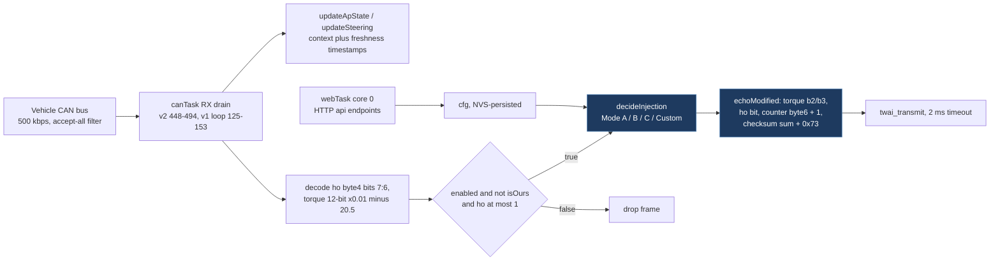
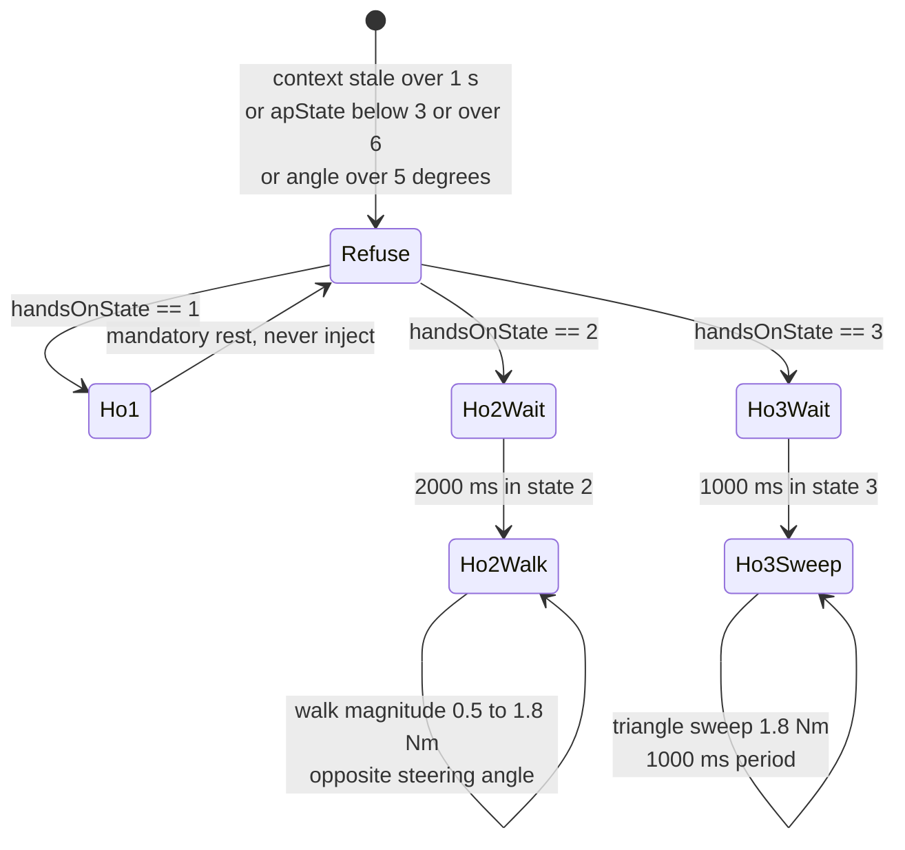

# nicolozak-nag-killer

Deep-dive analysis, replace mode. The YAML frontmatter above is preserved byte-for-byte from the pre-replace summary (including its truncated `description` line — see the contradiction table, row 6). The pre-replace summary contained no `## Upstream (...)` sections, so there are none to re-append; that absence is recorded here per the legacy-repo-deep-dive contract. The old summary remains retrievable via `git show HEAD:docs/legacy/nicolozak-nag-killer.md` and is cited as `HEAD:docs/legacy/nicolozak-nag-killer.md#L<n>` throughout.

## 1. Provenance

| Item | Value |
| --- | --- |
| Submodule path | `legacy/nicolozak-nag-killer` |
| Pinned gitlink | `160000 c71c69325d19ddd14f6c0f3f3bfde771c5f0e536 0` (from `git ls-files -s legacy/nicolozak-nag-killer`) |
| Submodule HEAD | `c71c69325d19ddd14f6c0f3f3bfde771c5f0e536` — matches gitlink; `git status --porcelain` clean |
| Upstream URL | `https://gitlab.com/nicolozak/nag-killer` (GitLab-hosted; remote verified via `git remote -v`) |
| Pinned commit | `c71c693 v2: fix Mode B (burst/pause), add Mode C (state machine), context tracking` (2026-04-30, author BatteryPlug) |
| License | GPL-3.0 — claimed in all three READMEs; **no LICENSE file exists in the tree** (`git grep -nE 'LICENSE'` in the submodule returns nothing) |
| Analysis date | 2026-11-20 |
| Upstream history before pin | Fully reviewed: the submodule has exactly 3 commits, the pinned SHA is the newest, so the entire local history was examined (section 15) |

Upstream files read — FULL-READ, complete inventory (6 of 6 tracked files; `git ls-files` shows no hidden or platform directories, no dot-dirs, no vendored DBC/JSON catalogs):

| File | Lines | Coverage |
| --- | --- | --- |
| `README.md` | 1-48 | FULL-READ |
| `v1_simple/README.md` | 1-74 | FULL-READ |
| `v1_simple/v1_simple.ino` | 1-208 | FULL-READ |
| `v2_dashboard/README.md` | 1-123 | FULL-READ |
| `v2_dashboard/v2_dashboard.ino` | 1-653 | FULL-READ |
| `v2_dashboard/index_html.ino` | 1-316 | FULL-READ |

Upstream files explicitly NOT read: none — the tree contains nothing else. Evidence-grade statements that apply repo-wide: **No TEST-READ evidence exists: this repo ships no tests.** **No CAPTURE evidence exists in this repo** — no sniff logs, no recorded frames; the "TSL6P sniff log" and "@Linu guide" are referenced but not vendored.

Our-side files read for parity (RANGE-CITED unless noted):

| File | Lines | Coverage |
| --- | --- | --- |
| `firmware/lib/vehicle/can/feature/fsd/nag.h` | 1-524 | FULL-READ |
| `firmware/lib/vehicle/can/feature/fsd/nag/math.h` | 1-52 | FULL-READ |
| `firmware/lib/vehicle/can/checksum.h` | 1-75 | FULL-READ |
| `firmware/lib/core/types.h` | 185-314, 497-498, 830-843 | RANGE-CITED |
| `firmware/lib/vehicle/can/handler/bus/vehicle.h` | 100-149, 290-399 | RANGE-CITED |
| `firmware/lib/vehicle/can/handler/frame_readers.h` | 1-67 | RANGE-CITED |
| `firmware/lib/vehicle/can/feature/telemetry/powertrain.h` | 52-71 | RANGE-CITED |
| `firmware/lib/vehicle/can/ids.h` | single lines via grep anchors | RANGE-CITED |
| `firmware/test/test_native_nag_organic/test_nag_organic.cpp` | 330-459 plus grep coverage of gates | RANGE-CITED |

Pre-replace doc read in full from HEAD (working tree was identical to HEAD at analysis start: `git diff HEAD --stat -- docs/legacy/nicolozak-nag-killer.md` returned nothing).

## 2. Executive verdict

A single-purpose ESP32 (LILYGO T-CAN485, TWAI + SN65HVD230) nag-killer: it listens to the Tesla EPAS status frame 0x370 and immediately re-transmits a modified copy with the rolling counter incremented, betting that the receiving ECU deduplicates on counter and will therefore drop the next genuine frame. Two builds: `v1_simple` (fixed +1.80 Nm / handsOn=1 echo) and `v2_dashboard` (WiFi AP + web UI, three injection modes: A = v1, B = TSL6P-style burst/pause on 0x052, C = a @Linu-derived hands-on state machine). The mechanisms that matter for us: the counter-collision echo core (already present in our nag pipeline, with a cleaner frame-mutation layer), Mode C's context-freshness refusal gate (a real gap on our side — our `dasSeen` latches true forever), Mode C's ±5° steering gate, and the pinned ±1.80 Nm community safety cap that our organic mode deliberately exceeds (2.1 Nm peak, ~3.0 Nm grip excursions). Candidates for a future PR: the freshness gate, a universal real-hands guard, and a torque-ceiling audit. Must not be ported: the open WiFi AP with an unauthenticated HTTP config surface, and Mode B's 0x052 echo, which hardcodes 0x370's checksum addend. All vehicle-behavior claims ("proven on MY 2022 HW3", "TSL6P rest periods evade detection") are SUMMARY-ONLY — no captures ship with the repo.

## 3. Evidence map

| Source file | Lines | What it proves | Grade |
| --- | --- | --- | --- |
| `v1_simple/v1_simple.ino` | 83-122 | Echo construction: byte3=0xB6, data[4] |= 0x40, counter byte6 lo-nibble +1, checksum `sum(data[0..6]) + 0x73` | CODE-READ |
| `v1_simple/v1_simple.ino` | 92 | v1 copies `data[2]` unchanged — the echoed 12-bit torque depends on the incoming frame's data[2] low nibble | CODE-READ |
| `v1_simple/v1_simple.ino` | 134-136 | EPAS decode: ho = byte4 bits 7:6; torque = 12-bit byte2lo+byte3, ×0.01 − 20.5 Nm | CODE-READ |
| `v1_simple/v1_simple.ino` | 148-151 | Echo gate `enabled && !isOurEcho && ho <= 1`; isOurEcho = payload sniff (byte3==0xB6 && ho==1) | CODE-READ |
| `v1_simple/v1_simple.ino` | 159-178 | Bus-off: full driver uninstall/reinstall, throttled to once per 3000 ms | CODE-READ |
| `v2_dashboard/v2_dashboard.ino` | 60-68 | Hard safety caps TORQUE_RAW_MAX 0x8B6 (+1.80 Nm), TORQUE_RAW_MIN 0x74E (−1.80 Nm) | CODE-READ |
| `v2_dashboard/v2_dashboard.ino` | 136-185 | Mode A/B/C default configs: target IDs 0x370 / 0x052 / 0x370; 4-value Mode B torque table | CODE-READ |
| `v2_dashboard/v2_dashboard.ino` | 188-204 | `clampTorque()` and `nmToBytes()` clamp every user- and code-supplied torque to ±1.80 Nm | CODE-READ |
| `v2_dashboard/v2_dashboard.ino` | 267-374 | `decideInjection()`: Mode A/CUSTOM table cycle + probabilistic ho, Mode B burst/pause, Mode C gated state machine | CODE-READ |
| `v2_dashboard/v2_dashboard.ino` | 313-371 | Mode C: freshness 1000 ms, apState 3..6, |angle| ≤ 5°, state-2 walk, state-3 sweep | CODE-READ |
| `v2_dashboard/v2_dashboard.ino` | 386-393 | v2 echo writes byte2 low nibble + byte3, ho bit, counter byte6 +1, checksum sum+0x73 | CODE-READ |
| `v2_dashboard/v2_dashboard.ino` | 408-445 | Context updaters read configured bytes without any DLC check | CODE-READ |
| `v2_dashboard/v2_dashboard.ino` | 606-624 | WiFi AP SSID NagKiller-XXXX, hardcoded PSK "nagkiller", unauthenticated HTTP endpoints | CODE-READ |
| `v2_dashboard/v2_dashboard.ino` | 241-257 | `cfgSave()` persists only 12 of 21 Config fields; byte/shift/mask tuning fields silently reset each boot | CODE-READ |
| `index_html.ino` | 237-239 | Dashboard CAN-state labels `['running','recovering','off','stopped']` indexed by raw `twai_state_t` number | CODE-READ |
| `README.md` | 17 | "Proven on Model Y 2022 HW3 (pre-Juniper firmware)" — no capture data ships with the repo | SUMMARY-ONLY |
| `v2_dashboard/README.md` | 26-38 | TSL6P burst/pause rationale: "rest periods now believed to be the real reason TSL6P avoids detection (per @JNP's re-analysis)" — log not vendored | SUMMARY-ONLY |
| `v1_simple/README.md` | 25-27 | Counter-dedup preemption claim: receiver drops the next genuine frame as a duplicate — receiver-side behavior, not provable from this repo | UNVERIFIED (a bench capture of the receiver's acceptance stream would verify) |
| `v2_dashboard/README.md` | 16-17 | Binary sizes ~280 KB / ~970 KB and +80 mA AP idle current — not rebuilt during this analysis | UNVERIFIED (an `arduino-cli compile` of both builds would verify) |

## 4. Architecture and build surface

Entry points: Arduino sketches (`setup()` + `loop()`), one build per directory, no shared core, no build flags, no platformio.ini. v1 is a single-task polled loop; v2 pins `canTask` to core 1 (priority 5, RX + echo) and `webTask` to core 0 (priority 1, WiFi AP + HTTP). Dependency boundary: v1 uses only `driver/twai.h`; v2 adds `WiFi.h`, `WebServer.h`, `Preferences.h` (NVS namespace `nag`). Config is shared mutable state guarded by `portMUX_TYPE cfgMux`; live Mode C context by `ctxMux`. Build: `arduino-cli compile --fqbn esp32:esp32:esp32 .` — no feature gating, no OTA, no watchdog, no brownout hook (explicit absences, see section 9).

Architectural contrast with us: upstream is a passive single-bus sniffer that wins a counter race; our firmware receives on the vehicle bus and echoes the mutated frame back onto the same bus via `driverSend(echo, BUS_VEHICLE)` (`firmware/lib/vehicle/can/handler/bus/vehicle.h:342`) — same echo model, different driver stack (MCP2515 vs TWAI) and a three-stage strategy pipeline instead of upstream's single function.



## 5. Mechanism catalogue

### 5.1 Counter-collision echo core (v1 and v2 shared)

- **Claim (README / summary):** Echo with counter+1 so "the original frame arriving next" is discarded as a duplicate by a counter-deduplicating listener (`v1_simple/README.md:25-27`, `HEAD:docs/legacy/nicolozak-nag-killer.md#L60`).
- **Code path:** `v1_simple.ino:129` `loop()` RX drain → `:149` gate → `:83` `echoModified880()` → `twai_transmit` `:113`; v2 `v2_dashboard.ino:451` `canTask()` → `:484` gate → `:376` `echoModified()` → `:396` `twai_transmit`.
- **Frame spec:** ID 0x370 (880), DLC 8 (copied from source). data[0], data[1], data[5] copied; data[2] copied by v1 (`v1_simple.ino:92`), low-nibble rewritten by v2 (`v2_dashboard.ino:386`); data[3] = torque low byte; data[4] bit 6 OR-ed for handsOn=1 (`v1:99`, `v2:388`); counter = data[6] low nibble +1 mod 16 (`v1:101-104`, `v2:390`); checksum data[7] = `(sum(data[0..6]) + 0x73) & 0xFF` (`v1:106-109`, `v2:391-393`) where 0x73 = 0x70 + 0x03 = the two ID bytes of 0x370.
- **Gates and timing:** echo on every received 0x370 with `ho <= 1` (`v1:149`, `v2:484`); TX enqueue timeout `pdMS_TO_TICKS(2)`; measured "8-10 µs" is the time to enqueue, not the on-bus time (micros brackets only `twai_transmit`, `v1:112-114`, `v2:395-397`).
- **State machine:** stateless per frame.
- **Tests:** None found.
- **Evidence grade:** CODE-READ (construction); the receiver-side dedup effect itself is UNVERIFIED (needs a capture of the receiving node's acceptance stream).
- **Verdict:** CONFIRMED for frame construction and timing; the dedup-preemption *mechanism of action* is upstream's claim.
- **Adapt to TeslaCANModder?** already present — our `nagEchoApply` (`firmware/lib/vehicle/can/feature/fsd/nag.h:457-487`) does counter+1, torque write, ho write, checksum via the shared pipeline.

### 5.2 Mode A — fixed-torque echo (v2) vs v1's conditional torque

- **Claim (README / summary):** v1 "Hard-coded 0x370 echo at fixed +1.80 Nm" (`README.md:17`); root README blanket claim "torque clamped to ±1.80 Nm" (`README.md:11`).
- **Code path:** v1 `echoModified880` `v1_simple.ino:95-96` writes only byte3=0xB6 and keeps data[2] whole (`:92`); v2 `decideInjection` MODE_A branch (`v2_dashboard.ino:284-294`) picks table entry (0x08, 0xB6) → `echoModified` writes data[2] low nibble 0x8 (`:386`).
- **Frame spec:** +1.80 Nm = raw 2230 = 0x8B6 → byte2 low nibble 0x8, byte3 0xB6 (`v2_dashboard.ino:62-63`).
- **Gates and timing:** `ho <= 1`; ho=1 written per `hoRatePct` LCG (default 100% = always) — `v2:290-292`.
- **State machine:** none.
- **Tests:** None found.
- **Evidence grade:** CODE-READ.
- **Verdict:** PARTIAL — v1's "+1.80 Nm fixed" is conditional: with data[2] preserved, the echoed 12-bit torque is `((data[2] & 0x0F) << 8) | 0xB6`, which equals +1.80 Nm only when the incoming data[2] low nibble is 0x8 (i.e. real torque in [−0.02, +2.53] Nm). With nibble 0x7 it reads −0.76 Nm; with nibble 0xF it reads +19.72 Nm. v2 fixes this by rewriting the nibble.
- **Adapt to TeslaCANModder?** already present in substance (our legacy/safe modes echo with fixed torque), encoding delta unresolved — see parity rows 7 and 8.

### 5.3 Mode B — TSL6P-style burst/pause on 0x052

- **Claim (README / summary):** "Closer to the actual TSL6P device behaviour observed in sniff logs… rest periods now believed to be the real reason TSL6P avoids detection" (`v2_dashboard/README.md:26-38`).
- **Code path:** `decideInjection` MODE_B branch `v2_dashboard.ino:296-311`: `phase = (now - bootTime) % (burstMs + pauseMs)`; if `phase >= burstMs` → silent; during burst, table index advances every 200 ms (`:306`), `out_setHo = true` (`:309`).
- **Frame spec:** target ID 0x052 (82) — default `cfgDefaultsModeB` `v2:169`; torque cycle {+1.80, +1.50, −1.50, −1.80} Nm = {(0x08,0xB6),(0x08,0x98),(0x07,0x6C),(0x07,0x4E)} `v2:171-174`; same byte layout and same `sum + 0x73` checksum as 0x370 (`:393`) — the addend is 0x370-derived, not ID-parameterized.
- **Gates and timing:** burst 1000 ms / pause 1500 ms defaults, clamped 50..10000 / 0..10000 (`:210-212`); echo still gated by `ho <= 1` on the target frame (`:484`).
- **State machine:** two phases (burst, rest) driven by wall-clock modulo; no hysteresis.
- **Tests:** None found.
- **Evidence grade:** CODE-READ (mechanism); SUMMARY-ONLY (the TSL6P-avoidance rationale — log not vendored).
- **Verdict:** PARTIAL — code matches the described pattern; the detection-evasion claim is unverified, and the checksum addend is suspect for a non-0x370 ID.
- **Adapt to TeslaCANModder?** no port now — rationale is SUMMARY-ONLY; revisit only if a TSL6P sniff log is obtained.

### 5.4 Mode C — @Linu hands-on state machine

- **Claim (README / summary):** "Gated state machine… watches DAS_autopilotHandsOnState… only injects under tight conditions (AP active, |steering angle| ≤ 5°, post entry-pause)" (`v2_dashboard/README.md:40-64`, `README.md:18`).
- **Code path:** `canTask` `:463-464` → `updateApState()` `:408-430` (apState and handsOnState from one configured frame) and `updateSteering()` `:431-445` → `decideInjection` MODE_C branch `v2_dashboard.ino:313-371`.
- **Frame spec:** echo on 0x370 as in 5.1; context from configured `apStateId` (default 0x399: apState = byte0 bits 7:4, handsOnState = byte0 bits 3:0, `:143-149`) and `steeringId` (default 0x129: int16 bytes [1:0], scale 0.1°, `:150-153`, `:438-439`).
- **Gates and timing:** refuse if apState or steering context older than `FRESH_MS` 1000 ms (`:321-323`); require `apState` 3..6 (`:326`); require `|steeringAngleDeg| <= 5.0` (`:327`); handsOnState 1 → never inject (`:332`); state 2 → silent for 2000 ms after entry, then random-walk magnitude 0.5..1.8 Nm opposite steering (`:333-351`); state 3 → silent for 1000 ms, then triangle sweep ±1.8 Nm over 1000 ms cycles (`:353-362`); other states → no inject (`:363-366`); `setHo = |torque| >= 1.0` (`:346`, `:361`).
- **State machine:** see below.



- **Tests:** None found.
- **Evidence grade:** CODE-READ.
- **Verdict:** CONFIRMED as described; note the v2 README's own admission that the context CAN IDs are "best guesses [that] must be verified per-vehicle" (`v2:140-142` comment).
- **Adapt to TeslaCANModder?** already present in substance — our organic mode is a sibling implementation of the same @Linu spec (`nag.h` organic constants: state-2 pause 2000 ms `NAG_ORG_STATE2_PAUSE_MS:73`, strong pause 1000 ms `:75`). Real gaps worth adapting: the 1000 ms freshness refusal and the 5° steering gate (section 13).

### 5.5 Torque safety clamp layer

- **Claim (README / summary):** "Hard safety cap: torque is clamped to ±1.80 Nm in firmware, cannot be overridden from the dashboard" (`v2_dashboard.ino:8-9`, `v2_dashboard/README.md:70-77`, citing a pinned "DO NOT GO OVER 1.8 Nm" community warning).
- **Code path:** `clampTorque()` `v2:188-194`, `nmToBytes()` `v2:196-204`, applied to every table entry in `cfgClampAll()` `v2:213`, which runs on load (`:238`), save (`:242`), and every HTTP update (`:592`).
- **Frame spec:** clamps the 12-bit raw to [0x74E, 0x8B6] = [−1.80, +1.80] Nm.
- **Gates and timing:** none beyond the clamp itself; Mode C's `nmToBytes` output is equally clamped (`:368`).
- **State machine:** none.
- **Tests:** None found.
- **Evidence grade:** CODE-READ.
- **Verdict:** CONFIRMED for v2; CONTRADICTED for v1 (see contradiction rows 2-3 — v1 has no clamp at all).
- **Adapt to TeslaCANModder?** candidate for a deliberate audit — our organic peaks at 2.1 Nm (`NAG_ORG_RAW_STRONG_PEAK` `nag.h:84`) and grip excursions reach ~3.0 Nm (`NAG_ORG_RAW_EXC_BASE 2350` `nag.h:85`), exceeding the community cap this repo pins.

### 5.6 Self-echo detection

- **Claim (README / summary):** "Self-echo detection pattern to avoid feedback loops" (`HEAD:docs/legacy/nicolozak-nag-killer.md#L77`); v1 comment "Track our last echo counter to avoid feedback loop" (`v1_simple.ino:55`).
- **Code path:** v1 `:148` `isOurEcho = (frame.data[3] == 0xB6 && ho == 1)`; v2 `:476-482` scans the torque table for a matching byte3 plus `ho == 1`.
- **Frame spec:** n/a — RX-side classification only.
- **Gates and timing:** applied before the `ho <= 1` echo decision.
- **State machine:** none.
- **Tests:** None found.
- **Evidence grade:** CODE-READ.
- **Verdict:** PARTIAL — in TWAI normal mode the controller never receives its own transmissions, so the guard does not guard against self-reception; it only suppresses *genuine* frames whose byte3 coincidentally matches a table entry with ho==1 (e.g. a driver truly holding +1.80 Nm silences the echo). The `lastSentCounter` variable (`v1:55`, written `:119`) is never read — dead code, so the "track our last echo counter" comment does not match the code.
- **Adapt to TeslaCANModder?** no impact — our echo mutates inside the dispatch pipeline (`vehicle.h:340-342`), no bus-reception feedback path.

### 5.7 Bus-off recovery

- **Claim (README / summary):** "will attempt automatic recovery if the TWAI controller enters BUS_OFF" (`v1_simple/README.md:69-70`).
- **Code path:** v1 `loop()` `v1:155-178`: rate-limited to once per 3000 ms, then `twai_initiate_recovery()` → `delay(300)` → `twai_stop()` → `twai_driver_uninstall()` → `delay(100)` → reinstall + start, resets txFail/txOk. v2 `canTask` `v2:488-491`: `twai_initiate_recovery()` + 300 ms delay only, no throttle, no reinstall.
- **Frame spec:** n/a.
- **Gates and timing:** v1 ≥3000 ms between attempts; v2 attempts every loop pass (~every 1 ms + 300 ms delay while bus-off persists).
- **State machine:** none.
- **Tests:** None found.
- **Evidence grade:** CODE-READ.
- **Verdict:** CONFIRMED — two different strategies; the v2 variant is weaker (no reinstall, no throttle).
- **Adapt to TeslaCANModder?** no impact — our MCP2515 health handling lives in `firmware/lib/core/can/` (different driver, existing health subsystem).

### 5.8 Runtime configuration surface (NVS + WiFi AP + HTTP REST)

- **Claim (README / summary):** "every parameter that v1 had hard-coded is now changeable at runtime" (`v2_dashboard/README.md:3-5`).
- **Code path:** `cfgLoad()/cfgSave()` `v2:216-257` (Preferences namespace `nag`, version key `v`=2) → `httpSetMode` `:558-567`, `httpUpdate` `:569-596`, `httpReset` `:598-604`; AP in `webTask` `:606-624`.
- **Frame spec:** n/a.
- **Gates and timing:** `cfgClampAll()` runs before every persist and apply.
- **State machine:** none.
- **Tests:** None found.
- **Evidence grade:** CODE-READ.
- **Verdict:** PARTIAL — the byte-level tuning fields (`apStateByte/Shift/Mask`, `handsOnByte/Shift/Mask`, `steeringByteHi/Lo`, `steeringScale/Offset`, `v2:86-99`) are neither editable in the web UI (only the two IDs are posted, `index_html.ino:264-285`) nor persisted (`cfgSave` `:241-257` writes a subset), so they silently reset to compiled defaults every boot.
- **Adapt to TeslaCANModder?** never port — open AP, hardcoded PSK, unauthenticated mutation endpoints (section 12); our authenticated REST/BLE command surface already covers the need.

## 6. Summary vs code contradiction table

Pre-replace claims are cited as `git show HEAD:docs/legacy/nicolozak-nag-killer.md#L<n>` (abbreviated `HEAD:…md#L<n>` below).

| # | Summary / README claim | Code evidence | Verdict |
| --- | --- | --- | --- |
| 1 | `v1_simple/README.md:17` and the v1 header comment `v1_simple.ino:15` say the echo fires "when byte 4 bits 7:6 == 0" | `v1_simple.ino:149` gate is `ho <= 1` — the echo also fires at handsOn level 1 | CONTRADICTED — one extra state is echoed |
| 2 | `HEAD:…md#L55` "Byte 3: forced to 0xB6 (fixed torque = 1.80 Nm)" (inherits `README.md:17`) | `v1_simple.ino:92` keeps data[2] whole, so the 12-bit echoed torque is +1.80 Nm only when the incoming data[2] low nibble is 0x8; across nibbles it spans ≈ −18.7 … +19.7 Nm. v2 fixes it at `v2_dashboard.ino:386` | CONTRADICTED for v1, CONFIRMED for v2 |
| 3 | `README.md:11` "Hard safety cap built into firmware: torque clamped to ±1.80 Nm" presented as covering both builds | v1 has no clamp anywhere (`v1_simple.ino:83-122`); clamps exist only in v2 (`v2_dashboard.ino:64-67, 188-204`) | CONTRADICTED for v1 |
| 4 | `HEAD:…md#L47` describes v2 as merely "a WiFi web dashboard (real-time EPAS status, stats display)" | `v2_dashboard.ino:71` defines `NagMode { MODE_A, MODE_B, MODE_C, MODE_CUSTOM }`; `:157-185` are three full injection strategies — the pre-replace doc describes the intermediate `a0bc198` snapshot, not the pinned `c71c693` | CONTRADICTED — major staleness; the rest of the old summary is SUMMARY-ONLY until re-checked (it was re-checked for this doc) |
| 5 | `HEAD:…md#L40` "Single-file firmware (~150 lines)" | `v1_simple/v1_simple.ino` is 208 lines | CONTRADICTED — minor numeric drift |
| 6 | Preserved frontmatter `description` ends mid-word ("frames with counter-based a") | — | Recorded, not edited: byte-preservation rule; fix only via a separate frontmatter-only change if desired |
| 7 | `HEAD:…md#L32` "Language: C (Arduino/ESP-IDF TWAI)" | Both sketches are C++ (`.ino` compiled as C++; v2 uses `enum NagMode : uint8_t`, C++ references `v2:267-268`, `String`) | CONTRADICTED — minor |

## 7. CAN frame and signal inventory

One row per frame the repo decodes, mutates, or injects. The repo documents no frame periods; "not stated" means exactly that. No vendored DBC/JSON catalog exists (no STRUCTURAL-PARSE items).

| ID (hex+dec) | Bus | Period | DLC | Byte/bit layout | Scale/units | Counter | Checksum | R/W | Grade |
| --- | --- | --- | --- | --- | --- | --- | --- | --- | --- |
| 0x370 (880) EPAS_sysStatus | single 500 kbps bus | not stated | 8 | handsOnLevel byte4 bits 7:6; torque 12-bit = byte2 low nibble « 8 + byte3; copied bytes 0,1,5; steeringRackForce in bytes 0-1 (comment only) | torque ×0.01 − 20.5 Nm | byte6 low nibble, +1 mod 16 on echo | byte7 = (sum(bytes 0-6) + 0x73) & 0xFF, addend = ID bytes of 0x370 | decode + mutate + inject | CODE-READ |
| 0x052 (82) Mode B target | same | not stated | 8 (assumed same layout) | same layout assumed as 0x370: torque byte2lo+byte3, ho byte4 bit 6, counter byte6 lo nibble | ×0.01 − 20.5 Nm (assumed) | byte6 low nibble +1 | byte7 = sum + 0x73 — **addend is 0x370-derived, not 0x052-derived** | mutate + inject | CODE-READ (layout assumption UNVERIFIED on wire) |
| 0x399 (921) Mode C context default | same | not stated | ≥1 | apState = byte0 bits 7:4, handsOnState = byte0 bits 3:0 (both configurable) | states 0-15 | none | none | decode only | CODE-READ; upstream itself labels the default "best guesses" (`v2_dashboard.ino:140-142`) |
| 0x129 (297) steering angle default | same | not stated | ≥2 | int16 = byte1 « 8 + byte0 (configurable hi/lo) | ×0.1 °, signed | none | none | decode only | CODE-READ; byte order contradicts our decode — parity row 5 |

## 8. Constants and tuning table

| Constant | Value | File:line | Meaning | Grade |
| --- | --- | --- | --- | --- |
| `TORQUE_RAW_MAX` | 0x8B6 (2230) | `v2_dashboard.ino:64` | +1.80 Nm ceiling of the hard safety clamp | CODE-READ |
| `TORQUE_RAW_MIN` | 0x74E (1870) | `v2_dashboard.ino:65` | −1.80 Nm floor of the hard safety clamp | CODE-READ |
| `0xB6` | 182 | `v1_simple.ino:96` | torque low byte; +1.80 Nm only combined with data[2] low nibble 0x8 | CODE-READ |
| `0x40` | bit 6 mask | `v1_simple.ino:99`, `v2_dashboard.ino:388` | handsOnLevel=1 bit in byte 4 (OR, never clears bit 7) | CODE-READ |
| `0x73` | checksum addend | `v1_simple.ino:109`, `v2_dashboard.ino:393` | = ID 0x370 low+high bytes (0x70+0x03); hardcoded for all target IDs | CODE-READ |
| `FRESH_MS` | 1000 | `v2_dashboard.ino:321` | Mode C refuses injection when apState or steering context is older | CODE-READ |
| apState window | 3..6 | `v2_dashboard.ino:326` | AP-active gate | CODE-READ |
| steering gate | ≤ 5.0° | `v2_dashboard.ino:327` | Mode C only injects near straight-ahead | CODE-READ |
| state-2 entry wait | 2000 ms | `v2_dashboard.ino:335` | silence window after entering handsOnState 2 | CODE-READ |
| state-3 entry wait | 1000 ms | `v2_dashboard.ino:355` | silence window after entering handsOnState 3 | CODE-READ |
| walk step | ((s & 0x1F) − 16) × 0.05 → −0.80..+0.75 Nm | `v2_dashboard.ino:340` | per-frame random-walk step (LCG ×1103 +12345) | CODE-READ |
| walk magnitude clamp | 0.5 .. 1.8 Nm | `v2_dashboard.ino:343-344` | state-2 walk band (capped from Linu's 2.0) | CODE-READ |
| state-3 sweep | −1.8 ↔ +1.8 over 1000 ms triangle | `v2_dashboard.ino:357-360` | strong-state torque shape | CODE-READ |
| `setHo` threshold | abs(torque) ≥ 1.0 Nm | `v2_dashboard.ino:346`, `:361` | handsOn bit written only above 1 Nm | CODE-READ |
| `burstMs` / `pauseMs` | 1000 / 1500 default, clamped 50..10000 / 0..10000 | `v2_dashboard.ino:138-139`, `:210-212` | Mode B burst/pause windows | CODE-READ |
| Mode B table step | 200 ms per table entry | `v2_dashboard.ino:306` | 4-value torque cycle cadence during burst | CODE-READ |
| `hoRatePct` LCG | seq ×1103 +12345 mod 2^16 | `v2_dashboard.ino:290-291` | probabilistic handsOn rate for Mode A/Custom (100% default); "legacy" survivor of the abandoned probabilistic Mode B | CODE-READ |
| echo gate | `ho <= 1` | `v1_simple.ino:149`, `v2_dashboard.ino:484` | no echo when real EPAS handsOn level ≥ 2 | CODE-READ |
| torque decode | ×0.01 − 20.5 Nm, 12-bit | `v1_simple.ino:135-136`, `v2_dashboard.ino:470-473` | torsion-bar torque decode | CODE-READ |
| bus-off handling | v1: throttle 3000 ms + full reinstall; v2: `twai_initiate_recovery` + 300 ms | `v1_simple.ino:159-178`, `v2_dashboard.ino:488-491` | two divergent recovery strategies | CODE-READ |
| TX/RX queue | 16 / 64 | `v1_simple.ino:70-71`, `v2_dashboard.ino:638-639` | TWAI queue depths | CODE-READ |
| Serial baud | 2,000,000 | `v1_simple.ino:59`, `v2_dashboard.ino:629` | console rate | CODE-READ |
| heartbeat | 5000 ms | `v1_simple.ino:203` | v1 periodic status line | CODE-READ |
| `MAX_TORQUE_ENTRIES` | 8 | `v2_dashboard.ino:68` | torque table size | CODE-READ |
| WiFi AP | SSID NagKiller-MAC4, PSK "nagkiller", port 80 | `v2_dashboard.ino:610-611`, `:500` | config surface | CODE-READ |

## 9. Failure modes and edge cases

| Failure | Handling code path | Tested? | Grade |
| --- | --- | --- | --- |
| TWAI bus-off | v1 `v1_simple.ino:159-178`: throttled full reinstall; v2 `v2_dashboard.ino:488-491`: unthrottled `twai_initiate_recovery()` + 300 ms, no reinstall | no | CODE-READ |
| TX queue exhaustion | enqueue timeout `pdMS_TO_TICKS(2)`, `txFail` counted only (`v1:113,121`, `v2:396,403`); no backpressure or abort policy | no | CODE-READ |
| Feedback-loop misfire | payload sniff suppresses genuine frames whose byte3 matches a table entry with ho==1 — e.g. a driver truly at +1.80 Nm silences the echo (`v1:148`, `v2:476-482`); TWAI normal mode never receives own TX, so the guard cannot serve its stated purpose | no | CODE-READ |
| v1 unclamped echo torque | with incoming data[2] nibble ≠ 0x8 the echo carries up to ≈ +19.7 / −18.7 Nm instead of the claimed +1.80 (`v1:92,96`) | no | CODE-READ |
| Mode B checksum on 0x052 | `sum + 0x73` hardcoded while default target is 0x052 (`v2:169`, `:393`) — addend is 0x370-derived; actual 0x052 checksum scheme unknown | no | CODE-READ (fact of hardcoding); the real 0x052 scheme is UNVERIFIED — a bench capture of a genuine 0x052 frame would settle it |
| Stale Mode C context | refuse to inject if apState/steering unseen >1000 ms (`v2:321-323`) — safe no-op by design | no | CODE-READ |
| Short-frame context poisoning | `updateApState`/`updateSteering` read configured bytes with no DLC check (index-range check only, `v2:414`, `:437`) — a DLC-2 frame on a configured ID decodes stale/zero bytes into live context | no | CODE-READ |
| Config fields lost on reboot | `cfgSave()` `v2:241-257` persists 12 of 21 fields; byte/shift/mask/steering-scale fields reset to compiled defaults silently every boot | no | CODE-READ |
| Empty NVS | `cfgLoad()` falls back to Mode A defaults (`v2:218-222`) | no | CODE-READ |
| `millis()` wrap | entry-timestamp sentinels use `== 0` (`v2:334`, `:424`) — a wrap to exactly 0 would be misread as "not in state"; negligible probability | no | CODE-READ |
| Dashboard CAN-state labels | `['running','recovering','off','stopped']` indexed by raw `twai_state_t` (`index_html.ino:237-239`) — if ESP-IDF's `twai_state_t` order is STOPPED=0, RUNNING=1, BUS_OFF=2, RECOVERING=3, the labels are misaligned (STOPPED shown as "running" with the ok class) | no | UNVERIFIED — confirm by reading `twai_state_t` in the ESP-IDF `driver/twai.h` header |
| Open WiFi config surface | hardcoded PSK, unauthenticated `/api/update` reconfigures injection from any associated client (`v2:611`, `:615-620`) | no | CODE-READ |
| Watchdog / brownout / OTA guard | None found — no watchdog feed, no brownout hook, no OTA pause anywhere in either build | n/a | CODE-READ (explicit absence) |

## 10. Test coverage map

Upstream: **None found — this repo ships no tests.** `git -C legacy/nicolozak-nag-killer ls-files` lists exactly 6 files (3 source, 3 README); a `test|spec` name filter matches nothing.

Critical paths with NO test, and the risk in one line:

- Checksum recomputation (`v1:106-109`, `v2:391-393`) — a wrong addend on any target ID silently produces frames receivers must drop; risk: Mode B ships broken frames.
- Counter wrap at 16 (`v2:390`) — an off-by-one breaks the dedup preemption silently.
- `clampTorque`/`nmToBytes` bounds (`v2:188-204`) — a clamp bug defeats the only safety layer.
- Mode C state transitions and pauses (`v2:313-371`) — the 2000/1000 ms windows are load-bearing timing gates.
- Bus-off recovery variants (`v1:159-178`, `v2:488-491`) — recovery loops can livelock or fail to restore the driver.
- `ho <= 1` gate (`v1:149`, `v2:484`) — removing it would echo over genuine driver hands-on and downgrade reported hands-on level.

## 11. Parity matrix with TeslaCANModder

Our-side citations are CODE-READ unless a test is cited (then TEST-READ for the asserted behavior).

| Signal / frame | Upstream decode (cite) | Our decode (cite) | Delta | Action |
| --- | --- | --- | --- | --- |
| 0x370 torsion-bar torque, 12-bit ×0.01−20.5 | `v1_simple.ino:135-136` | not decoded — our 0x370 handler reads steering mode and real hands-on only (`vehicle.h:318-325`) | we synthesize torque, never read it | ignore |
| 0x370 handsOnLevel, byte4 bits 7:6 (2-bit) | decode `v1:134`/`v2:470`; write via OR bit6 only (`v1:99`, `v2:388`) | decode `vehicle.h:325` (`nagOrganicRealHandsOn`); write clears both bits then sets level (`nag.h:483`) | ours never leaves bit 7 set — safer write semantics | already present, keep ours |
| 0x370 checksum | sum(bytes 0-6) + 0x73 (`v1:106-109`, `v2:391-393`) | `nagChecksum` sum(bytes 0-6) + 0x70 + 0x03 (`checksum.h:67-75`) | identical value | align — already aligned |
| 0x370 rolling counter | always byte6 low nibble +1 mod 16 (`v1:101-104`, `v2:390`) | byte6 for organic/feifan (`nag.h:111`, `:462-465`; TEST-READ `test_apply_organic_increments_counter_byte6_lower_nibble`, `test_nag_organic.cpp:336-346`), byte1 for legacy/safe/natural (`nag.h:420`, `:426`; TEST-READ `test_apply_legacy_zero_torque_byte1_counter`, `test_nag_organic.cpp:408-429`) | our codebase is internally split; upstream's v1 (claimed field-proven, SUMMARY-ONLY) uses byte6 only | capture-first — one bench capture per firmware generation resolves which byte actually rolls |
| 0x370 torque write layout | v2 writes 12-bit preserving data[2] high nibble (`v2:386-387`); v1 keeps data[2] whole (bug, `v1:92`) | organic/feifan preserve data[2] high (`nag.h:467-474`); legacy/safe/natural write full 16-bit (`nag.h:476-480`) | our legacy/safe/natural encoding is incompatible with upstream's offset convention: under the ×0.01−20.5 decode, our legacy raw 0 reads −20.5 Nm and natural raw 8..18 reads ≈ −20.4 Nm, not the intended values | capture-first — audit our legacy/natural torque encoding against a real decode oracle before touching anything |
| EPAS real-hands echo gate | `ho <= 1` on every echo (`v1:149`, `v2:484`) | no EPAS-level gate for legacy/safe/natural (`nag.h:130-141` — legacy is always-on); organic-only driver bypass (`nag.h:154-155`, decode at `vehicle.h:325`) | upstream never downgrades a genuine ≥2 handsOn report; our non-organic modes can | candidate — cheap universal guard |
| DAS_autopilotHandsOnState (4-bit) | Mode C from 0x399 byte0 bits 3:0 (`v2:147-149`, `:415-416`); default self-labeled "best guesses" (`v2:140-142`) | from 0x39B byte5 bits 5:2 (`nag.h:43-50`, wired at `vehicle.h:130-132`) | different frame and position; upstream's is an admitted guess | ignore upstream guess; keep ours |
| DAS_autopilotState 3..6 AP gate | Mode C from 0x399 byte0 bits 7:4 (`v2:143-145`, `:326`) | from 0x39B byte1 bits 7:4 (`frame_readers.h:42-45`, wired at `vehicle.h:134`; gate `nag.h:148`) | same 3..6 range semantics, different source frame | ignore upstream guess; keep ours |
| Steering angle source | 0x129 bytes [1:0], byte1 = high (`v2:150-153`, `:438-439`) | 0x129 bytes [0:1], byte0 = high (`powertrain.h:59-63`, wired at `vehicle.h:397-399`) | **byte order swapped** — the two decodes cannot both be right for the same wire frame | capture-first — bench capture with a known wheel angle; also gates the ±5° candidate below |
| Context freshness | refuse inject if apState/steering stale >1000 ms (`v2:321-323`) | none — `dasSeen` latches true on first 0x39B and is never cleared (`types.h:498`, set `vehicle.h:136`, gates `nag.h:134-146`) | real gap: our organic/full will keep injecting on a frozen DAS state | candidate for future PR |
| Steering-angle injection gate | Mode C requires abs(angle) ≤ 5° (`v2:327`) | none — organic injects at any angle, sign-only direction logic (`nag.h:225-226`, `:267-268`) | upstream refuses to fight the driver in turns | candidate (backlog, after the byte-order capture) |
| State-2 pause | 2000 ms after entering state 2 (`v2:335`) | `NAG_ORG_STATE2_PAUSE_MS 2000UL` (`nag.h:73`, applied `:320`) | identical — both descend from the same @Linu spec | already present |
| Strong-state pause | 1000 ms (`v2:355`) | `NAG_ORG_STRONG_PAUSE_MS 1000UL` (`nag.h:75`, applied `:332`) | identical | already present |
| State-2 walk band | 0.5..1.8 Nm, capped from Linu's 2.0 (`v2:337-344`) | 0.5..2.0 Nm (`nag.h:80-83`, `:223-236`) | ours exceeds the community cap this repo pins ("DO NOT GO OVER 1.8 Nm", `v2_dashboard/README.md:72-77`) | deliberate decision — audit, do not silently port a clamp |
| Strong-state torque shape | state 3 only: triangle sweep ±1.8 per 1000 ms (`v2:356-361`) | states 3/4/5: ramp to 2.1 Nm peak over 500 ms, 1500 ms cycle (`nag.h:75-77`, `:255-269`) | different shape, larger magnitude (ours sourced from zdenekbouresh grip pattern) | ignore — deliberate divergence |
| handsOnState==1 handling | mandatory never-inject (`v2:332`) | 500 ms grace hold from prior active state, then silent (`nag.h:305-315`) | ours briefly continues after the transition; upstream stops immediately | ignore — minor |
| 0x052 Mode B target | injects with 0x370-derived checksum (`v2:169`, `:393`) | absent — no 0x052 anywhere in `firmware/lib` | ours has nothing to reconcile | ignore |
| DLC guarding on context frames | none (`v2:408-445` reads without DLC check) | `f.dlc >= 6` for 0x39B (`vehicle.h:130`), `>= 8` for 0x370 (`:319`), `>= 2` for 0x129 (`:397`) | ours guards, upstream does not | already present |

## 12. Surface inventory and security notes

| Surface | Endpoint / key | Semantics | Grade |
| --- | --- | --- | --- |
| USB Serial (v1) | `e` / `E`, `s` / `S` keys, 2,000,000 baud (`v1:181-199`) | toggle echo; dump counters, torque, TWAI state | CODE-READ |
| USB Serial (v1) | heartbeat every 5000 ms (`v1:203-207`) | status line with handsOn, torque, echo count | CODE-READ |
| USB Serial (v2) | AP banner at boot (`v2:613`) | prints SSID, PSK, IP in cleartext | CODE-READ |
| WiFi AP | SSID `NagKiller-XXXX` (last 4 MAC hex), WPA2 PSK `nagkiller`, IP 192.168.4.1 (`v2:606-613`) | open-broadcast local config network; PSK is public in the README and on serial | CODE-READ |
| HTTP | `GET /` (`:615`) | dashboard page from PROGMEM | CODE-READ |
| HTTP | `GET /api/config` (`:616`), `GET /api/stats` (`:617`) | full config and live stats JSON, no auth | CODE-READ |
| HTTP | `POST /api/mode?m=0|1|2` (`:618`) | switch Mode A/B/C, overwrites config, persists | CODE-READ |
| HTTP | `POST /api/update?...` (`:619`) | patch enabled, targetId, torque table (b2_i/b3_i), burst/pause, context IDs — **unauthenticated mutation of injection parameters**; only the ±1.8 Nm clamp bounds the damage | CODE-READ |
| HTTP | `POST /api/reset` (`:620`) | restore Mode A defaults, clear counters | CODE-READ |
| NVS | namespace `nag`, version key `v` = 2 (`v2:217`, `:255`) | unencrypted config persistence | CODE-READ |

Security/provenance findings: hardcoded PSK (`v2:611`); no HTTP authentication on any endpoint; no rate limiting; AP-only (no STA/bridge, so no remote path off the bench — mitigating); no TLS; no crypto anywhere; no secrets beyond the AP PSK; no untrusted archives; no dangerous build flags. License risk: GPL-3.0 claimed in READMEs but no LICENSE file exists in the tree — record before any derived work.

## 13. Adaptation assessment

| Mechanism | Value | Cost | Risk | Evidence | Decision |
| --- | --- | --- | --- | --- | --- |
| Counter-collision echo core | low — we already ship the equivalent | none | none | CODE-READ both sides | already present |
| Mode A fixed-torque echo | low — legacy mode covers it | none | encoding delta unresolved (parity rows 4-5) | CODE-READ | already present; capture-first audit of our legacy/natural encoding |
| Mode B burst/pause on 0x052 | possibly real evasion value | low | rationale is SUMMARY-ONLY; checksum addend suspect | CODE-READ mechanism, SUMMARY-ONLY rationale | no port now — backlog until a TSL6P sniff log is captured |
| Mode C state machine | covered by our organic mode (same @Linu lineage: 2000/1000 ms pauses match) | none | none | CODE-READ both sides | already present |
| Mode C freshness refusal gate (1000 ms) | high — our `dasSeen` latches forever; organic would inject on a frozen DAS context | low: one timestamp + comparison in `nagEchoShouldEcho` (`nag.h:126`) | low — conservative gate, testable natively | CODE-READ | **candidate for future PR** |
| Mode C ±5° steering gate | medium — prevents injecting against a turning driver | low, but depends on our 0x129 byte order being right | medium — a bad angle decode would gate wrongly | CODE-READ | candidate (backlog, after the 0x129 capture-first row) |
| EPAS real-hands echo guard (`ho <= 1`) | medium — our legacy/safe/natural can downgrade a genuine handsOn ≥ 2 report | low: one comparison using `nagOrganicRealHandsOn` (`vehicle.h:325`) already decoded | low | CODE-READ | **candidate for future PR** |
| ±1.80 Nm hard clamp | medium — community-pinned safety ceiling; our organic peaks 2.1 Nm with ~3.0 Nm excursions (`nag.h:84-85`) | low | changing organic tuning alters a mode users rely on; needs its own decision, not a silent port | CODE-READ both sides | **deliberate decision — audit**, capture-first; do not clamp silently |
| Self-echo detection | none for us (in-line pipeline, no self-reception) | none | none | CODE-READ | no impact |
| Bus-off recovery variants | none — MCP2515 stack differs | none | none | CODE-READ | no impact |
| WiFi AP + HTTP config surface | none — we have authenticated REST/BLE | high | open AP with unauthenticated injection control | CODE-READ | never port |

All three "candidate for future PR" rows are frame-mutation changes: any implementation must walk `docs/checklists/can-review-checklist.md` and take a listen-only bench capture before landing.

## 14. Do-not-copy list

| Item | File:line | Reason |
| --- | --- | --- |
| Open WiFi AP with hardcoded PSK | `v2_dashboard.ino:606-613` | unauthenticated injection control on a broadcast network; our surfaces require auth |
| Unauthenticated `/api/update` config mutation | `v2_dashboard.ino:569-596`, `:619` | any associated client can reconfigure CAN injection mid-drive |
| Mode B 0x052 echo with 0x370-derived checksum | `v2_dashboard.ino:169`, `:393` | checksum addend is not ID-parameterized; frames on 0x052 carry a wrong-ID checksum |
| v1's unconditional data[2] copy | `v1_simple.ino:92` | makes the "fixed +1.80 Nm" echo conditional on incoming torque nibble; up to ±19 Nm error |
| ho write via OR of bit 6 only | `v1_simple.ino:99`, `v2_dashboard.ino:388` | never clears bit 7 — fine only because the `ho <= 1` gate guarantees bit 7 is 0; fragile if the gate changes (ours clears both bits, `nag.h:483`) |
| `lastSentCounter` dead variable | `v1_simple.ino:55`, `:119` | write-only; comment claims a feedback guard that does not exist |
| `ctx.prevHandsOnState` dead field | `v2_dashboard.ino:108`, `:422` | assigned, never read |
| Serial single-char command protocol | `v1_simple.ino:181-199` | incompatible with our JSON-RPC wire contract |
| `String`-assembled JSON responses | `v2_dashboard.ino:502-552` | heap fragmentation on ESP32; our stack uses bounded serialization |
| Context decode without DLC check | `v2_dashboard.ino:408-445` | short frames poison live Mode C context |
| The `.ino` files themselves | whole tree | never import legacy files into shipping directories; port behavior, constants and byte layout only, with `derived idea, independent implementation` attribution |

## 15. History and evolution

Local `git log --all` — exactly 3 commits, all by author BatteryPlug, all reviewed (the pinned SHA is the newest, so this is the complete local history):

| SHA | Date | Subject | What it shows |
| --- | --- | --- | --- |
| `2cd4183` | 2026-04-18 | Reframe as neutral CAN research firmware | root commit: `can880_echo.ino` (208 lines) + README |
| `a0bc198` | 2026-04-25 | v2_dashboard: add runtime-configurable build with on-board WiFi UI | pure rename `can880_echo.ino` → `v1_simple/v1_simple.ino` (0 line diff); adds v2 with WiFi UI |
| `c71c693` | 2026-04-30 | v2: fix Mode B (burst/pause), add Mode C (state machine), context tracking | **pinned**; 450 lines rewritten in v2_dashboard.ino |

What was tried and rolled back, from code evidence: the intermediate v2 applied `handsOn=1` on a fixed ~28% of frames at random; the pinned commit replaced that with time-based burst/pause (`v2_dashboard/README.md:34-38` explains the rollback). The probabilistic path survives only as the `hoRatePct` field — still used by Mode A/Custom (`v2:290-292`) but explicitly labeled "legacy:" (`v2:81`) and bypassed by Mode B (`:309` sets ho unconditionally during burst). Mode C and the context-freshness tracking were added in the same pinned commit. Network-only claims (the upstream Discord thread, @JNP's re-analysis of the TSL6P log, the @Linu STEERING_TORQUE_INJECTION_GUIDE, the "pinned DO NOT GO OVER 1.8 Nm" safety warning) are all UNVERIFIED — none of those artifacts ship in the repo, and the README's links to the @Linu guide point back at the repo root rather than at any actual guide.

## 16. Re-verification recipe

```bash
OLD=c71c69325d19ddd14f6c0f3f3bfde771c5f0e536
git -C legacy/nicolozak-nag-killer fetch --tags --prune
git -C legacy/nicolozak-nag-killer log --oneline $OLD..origin/main
git -C legacy/nicolozak-nag-killer diff --stat $OLD..origin/main
git -C legacy/nicolozak-nag-killer diff $OLD..origin/main -- v1_simple/ v2_dashboard/
git ls-files -s legacy/nicolozak-nag-killer          # expect: 160000 c71c69325d19ddd14f6c0f3f3bfde771c5f0e536 0
git -C legacy/nicolozak-nag-killer rev-parse HEAD     # must equal the gitlink above
```

Grep anchors — every one demonstrated at write time (run with `git -C legacy/nicolozak-nag-killer grep -nE` from the repo root because the Windows shell here lacks plain `grep`; plain `grep -nE` from a bash shell produces the same hits). If line numbers drift more than ~10, re-read the whole function; do not trust this document's numbers.

Upstream anchors:

```text
grep -nE '0x73' legacy/nicolozak-nag-killer/v1_simple/v1_simple.ino
  -> expect 3 hits: lines 19, 106, 109 (comment + checksum addend 0x73)
grep -nE 'ho <= 1' legacy/nicolozak-nag-killer/v1_simple/v1_simple.ino legacy/nicolozak-nag-killer/v2_dashboard/v2_dashboard.ino
  -> expect 2 hits: v1:149, v2:484
grep -nE 'TORQUE_RAW_MAX|TORQUE_RAW_MIN|FRESH_MS|0x052' legacy/nicolozak-nag-killer/v2_dashboard/v2_dashboard.ino
  -> expect 10 hits incl. v2:64-65 (clamp bounds), v2:169 (Mode B target 0x052),
     v2:190-191 and v2:200-201 (clamp use), v2:321-323 (freshness)
grep -nE '0xB6|0x40' legacy/nicolozak-nag-killer/v1_simple/v1_simple.ino
  -> expect 6 hits: lines 16, 95, 96, 99, 147, 148 (torque byte + ho bit + self-echo sniff)
grep -nE 'steeringByteHi|apStateId = 0x399|steeringId = 0x129' legacy/nicolozak-nag-killer/v2_dashboard/v2_dashboard.ino
  -> expect hits incl. v2:94, v2:143, v2:150-151, v2:434 (configurable context byte positions)
```

Upstream negative anchors:

```text
grep -nE 'LICENSE' -r legacy/nicolozak-nag-killer/            -> no output (no LICENSE file in tree)
git -C legacy/nicolozak-nag-killer ls-files | grep -iE 'test|spec'  -> no output (no tests)
grep -nE '0x3FD|3FD' -r legacy/nicolozak-nag-killer/          -> no output (repo never touches the FSD mux frame)
```

Our-side drift anchors (the `already present` decisions rest on these):

```text
grep -nE 'NAG_ORG_STATE2_PAUSE_MS|NAG_ORG_STRONG_PAUSE_MS|NAG_ORG_RAW_EXC_BASE' firmware/lib/vehicle/can/feature/fsd/nag.h
  -> expect hits at 73 (2000UL), 75 (1000UL), 85 (2350) + uses at 258-291, 320, 332
grep -nE 'counterByte' firmware/lib/vehicle/can/feature/fsd/nag.h
  -> expect hits at 111 (comment "1 or 6"), 464-465 (counter increment on t.counterByte)
grep -nE 'readDasHandsOnState|dasHandsOnRequested' firmware/lib/vehicle/can/feature/fsd/nag.h
  -> expect hits at 47, 57 + uses at 136, 141; wiring at vehicle.h:132
grep -nE 'decodeSteeringAngle' firmware/lib/vehicle/can/feature/telemetry/powertrain.h
  -> expect hit at 59 (int16, data[0] high byte, /10.0f)
grep -nE 'nagOrganicRealHandsOn' firmware/lib/vehicle/can/handler/bus/vehicle.h
  -> expect hit at 325 ((f.data[4] >> 6) & 0x03)
grep -nE 'CAN_ID_EPAS_TORQUE' firmware/lib/vehicle/can/ids.h
  -> expect hit at 59 (0x370, EPAS3P_sysStatus)
grep -nE 'nagChecksum' firmware/lib/vehicle/can/checksum.h
  -> expect hit at 67 (sum + 0x70 + 0x03)
```

Our-side negative anchors:

```text
grep -nE 'FRESH_MS|freshness|StaleMs' firmware/lib/vehicle/can/feature/fsd/nag.h
  -> no output (confirms the freshness-gap candidate: organic has no staleness gate)
grep -rnE '0x052' firmware/lib/
  -> no output (Mode B's alternate target ID is absent from our tree)
```

## 17. Open questions and explicitly not investigated

Pre-pin upstream history: fully reviewed — the submodule's local history contains exactly 3 commits and the pinned SHA is the newest, so there is no un-reviewed local history before the pin.

UNVERIFIED items (each names what would settle it):

- Receiver-side counter dedup: the whole preemption mechanism assumes the listening ECU drops counter-colliding frames. A bench capture of the receiving node's acceptance stream would verify.
- "Proven on Model Y 2022 HW3 (pre-Juniper)" (`README.md:17`): SUMMARY-ONLY; no capture ships. A sniff log from that configuration would verify.
- Mode B's evasion rationale (TSL6P rest periods): the sniff log and @JNP's re-analysis are not vendored. Obtaining the TSL6P log would verify.
- 0x052 checksum scheme: `sum + 0x73` is hardcoded for a non-0x370 ID. A capture of a genuine 0x052 frame would settle whether Mode B's frames are even valid.
- 0x129 steering-angle byte order: upstream and our decode disagree (bytes [1:0] vs [0:1] as high byte). One bench capture with a known wheel angle resolves it and gates the ±5° candidate.
- Our legacy/safe/natural torque encoding (raw 0 / raw 8..18 under a ×0.01−20.5 decode): a decode-oracle test against a real capture would confirm whether these modes emit the torque we intend.
- Dashboard CAN-state labels vs ESP-IDF `twai_state_t` order (`index_html.ino:237`): reading `driver/twai.h` in the Arduino ESP32 core would confirm the suspected mislabeling.
- Binary sizes (~280 KB / ~970 KB) and the +80 mA AP idle current (`v2_dashboard/README.md:16-17`): not rebuilt/measured during this analysis.
- The @Linu STEERING_TORQUE_INJECTION_GUIDE and the pinned 1.8 Nm safety warning: linked back to the repo root, not vendored; Mode C's fidelity to the original spec cannot be checked from this tree.
- The upstream Discord thread: not reachable from the repo; all references to it are network claims.

Explicitly not investigated: no build of either sketch was performed (no Arduino toolchain invocation); no hardware-in-the-loop testing; no attempt to fetch the upstream GitLab remote (analysis is pinned to the local snapshot); `firmware/test/test_native_nag_organic/test_nag_organic.cpp` was read in the 330-459 range plus grep coverage only — the full gate-test suite above line 330 was not line-by-line read, and no other our-side test files were opened.
