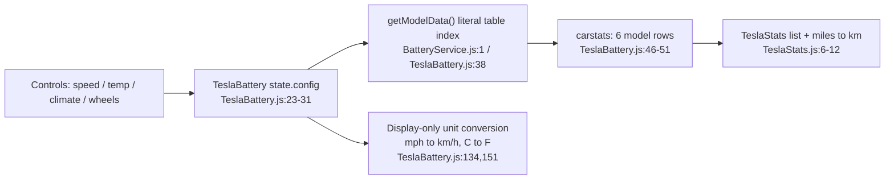
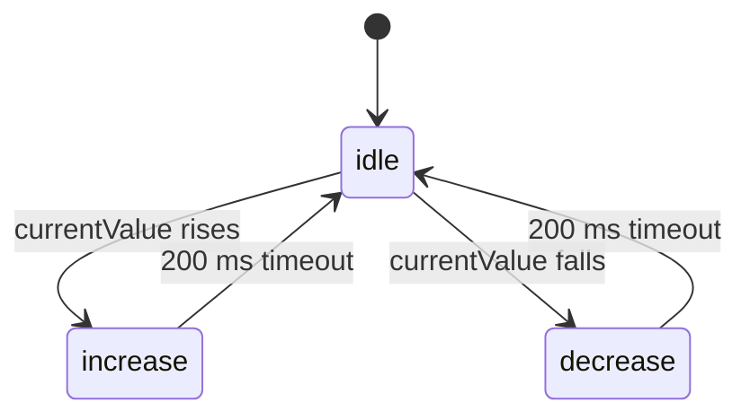

# oliwiah-Tesla_Battery_Range_Calc_React

## 1. Provenance

- Submodule path: `legacy/oliwiah-Tesla_Battery_Range_Calc_React`
- Pinned gitlink: `160000 ccfd891a4d69038745451bf0152558ab80d29912 0`
- `git -C legacy/oliwiah-Tesla_Battery_Range_Calc_React rev-parse HEAD` = `ccfd891a4d69038745451bf0152558ab80d29912` — matches the gitlink; `status --porcelain` empty at analysis time.
- Upstream URL (origin fetch/push): `https://github.com/oliwiah/Tesla_Battery_Range_Calc_React`.
- License: none declared. No `LICENSE` / `LICENCE` / `COPYING` file in `git ls-files`; `README.md:7` admits reusing data, images and CSS from Todd Motto's Angular 2 tutorial. Grade CODE-READ for absence, SUMMARY-ONLY for the reuse claim.
- Analysis date: 2026-11-21.
- Files read (line ranges):
    - `README.md:1-46` (FULL-READ)
    - `my-app/package.json:1-20` (FULL-READ)
    - `my-app/src/App.js:1-35` (FULL-READ)
    - `my-app/src/index.js:1-8` (FULL-READ)
    - `my-app/src/registerServiceWorker.js:1-107` (FULL-READ)
    - `my-app/src/services/BatteryService.js:1-1288` (FULL-READ, 1288 lines of literal table data)
    - `my-app/src/containers/TeslaBattery/TeslaBattery.js:1-174` (FULL-READ)
    - `my-app/src/components/TeslaStats/TeslaStats.js:1-26`, `TeslaClimate.js:1-26`, `TeslaWheels.js:1-44`, `TeslaCounter.js:1-300`, `TeslaNotice.js:1-19`, `Header.js:1-11`, `TeslaCar.js:1-18` (FULL-READ)
    - `.idea/workspace.xml:1-60` (RANGE-CITED; IDE state only)
    - `gif_html:1` (single external URL)
    - Our side: `client/src/state/useSocDisplay.ts:1-93`, `client/src/state/useSpeedUnit.ts:1-52`, `client/src/screens/DriveScreen.tsx:425-474`, `firmware/lib/vehicle/can/feature/telemetry/bms.h:225-254`, `firmware/lib/vehicle/can/handler/bus/vehicle.h:112-125`, `firmware/lib/client/command/dispatch.h:345-352`, `packages/protocol/src/reducer.ts:944-952`.
- Files explicitly NOT read: all binary assets (`*.svg`, `*.png`, `*.ico`, `*.eot`, `*.ttf`, `*.woff`, `gif.gif`), every `*.css` file (styling only; wheel/animation visuals unverified), `package-lock.json`, `my-app/public/index.html`, `my-app/public/manifest.json`, `.idea/*.iml`, `.idea/modules.xml`, `.idea/vcs.xml`.
- Mode: replace. Frontmatter preserved byte-for-byte (verified clean — no inherited trailing whitespace on the description line). The pre-replace doc had **no** `## Upstream (...)` sections, so none are carried over. Its description is factually truncated mid-list (`(speed, temp`) and is kept by directive; the staleness is recorded in section 6.
- Pre-replace claims are cited as `git show HEAD:docs/legacy/oliwiah-Tesla_Battery_Range_Calc_React.md#<line>`.

## 2. Executive verdict

Static React 16.2 / Create React App frontend that estimates Model-S-era pack range by indexing a hardcoded 1288-line JavaScript lookup table on five user inputs (speed, outside temperature, one climate boolean, wheel size, pack tier). There is no CAN bus, serial link, BLE, or vehicle I/O of any kind — the only network touch is the CRA service-worker check. Mechanisms worth noting are the side-by-side mph/km/h and °C/°F display counters, the single climate toggle whose label flips AC/heat at `temperature > 10`, and the 200 ms counter animation; all are UI-only and all are already represented more robustly in our client (`useSpeedUnit.ts`, `useSocDisplay.ts`). The lookup table contains three demonstrably corrupt cells and stale pack-tier data, so it must never be ported. Everything is CODE-READ; there is no TEST-READ or CAPTURE evidence in this repo. Our side already consumes live decoded range from CAN 0x33A, so the correct action on every parity row is `ignore`.

## 3. Evidence map

| Source file | Lines | What it proves | Grade |
| --- | --- | --- | --- |
| `README.md` | 3-9 | React rewrite of Todd Motto Angular 2 tutorial; reused data/images/CSS; local state + props | SUMMARY-ONLY |
| `README.md` | 11-18 | Stack: React, ES6, CSS, Bootstrap, JSON, Surge deploy | SUMMARY-ONLY |
| `README.md` | 26-40 | Claimed inputs: battery type, speed, temp, AC, heat, wheel size; claimed vehicle "Model 3" | SUMMARY-ONLY |
| `my-app/src/services/BatteryService.js` | 1-1288 | Full 6-tier × 2-wheel × 2-climate × 6-speed × 6-temperature integer-mile table; no formula | CODE-READ |
| `my-app/src/services/BatteryService.js` | 596, 936, 1200 | Three outlier cells (279, 274, 228) inconsistent with their neighbours | CODE-READ |
| `my-app/src/containers/TeslaBattery/TeslaBattery.js` | 23-31 | Initial config: speed 55, temp 20, climate true, wheels 19 | CODE-READ |
| `my-app/src/containers/TeslaBattery/TeslaBattery.js` | 34-51 | Lookup expression and six fixed model keys; recompute on every state change | CODE-READ |
| `my-app/src/containers/TeslaBattery/TeslaBattery.js` | 57-115 | Shared increment/decrement keyed on title string; climate toggle; wheel handler | CODE-READ |
| `my-app/src/containers/TeslaBattery/TeslaBattery.js` | 127-155 | mph/km/h and °C/°F counters; conversion factors `1.609` and `×1.8 + 32` | CODE-READ |
| `my-app/src/App.js` | 6-21 | Counter bounds: speed step 5 / 45..70, temperature step 10 / -10..40 | CODE-READ |
| `my-app/src/components/TeslaCounter/TeslaCounter.js` | 14-32, 85-103, 158-176, 231-249 | Four near-duplicate animation components using deprecated `componentWillReceiveProps` | CODE-READ |
| `my-app/src/components/TeslaCounter/TeslaCounter.js` | 123-134, 269-279 | Display-only km/h and °F counters with hardcoded disable thresholds | CODE-READ |
| `my-app/src/components/TeslaClimate/TeslaClimate.js` | 5-20 | One checkbox; label is `ac` when `limit` true else `heat` | CODE-READ |
| `my-app/src/components/TeslaWheels/TeslaWheels.js` | 5-28 | Two radio options hardcoded to `[19, 21]` | CODE-READ |
| `my-app/src/components/TeslaStats/TeslaStats.js` | 5-12 | Renders one row per model; miles→km via `×1.609` | CODE-READ |
| `my-app/src/registerServiceWorker.js` | 11-99 | Production-only SW registration, origin guard, localhost validation, errors logged only | CODE-READ |
| `my-app/src/index.js` | 7-8 | Entry: `ReactDOM.render(<App />)` + `registerServiceWorker()` | CODE-READ |
| `my-app/package.json` | 5-19 | `react-scripts 1.1.1`, React 16.2, prop-types 15.6, Surge 0.19; test script exists | CODE-READ |
| `.idea/workspace.xml` | 1-60 | IDE-only state; recent change was README.md; no build configuration | RANGE-CITED |
| `git ls-files` (submodule) | all | No LICENSE, no CHANGELOG, no `*.test.*`, no `*.spec.*`, no CAN/DBC/JSON data catalog | CODE-READ |
| `client/src/state/useSocDisplay.ts` | 47-93 | Our SOC→expected→ideal range tap cycle with graceful `—` fallback | CODE-READ |
| `client/src/state/useSpeedUnit.ts` | 12-51 | Our single-source km/h↔mph toggle (`KMH_TO_MPH = 0.621371`) | CODE-READ |
| `client/src/screens/DriveScreen.tsx` | 434-462 | Our range readout prefers `bmsIdealRemaining`, falls back to `bmsExpectedRange` | CODE-READ |
| `firmware/lib/vehicle/can/feature/telemetry/bms.h` | 235-250 | Our 0x33A expected/ideal range decode: bits 0-9 / 16-25, `raw * 1.6f` km | CODE-READ |
| `firmware/lib/vehicle/can/handler/bus/vehicle.h` | 115-125 | Decode dispatch gated on `CAN_ID_BMS_ENERGY` and `dlc >= 8` | CODE-READ |
| `firmware/lib/client/command/dispatch.h` | 345-352 | Wire emit `expRange` / `idealRange` as km × 10 | CODE-READ |
| `packages/protocol/src/reducer.ts` | 946-949 | Wire→state decode of `expRange` / `idealRange` via `/10` | CODE-READ |

No TEST-READ evidence exists: the `test` script at `package.json:14` is defined but no test file is tracked. No CAPTURE evidence exists: this repo has no CAN bus or capture tooling. `BatteryService.js` is FULL-READ (every one of its 1288 lines was read); `.idea/workspace.xml` is RANGE-CITED only.

## 4. Architecture and build surface

- Entry point: `my-app/src/index.js:7-8` renders `App` and registers the service worker.
- Component tree: `App.js:23-33` → `Header` + `TeslaBattery`; `TeslaBattery.js:117-170` composes `TeslaCar`, `TeslaStats`, four `TeslaCounter*` exports, `TeslaClimate`, `TeslaWheels`, `TeslaNotice`.
- Shared core vs platform port: none. Single browser target; no embedded or platform-specific port.
- Build flags: none. CRA `react-scripts 1.1.1` with `start` / `build` / `test` / `eject` (`package.json:11-15`); `surge` devDependency for static deploy (`package.json:18`).
- Dependency boundaries: React 16.2 + prop-types only. No serial, BLE, WiFi, sockets, or CAN libraries. Only outbound request is the service-worker `fetch` at `registerServiceWorker.js:76`.
- State flow: all UI state lives in `TeslaBattery` (`TeslaBattery.js:23-31`); children are controlled via props; every change calls `statsUpdate()` in a `setState` callback (`TeslaBattery.js:62,108,114`).

None found: no frame pipeline in this repo.

UI data flow (not a frame pipeline):



## 5. Mechanism catalogue

### Static five-dimensional range lookup

- **Claim (README / summary):** "static JSON data" drives the range calculation from battery type, speed, temperature, AC/heat and wheels (`git show HEAD:docs/legacy/oliwiah-Tesla_Battery_Range_Calc_React.md#15`, `README.md:26-40`).
- **Code path:** `my-app/src/services/BatteryService.js:1` `getModelData()` → `TeslaBattery.js:34-44` `calculateStats()` → `TeslaBattery.js:46-51` `statsUpdate()` → `setState` → `TeslaStats.js:5-12` render.
- **Frame spec:** None found — no CAN frames in this repo. Key shape is `data[model][wheels][climate ? 'on' : 'off'].speed[speed][temperature]` → integer miles (`TeslaBattery.js:38`).
- **Gates and timing:** initial compute in `componentDidMount` (`TeslaBattery.js:53-55`); recompute on every config change via `setState` callback (`TeslaBattery.js:62,108,114`). No debounce, no cache, no validation.
- **State machine:** None found — pure function of inputs.
- **Tests:** None found.
- **Evidence grade:** CODE-READ.
- **Verdict:** CONFIRMED — the table, not a formula, is the entire calculation.
- **Adapt to TeslaCANModder?** never — stale Model-S pack tiers plus three corrupt cells; our side reads live BMS range.

### Side-by-side dual-unit counters

- **Claim (README / summary):** author "added my own functionalities like SI units buttons" (`README.md:7`); speed and temperature shown in mph and km/h / °C and °F (`README.md:31-35`).
- **Code path:** `App.js:6-21` `counterDefaultVal` → `TeslaBattery.js:127-155` → `TeslaCounter.js:53-60` buttons → `TeslaBattery.js:64-102` `increment()` / `decrement()` → `updateCounterState()` (`TeslaBattery.js:57-63`).
- **Frame spec:** None found.
- **Gates and timing:** step 5 mph / 10 °C; clamps at min/max (`TeslaBattery.js:78,98`); primary counter buttons disabled at bounds (`TeslaCounter.js:55,59,199,204`). Secondary display-only counters use their own hardcoded bounds 113/72 km/h (`TeslaCounter.js:126,131`) and 104/14 °F (`TeslaCounter.js:272,277`).
- **State machine:** None found — no unit cycling; all four counters render simultaneously.
- **Tests:** None found.
- **Evidence grade:** CODE-READ.
- **Verdict:** PARTIAL — km/h and °F are derived display values; clicking their +/- still mutates the mph/°C base because all four share `increment`/`decrement` keyed by `initValues.title`.
- **Adapt to TeslaCANModder?** no impact — our `useSpeedUnit.ts:12-51` already has one canonical unit state and conversion.

### Single climate toggle with AC/heat relabel

- **Claim (README / summary):** "air conditioning on / off" and "heating on / off" as two variables (`README.md:36-37`).
- **Code path:** `TeslaBattery.js:139-143` → `TeslaClimate.js:5-20` → `handleChangeClimate()` (`TeslaBattery.js:105-109`) → `climate ? 'on' : 'off'` lookup branch (`TeslaBattery.js:38`).
- **Frame spec:** None found.
- **Gates and timing:** `limit = temperature > 10` (`TeslaBattery.js:141`) selects the label `ac` vs `heat` (`TeslaClimate.js:8,10`); the same boolean selects the `on`/`off` half of the table.
- **State machine:** Two states (on/off); no 3+ state diagram required.
- **Tests:** None found.
- **Evidence grade:** CODE-READ.
- **Verdict:** CONTRADICTED — one checkbox, not two independent controls; the label changes with temperature but the stored value does not.
- **Adapt to TeslaCANModder?** no impact — we do not model HVAC→range.

### Wheel-size radio selector

- **Claim (README / summary):** 19" gives longer range than 21" (`README.md:38-40`).
- **Code path:** `TeslaWheels.js:5-28` radio inputs → `handleChangeWheels()` (`TeslaBattery.js:111-115`) → table wheel branch (`TeslaBattery.js:38`) and car CSS class (`TeslaCar.js:7-9`).
- **Frame spec:** None found.
- **Gates and timing:** sizes fixed to `[19, 21]` (`TeslaWheels.js:8`); no other wheel sizes representable.
- **State machine:** None found.
- **Tests:** None found.
- **Evidence grade:** CODE-READ.
- **Verdict:** CONFIRMED — 19" table values are consistently higher than 21" in the sampled blocks, but no formula or physical model is present.
- **Adapt to TeslaCANModder?** no impact — no wheel-size concept in our stack.

### Counter change animation

- **Claim (README / summary):** "changed some css styles and animations to make it look a bit different" (`README.md:7`).
- **Code path:** `TeslaCounter.js:14-32,85-103,158-176,231-249` `componentWillReceiveProps` → local `animationEffect` / `direction` state → CSS class at `TeslaCounter.js:37-39,108-110,181-183,254-256`.
- **Frame spec:** None found.
- **Gates and timing:** 200 ms `setTimeout` resets `animationEffect` (`TeslaCounter.js:23-29,94-100,167-173,240-246`); direction string is `'increase'` or misspelled `'decrese'` (`TeslaCounter.js:17,88,161,234`); classes `speed-up-wheel-animation` / `speed-down-wheel-animation`.
- **State machine:** Three observable states (idle / increase / decrease).



- **Tests:** None found.
- **Evidence grade:** CODE-READ.
- **Verdict:** CONFIRMED — animation fires on every prop change, including derived-unit counters.
- **Adapt to TeslaCANModder?** no impact — deprecated React API and duplicated four times.

### Stats list rendering

- **Claim (README / summary):** range UI shows estimated range (`git show HEAD:docs/legacy/oliwiah-Tesla_Battery_Range_Calc_React.md#15`).
- **Code path:** `TeslaBattery.js:46-51` builds `carstats` → `TeslaStats.js:5-12` maps to `<li>` with `stat.miles` and `(stat.miles * 1.609).toFixed(0)`.
- **Frame spec:** None found.
- **Gates and timing:** all six models rendered simultaneously; no selector, no sort, no empty-state guard.
- **State machine:** None found.
- **Tests:** None found.
- **Evidence grade:** CODE-READ.
- **Verdict:** CONFIRMED.
- **Adapt to TeslaCANModder?** no impact — our `DriveScreen.tsx:434-462` has the readout and fallback already.

### CRA service-worker registration

- **Claim (README / summary):** deployed via Surge (`README.md:18,46`); summary did not mention PWA behavior.
- **Code path:** `index.js:8` `registerServiceWorker()` → `registerServiceWorker.js:11-43` → `registerValidSW()` (`45-72`) / `checkValidServiceWorker()` (`74-99`).
- **Frame spec:** None found.
- **Gates and timing:** production only and `'serviceWorker' in navigator` (`:12`); cross-origin `PUBLIC_URL` returns silently (`:14-19`); localhost path fetches `/service-worker.js` and unregisters + reloads on 404 or non-JavaScript (`:76-88`); offline/failure only `console.log` (`:69-71,94-98`).
- **State machine:** None found.
- **Tests:** None found.
- **Evidence grade:** CODE-READ.
- **Verdict:** CONFIRMED — boilerplate CRA behavior.
- **Adapt to TeslaCANModder?** never — CRA/React-16 boilerplate unrelated to our Expo client pipeline.

## 6. Summary vs code contradiction table

| Pre-replace claim | Code reality | Grade |
| --- | --- | --- |
| "using static JSON data" (`git show HEAD:docs/legacy/oliwiah-Tesla_Battery_Range_Calc_React.md#15`, `#22`, `#43`) | Data is a JavaScript object literal returned by `getModelData()` (`BatteryService.js:1-1288`). Only `.json` files tracked are `package.json` / `package-lock.json`; no data JSON exists. | CODE-READ |
| "Tesla Model 3 battery range" (`README.md:28`; frontmatter description preserved from `git show HEAD:docs/legacy/oliwiah-Tesla_Battery_Range_Calc_React.md#3`) | Model keys are `60, 60D, 75, 75D, 90D, P100D` (`TeslaBattery.js:47`; `BatteryService.js:3,217,431,645,859,1073`) — legacy Model S pack tiers. "Model 3" label is unsupported by code. | CODE-READ (keys) / SUMMARY-ONLY (label) |
| "air conditioning on / off" and "heating on / off" as separate inputs (`README.md:36-37`) | One boolean `climate` (`TeslaBattery.js:28,38`) and one checkbox; label flips `ac`/`heat` only when `temperature > 10` (`TeslaBattery.js:141`, `TeslaClimate.js:8,10`). | CODE-READ |
| "type of battery" presented as a user-selectable variable (`README.md:29`) | No battery selector; all six models are computed and displayed at once (`TeslaBattery.js:47-51`, `TeslaStats.js:6-12`). | CODE-READ |
| "License: None" (`git show HEAD:docs/legacy/oliwiah-Tesla_Battery_Range_Calc_React.md#34`) | No license file is tracked, but `README.md:7` says data/images/CSS were reused from a third-party tutorial. "None" means undeclared, not public-domain; provenance risk stands. | CODE-READ + SUMMARY-ONLY |
| Two `## Architecture` headings in one summary (`git show HEAD:docs/legacy/oliwiah-Tesla_Battery_Range_Calc_React.md#17` and `#36`) | Structural defect only; replaced by a single numbered section 4. | CODE-READ |
| Frontmatter description ends mid-list at `(speed, temp` (`git show HEAD:docs/legacy/oliwiah-Tesla_Battery_Range_Calc_React.md#3`) | Preserved byte-for-byte by directive; recorded here as inherited staleness rather than silently edited. | CODE-READ |

## 7. CAN frame and signal inventory

None found — no CAN frames are decoded, mutated, injected, or received anywhere in this repo. No vendored DBC/JSON catalog exists. The literal table in `BatteryService.js` is UI data, not a frame catalog.

## 8. Constants and tuning table

| Constant | Value | File:line | Meaning | Grade |
| --- | --- | --- | --- | --- |
| speed counter bounds | step 5, min 45, max 70 mph | `App.js:10-12` | Exactly matches table speed keys (45..70) | CODE-READ |
| temperature counter bounds | step 10, min -10, max 40 °C | `App.js:17-19` | Exactly matches table temperature keys | CODE-READ |
| initial config | speed 55, temperature 20, climate true, wheels 19 | `TeslaBattery.js:26-29` | Boot state | CODE-READ |
| model keys | `60, 60D, 75, 75D, 90D, P100D` | `TeslaBattery.js:47` | Six table tiers | CODE-READ |
| wheel sizes | `[19, 21]` | `TeslaWheels.js:8` | Table wheel branches | CODE-READ |
| climate branch keys | `on` / `off` | `TeslaBattery.js:38` | Table HVAC branches | CODE-READ |
| AC/heat label threshold | `temperature > 10` | `TeslaBattery.js:141`, `TeslaClimate.js:8,10` | Relabels single toggle | CODE-READ |
| mph→km/h factor | `1.609` | `TeslaBattery.js:134`, `TeslaStats.js:10` | Display conversion, duplicated | CODE-READ |
| °C→°F factor | `× 1.8 + 32` | `TeslaBattery.js:151` | Display conversion | CODE-READ |
| km/h counter disable bounds | 113 / 72 | `TeslaCounter.js:126,131` | Hardcoded, decoupled from `App.js` | CODE-READ |
| °F counter disable bounds | 104 / 14 | `TeslaCounter.js:272,277` | Hardcoded, decoupled from `App.js` | CODE-READ |
| animation reset | 200 ms | `TeslaCounter.js:23-29,94-100,167-173,240-246` | Timeout per counter component | CODE-READ |
| table temperature keys | -10, 0, 10, 20, 30, 40 | `BatteryService.js:8-13` (example block) | Grid axis | CODE-READ |
| table speed keys | 45, 50, 55, 60, 65, 70 | `BatteryService.js:7,15,23,31,39,47` | Grid axis | CODE-READ |
| outlier cell A | 279 at 75 / 21" / off / 45 mph / 10 °C | `BatteryService.js:596` | Neighbours 372 (0 °C) and 387 (20 °C) | CODE-READ |
| outlier cell B | 274 at 90D / 19" / off / 55 mph / 30 °C | `BatteryService.js:936` | Neighbours 366 (20 °C) and 380 (40 °C) | CODE-READ |
| outlier cell C | 228 at P100D / 21" / on / 55 mph / -10 °C | `BatteryService.js:1200` | Neighbours 323 (0 °C) and 354 (10 °C) | CODE-READ |

## 9. Failure modes and edge cases

No CAN-specific paths exist — bus-off, OTA pause, queue overflow, watchdog, brownout/reboot state and missing-frame timeouts are all out of scope because this repo has no bus.

| Failure | Handling code path | Tested? | Grade |
| --- | --- | --- | --- |
| Missing lookup cell yields `undefined` miles and an empty `<p>` | None — direct index at `TeslaBattery.js:38`, rendered at `TeslaStats.js:9` | No | CODE-READ |
| Three corrupt lookup cells return wrong range silently | None — literals at `BatteryService.js:596,936,1200` | No | CODE-READ |
| Grid changed outside `App.js` bounds breaks direct key lookup | None — no guard in `calculateStats()` (`TeslaBattery.js:34-44`) | No | CODE-READ |
| Clicking +/- on km/h or °F counter mutates the mph/°C base | Shared `increment`/`decrement` keyed by title (`TeslaBattery.js:64-102`, `TeslaCounter.js:125,130,271,276`) | No | CODE-READ |
| Hardcoded secondary bounds desync from `App.js` on future edits | `TeslaCounter.js:126,131,272,277` | No | CODE-READ |
| Deprecated `componentWillReceiveProps` breaks on newer React | `TeslaCounter.js:14,85,158,231` — no migration | No | CODE-READ |
| `setTimeout` not cleared on unmount → setState after unmount | `TeslaCounter.js:23-29,94-100,167-173,240-246` | No | CODE-READ |
| Service-worker failure/offline only logged, no user feedback | `registerServiceWorker.js:69-71,94-98` | No | CODE-READ |
| Cross-origin `PUBLIC_URL` silently skips SW registration | `registerServiceWorker.js:14-19` | No | CODE-READ |
| No error boundary or fallback UI for render failures | None found in `App.js` / `TeslaBattery.js` | No | CODE-READ |

## 10. Test coverage map

- Per test file: **None found.** `git ls-files` in the submodule returns no `*.test.*`, `*.spec.*`, `__tests__/`, or test helper. `package.json:14` declares `"test": "react-scripts test --env=jsdom"` but nothing implements it.
- Critical paths with no test:

| Untested path | Risk |
| --- | --- |
| `getModelData()` lookup for every model/wheel/climate/speed/temp combination | A single bad cell ships a wrong range with no signal |
| The three known outlier cells (`BatteryService.js:596,936,1200`) | No oracle catches the bad numbers |
| mph→km/h and °C→°F conversions (`TeslaBattery.js:134,151`, `TeslaStats.js:10`) | Duplicated factor can drift |
| `increment()` / `decrement()` clamps (`TeslaBattery.js:78,98`) | Shared handler can move the wrong unit |
| AC/heat relabel at `temperature > 10` (`TeslaBattery.js:141`) | Label can contradict the table branch |
| Wheel radio → table branch (`TeslaWheels.js:8`) | Wrong wheel data silently selected |
| Service-worker registration and unregister paths (`registerServiceWorker.js:45-99`) | Offline behavior unasserted |

## 11. Parity matrix with TeslaCANModder

| Signal / frame | Upstream (cite) | Our decode (CODE-READ cite) | Delta | Action |
| --- | --- | --- | --- | --- |
| Expected range (km) | Static table, integer miles × 1.609 (`BatteryService.js:1-1288`, `TeslaBattery.js:38`, `TeslaStats.js:10`) | 0x33A bits 0-9 × 1.6 km (`firmware/lib/vehicle/can/feature/telemetry/bms.h:235-239`) → `vehicle.h:120` → `dispatch.h:349` → `reducer.ts:948` → `useSocDisplay.ts:81` / `DriveScreen.tsx:438-442` | Simulated static value vs live vehicle telemetry; upstream base unit is miles | ignore — already present, higher fidelity |
| Ideal range (km) | None found — no ideal-range concept | 0x33A bits 16-25 × 1.6 km (`bms.h:246-250`) → `vehicle.h:121` → `dispatch.h:350` → `reducer.ts:949` → `useSocDisplay.ts:85-89` | Upstream has no counterpart | ignore — already present |
| State of charge | None found — no SOC input or output | `useSocDisplay.ts:36-45,69,76` formats SOC and derives 15/25 thresholds; `DriveScreen.tsx:436-437` clamps and colors | Upstream has no SOC | ignore — already present |
| Speed unit display | mph and km/h rendered side by side, km/h = mph × 1.609 (`TeslaBattery.js:127-138`, `TeslaCounter.js:114-134`) | Single tap-to-cycle unit with `KMH_TO_MPH = 0.621371` (`useSpeedUnit.ts:12-18,35-51`) | Dual static display vs one canonical toggle; inverse conversion factors | ignore — already present, do not import 1.609 |
| Pack capacity / tier | Six literal tier names as table keys (`TeslaBattery.js:47`) | Measured `bmsInitialFullPack` emitted and stored (`dispatch.h:348`, `reducer.ts:946-947`) | Static tier names vs measured kWh | ignore — already present |
| HVAC effect on range | Single boolean switches table branch (`TeslaBattery.js:38,105-109`) | None found — no our-side CODE-READ analog located | No simulation path in our stack; row is SUMMARY-ONLY on our side | no decision — backlog only; not a port candidate |

## 12. Surface inventory and security notes

Surfaces (all local browser UI unless noted):

| Surface | Semantics | Cite |
| --- | --- | --- |
| Speed + / - buttons | Mutate `config.speed` by step 5 within 45..70 | `TeslaCounter.js:53-60`, `App.js:10-12` |
| Temperature + / - buttons | Mutate `config.temperature` by step 10 within -10..40 | `TeslaCounter.js:197-206`, `App.js:17-19` |
| Climate checkbox | Toggles single `climate` boolean; label AC/heat by temp | `TeslaClimate.js:12-17`, `TeslaBattery.js:141` |
| Wheel radio group | Selects 19 or 21 | `TeslaWheels.js:11-16` |
| Stats list | Read-only six-model range output | `TeslaStats.js:6-12` |
| Service worker | Production-only SW registration + `/service-worker.js` fetch | `registerServiceWorker.js:12,23,76` |
| Static deploy | Surge; URL advertised at `README.md:46` (`http://react-tesla-battery-range.surge.sh`) | `README.md:18,46`, `package.json:18` |

No serial/BLE/WiFi command or REST endpoint exists in this repo. Negative anchors confirmed: no `MCP2515`, `0x33A`, `0x3FD`, `serialport`, `WebSocket`, `navigator.serial` under `my-app/src`; no `eval(`, `new Function(`, `child_process`, or `require('http')`; no `api_key`/`password`/`secret`/`token`/private-key markers in README, source, or manifest; no `license`/`copyright` string in README or manifest. No dangerous build flags. Security findings are therefore limited to provenance: third-party data/images/CSS reused without a license file (`README.md:7`), and EOL dependencies (`react-scripts 1.1.1`, React 16.2 at `package.json:7-9`) with advisories **UNVERIFIED** — running `npm audit` inside `my-app` after an install would settle that.

## 13. Adaptation assessment

| Mechanism | Value | Cost | Risk | Evidence grade | Decision |
| --- | --- | --- | --- | --- | --- |
| Static range lookup table | Low | High (1288 lines of literals) | High (3 corrupt cells, stale tiers) | CODE-READ | never port |
| Dual-unit side-by-side counters | Low | Low | Low (shared-handler unit bug) | CODE-READ | already present (`useSpeedUnit.ts`) |
| Climate AC/heat toggle | None | Low | Low | CODE-READ | no impact |
| Wheel-size radio | None | Low | Low | CODE-READ | no impact |
| Counter animation | Low | Medium (4 duplicates, deprecated API) | Medium (timer leak) | CODE-READ | no impact |
| Stats list rendering | Low | Low | Low | CODE-READ | no impact (`DriveScreen.tsx`) |
| CRA service worker | None | Low | Low | CODE-READ | never port |

No mechanism qualifies as `candidate for future PR`. Nearest three for future reference, all already covered on our side: (1) graceful `—` fallback when range data is unavailable (`useSocDisplay.ts:31-33,81-89`); (2) single-source unit conversion (`useSpeedUnit.ts:12-51`); (3) explicit data-integrity check before trusting a lookup value — worth adding as a test oracle on our BMS decode, but that is a new test, not a port.

## 14. Do-not-copy list

| Item | Cite | Reason |
| --- | --- | --- |
| Entire range table | `BatteryService.js:1-1288` | Stale Model-S pack tiers; literal values with no model or formula |
| Outlier cell A | `BatteryService.js:596` | 279 against neighbours 372 / 387 |
| Outlier cell B | `BatteryService.js:936` | 274 against neighbours 366 / 380 |
| Outlier cell C | `BatteryService.js:1200` | 228 against neighbours 323 / 354 |
| Reused third-party data, images, CSS | `README.md:7`; assets under `my-app/src/assets/` | No license file; provenance risk |
| Deprecated lifecycle API | `TeslaCounter.js:14,85,158,231` | `componentWillReceiveProps` removed in modern React |
| Uncleared animation timers | `TeslaCounter.js:23-29,94-100,167-173,240-246` | setState after unmount |
| Hardcoded secondary bounds | `TeslaCounter.js:126,131,272,277` | Duplicates `App.js` truth |
| Duplicated conversion factor | `TeslaBattery.js:134` and `TeslaStats.js:10` | Two copies of 1.609 will drift |
| CRA service-worker boilerplate | `registerServiceWorker.js:1-107` | Belongs to CRA/React 16, not our Expo pipeline |
| EOL dependency set | `my-app/package.json:7-9,18` | react-scripts 1.1.1 / React 16.2 / Surge 0.19 |

No `## Upstream (...)` section existed pre-replace, so none are preserved here.

## 15. History and evolution

- Submodule local history contains exactly one commit: `ccfd891 readme modified`, dated 2018-05-04 (`git -C legacy/oliwiah-Tesla_Battery_Range_Calc_React log`). No branches, tags, or earlier commits are present locally; pre-pin upstream history was **not** reviewed.
- No changelog file is tracked. No rollback, abandoned approach, or iteration sequence is recoverable from local history — explicitly UNVERIFIED.
- `README.md:3-9` states the project is a React rewrite of Todd Motto's Angular 2 reactive-forms calculator, with author-added SI-unit buttons and changed CSS/animations — SUMMARY-ONLY account of an earlier iteration, not verifiable from local git.
- Parent-doc lineage: `cf1e5d6 docs(legacy): refresh remaining per-repo analysis docs with mermaid diagrams (wave 2)` and `b096f1e chore(release): v2.0.0` touched the pre-replace summary. Network-only claims (GitHub issues, PRs, live demo status) stay UNVERIFIED.

## 16. Re-verification recipe

```bash
OLD=ccfd891a4d69038745451bf0152558ab80d29912
git ls-files -s legacy/oliwiah-Tesla_Battery_Range_Calc_React          # expect 160000 <OLD> 0
git -C legacy/oliwiah-Tesla_Battery_Range_Calc_React rev-parse HEAD    # expect <OLD>
git -C legacy/oliwiah-Tesla_Battery_Range_Calc_React status --porcelain # expect empty
git -C legacy/oliwiah-Tesla_Battery_Range_Calc_React fetch --tags --prune
git -C legacy/oliwiah-Tesla_Battery_Range_Calc_React log --oneline $OLD..origin/main
git -C legacy/oliwiah-Tesla_Battery_Range_Calc_React diff --stat $OLD..origin/main
git -C legacy/oliwiah-Tesla_Battery_Range_Calc_React diff $OLD..origin/main -- my-app/src README.md
```

Grep anchors, all demonstrated at write time with GNU `grep -nE`:

```text
grep -nE 'getModelData' legacy/oliwiah-Tesla_Battery_Range_Calc_React/my-app/src/services/BatteryService.js legacy/oliwiah-Tesla_Battery_Range_Calc_React/my-app/src/containers/TeslaBattery/TeslaBattery.js -> expect BatteryService.js:1; TeslaBattery.js:9,35
grep -nE 'const miles = dataModels' legacy/oliwiah-Tesla_Battery_Range_Calc_React/my-app/src/containers/TeslaBattery/TeslaBattery.js -> expect line 38
grep -nE 'carModels = ' legacy/oliwiah-Tesla_Battery_Range_Calc_React/my-app/src/containers/TeslaBattery/TeslaBattery.js -> expect line 47
grep -nE 'step: 5|min: 45|max: 70|step: 10|min: -10|max: 40' legacy/oliwiah-Tesla_Battery_Range_Calc_React/my-app/src/App.js -> expect lines 10,11,12,17,18,19
grep -nE '1\.609|1\.8\) \+ 32' legacy/oliwiah-Tesla_Battery_Range_Calc_React/my-app/src/containers/TeslaBattery/TeslaBattery.js legacy/oliwiah-Tesla_Battery_Range_Calc_React/my-app/src/components/TeslaStats/TeslaStats.js -> expect TeslaBattery.js:134,151; TeslaStats.js:10
grep -nE 'sizes = \[19, 21\]' legacy/oliwiah-Tesla_Battery_Range_Calc_React/my-app/src/components/TeslaWheels/TeslaWheels.js -> expect line 8
grep -nE "climate \? 'on' : 'off'" legacy/oliwiah-Tesla_Battery_Range_Calc_React/my-app/src/containers/TeslaBattery/TeslaBattery.js -> expect line 38
grep -nE 'componentWillReceiveProps' legacy/oliwiah-Tesla_Battery_Range_Calc_React/my-app/src/components/TeslaCounter/TeslaCounter.js -> expect lines 14,85,158,231
grep -nE "'30': 274" legacy/oliwiah-Tesla_Battery_Range_Calc_React/my-app/src/services/BatteryService.js -> expect line 936 (sole hit)
grep -nE "'10': 279" legacy/oliwiah-Tesla_Battery_Range_Calc_React/my-app/src/services/BatteryService.js -> expect lines 596,620,898 (596 is the outlier)
grep -nE "'-10': 228" legacy/oliwiah-Tesla_Battery_Range_Calc_React/my-app/src/services/BatteryService.js -> expect lines 674,1200 (1200 is the outlier)
grep -rnE 'MCP2515|0x33A|0x3FD|serialport|WebSocket|navigator\.serial' legacy/oliwiah-Tesla_Battery_Range_Calc_React/my-app/src -> no output (negative anchor)
grep -rniE 'license|copyright' legacy/oliwiah-Tesla_Battery_Range_Calc_React/README.md legacy/oliwiah-Tesla_Battery_Range_Calc_React/my-app/package.json -> no output (negative anchor)
grep -rniE 'api[_-]?key|password|secret|token|BEGIN (RSA|OPENSSH|PRIVATE) KEY' legacy/oliwiah-Tesla_Battery_Range_Calc_React/README.md legacy/oliwiah-Tesla_Battery_Range_Calc_React/my-app/src legacy/oliwiah-Tesla_Battery_Range_Calc_React/my-app/package.json -> no output (negative anchor)
grep -rnE '\beval\(|new Function\(|child_process|require\(.http' legacy/oliwiah-Tesla_Battery_Range_Calc_React/my-app/src -> no output (negative anchor)

# our-side drift anchors (pin by symbol, not line number)
grep -nE 'useSocDisplay|bmsExpectedRange|range_expected|range_ideal' client/src/state/useSocDisplay.ts -> expect lines 2,12,47,52,58,59,60,80,81,85,86,88
grep -nE 'bmsIdealRemaining|bmsExpectedRange|km est' client/src/screens/DriveScreen.tsx -> expect lines 439,440,441,442,461
grep -nE 'decodeBmsExpectedRange|decodeBmsIdealRange|raw \* 1\.6f' firmware/lib/vehicle/can/feature/telemetry/bms.h -> expect lines 235,238,246,249
grep -nE 'decodeBmsExpectedRange|decodeBmsIdealRange' firmware/lib/vehicle/can/handler/bus/vehicle.h -> expect lines 120,121
grep -nE 'expRange|idealRange' packages/protocol/src/reducer.ts -> expect lines 948,949
grep -nE 'expRange|idealRange' firmware/lib/client/command/dispatch.h -> expect lines 349,350
grep -nE 'KMH_TO_MPH|cycleUnit' client/src/state/useSpeedUnit.ts -> expect lines 12,18,28,38,48
grep -nE 'getModelData|carstats|mph|°F' client/src/state/useSocDisplay.ts -> no output (our side has no static lookup)
```

If line numbers drift more than ~10, re-read the whole function; do not trust this document's numbers. Pre-pin upstream history was not reviewed — only the pinned snapshot `ccfd891a4d69038745451bf0152558ab80d29912` was analyzed, and the local clone holds only that one commit.

## 17. Open questions and explicitly not investigated

- Pre-pin upstream history was not reviewed; the local clone has a single commit, so earlier iterations, branches and tags could not be mined.
- Live demo / Surge deployment status not checked (network-only); `README.md:46` URL is a lead, not evidence.
- GitHub issues and PRs not consulted; author intent for the three outlier cells is unknown.
- Whether the three anomalous table cells are data-entry errors or intentional model quirks is UNVERIFIED; verifying needs the original Todd Motto dataset or author confirmation.
- Whether the "Model 3" label is intentional or inherited from Model S source data is UNVERIFIED.
- CSS files and binary assets (SVG/PNG/fonts/ICO/gif) were not read; visual wheel and animation behavior is UNVERIFIED.
- `package-lock.json` was not read; transitive dependency versions beyond `package.json` are UNVERIFIED.
- `npm audit` was not run (needs install/network); EOL dependency advisories are UNVERIFIED.
- No CAPTURE evidence exists (no CAN bus here) and no TEST-READ evidence exists (no committed tests).
- Our-side parity check was scoped to client range/battery panels, speed-unit hook, firmware BMS decode, protocol reducer and command dispatch; the wider protocol surface was not re-audited.

_Frontmatter preserved byte-for-byte from the pre-replace document. No `## Upstream (...)` sections existed to preserve._
