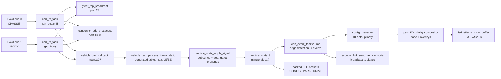
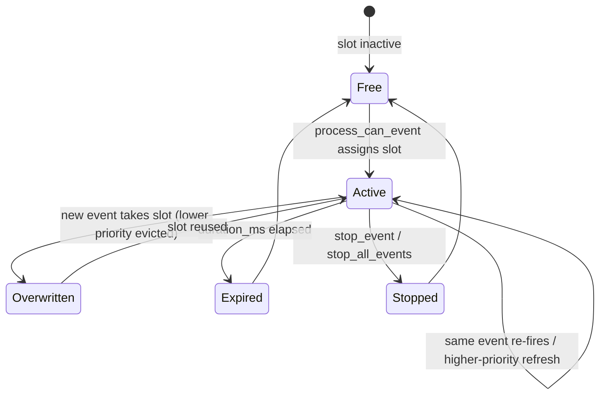
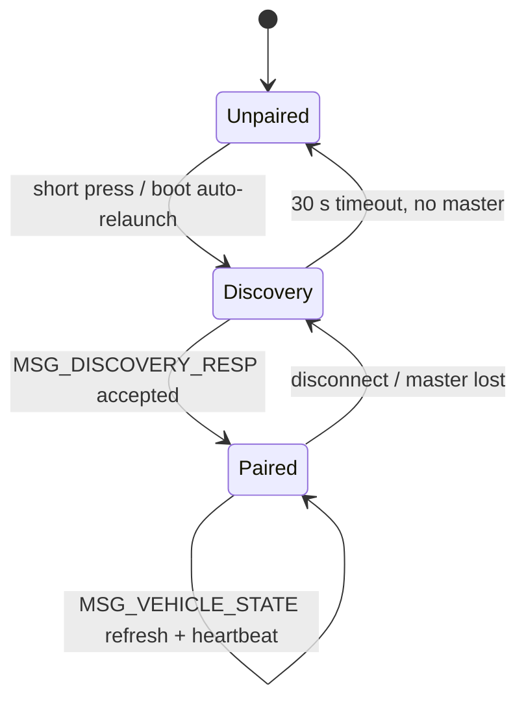
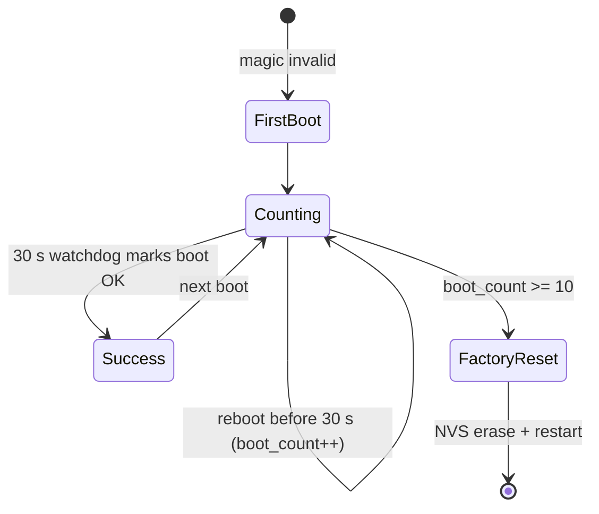
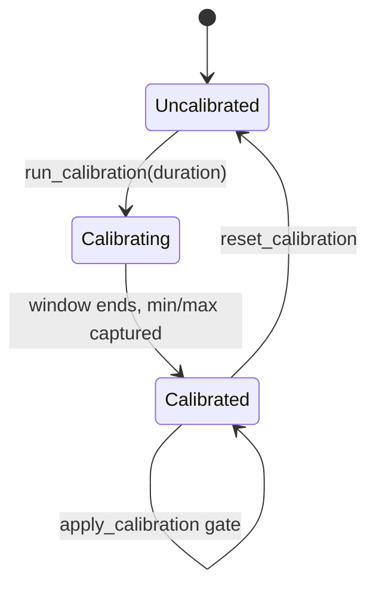

# rafal83-Car-Light-Sync — deep-dive

Deep analysis of `legacy/rafal83-Car-Light-Sync` per the `legacy-repo-deep-dive` skill (replace mode). The YAML frontmatter above is preserved byte-for-byte from the pre-replace doc, including a description line that ends mid-word (`Features a w`); the inherited file carried no trailing whitespace on that line, so nothing was stripped. The pre-replace summary had no `## Upstream (...)` sections, so there was nothing else to preserve; its claims are cited below as `git show HEAD:docs/legacy/rafal83-Car-Light-Sync.md` where contradicted.

## 1. Provenance

| Item | Value |
| --- | --- |
| Submodule path | `legacy/rafal83-Car-Light-Sync` |
| Pinned gitlink | `160000 93dbf75ef9903bd98bc61a7e48f5d1df67c48425 0` (from `git ls-files -s legacy/rafal83-Car-Light-Sync`) |
| Submodule HEAD | `93dbf75ef9903bd98bc61a7e48f5d1df67c48425` — matches gitlink; worktree clean (`git status --porcelain` empty) |
| Pinned commit | `93dbf75` — "Add video link and support information to README" (2026-01-23) |
| Upstream URL | https://github.com/rafal83/Car-Light-Sync |
| License | Custom **Non-Commercial** license (`LICENSE:1-30`) — commercial use prohibited without written permission; **not** OSI open source despite `README.md:3` saying "Open source" |
| Analysis date | 2026-11-21 |
| Pre-replace doc | `git show HEAD:docs/legacy/rafal83-Car-Light-Sync.md` (77 lines, replaced by this analysis) |

Files read (coverage vocabulary per skill; this repo ships no tests and no captures, so evidence grades below are CODE-READ, SUMMARY-ONLY, or UNVERIFIED only — stated once here per the closed vocabulary):

- FULL-READ: `main/vehicle_can_mapping.c` (862), `main/vehicle_can_unified.c` (251), `main/can_bus.c` (344), `main/main.c` (846), `include/led_effects.h` (338), `include/config_manager.h` (425), `main/boot_loop_guard.c/.h`, `main/ota_update.c` (247), `main/reset_button.c` (134), `include/audio_input.h` (199), `include/status_led.h` (42), `main/led_strip_encoder.c` (124), `main/can_servers_config.c` (33), `include/task_core_utils.h` (24), `include/status_manager.h` (12), `main/Kconfig.projbuild` (48), `partitions.esp32c6.csv` (7), `include/log_stream.h` (109), `include/espnow_link.h` (75), `include/ble_api_service.h` (54), `include/vehicle_can_mapping.h` (39), `include/vehicle_can_unified.h` (211), `include/vehicle_can_unified_config.h` (57), `include/can_bus.h` (54), `include/config.h` (76), `main/config.c` (34), `include/wifi_credentials.h` (12), `src/main.c` (1), `main/vehicle_can_unified_config.generated.c` (1), `platformio.ini` (77), `main/CMakeLists.txt` (72), `tools/can/generate_vehicle_can_config.py` (246), `README.md` (60), `.github/workflows/firmware.yml` (84).
- RANGE-CITED: `main/led_effects.c` (1-529, 865-999, 1355-1699, 2066-2135, 2596-2998, plus symbol index via grep; ~1000 of ~2998 lines), `main/config_manager.c` (1-382, 638-722, 792-1061, 1266-1335), `main/web_server.c` (2642-2771 + full handler/registration grep index), `main/ble_api_service.c` (30-149, 228-277 + UUID/dispatch grep), `main/gvret_tcp_server.c` (constants + 560-589), `main/canserver_udp_server.c` (26-100), `main/espnow_link.c` (grep + 694-723), `main/settings_manager.c` (1-120), `main/spiffs_storage.c` (1-100), `main/wifi_manager.c` (160-204 + grep), `main/captive_portal.c` (grep only), `main/audio_input.c` (structure grep only, ~100 symbol hits), `include/vehicle_can_unified_config.generated.h` (1-60, 719-798, 974-991, 1556-1705, 1789-1802, 1931-1962, 2955-3039, 5065-5454, 5385-5454 + full message-ID index via grep), `tools/can/dbc_to_config.py` (1-80), `scripts/pre_build_minify.py` (1-45), `tools/README.md` (150-199), `docs/firmware.md` (1-60), `data/default.json` (first ~2000 chars of one long line), `data/dashboard/dashboard.js` (grep of BLE decoders, 73 hits), `LICENSE` (1-30).
- STRUCTURAL-PARSE (schema-level only, claims limited to structure): `include/vehicle_can_unified_config.generated.h` as a whole (201KB vendored decode catalog, 26 messages), `vehicle_configs/tesla/Model3CAN.json` (1.1MB, never opened directly — its content is known only through the generated header), `model3_2021.json` / `model3_2021_full.json` (never opened), all five `*.dbc` files (320KB-666KB, never opened), `presets/*.json` (17 files, never opened individually — schema assumed from `data/default.json` which is the embedded factory preset).

Files explicitly NOT read: `data/script.js` (195KB web UI), `data/index.html`, `data/i18n.js`, `data/style.css`, `data/dashboard/dashboard.css|dashboard.html`, `data/dashboard/ble-client-loader.js`, `capacitor-bluetooth-adapter.js`, `capacitor.js`, all `mobile.app/**` (including its docs and `sync-html.js`), `main/status_led.c`, `main/log_stream.c`, `main/audio_input.c` (beyond symbol index), remaining ranges of `led_effects.c` / `config_manager.c` / `web_server.c` / `ble_api_service.c` / `espnow_link.c` / `gvret_tcp_server.c` / `canserver_udp_server.c` / `wifi_manager.c` / `settings_manager.c` / `spiffs_storage.c`, `docs/hardware.md`, `docs/software.md`, `docs/troubleshooting.md`, `.github/workflows/android-app.yml` + `ios-simulator.yml`, `sdkconfig*` files, `scripts/minify.js`, root `CMakeLists.txt`, `src/CMakeLists.txt`, `.clang-format`, `.gitattributes`, `package.json`, images/SVGs, and the not-yet-opened config/DBC files listed above.

No TEST-READ evidence exists: this repo ships no test files and its CI only compiles. No CAPTURE evidence exists in this repo.

## 2. Executive verdict

Car Light Sync is an ESP32-C6/S3 WS2812 lighting product: a firmware-only, CAN-read-only decode stack that turns Tesla Model 3 CAN state into LED effects, web/BLE dashboards, and wireless multi-device fan-out. Its genuinely strong engineering is infrastructure, not vehicle protocol work: a DBC-generated decode table with Intel/Motorola bit extraction and mux support, a per-LED priority overlay compositor for concurrent CAN-event effects, a byte-compact BLE telemetry protocol (CONFIG/PARK/DRIVE packets with ack-based reliability), a GVRET TCP and a panda-format CANServer UDP gateway, a boot-loop guard in RTC-noinit RAM, and an SPIFFS profile store with magic+version+checksum headers. Its vehicle-layer signal claims are only as good as the vendored joshwardell-lineage `Model3CAN.json` — several decoded layouts conflict with our shipping decoders (0x118 gear/pedal, 0x257 speed, 0x399 scope), it never transmits on CAN (TX API exists but has zero callers), and its SNA guards are partly dead because they compare post-scale values against raw sentinels. Adaptation candidates for TeslaCANModder are the boot-loop guard pattern, the panda-UDP gateway idea (our protocol package already defines `gvret`/`espnow` commands with no firmware behind them), and the PARK ultrasonic blind-spot fusion concept — all as derived ideas, never code copies: the upstream license is non-commercial and forbids copying into a GPL-3.0 product. The LED/audio/web-effect layer is out of scope for us.

## 3. Evidence map

| source file | lines | what it proves | grade |
| --- | --- | --- | --- |
| `main/vehicle_can_mapping.c` | 15-23 | latch decode: 2=closed, 0=SNA, else open | CODE-READ |
| `main/vehicle_can_mapping.c` | 33-45 | front ultrasonic window 50 samples, 2 s hysteresis, ≥20 cm drop | CODE-READ |
| `main/vehicle_can_mapping.c` | 67-87 | per-field debounce: blindspot 500 ms, turn 10 ms, autopilot 1000 ms; `turn_right` listed in both the 10 ms and 1000 ms groups (10 ms wins by order) | CODE-READ |
| `main/vehicle_can_mapping.c` | 281-342 | 0x3C2 wheel-scroll/press/tilt decode on BODY bus | CODE-READ |
| `main/vehicle_can_mapping.c` | 350-372 | 0x118 DI_gear + DI_accelPedalPos with `value != 255` SNA guard | CODE-READ |
| `main/vehicle_can_mapping.c` | 511-702 | decode gated on gear∈{2,3,4}: speed/DAS/ultrasonics/power frames | CODE-READ |
| `main/vehicle_can_mapping.c` | 707-858 | else-branch (gear P/unknown): doors/locks/charge/sentry only decoded when parked | CODE-READ |
| `main/vehicle_can_mapping.c` | 197-227 | blindspot alert: <200 cm in R, <250 cm with turn signal | CODE-READ |
| `main/vehicle_can_mapping.c` | 260-267 | SoC% computed from 0x352 energies: (remain−buffer)×100/(pack−buffer) | CODE-READ |
| `main/vehicle_can_unified.c` | 37-157 | linear message lookup, LE/BE bit extraction, signed/bool scaling, mux gate | CODE-READ |
| `main/can_bus.c` | 45-103 | RX task per bus, 1 s receive timeout, 100 ms error backoff, GVRET+CANServer fan-out before callback | CODE-READ |
| `main/can_bus.c` | 128-135 | TWAI NORMAL mode, 500 kbps, accept-all filter | CODE-READ |
| `main/can_bus.c` | 149-156, 188-194 | pre-5.2/single-controller fallback disables the CHASSIS-indexed bus (index 0) and keeps BODY | CODE-READ |
| `main/can_bus.c` | 286-326 | `can_bus_send` TX API exists (11-bit, DLC clamp 8, 10 ms tx timeout) | CODE-READ |
| grep `can_bus_send` over `main/*.c` | 1 hit | only the definition — zero callers; firmware is CAN-RX-only | CODE-READ |
| `main/main.c` | 96-113 | per-frame callback: decode → LED state → web state; ESP-NOW slave path bypasses CAN | CODE-READ |
| `main/main.c` | 155-415 | `can_event_task`: 25 ms tick, edge macros, BLE CONFIG/DRIVE/PARK packets, ESP-NOW dirty-send ≥50 ms | CODE-READ |
| `main/main.c` | 429 | `can_body_status.running \|\| can_body_status.running` — duplicated operand, chassis never checked | CODE-READ |
| `main/main.c` | 593-846 | init order: boot guard → NVS → SPIFFS → settings → OTA → CAN(master only) → LED → BLE → tasks → web | CODE-READ |
| `main/config_manager.c` | 43-52, 233-377 | profile blob: magic `0x50524F46`, version 1, **byte-sum** checksum (comment at 230 wrongly says CRC32) | CODE-READ |
| `main/config_manager.c` | 792-900 | event slots (max 10), lower-priority overwrite, existing-slot timer refresh | CODE-READ |
| `main/config_manager.c` | 926-1053 | per-LED priority compositor: base effect + event overlays + `priority_buffer` | CODE-READ |
| `main/config_manager.c` | 1266-1329 | web-triggered factory reset erases NVS **and** formats SPIFFS | CODE-READ |
| `main/config_manager.c` | 638-680 | default profile loaded from embedded `default.json` | CODE-READ |
| `main/led_effects.c` | 401-428 | power cap: 3000 mA / (40 mA × LED count) → max brightness | CODE-READ |
| `main/led_effects.c` | 188-229 | brightness chain: user → power cap → dynamic vehicle brightness → audio modulation | CODE-READ |
| `main/led_effects.c` | 865-995 | blindspot flash / turn signal / hazard render (15-120 frame periods, 60-70 % duty) | CODE-READ |
| `main/led_effects.c` | 1359-1490 | brake light + charge bar with kW-proportional animation speed (power/250 px/frame) | CODE-READ |
| `main/led_effects.c` | 1493-1656 | power meter effects from 0x2E5/0x266 with RWD mask + 200 kW fallback | CODE-READ |
| `main/led_effects.c` | 2698-2745 | render arbitration: events > OTA progress > ready/error > base effect | CODE-READ |
| `main/ble_api_service.c` | 30-41, 108-129 | NimBLE, custom 128-bit UUIDs, 3 characteristics (write cmd, notify resp, notify state) | CODE-READ |
| `main/ble_api_service.c` | 237-261, 394-446 | newline-framed JSON `{method,path,body,headers}` → local HTTP loop-back proxy | CODE-READ |
| `main/vehicle_can_unified.c` | 163-251 | packed CONFIG(11B)/DRIVE(22B)/PARK(19B) BLE structs with flag bytes | CODE-READ |
| `data/dashboard/dashboard.js` | 79-87, 992-1004 | dashboard decodes the same packets: header `type<<5\|opts`, payload sizes 11/19/22 | CODE-READ |
| `main/espnow_link.c` | 23-29, 265, 694-717 | protocol v1, msg types 0x01-0x04, unencrypted, full-struct broadcast to FF:FF:FF:FF:FF:FF | CODE-READ |
| `main/gvret_tcp_server.c` | 20-43, 157-195, 564-589 | port 23, 0xF1 framing, 0xE7 binary mode, cmds 0x00-0x0E, build 618, 4 clients | CODE-READ |
| `main/canserver_udp_server.c` | 20-37, 83-100 | port 1338, panda 16-byte frames `(id<<21)\|ext<<31` + `dlc\|bus<<4`, 120 frames/packet, 5 s ping timeout | CODE-READ |
| `main/web_server.c` | 2569-2735 | ~45 registered HTTP routes + captive-portal 404 redirect; no auth anywhere (grep auth/token/password → no output) | CODE-READ |
| `main/boot_loop_guard.c` | 20-117 | RTC_NOINIT counter, magic `0xB007C0DE`, ≥10 boots within 30 s windows → `reset_button_factory_reset()` | CODE-READ |
| `main/reset_button.c` | 110-134 | button factory reset erases **NVS only**; SPIFFS profiles survive | CODE-READ |
| `main/ota_update.c` | 16-17, 55-185 | 5 ms write throttle, 30 s delayed reboot, LED progress display, pending-verify validation | CODE-READ |
| `include/wifi_credentials.h` | 8-10 | no hardcoded credentials (auto-connect block commented out) | CODE-READ |
| `include/config.h` | 48, 59 | open AP (`WIFI_AP_PASSWORD ""`), `CAN_UPDATE_RATE_MS 100` (unused by pipeline) | CODE-READ |
| `main/wifi_manager.c` | 164-191 | AP start; `WIFI_AUTH_OPEN` when password empty | CODE-READ |
| `include/vehicle_can_unified_config.generated.h` | 6452-6609 | 26-message compiled decode table (`g_can_message_count = 26`) | CODE-READ |
| `tools/can/generate_vehicle_can_config.py` | 21-49 | `KEEP_MESSAGE_IDS` whitelist (26 IDs) is the real decode scope; generated header is committed, not rebuilt by CI | CODE-READ |
| `tools/README.md` | 156-199 | documents `tools/can/filter_can_config.py` which does not exist in the tree | CODE-READ |
| `LICENSE` | 1-17 | non-commercial custom license; commercial use prohibited | CODE-READ |
| `README.md` | 3, 16-22, 37-43 | self-description and DBC lineage (joshwardell, opendbc, Onyx M2) | SUMMARY-ONLY |
| `docs/firmware.md` | 5-16, 33-60 | architecture claims (checked in section 6) | SUMMARY-ONLY |

## 4. Architecture and build surface

Entry point: `main/main.c:app_main()` (the real firmware; `src/main.c` is a 1-line stub). Shared core vs platform: one C codebase targets ESP32-C6 and ESP32-S3 via `include/config.h` GPIO blocks and `task_core_utils.h` core pinning (LED core 1, general core 0; unicore fallback). Build surface: PlatformIO `espressif32@6.12.0` + ESP-IDF framework, 4 environments (`esp32s3`, `esp32s3_n4r2`, `esp32c6`, `esp32c6_production`), per-board partition tables (C6: two 1.875 MB OTA slots + 176 KB SPIFFS + 16 KB NVS), gzip-minified embedded web assets via pre-build scripts, CI builds only `esp32c6` and runs clang-format lint (`.github/workflows/firmware.yml:42-83`). The CAN decode header `include/vehicle_can_unified_config.generated.h` is **committed output** of `tools/can/generate_vehicle_can_config.py`; no build step regenerates it, so the `KEEP_MESSAGE_IDS` whitelist at `generate_vehicle_can_config.py:21-49` is the single source of decode scope.

Dependency boundaries: `can_bus` → GVRET/CANServer fan-out + one registered callback; `vehicle_can_unified` (generated-table decode) → `vehicle_can_mapping` (signal→state) → `led_effects` + `web_server` state mirrors; `config_manager` (SPIFFS profiles, event arbitration) → `led_effects` render-to-buffer API; BLE proxies HTTP to itself via `127.0.0.1`; ESP-NOW slaves receive a full `vehicle_state_t` instead of having a CAN transceiver. LED audio effects depend on `audio_input` (INMP441 I2S + 256-point FFT).



## 5. Mechanism catalogue

### M1 — DBC-generated unified CAN decode pipeline

- **Claim (README / summary):** "unified architecture based on DBC, with generic signal decoding" (`docs/firmware.md:13`).
- **Code path:** `can_rx_task` (`can_bus.c:45`) → `vehicle_can_callback` (`main.c:97`) → `vehicle_can_process_frame_static` (`vehicle_can_unified.c:116`) → `find_message_def` → `extract_bits_le/be` → `decode_signal_value` → `vehicle_state_apply_signal`.
- **Frame spec:** `can_frame_t` = id, dlc (clamped to 8 at `can_bus.c:81-82`), data[8], bus_id. Table `g_can_messages[26]` (`vehicle_can_unified_config.generated.h:6452-6609`); signals carry start_bit/length/byte_order/factor/offset/mux. Motorola start_bit is DBC-style (bit 0 = MSB of byte 0, `vehicle_can_unified.c:63-74`). Message lookup is a linear scan over 26 entries per frame (~2000 frames/s per bus).
- **Gates and timing:** no per-ID filter at the driver (`TWAI_FILTER_CONFIG_ACCEPT_ALL`, `can_bus.c:135`); unknown IDs are dropped in software. Mux: multiplexer signal decoded first, multiplexed signals skipped unless `mux_raw == mux_value` (`vehicle_can_unified.c:126-147`).
- **State machine:** None found (stateless per-frame decode).
- **Tests:** None found (repo ships no tests).
- **Evidence grade:** CODE-READ
- **Verdict:** CONFIRMED
- **Adapt to TeslaCANModder?** candidate for future PR (idea only: generated-table decode lives in our repo as `packages/protocol` decoder data; see section 17 before deciding).

### M2 — Debounced signal→state mapping with gear-gated branches

- **Claim (README / summary):** not described upstream; discovered in code.
- **Code path:** `vehicle_state_apply_signal` (`vehicle_can_mapping.c:281-862`) with `UPDATE_AND_SEND_*` macros (155-195) → `check_field_debounce` (90-122) → `vehicle_can_state_dirty_set`.
- **Frame spec:** see section 7. Mapping is by `strcmp` on signal name per frame — O(signals) string compares per frame.
- **Gates and timing:** per-field debounce via struct-offset-indexed table: blindspot fields 500 ms, turn signals 10 ms, autopilot 1000 ms (`vehicle_can_mapping.c:72-84`). Quirk: `turn_right` appears in both the 10 ms group (line 78) and the 1000 ms group (line 82); the 10 ms branch always wins, so the 1000 ms line only ever applies to `autopilot`. Structural gate: while `gear ∈ {2,3,4}` only the drive branch (speed/DAS/ultrasonic/power, lines 511-702) runs and **doors/locks/charging/sentry frames are ignored**; while parked the reverse holds (lines 707-858). 0x3C2 is gated to `CAN_BUS_BODY`, 0x334 to `CAN_BUS_CHASSIS` (lines 288, 658).
- **State machine:** None found (field-level debounce only).
- **Tests:** None found.
- **Evidence grade:** CODE-READ
- **Verdict:** CONFIRMED (with two code quirks worth not copying: duplicate `turn_right` debounce entry; frozen door/charge state while in R/N/D).
- **Adapt to TeslaCANModder?** no impact (we decode per-frame without name dispatch; debounce would add latency to nag/DAS paths).

### M3 — CAN event edge-detection + per-LED priority overlay engine

- **Claim (README / summary):** "event-based effect profiling" (`README.md:20`).
- **Code path:** `can_event_task` 25 ms tick (`main.c:155-415`) → `CHECK_BOOLEAN_EVENT*` macros (131-152) → `config_manager_process_can_event` (`config_manager.c:792-900`) → `config_manager_update` (`config_manager.c:926-1053`) → `led_effects_render_to_buffer` + `led_effects_show_buffer`.
- **Frame spec:** none (post-decode layer).
- **Gates and timing:** 40 event types (`config_manager.h:58-100`). Max 10 concurrent slots (`MAX_ACTIVE_EVENTS`, `config_manager.c:81`). A new event takes a free slot, refreshes an existing slot, or overwrites the lowest-priority active slot (844-866). Finite-duration events expire in `config_manager_update` (944-959). Composition: default effect renders as base layer, each event renders into a temp buffer and only writes pixels where its priority ≥ the recorded per-LED priority (1030-1040). Duration 0 = permanent until stopped.
- **State machine:**



- **Tests:** None found.
- **Evidence grade:** CODE-READ
- **Verdict:** CONFIRMED
- **Adapt to TeslaCANModder?** no impact (LED compositing is outside our product; the per-zone priority arbitration idea is noted in section 13 only for reference).

### M4 — Blind-spot alert fusion (DAS visual + PARK ultrasonic)

- **Claim (README / summary):** "blindspot indicators" (`README.md:19`).
- **Code path:** `vehicle_state_apply_signal` 0x399 `DAS_blindSpotRear*` → `state->blindspot_left/right` (`vehicle_can_mapping.c:597-608`); 0x22E `PARK_sdiSensor12/7RawDistData` → `s_blindspotLeft/RightCm` → `recompute_blindspot_alert` (197-227).
- **Frame spec:** 0x399 blindSpotRearLeft bits 4-5, RearRight bits 6-7 (2-bit, SNA 3); 0x22E raw distance in cm, SNA 511 (generated.h:1568-1589, mapping.c:620-635).
- **Gates and timing:** alert = ultrasonic < 200 cm while in reverse, < 250 cm while turn signal active, else 0; gated on the visual blindspot flag being set; 500 ms debounce on the alert fields.
- **State machine:** None found.
- **Tests:** None found.
- **Evidence grade:** CODE-READ
- **Verdict:** CONFIRMED
- **Adapt to TeslaCANModder?** candidate for future PR (capture-first: add 0x22E/0x20E decode only after a bench capture confirms those IDs exist on our connector; see parity row 6).

### M5 — Forward-collision heuristic from front ultrasonics

- **Claim (README / summary):** not claimed upstream; the DAS `DAS_forwardCollisionWarning` handler is commented out (`vehicle_can_mapping.c:590-596`) and replaced by this heuristic.
- **Code path:** 0x20E `PARK_sdiSensor3/4RawDistData` → `s_frontLeft/RightCm` → `recompute_front_alert` (`vehicle_can_mapping.c:229-258`).
- **Frame spec:** 0x20E raw distance cm, SNA 511, clamped to `1 < v <= 500` else 0 (mapping.c:638-654).
- **Gates and timing:** alert when the 50-sample moving average of (left+right) drops ≥ 20 cm below the previous average AND accel pedal > 0 AND gear == 4 AND speed > 10 km/h; alert latched for 2 s (`FRONT_ALERT_HYST_MS`) after the condition clears.
- **State machine:** None found (a hold timer, not states).
- **Tests:** None found.
- **Evidence grade:** CODE-READ
- **Verdict:** CONFIRMED
- **Adapt to TeslaCANModder?** no impact (LED feature; also a heuristic, not a vehicle-verified signal).

### M6 — Dual TWAI bus driver with multi-controller gating

- **Claim (README / summary):** "dual TWAI required → ESP32-C6 + ESP-IDF ≥ 5.2" (`README.md:17`), "the second is automatically disabled" on S3 (`docs/firmware.md:16`).
- **Code path:** `can_bus_init/start/stop` (`can_bus.c:107-278`) with `#if ESP_IDF_VERSION >= 5.2.0 && SOC_TWAI_CONTROLLER_NUM >= 2` selecting `twai_*_v2` per-controller API.
- **Frame spec:** 500 kbps, NORMAL mode, accept-all filters, RX task pinned to core 0, priority 10, 4 KB stack.
- **Gates and timing:** receive timeout 1 s; error path increments `ctx->errors` and backs off 100 ms. GPIOs: C6 body TX 15/RX 14, chassis TX 7/RX 6; S3 chassis TX 10/RX 9, body TX 8/RX 7 (`config.h:23-41`).
- **State machine:** None found.
- **Tests:** None found.
- **Evidence grade:** CODE-READ
- **Verdict:** PARTIAL — dual bus confirmed for C6, but the fallback branch disables the bus **labeled CHASSIS (index 0)** while keeping BODY (`can_bus.c:151-156, 188-194`); "the second is disabled" is true only in slot-count terms, and which physical harness survives differs from what the enum naming suggests.
- **Adapt to TeslaCANModder?** no impact (we use 3× MCP2515 over SPI, not TWAI).

### M7 — Steering-wheel scroll profile cycling with safety gate

- **Claim (README / summary):** "Scroll Wheel: profile change (opt-in) with speed threshold for safety" (`docs/firmware.md:29`).
- **Code path:** 0x3C2 `VCLEFT_swcRightScrollTicks` → `s_wheel_scroll_callback` → `on_wheel_scroll_event` (`main.c:72-94`) → `config_manager_cycle_active_profile`.
- **Frame spec:** 0x3C2 on BODY bus; scroll ticks value 0/21 ignored as SNA (`vehicle_can_mapping.c:289-321`).
- **Gates and timing:** opt-in (`wheel_control_enabled`, default false), blocked unless `autopilot == 0 && cruise == 0`, blocked above speed limit (default 5 km/h, clamped 1-100, `config_manager.c:77-78, 150-160`); left-wheel ticks only set state flags, right-wheel ticks cycle the active profile ±1.
- **State machine:** None found.
- **Tests:** None found.
- **Evidence grade:** CODE-READ
- **Verdict:** CONFIRMED
- **Adapt to TeslaCANModder?** candidate for future PR (idea: wheel-scroll as an input surface with an AP-state + speed gate; our ALC already writes 0x3C2, we do not read it).

### M8 — Per-LED power limiter

- **Claim (README / summary):** "Automatic power limiting (max 2A to avoid brownout)" (`led_effects.c:9`) — the constant is actually 3000 mA.
- **Code path:** `update_max_allowed_brightness` (`led_effects.c:408-428`) → `map_user_brightness` (401-406) → `apply_brightness` (188-229).
- **Frame spec:** none.
- **Gates and timing:** `max_allowed_brightness = 3000 mW-budget / (40 mA × led_count)` recomputed on LED-count change; every rendered color is scaled by it before dynamic/audio modulation.
- **State machine:** None found.
- **Tests:** None found.
- **Evidence grade:** CODE-READ
- **Verdict:** PARTIAL (mechanism confirmed; the file-header "2A" comment contradicts `MAX_POWER_MILLIAMPS 3000` at line 43).
- **Adapt to TeslaCANModder?** no impact.

### M9 — Dynamic brightness from vehicle UI brightness

- **Claim (README / summary):** "Dynamic Brightness: can follow vehicle brightness" (`docs/firmware.md:30`).
- **Code path:** 0x3F5 `VCFRONT_switchLightingBrightness` → `state->brightness` (`vehicle_can_mapping.c:445-450`) → `apply_brightness` (`led_effects.c:196-213`).
- **Frame spec:** 0x3F5 brightness signal 0-127, SNA 255.
- **Gates and timing:** final scale = vehicle_brightness × rate/100 with 1 % floor; per-event exclusion mask (`dynamic_brightness_exclude_mask`, `config_manager.h:157`).
- **State machine:** None found.
- **Tests:** None found.
- **Evidence grade:** CODE-READ
- **Verdict:** CONFIRMED
- **Adapt to TeslaCANModder?** no impact (we do not drive LEDs; decoding 0x3F5 brightness for status telemetry is backlog, not a mechanism port).

### M10 — SPIFFS binary profile store

- **Claim (README / summary):** not described upstream; discovered in code.
- **Code path:** `config_manager_save_profile/load_profile` (`config_manager.c:233-377`) over `spiffs_save_blob/load_blob`; registry bitmap rebuilt from directory listing (118-148).
- **Frame spec:** file `/spiffs/profiles/profile_<id>.bin`, header magic `0x50524F46` ("PROF"), version 1, `data_size`, blob, 32-bit **additive byte-sum** checksum (`calculate_checksum`, 43-52).
- **Gates and timing:** load validates magic, version (rejects future, migrates older by re-save), size, checksum; older/smaller payloads accepted zero-padded (364-366). SPIFFS pressure handled by a deletion ladder: rotated logs → audio calibration → `ESP_ERR_NO_MEM` (`spiffs_storage.c:57-91`).
- **State machine:** None found.
- **Tests:** None found.
- **Evidence grade:** CODE-READ
- **Verdict:** CONFIRMED (but the section comment at `config_manager.c:230` says "CRC32" — see section 6).
- **Adapt to TeslaCANModder?** no impact (we persist via NVS).

### M11 — BLE GATT HTTP proxy + packed state notifications

- **Claim (README / summary):** "mobile app (BLE)" (`README.md:18`).
- **Code path:** `ble_gatt_access_cb` → `ble_handle_command_bytes` (newline framing, `ble_api_service.c:237-261`) → request queue (depth 3) → `ble_process_request_message` (394-446) → `ble_perform_local_http_request` against `http://127.0.0.1`; responses notified in ≤512-byte chunks. Vehicle state pushed by `can_event_task` as header byte `(type<<5)|opts` + packed struct (`main.c:343-404`, `vehicle_can_unified.c:163-251`).
- **Frame spec:** service `4fafc201-1fb5-459e-8fcc-c5c9c331914b`; characteristics: command `beb5483e-36e1-4688-b7f5-ea07361b26a8` (write), response `64a0990c-52eb-4c1b-aa30-ea826f4ba9dc` (notify), vehicle state `c5c9c331-914b-459e-8fcc-c5c91fb54fad` (notify) (`ble_api_service.c:30-41`). Packets: CONFIG 11-byte payload (resent until BLE ack, ≥2 s period, content-hash dedup), DRIVE 22-byte (gear 2/3/4), PARK 19-byte; decoder mirrored in `data/dashboard/dashboard.js:79-308`.
- **Gates and timing:** request cap 16 KB (purge + HTTP 413 on overflow), response cap 16 KB, HTTP timeout 4 s.
- **State machine:** None found (ack/retry is a timer, not states).
- **Tests:** None found.
- **Evidence grade:** CODE-READ
- **Verdict:** CONFIRMED
- **Adapt to TeslaCANModder?** no impact (our BLE is the Tesla VCSEC protocol + a serial-like command channel; the loop-back HTTP proxy pattern is interesting but solves a problem we do not have).

### M12 — ESP-NOW master/satellite replication

- **Claim (README / summary):** "ESP-NOW: Master role by default, satellite profiles available (blindspot, speedometer)" (`README.md:22`).
- **Code path:** master: `espnow_link_send_vehicle_state` (`espnow_link.c:694-717`) broadcasts msg type 0x04 + full `vehicle_state_t` to FF:FF:FF:FF:FF:FF, driven by the dirty flag at ≥50 ms (`main.c:406-411`). Slave: `espnow_vehicle_state_rx_handler` copies the struct and feeds the same LED/web consumers (`main.c:104-113`); CAN is disabled entirely for slaves (`main.c:722-726`).
- **Frame spec:** protocol version 1; `MSG_DISCOVERY_REQ 0x01`, `MSG_DISCOVERY_RESP 0x02`, `MSG_TEST 0x03` (payload DE AD BE EF), `MSG_VEHICLE_STATE 0x04` (`espnow_link.c:23-29, 801`); up to 8 peers persisted in SPIFFS; `peer.encrypt = false` (265, 526, 678).
- **Gates and timing:** discovery window 30 s; short button press on a slave triggers re-pairing (`reset_button.c:59-68`); heartbeat timestamps per peer.
- **State machine (slave):**



- **Tests:** None found.
- **Evidence grade:** CODE-READ
- **Verdict:** CONFIRMED
- **Adapt to TeslaCANModder?** candidate for future PR — our protocol package defines `espnow:on/off` and `espnow:channel:N` (`packages/protocol/src/commands.ts:429-433`) with **zero firmware implementation** (case-insensitive grep over `firmware/` for espnow → no matches), so the master/satellite idea could fill a real gap; implement independently.

### M13 — GVRET TCP SavvyCAN gateway

- **Claim (README / summary):** "GVRET TCP (port 23): SavvyCAN compatible, exposes frames from both buses" (`docs/firmware.md:19`).
- **Code path:** `can_rx_task` → `gvret_tcp_broadcast_can_frame` (`gvret_tcp_server.c:564-589`) → per-client sockets; command parser `process_gvret_command` (233-291).
- **Frame spec:** port 23; frame start 0xF1; broadcast frame `[0xF1][0x00][timestamp:4][id:4][dlc+bus][data:0-8]` (70); binary-mode entry 0xE7; commands 0x00-0x0E implemented for 0x06 (bus params), 0x07 (device info, build 618), 0x09 (keep-alive → `F1 09 DE AD`), 0x0C (num buses).
- **Gates and timing:** max 4 clients; fast-path skip when no clients (569-572); initialized but not started unless web-enabled or autostart (`main.c:805-813`).
- **State machine:** None found.
- **Tests:** None found.
- **Evidence grade:** CODE-READ
- **Verdict:** CONFIRMED
- **Adapt to TeslaCANModder?** already present — our protocol package defines `gvret:on/off` and `gvret:port:N` (`packages/protocol/src/commands.ts:421-425`) and our docs document the command (`docs/reference/commands.md`), but our firmware has **no GVRET implementation** (grep → no matches); the delta is a firmware-side candidate (section 13).

### M14 — CANServer UDP panda-format gateway

- **Claim (README / summary):** "CANServer UDP: Panda/UDS format, UDP frame broadcast" (`docs/firmware.md:20`).
- **Code path:** `can_rx_task` → `canserver_udp_broadcast_can_frame` → `encode_panda_frame` (`canserver_udp_server.c:83-100`); RX task registers clients on "hello"/"ehllo" and evicts after 5 s ping timeout (140-147, 204-230).
- **Frame spec:** UDP port 1338; 16-byte frames: f1 = `(id & 0x1FFFFFFF) << 21 | extended << 31`, f2 = `dlc & 0x0F | bus << 4`, data[8] zero-padded (32-37, 83-100); batches up to 120 frames (~1900 B) per packet (24).
- **Gates and timing:** max 4 clients, 5 s keepalive.
- **State machine:** None found.
- **Tests:** None found.
- **Evidence grade:** CODE-READ
- **Verdict:** CONFIRMED
- **Adapt to TeslaCanModder?** candidate for future PR (tools/diagnostics surface; independent implementation required — the panda format itself is comma.ai's public spec, cited in their README:42).

### M15 — Web REST + captive portal + SSE logs

- **Claim (README / summary):** "Web server with REST API, embedded web interface" (`docs/firmware.md:24`).
- **Code path:** `web_server_init/start` registration block (`web_server.c:2569-2735`) — ~45 routes: config, status, profiles CRUD/activate/import/export, factory reset, OTA info/upload/restart, event simulation/stop, effects/event-types lists, audio status/enable/config/calibrate, GVRET + CANServer start/stop/status/autostart, SSE `/api/logs/stream`, log file status/enable/clear/download; captive portal = custom DNS server on UDP 53 (`captive_portal.c:60-160`) + 404 → main-page redirect (`web_server.c:2733-2735`).
- **Frame spec:** JSON over HTTP; profiles exported/imported as JSON (16 KB buffer, `config_manager.c:34`).
- **Gates and timing:** content-length cap (`MAX_CONTENT_LENGTH`) rejects oversized bodies; OTA upload streams to the OTA writer with LED progress.
- **State machine:** None found.
- **Tests:** None found.
- **Evidence grade:** CODE-READ
- **Verdict:** CONFIRMED
- **Adapt to TeslaCanModder?** no impact (our REST API + dashboard already exist; see section 12 for the security lesson).

### M16 — OTA pipeline with LED progress + delayed reboot

- **Claim (README / summary):** "Integrated OTA" (`README.md:20`).
- **Code path:** `ota_begin/write/end` (`ota_update.c:55-185`) driven by `ota_upload_handler`; LED overlay `led_effects_start_progress_display/update_progress/show_upgrade_ready/show_upgrade_error`.
- **Frame spec:** n/a.
- **Gates and timing:** write throttle 5 ms per chunk; success or any error schedules `esp_restart()` after 30 s (`OTA_REBOOT_DELAY_MS`); first boot after update validates the pending partition (`ota_validate_current_partition`, 213-231); all CAN events stopped and base render suspended during OTA (`ota_begin:61-63`, `config_manager_update:927-930`).
- **State machine:** LED overlay states NORMAL → OTA_PROGRESS → (OTA_READY | OTA_ERROR) → reboot (`led_effects.c:2698-2745`).
- **Tests:** None found.
- **Evidence grade:** CODE-READ
- **Verdict:** CONFIRMED
- **Adapt to TeslaCanModder?** no impact (we release via GitHub Actions artifacts and the client flasher).

### M17 — Boot loop guard in RTC-noinit RAM

- **Claim (README / summary):** "Boot loop protection (LP SRAM)" (`main.c:11`).
- **Code path:** `boot_loop_guard_init` (`boot_loop_guard.c:48-109`) reads/increments `RTC_NOINIT_ATTR s_boot_data`; `boot_watchdog_task` marks success after 30 s.
- **Frame spec:** n/a.
- **Gates and timing:** magic `0xB007C0DE`; if ≥10 boots occur without any boot reaching the 30 s success mark → `reset_button_factory_reset()`; a normal boot (gap > 30 s) resets the counter to 1.
- **State machine:**



- **Tests:** None found.
- **Evidence grade:** CODE-READ
- **Verdict:** CONFIRMED, with a real defect: the guard triggers the **NVS-only** reset (`reset_button.c:110-134`), while the web factory reset erases NVS **and** formats SPIFFS (`config_manager.c:1266-1288`) — a boot loop caused by a corrupt SPIFFS profile/settings file is not actually cured by the guard's recovery path.
- **Adapt to TeslaCanModder?** candidate for future PR (port the pattern to our ESP32 watchdog boot path with the SPIFFS-divergence fixed).

### M18 — Audio-reactive engine (INMP441 + FFT)

- **Claim (README / summary):** "audio-reactive effects" (`README.md:16`).
- **Code path:** `audio_input.c` I2S RX (44.1 kHz, 1024-sample buffer) → RMS amplitude + frequency bands; dedicated FFT task consumes a depth-2 queue, 256-point Hann-windowed FFT into 16 bands (`audio_input.c:50-74`); beat detection = energy > 1.5 × rolling average above a 0.01 floor (203-221); BPM = 60000/interval averaged over 4 samples, clamped 60-180 (225-259); auto-gain multiplier targets 0.4 with alpha 0.02, range 0.5-5.0 (38-42).
- **Frame spec:** n/a (microphone).
- **Gates and timing:** brightness modulation 10 % base + 90 % amplitude (`led_effects.c:53-54, 216-226`); noise gate from 3 s calibration window (noise floor + 0.01 margin, minimum 0.20 peak-to-floor range, `audio_input.c:34-35, 139-199`).
- **State machine (calibration):**



- **Tests:** None found.
- **Evidence grade:** CODE-READ (structure via symbol index; bodies RANGE-CITED as declared in section 1)
- **Verdict:** CONFIRMED
- **Adapt to TeslaCanModder?** no impact (no microphone in our hardware scope).

## 6. Summary vs code contradiction table

| # | claim | source | code evidence | verdict |
| --- | --- | --- | --- | --- |
| 1 | "`main/` — ESP-IDF application entry (currently stub `app_main()`, main logic likely in `src/`)" | `git show HEAD:docs/legacy/rafal83-Car-Light-Sync.md` line 40 | `main/main.c` is the real 846-line firmware entry (`main.c:593-846`); `src/main.c` is the 1-line stub `void app_main() {}` | CONTRADICTED — the old doc had it exactly backwards |
| 2 | "Open source, non-profit" | `README.md:3` | `LICENSE:5-17` grants non-commercial use only, commercial use "strictly prohibited" | CONTRADICTED — not an open-source license |
| 3 | "Automatic night mode based on time" (file header) | `main/main.c:9` | no clock-based night mode exists anywhere; `state->night_mode` comes from CAN 0x273 `UI_ambientLightingEnabled` (`vehicle_can_mapping.c:780-784`) | CONTRADICTED |
| 4 | "binary format with CRC32" (section comment) | `main/config_manager.c:230` | `calculate_checksum` is a plain additive byte-sum (`config_manager.c:43-52`) | CONTRADICTED |
| 5 | `led_effects_get_night_mode` / `led_effects_get_night_brightness` exist | declared `include/led_effects.h:232,238` | no definition anywhere in `main/*.c` (grep over main/ → no output) | CONTRADICTED — dead declarations |
| 6 | status LED shows "CAN active" when either bus runs | implied by `main.c:426-431` intent | `main.c:429` tests `can_body_status.running \|\| can_body_status.running` — duplicated operand; chassis bus never checked | CONTRADICTED (bug) |
| 7 | `filter_can_config.py` usage examples and description | `tools/README.md:156-199`, `tools/can/__init__.py:8` | the file does not exist in the tree (grep → README/__init__ mentions only) | CONTRADICTED — dead doc |
| 8 | Kconfig `LED_COUNT` default 60, range 1-300 | `main/Kconfig.projbuild:9-14` | runtime clamps to `MAX_LED_COUNT 200` (`led_effects.c:387-399`) and default strip is `NUM_LEDS 122` (`config.h:9`) | CONTRADICTED (stale build knob) |
| 9 | "Generated files contain messages, signals ..., and event mapping" | `docs/firmware.md:14` | the generated header carries only messages+signals; event mapping lives in `config_manager.h:58-100` | PARTIAL |
| 10 | "the second [bus] is automatically disabled" on single-controller chips | `docs/firmware.md:16` | the disabled bus is the one labeled CHASSIS (index 0); BODY survives (`can_bus.c:151-156, 188-194`) | PARTIAL — slot count right, naming inverted |
| 11 | "max 2A" power limiting | `main/led_effects.c:9` (header comment) | `MAX_POWER_MILLIAMPS 3000` (`led_effects.c:43`) | CONTRADICTED (comment vs constant) |
| 12 | pre-replace frontmatter description truncation | frontmatter line 3 ends mid-word "Features a w" | inherited artifact, preserved byte-for-byte per skill; staleness recorded here instead of editing | noted (not a code claim) |

Claims from the pre-replace doc that were **confirmed** by code (agreements, kept out of this table per the skill): dual TWAI requires C6/IDF ≥5.2; GVRET TCP + CANServer UDP gateways; ESP-NOW master/satellite; web+BLE mobile app; Park/Drive dashboard modes from gear; presets and profile architecture; OTA; joshwardell/opendbc DBC lineage.

## 7. CAN frame and signal inventory

The compiled decode catalog `include/vehicle_can_unified_config.generated.h` (201 KB, 26 messages) is a vendored artifact of `vehicle_configs/tesla/Model3CAN.json` (1.1 MB, itself joshwardell/opendbc-derived): STRUCTURAL-PARSE, summarized here per frame actually consumed by code — never dumped wholesale. `model3_2021.json` (24 KB) is a parallel tooling output of `dbc_to_config.py` and is **not** compiled into the firmware. No frame periods are stated anywhere in this repo; DLC is not modeled in `can_message_def_t` (decode is signal-driven); the firmware performs **zero CAN TX** (`can_bus_send` has no callers). All rows below are RX, grade CODE-READ, with the decode gate from `vehicle_can_mapping.c` and layout from the generated header where actually read.

| ID (hex / dec) | Name | Bus gate | Byte/bit layout (as consumed) | Scale / units | Counter / checksum | R/W |
| --- | --- | --- | --- | --- | --- | --- |
| 0x3C2 / 962 | VCLEFT_switchStatus | BODY only (`mapping.c:288`) | swcLeft/RightScrollTicks, Pressed, DoublePress, TiltL/R nibbles (defs `generated.h:4067-4741`) | ticks signed, press 2=active, 0/21=SNA | not verified | R |
| 0x118 / 280 | ID118DriveSystemStatus | either | DI_gear bits 21-23; DI_accelPedalPos bits 32-39; DI_brakePedalState bits 19-20; DI_systemStatusChecksum byte 0; DI_systemStatusCounter bits 8-11 (`generated.h:5065-5164`) | pedal ×0.4; gear enum 0-4,7=SNA | byte0 / bits 8-11 | R |
| 0x39D / 925 | IBST_status | either | IBST_driverBrakeApply (def `generated.h:1846`) | ==2 → brake pressed | not verified | R |
| 0x3F3 / 1011 | UI_odo | either | UI_odometer (def `generated.h:1916`) | km; SNA guard `!=16777215` | not verified | R |
| 0x3F5 / 1013 | VCFRONT_lighting | either | indicatorLeftRequest bits 0-1, indicatorRightRequest bits 2-3, hazardRequest bits 4-7 (`generated.h:1931-1962`); lowBeam/highBeam/fog/switchLightingBrightness names at 2032+ (layout not re-read) | request ≥1 = active; brightness 0-127, SNA 255 | not verified | R |
| 0x352 / 850 | BMS_EnergyStatusMux | either | mux bits 0-1; mux0: nominalFullPackEnergy bits 16-31, nominalEnergyRemaining bits 32-47, idealEnergyRemaining bits 48-63; mux1: energyBuffer bits 16-31, expectedEnergyRemaining bits 32-47, fullyCharged bit 15 (`generated.h:5223-5312`) | ×0.02 kWh (buffer ×0.01) | none modeled | R |
| 0x132 / 306 | HVBattAmpVolt | either | BattVoltage132 (def `generated.h:5595`; layout not re-read) | volts | not verified | R |
| 0x261 / 609 | 12vBattStatus | either | v12vBattVoltage261 (def `generated.h:4742`; layout not re-read) | volts; accepted only if >10 | not verified | R |
| 0x7FF / 2047 | carConfig | either | GTW_drivetrainType (def `generated.h:5643`; layout not re-read) | >0.5 → RWD flag | not verified | R |
| 0x257 / 599 | DIspeed | either, drive-gated | DI_vehicleSpeed bits 12-23; DI_speedChecksum byte 0; DI_speedCounter bits 8-11 (`generated.h:5385-5418`) | ×0.08, offset −40 km/h; SNA guard dead (see section 9) | byte0 / bits 8-11 | R |
| 0x399 / 921 | DAS_status | either, drive-gated | autopilotState bits 0-3; blindSpotRearLeft bits 4-5; blindSpotRearRight bits 6-7; forwardCollisionWarning bits 22-23; handsOnState bits 42-45; laneDeparture/sideCollision names beyond 1705 (not re-read) | enums; SNA 15/3/5 | not verified | R |
| 0x22E / 558 | PARK_sdiRear | either, drive-gated | sdiSensor12RawDistData (left), sdiSensor7RawDistData (right) (def `generated.h:1141`) | cm; SNA 511 | not verified | R |
| 0x20E / 522 | PARK_sdiFront | either, drive-gated | sdiSensor3/4RawDistData (def `generated.h:469`) | cm; SNA 511; clamped 1..500 else 0 | not verified | R |
| 0x334 / 820 | UI_powertrainControl | CHASSIS only (`mapping.c:658`), drive-gated | UI_pedalMap bits 5-6; UI_speedLimit bits 16-23 (`generated.h:2955-3010`) | speedLimit +50 kph, SNA 255 | not verified | R |
| 0x2E5 / 741 | FrontInverterPower | drive-gated | FrontPower2E5 / FrontPowerLimit2E5 (def `generated.h:5525`; layout not re-read) | kW | not verified | R |
| 0x266 / 614 | RearInverterPower | drive-gated | RearPower266 / RearPowerLimit266 (def `generated.h:5454`; layout not re-read) | kW | not verified | R |
| 0x252 / 594 | BMS_powerAvailable | drive-gated | BMS_maxRegenPower bits 0-15; BMS_maxDischargePower bits 16-31 (`generated.h:5314-5337`) | ×0.01 / ×0.013 kW; regen SNA 2047 | none modeled | R |
| 0x102 / 258 | VCLEFT_doorStatus | parked-gated | frontLatchStatus bits 0-3, rearLatchStatus bits 4-7 (`generated.h:10-60`) | 2=closed, 0=SNA, else open | not verified | R |
| 0x103 / 259 | VCRIGHT_doorStatus | parked-gated | front/rearLatchStatus, trunkLatchStatus (def `generated.h:234`) | same latch semantics | not verified | R |
| 0x2E1 / 737 | VCFRONT_status | parked-gated | frunkLatchStatus (def `generated.h:3249`) | accepted only for values 1..2 | not verified | R |
| 0x273 / 627 | UI_vehicleControl | parked-gated | UI_ambientLightingEnabled bit 40; UI_lockRequest (def `generated.h:853`); UI_alarmEnabled/UI_intrusionSensorOn decoded then discarded (sentry commented, `mapping.c:785-792`) | lock 1=LOCK, 2=UNLOCK, 7=SNA | not verified | R |
| 0x284 / 644 | UIvehicleModes | parked-gated | UIsentryMode284 (def `generated.h:3113`) | raw passthrough | not verified | R |
| 0x212 / 530 | BMS_status | parked-gated | BMS_uiChargeStatus (3=charging) + BMS_chgPowerAvailable (def `generated.h:2709`) | kW, SNA 2047 | not verified | R |
| 0x25D / 605 | CP_status | parked-gated | CP_chargeDoorOpen + CP_chargeCableState (def `generated.h:1233`) | cable 1=not connected, 2=connected | not verified | R |
| 0x204 / 516 | PCS_chgStatus | decoded, unused | handler commented out (`mapping.c:762-775`) | — | — | R (dropped) |
| 0x3F8 / 1016 | UI_driverAssistControl | decoded, unused | cruise handler commented out (`mapping.c:612-618`) | — | — | R (dropped) |

## 8. Constants and tuning table

| constant | value | file:line | meaning | grade |
| --- | --- | --- | --- | --- |
| `FRONT_SUM_AVG_WINDOW` | 50 | `vehicle_can_mapping.c:34` | moving-average window for front ultrasonic sum | CODE-READ |
| `FRONT_ALERT_MIN_DROP_CM` | 20 | `vehicle_can_mapping.c:43` | min average drop to raise forward-collision alert | CODE-READ |
| `FRONT_ALERT_HYST_MS` | 2000 | `vehicle_can_mapping.c:40` | alert hold after condition clears | CODE-READ |
| blindspot thresholds | <200 cm (R), <250 cm (turn) | `vehicle_can_mapping.c:207,209` | alert distance gates | CODE-READ |
| front alert gate | pedal>0, gear==4, speed>10 km/h | `vehicle_can_mapping.c:246` | heuristic preconditions | CODE-READ |
| debounce | 500 ms blindspot / 10 ms turn / 1000 ms autopilot | `vehicle_can_mapping.c:74,79,83` | per-field update gating | CODE-READ |
| `MAX_DEBOUNCE_FIELDS` | 128 | `vehicle_can_mapping.c:51` | offset-indexed debounce table bound | CODE-READ |
| `MAX_ACTIVE_EVENTS` | 10 | `config_manager.c:81` | concurrent event slots | CODE-READ |
| `PROFILE_FILE_MAGIC` | 0x50524F46 | `config_manager.h:162` | profile blob magic "PROF" | CODE-READ |
| profile checksum | additive byte-sum | `config_manager.c:43-52` | integrity check (weaker than the CRC32 its comment claims) | CODE-READ |
| `wheel_control_speed_limit` | default 5 km/h, clamp ≤100 | `config_manager.c:78,157-158` | scroll-control safety gate | CODE-READ |
| `MAX_POWER_MILLIAMPS` / `LED_MILLIAMPS_PER_LED` | 3000 / 40 | `led_effects.c:43-44` | brightness power cap | CODE-READ |
| audio brightness swing | 0.1 + 0.9×amp | `led_effects.c:53-54,221` | modulation floor/span | CODE-READ |
| turn/hazard/blindspot periods | 20-120 frames @70 % duty; 15-100 @60 % | `led_effects.c:874,927,958` | flash timing | CODE-READ |
| charge animation speed | 0.017-1.0 px/frame = power/250 kW | `led_effects.c:1422-1433` | kW-proportional pixel speed | CODE-READ |
| `TRAIL_LENGTH` | 5 px, cubic decay | `led_effects.c:1439,1480` | charge comet trail | CODE-READ |
| power meter fallback | 200 kW | `led_effects.c:1494,1553` | limit when limits decode as ≤0.1 | CODE-READ |
| `can_event_task` tick / state send / config ack | 25 ms / ≥50 ms / 2000 ms | `main.c:413,168-169` | event scan + BLE pacing | CODE-READ |
| `led_task` period | 20 ms (50 FPS) | `main.c:127` | render loop | CODE-READ |
| `BOOT_LOOP_MAGIC` / `MAX_COUNT` / `SUCCESS_TIMEOUT` | 0xB007C0DE / 10 / 30000 ms | `boot_loop_guard.c:29`, `boot_loop_guard.h:11,16` | boot-loop detection | CODE-READ |
| `OTA_REBOOT_DELAY_MS` / `OTA_WRITE_THROTTLE_MS` | 30000 / 5 | `ota_update.c:16-17` | delayed restart, write pacing | CODE-READ |
| `GVRET_TCP_PORT` / `MAX_GVRET_CLIENTS` / build | 23 / 4 / 618 | `gvret_tcp_server.c:20-21,166` | SavvyCAN gateway | CODE-READ |
| `CANSERVER_UDP_PORT` / `PANDA_MSG_SIZE` / batch / keepalive | 1338 / 16 B / 120 / 5000 ms | `canserver_udp_server.c:20,23-24,37` | panda gateway | CODE-READ |
| BLE caps | req/resp 16384, chunk 512, queue 3, timeout 4000 ms | `ble_api_service.h:10-14` | proxy limits | CODE-READ |
| ESP-NOW | protocol v1, 30 s discovery, 8 peers, unencrypted | `espnow_link.c:23-29,92`; `espnow_link.h:27` | link parameters | CODE-READ |
| `AUDIO_FFT_SIZE` / `AUDIO_FFT_BANDS` / BPM | 256 / 16 / 60-180 | `audio_input.h:20-24` | FFT engine sizing | CODE-READ |
| beat factor / noise margin / calib range | 1.5× / 0.01 / 0.20 | `audio_input.c:219,35,34` | detection tuning | CODE-READ |
| `NUM_LEDS` / `MAX_LED_COUNT` | 122 / 200 | `config.h:9`, `config.h:74` | strip sizing | CODE-READ |
| TWAI | 500 kbps, 1 s rx timeout, 100 ms err backoff, prio 10 core 0 | `can_bus.c:132,61-64,96,222-229` | bus driver timing | CODE-READ |
| Kconfig `LED_COUNT` | default 60, range 1-300 | `main/Kconfig.projbuild:9-14` | stale knob, contradicts the 200 clamp | CODE-READ |

## 9. Failure modes and edge cases

| failure | handling code path | tested? | grade |
| --- | --- | --- | --- |
| Boot loop (crash-restart cycle) | `boot_loop_guard.c:69-87` → NVS-only factory reset via `reset_button.c:110-134` — but a boot loop caused by a corrupt SPIFFS profile/settings survives, since profiles and `settings.json` are NOT erased by this path (web reset is the only NVS+SPIFFS reset, `config_manager.c:1266-1288`) | no | CODE-READ |
| Dead SNA guards (post-scale sentinel compare) | `DI_vehicleSpeed` guard `value != 4095` (`vehicle_can_mapping.c:517`) can never trigger: decode applies ×0.08 −40 (`generated.h:5409-5418`), so raw SNA 4095 surfaces as ≈287.6 km/h; `DI_accelPedalPos` guard `value != 255` (`mapping.c:366`) likewise dead (raw 255 → 102.0); `UI_odometer != 16777215` only works because that signal is factor-1 | no | CODE-READ |
| Door/lock/charge/sentry state frozen while driving | gear-gated mapping: R/N/D branch returns before door/charge handlers (`vehicle_can_mapping.c:511-702` vs 707-858) — charging-cable state during a drive session cannot update | no | CODE-READ |
| TWAI receive error | error counter + 100 ms backoff (`can_bus.c:93-97`); no bus-off recovery logic, no re-init | no | CODE-READ |
| RMT TX timeout | `rmt_disable`+`rmt_enable` re-arm (`led_effects.c:377-384`) | no | CODE-READ |
| SPIFFS exhaustion | deletion ladder logs → audio calibration → `ESP_ERR_NO_MEM` (`spiffs_storage.c:57-91`) | no | CODE-READ |
| Profile blob corruption | magic/version/size/byte-sum rejection (`config_manager.c:312-362`); weak checksum means undetected corruption is plausible | no | CODE-READ |
| BLE oversized request | buffer purge + HTTP 413 (`ble_api_service.c:253-257`) | no | CODE-READ |
| OTA failure | LED error overlay + 30 s scheduled reboot regardless (`ota_update.c:140-185`) | no | CODE-READ |
| CAN TX failure | `can_bus_send` error path exists (`can_bus.c:317-322`) but the function has no callers — RX-only firmware; a future TX consumer would inherit an untested path | no | CODE-READ |
| status LED misreport | `main.c:429` duplicate operand — chassis-bus activity never lights the CAN status LED | no | CODE-READ |
| OTA secure boot | not investigated: `sdkconfig*` files not read; whether release builds sign/verify images is UNVERIFIED | — | UNVERIFIED |

No TEST-READ evidence exists: this repo ships no tests, so every row above is untested by definition.

## 10. Test coverage map

None found. `git ls-files` shows no test directories or test sources; CI (`.github/workflows/firmware.yml`) only compiles `esp32c6` and runs clang-format — no test job exists. `mobile.app/TEST_CHECKLIST.md` is a manual QA checklist (not read; it is not an automated test).

Critical paths with NO test, and the risk in one line each:

- Bit extraction (`extract_bits_le/be`) — an off-by-one in Motorola shift silently corrupts every big-endian signal; only live-vehicle behavior would reveal it.
- SNA guards — already demonstrably dead for 0x257/0x118 (section 9); no test catches sentinel-vs-scale mismatches.
- Boot-loop recovery — the one mechanism that can brick-recover the device has never been exercised, and its reset path provably misses SPIFFS.
- Profile migration (`migrate_profile_if_needed` is an empty stub, `config_manager.c:60-64`) — old-version profiles "migrate" by re-saving unchanged bytes.
- Event-slot overwrite arbitration — priority eviction can drop safety-relevant events (blindspot) silently (`config_manager.c:844-866` only logs).

## 11. Parity matrix with TeslaCANModder

Our-side citations are CODE-READ from `firmware/lib/vehicle/can/` and `firmware/lib/vehicle/can/feature/`. Frames both sides touch; every row has an our-side code citation, so no row is SUMMARY-ONLY.

| signal / frame | upstream decode (cite) | our decode (cite) | delta | action |
| --- | --- | --- | --- | --- |
| 0x273 ambient light bit 40 | `UI_ambientLightingEnabled` bit 40, RX (`generated.h:974-983`, `mapping.c:780-784`) | `setAmbientLighting` writes bit 40 (`firmware/lib/vehicle/can/feature/comfort/light.h:62-70`) | identical bit; we TX, they RX | align (no change) |
| 0x273 front fog bit 3 | `UI_frontFogSwitch` bit 3 (`generated.h:731-741`) | `setFrontFogSwitch` bit 3 (`light.h:17-25`) | identical | align |
| 0x273 auto high beam bit 41 | `UI_autoHighBeamEnabled` bit 41 (`generated.h:985-991`) | `setAutoHighBeam` bit 41 (`light.h:47-55`) | identical | align |
| 0x273 rear fog bit 23 / see-you-home bit 30 / dome bits 59-60 | decoded names only, layouts not re-read (`generated.h` after 798) | `setRearFogSwitch` bit 23 (`light.h:32-40`), `setSeeYouHomeLighting` bit 30 (`light.h:77-85`), `setDomeLightSwitch` bits 59-60 (`light.h:102-107`) | upstream side UNVERIFIED at bit level | capture-first if ever needed |
| 0x3F5 turn request | `indicatorLeftRequest` bits 0-1, `indicatorRightRequest` bits 2-3 (`generated.h:1931-1962`) | our inject writes a 2-bit **enum** at bits 1:0 (0=off,1=left,2=right,3=hazard) (`firmware/lib/vehicle/can/feature/body/turn_signal.h:24-31`) | incompatible interpretations of byte 0 | **capture-first** — one of the two layouts is wrong for real vehicles |
| 0x3F5 turn status | not decoded (request only) | `decodeTurnSignalLeft/RightActive` byte 6 bits 3:2 / 5:4 (`turn_signal.h:93-111`) | complementary (status vs request) | ignore |
| 0x399 blindspot levels | `DAS_blindSpotRearLeft` bits 4-5, right bits 6-7 (`generated.h:1568-1589`) | `decodeBlindSpotLeftLevel` byte 0 bits 5:4, right 7:6 (`turn_signal.h:119-138`) | identical bits | align |
| 0x399 scope | full DAS_status: autopilotState, handsOn, lane departure, side collision (`mapping.c:525-609`) | we treat 0x399 as blindspot-only; our DAS status frame is 0x39B (`firmware/lib/vehicle/can/ids.h:63-64`) | **conflicting frame-role hypothesis** (DBC lineage divergence: joshwardell vs opendbc) | **capture-first** |
| hands-on state | 0x399 bits 42-45 (`generated.h:1789-1798`) | `readDasHandsOnState` on 0x39B, byte 5 bits[5:2] (`firmware/lib/vehicle/can/feature/fsd/nag.h:47-50`; routed from `CAN_ID_DAS_STATUS` in `firmware/lib/vehicle/can/handler/bus/vehicle.h:130-136`) | different frame, different bits | **capture-first** (our nag gating depends on this) |
| 0x118 gear | `DI_gear` bits 21-23 (`generated.h:5122-5131`) | `decodeGearState` byte 0 bits 3:1 (`firmware/lib/vehicle/can/feature/telemetry/powertrain.h:29-32`) | **conflicting layouts** for the same enum | **capture-first** |
| 0x118 accel pedal | `DI_accelPedalPos` bits 32-39 ×0.4 (`generated.h:5155-5164`) | `decodeAccelPedal` byte 1 raw 0-100 (`powertrain.h:39-42`) | **conflicting layouts** | **capture-first** |
| 0x118 brake | `DI_brakePedalState` bits 19-20 (`generated.h:5111-5120`) | `decodeBrakePedalState` data[2] bits 20:19 (`powertrain.h:49-52`) | identical bits | align |
| 0x257 speed | `DI_vehicleSpeed` bits 12-23 ×0.08 −40 (`generated.h:5409-5418`) | `decodeVehicleSpeed` bytes 2-3 signed **big-endian** ÷100 (`powertrain.h:18-22`) | **conflicting layouts** | **capture-first** |
| 0x352 energy fields | nominalFullPack bits 16-31 LE ×0.02, remaining bits 32-47, ideal bits 48-63 (mux 0); buffer ×0.01 (mux 1) (`generated.h:5246-5311`) | `decodeBmsNominalFullPack/Remaining/Ideal` bytes 2-7 **big-endian** ×0.02 (`firmware/lib/vehicle/can/feature/telemetry/bms.h:92-118`) | same byte slots + scale, **opposite endianness** | **capture-first** |
| 0x252 regen limit | `BMS_maxRegenPower` bits 0-15 LE ×0.01 (`generated.h:5315-5326`) | `decodeBmsMaxRegenPower` bytes 0-1 BE ×0.01 (`bms.h:147-151`) | endianness conflict | **capture-first** |
| 0x252 discharge limit | `BMS_maxDischargePower` bits 16-31 ×**0.013** (`generated.h:5327-5337`) | `decodeBmsMaxDischargePower` bytes 2-3 ×**0.01** (`bms.h:158-162`) | endianness **and** factor conflict | **capture-first** |
| 0x212 fields | charge status (3=charging) + charge power (`mapping.c:816-837`) | precond-allowed bit 3, heating bit 5, contactor bits 8-10, HV state bits 16-18 (`bms.h:354-387`) | disjoint fields, same ID | ignore |
| 0x102/0x103/0x2E1 latches | `is_latch_open`: 2=closed, 0=SNA (`mapping.c:15-23`); front bits 0-3, rear bits 4-7 (`generated.h:10-60`) | `decodeLatchOpen`: `status != 2 && status != 0` (`firmware/lib/vehicle/can/feature/drive/drive_context.h:39-43`); front `readBitsLE(0,4)`, rear `readBitsLE(4,4)` (`drive_context.h:50-82`) | **identical semantics and bits** | align |
| 0x3C2 wheel buttons | RX: scroll/press/tilt (`mapping.c:289-341`) | TX only: `CAN_ID_VCLEFT_SWITCH` yoke/ALC frames (`ids.h:66`) | complementary directions | ignore |
| 0x334 drive config | RX `UI_pedalMap` bits 5-6 on CHASSIS (`mapping.c:658-670`) | TX drive-mode injection on VEHICLE (`ids.h:56`) | different direction **and bus** | capture-first before any 0x334 read work |
| 0x7FF gateway config | RX `GTW_drivetrainType` → RWD/AWD flag (`mapping.c:499-504`) | RX AP tier + GTW shield defense (`firmware/lib/vehicle/can/handler/bus/vehicle.h:485-505`) | different signals, same frame | ignore |
| 0x39D brake | `IBST_driverBrakeApply` ==2 (`mapping.c:373-378`) | we use 0x118 brake field instead (`powertrain.h:49-52`) | different frame for the same intent | ignore |

## 12. Surface inventory and security notes

| surface | mechanism | semantics |
| --- | --- | --- |
| WiFi AP | `wifi_manager_start_ap` (`wifi_manager.c:164-191`) | SSID `CarLightSync-XXXX`, **open network** (`WIFI_AP_PASSWORD ""`, `config.h:48`; `WIFI_AUTH_OPEN` at `wifi_manager.c:184-186`) |
| Captive portal | DNS server UDP 53 resolves everything to the AP IP (`captive_portal.c:60-160`) + HTTP 404 → main page (`web_server.c:2733-2735`) |
| HTTP API | ~45 routes (`web_server.c:2569-2731`): profiles, events, OTA, audio, GVRET/CANServer control, log SSE + file download — **no authentication on any route** (grep auth/token/password over `web_server.c` → no output) |
| OTA upload | `/api/ota/upload` (`web_server.c:1551`) — unauthenticated firmware reflashing for anyone on the AP; image-level validation only (`ota_update.c`) |
| BLE | custom GATT proxy (`ble_api_service.c`) — no pairing/security flags (grep encrypt/passkey/security → no output); command char accepts write-without-response from any central |
| GVRET TCP | port 23, up to 4 unauthenticated LAN clients receive every CAN frame |
| CANServer UDP | port 1338, any host sending "hello" becomes a stream client |
| ESP-NOW | unencrypted broadcast of the full vehicle state struct (`peer.encrypt=false`, `espnow_link.c:265`) to all peers |
| Serial/log | ESP-IDF UART logs; log file downloadable over HTTP |

Provenance/security findings: **no hardcoded credentials** (`wifi_credentials.h:8-10` all commented out) — clean. But the device is an unauthenticated CAN-telemetry broadcaster on an open AP: any bystander can read full vehicle state, reflash firmware, or steer the LEDs. For us the lesson is a checklist item, not a port: our WiFi REST API should keep auth, and any gateway we add (GVRET/panda) must inherit it. No dangerous build flags or untrusted archives were observed; `sdkconfig*` provenance (secure boot, signing) left UNVERIFIED in section 9.

## 13. Adaptation assessment

| mechanism | value | cost | risk | grade | decision |
| --- | --- | --- | --- | --- | --- |
| M17 boot-loop guard | high — cheap brick recovery for a device that lives behind a car panel | low (one RTC_NOINIT struct + init hook) | low; must fix the NVS-only-reset divergence when porting | CODE-READ | candidate for future PR (pattern port, `derived idea, independent implementation`) |
| M14 CANServer UDP (panda 16-byte format) | medium — ScanMyTesla-style tooling could consume our CAN stream directly | low-medium (one UDP task; format is comma.ai public spec) | low (RX-only fan-out) | CODE-READ | candidate for future PR (fills a tools/ gap; our `gvret` command is protocol-defined but firmware-absent) |
| M13 GVRET TCP | medium — SavvyCAN bench integration for our 3-bus setup | medium (protocol state machine) | low | CODE-READ + our-side `packages/protocol/src/commands.ts:421-425` (defined, unimplemented in firmware) | candidate for future PR — already present at the protocol layer, missing in firmware; verify against `docs/reference/commands.md` before scoping |
| M12 ESP-NOW replication | medium-low — multi-device state fan-out without WiFi | medium (peer management + persistence) | medium (unencrypted broadcast upstream; we would need our own integrity story) | CODE-READ + our-side `packages/protocol/src/commands.ts:429-433` (defined, unimplemented) | candidate for future PR only if satellite devices become a product goal |
| M4 blind-spot ultrasonic fusion | medium — richer dashboard blindspot context from 0x22E/0x20E | low decode, but frame presence on our connector unproven | medium — wrong-ID decode is dead code at best | CODE-READ upstream; UNVERIFIED on our harness | capture-first backlog, not a PR |
| M7 scroll-wheel input gate | low-medium — a hands-on control surface we currently only write | medium | medium — reads a frame our DBC lineage disputes | CODE-READ | backlog after the 0x3C2/0x399/0x257 capture session settles layouts |
| M1 generated decode table | low — we already keep decoder data in `packages/protocol` (not read in this pass; see section 17) | — | — | CODE-READ upstream; our-side UNVERIFIED | decide after reading `packages/protocol` decoder data |
| M2 debounce, M3 overlay engine, M5 collision heuristic, M8 power cap, M9 dynamic brightness, M10 profile store, M11 BLE proxy, M15 web portal, M16 OTA, M18 audio | none apply to our product (LED/audio/web-app domain) or duplicate what we ship (web, OTA, NVS persistence, BLE of a different kind) | — | — | CODE-READ | no impact |
| M6 dual TWAI | none — we use MCP2515 SPI buses, not TWAI | — | — | CODE-READ | no impact |

Top-3 actionable: (1) boot-loop guard pattern, (2) panda-UDP CAN gateway in `tools/`, (3) GVRET TCP firmware implementation behind the existing `gvret:*` command set. Any port must be an independent implementation — the upstream license (section 1) forbids copying, and GPL-3.0 compatibility does not excuse line-copying regardless.

## 14. Do-not-copy list

| item | file:line | reason |
| --- | --- | --- |
| all C sources under `main/` and `include/` | — | non-commercial license; port behavior/ideas only, never text |
| `vehicle_can_unified_config.generated.h` | whole file (201 KB) | generated from a DBC lineage whose layouts conflict with ours (section 11); wholesale reuse would import those conflicts |
| dead SNA-guard pattern (`value != 4095` after ×0.08−40) | `vehicle_can_mapping.c:517`, `:366` | sentinel-vs-scale bug — do not replicate the pattern; check raw values pre-scale |
| gear-gated else-branch that freezes doors/charge state while driving | `vehicle_can_mapping.c:511-858` | state-freezing design flaw for any control use |
| NVS-only factory reset from the boot-loop guard | `reset_button.c:110-134` vs `config_manager.c:1266-1288` | recovery path misses the storage that profiles actually live in |
| `can_bus_send` API surface | `can_bus.c:286-326` | untested TX path with zero callers; do not treat as validated vehicle-injection code |
| duplicated-operand status check | `main.c:429` | bug pattern to avoid (`a \|\| a`) |
| `calculate_checksum` byte-sum labeled "CRC32" | `config_manager.c:43-52, 230` | weak integrity + misleading comment; if we add blob checksums, use real CRC |
| empty migration stub | `config_manager.c:60-64` | placeholder that silently re-saves unchanged data as "migration" |
| `peer.encrypt = false` ESP-NOW broadcast | `espnow_link.c:265, 526, 678` | unencrypted vehicle-state broadcast; any ESP-NOW port of ours must not inherit this |
| open-AP + unauthenticated-everything posture | `config.h:48`, `wifi_manager.c:184-186`, `web_server.c` (no auth) | anti-pattern for a vehicle-adjacent device |
| `Kconfig.projbuild` LED_COUNT 1-300 | `main/Kconfig.projbuild:9-14` | build knob contradicting runtime clamps |
| dead night-mode API | `include/led_effects.h:229-238` | declared, never implemented |
| `filter_can_config.py` documentation | `tools/README.md:156-199` | documents a script that does not exist; stale-doc pattern to avoid |

## 15. History and evolution

The local submodule history is a **shallow clone**: `git log` contains exactly one commit, the pinned `93dbf75` (2026-01-23, "Add video link and support information to README"); `git rev-parse --is-shallow-repository` → true. No earlier history is available locally, so evolution can only be inferred from the snapshot: dual-bus TWAI with an explicit pre-5.2 fallback (`can_bus.c:149-164`) records the transition from single-controller S3 builds to C6; the commented-out `PCS_hvChargeStatus` and cruise-control handlers (`vehicle_can_mapping.c:612-618, 762-775`) record decode paths tried and disabled; `DAS_forwardCollisionWarning` replaced by a home-grown ultrasonic heuristic (590-596) records distrust of that DBC signal; the BLE CONFIG ack/2 s-resend logic and the ESP-NOW heartbeat API read as iterations on unreliable-link handling. All of these are snapshot inferences, CODE-READ at best; **pre-pin upstream history was NOT reviewed** (network history mining stays UNVERIFIED — issues/PRs/commits before 2026-01-23 were not fetched and must not be treated as evidence).

## 16. Re-verification recipe

```bash
OLD=93dbf75ef9903bd98bc61a7e48f5d1df67c48425
git -C legacy/rafal83-Car-Light-Sync fetch --tags --prune
git -C legacy/rafal83-Car-Light-Sync log --oneline $OLD..origin/main
git -C legacy/rafal83-Car-Light-Sync diff --stat $OLD..origin/main
git -C legacy/rafal83-Car-Light-Sync diff $OLD..origin/main -- main/ include/ tools/can/
git ls-files -s legacy/rafal83-Car-Light-Sync   # must still print: 160000 93dbf75ef9903bd98bc61a7e48f5d1df67c48425 0
```

Anchors — every one demonstrated at write time (run from repo root; expected hits from this snapshot):

```text
grep -nE 'FRONT_SUM_AVG_WINDOW 50|FRONT_ALERT_HYST_MS 2000|FRONT_ALERT_MIN_DROP_CM 20' legacy/rafal83-Car-Light-Sync/main/vehicle_can_mapping.c
  -> line 34 / 40 / 43
grep -nE 's_blindspotLeftCm < 200|s_blindspotLeftCm < 250' legacy/rafal83-Car-Light-Sync/main/vehicle_can_mapping.c
  -> line 207 / 209
grep -nE 'value != 4095' legacy/rafal83-Car-Light-Sync/main/vehicle_can_mapping.c
  -> line 517 (dead SNA guard)
grep -nE 'strcmp\(name, "DI_accelPedalPos"\) == 0' legacy/rafal83-Car-Light-Sync/main/vehicle_can_mapping.c
  -> line 365
grep -nE 'BOOT_LOOP_MAGIC 0xB007C0DE|RTC_NOINIT_ATTR boot_loop_data_t' legacy/rafal83-Car-Light-Sync/main/boot_loop_guard.c
  -> line 29 / 27
grep -nE 'MAX_ACTIVE_EVENTS 10|uint32_t calculate_checksum|Binary save/load of profiles \(binary format with CRC32\)' legacy/rafal83-Car-Light-Sync/main/config_manager.c
  -> line 81 / 43 / 230 (230 is the false-CRC32 comment)
grep -nE 'GVRET_TCP_PORT 23|GVRET_FRAME_START 0xF1|GVRET_BINARY_MODE 0xE7|build_num = 618' legacy/rafal83-Car-Light-Sync/main/gvret_tcp_server.c
  -> line 20 / 42 / 43 / 166
grep -nE 'CANSERVER_UDP_PORT 1338|PANDA_MSG_SIZE 16|MAX_FRAMES_PER_PACKET 120|CANSERVER_KEEPALIVE_TIMEOUT_MS 5000' legacy/rafal83-Car-Light-Sync/main/canserver_udp_server.c
  -> line 20 / 37 / 24 / 23
grep -nE 'PROTOCOL_VERSION 1|MSG_DISCOVERY_REQ  = 0x01|MSG_VEHICLE_STATE  = 0x04|ESPNOW_MAX_PEERS 8|peer.encrypt      = false' legacy/rafal83-Car-Light-Sync/main/espnow_link.c
  -> line 23 / 26 / 29 / 92 / 265
grep -nE 'MAX_POWER_MILLIAMPS 3000|LED_MILLIAMPS_PER_LED 40' legacy/rafal83-Car-Light-Sync/main/led_effects.c
  -> line 43 / 44
grep -nE 'can_body_status\.running \|\| can_body_status\.running' legacy/rafal83-Car-Light-Sync/main/main.c
  -> line 429 (duplicate-operand bug)
grep -nE 'BLE_MAX_REQUEST_LEN 16384' legacy/rafal83-Car-Light-Sync/include/ble_api_service.h
  -> line 10
grep -nE 'KEEP_MESSAGE_IDS' legacy/rafal83-Car-Light-Sync/tools/can/generate_vehicle_can_config.py
  -> line 21 (decode-scope whitelist)
grep -nE 'DI_gear|DI_accelPedalPos|DI_vehicleSpeed|DAS_autopilotHandsOnState|UI_ambientLightingEnabled|g_can_message_count = 26' legacy/rafal83-Car-Light-Sync/include/vehicle_can_unified_config.generated.h
  -> line 5122 / 5155 / 5409 / 1789 / 974 / 6609
grep -nE 'WIFI_AP_PASSWORD ""' legacy/rafal83-Car-Light-Sync/include/config.h
  -> line 48 (open AP)
```

Negative anchors (absence claims):

```text
grep -rnE 'can_bus_send' legacy/rafal83-Car-Light-Sync/main --include=*.c
  -> only can_bus.c:286 (definition); no callers — RX-only firmware
grep -rnE 'led_effects_get_night_mode|led_effects_get_night_brightness' legacy/rafal83-Car-Light-Sync/main --include=*.c
  -> no output (dead declarations)
grep -rnE 'auth|token|password' legacy/rafal83-Car-Light-Sync/main/web_server.c
  -> no output (no HTTP authentication anywhere)
grep -rnE 'encrypt|passkey|security|BLE_SM' legacy/rafal83-Car-Light-Sync/main/ble_api_service.c
  -> no output (no BLE security)
grep -rnE 'filter_can_config' legacy/rafal83-Car-Light-Sync/tools
  -> only README.md:17,156,173,176,271 and tools/can/__init__.py:8; the .py does not exist
```

Our-side drift anchors (the `already present`/parity decisions rest on these):

```text
grep -nE 'setAmbientLighting\(Frame|f\.data\[5\] \|= 0x01' firmware/lib/vehicle/can/feature/comfort/light.h
  -> line 62 / 67 (bit 40 — matches upstream bit 40)
grep -nE 'decodeVehicleSpeed|decodeGearState|decodeAccelPedal|decodeBrakePedalState' firmware/lib/vehicle/can/feature/telemetry/powertrain.h
  -> line 18 / 29 / 39 / 49
grep -nE 'readDasHandsOnState' firmware/lib/vehicle/can/feature/fsd/nag.h
  -> line 47 (0x39B byte 5 bits[5:2])
grep -nE 'decodeBmsNominalFullPack|decodeBmsMaxRegenPower|decodeBmsMaxDischargePower' firmware/lib/vehicle/can/feature/telemetry/bms.h
  -> line 92 / 147 / 158
grep -nE 'decodeTurnSignalLeftActive|decodeBlindSpotLeftLevel' firmware/lib/vehicle/can/feature/body/turn_signal.h
  -> line 93 / 119
grep -nE 'decodeLatchOpen' firmware/lib/vehicle/can/feature/drive/drive_context.h
  -> line 39 (identical latch semantics to upstream is_latch_open)
grep -nE 'CAN_ID_BLIND_SPOT|CAN_ID_DAS_STATUS' firmware/lib/vehicle/can/ids.h
  -> line 63 (0x399 blindspot) / 64 (0x39B DAS status)
grep -nE 'gvret|espNow' packages/protocol/src/commands.ts
  -> line 421-425 / 429-433 (commands defined)
grep -rniE 'gvret|espnow' firmware/
  -> no output (protocol-defined, firmware-unimplemented — the basis of sections 11/13 candidate rows)
```

If line numbers drift more than ~10 after an upstream bump, re-read the whole function; do not trust this document's numbers.

## 17. Open questions and explicitly not investigated

- Pre-pin upstream history was **not** reviewed: the submodule is a shallow clone with a single commit (`93dbf75`); any claim about why earlier designs changed is UNVERIFIED and would require `git fetch --unshallow` plus history mining in a separate pass.
- Our `packages/protocol` decoder data was **not read** in this pass, so the "generated decode table" adaptation decision (M1) is open; reading it would tell us whether a firmware-side generated table adds anything over the current hand-written decoders.
- The 0x3F5 request-layout conflict (enum-at-bits-1:0 vs left/right request fields), the 0x118 gear/pedal layouts, the 0x257 speed layout, the 0x399-vs-0x39B DAS status frame role, and the 0x352/0x252 endianness are all **capture-first**: a single listen-only bench session on a real vehicle (per `docs/checklists/can-review-checklist.md`) would settle all five at once. Until then, upstream's layouts must not be treated as more correct than ours just because they are DBC-generated.
- Whether 0x22E/0x20E PARK ultrasonic frames exist on our X179 chassis/vehicle taps is UNVERIFIED; only a bench capture can justify the M4 fusion port.
- OTA secure-boot/signing posture (`sdkconfig*` files unread), the web UI internals (`data/script.js`, 195 KB, unread), the mobile Capacitor app (`mobile.app/**`, unread), `docs/hardware.md` wiring details (unread), and `main/status_led.c`/`main/log_stream.c` bodies (beyond headers/greps) were all explicitly not investigated; none of them is load-bearing for the mechanism claims above.
- The `config_manager.c` event→profile-switch action (`EVENT_ACTION_SWITCH_PROFILE`, `config_manager.h:105`) was read at the dispatch level (`config_manager.c:802-811`) but its profile-eligibility helper (`config_manager_event_can_switch_profile`, line 1238) was not read; treat profile-switch semantics as partially verified if reused.
