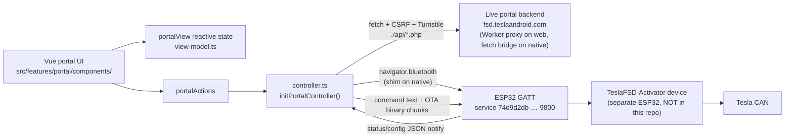
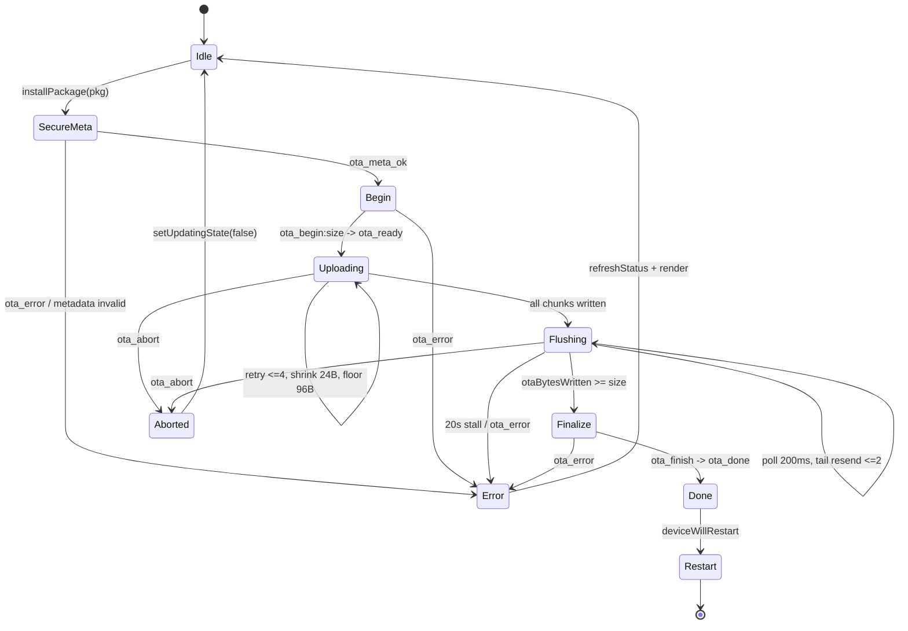
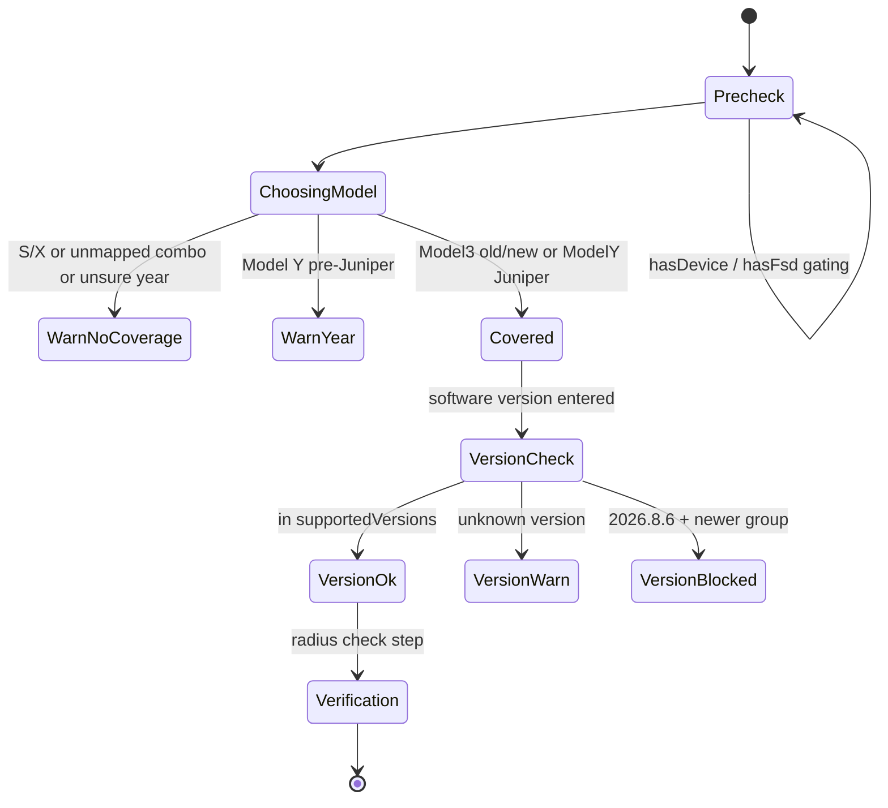
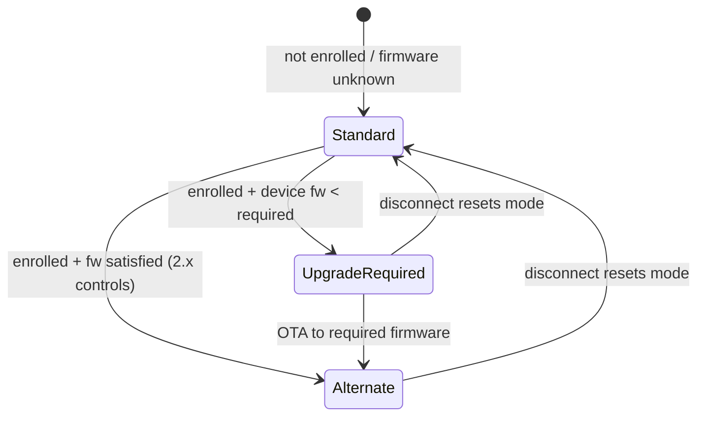

# riderx-autosteerplus

Deep code-grounded analysis. Mode: **replace** — the pre-replace summary still exists in git history; pre-replace claims are cited below as `git show HEAD:docs/legacy/riderx-autosteerplus.md#L<n>`. The original doc had YAML frontmatter (preserved byte-for-byte above) and **no** `## Upstream (...)` sections, so there are no preserved Upstream sections to re-append.

## 1. Provenance

- Submodule path: `legacy/riderx-autosteerplus`
- Pinned gitlink (canonical, from `git ls-files -s`): `160000 bd1b5e65b46dbbeaecf9930aa453c913f7aad7da 0`
- `git -C legacy/riderx-autosteerplus rev-parse HEAD` matches: `bd1b5e65b46dbbeaecf9930aa453c913f7aad7da` ("fix: logo", 2026-04-08, Martin Donadieu)
- Submodule working tree clean (`status --porcelain` empty). The local clone is **shallow** (`rev-parse --is-shallow-repository` → `true`), so only this one commit is available locally.
- Upstream URL: `https://github.com/riderx/autosteerplus` (origin fetch/push)
- License: MIT (`LICENSE:1-21`, "Copyright (c) 2026 riderx")
- Analysis date: 2026-11-20
- What the repo is: a Vue 3 + Capacitor (iOS/Android) app plus a Cloudflare Worker web fork that wraps the **live** third-party portal `https://fsd.teslaandroid.com` (Tesla FSD "activator" device management). It contains **no firmware and no CAN code**; the ESP32 device ("TeslaFSD-" / "TeslaFSD-Activator") is a separate product not in this repo.

Reading coverage (per-file, closed vocabulary):

- FULL-READ: `src/features/portal/controller.ts` (1-3484), `src/features/portal/view-model.ts` (1-280), `src/runtime/web-bluetooth-shim.ts` (1-282), `src/runtime/portal-session.ts` (1-110), `src/main.ts` (1-58), `src/App.vue` (1-44), `src/app-version.ts` (1), `worker/index.ts` (1-96), `worker-youtube/index.ts` (1-88), `wrangler.jsonc` (1-24), `wrangler.youtube.jsonc` (1-19), `capacitor.config.ts` (1-59), `package.json` (1-39), `vite.config.ts` (1-33), `index.html` (1-30), `README.md` (1-311), `LICENSE` (1-21), `AGENTS.md` (whole file), `.github/workflows/deploy-web.yml` (1-45), `.codex/environments/environment.toml` (1-11), `android/app/src/main/java/com/autosteerplus/app/MainActivity.java` (1-5), `android/app/src/main/AndroidManifest.xml` (1-35), `android/app/capacitor.build.gradle` (1-22), `ios/App/App/AppDelegate.swift` (1-49), `scripts/fix-ios-spm.mjs` (1-43), `src/features/portal/theme.css` (1-2), `src/features/portal/components/PortalDashboardPage.vue` (1-92), `src/features/portal/components/PortalRadiusCheck.vue` (1-119).
- RANGE-CITED: `src/features/portal/components/PortalOnboardingPage.vue` (script block 602-1406 read in full; template 1-601 only via targeted greps), `src/features/portal/components/PortalDocsPage.vue` (script 503-734 plus template sections 320-458), and the remaining portal components (`PortalAuthShell`, `PortalControlsPanel`, `PortalOtaPanel`, `PortalStatusPanel`, `PortalAdminPanel`, `PortalFaqPage`, `PortalHeader`, `PortalPasswordGate`, `PortalPasskeysPanel`, `PortalPasskeySetupGate`, `PortalSessionLogPanel`, `PortalActionButton`, `PortalZoomableImage`) — binding-level greps only (`portalActions.*` / `portalView.*` call sites), no full template reads.
- Files explicitly NOT read: all binary images (~130 files, including ~50 MB `profile_set_action_done_car_screen.png`, ~48 MB `service_mode.png`, ~40 MB `set_drive_profile_from_wheel.png`), `android.jks` (binary keystore; existence and README password disclosure noted, contents not read), `bun.lock`, `android/gradle/**`, `android/app/src/main/res/**`, `ios/App/App.xcodeproj/project.pbxproj`, `ios/App/CapApp-SPM/**` (regenerated by `scripts/fix-ios-spm.mjs`), `ios/debug.xcconfig`, `public/privacy/index.html`, `marketing/**`. Inventory came from `git -C legacy/riderx-autosteerplus ls-files` (includes hidden dirs `.codex/`, `.github/`).

## 2. Executive verdict

This repo is a commercial-style **client packaging exercise**, not a CAN research repo: a Vue 3 UI (Konsta/Tailwind) wrapped around the live `fsd.teslaandroid.com` portal, shipped as a Capacitor iOS+Android app and a Cloudflare Worker web fork. There is no firmware, no CAN frame handling, and no tests; every vehicle claim (Summon radius growth, follow-distance profile mapping, software-version compatibility) is data baked into Vue templates, not decoded from buses. The mechanisms that matter to TeslaCANModder are all **transport-side**: the Web Bluetooth shim over `@capacitor-community/bluetooth-le`, a four-characteristic GATT protocol (status/config/command/OTA-data), a well-tuned BLE OTA engine (180 B chunks, retry/backoff/shrink, tail resend, sha256+signature+IV secure handshake), and a software-version compatibility gate whose version intel (2026.2.9.x = FSD 14, 2026.8.3 = FSD 13 install-good, 2026.8.6 blocked) converges with our own `fwcompat` decoder. Adaptation candidates: the BLE OTA engine and its tuning constants, a refinement of our `fw_compat` 2026-release gating, and the follow-distance profile table as docs content (capture-first, direction unverified). Do not port: the third-party portal dependency, the committed Android keystore with a disclosed password, CapGo auto-update, the ~140 MB of committed screenshots, and the untyped 3500-line controller pattern.

## 3. Evidence map

No TEST-READ evidence exists: this repo ships no tests (only Capacitor template stubs, see section 10). No CAPTURE evidence exists in this repo: no CAN logs, no frame captures, no decode tooling.

| source file | lines | what it proves | grade |
| ----------- | ----- | ------------- | ----- |
| `src/features/portal/controller.ts` | 11-28 | BLE service/char UUIDs, OTA chunk/retry/flush constants | CODE-READ |
| `src/features/portal/controller.ts` | 2556-2641 | `connect()`: namePrefix discovery, serialized characteristic lookup, notify setup | CODE-READ |
| `src/features/portal/controller.ts` | 2651-2695 | `sendCommand()` write/response race with matcher waiters | CODE-READ |
| `src/features/portal/controller.ts` | 2713-2747 | config text commands `hooks=`, `mode=`, `payload=`, `setting=` | CODE-READ |
| `src/features/portal/controller.ts` | 2756-2926 | OTA download, chunk retry/shrink, tail-resend flush loop | CODE-READ |
| `src/features/portal/controller.ts` | 2928-3010 | secure OTA metadata handshake + package sanitization regexes | CODE-READ |
| `src/features/portal/controller.ts` | 3012-3092 | `installFirmware()`/`abortOta()` full sequence | CODE-READ |
| `src/features/portal/controller.ts` | 139-192 | admin role detection heuristics | CODE-READ |
| `src/features/portal/controller.ts` | 1772-1984 | WebAuthn passkey normalize/serialize + login flows | CODE-READ |
| `src/features/portal/controller.ts` | 938-1130 | Device Manager lock modes + management catalog normalization | CODE-READ |
| `src/runtime/web-bluetooth-shim.ts` | 64-97, 99-282 | native BLE bridge, `androidNeverForLocation`, requestDevice merge, NUS-style shim classes | CODE-READ |
| `src/runtime/portal-session.ts` | 3, 58-110 | portal origin, fetch interception, CSRF/Turnstile meta bootstrap | CODE-READ |
| `src/main.ts` | 36-48 | native vs web bootstrap order, CapGo `notifyAppReady` | CODE-READ |
| `worker/index.ts` | 14-47, 78-96 | reverse proxy `/api` + `/__portal__` → fsd.teslaandroid.com | CODE-READ |
| `worker-youtube/index.ts` | 1-88 | YouTube embed wrapper worker (yt.tslap.store) | CODE-READ |
| `vite.config.ts` | 18-32 | dev proxy of `/api` and `/__portal__` to portal origin | CODE-READ |
| `capacitor.config.ts` | 9-11, 30-47, 48-55 | CapGo env overrides, auto-update config, BLE display strings | CODE-READ |
| `wrangler.jsonc` | 5, 11-17 | hardcoded CF account id, custom domain asp.tslap.store | CODE-READ |
| `README.md` | 192 | keystore password disclosure: "the key and passwords are all: autosteerplus" | CODE-READ |
| `README.md` | 43, 113 | references `src/features/portal/styles.css` which is absent from the tree | CODE-READ (absence) |
| `src/features/portal/components/PortalOnboardingPage.vue` | 695-923, 916-923, 1075-1308 | model/year/version gate data, supportedVersions set, blocked 2026.8.6 | CODE-READ |
| `src/features/portal/components/PortalDocsPage.vue` | 389-402, 687-713 | follow-distance → profile mapping table (HW3/HW4) | CODE-READ |
| `src/features/portal/components/PortalRadiusCheck.vue` | 105-118 | Summon radius verification checklist (5-40 m before, ~200 m after) | CODE-READ |
| `src/features/portal/view-model.ts` | 90, 140, 197 | dead `openIdentifyCar` action and unused "identify" page | CODE-READ |
| `android/app/capacitor.build.gradle` | 11-16 | Android ships BLE + CapGo updater plugins | CODE-READ |
| `LICENSE` | 1-21 | MIT license | CODE-READ |
| `git show HEAD:docs/legacy/riderx-autosteerplus.md#L15` | — | old summary: portal wrapper + BLE bridge + web fork (agrees with code) | SUMMARY-ONLY |
| `git show HEAD:docs/legacy/riderx-autosteerplus.md#L33` | — | old summary: License MIT (agrees with LICENSE) | SUMMARY-ONLY |

## 4. Architecture and build surface

None found: no frame pipeline in this repo — there is no CAN RX/decode/mutate/TX code anywhere (`git grep -nEi 'CAN_ID|MCP2515|0x3F8|0x2B9|can_frame'` over the submodule returns nothing). The app-level data flow is:



- Entry points: `src/main.ts:50-53` (`main()` → bootstrap → `createApp(App).mount`), `src/App.vue:40-43` (mounts, then dynamically imports and runs `initPortalController()`), `worker/index.ts:78-96` (Cloudflare fetch handler), `worker-youtube/index.ts:73-88`.
- Shared core vs platform port: portal logic is 100% shared TypeScript; platform split is only at the runtime shim layer (`web-bluetooth-shim.ts` installs `navigator.bluetooth` only when `Capacitor.isNativePlatform()`, `web-bluetooth-shim.ts:268-271`).
- Build flags / env: `CAPGO_AUTO_UPDATE`, `CAPGO_APP_ID`, `CAPGO_DEFAULT_CHANNEL` (`capacitor.config.ts:9-11`), `__APP_VERSION__` define from package.json (`vite.config.ts:14-16`). No bus/build-flag matrix like ours — nothing is feature-gated.
- Dependency boundary — the hard one: all auth, packages, and customer management live on the remote portal (22 `.php` endpoints under `./api/`); this repo cannot function standalone (README:291 agrees).

## 5. Mechanism catalogue

### Web Bluetooth shim (native BLE bridge)

- **Claim (README / summary):** native app installs a Web Bluetooth compatibility shim onto `navigator.bluetooth` backed by `@capacitor-community/bluetooth-le` (README:19, 52-54).
- **Code path:** `src/runtime/web-bluetooth-shim.ts:268` — `installWebBluetoothShim()` → `WebBluetoothNavigatorShim.requestDevice()` → `BleClient.requestDevice(mergeRequestOptions())` → shim GATT classes → same call sites as browser Web Bluetooth.
- **Frame spec:** None found (no CAN frames; BLE payload spec is in the GATT portal protocol card).
- **Gates and timing:** shim installed only on native platform and only if `navigator.bluetooth` is absent (`web-bluetooth-shim.ts:268-271`); `BleClient.initialize({androidNeverForLocation: true})` once (`64-71`); connect pre-disconnects a stale session and uses `skipDescriptorDiscovery: true` (`190-199`); requestDevice merges multiple filters into one namePrefix and uses `displayMode: 'list'` (`73-97`).
- **State machine:** None found (stateless shim; `#notifying` boolean per characteristic).
- **Tests:** None found.
- **Evidence grade:** CODE-READ
- **Verdict:** CONFIRMED
- **Adapt to TeslaCANModder?** already present as a concept — our `IBlePeripheral` injection contract (`client/src/hardware/transport.ts:185-197`) is the same adapter pattern; keep their Android note that concurrent characteristic lookups must be serialized (`controller.ts:2580-2582`) as a pitfall reminder for our RN BLE adapter.

### Portal session / fetch bridge

- **Claim (README / summary):** "a runtime fetch/session bridge so the app can keep talking to the live backend" (README:20).
- **Code path:** `src/runtime/portal-session.ts:58-82` — `installPortalFetchBridge()` rewraps `window.fetch`, rewrites same-origin and portal-origin URLs to `PORTAL_ORIGIN` with `credentials: 'include'` → `bootstrapPortalSession()` (`84-110`) fetches the portal root, DOM-parses HTML, extracts `meta[name=csrf-token]` and `meta[name=turnstile-site-key]`, injects them into the local document.
- **Frame spec:** None found.
- **Gates and timing:** bridge only on native (`58-59`); bootstrap URL is `PORTAL_ORIGIN + '/'` on native, `/__portal__/` on web (`50-56`); fatal banner on failure (`src/main.ts:12-34`).
- **State machine:** None found.
- **Tests:** None found.
- **Evidence grade:** CODE-READ
- **Verdict:** CONFIRMED
- **Adapt to TeslaCANModder?** no impact — we own our firmware/backend and do not wrap a third-party portal; the credential-forwarding pattern is on the do-not-copy list.

### GATT portal protocol (status / config / command / OTA-data characteristics)

- **Claim (README / summary):** device management over BLE to the "Tesla FSD ESP32 activator" (`index.html:12`).
- **Code path:** `src/features/portal/controller.ts:2556-2641` — `connect()` → `requestDevice({filters: [{namePrefix: "TeslaFSD-"}, {namePrefix: "TeslaFSD-Activator"}], optionalServices: [BLE_SERVICE_UUID]})` → four characteristics resolved **one-by-one** (Android GATT concurrency note at 2580-2582) → command notifications → status/config notifications → `refreshStatus(true)`.
- **Frame spec:** service `74d9d2db-4d0a-4f23-9acb-5528df6b9800`; characteristics `…9801` status (JSON, read+notify), `…9802` config (JSON, read+notify+write), `…9803` command (text, write+notify), `…9804` OTA data (binary, write-without-response). Status JSON fields: `deviceName, firmwareVersion, canOnline, canRxAgeMs, canHooksEnabled, operationModeLabel, profile, speedOffsetPercent, fsdFlag, otaInProgress, otaBytesWritten, otaExpectedSize, otaLastError, otaSecureMode, otaMetadataRequired, otaMetadataLoaded, otaEncryptedRequired` (`1494-1540, 2521-2554`). Config JSON: `canHooksEnabled, operationModeId, modes, payloads, choices, payloadsResetAfterOta` (`1542-1552`).
- **Gates and timing:** connect requires `state.authenticated` (`2557-2559`); status polled at 1500 ms (`STATUS_POLL_INTERVAL_MS`, line 22, `2466-2477`) on top of notifications; commands race write vs response (`2651-2695`); reboot command tolerates write-error-after-response because the device dies mid-write (`2651-2678`, `2749-2754`).
- **State machine:** None found (connection boolean + waiter list).
- **Tests:** None found.
- **Evidence grade:** CODE-READ
- **Verdict:** CONFIRMED
- **Adapt to TeslaCANModder?** candidate for future PR only if we add BLE OTA — otherwise our single-channel NUS JSON-RPC (`firmware/lib/io/ble/esp32/uuids.h:11-17`) is simpler and already shipped. Capture-first before changing any transport-visible shape; `docs/checklists/can-review-checklist.md` would be required.

### BLE OTA engine (chunk push, retry/backoff/shrink, tail resend, secure handshake)

- **Claim (README / summary):** "Authenticated Web Bluetooth OTA and device management portal" (`index.html:12`); old summary called the app a "UI/control layer" without naming the OTA protocol (git show HEAD:docs/legacy/riderx-autosteerplus.md#L58).
- **Code path:** `src/features/portal/controller.ts:3012-3081` — `installFirmware()` → `fetchFirmwarePackage()` (HTTP, 2756-2767) → `ensureSecureMetadataReady()` (2928-2959) → `ota_begin:<size>` (3043-3051) → `uploadFirmwareChunks()` (2903-2926, per-chunk `writeChunkWithRetry()` 2862-2901) → `waitForOtaBytes()` flush loop (2775-2860) → `ota_finish` (3063-3072). Abort: `abortOta()` 3083-3092.
- **Frame spec:** text handshake over command characteristic: `ota_meta:<size>:<sha256>:<signatureHex>:<deliveryIvHex>` → `ota_meta_ok:`; `ota_begin:<size>` → `ota_ready:`; binary chunks (≤180 B, ≥96 B) to `…9804` write-without-response; `ota_finish` → `ota_done:`; `ota_abort` → `ota_aborted`; errors as `ota_error:<msg>`.
- **Gates and timing:** 4 attempts per chunk, backoff 180 ms × attempt, chunk shrink 24 B per failure (16 B if the device already advanced past the offset) with floor 96 B (`2862-2901`); progress status read every 6 chunks (`2920-2922`); flush poll 200 ms, flush timeout 20 s, status heartbeat 800 ms in tail, tail grace 700 ms, tail resend limit 2, tail window 360 B (`2775-2860`); `ota_begin`/`ota_meta` timeout 8 s, `ota_finish` 15 s, abort 4 s; package size must equal announced size (`3028-3032`) and is capped at 16 MiB (`2970-2973`).
- **State machine:**



- **Tests:** None found.
- **Evidence grade:** CODE-READ
- **Verdict:** CONFIRMED
- **Adapt to TeslaCANModder?** candidate for future PR — the strongest mechanism here. Port the **behavior and constants** (chunk size floor/ceiling, retry/shrink ladder, tail-resend window), not the code; requires an ESP32-side OTA receiver we do not ship today (ours flashes via esptool-js over WebSerial, `client/src/hardware/webEspFlasher.ts:42-103`). Any firmware-side addition is transport-visible → `docs/checklists/can-review-checklist.md` + listen-only bench capture first.

### Onboarding vehicle-compatibility gate (model / year / software version)

- **Claim (README / summary):** "Guided install flow with model/year/version checks and install videos" (README:81); old summary lists "Onboarding/docs/FAQ flow design" as a takeaway (git show HEAD:docs/legacy/riderx-autosteerplus.md#L69).
- **Code path:** `src/features/portal/components/PortalOnboardingPage.vue:626-1391` — `hasDevice`/`hasFsd` gates (`1339-1363`) → `selectedModel`/`selectedYearBand` → `selectedCarId` computed (`984-1006`) → `vehicleSelectionState` (`1075-1159`) → `expectedFsdState` (`1173-1234`) → `compatibilityState` (`1236-1308`); guides mapped by `CarOption.guideId` (`763-824`, `826-914`).
- **Frame spec:** None found (pure UI state; no bus frames).
- **Gates and timing:** resets on any re-choice (`1326-1328`); resets the whole flow if device/FSD preconditions break (`1330-1337`); install videos served via `yt.tslap.store` wrapper on native, direct YouTube embed on web (`1021-1031`).
- **State machine:**



- **Tests:** None found.
- **Evidence grade:** CODE-READ
- **Verdict:** CONFIRMED
- **Adapt to TeslaCANModder?** candidate (data, not code): the version intel feeding this gate overlaps our `fwcompat` decode — see parity row 4. The Summon-radius "before 5-40 m / after ~200 m" verification UX (`PortalRadiusCheck.vue:105-118`) is a nice end-user verification story worth paraphrasing in our docs.

### Auth surface (passwords, WebAuthn passkeys, Turnstile, admin gating)

- **Claim (README / summary):** old summary says the app "wraps" the portal (git show HEAD:docs/legacy/riderx-autosteerplus.md#L15); README does not describe auth.
- **Code path:** `src/features/portal/controller.ts:1692-1738` — `login()` posts `{email, password, botToken}` with CSRF header; `1772-1839` WebAuthn option normalization/credential serialization; `1875-1918` `registerPasskey()`; `1944-1984` `signInWithPasskey()`; Turnstile widget render/retry at `109-137, 428-482`; password policy `533-561` (15-char minimum, no 4-digit codes, no repeats, no email substring); admin heuristics `139-192`.
- **Frame spec:** None found.
- **Gates and timing:** Turnstile render retry 40 × 250 ms (`126-136`); command waiters timeout 6 s default (`2354-2365`); admin passkey setup gates the whole admin panel (`194-196`).
- **State machine:** None found (boolean gates: `mustChangePassword`, `passwordDialogOpen`, `adminPasskeySetupRequired`).
- **Tests:** None found.
- **Evidence grade:** CODE-READ
- **Verdict:** CONFIRMED
- **Adapt to TeslaCANModder?** no impact — our auth model is device-local (firmware REST/BLE), not a multi-tenant web portal.

### Device Manager lock and catalog (firmware-gated UI modes)

- **Claim (README / summary):** None found (README does not mention Device Manager).
- **Code path:** `src/features/portal/controller.ts:938-968` — `normalizeDeviceManagementLock()` (modes `standard`/`upgrade_required`/`alternate`, required firmware version, access groups); `970-1023` bootstrap + gating messages; `1029-1051` config-input gating; `2497-2513` disconnect resets mode to `standard` and clears `currentFirmwareVersion`; catalog normalization `670-790` (`modes`/`payloads`/`choices` with `range` clamping).
- **Frame spec:** None found.
- **Gates and timing:** alternate UI requires authenticated + connected + mode `alternate` (`988-994`); upgrade-required message shows required vs current firmware (`1004-1011`); `fsd_v14_speed_profile` choice hidden when mode is `fsd_v12_v13` (`791-800`).
- **State machine:**



- **Tests:** None found.
- **Evidence grade:** CODE-READ
- **Verdict:** CONFIRMED
- **Adapt to TeslaCANModder?** no impact — SaaS rollout gating for a commercial fleet; irrelevant to our open firmware.

### Cloudflare Worker reverse proxy + YouTube embed wrapper

- **Claim (README / summary):** "Cloudflare Workers static deploy config for the web fork" (README:22, old summary L44 agrees).
- **Code path:** `worker/index.ts:78-96` — `/api` + `/__portal__` paths → `proxyPortalRequest()` → fetch to `https://fsd.teslaandroid.com` with `redirect: 'manual'` (`39-47`); `/yt/player/<id>` → 302 to `https://yt.tslap.store` (`49-70`); `/privacy` → static asset; else Vite dist SPA. `worker-youtube/index.ts:4-71` renders a full-viewport YouTube iframe with `rel=0&playsinline=1&modestbranding=1`.
- **Frame spec:** None found.
- **Gates and timing:** YouTube ID regex `^[a-zA-Z0-9_-]{11}$` (both workers); player page cached 300 s (`worker-youtube/index.ts:67`).
- **State machine:** None found.
- **Tests:** None found.
- **Evidence grade:** CODE-READ
- **Verdict:** CONFIRMED (old summary's "plain Vite site on Cloudflare" understates the proxy — see contradiction table).
- **Adapt to TeslaCANModder?** no impact — our web client talks directly to the device on the LAN; we do not proxy a third-party backend.

### CapGo live app-shell updates

- **Claim (README / summary):** None found (not mentioned in README or old summary).
- **Code path:** `src/main.ts:40` — `CapacitorUpdater.notifyAppReady()`; `capacitor.config.ts:30-47` — autoUpdate (default on unless `CAPGO_AUTO_UPDATE=false`), `directUpdate: 'onLaunch'`, 10 s splash/app-ready timeouts, `autoDeleteFailed/Previous`, `resetWhenUpdate`.
- **Frame spec:** None found.
- **Gates and timing:** update channel `production` by default (`capacitor.config.ts:11`).
- **State machine:** None found (library-internal).
- **Tests:** None found.
- **Evidence grade:** CODE-READ
- **Verdict:** CONFIRMED
- **Adapt to TeslaCANModder?** never port — silent third-party auto-update of the app shell is a supply-chain risk and conflicts with our pinned GitHub-release assets.

## 6. Summary vs code contradiction table

| pre-replace claim | code evidence | verdict |
| ---------------- | ------------- | ------- |
| `git show HEAD:docs/legacy/riderx-autosteerplus.md#L30`: "**Platform**: iOS (Capacitor native app), Web (Cloudflare Workers)" | full Android native platform ships: `android/app/src/main/AndroidManifest.xml:1-35`, BLE + CapGo plugins in `android/app/capacitor.build.gradle:11-16`; upstream AGENTS.md says three delivery surfaces (web, iOS, Android) | CONTRADICTED — platform list incomplete |
| `git show HEAD:docs/legacy/riderx-autosteerplus.md#L54`: "Web mode: Plain Vite site on Cloudflare" | web mode is a Worker **reverse proxy**: `/api` and `/__portal__` are forwarded to `https://fsd.teslaandroid.com` (`worker/index.ts:14-47`); dev server proxies the same paths (`vite.config.ts:18-32`) — the web fork cannot function without the live portal | CONTRADICTED — "plain Vite site" misrepresents the live-backend dependency |
| preserved frontmatter `description` (line 3 above, byte-for-byte): "…into a native iOS" (truncated, iOS only) | same evidence as row 1; kept verbatim per replace-mode rules | STALE FRONTMATTER — recorded, bytes preserved |
| `README.md:43` + `README.md:113` + AGENTS.md: "Treat `src/features/portal/styles.css` as legacy styling" | no `styles.css` exists anywhere in `git ls-files` (`src/features/portal/` contains only `theme.css` + `ui.ts` + code; only `android/.../res/values/styles.xml` matches "styles") | CONTRADICTED — docs reference a file that is not in the tree |
| `git show HEAD:docs/legacy/riderx-autosteerplus.md#L62`: "Reusability: Low" | the BLE OTA engine constants (section 5 card 4) are genuinely reusable tuning data; the old rating under-called the transport value | PARTIAL — old rating was an opinion, evidence map upgrades it |

Everything else in the old summary checked out against code and is recorded in the evidence map (MIT license, portal wrapper purpose, BLE bridge stack, no direct CAN integration).

## 7. CAN frame and signal inventory

None found. This repo decodes, mutates, or injects **zero** CAN frames; it contains no DBC/JSON signal catalog and no CAN code at all (negative anchor: `git -C legacy/riderx-autosteerplus grep -nEi 'CAN_ID|MCP2515|0x3F8|0x2B9|can_frame'` → no output). All vehicle-facing values it displays (`profile`, `speedOffsetPercent`, `fsdFlag`, `canOnline`) arrive as JSON fields over BLE from the external device (`controller.ts:1494-1540`).

## 8. Constants and tuning table

| constant | value | file:line | meaning | grade |
| -------- | ----- | --------- | ------- | ----- |
| `BLE_SERVICE_UUID` | `74d9d2db-4d0a-4f23-9acb-5528df6b9800` | controller.ts:11 | custom GATT service for the activator device | CODE-READ |
| `BLE_STATUS/CONFIG/COMMAND/OTA_DATA UUID` | `…9801` / `…9802` / `…9803` / `…9804` | controller.ts:12-15 | four-characteristic split (JSON status, JSON config, text command, binary OTA) | CODE-READ |
| `DEFAULT_OTA_CHUNK_SIZE` | 180 B | controller.ts:17 | default BLE OTA chunk (fits default ATT payload) | CODE-READ |
| `MIN_OTA_CHUNK_SIZE` | 96 B | controller.ts:18 | shrink floor after repeated GATT write failures | CODE-READ |
| `OTA_CHUNK_RETRY_LIMIT` | 4 | controller.ts:19 | attempts per chunk before failing the install | CODE-READ |
| `OTA_RETRY_BACKOFF_MS` | 180 (× attempt) | controller.ts:21, 2894 | linear backoff between chunk retries | CODE-READ |
| `OTA_PROGRESS_STATUS_EVERY` | 6 chunks | controller.ts:20, 2920-2922 | periodic status snapshot cadence during upload | CODE-READ |
| `OTA_FLUSH_POLL_INTERVAL_MS` / `OTA_FLUSH_TIMEOUT_MS` | 200 ms / 20000 ms | controller.ts:23-24 | post-upload flush poll and hard deadline | CODE-READ |
| `OTA_STALLED_TAIL_GRACE_MS` / `OTA_TAIL_RESEND_LIMIT` / `OTA_TAIL_FLUSH_WINDOW_BYTES` | 700 ms / 2 / 360 B (2 chunks) | controller.ts:26-28 | stall detection and trailing-chunk re-send policy | CODE-READ |
| `STATUS_POLL_INTERVAL_MS` | 1500 ms | controller.ts:22, 2466-2477 | status re-read cadence on top of notifications | CODE-READ |
| command waiter timeout | 6000 ms default; 4000/8000/15000 for reboot/status/ota_meta+begin/finish | controller.ts:2354-2365, 2750, 2807, 2949-2953, 3043-3047, 3063-3067 | per-command response deadlines | CODE-READ |
| `PASSWORD_MIN_LENGTH` | 15 | controller.ts:32, 533-561 | portal password policy (+ no 4-digit codes, no email substring) | CODE-READ |
| package size cap | 16 MiB | controller.ts:2967-2974 | max accepted OTA package size | CODE-READ |
| secure-OTA metadata regexes | sha256 `^[a-f0-9]{64}$`, IV `^[a-f0-9]{32}$`, sig `^[a-f0-9]{2,160}$` even-length | controller.ts:2992-3007 | pre-handshake package sanitization | CODE-READ |
| package id regex | `^[A-Za-z0-9._-]{1,120}$` | controller.ts:2963 | identifier sanitization | CODE-READ |
| Turnstile retry | 40 × 250 ms | controller.ts:126-136 | widget render retry budget | CODE-READ |
| `supportedVersions` | `2026.2.9`, `2026.2.9.1-.3`, `2026.8.3` | PortalOnboardingPage.vue:916-923 | confirmed-install Tesla software versions; 2026.8.6 blocked for newer cars (1259-1271) | CODE-READ |
| follow-distance → profile table | HW3: 2→Hurry, 3→Normal, 4→Chill; HW4: 2→Max, 3→Hurry, 4→Normal, 5→Chill, 6→Sloth; "lower distance = more aggressive" | PortalDocsPage.vue:389-402, 687-713 | user-facing mapping claim (no decode code in repo) | CODE-READ (as data-in-code) |
| Summon radius check | before ~5-40 m diameter (region-dependent), after ~200 m diameter | PortalRadiusCheck.vue:105-118, PortalOnboardingPage.vue:736 | install-verification heuristic | CODE-READ (as data-in-code) |
| Canadian FSD subscription postal fallback | `T4A 2G4`, ~$99 CAD/month | PortalOnboardingPage.vue:749, PortalDocsPage.vue:599-605 | region-lock workaround recipe (pricing SUMMARY-grade in itself) | CODE-READ (as data-in-code) |
| `PORTAL_ORIGIN` / `WEB_PORTAL_BOOTSTRAP_PATH` | `https://fsd.teslaandroid.com` / `/__portal__/` | portal-session.ts:3-5, worker/index.ts:1-3 | the live-backend dependency | CODE-READ |
| Bluefy fallback URL | `https://apps.apple.com/app/id1492822055` | AGENTS.md:87, PortalAuthShell.vue:191 | iOS web-BLE fallback browser | CODE-READ |
| Cloudflare `account_id` | `9ee3d7479a3c359681e3fab2c8cb22c0` | wrangler.jsonc:5, wrangler.youtube.jsonc:5 | deploy target identity (hardcoded — provenance note) | CODE-READ |

## 9. Failure modes and edge cases

| failure | handling code path | tested? | grade |
| ------- | ------------------ | ------- | ----- |
| GATT disconnect mid-session | `handleDisconnect()` stops polling, rejects all pending command waiters, clears device/characteristics, resets management mode, notifies server `device-context {connected:false}` | no | CODE-READ (controller.ts:2486-2519) |
| command response never arrives | `waitForCommand()` rejects after 6000 ms (per-command overrides), waiter removed from list | no | CODE-READ (controller.ts:2354-2373) |
| BLE chunk write fails | retry ≤4 with 180 ms × attempt backoff, shrink 24 B (16 B if device advanced), floor 96 B, device offset reconciliation via status snapshot | no | CODE-READ (controller.ts:2862-2901) |
| OTA flush stalls at the tail | poll 200 ms; tail resend (≤2) of the trailing 360 B after 700 ms grace; hard fail at 20 s with received-byte count | no | CODE-READ (controller.ts:2775-2860) |
| device reports OTA error mid-flow | every handshake matcher accepts `ota_error:*` and throws with the device text | no | CODE-READ (controller.ts:2807-2817, 2949-2957, 3043-3051, 3063-3071) |
| reboot kills the link before write ack | `tolerateWriteErrorAfterResponse` swallows the write error if the response already matched | no | CODE-READ (controller.ts:2651-2678, 2749-2754) |
| downloaded firmware size ≠ announced | pre-flight size equality check, abort before `ota_begin` | no | CODE-READ (controller.ts:3024-3032) |
| status/config JSON malformed | `parseJsonPayload()` logs and drops; `apiJson()` surfaces a 240-char snippet | no | CODE-READ (controller.ts:2333-2340, 1599-1613) |
| Turnstile widget fails to render | 40 × 250 ms retry, then instructs the user to reload | no | CODE-READ (controller.ts:109-137) |
| Android GATT instability on concurrent lookups | characteristics resolved sequentially with an explicit comment | no | CODE-READ (controller.ts:2580-2589) |
| portal bootstrap fails at startup | fatal red banner rendered, app does not mount | no | CODE-READ (src/main.ts:12-34, 55-58) |
| all of the above | no automated coverage anywhere — every path is untested | — | stated in prose: this repo ships no tests |

## 10. Test coverage map

Test files found: `android/app/src/test/java/com/getcapacitor/myapp/ExampleUnitTest.java` and `android/app/src/androidTest/java/com/getcapacitor/myapp/ExampleInstrumentedTest.java` — both are **Capacitor template stubs** (`com.getcapacitor.myapp` package, not the app package); they assert nothing about this project.

Critical paths with no test, with risk in one line:

- BLE OTA state machine (controller.ts:2756-3092): a regression in retry/shrink/tail-resend silently bricks field updates — highest-risk untested path.
- WebAuthn serialization (controller.ts:1772-1839): a base64url regression locks out every passkey user.
- Fetch bridge rewrite rules (portal-session.ts:58-82): wrong origin matching leaks cookies or breaks auth silently.
- Onboarding gate (PortalOnboardingPage.vue:1075-1308): wrong version gating tells users to install on blocked firmware.
- Worker proxy routing (worker/index.ts:78-96): a path-matching bug sends portal API traffic to the static SPA.

No TEST-READ evidence exists in this repo; every behavior claim above is CODE-READ only.

## 11. Parity matrix with TeslaCANModder

| signal/frame/surface | upstream decode (cite) | our decode (cite) | delta | action |
| -------------------- | ----------------------- | ----------------- | ----- | ------ |
| BLE GATT service design | custom service `74d9d2db-…-9800` with 4 characteristics: JSON status, JSON config, text command, binary OTA data (controller.ts:11-15, 2556-2641) | Nordic UART service `6e400001-b5a3-f393-e0a9-e50e24dcca9e` with RX/TX text characteristics carrying single-line JSON-RPC (firmware/lib/io/ble/esp32/uuids.h:11-17) | upstream splits channels and gains a binary OTA path; ours is one line protocol | capture-first — only revisit if we adopt BLE OTA (row 5) |
| device discovery name | namePrefix `TeslaFSD-` / `TeslaFSD-Activator` (controller.ts:2567-2573) | advertised name `TeslaCANModder`, NVS-overridable (firmware/lib/core/config/esp32.h:35) | different products, no conflict | ignore |
| follow-distance → speed profile | user-facing table: HW3 distances 2-4, HW4 2-6, "lower distance = more aggressive" (PortalDocsPage.vue:389-402, 687-713) | `readFollowDistance()` byte5 bits[7:5] (firmware/lib/vehicle/can/ids.h:106-109); `mapHW3FollowDistToProfile` = {-1,2,1,0}, `mapHW4FollowDistToProfile` = {-1,3,2,1,0,4} (firmware/lib/vehicle/can/feature/fsd/profile.h:43-58) | upstream "distance" is the UI dial (2..6); ours is the raw CAN bits (0..5). Their aggressive-direction claim ("lower = more aggressive") points the opposite way from our maps (low fd → high profile index; per docs/reference/commands.md higher index = more conservative) — possible direction inversion between the UI dial and CAN bits, unresolved without a bench capture | capture-first — record a real dial sweep with `stream:on` before touching either side |
| vehicle software-version gating | `supportedVersions` = {2026.2.9, 2026.2.9.1-.3, 2026.8.3} install-good; 2026.8.6 blocked on newer cars, "mixed" on Intel; 2026.2.9.x ⇒ FSD 14, 2026.8.3 ⇒ FSD 13 (PortalOnboardingPage.vue:916-923, 1193-1223, 1259-1283) | `decodeFwVersion()`: 2026 release ≥8 ⇒ WARN on HW4 (FSD v13), 2026.2 minor ≥9 ⇒ OK (FSD v14), year ≥2026 ⇒ OK, else WARN (firmware/lib/vehicle/can/feature/telemetry/fw_compat.h:56-94) | both agree 2026.2.9 → v14 and 2026-release-8-line → v13; ours lumps 2026.8.3 with 2026.8.6 as HW4 WARN, upstream treats 8.3 as install-good and 8.6 as blocked — ours is coarser and lacks an 8.6-specific block | align (candidate) — refine `fw_compat` minor/build gating with the 8.3-vs-8.6 distinction; capture-first on a real car before changing the gate |
| firmware update channel | in-field BLE OTA push onto the running device, chunked 180 B with retry/shrink/tail-resend (controller.ts:2756-3092) | browser WebSerial + esptool-js bootloader flash of the merged release image at 460800 baud (client/src/hardware/webEspFlasher.ts:42-103) | complementary channels: theirs needs no USB access and no trim removal; ours rewrites the whole image from the bootloader | capture-first → candidate for future PR (BLE OTA receiver in firmware + chunk constants ported as behavior, not code) |
| signed/secure package metadata | sha256 + ECDSA-style signature hex + 16-byte AES delivery IV validated client-side and pushed via `ota_meta:` handshake (controller.ts:2928-3010) | release asset fetched over HTTPS from GitHub releases; no signature verification step (client/src/hardware/webEspFlasher.ts:44-49) | theirs adds end-to-end package authenticity; ours trusts TLS + release tags | capture-first (low priority; revisit only if BLE OTA lands) |
| in-app docs rendering | guidance baked into Vue templates with repo-root images (fsd_visualisation.png, summon_before/after.PNG, 30-50 MB each) (PortalDocsPage.vue:508-513, PortalRadiusCheck.vue:86-87) | client renders canonical `docs/` markdown through a docs catalog + MarkdownRenderer (client/src/screens/DocsScreen.tsx:10-12, 144) | ours is single-source and lightweight; upstream duplicates content in components and ships 140+ MB of binaries | ignore (ours is better); do reuse their Summon-radius verification narrative as docs content |

All seven rows have our-side CODE-READ citations; none are SUMMARY-ONLY.

## 12. Surface inventory and security notes

Transport surfaces:

- **BLE GATT** (native via shim, web via Web Bluetooth): discover by namePrefix, then 4 characteristics; commands `reboot`, `status`, `ota_meta:…`, `ota_begin:<size>`, `ota_finish`, `ota_abort`; config writes `hooks=0|1`, `mode=<id>`, `payload=<id>:0|1`, `setting=<id>:<value>` (controller.ts:2713-2747). Responses: `restarting`, `status_ok`, `ota_meta_ok:`, `ota_ready:`, `ota_done:`, `ota_aborted`, `ota_error:…`.
- **HTTP portal API** (all to `fsd.teslaandroid.com`, via worker proxy on web / fetch bridge on native): `session.php`, `login.php`, `logout.php`, `packages.php`, `package-download.php`, `change-password.php`, `device-context.php`, `passkeys.php`, `passkey-register-options.php`, `passkey-register-verify.php`, `passkey-auth-options.php`, `passkey-auth-verify.php`, `passkey-delete.php`, `admin-users.php`, `admin-create-user.php`, `admin-set-user-active.php`, `admin-set-user-groups.php`, `admin-delete-user.php`, `admin-sync-shopify-customers.php`, `admin-set-package-groups.php`, `admin-delete-package.php`, `admin-device-management-lock.php` — CSRF header from meta tag (controller.ts:92-98, 1564-1597).
- **Hash routes**: `#/home`, `#/docs?section=…`, `#/onboarding`, `#/faq` (controller.ts:33-36, 202-296). The `openIdentifyCar` action and `"identify"` page in the view-model are dead surfaces: no component calls them (only view-model.ts:90, 140, 197 define them).
- **Cloudflare Workers**: `asp.tslap.store` (proxy + static SPA) and `yt.tslap.store` (YouTube embed wrapper).
- **CapGo update channel**: auto-update of the native app shell on launch, channel `production`.

Provenance/security findings:

- **Committed signing keystore with disclosed password**: `android.jks` is in the tree and README:192 states "sign with android.jks the key and passwords are all: autosteerplus". Anyone can sign impersonating updates for this app id. Severity: high for upstream, irrelevant to us — never replicate.
- **Hardcoded Cloudflare account id** `9ee3d7479a3c359681e3fab2c8cb22c0` in both wrangler configs (wrangler.jsonc:5, wrangler.youtube.jsonc:5) — account-scoped identifier committed; use env/secrets instead.
- **Cross-origin cookie forwarding**: the fetch bridge rewrites same-origin URLs to the remote portal with `credentials: 'include'` (portal-session.ts:30-36, 58-82) — session cookies for the wrapper origin are silently re-sent to the third-party portal. Working as designed for this product; a pattern to avoid in our stack.
- **Auth depends on the live third-party portal** including its Turnstile CAPTCHA and CSRF rotation (index.html:16-17, 24; portal-session.ts:99-109). No local fallback; outage of `fsd.teslaandroid.com` bricks the app (README:291 acknowledges).
- **~140 MB+ of marketing binaries committed at repo root** (50.8 MB `profile_set_action_done_car_screen.png`, 48.6 MB `service_mode.png`, 39.8 MB `set_drive_profile_from_wheel.png`, 5.5 MB `fsd_in_Action.JPG`, plus per-density splash clones) — repo bloat anti-pattern.
- **`// @ts-nocheck` on the 3484-line controller** (controller.ts:1) — the load-bearing module ships with type checking disabled.

## 13. Adaptation assessment

| mechanism | value | cost | risk | evidence grade | decision |
| --------- | ----- | ---- | ---- | -------------- | -------- |
| Web Bluetooth shim | low — we already have the equivalent `IBlePeripheral` adapter pattern | — | — | CODE-READ | already present (concept); keep the Android serialized-lookup pitfall note (controller.ts:2580-2582) |
| Portal session/fetch bridge | none for us | — | credential-forwarding pattern | CODE-READ | no impact |
| GATT 4-characteristic protocol | medium — clean channel separation for status/config/OTA | high — transport-visible firmware change | can-review-checklist required; needs capture-first | CODE-READ | candidate for future PR **only if** BLE OTA is adopted; not standalone |
| BLE OTA engine + tuning constants | **high** — field updates without USB/trim removal; retry/shrink/tail-resend constants are battle-tested | high — needs ESP32 OTA receiver partition work + client transport | transport-visible; can-review-checklist + bench capture mandatory | CODE-READ | candidate for future PR (port behavior/constants, independent implementation) |
| Onboarding compatibility gate | medium — version intel (8.3 good / 8.6 blocked) and Summon-radius verification UX | low for docs content; medium for `fw_compat` change | changing our gate without a capture could mislabel a working car | CODE-READ | candidate (two parts: docs narrative now; `fw_compat` refinement capture-first) |
| Auth/passkeys/Turnstile | none — different trust model | — | — | CODE-READ | no impact |
| Device Manager lock/catalog | none — SaaS fleet gating | — | — | CODE-READ | no impact |
| Worker proxy + YouTube wrapper | low — our docs are local markdown; we have no third-party backend | — | — | CODE-READ | no impact |
| CapGo auto-update | negative | — | silent third-party app-shell updates | CODE-READ | never port |

## 14. Do-not-copy list

- `android.jks` (binary, repo root) + README:192 password disclosure — committed production signing secret; never replicate, never reuse the disclosed password anywhere.
- `src/features/portal/controller.ts:1` — `// @ts-nocheck` on the entire orchestration module; do not copy the untyped-controller pattern.
- `src/runtime/portal-session.ts:58-82` — cross-origin fetch rewrite with `credentials: 'include'` to a third-party origin; a cookie-forwarding anti-pattern for our stack.
- `capacitor.config.ts:9, 30-47` — default-on CapGo auto-update with `directUpdate: 'onLaunch'`; silent supply-chain updates conflict with our pinned GitHub-release asset model.
- `wrangler.jsonc:5`, `wrangler.youtube.jsonc:5` — hardcoded account-scoped deploy identifiers; ours should stay env-driven.
- Repo-root marketing binaries (~140 MB+, see section 12) — never import multi-megabyte screenshots into a shipping tree; serve scaled assets.
- `worker/index.ts:39-47` — reverse proxying an entire `/api/*` namespace to someone else's live backend; couples our client to a third party we do not control.

## 15. History and evolution

The submodule clone is **shallow** (`git -C legacy/riderx-autosteerplus rev-parse --is-shallow-repository` → `true`): the local `git log` contains exactly one commit — `bd1b5e6 "fix: logo"` (2026-04-08, Martin Donadieu). No changelog file exists in the tree. Therefore **no history mining was possible**: what was tried, reverted, or abandoned before the pin is invisible locally; any upstream-history claim beyond this snapshot is UNVERIFIED and would require `git -C legacy/riderx-autosteerplus fetch --unshallow` (network) followed by re-analysis. Single-commit observations: the tree is a polished consumer product (App/Play Store marketing folders, privacy page, per-density splash assets), not a research fork; the dead `openIdentifyCar` action and absent `styles.css` both suggest an earlier iteration whose surfaces were partially removed.

## 16. Re-verification recipe

Pinned snapshot: gitlink `160000 bd1b5e65b46dbbeaecf9930aa453c913f7aad7da 0` (parent repo), matching `rev-parse HEAD` inside the submodule.

```bash
OLD=bd1b5e65b46dbbeaecf9930aa453c913f7aad7da
git -C legacy/riderx-autosteerplus fetch --tags --prune
git -C legacy/riderx-autosteerplus log --oneline $OLD..origin/main
git -C legacy/riderx-autosteerplus diff --stat $OLD..origin/main
git -C legacy/riderx-autosteerplus diff $OLD..origin/main -- src/ worker/ worker-youtube/ capacitor.config.ts wrangler.jsonc
git ls-files -s legacy/riderx-autosteerplus   # compare gitlink to rev-parse HEAD
```

Grep anchors (all demonstrated at write time; run from repo root):

```text
git -C legacy/riderx-autosteerplus grep -nE '74d9d2db-4d0a-4f23-9acb-5528df6b980[0-4]' -- src/features/portal/controller.ts
  -> expect 5 hits, lines 11-15 (service + status/config/command/OTA-data UUIDs)

git -C legacy/riderx-autosteerplus grep -nE 'DEFAULT_OTA_CHUNK_SIZE = |OTA_CHUNK_RETRY_LIMIT = |OTA_TAIL_RESEND_LIMIT = ' -- src/features/portal/controller.ts
  -> expect 3 hits: line 17 (180), line 19 (4), line 27 (2)

git -C legacy/riderx-autosteerplus grep -nE 'ota_begin:|ota_finish|ota_abort|ota_meta:' -- src/features/portal/controller.ts
  -> expect 5 hits: lines 2950, 3044, 3064, 3085, 3087

git -C legacy/riderx-autosteerplus grep -nE 'fsd\.teslaandroid\.com' -- src worker vite.config.ts
  -> expect 3 hits: src/runtime/portal-session.ts:3, vite.config.ts:7, worker/index.ts:1

git -C legacy/riderx-autosteerplus grep -nE 'supportedVersions' -- src/features/portal/components/PortalOnboardingPage.vue
  -> expect 2 hits: lines 916 (Set definition), 1285 (compatibility check)

git -C legacy/riderx-autosteerplus grep -nE 'openIdentifyCar' -- src
  -> expect exactly 2 hits, both in src/features/portal/view-model.ts (lines 90, 140) — the dead-action claim
```

Negative anchors (absence claims):

```text
git -C legacy/riderx-autosteerplus grep -nEi 'CAN_ID|MCP2515|0x3F8|0x2B9|can_frame'
  -> no output (repo contains no CAN code)

git -C legacy/riderx-autosteerplus ls-files | grep -E 'src/features/portal/styles\.css'
  -> no output (README.md:43/113 and AGENTS.md:147 reference a file absent from the tree)
```

Our-side drift anchors (the `already present` / parity decisions rest on these):

```text
git grep -nE '6e400001-b5a3-f393-e0a9-e50e24dcca9e' -- firmware/lib/io/ble/esp32/uuids.h
  -> expect 1 hit: line 11 (Nordic UART service UUID)

git grep -nE 'mapHW4FollowDistToProfile|mapHW3FollowDistToProfile' -- firmware/lib/vehicle/can/feature/fsd/profile.h
  -> expect 2 hits: lines 43, 54

git grep -nE 's\.fwYear == 2026 && s\.fwRelease >= 8' -- firmware/lib/vehicle/can/feature/telemetry/fw_compat.h
  -> expect 1 hit: line 69 (the coarse 2026-release-8 WARN gate discussed in parity row 4)

git grep -nE 'esptool-js' -- client/src/hardware/webEspFlasher.ts
  -> expect 1 hit: line 58 (our WebSerial flash path)

git grep -nE 'BLE_DEVICE_NAME' -- firmware/lib/core/config/esp32.h
  -> expect 1 hit: line 35 ("TeslaCANModder")
```

If line numbers drift more than ~10, re-read the whole function; do not trust this document's numbers.

## 17. Open questions and explicitly not investigated

- Pre-pin upstream history was **not reviewed** — the local clone is shallow with a single commit (see section 15). Fetching `--unshallow` and re-mining the log is an inherited backlog item.
- UNVERIFIED — follow-distance profile **direction**: upstream claims "lower distance = more aggressive profile" (PortalDocsPage.vue:395-398) while our maps send low CAN fd values to high (conservative) profile indices (`profile.h:43-58`). A bench capture sweeping the stalk with `stream:on` + `profile` readback would settle it. Do not "fix" either side before that capture.
- UNVERIFIED — the upstream device-side firmware (the actual `TeslaFSD-Activator` ESP32 image, its CAN IDs, checksums, and the secure-OTA receiver) is **not in this repo**; every device behavior (status JSON shape, `ota_*` handshake, profile/offset fields) is CODE-READ only from the client's perspective. A BLE capture against the real device would be needed to grade any of it CAPTURE.
- UNVERIFIED — 2026.8.6 "blocked" and 2026.8.3 "install-good" are community intel baked into Vue data (`PortalOnboardingPage.vue:916-923, 1259-1283`), not decoded from anything; before aligning our `fw_compat` gate, verify against a real car on those versions.
- UNVERIFIED — Summon radius before/after figures (5-40 m → ~200 m) are marketing-grade UX heuristics; no capture backs them.
- Not investigated: the Shopify customer-sync backend semantics (only the client caller was read), the `fsd.teslaandroid.com` portal server itself (out of scope, third party), iOS/Android build files beyond the manifests/plugin lists, and all binary image content.
