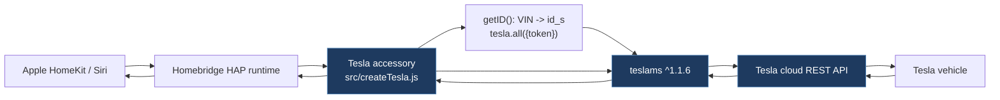
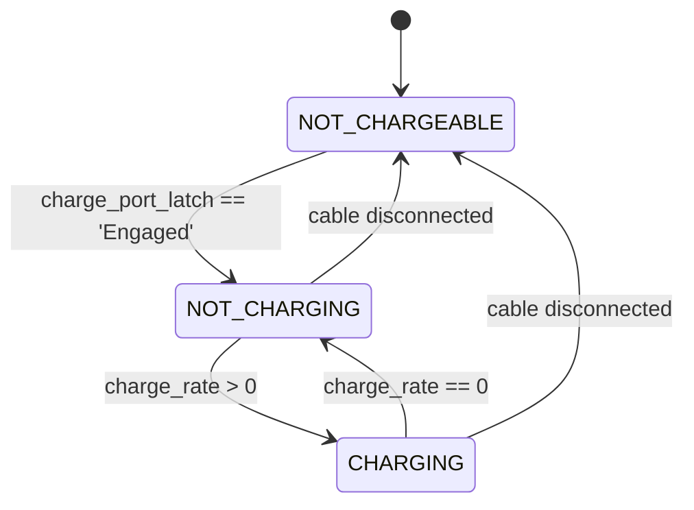

# rjyo-homebridge-tesla-remote

## 1. Provenance

- Submodule path: `legacy/rjyo-homebridge-tesla-remote`.
- Pinned gitlink: `160000 8408d6ca5ff6d4abf425c7b81eaf4d628319ca90 0` (from `git ls-files -s legacy/rjyo-homebridge-tesla-remote`). `git -C legacy/rjyo-homebridge-tesla-remote rev-parse HEAD` returns the same SHA; `status --porcelain` is empty. Snapshot matches the gitlink.
- Upstream URL: `https://github.com/rjyo/homebridge-tesla-remote` (`git remote -v`). `package.json:19` uses the older `git://github.com/rjyo/homebridge-tesla-remote.git` form.
- License: MIT (`package.json:6`). TeslaCANModder is GPL-3.0; MIT compatibility permits reimplementing behavior and constants, not copying source text.
- Analysis date: 2026-11-21.
- Files read (all `FULL-READ`; `git -C legacy/rjyo-homebridge-tesla-remote ls-files` inventory): `.gitignore` (4 lines), `README.md` (30), `config-sample.json` (20), `package.json` (46), `src/index.js` (10), `src/createTesla.js` (268). No hidden platform dirs beyond `.gitignore`; `dist/` is gitignored (`.gitignore:4`) and absent from the checkout.
- Files explicitly NOT read: none tracked. No vendored DBC/JSON catalog exists, so `STRUCTURAL-PARSE` / `RANGE-CITED` coverage does not apply.
- Pre-replace doc: frontmatter existed and is preserved byte-for-byte in content (LF line endings applied repo-wide per hygiene; the description line carried no inherited trailing whitespace). The pre-replace doc contained **no** upstream-preservation sections, so none were preserved. Pre-replace claims are cited as `git show HEAD:docs/legacy/rjyo-homebridge-tesla-remote.md`.
- History depth: `git rev-list --count HEAD` = 1 (shallow). Pre-pin upstream history was **not** reviewed.

## 2. Executive verdict

A tiny MIT-licensed Homebridge plugin (v0.3, 2019) that maps four HomeKit services — thermostat, lock, battery/charging, charging switch — onto Tesla's **cloud** REST API through the `teslams` library using a stored OAuth access token and a VIN→vehicle-id lookup. It contains no CAN, BLE, serial, or local transport code, and no frame pipeline. Mechanism worth noting: the three-state charging/connected derivation and the deferred HomeKit current-state update; these are HomeKit-specific, not CAN-relevant. Adaptation candidates for TeslaCANModder are weak — our firmware already implements local CAN/BLE climate, charge, VIN identity, and an MQTT telemetry bridge. Do not copy the token-storage pattern, the unguarded cloud-response parsing, or the two `createTesla.js` bugs (duplicate `value` key, undefined `on`). Verdict: research-only, no shipping impact.

## 3. Evidence map

No TEST-READ evidence exists: this repo ships no tests (`git ls-files` lists no `test*` file; `package.json:15` ignores `test.js` but none exists). No CAPTURE evidence exists in this repo (no vehicle, token, or trace). All six tracked files were FULL-READ.

| Source file | Lines | What it proves | Grade |
| --- | --- | --- | --- |
| `src/index.js` | 1-10 | Entry point; `registerAccessory('homebridge-tesla', 'Tesla', ...)` injects `homebridge.hap.Service` / `Characteristic` into the accessory factory | CODE-READ |
| `src/createTesla.js` | 4-56 | Class factory + constructor; four HomeKit services built and get/set handlers bound; `token`/`vin` read from config | CODE-READ |
| `src/createTesla.js` | 58-75 | `getBatteryLevel` → `tesla.get_charge_state` → `cs.battery_level`; falsy value treated as error | CODE-READ |
| `src/createTesla.js` | 77-105 | `getChargingState` derives `chargingState` from `charge_rate > 0` and `'Engaged'` latch | CODE-READ |
| `src/createTesla.js` | 107-134 | `setCharging` → `tesla.charge_state` with `on|off`; reason-specific errors | CODE-READ |
| `src/createTesla.js` | 136-151 | `setTargetTemperature` bug: logs undefined `on`, passes duplicate `value, value` key | CODE-READ |
| `src/createTesla.js` | 153-176 | `getClimateState` → `tesla.get_climate_state`; `inside_temp` truthy gate; AUTO/OFF mapping | CODE-READ |
| `src/createTesla.js` | 178-194 | `setClimateOn` maps OFF→`stop`, else `start` → `tesla.auto_conditioning` | CODE-READ |
| `src/createTesla.js` | 196-206 | `getLockState` → `tesla.get_vehicle_state` → `state.locked` | CODE-READ |
| `src/createTesla.js` | 208-236 | `setLockState` → `tesla.door_lock`; deferred `setCharacteristic` at 1 ms for Siri | CODE-READ |
| `src/createTesla.js` | 238-262 | `getID` → `tesla.all({token})`; `JSON.parse(body).response`; VIN match → `id_s` | CODE-READ |
| `README.md` | 1-30 | Install/config instructions; token generated via `teslacmd -u/-p --print_token`; two documented limits | SUMMARY-ONLY |
| `config-sample.json` | 1-20 | Example config with bridge username/pin/port and accessory `name`+`token` only — **no `vin`** | CODE-READ |
| `package.json` | 1-46 | v0.3, MIT, `teslams ^1.1.6`, Babel es2015/stage-0, node `>=0.12`, homebridge `>=0.2.0` | CODE-READ |
| `docs/legacy/rjyo-homebridge-tesla-remote.md` (pre-replace) | 13-58 | Prior summary claiming four services, "CAN Interface: N/A", no firmware relevance | SUMMARY-ONLY |
| Our side — `firmware/lib/vehicle/can/feature/misc/mqtt_bridge.h` | 26, 81 | `executeMqttCmd` + `mqttShouldPublish`: our local telemetry bridge exists | CODE-READ |
| Our side — `firmware/lib/client/command/dispatch.h` | 813-821 | MQTT commands dispatched with ack/save | CODE-READ |
| Our side — `firmware/lib/vehicle/can/feature/comfort/climate.h` | 5, 55 | Local climate keeper via CAN 0x2F3 | CODE-READ |
| Our side — `firmware/lib/vehicle/can/feature/body/charge.h` | 18, 64-66 | Local charge start/stop via CAN | CODE-READ |
| Our side — `firmware/lib/vehicle/ble/handler/dispatch.h` | 31, 166 | VIN stored for local BLE identity | CODE-READ |

## 4. Architecture and build surface

- Entry point: `src/index.js:3-9` (`module.exports = register(homebridge)`) → `createTesla({Service, Characteristic})` → `Tesla` accessory class.
- Shared core vs platform port: none. Single accessory class, no platform, no per-OS port. `getServices()` (`src/createTesla.js:264-266`) returns all four services.
- Build: Babel `es2015` + `stage-0` presets (`package.json:27`), `src/` → `dist/`, `main: dist/index.js` (`package.json:5,15`). No CAN/build flags. `engines`: node `>=0.12.0`, homebridge `>=0.2.0` (`package.json:28-31`).
- Dependency boundary: runtime `homebridge` hap objects injected at registration; one external dependency `teslams ^1.1.6` (`package.json:32-34`) owns all network/API behavior. No vendored protocol code.

Cloud control flow (illustrative — not a CAN frame pipeline):



CAN frame pipeline (RX → decode → mutate/gate → TX): **None found: no frame pipeline in this repo.** No CAN identifier, bus, DLC, checksum, or counter appears in any source file (verified by negative anchors in section 16).

## 5. Mechanism catalogue

### M1 — VIN → vehicle-id resolution and token auth

- **Claim (README / summary):** Token-based auth, no username/password; VIN identifies the car (`README.md:5-7,20`; pre-replace `git show HEAD:docs/legacy/rjyo-homebridge-tesla-remote.md#L46`).
- **Code path:** `src/createTesla.js:239-262` — `getID()` → `tesla.all({token: this.token})` → `JSON.parse(body).response` → loop `vehicle.vin == this.vin` → `callback(null, vehicle.id_s)`; error at `:260`.
- **Frame spec:** None found (cloud JSON, no CAN frame).
- **Gates and timing:** `err` from `tesla.all` short-circuits (`:243-246`); exact string VIN equality (`:251`); no retry/backoff.
- **State machine:** None found (single-shot lookup per command).
- **Tests:** None found.
- **Evidence grade:** CODE-READ.
- **Verdict:** CONFIRMED.
- **Adapt to TeslaCANModder?** no impact (we store VIN locally for BLE identity, not account lookup).

### M2 — HomeKit Thermostat service (climate)

- **Claim (README / summary):** Climate control — get/set temperature, HVAC on/off (pre-replace `git show HEAD:docs/legacy/rjyo-homebridge-tesla-remote.md#L41`).
- **Code path:** `src/createTesla.js:23-36` handlers → `getClimateState()` (`:153-176`) → `tesla.get_climate_state`; `setTargetTemperature()` (`:136-151`) → `tesla.set_temperature`; `setClimateOn()` (`:178-194`) → `tesla.auto_conditioning`.
- **Frame spec:** None found.
- **Gates and timing:** get side gated on truthy `state.inside_temp` (`:160`); `is_auto_conditioning_on` maps to `TargetHeatingCoolingState.AUTO` else `OFF` (`:163`); display units hardcoded `FAHRENHEIT` (`:35`); set path broken (`:137` undefined `on`, `:141` duplicate `value` key).
- **State machine:** Two states only (OFF/AUTO) — no diagram required.
- **Tests:** None found.
- **Evidence grade:** CODE-READ.
- **Verdict:** PARTIAL (get path works; set-temperature path defective).
- **Adapt to TeslaCANModder?** no impact (our `firmware/lib/vehicle/can/feature/comfort/climate.h:5,55` already does local CAN climate).

### M3 — HomeKit LockMechanism service

- **Claim (README / summary):** Door lock/unlock (pre-replace `git show HEAD:docs/legacy/rjyo-homebridge-tesla-remote.md#L42`).
- **Code path:** `src/createTesla.js:38-44` handlers → `getLockState()` (`:196-206`) → `tesla.get_vehicle_state` → `state.locked`; `setLockState()` (`:208-236`) → `tesla.door_lock({id, lock: locked})`.
- **Frame spec:** None found.
- **Gates and timing:** `locked = state == LockTargetState.SECURED` (`:209`); on success a 1 ms `setTimeout` updates `LockCurrentState` so Siri does not see the event inside the target-state response (`:218-227`).
- **State machine:** Two states (SECURED/UNSECURED) — no diagram required.
- **Tests:** None found.
- **Evidence grade:** CODE-READ.
- **Verdict:** CONFIRMED.
- **Adapt to TeslaCANModder?** no impact (local lock exists via our CAN/BLE command surface).

### M4 — Battery / Charging services and three-state charge derivation

- **Claim (README / summary):** Battery level monitoring and charge control (pre-replace `git show HEAD:docs/legacy/rjyo-homebridge-tesla-remote.md#L15`).
- **Code path:** `src/createTesla.js:46-55` handlers → `getBatteryLevel()` (`:58-75`), `getChargingState()` (`:77-105`), `setCharging()` (`:107-134`) → `tesla.get_charge_state` / `tesla.charge_state`.
- **Frame spec:** None found.
- **Gates and timing:** `charging = charge_rate > 0` (`:85`); `connected = charge_port_latch === 'Engaged'` (`:86`); reason gates `not_charging` / `complete` (`:122-127`); `response.result == true` loose equality (`:115`).
- **State machine:** Three HAP charging states derived in priority order (`:87-93`):



- **Tests:** None found.
- **Evidence grade:** CODE-READ.
- **Verdict:** CONFIRMED.
- **Adapt to TeslaCANModder?** no impact (our CAN/BLE charge control exists; our charge telemetry is decoded from CAN, not cloud charge_rate).

### M5 — Homebridge accessory registration

- **Claim (README / summary):** Homebridge plugin exposing a "Tesla" accessory (`README.md:1-3`; pre-replace `git show HEAD:docs/legacy/rjyo-homebridge-tesla-remote.md#L39`).
- **Code path:** `src/index.js:3-9` — `register(homebridge)` → `homebridge.registerAccessory('homebridge-tesla', 'Tesla', createTesla(...))`.
- **Frame spec:** None found.
- **Gates and timing:** None found (registration is unconditional).
- **State machine:** None found.
- **Tests:** None found.
- **Evidence grade:** CODE-READ.
- **Verdict:** CONFIRMED.
- **Adapt to TeslaCANModder?** no impact (deprecated HAP `registerAccessory` API; we expose REST/BLE, not HomeKit).

### M6 — Deferred current-state update for Siri

- **Claim (README / summary):** Not documented; discovered in code.
- **Code path:** `src/createTesla.js:218-227` — `setTimeout(() => this.lockService.setCharacteristic(LockCurrentState, currentState), 1)`.
- **Frame spec:** None found.
- **Gates and timing:** 1 ms deferral; comment (`:222-224`) explains Siri cannot handle the change event inside the same set-target response. No cancellation/guard if the device changes state in between.
- **State machine:** None found.
- **Tests:** None found.
- **Evidence grade:** CODE-READ.
- **Verdict:** CONFIRMED.
- **Adapt to TeslaCANModder?** no impact (HomeKit/Siri-specific control-loop race fix; no equivalent event loop in our command dispatch).

## 6. Summary vs code contradiction table

Agreements (four HomeKit services, no CAN, MIT, token auth, `teslams` dependency) are in the evidence map, not repeated here. Only actual contradictions:

| Pre-replace claim / upstream text | Code reality | Grade |
| --- | --- | --- |
| Pre-replace doc says thermostat "get/set temperature" (`git show HEAD:docs/legacy/rjyo-homebridge-tesla-remote.md#L41`) | Set path is defective: logs undefined `on` (`src/createTesla.js:137`) and passes duplicate `value, value` object key to `tesla.set_temperature` (`:141`) — intended second field (e.g. units) is lost | CODE-READ |
| Upstream README config example includes `"vin": "XXXXXXX"` (`README.md:20`) | Shipped `config-sample.json:13-16` omits `vin`; `getID()` requires `this.vin` (`:15,251`) and returns "Vehicle with VIN undefined not found" (`:260`) — a config built from the shipped sample fails every command | CODE-READ |
| Pre-replace doc describes general thermostat temperature control (`git show HEAD:docs/legacy/rjyo-homebridge-tesla-remote.md#L41`) | `TemperatureDisplayUnits` is hardcoded to `FAHRENHEIT` regardless of locale/config (`src/createTesla.js:32-36`) | CODE-READ |

## 7. CAN frame and signal inventory

None found: no CAN frame is decoded, mutated, or injected anywhere in this repo. No CAN ID, bus, DLC, counter position, checksum, or scale/units exists in source. Negative anchors in section 16 confirm absence. No vendored DBC/JSON catalog to label `STRUCTURAL-PARSE`.

## 8. Constants and tuning table

| Constant | Value | File:line | Meaning | Grade |
| --- | --- | --- | --- | --- |
| `setTimeout` deferral | `1` ms | `src/createTesla.js:225-227` | Delay before publishing lock current-state so Siri sees it after target-state response | CODE-READ |
| Charge-port latch sentinel | `'Engaged'` | `src/createTesla.js:86` | String gate distinguishing cable-connected from disconnected | CODE-READ |
| Charging-active gate | `charge_rate > 0` | `src/createTesla.js:85` | Threshold that drives `charging` boolean and `CHARGING` state | CODE-READ |
| Temperature display units | `Characteristic.TemperatureDisplayUnits.FAHRENHEIT` | `src/createTesla.js:35` | Hardcoded thermostat unit; no config override | CODE-READ |
| Bridge username / pin / port (sample) | `99:22:3D:E3:A3:30` / `331-45-154` / `31482` | `config-sample.json:4-6` | Example Homebridge bridge identity; load-bearing only if copied verbatim (security note in §12) | CODE-READ |
| Dependency version | `^1.1.6` | `package.json:33` | `teslams` cloud API client; unpinned minor governs all wire behavior | CODE-READ |

## 9. Failure modes and edge cases

No bus-off, watchdog, OTA, queue-overflow, or brownout paths exist (no CAN/local transport). All rows below are untested because the repo ships no tests.

| Failure | Handling code path | Tested? | Grade |
| --- | --- | --- | --- |
| No vehicle matches configured VIN | Error `Vehicle with VIN ... not found` at `src/createTesla.js:256-260` | No | CODE-READ |
| Malformed cloud body | `JSON.parse(body)` unguarded at `src/createTesla.js:248` — throws on bad JSON | No | CODE-READ |
| Cloud login error | `tesla.all` `err` → `callback(err)` at `src/createTesla.js:243-246` | No | CODE-READ |
| Battery level is `0` (falsy) | Treated as error at `src/createTesla.js:65-70` | No | CODE-READ |
| `inside_temp` is `0` (falsy) | Treated as error at `src/createTesla.js:160-167` | No | CODE-READ |
| Set-temperature called | `ReferenceError: on is not defined` at `src/createTesla.js:137`; duplicate key at `:141` | No | CODE-READ |
| `get_vehicle_state` returns null | `state.locked` dereferenced without null check at `src/createTesla.js:202-204` | No | CODE-READ |
| Cloud charge/climate call returns failure | Reason-specific errors at `src/createTesla.js:122-131,185-191` | No | CODE-READ |
| Deferred lock state races a real state change | Unconditional 1 ms `setTimeout` at `src/createTesla.js:225-227` with no revalidation | No | CODE-READ |

## 10. Test coverage map

Per test file: **None found** — `git ls-files` lists no test file; `package.json:15` ignores `test.js` but none exists. `lint` script (`package.json:14`) is the only automated check.

Critical paths with no test (risk in one line each):

- `getID()` VIN match / no-match / malformed body — wrong vehicle id or uncaught throw is undetectable.
- `getChargingState()` three-state derivation — `NOT_CHARGEABLE`/`NOT_CHARGING`/`CHARGING` mapping can regress silently (state diagram in M4 has no oracle).
- `setTargetTemperature()` — the duplicate-key/undefined-`on` bugs survive any refactor because nothing exercises the set path.
- `setCharging()` / `setClimateOn()` / `setLockState()` failure branches — reason strings could drift with `teslams` versions unnoticed.
- `setLockState()` deferred `setCharacteristic` — timing race untested.

## 11. Parity matrix with TeslaCANModder

No CAN frame or signal is touched on either side — there are zero shared CAN IDs, so no frame-level parity rows exist. The rows below compare capabilities and each carries a our-side CODE-READ citation, so they can drive a decision.

| Signal / feature | Upstream (cite) | Our side (cite) | Delta | Action |
| --- | --- | --- | --- | --- |
| Climate on/off | Cloud `auto_conditioning` (`src/createTesla.js:178-194`) | CAN 0x2F3 keeper (`firmware/lib/vehicle/can/feature/comfort/climate.h:5,55`) | Cloud REST vs local CAN frame mutation | ignore |
| Charge start/stop | Cloud `charge_state` (`src/createTesla.js:107-134`) | CAN charge control (`firmware/lib/vehicle/can/feature/body/charge.h:18,64-66`); BLE `tesla:charge:*` (`firmware/lib/vehicle/ble/handler/dispatch.h:228-236`) | Cloud vs CAN/BLE | ignore |
| VIN → vehicle identity | `getID()` account lookup (`src/createTesla.js:238-262`) | VIN stored for BLE auth (`firmware/lib/vehicle/ble/handler/dispatch.h:31,166`) | Account-level id lookup vs local key identity | ignore |
| Home-automation telemetry bridge | None (direct HomeKit↔cloud) | MQTT bridge (`firmware/lib/vehicle/can/feature/misc/mqtt_bridge.h:26,81`; dispatched at `firmware/lib/client/command/dispatch.h:814`) | Upstream sink is HomeKit; ours is MQTT broker | already present (different sink) |

## 12. Surface inventory and security notes

Transport surfaces: none locally. No serial, web/REST listener, BLE, or TCP/UDP server is opened by this plugin; Homebridge HAP provides the only external transport. The exposed surface is the HomeKit characteristic set:

| Service (`src/createTesla.js`) | Characteristics (get/set) | Backing call |
| --- | --- | --- |
| Thermostat (`:23-36`) | CurrentTemperature get, TargetTemperature get/set, TargetHeatingCoolingState get/set, TemperatureDisplayUnits get | `get_climate_state`, `set_temperature`, `auto_conditioning` |
| LockMechanism (`:38-44`) | LockCurrentState get, LockTargetState get/set | `get_vehicle_state`, `door_lock` |
| BatteryService (`:46-50`) | BatteryLevel get, ChargingState get | `get_charge_state` |
| Switch (`:52-55`) | On get/set (charging) | `get_charge_state`, `charge_state` |

Provenance / security findings:

- Cloud OAuth token stored plaintext in config: `this.token = config.token` (`src/createTesla.js:14`); config files are user-managed, not encrypted. Do not replicate credential storage.
- `config-sample.json:4-6` ships a concrete bridge username/pin/port; copying unchanged leaves a public pairing PIN.
- Untrusted cloud response parsed without validation: `JSON.parse(body)` (`src/createTesla.js:248`), no schema/shape check before `.response`.
- Transport security fully delegated to `teslams ^1.1.6` (`package.json:33`); no TLS pinning or timeout visible in this repo.
- No validation of `config.vin` / `config.token` (`src/createTesla.js:13-15`); `vin` may be undefined (see §6).
- Correctness bug: `setTargetTemperature` (`src/createTesla.js:137,141`) can set an unintended value or throw.

## 13. Adaptation assessment

| Mechanism | Value | Cost | Risk | Grade | Decision |
| --- | --- | --- | --- | --- | --- |
| M1 VIN→id lookup + token auth | Low (we use VIN for BLE, not cloud accounts) | Low | Low | CODE-READ | no impact |
| M2 Thermostat climate | Low (local CAN climate already shipped) | Low | Medium (cloud dependency absent) | CODE-READ | already present |
| M3 Lock service | Low (local lock shipped) | Low | Low | CODE-READ | no impact |
| M4 Three-state charge derivation | Low (we decode charge from CAN) | Low | Low | CODE-READ | already present |
| M5 Accessory registration | None (HomeKit-only, deprecated API) | High | Medium | CODE-READ | never port |
| M6 Deferred current-state update | Low (generic race-mitigation idea) | Low | Low | CODE-READ | no impact (HomeKit-specific) |
| MQTT telemetry bridge (our counterpart) | High (already in shipping firmware) | — | — | CODE-READ | already present |

No mechanism is a `candidate for future PR` for CAN firmware; the only transferable concept — a home-automation sink — is already implemented locally via MQTT.

## 14. Do-not-copy list

| Item | File:line | Reason |
| --- | --- | --- |
| Duplicate `value, value` key | `src/createTesla.js:141` | Correctness bug; drops the intended second field. |
| Undefined `on` in log + "temperator" typo | `src/createTesla.js:137` | Throws `ReferenceError`; typo. |
| Unguarded `JSON.parse(body)` | `src/createTesla.js:248` | Uncaught throw on malformed cloud response. |
| Hardcoded `FAHRENHEIT` | `src/createTesla.js:35` | No locale/config override. |
| 1 ms `setTimeout` Siri workaround | `src/createTesla.js:225-227` | HomeKit-specific race hack, no revalidation. |
| Example bridge credentials | `config-sample.json:4-6` | Public default PIN/username; must never ship unchanged. |
| Deprecated `registerAccessory` API | `src/index.js:3-9` | Removed in modern Homebridge. |
| Ancient engine constraints | `package.json:28-31` | Node `>=0.12`, homebridge `>=0.2.0`. |
| `teslams ^1.1.6` cloud dependency | `package.json:33` | Cloud-only; no local CAN relevance; unpinned minor. |
| Any verbatim source | all files | MIT license permits reimplementation of behavior/constants, not line-copying into `firmware/`, `client/`, `packages/`, or `tools/`. |

## 15. History and evolution

Local `git log` contains a single commit: `8408d6c` "Fix typos", authored/committed 2019-08-14 (author Rakuraku Jyo). `git rev-list --count HEAD` = 1, so this is a shallow clone: no pre-pin history, no earlier iterations, and no changelog are available locally. The pinned snapshot is the only reviewed state. No abandoned approaches or rollbacks can be mined from the available history. Notable curiosity: despite the "Fix typos" commit message, the strings "temperator" (`src/createTesla.js:137`) and "currenting" (`:59`) remain in the pinned snapshot — whether they were fixed later upstream is UNVERIFIED (no fetch performed; network-only claims about issues/PRs are UNVERIFIED).

## 16. Re-verification recipe

After an upstream bump, re-anchor and diff. Do not mutate the working tree from an automated run.

```bash
OLD=8408d6ca5ff6d4abf425c7b81eaf4d628319ca90
git ls-files -s legacy/rjyo-homebridge-tesla-remote   # expect 160000 <full-sha> 0
git -C legacy/rjyo-homebridge-tesla-remote rev-parse HEAD
git -C legacy/rjyo-homebridge-tesla-remote status --porcelain   # expect empty
git -C legacy/rjyo-homebridge-tesla-remote fetch --tags --prune
git -C legacy/rjyo-homebridge-tesla-remote log --oneline $OLD..origin/main
git -C legacy/rjyo-homebridge-tesla-remote diff --stat $OLD..origin/main
git -C legacy/rjyo-homebridge-tesla-remote diff $OLD..origin/main -- src/ README.md config-sample.json package.json
```

Grep anchors (all demonstrated at write time with `grep -nE`; run from repo root; `$L=legacy/rjyo-homebridge-tesla-remote`):

```text
grep -nE 'registerAccessory|homebridge-tesla' $L/src/index.js
    -> 6: homebridge.registerAccessory('homebridge-tesla', 'Tesla', createTesla({
grep -nE 'tesla\.(get_charge_state|get_climate_state|get_vehicle_state|all|charge_state|set_temperature|auto_conditioning|door_lock)' $L/src/createTesla.js
    -> 9 hits at lines 64, 83, 114, 141, 159, 184, 202, 214, 242
grep -nE 'value, value' $L/src/createTesla.js
    -> 141: tesla.set_temperature({id:id, value, value}, (response) => {
grep -nE 'temperator|currenting' $L/src/createTesla.js
    -> 59 (currenting), 137 (temperator)
grep -nE 'TemperatureDisplayUnits.FAHRENHEIT' $L/src/createTesla.js
    -> 35
grep -nE '"license"|"version"' $L/package.json
    -> 3 (0.3), 6 (MIT)
grep -nE 'getID[(]' $L/src/createTesla.js
    -> 9 hits: 61, 80, 109, 138, 156, 181, 199, 211, 239
```

Negative anchors (absence claims — expect **no output**):

```text
grep -nE 'vin' $L/config-sample.json
    -> no output (config sample omits VIN)
grep -nE 'socketcan|can0|CAN bus|0x[0-9A-Fa-f]{3}' $L/src/createTesla.js $L/src/index.js
    -> no output (no CAN identifiers)
grep -nE '0xAA|XOR' $L/src/createTesla.js $L/src/index.js
    -> no output (no binary/XOR framing)
```

Our-side drift anchors (the `already present` decisions; pin by symbol, not line number):

```text
grep -nE 'executeMqttCmd' firmware/lib/client/command/dispatch.h firmware/lib/vehicle/can/feature/misc/mqtt_bridge.h
    -> dispatch.h:814 call, mqtt_bridge.h:26 definition
grep -nE 'mqttShouldPublish|MQTT_DEFAULT_INTERVAL' firmware/lib/vehicle/can/feature/misc/mqtt_bridge.h
    -> 14 (#define 2000), 81 (inline bool mqttShouldPublish)
grep -nE 'CLIMATE_KEEP|0x2F3' firmware/lib/vehicle/can/feature/comfort/climate.h
    -> 5, 13, 18, 22, 24, 51, 55
grep -nE 'CHARGE_START|charge:start' firmware/lib/vehicle/can/feature/body/charge.h
    -> 18, 37, 53, 64, 66
grep -nE 'tesla:vin|char vin' firmware/lib/vehicle/ble/handler/dispatch.h
    -> 31 (char vin[18]), 166 (// --- tesla:vin:<VIN> ---)
```

If line numbers drift more than ~10, re-read the whole function; do not trust this document's numbers. Upstream history before the pinned SHA was **not** reviewed (shallow clone, single commit).

## 17. Open questions and explicitly not investigated

- Pre-pin upstream history: not reviewed (shallow clone, one commit). Earlier approaches/rollbacks are unknown.
- Does `teslams.set_temperature` expect a second field (e.g. `units`) that the duplicate `value, value` key was meant to supply? UNVERIFIED — requires reading the external `teslams` source, which is not vendored here. Verify by installing/inspecting `teslams@1.1.6`.
- Are the `temperator`/`currenting`/duplicate-key defects still present after the pinned SHA? UNVERIFIED — no fetch was performed; verify with the section 16 diff and fresh grep anchors.
- Is the missing `vin` in `config-sample.json` intentional or an oversight? UNVERIFIED.
- No CAPTURE evidence: no vehicle, no cloud token, and no real API response were available; all behavior is CODE-READ from source only.
- Upstream maintenance status / issues / PRs: UNVERIFIED (network not consulted).
- No investigation of `teslams` internals, TLS behavior, or Tesla API semantics — those live outside this repo.
