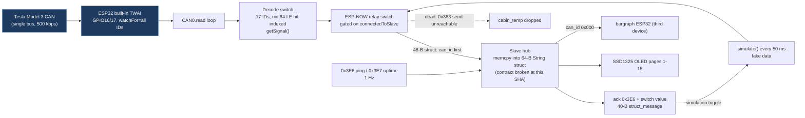
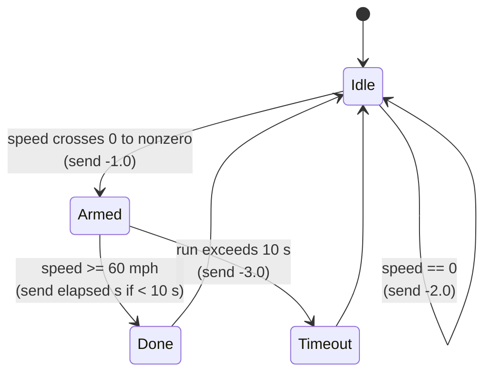

# rossklonowski-CANserver

Deep-dive analysis (skill: `legacy-repo-deep-dive`, replace mode). Path abbreviations used throughout:

- `S/` = `CANserver-master/CANserver-master/CANserver/` (committed master tree)
- `SL/` = `CANserver-master/CANserver-slave/CANslave/` (committed slave tree)
- `Z.ino` = `CANserver-master.zip` → `CANserver-master/CANserver-master/CANserver/CANserver.ino` (the committed zip snapshot, extracted to temp for diffing)

## 1. Provenance

| Item              | Value                                                                                                                          |
| ----------------- | ------------------------------------------------------------------------------------------------------------------------------ |
| Submodule path    | `legacy/rossklonowski-CANserver`                                                                                                |
| Pinned gitlink    | `160000 d1e8dc98d216fefd4950a453e848b34029188781 0` (`git ls-files -s legacy/rossklonowski-CANserver`)                          |
| HEAD match        | `git -C legacy/rossklonowski-CANserver rev-parse HEAD` → `d1e8dc98d216fefd4950a453e848b34029188781` — matches gitlink            |
| Worktree status   | clean (`git status --porcelain` empty)                                                                                          |
| HEAD commit       | `d1e8dc9` "Merge pull request #1 from rossklonowski/esp-button", author Ross Klonowski, 2026-01-25 — the ONLY commit in the local (shallow) clone |
| Upstream URL     | https://github.com/rossklonowski/CANserver (fetch/push origin)                                                                  |
| License          | MIT, Copyright (c) 2020 Josh Wardell (`CANserver-master/CANserver-master/LICENSE:1-3`) — GPL-3.0-compatible for idea reuse; no line-copying |
| Analysis date    | 2026-11-21                                                                                                                      |
| Mode              | Replace (this file replaces the pre-existing summary; pre-replace claims cited as `git show HEAD:docs/legacy/rossklonowski-CANserver.md`, line-stable because the doc is clean at HEAD) |
| Preserved         | YAML frontmatter above, byte-for-byte (no trailing whitespace existed on any frontmatter line, so nothing was stripped). The pre-replace doc contained **no `## Upstream (...)` sections** — there is nothing else to preserve. The new body is LF-only; the pre-replace file was CRLF. |
| Repo shape        | The tracked content is a vendored GitHub-zip extraction (`CANserver-master.zip` committed **and** extracted into `CANserver-master/`), plus vendored `esp32_can-master/` and `can_common-master/` library snapshots and macOS AppleDouble junk (`._*` files). The committed tree and the committed zip are **different snapshots**: the zip is older (see section 15). |

**Files read (FULL-READ):** `S/CANserver.ino` 1-489; `S/carDataVariables.h` 1-61; `S/constants.h` 1-19; `S/generalCANSignalAnalysis.cpp` 1-65 and `.h` 1-33; `S/payload.h` 1-11; `S/sendHelper.cpp` 1-108; `S/simulation.cpp` 1-189 and `.h` 1-13; `SL/CANslave.ino` 1-704; `SL/payload.h` 1-13; `SL/carDataVariables.h` 1-56; `SL/processData.h` 1-13; `SL/sendHelper.cpp` 1-32; `SL/program_settings.h` 1-19; `SL/display_settings.h` 1-35; `SL/queue.cpp` 1-36 and `queue.h` 1-30; `SL/Value.cpp` 1-97; `SL/oled.h` 1-30; repo-root `README.md` 1-24; `CANserver-master/CANserver-master/README.md` 1-15; `CANserver-master/CANserver-master/LICENSE` 1-21; `docs/CANserverManual.md` 1-104; `docs/displaycommands.md` 1-62; `docs/buscompare.md` 1-48; `docs/todo.md` 1-44; `docs/uDisplayManual.md` 1-40; `SL/CHECKLIST.md` 1-25; `SL/QUICK_START.txt` 1-20; `SL/PriUint64.h` 1-12.

**Files read (RANGE-CITED, only the cited ranges):** `Z.ino` (zip .ino) lines 100-135, 135-200, 395-470, 470-560, 690-851 plus a `case 0x` full-listing grep; zip `CANserver-slave/CANslave/CANslave.ino` lines 26-39 plus an active-code (non-comment) filter; `SL/data/webpage.html` head 1-12.

**Files read (STRUCTURAL-PARSE, schema-level only):** `esp32_can-master/src/` (CAN0 symbol and default pins, file inventory); `can_common-master/` (file inventory); `S/AsyncJson.h` (vendored ESPAsyncWebServer helper, header scan); `S/data/index.html` not opened (unserved asset, see section 6); `CANserver-master.zip` entry listing (67 files, 3 extracted for diffing).

**Files explicitly NOT read:** all fonts (`S/data/fonts/*`), all images (`docs/img/*`, jpg/png), `SL/bitmaps.h`, `SL/Custom_Adafruit_GFX.cpp/.h`, `SL/Custom_Adafruit_SSD1325.cpp/.h`, `SL/alphanumeric.cpp/.h`, `SL/bargraph.cpp/.h`, `SL/lcd.cpp/.h`, `SL/oled.cpp`, `SL/button.cpp/.h`, `SL/graph.cpp/.h`, `SL/SCD40.cpp/.h`, `SL/ProgressBar.cpp/.h`, `SL/GRAPH_README.md`, `SL/GRAPH_USAGE.md`, `SL/IMPLEMENTATION_SUMMARY.md`, `S/data/style.css`, `CANserver-master/CANserver-slave/CANslave/tools/EspExceptionDecoder/tool/EspExceptionDecoder.jar` (binary blob), all `._*` AppleDouble resource-fork files. These are display periphery or vendored blobs; the task scope was the server itself.

**Grade preamble:** No TEST-READ evidence exists: this repo ships no tests (`test/README` is the Arduino placeholder; `SL/CHECKLIST.md` is a manual checklist, not a test). No CAPTURE evidence exists in this repo.

## 2. Executive verdict

This is the **family origin of the jwardell CANserver decode set** — a 2020-2023 Arduino fork that sniffs one Tesla Model 3 CAN bus (ESP32 built-in TWAI, 500 kbps, GPIO16/17), decodes 17 frames entirely read-only (never transmits on CAN — `CAN0.begin/watchFor/read` are the only CAN0 calls), and relays decoded floats over ESP-NOW to an OLED "slave" hub that also consumes BUTTON/SCD40/ACCEL messages from sibling devices. The two mechanisms that matter for TeslaCANModder are (a) the **little-endian bit-indexed decode convention** — the origin of the LE assembly that `docs/legacy/ekr-candash.md` flagged as a paradox: there is no byte-swap anywhere; the LE convention comes straight from `generalCANSignalAnalysis` operating on the `uint64` view of wire-ordered bytes, and that library's bigEndian path is unimplemented garbage — and (b) the **decode set itself**, which bit-matches our `0x312` thermal targets and `0x292` average SoC exactly (genuine independent confirmation) but disagrees with our `0x376` front-inverter byte position and our `0x257`/`0x132` multi-byte assembly order (capture-first). Cheap adaptation candidates: the 290-420 V sanity gate on `0x132`, mux gating for `0x376`/`0x315` motor temps, and the `0x3B6` odometer decode. One task-premise correction: the **CANServer v2 binary log format is NOT in this snapshot** — the two sibling docs (`MatthewDriver-TeslaCAN.md`, `mhpetiwala-TeslaCAN.md`) analyzed its Python consumers, but the writer lives in later jwardell firmware (negative anchors in section 16). Must-not-port: the memcpy'd `String` payload fields, the hardcoded AP password (`ellenpassword`) in the committed zip base, the `(9/5)+32` °F conversion bug, and the structurally broken master↔slave payload contract at this pinned SHA.

## 3. Evidence map

| source file | lines | what it proves | grade |
| ----------- | ----- | -------------- | ----- |
| `S/CANserver.ino` | 32 | CAN bitrate 500 kbps (`BITRATE`) | CODE-READ |
| `S/CANserver.ino` | 33-34, 219-393 | every decode uses `littleEndian` flag | CODE-READ |
| `S/CANserver.ino` | 119-120 | `CAN0.begin(BITRATE)` + `CAN0.watchFor()` (unfiltered RX, single bus) | CODE-READ |
| `S/CANserver.ino` | 123 | `WiFi.mode(WIFI_STA)` — no AP, no web server in the committed tree | CODE-READ |
| `S/CANserver.ino` | 139-140 | ESP-NOW peer: channel 0, `encrypt = false` | CODE-READ |
| `S/CANserver.ino` | 209-397 | decode switch: 17 vehicle CAN IDs, all read-only | CODE-READ |
| `S/CANserver.ino` | 220 | voltage sanity gate `>290 && <420` V on 0x132 | CODE-READ |
| `S/CANserver.ino` | 318-333 | missing `break` after case 0x376 → falls into 0x315 block | CODE-READ |
| `S/CANserver.ino` | 356-360 | 0x3B6 odometer: `uint64 & 0xFFFFFFFF`, ×0.001 km, DLC 4 | CODE-READ |
| `S/CANserver.ino` | 399-487 | ESP-NOW relay switch gated on `connectedToSlave` | CODE-READ |
| `S/CANserver.ino` | 454-456 | orphaned `sendToDisplay(..., 0x383, cabin_temp)` between `break;` and `case` — unreachable | CODE-READ |
| `S/generalCANSignalAnalysis.cpp` | 25-38, 52-63 | only the `byteOrder == 1` (LE) branch is implemented; bigEndian returns uninitialized `_signalMessage` | CODE-READ |
| `S/sendHelper.cpp` | 24-36 | 2-int overload leaves `int_value_3` uninitialized on the wire | CODE-READ |
| `S/payload.h` | 2-11 | master wire struct: `can_id` first, no `msgCode` field | CODE-READ |
| `SL/payload.h` | 3-13 | slave wire struct: `String msgCode` FIRST — contract diverged | CODE-READ |
| `SL/CANslave.ino` | 301-329 | slave `memcpy`s raw bytes into the String-bearing struct, dispatches on `msgCode` | CODE-READ |
| `SL/CANslave.ino` | 146-151, 227-245 | `(9/5)` integer division = 1: °C+32 labeled °F (9 hits) | CODE-READ |
| `SL/queue.h` + `SL/queue.cpp` | 16, 11 | `int queue[];` zero-size member; ctor writes `queue[size]` — OOB if instantiated (class is dead code, never constructed) | CODE-READ |
| `SL/Value.cpp` | 36-54, 95-97 | unit auto-scaling thresholds; `resetValue()` leaves `_set = true` | CODE-READ |
| `Z.ino` (zip base) | 120-130 | AP `ssid="Tesla Server"`, `password="ellenpassword"`, `AsyncWebServer server(80)` — the web UI the old doc describes | CODE-READ |
| `Z.ino` (zip base) | 136-146, 169-170 | wire struct carries `String unit1/2/3`; every send goes to two receivers | CODE-READ |
| `Z.ino` (zip base) | 399-417 | web routes `/`, `/style.css`, `/refresh` (unauthenticated JSON) | CODE-READ |
| `Z.ino` (zip base) | 783-789 | older UNMUXED 0x352 decode (bits 0/11/22, ×0.1) | CODE-READ |
| `Z.ino` (zip base) | 796, 798-830 | 0x257 speed at bits 24-32 ×1 (mph) + 0-60 timer state machine — both abandoned in the tree | CODE-READ |
| `esp32_can-master/src/esp32_can.cpp` | 5 | `ESP32CAN CAN0(GPIO_NUM_16, GPIO_NUM_17)` — built-in TWAI, not MCP2515 | STRUCTURAL-PARSE |
| `docs/CANserverManual.md` | 37 | hardware is listen-only as shipped (transceiver TX pull-up disabled) — matches the code's zero TX calls | CODE-READ |
| `docs/buscompare.md` | 7-46 | per-ID chassis/vehicle bus table, firmware 2020.24 era | CODE-READ |
| repo-root `README.md` | 5-7 | README claims AP web interface — matches the zip base, not the tree (see section 6) | CODE-READ |
| pre-replace doc | 15, 33-34, 39 | old-doc claims (AP+web server, ESP-NOW) evaluated in section 6 | SUMMARY-ONLY |

## 4. Architecture and build surface

- **Entry points:** two Arduino sketches, no build system, no PlatformIO.ini, no build flags. Master: `S/CANserver.ino` (489 lines). Slave: `SL/CANslave.ino` (704 lines).
- **CAN hardware:** NOT MCP2515. The jwardell CANserver board wires a CAN transceiver to the ESP32's built-in TWAI controller on GPIO16 (RX) / GPIO17 (TX); the vendored `collin80/esp32_can` library exposes it as global `CAN0` (`esp32_can-master/src/esp32_can.cpp:5`). Board: Node32s, IO0 button for programming (`docs/CANserverManual.md:50-58, 73`).
- **Single bus, unfiltered:** `CAN0.watchFor()` accepts every ID (`S/CANserver.ino:120`); the physical bus is whichever harness is plugged in (powertrain via OBD for 2020+, or chassis under the passenger seat — `docs/CANserverManual.md:9-20`).
- **Dependency boundaries:** master needs `esp32_can`, `can_common`, `esp_now`, ArduinoJson (unused include in `S/constants.h:13`), and includes `AsyncJson.h` with the comment `// for wifi??` (`S/CANserver.ino:20`) — a leftover from the zip base, since the tree has no web server.
- **Shared core vs port:** `generalCANSignalAnalysis` + `payload.h` + `carDataVariables.h` exist in BOTH trees but have diverged (different struct layouts, different variable types). There is no shared core — the two sketches are independent copies.



No frame is ever mutated, checksummed, or transmitted on the CAN bus — the only CAN writes in the entire repo would come from the vendored library examples, which are not part of either sketch. There is no bus-off handling, no OTA, no watchdog, no NVS/persistence in the app code.

## 5. Mechanism catalogue

### 5.1 CAN RX decode pipeline (the core)

- **Claim (README / summary):** "reads Tesla Model 3 CAN bus data"; "CAN Interface: CAN bus via CANserver hardware at 500 kbps" (`HEAD:docs/legacy/rossklonowski-CANserver.md:15, 33`).
- **Code path:** `S/CANserver.ino:190` `CAN0.read(message)` → `switch (message.id)` at `:209` → `analyzeMessage.getSignal(message.data.uint64, start, len, factor, offset, signed, littleEndian)` → global `double`/`int` in `S/carDataVariables.h` → separate relay switch at `:399`.
- **Frame spec:** see section 7 for the full 17-frame inventory. All multi-byte signals extracted little-endian from the `uint64` union view.
- **Gates and timing:** per-case DLC gates (`== 8`, `0x241` requires `== 7` at `:389`, `0x3B6` requires `== 4` at `:336`); the DLC gates for `0x264` (`:239`) and `0x321` (`:271`) are commented out. Plausibility gates: 0x132 voltage `>290 && <420` V (`:220`); 0x1D8 torque `<5000 && >-2000` (`:232`).
- **State machine:** None found (stateless per-frame switch).
- **Tests:** None found.
- **Evidence grade:** CODE-READ.
- **Verdict:** CONFIRMED (decode set + LE convention); the old doc's "500 kbps" claim is confirmed (`S/CANserver.ino:32`).
- **Adapt to TeslaCANModder?** already present (our decode pipeline) — the value here is the independent decode-set oracle (section 11), not the pipeline.

### 5.2 `generalCANSignalAnalysis` bit extraction

- **Claim (README / summary):** "library for extracting arbitrary bit-positioned signals (bit position, length, factor, offset, endianness)" (`HEAD:docs/legacy/rossklonowski-CANserver.md:41, 74`).
- **Code path:** `S/generalCANSignalAnalysis.cpp:16-40` (int-factor overload), `:42-65` (double-factor overload) — mask `((1 << len) - 1) & (msg >> startBit)`, sign-extend via `pow(2, len-1)` comparison, apply factor+offset.
- **Frame spec:** not applicable (library).
- **Gates and timing:** the extraction is gated on `_byteOrder == 1` only (`:25`, `:52`). There is no else-branch: with `bigEndian` (= false, defined at `S/CANserver.ino:34`) the function returns `_signalMessage` **uninitialized**. The `int` overload also truncates through `float` member assignment.
- **State machine:** None found.
- **Tests:** None found.
- **Evidence grade:** CODE-READ.
- **Verdict:** PARTIAL — the library accepts an endianness argument but only implements little-endian; the old doc's "endianness" capability is half-true.
- **Adapt to TeslaCANModder?** no impact — we have our own decoders; port the behavior (start/len/factor/offset semantics) only, and never the source.

### 5.3 ESP-NOW master→slave relay and payload contract

- **Claim (README / summary):** "transmits real-time data (battery voltage, current, power) to a slave ESP32 via ESP-NOW" (`HEAD:docs/legacy/rossklonowski-CANserver.md:15`).
- **Code path:** `S/CANserver.ino:399-487` relay switch → `S/sendHelper.cpp:9-108` overload set builds `payload` → `esp_now_send` (unencrypted, channel 0, `S/CANserver.ino:139-140`).
- **Frame spec:** master wire struct `S/payload.h:2-11`: `uint32_t can_id`, 3× `int`, 4× `double` = 48 B on ESP32. Slave wire struct `SL/payload.h:3-13`: **`String msgCode` first**, then can_id/ints/doubles ≈ 64 B. Slave's own reply uses a third struct `SL/sendHelper.cpp:8-16` (`can_id`, 3 int, 3 double = 40 B, no `double_value_4`).
- **Gates and timing:** relay gated on `connectedToSlave` (`:399`). Master→slave sends are event-driven per received CAN frame; no pacing, no queue.
- **State machine:** None found.
- **Tests:** None found.
- **Evidence grade:** CODE-READ (structural divergence); UNVERIFIED (runtime consequence — wild-pointer behavior of the memcpy'd `String` needs hardware).
- **Verdict:** CONTRADICTED at the pinned SHA — the master sends `can_id` first, the slave reinterprets those bytes as an Arduino `String` object and compares `msgCode == "CAN"` (`SL/CANslave.ino:303`), which dereferences a pointer built from the can_id bytes. Structurally the live data path cannot work as committed; only the slave→master ack (whose 40-B struct aligns on `can_id` and `double_value_1`) survives, and the master's `memcpy(&new_data, incomingData, sizeof(new_data))` at `:92` still overreads 8 bytes past the 40-B ESP-NOW buffer. Additional defects: the 2-int `sendToDisplay` overload leaves `int_value_3` uninitialized (`S/sendHelper.cpp:24-36`); the `0x383 cabin_temp` send at `S/CANserver.ino:454-456` sits between `break;` and `case 0x315:` — unreachable dead code, so cabin temperature is never relayed live; `case 0x376` at `:318-324` has no `break`, so every 0x376 frame also executes the 0x315 block (an 0x376 frame with mux==1 decodes `rearInverterTemp` from a 0x376 payload).
- **Adapt to TeslaCANModder?** never port the wire structs; the useful idea is "decoded-float relay to a display peer", which our stack does not need (we are the CAN source).

### 5.4 Slave hub dispatch (msgCode protocol)

- **Claim (README / summary):** the pre-replace doc describes the slave only as "drives quad alphanumeric LED segment displays" (`HEAD:docs/legacy/rossklonowski-CANserver.md:15`).
- **Code path:** `SL/CANslave.ino:293-330` `OnDataRecv` → `memcpy` into the String-bearing struct → dispatch on `msgCode`: `"CAN"` → `handle_received_data` (`:141-290`, 16 cases), `"BUTTON"` → page change / graph reset (`:305-316`), `"SCD40"` → CO₂/temp/humidity graph (`:317-322`), `"ACCEL"` → g-force graph (`:323-329`).
- **Frame spec:** see section 7 overlay table.
- **Gates and timing:** display refresh every 150 ms (`update_interval`, `:65`); g-graph window 5 s auto-scale, temp-graph window 1 h (`:421-425`); data-rate stat every 1 s (`:468-478`).
- **State machine:** page counter 1..15 wrapping (`changePage`, `:340-346`), start page 6 (`:57-59`).
- **Tests:** None found. `SL/CHECKLIST.md` is a manual verification checklist, not a test.
- **Evidence grade:** CODE-READ.
- **Verdict:** CONFIRMED as an ESP-NOW hub; the old doc's "alphanumeric displays" is stale — the tree slave renders to a 128×64 SSD1325 OLED (`SL/oled.h:13-21`, pins CLK18/MOSI23/CS21/RST17/DC16); alphanumeric code exists in the tree but is not on any live page.
- **Adapt to TeslaCANModder?** no impact (client-side display concept).

### 5.5 Liveness heartbeat (0x3E6 / 0x3E7)

- **Claim (README / summary):** "CAN ID 0x3E6 used for master-slave acknowledgment via ESP-NOW" (`HEAD:docs/legacy/rossklonowski-CANserver.md:66`).
- **Code path:** master pings every 1000 ms: `sendToDisplay(receiverMacAddress, 0x3E6, 1)` (`S/CANserver.ino:180-185`) and streams uptime `0x3E7` every 1000 ms (`:173-178`); slave replies `sendToDisplay(masterMacAddress, 0x3E6, value)` where `value` = `digitalRead(switchPin)` (`SL/CANslave.ino:262-280`); master resets its timeout on any 0x3E6 ack (`:69-86`).
- **Frame spec:** 0x3E6 ping = int overload (`int_value_1 = 1`); slave ack = double overload (`double_value_1 = 0.0/1.0`); 0x3E7 = int uptime seconds. Master declares the slave lost after 2000 ms without ack (`:156-163`); slave declares the master lost after 5000 ms (`SL/CANslave.ino:480-489`). Both start optimistically `connected = true` (`S/CANserver.ino:63`, `SL/CANslave.ino:85`). LED2 HIGH = lost, LOW = alive on both sides.
- **Gates and timing:** 1 Hz ping, 2 s / 5 s timeouts.
- **State machine:** 2 states (connected / lost) — below the 3-state diagram threshold; re-arm = any 0x3E6 received.
- **Tests:** None found.
- **Evidence grade:** CODE-READ.
- **Verdict:** PARTIAL — 0x3E6 ack confirmed, but the old doc misses the 0x3E7 uptime channel and that 0x3E6 doubles as the simulation-toggle carrier (5.6).
- **Adapt to TeslaCANModder?** already present conceptually (our transport health checks); the dual-timeout LED pattern is a display convention, not a port.

### 5.6 Slave-switch simulation toggle and `simulate()`

- **Claim (README / summary):** "CAN data simulation mode for development without vehicle" (`HEAD:docs/legacy/rossklonowski-CANserver.md:78`).
- **Code path:** slave reads physical switch on GPIO12 (`SL/CANslave.ino:419`, `:54`) → answers 0x3E6 ack with `double_value_1 = 0.0/1.0` (`:271-279`) → master `handle_received_data` sets `simulation = (payload.double_value_1 != 0.0)` (`S/CANserver.ino:78-82`) → `loop()` calls `simulate()` every 50 ms (`:165-171`).
- **Frame spec:** not applicable (synthetic values injected at the variable layer, never as CAN frames).
- **Gates and timing:** 50 ms interval (`simulate_interval`, `:51`); `simulate()` ramps/wraps all variables (SoC +0.06 wrap 80, temps +0.1, energy buffer +0.01 wrap 8, fixed `battVolts = 350.00`, `battAmps = 171.428`, `battPower = 10000.00`, `maxRegen = 102.00`, `maxDischarge = 252.00`) then sends the full 17-payload set including `0x383` cabin temp (`S/simulation.cpp:172-188`) — so simulation exercises a send the live path cannot reach (dead 0x383 code).
- **State machine:** 2 states (simulation on/off), toggled only by the slave ack.
- **Tests:** None found.
- **Evidence grade:** CODE-READ.
- **Verdict:** CONFIRMED — but the toggle path is undocumented and the old doc implies simulation is a master-side feature.
- **Adapt to TeslaCANModder?** already present — our `simu:start/simu:stop` (`firmware/lib/vehicle/can/feature/misc/can_sim.h:95-102`, dispatched at `firmware/lib/client/command/dispatch.h:778-782`) generates synthetic frames; upstream adds nothing but the "hardware switch on the display side" idea.

### 5.7 Zip base: WiFi AP + web UI (inherited, dead in the tree)

- **Claim (README / summary):** "WiFi AP with web server" and "serves a web interface" (`HEAD:docs/legacy/rossklonowski-CANserver.md:15, 39`).
- **Code path:** `Z.ino:120-130` (`ssid = "Tesla Server"`, `password = "ellenpassword"`, `AsyncWebServer server(80)`) → routes at `:399-417` (`/` serves `webpage.html` from SPIFFS, `/style.css`, `/refresh` serializes a `DynamicJsonDocument(2048)` of ~22 telemetry keys `:440-461`) → each `sendToDisplay` writes BOTH receivers (`:169-170`).
- **Frame spec:** not applicable (HTTP/JSON).
- **Gates and timing:** serial-side 100 ms LED heartbeat (`:117`, `:465-470`).
- **State machine:** None found.
- **Tests:** None found.
- **Evidence grade:** CODE-READ (zip snapshot only).
- **Verdict:** CONFIRMED for the zip base; CONTRADICTED for the committed tree (section 6 rows 1-2). The tree keeps the unserved assets (`S/data/*.html`, fonts) and the `AsyncJson.h` include as fossils.
- **Adapt to TeslaCANModder?** never port — unauthenticated plaintext AP with a hardcoded personal password; we already ship a WiFi REST API with auth.

### 5.8 Zip base: 0-60 mph timer state machine (abandoned)

- **Claim (README / summary):** not mentioned in the pre-replace doc (dead variables `activeZeroToSixtyTime` / `totalZeroToSixtyTime` survive in the tree at `S/CANserver.ino:36-38` and the slave `0x001` case at `SL/CANslave.ino:183-189`, but no live sender).
- **Code path:** `Z.ino:791-832` — 0x257 decode branch runs the timer and sends sentinel values on can_id `0x001` with unit `"s"` to both displays (four duplicate sends per event).
- **Frame spec:** 0x257 speed in the zip = bits 24-32 ×1 (mph, DI speed) `:796` — a different signal than the tree's bits 12-23 ×0.08 −40 kph (`S/CANserver.ino:294`). Sentinels: `-2.0` = stopped (`:799-802`), `-1.0` = launch detected (`:805-812`), result seconds if `< 10.0` (`:815-823`), `-3.0` = too slow (`:824-829`).
- **Gates and timing:** arm on 0→nonzero speed crossing; trigger at `UIspeed >= 60.0`; discard runs over 10 s.
- **State machine:**



- **Tests:** None found.
- **Evidence grade:** CODE-READ.
- **Verdict:** CONFIRMED (zip only) — abandoned in the tree; only the slave's `0x001` case (`SL/CANslave.ino:183-189`, guarded by `displayZeroToSixty` which is `false` in `SL/display_settings.h:23`) remains as a stub.
- **Adapt to TeslaCANModder?** no impact (novelty gauge; our speed decode path differs and the feature needs a correct 0x257 decode first).

## 6. Summary vs code contradiction table

Pre-replace claims are cited from `git show HEAD:docs/legacy/rossklonowski-CANserver.md` (the doc is clean at HEAD, so line numbers match the working-tree copy that was replaced). Agreements (MIT license `:34` vs `LICENSE:1-3`, 500 kbps `:33` vs `S/CANserver.ino:32`, ESP-NOW architecture `:15` vs `S/sendHelper.cpp`, `generalCANSignalAnalysis` purpose `:41`) live in the evidence map, not here.

| # | pre-replace claim | code evidence | verdict |
| - | ----------------- | ------------- | ------- |
| 1 | `:39` — "Main master firmware: … WiFi AP with web server" | tree `S/CANserver.ino:123` is `WiFi.mode(WIFI_STA)` only; `git grep -nE 'AsyncWebServer|softAP|server\.begin'` over the tree .ino → no output (anchor A4); the claim matches only the committed zip base `Z.ino:120-130` | CONTRADICTED for the committed tree |
| 2 | `:15`, `:25` — "serves a web interface for viewing additional vehicle telemetry (temperatures, battery life)" | no server code in the tree; `S/data/webpage.html` head (lines 1-12) is the zip-base UI (cells keyed `battPower`, `battAmps` matching `Z.ino:440-447`) and is never served | CONTRADICTED (zip-only feature) |
| 3 | `:15` — "transmits real-time data … to a slave ESP32 via ESP-NOW" | master struct `S/payload.h:2-11` (can_id first, 48 B) vs slave struct `SL/payload.h:3-13` (`String msgCode` first, ≈64 B) and `SL/CANslave.ino:303` dispatch on `msgCode == "CAN"` | CONTRADICTED at the pinned SHA — the payload contract is structurally broken (see card 5.3) |
| 4 | `:66` — "CAN ID 0x3E6 used for master-slave acknowledgment" | confirmed at `S/CANserver.ino:180-185` / `SL/CANslave.ino:262-280`, but 0x3E6 also carries the simulation toggle (`S/CANserver.ino:78-82`) and there is a second channel 0x3E7 (`:173-178`) the doc misses | PARTIAL |
| 5 | `:41`, `:74` — "extracting CAN signals by bit position, length, factor, offset, endianness" | `S/generalCANSignalAnalysis.cpp:25-38, 52-63`: only `byteOrder == 1` implemented; bigEndian returns uninitialized memory | PARTIAL — endianness support does not exist in practice |
| 6 | `:44` — "constants.h — Configuration constants" | `S/constants.h:13-17`: an unused `ArduinoJson.h` include and one hardcoded personal peer MAC | mischaracterized |
| 7 | `:48` — "Slave ESP32 firmware for driving alphanumeric displays" | tree slave renders 15 OLED pages on SSD1325 (`SL/CANslave.ino:536-697`, `SL/oled.h:13-21`); the alphanumeric driver (`SL/alphanumeric.cpp`) is not on any live page — the alphanumeric slave is the ZIP-era device (`Z` slave `display.cpp/.h`) | PARTIAL / stale (describes the older snapshot) |
| 8 | `:59-60` — decode list including "cabin temp/humidity" as delivered telemetry | live 0x383 send is unreachable dead code (`S/CANserver.ino:454-456` between `break;` and `case 0x315:`), and the slave has no `0x383` or `0x2B3` case at all (`SL/CANslave.ino:141-290`) — cabin temp/humidity never reaches the display even in simulation | CONTRADICTED |
| 9 | frontmatter description — "transmits real-time data … serves a web interface" (line truncated mid-word at byte 133, ending "real-time da") | per skill rules the frontmatter bytes are preserved; the web-interface half is stale per rows 1-2, and the truncation is an inherited generation defect | stale-by-record (bytes kept verbatim) |
| 10 | (task premise, not the old doc) — "extract the v2 log format" from this repo | `git grep -nE 'CANSERVER_v2|0xCD|0xCE|0xCF'` over every tracked .ino/.h/.cpp → no output (anchor A3); the CANServer v2 binary log format lives in later jwardell firmware, not in this 2020-2023 snapshot | not present — premise corrected, see section 17 |

## 7. CAN frame and signal inventory

All decodes are read-only, on whichever single bus the harness targets. No frame in this repo is mutated, injected, counter-rolled, or checksummed: every "counter position" and "checksum" cell below is `none` because no code touches them. Endianness note: "LE bits a-b" means `getSignal` on the `uint64` view where frame byte 0 is the LSB — i.e. wire bytes are assembled byte[0]-as-LSB, the opposite of our firmware's big-endian `(data[i] << 8) | data[i+1]` convention. Bus column cites `docs/buscompare.md` (2020.24-era) where the ID is listed there.

| ID (hex+dec) | bus | period | DLC | byte/bit layout (LE bit numbering) | scale/units | counter | checksum | R/W | grade |
| ------------ | --- | ------ | --- | --------------------------------- | ----------- | ------- | -------- | --- | ----- |
| 0x00C (12) UI_status | both (buscompare) | n/a | 8 | bits 5-5 displayOn | ×1, on/off | none | none | R | CODE-READ (`S/CANserver.ino:210-214`) |
| 0x132 (306) HVBattAmpVolt | vehicle | n/a | 8 | bits 0-15 volts; bits 16-31 current (signed) | ×0.01 V; ×−0.1 A; power = V×A | none | none | R | CODE-READ (`:216-226`, gate `:220`) |
| 0x1D8 (472) RearTorque | vehicle | n/a | 8 | bits 24-36 torque (signed 13) | ×0.25 N·m, gate −2000..5000 | none | none | R | CODE-READ (`:228-236`) |
| 0x264 (612) charge line | vehicle | n/a | ungated | bits 0-13 line V; bits 14-22 line A; bits 24-31 line power | ×0.0333 V; ×0.1 A; ×0.1 kW | none | none | R | CODE-READ (`:238-244`, DLC gate commented `:239`) |
| 0x292 (658) BMS_SOC | vehicle | n/a | 8 | bits 30-39 socAVE; bits 50-57 battTempPct | ×0.1 %; ×0.4 % | none | none | R | CODE-READ (`:246-251`) |
| 0x312 (786) BMSthermal | vehicle | n/a | 8 | bits 53-61 maxT; 44-52 minT; 17-25 coolTarget; 35-43 heatTarget | ×0.25, offset −25 °C each | none | none | R | CODE-READ (`:253-261`) |
| 0x252 (594) BMS limits | vehicle | n/a | 8 | bits 0-15 maxRegen; 16-31 maxDischarge | ×0.01 kW each | none | none | R | CODE-READ (`:263-268`) |
| 0x321 (801) VCFRONT sensors | vehicle | n/a | ungated | bits 0-9 coolant inlet T; 10-20 coolant PT T | ×0.125, offset −40 °C | none | none | R | CODE-READ (`:270-275`, DLC gate commented `:271`) |
| 0x352 (850) BMS_energyStatus | vehicle | n/a | 8 | mux bits 0-1; mux0: 16-31 nominalFull, 32-47 nominalRemaining; mux1: 16-31 energyBuffer; mux2: 48-63 expectedRemaining | ×0.02 kWh (buffer ×0.01) | none | none | R | CODE-READ (`:277-290`) |
| 0x257 (599) vehicle speed | both (buscompare) | n/a | 8 | bits 12-23 UIspeed | ×0.08, offset −40 km/h | none | none | R | CODE-READ (`:292-296`) |
| 0x2E5 (741) front power | vehicle | n/a | 8 | bits 0-10 frontPower (signed); 48-56 frontPowerLimit | ×0.5 kW; ×1 kW | none | none | R | CODE-READ (`:298-303`) |
| 0x266 (614) rear power | vehicle | n/a | 8 | bits 0-10 rearPower (signed); 48-56 rearPowerLimit | ×0.5 kW; ×1 kW | none | none | R | CODE-READ (`:305-310`) |
| 0x383 (899) VCRIGHT_thsStatus | vehicle | n/a | 8 | bits 30-40 cabin_temp | ×0.1, offset −40 °C | none | none | R (decode only — relay send dead, `:454-456`) | CODE-READ (`:312-316`) |
| 0x376 (886) front inverter temps | vehicle | n/a | 8 | mux bits 0-2; mux0 → bits 16-23 frontInverterTemp | ×1, offset −40 °C; **no break** — falls into 0x315 block | none | none | R | CODE-READ (`:318-324`) |
| 0x315 (789) rear inverter temps | vehicle | n/a | 8 | mux bits 0-2; mux1 → bits 8-15 rearInverterTemp | ×1, offset −40 °C | none | none | R | CODE-READ (`:326-333`) |
| 0x3B6 (950) odometer | not in buscompare | n/a | 4 | bytes 0-3 (`uint64 & 0xFFFFFFFF`) | ×0.001 km; serial prints ×0.621371 mi | none | none | R | CODE-READ (`:335-377`) |
| 0x2B3 (691) VCRIGHT logging | vehicle | n/a | 8 | mux bits 0-3; mux 11 → bits 24-31 cabin_humidity | ×1 %RH | none | none | R | CODE-READ (`:379-386`) |
| 0x241 (577) VCRIGHT logging | vehicle | n/a | 7 | bits 0-8 coolantFlowBat; 22-30 coolantFlowPT | ×0.1 LPM | none | none | R | CODE-READ (`:388-393`) |

Zip-base-only decode differences (older snapshot, `Z.ino`): 0x267 DI_vehicleEstimates gradeEST bits 33-39 ×1 / gradeESTinternal bits 48-54 ×1 (`:751-756`); 0x292 decoded as battBeginningOfLifeEnergy bits 40-49 ×0.1 (`:758-762`); 0x312 with inline (broken) °F conversion (`:764-774`); 0x352 UNMUXED (expected bits 22-32, nominalRemaining bits 11-21, nominalFull bits 0-10, all ×0.1, `:783-789`); 0x257 as bits 24-32 ×1 mph (`:796`). The tree dropped 0x267 entirely.

ESP-NOW overlay IDs (not on the vehicle bus — synthetic relay identifiers):

| ID | direction | payload | meaning | grade |
| -- | -------- | ------- | ------- | ----- |
| 0x3E6 (998) | master→slave ping, slave→master ack | int 1 / double switch value | liveness + simulation toggle | CODE-READ (`S/CANserver.ino:184`, `SL/CANslave.ino:279`) |
| 0x3E7 (999) | master→slave | int uptime seconds | master uptime display | CODE-READ (`S/CANserver.ino:177`, `SL/CANslave.ino:249-252`) |
| 0x001 (1) | zip master→displays | double + unit "s" | 0-60 timer sentinel/result | CODE-READ (`Z.ino:799-829`, `SL/CANslave.ino:183-189`) |
| 0x000 (0) | slave→bargraph ESP32 | 2 doubles | front/rear motor power relay | CODE-READ (`SL/CANslave.ino:109-125`) |

## 8. Constants and tuning table

| constant | value | file:line | meaning | grade |
| -------- | ----- | --------- | ------- | ----- |
| `BITRATE` | 500000 | `S/CANserver.ino:32` | CAN bitrate, Tesla = 500 kbps | CODE-READ |
| `littleEndian` | `true` (all decodes) | `S/CANserver.ino:33` | wire-assembly convention of the whole family | CODE-READ |
| voltage sanity gate | `>290 && <420` V | `S/CANserver.ino:220` | reject bad 0x132 frames before storing volts/amps/power | CODE-READ |
| torque sanity gate | `<5000 && >-2000` | `S/CANserver.ino:232` | reject bad 0x1D8 torque (comment: "reduce errors") | CODE-READ |
| ping period / ack timeout | 1000 ms / 2000 ms | `S/CANserver.ino:55-56, 156` | master declares slave lost | CODE-READ |
| slave master-timeout | 5000 ms | `SL/CANslave.ino:77` | slave declares master lost | CODE-READ |
| `simulate_interval` | 50 ms | `S/CANserver.ino:51` | fake-data tick | CODE-READ |
| display refresh | 150 ms | `SL/CANslave.ino:65` | OLED page redraw | CODE-READ |
| graph windows | 1 h (temp), 5 s (g-force) | `SL/CANslave.ino:421-425` | scrolling graph history | CODE-READ |
| odometer scale | ×0.001 (km), ×0.621371 (mi) | `S/CANserver.ino:360-361`, `SL/CANslave.ino:255` | 0x3B6 decode + display conversion | CODE-READ |
| °F conversion | `(9/5)` = **1** (integer division) | `SL/CANslave.ino:146, 147, 150, 151, 227, 228, 240, 245`; also `Z.ino:767, 770` | intended ×1.8 is actually ×1 — °C+32 labeled °F | CODE-READ |
| 0-60 window | 60.0 mph / 10.0 s | `Z.ino:815, 819` | timer trigger and discard threshold (zip only) | CODE-READ |
| CAN pins | GPIO16 (RX), GPIO17 (TX) | `esp32_can-master/src/esp32_can.cpp:5` | built-in TWAI, single bus | STRUCTURAL-PARSE |
| peer MACs | `AC:67:B2:2C:21:30` (master→), `24:62:AB:FB:01:7C` (slave→), `AC:67:B2:2C:3C:D0` (bargraph) | `S/constants.h:16-17`, `SL/program_settings.h:12-13` | hardcoded personal device addresses; `3C:D0` is the zip-era "Segmented Displays" receiver repurposed as the button/bargraph device | CODE-READ |
| AP credentials | `ssid="Tesla Server"`, `password="ellenpassword"` | `Z.ino:120-121` | hardcoded personal WPA password in the committed zip base | CODE-READ |
| simulation seeds | `battVolts=350.00`, `battAmps=171.428`, `battPower=10000.00`, `maxRegen=102.00`, `maxDischarge=252.00`, odometer start 32186.88 | `S/simulation.cpp:16, 82, 87, 93, 119, 125` | fake-data anchor points | CODE-READ |
| pages | start 6, `TOTAL_PAGES` 15 | `SL/CANslave.ino:57-59` | OLED page ring | CODE-READ |
| `switchPin` | GPIO12 | `SL/CANslave.ino:54, 419` | physical simulation-toggle switch | CODE-READ |

## 9. Failure modes and edge cases

| failure | handling code path | tested? | grade |
| ------- | ------------------ | ------ | ----- |
| slave dies | master: 2 s ack timeout → `connectedToSlave = false`, LED2 HIGH, relay switch stops sending (`S/CANserver.ino:156-163`) | No | CODE-READ |
| master dies | slave: 5 s ping timeout → `connectedToMaster = false`, LED2 HIGH (`SL/CANslave.ino:480-489`) | No | CODE-READ |
| optimistic init | both sides start `connected = true` (`S/CANserver.ino:63`, `SL/CANslave.ino:85`) — stale "connected" state for the first timeout window | No | CODE-READ |
| garbage 0x132 voltage | 290-420 V gate skips the whole decode including current/power (`S/CANserver.ino:220`) | No | CODE-READ |
| garbage 0x1D8 torque | −2000..5000 gate (`S/CANserver.ino:232`) | No | CODE-READ |
| payload contract divergence | slave memcpy's 48-B can_id-first data into a ≈64-B String-first struct → wild-pointer `String` compare (`SL/CANslave.ino:301-303`) — crash vs silent drop unknown | No | CODE-READ (structure) / UNVERIFIED (runtime — needs hardware) |
| memcpy overread | master copies `sizeof(payload)` (48 B) from a 40-B ESP-NOW buffer (`S/CANserver.ino:92`); slave likewise past 48 B | No | CODE-READ |
| 0x376 fall-through | missing `break` runs the 0x315 block on every 0x376 frame; mux==1 0x376 frames decode a bogus rear inverter temp (`S/CANserver.ino:318-333`) | No | CODE-READ |
| cabin temp lost | live 0x383 send unreachable (`S/CANserver.ino:454-456`); slave has no 0x383/0x2B3 case — value never displayed | No | CODE-READ |
| uninitialized fields on wire | 2-int `sendToDisplay` leaves `int_value_3` unset (`S/sendHelper.cpp:24-36`); double overloads leave the int fields unset | No | CODE-READ |
| bigEndian decode | `getSignal` returns uninitialized `_signalMessage` for `byteOrder == 0` (`S/generalCANSignalAnalysis.cpp:25-38`) — latent, tree always passes LE | No | CODE-READ |
| serial flood | 0x3B6 decode prints ~10 serial lines per frame incl. full hex dump (`S/CANserver.ino:337-362`) — hot-path debug left in | No | CODE-READ |
| charger efficiency div-by-zero | `battPower / chargeLinePower` when no charger (`SL/CANslave.ino:215`) — float inf; page-4 guard only checks voltage > 5 (`:594`) | No | CODE-READ |
| `Value::resetValue` | clears value but leaves `_set = true` (`SL/Value.cpp:95-97`) — post-reset display shows "0W" instead of the unset placeholder | No | CODE-READ |
| `my_queue` ctor | writes `queue[size]` on a zero-size flexible member (`SL/queue.cpp:11`, `SL/queue.h:16`) — OOB if ever instantiated; class is dead code (only a commented-out use at `SL/CANslave.ino:158`) | No | CODE-READ |
| bus-off / watchdog / brownout / queue overflow | None found in either sketch; vendored `esp32_can` internals not audited beyond the CAN0 symbol (STRUCTURAL-PARSE) | — | UNVERIFIED |

## 10. Test coverage map

Test files: **None found.** `test/README` and `lib/README` are Arduino scaffold placeholders; `SL/CHECKLIST.md` + `SL/QUICK_START.txt` + `SL/GRAPH_README.md` are manual verification steps for the graph feature ("upload graph_test.ino and eyeball a sine wave"), not assertions.

Critical paths with no test, and the risk in one line:

- decode switch (`S/CANserver.ino:209-397`) — any wrong bit/factor ships silently; nothing recomputes a decode independently.
- payload contract (5.3) — no size/layout check between the two sketches; the divergence proves the point.
- `generalCANSignalAnalysis` sign extension via `pow(2, len-1)` — boundary raw == 2^(len-1) is treated as positive (strict `>` comparison, `S/generalCANSignalAnalysis.cpp:28`).

## 11. Parity matrix with TeslaCANModder

All our-side citations are CODE-READ from our tree. Byte-order preamble: upstream extracts multi-byte signals little-endian from the `uint64` view (frame byte 0 = LSB); our firmware assembles big-endian (`(data[i] << 8) | data[i+1]`). For the same byte pair these conventions produce different numbers, so every multi-byte row is capture-first even where byte positions agree. This also closes the sibling open question `docs/legacy/ekr-candash.md:596` ("whether CANserver byte-swaps payloads upstream"): no byte-swap exists anywhere in this repo — the LE convention is native to the family origin's decoder (`S/generalCANSignalAnalysis.cpp` + `S/CANserver.ino:33`), consistent with candash's client-side LE assembly. Whether LE or BE matches the physical wire is still a bench question; this origin is a second independent LE vote, not a wire truth.

| signal/frame | upstream decode (cite) | our decode (cite) | delta | action |
| ------------ | ---------------------- | ----------------- | ----- | ------ |
| 0x132 pack voltage | bits 0-15 LE ×0.01, 290-420 V gate (`S/CANserver.ino:219-221`) | bytes 0-1 BE ×0.01, no gate (`firmware/lib/vehicle/can/feature/telemetry/bms.h:18-22`, wired `firmware/lib/vehicle/can/handler/bus/vehicle.h:75-79`) | assembly order opposite; we lack the sanity gate | capture-first for order; **port the 290-420 gate** |
| 0x132 pack current | bits 16-31 signed ×−0.1 (`S/CANserver.ino:222`) | bytes 2-3 signed BE ×+0.1 (`bms.h:29-33`) | sign flipped AND order opposite | capture-first (sign convention decides which side reads discharge as negative) |
| 0x292 average SoC | bits 30-39 ×0.1 (`S/CANserver.ino:248`) | `decodeBmsSocAvg` bits 30-39 ×0.1 (`bms.h:213-217`, wired `vehicle.h:92`) | **bit-identical** | genuine independent confirmation — no action |
| 0x292 battery temp pct | bits 50-57 ×0.4 (`S/CANserver.ino:249`) | none (no 0x292 temp decode in `bms.h:186-228`) | upstream-only | capture-first (potential new telemetry) |
| 0x312 pack T min/max | bits 44-52 / 53-61 ×0.25 −25 (`S/CANserver.ino:255-256`) | `decodeBmsPackTMin/Max` same bits/scale (`bms.h:332-347`, wired `vehicle.h:109-110`) | **bit-identical** | confirmation — no action |
| 0x312 cool/heat targets | bits 17-25 / 35-43 ×0.25 −25 (`S/CANserver.ino:257-258`) | `decodeBmsCoolTarget/HeatTarget` same (`bms.h:310-325`, wired `vehicle.h:107-108`) | **bit-identical** | confirmation — no action |
| 0x352 energy status | mux0 nominalFull bits 16-31 ×0.02, nominalRemaining bits 32-47; mux1 buffer bits 16-31 ×0.01; mux2 expected bits 48-63 ×0.02 (`S/CANserver.ino:279-287`) | mux0 nominalFull bytes 2-3 BE ×0.02, nominalRemaining bytes 4-5, ideal bytes 6-7; mux1 buffer bytes 2-3, expected bytes 4-5, to-complete bytes 6-7 (`bms.h:92-118, 448-474`, wired `vehicle.h:115+`) | byte pairs agree on mux0 full/remaining and mux1 buffer; upstream puts expectedRemaining on **mux2 bytes 6-7**, we put it on mux1 bytes 4-5 (we use mux1 bytes 6-7 for to-charge-complete) | capture-first — mux index for expectedRemaining conflicts |
| 0x257 vehicle speed | bits 12-23 ×0.08 −40 kph (`S/CANserver.ino:294`); zip used bits 24-32 ×1 mph (`Z.ino:796`) | bytes 2-3 signed BE ×0.01 (`firmware/lib/vehicle/can/feature/telemetry/powertrain.h:18-22`, wired `vehicle.h:381-386`) | three mutually exclusive decodes in the wild (ours, tree-upstream, zip-upstream) | capture-first (consistent with `ekr-candash.md` and `MatthewDriver-TeslaCAN.md` speed deltas) |
| 0x376 front inverter temp | mux==0 gate, bits 16-23 (byte 2) ×1 −40 (`S/CANserver.ino:320-323`) | byte 1 −40, **no mux gate** (`firmware/lib/vehicle/can/feature/telemetry/motor_temps.h:50-54`, wired `vehicle.h:427-433`) | byte position differs (2 vs 1) AND we decode all mux rows | capture-first; upstream's mux gate is evidence the frame is multiplexed — **add mux gating** |
| 0x315 rear inverter temp | mux==1 gate, bits 8-15 (byte 1) ×1 −40 (`S/CANserver.ino:326-332`) | byte 1 −40, no mux gate (`motor_temps.h:17-21`, wired `vehicle.h:417-423`) | position matches; gate missing | **add mux gating** (capture-first) |
| 0x252 regen/discharge limits | bits 0-15 / 16-31 ×0.01 (`S/CANserver.ino:265-266`) | `decodeBmsMaxRegenPower/MaxDischargePower` bytes 0-1 / 2-3 BE ×0.01 (`bms.h:147-162`) | same byte pairs, opposite assembly | capture-first (LE/BE) |
| 0x3B6 odometer | bytes 0-3 ×0.001 km, DLC 4 (`S/CANserver.ino:356-360`) | none (no 0x3B6 in `firmware/lib/vehicle/can/ids.h` grep) | upstream-only | candidate — matches `mhpetiwala-TeslaCAN.md`'s 0x3B6 candidate with the origin decode now CODE-READ |
| 0x00C, 0x264, 0x2E5, 0x266, 0x321, 0x241, 0x2B3, 0x383, 0x1D8 | decoded upstream (`S/CANserver.ino` section 7 rows) | none in our ids.h/decoders | upstream-only read-only telemetry | capture-first enrichment pool; no action now |
| ESP-NOW transport | working master↔slave↔bargraph pipeline (`S/sendHelper.cpp`) | command surface only: `packages/protocol/src/commands.ts:429-433` emits `espnow:on/off/channel`, `client/src/components/monitor/sections/ConnectionSection.tsx:371-393` sends it, but **zero** esp_now code in firmware (anchor B3: `git grep -nE 'esp_now|espnow' -- firmware` → no output) | our documented command has no firmware implementation | TeslaCANModder cleanup: implement or deprecate the command (upstream proves the transport works on ESP32, but our ESP32 variant would need its own driver story) |
| CAN simulation | `simulate()` 50 ms fake values (`S/simulation.cpp:13-189`) | already present — `simu:start/simu:stop` synthetic frames (`firmware/lib/vehicle/can/feature/misc/can_sim.h:95-102`, `firmware/lib/client/command/dispatch.h:778-782`) | ours injects synthetic frames into the decode pipeline; upstream only fakes display variables | already present — no port |
| MQTT telemetry | none | already present — `mqtt:on/off/broker/port/interval` (`firmware/lib/client/command/dispatch.h:813-818`) | — | already present — no port |
| CAN frame recorder | none | already present — `recorder:*` (`firmware/lib/client/command/dispatch.h:871-904`) | — | already present — no port |
| CAN TX (mutation/injection) | **none** — no `CAN0.send/write` anywhere (anchor: `git grep -nE 'CAN0\.'` tree .ino → only begin/watchFor/read at `:119, :120, :190`); hardware TX disabled by transceiver pull-up (`docs/CANserverManual.md:37`) | we mutate/inject by design | this repo is a pure listener | use as a listen-only decode oracle for bench validation; nothing to port |

## 12. Surface inventory and security notes

| surface | semantics | provenance/security | grade |
| ------- | --------- | ------------------ | ----- |
| ESP-NOW broadcast | unencrypted (`encrypt = false`, channel 0, `S/CANserver.ino:139-140`; `SL/CANslave.ino:393-394`), unauthenticated peer MACs hardcoded | any nearby ESP32 can spoof the master/slave/bargraph; display-only impact (no actuation anywhere) | CODE-READ |
| USB serial (master) | setup banner + `OnDataSent` status spam (`S/CANserver.ino:100-101`), debug frame dump behind `debug=false` flag (`:40, 191-206`), unconditional 0x3B6 hex dump (`:337-362`) | debug noise in hot path | CODE-READ |
| USB serial (slave) | setup banner, ack prints (`SL/CANslave.ino:270-278`), send-status prints (`:335-337`) | — | CODE-READ |
| WiFi AP + HTTP (zip base only) | open-by-convention WPA with hardcoded personal password `ellenpassword` (`Z.ino:120-121`); routes `/`, `/style.css`, `/refresh` serve unauthenticated plaintext JSON (`:399-417`) | dead in the committed tree; never port | CODE-READ |
| CAN RX | unfiltered `watchFor()` on one bus | read-only by software and (as shipped) by hardware pull-up (`docs/CANserverManual.md:37`) | CODE-READ |
| Vendored binaries/junk | `EspExceptionDecoder.jar` committed; 30+ macOS AppleDouble `._*` files committed; whole GitHub zip committed alongside its own extraction | repo hygiene; do not replicate this layout | STRUCTURAL-PARSE |

No credentials, keys, or certs exist beyond the zip-base WiFi password; no `.env`-style files; no dangerous build flags (there is no build system).

## 13. Adaptation assessment

| mechanism | value | cost | risk | evidence | decision |
| ---------- | ----- | ---- | ---- | -------- | -------- |
| 0x132 voltage sanity gate (290-420 V) | cheap freshness/quality gate we lack; upstream wrote it to kill known garbage frames | one `if` in our 0x132 handler (`firmware/lib/vehicle/can/handler/bus/vehicle.h:75-84`) | none (read-only decode quality) | CODE-READ both sides | **candidate for future PR** (behavior port, constant re-derived, comment attributes upstream `CANserver.ino:220`) |
| mux gating for 0x376/0x315 motor temps | upstream gates decodes on the 3-bit mux; we decode every row — if the frame is multiplexed we store wrong-mux garbage as temperatures | add mux check in `vehicle.h:417-433` + tests in `firmware/test/test_native_motor_temps/` | low (read-only); position fix for 0x376 is separate | CODE-READ upstream, CODE-READ ours | **capture-first, then candidate** — bench capture must settle byte 1 vs byte 2 for 0x376 before any edit |
| 0x3B6 odometer decode | new read-only client telemetry (km, DLC 4, ×0.001) | one decoder + handler row + test | none | CODE-READ | **candidate for future PR** |
| 0x383 cabin temp / 0x2B3 humidity decodes | more read-only telemetry (both have dead relay paths upstream — copy the decode, never the relay bug) | small | none | CODE-READ | **candidate for future PR** (low priority) |
| LE assembly cross-check oracle | third independent vote that the community family decodes multi-byte signals LE; use as an oracle when bench-validating our BE decoders | zero (analysis-time use) | none | CODE-READ | **use as oracle** — no code port |
| ESP-NOW multi-device transport | proves ESP32-to-ESP32 telemetry broadcast works, but we are the CAN source, our `espnow:*` command has no firmware implementation, and unencrypted broadcast contradicts our encrypted-BLE direction | driver + peer management | protocol sprawl | CODE-READ upstream, CODE-READ absence ours | **no impact now**; separately, TeslaCANModder should decide implement-vs-deprecate for its own dangling `espnow:*` command |
| AP + web UI (zip base) | none — we ship an authenticated REST API | — | hardcoded password, plaintext, unauthenticated | CODE-READ | **never port** |
| 0-60 timer | novelty gauge; depends on a 0x257 decode we first must capture-validate | — | — | CODE-READ (zip only) | no impact |
| `simulate()` | already present as `simu:*` | — | — | CODE-READ | already present |
| `Value` unit-formatting class | display-side nicety for our client's number rendering | client-side idea only | none | CODE-READ | no impact (note: avoid its `resetValue` `_set` bug) |

## 14. Do-not-copy list

| item | file:line | reason |
| ---- | --------- | ------ |
| `String` members in ESP-NOW wire structs | `SL/payload.h:4`; `Z.ino:143-145` | memcpy of a heap-pointer-bearing object onto the wire = wild pointer on the receiver; the committed SHA proves how this ends |
| memcpy into non-trivial types | `SL/CANslave.ino:301-303` | same class of UB; never reproduce |
| hardcoded personal credentials | `Z.ino:121` (`ellenpassword`) | secrets in source, even dead snapshots |
| hardcoded personal peer MACs | `S/constants.h:17`, `SL/program_settings.h:12-13` | config must be runtime-settable, never baked |
| `(9/5)+32` °F conversion | `SL/CANslave.ino:146-151, 227-245`; `Z.ino:767, 770` | integer division makes it °C+32 labeled °F; if we ever display °F use `× 1.8f + 32.0f` with a unit test |
| `generalCANSignalAnalysis` verbatim | `S/generalCANSignalAnalysis.cpp:1-65` | besides MIT license hygiene: unimplemented bigEndian branch, `pow()` sign extension, float-truncating internals — port semantics, not source |
| missing-`break` fall-through pattern | `S/CANserver.ino:318-333` | silent cross-decode of one frame as another |
| dead-code-between-break-and-case | `S/CANserver.ino:454-456` | the 0x383 cabin-temp send that never runs |
| hot-path debug prints | `S/CANserver.ino:337-362` | per-frame serial flooding |
| `my_queue` flexible-array class | `SL/queue.h:16`, `SL/queue.cpp:11` | OOB write in constructor; dead code |
| zip-inside-git + AppleDouble junk layout | repo root `CANserver-master.zip`, all `._*` files | never replicate this repo hygiene in our tree |
| `EspExceptionDecoder.jar` | `CANserver-master/CANserver-slave/CANslave/tools/.../EspExceptionDecoder.jar` | vendored binary blob |

## 15. History and evolution

**Local git history:** the submodule clone is **shallow** (`git rev-parse --is-shallow-repository` → true) and contains exactly one commit — the pinned merge `d1e8dc9` "Merge pull request #1 from rossklonowski/esp-button" (author date 2026-01-25). No parents, no branches beyond `master`, no pre-pin history locally. Everything below the commit level therefore comes from in-file evidence.

**Committed zip vs committed tree — two snapshots of the same lineage:** the zip is the OLDER state; the extracted tree is newer. Differences proven by listing diff:

- zip-only (dropped or renamed when the tree was committed): `CANserver/.vscode/settings.json`, slave `display.cpp/.h` (the old display driver, replaced by `oled.cpp`), and a stray root-level `generalCANSignalAnalysis.cpp`.
- tree-only (added after the zip was made): master `payload.h`, `sendHelper.*`, `simulation.*`, `constants.h`, `carDataVariables.h`, `PriUint64.h`, `data/index.html`; the whole OLED-hub slave (`oled.cpp`, `Value.cpp`, `queue.cpp`, `graph.cpp`, `SCD40.cpp`, `ProgressBar.cpp`, `CHECKLIST.md`, …).

**Evolution reconstructed from code and headers:**

- 2020 base — jwardell/Chris Whiteford lineage (`S/CANserver.ino:2-4`): AP web server, SPIFFS web UI, dual ESP-NOW microDisplay receivers with `String` unit fields, 0-60 timer, `0x267` grade decode, unmuxed `0x352`, `0x257` bits 24-32 mph, inline °F conversion. All visible only in the zip snapshot today.
- 2021-01 — fork dated (`SL/CANslave.ino:4`, both `carDataVariables.h:4` "January 16 2021"): ESP-NOW-only master, OLED slave hub, `Value` class (dated September 3 2021, `SL/Value.cpp:5`).
- 2023-01 — `simulation.h/.cpp` and `constants.h` headers dated "January 15 2023" (`S/simulation.h:5`, `S/constants.h:5`); the muxed `0x352` and bits-12 `0x257` decodes and the 17-frame set belong to this era.
- MAC role migration — the zip's "Segmented Displays" receiver `AC:67:B2:2C:3C:D0` (`Z.ino:126`, still commented in `S/constants.h:16`) reappears in the tree as the slave's `buttonMacAddress` (`SL/program_settings.h:13`); the zip's "LCD" receiver `…21:30` (`Z.ino:127`) became the tree master's only receiver (`S/constants.h:17`). Hardware was repurposed as the fork evolved.
- Abandoned en route — the web server/AP (include `AsyncJson.h // for wifi??` at `S/CANserver.ino:20` and unserved `data/` assets are the fossils), the 0-60 timer (dead vars at `S/CANserver.ino:36-38`, stub slave case `SL/CANslave.ino:183-189`), the quad-alphanumeric slave (superseded by the OLED hub), the `0x267` grade decode, and the zip's per-value unit strings.
- Pinned merge (2026-01-25) — PR #1 "esp-button": the `BUTTON` msgCode dispatch (`SL/CANslave.ino:305-316`) that lets the repurposed segmented-display device change pages and reset graphs. This is also the commit that introduced the msgCode-first payload struct the master was never updated to match (contradiction row 3).
- Network-only claims (GitHub issues/PR pages beyond this merge, jwardell's v2 line): UNVERIFIED — not fetched.

## 16. Re-verification recipe

```bash
OLD=d1e8dc98d216fefd4950a453e848b34029188781
git -C legacy/rossklonowski-CANserver fetch --tags --prune
git -C legacy/rossklonowski-CANserver log --oneline $OLD..origin/master
git -C legacy/rossklonowski-CANserver diff --stat $OLD..origin/master
git ls-files -s legacy/rossklonowski-CANserver   # compare gitlink to rev-parse HEAD
```

Upstream anchors (run from repo root; every one was executed at write time and produced the shown hit):

```text
git -C legacy/rossklonowski-CANserver grep -nE 'case 0x376' -- CANserver-master/CANserver-master/CANserver/CANserver.ino
  -> 2 hits: :318 (decode switch) and :449 (relay switch)
git -C legacy/rossklonowski-CANserver grep -nE '\(tempvolts > 290\)' -- CANserver-master/CANserver-master/CANserver/CANserver.ino
  -> :220 voltage sanity gate
git -C legacy/rossklonowski-CANserver grep -nE 'String msgCode' -- CANserver-master/CANserver-slave/CANslave/payload.h
  -> :4 'String msgCode; // 16 bytes'
git -C legacy/rossklonowski-CANserver grep -nE '9/5' -- CANserver-master/CANserver-slave/CANslave/CANslave.ino
  -> 8 hits (:146, :147, :150, :151, :227, :228, :240, :245) — the °F integer-division bug
git -C legacy/rossklonowski-CANserver grep -nE 'ESP32CAN CAN0' -- esp32_can-master/src/esp32_can.cpp
  -> :5 ESP32CAN CAN0(GPIO_NUM_16, GPIO_NUM_17);
tar -xOf legacy/rossklonowski-CANserver/CANserver-master.zip CANserver-master/CANserver-master/CANserver/CANserver.ino | grep -n 'ellenpassword'
  -> :121 const char* password = "ellenpassword";
# negative anchors (expected: no output)
git -C legacy/rossklonowski-CANserver grep -nE 'CANSERVER_v2|0xCD|0xCE|0xCF' -- '*.ino' '*.h' '*.cpp'
  -> no output — the CANServer v2 binary log format is absent from this snapshot
git -C legacy/rossklonowski-CANserver grep -nE 'AsyncWebServer|softAP|server\.begin' -- CANserver-master/CANserver-master/CANserver/CANserver.ino
  -> no output — the committed tree has no web server (it exists only inside the zip base)
git -C legacy/rossklonowski-CANserver grep -nE 'msgCode' -- CANserver-master/CANserver-master/CANserver/payload.h
  -> no output — master payload struct lacks the slave's msgCode field (contract divergence)
git -C legacy/rossklonowski-CANserver grep -nE 'CAN0\.' -- CANserver-master/CANserver-master/CANserver/CANserver.ino
  -> only :119 begin, :120 watchFor, :190 read — no CAN transmit exists
```

Our-side drift anchors (the `already present` / `absent` decisions rest on our files):

```text
git grep -nE 'decodeBmsVoltage' -- firmware/lib
  -> firmware/lib/vehicle/can/feature/telemetry/bms.h:18 (BE ×0.01, no 290-420 gate) + handler wiring vehicle.h:77
git grep -nE 'decodeFrontInvTemp' -- firmware/lib
  -> firmware/lib/vehicle/can/feature/telemetry/motor_temps.h:50 (byte 1, no mux gate) + handler wiring vehicle.h:429
git grep -nE 'inline float decodeVehicleSpeed' -- firmware/lib
  -> firmware/lib/vehicle/can/feature/telemetry/powertrain.h:18 (bytes 2-3 signed ×0.01)
git grep -nE 'mqtt:on|executeMqttCmd' -- firmware/lib
  -> firmware/lib/client/command/dispatch.h:813-814 (MQTT bridge already present)
git grep -nE 'espNow' -- packages/protocol/src
  -> packages/protocol/src/commands.ts:429-433 (command surface exists client-side)
# negative anchor (expected: no output) — the espnow command has no firmware implementation:
git grep -nE 'esp_now|espnow' -- firmware
  -> no output
```

If line numbers drift more than ~10 after an upstream bump, re-read the whole function; do not trust this document's numbers. Re-verify at minimum the section-11 bit-identical rows (`0x292` SoC avg, `0x312` targets, `0x312` pack T) — they are the rows that most cheaply detect upstream decode changes. Upstream history before the pinned SHA was **not** reviewed (shallow clone, single commit).

## 17. Open questions and explicitly not investigated

- **Pre-pin upstream history was not reviewed** — the local clone is shallow with exactly one commit (the 2026-01-25 merge). The 2020-2023 reconstruction in section 15 is inferred from file dates and the zip-vs-tree diff, not from commit history.
- **CANServer v2 binary log format is NOT in this repo** (task premise corrected, contradiction row 10). The sibling consumers (`docs/legacy/MatthewDriver-TeslaCAN.md` §5 "CANServer v2 binary log format", `docs/legacy/mhpetiwala-TeslaCAN.md`) parse logs written by later jwardell CANserver firmware whose writer is absent here — `docs/todo.md:31-44` (inherited jwardell roadmap: SD logging, "continuous can logs…think Teslafi") describes that feature line, and none of it exists in either snapshot's code. Verifying the writer needs the jwardell `CANserver` v2.x tag fetched and diffed (network fetch not attempted, UNVERIFIED).
- **Runtime behavior of the broken payload contract** — crash vs silent drop on the slave depends on ESP32 Arduino `String` internals and the memory behind the wild pointer; needs real hardware or an ESP-NOW harness. UNVERIFIED.
- **LE vs BE wire truth** for 0x132/0x257/0x252/0x352 multi-byte fields — this origin is an independent LE vote consistent with candash, but only a listen-only bench capture of a real vehicle settles which assembly matches the physical frame. This repo is a good capture oracle precisely because it never transmits.
- **0x376/0x315 mux behavior on current vehicles** — upstream gates on mux (0/1); we decode unconditionally; a capture must also settle front-inverter byte 1 vs byte 2.
- **Where the committed tree snapshot came from** — the zip is provably not its source (missing files, older decodes); presumably a separate GitHub archive download at a later date. UNVERIFIED.
- **0x264 / 0x321 DLC gates** were commented out in the tree (`S/CANserver.ino:239, 271`) — no in-repo evidence explains why (garbage frames accepted as a result).
- **Zip-base `0x001` sentinel values** (−1/−2/−3 "s") are CODE-READ facts; whether any display firmware ever rendered them specially is UNVERIFIED (display rendering is commented out in the zip slave).
- **Vendored library internals** (`esp32_can`, `can_common`) were read only at STRUCTURAL-PARSE level (CAN0 symbol, pins, file inventory); bus-off recovery, filter hardware, and MCP2515 support paths in those libs were not audited.
- **Display periphery** (alphanumeric, bargraph, graph, SCD40, ProgressBar, Custom_Adafruit_* drivers, bitmaps) was not read — out of scope for the server-focused task; two sibling docs already analyzed consumer-side tooling.
