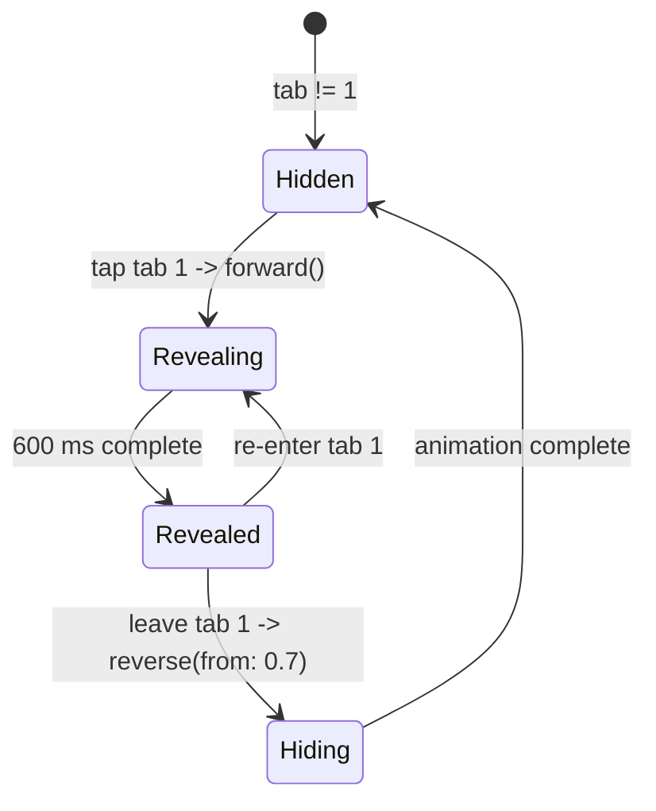

# rrrovalle-tesla-car-app

## 1. Provenance

- Submodule path: `legacy/rrrovalle-tesla-car-app`.
- Pinned gitlink (canonical): `160000 e885542d71203937c0a3fed9d97d7061bf664f66 0`.
- `git -C legacy/rrrovalle-tesla-car-app rev-parse HEAD` = `e885542d71203937c0a3fed9d97d7061bf664f66` — matches gitlink.
- `git -C legacy/rrrovalle-tesla-car-app status --porcelain` — empty (clean).
- Upstream URL: `https://github.com/rrrovalle/tesla-car-app` (origin fetch + push).
- License: none declared. No `LICENSE` file in `git ls-files`; `app/pubspec.yaml:1-2` has no license field. Reuse risk: do not line-copy.
- Analysis date: 2026-11-21.
- Files read (all FULL-READ; each is small):
    - `README.md:1-4`
    - `app/README.md:1-16`
    - `app/lib/main.dart:1-25`
    - `app/lib/home_controller.dart:1-35`
    - `app/lib/constraints.dart:1-7`
    - `app/lib/models/TyrePsi.dart:1-14`
    - `app/lib/screens/components/battery_status.dart:1-55`
    - `app/lib/screens/components/door_lock.dart:1-36`
    - `app/lib/screens/components/nav_bottom.dart:1-41`
    - `app/lib/screens/home_screen.dart:1-167`
    - `app/test/widget_test.dart:1-30`
    - `app/pubspec.yaml:1-90`
    - `app/analysis_options.yaml:1-29`
    - `app/android/app/src/main/AndroidManifest.xml:1-41`
    - `app/android/app/build.gradle:1-68`
    - `app/ios/Runner/Info.plist:1-45`
- Files explicitly NOT read: `app/pubspec.lock`; all `app/assets/**` SVG/PNG binaries; Android project scaffolding (`gradle-wrapper.properties`, `settings.gradle`, `MainActivity.kt`, `res/**`, debug/profile manifests); iOS scaffolding (`Runner.xcodeproj/project.pbxproj`, `xcshareddata/**`, `AppDelegate.swift`, storyboards, `xcconfig`, bridging header); `app/web/index.html`, `manifest.json`, web icons. None of these paths can contain a CAN pipeline; they were skipped as non-load-bearing.
- Replace-mode preservation: frontmatter below is byte-for-byte the original (same keys, order, values). The description line at original line 3 ended in `and ti` with no trailing whitespace (verified), so no strip was needed. The original doc had **no** `## Upstream (...)` sections, so there was nothing to preserve there. Pre-replace claims are cited as `git show HEAD:docs/legacy/rrrovalle-tesla-car-app.md#N`.

## 2. Executive verdict

`rrrovalle-tesla-car-app` is a Flutter/Dart UI mockup, not a vehicle interface. It renders a dark-themed car panel with four in-memory lock booleans, a tab-driven battery-reveal animation, hardcoded battery strings, and a declared-but-unused `TyrePsi` model. There is no CAN, BLE, serial, WiFi, HTTP, persistence, or backend code anywhere in `app/lib` (negative anchor in section 16). The only mechanism with any transferable idea is the battery-reveal stagger animation (600 ms controller, `Interval(0.0,0.5)` + `Interval(0.6,1)`, reverse from 0.7) — a UI-only pattern, not firmware. Everything else is either already present on our side (dark theme, lock commands, BMS telemetry via `packages/protocol`) or dead mock data. Nothing here is a port candidate for `firmware/`, `packages/protocol/`, or `tools/`. Do not copy upstream source verbatim: there is no license, the sole test is a broken template, and the Android release build signs with debug keys.

## 3. Evidence map

| Source file | Lines | What it proves | Grade |
| --- | --- | --- | --- |
| `app/lib/main.dart` | 1-25 | Dark `MaterialApp`, title `Tesla Panel`, `home: HomeScreen()`; no transport imports | CODE-READ |
| `app/lib/home_controller.dart` | 1-35 | Four independent lock bools + tab index; `ChangeNotifier` toggles in memory only | CODE-READ |
| `app/lib/constraints.dart` | 1-7 | UI colors (`0xFF53F9FF`, `0xFFFF5368`) and durations only; no frame data | CODE-READ |
| `app/lib/models/TyrePsi.dart` | 1-14 | `TyrePsi` + `demoPsiList` declared; no consumer in `app/lib` | CODE-READ |
| `app/lib/screens/components/battery_status.dart` | 1-55 | Battery readout is five hardcoded `Text` strings | CODE-READ |
| `app/lib/screens/components/door_lock.dart` | 1-36 | `GestureDetector` swaps lock/unlock SVG via `AnimatedSwitcher` | CODE-READ |
| `app/lib/screens/components/nav_bottom.dart` | 1-41 | Four nav items from `navIconSrc`; no screen bodies behind them | CODE-READ |
| `app/lib/screens/home_screen.dart` | 1-167 | Tab state drives battery animation; four lock widgets + static car/battery SVG | CODE-READ |
| `app/test/widget_test.dart` | 1-30 | Only test is unmodified Flutter counter template | CODE-READ |
| `app/pubspec.yaml` | 1-90 | Flutter SDK `>=2.12.0 <3.0.0`, `flutter_svg 0.22`, no vehicle/network deps | CODE-READ |
| `app/analysis_options.yaml` | 1-29 | Stock `flutter_lints` config | CODE-READ |
| `app/android/app/src/main/AndroidManifest.xml` | 1-41 | Launcher activity `singleTop`; no permissions declared | CODE-READ |
| `app/android/app/build.gradle` | 1-68 | Release build uses `signingConfigs.debug`; placeholder `applicationId` | CODE-READ |
| `app/ios/Runner/Info.plist` | 1-45 | Stock Flutter plist; no URL schemes or BLE background modes | CODE-READ |
| `README.md` | 1-4 | Claims door unlock, battery status, air-cooler temperature, tire PSI | SUMMARY-ONLY |
| `app/README.md` | 1-16 | Stock Flutter template README | SUMMARY-ONLY |
| `git show HEAD:docs/legacy/rrrovalle-tesla-car-app.md` | 15, 30-31, 42, 50-55 | Pre-replace summary claims (UI mockup, no CAN, ChangeNotifier, styling takeaways) | SUMMARY-ONLY |

No valid TEST-READ evidence exists: the only test asserts a counter that `MyApp` never implements (section 10). No CAPTURE evidence exists: there are no frames or decodes to capture. Every file above was FULL-READ. No vendored DBC/JSON catalog exists, so STRUCTURAL-PARSE and RANGE-CITED coverage do not apply.

## 4. Architecture and build surface

- Entry point: `app/lib/main.dart:4-25` — `main()` → `MyApp` → `HomeScreen`.
- Shared core vs platform port: all logic lives in `app/lib/**` (Dart/Flutter). `app/android/**` and `app/ios/**` are stock Flutter scaffolds; `app/web/**` is stock web scaffold. No per-platform transport code.
- State: `HomeController extends ChangeNotifier` (`app/lib/home_controller.dart:3`), instantiated once in `home_screen.dart:18`; `AnimatedBuilder` merges it with the animation controller (`home_screen.dart:55-56`).
- Build flags: none. No CAN/build-flag gating; `app/pubspec.yaml:29-48` declares only Flutter, `cupertino_icons`, `flutter_svg`, `flutter_test`, `flutter_lints`.
- Dependency boundary: no native plugin for serial/BLE/CAN in `pubspec.yaml` or manifests.

None found: no frame pipeline in this repo.

## 5. Mechanism catalogue

### M1 — Four independent door/bonnet/trunk lock toggles

- **Claim (README / summary):** "unlock any door" (`README.md:2`; `git show HEAD:docs/legacy/rrrovalle-tesla-car-app.md#15`).
- **Code path:** `app/lib/home_controller.dart:3-35` — `HomeController extends ChangeNotifier` → `updateRightDoorLock()` / `updateLeftDoorLock()` / `updateBonnetDoorLock()` / `updateTrunkDoorLock()` toggle bools → `notifyListeners()` → `AnimatedBuilder` at `app/lib/screens/home_screen.dart:55-165` rebuilds four `DoorLock` widgets.
- **Frame spec:** None found.
- **Gates and timing:** None found (no AP/DAS gate; no persistence; immediate in-memory flip).
- **State machine:** Four independent 2-state bools, all initialized `true` (`home_controller.dart:11-14`); each flips on tap, no re-arm, no NVS.
- **Tests:** None found (`widget_test.dart:14-29` tests a counter, not locks).
- **Evidence grade:** CODE-READ.
- **Verdict:** CONFIRMED.
- **Adapt to TeslaCANModder?** no impact — we ship real `lock`/`unlock` commands (`packages/protocol/src/commands.ts:221`).

### M2 — Bottom-navigation tab selection

- **Claim (README / summary):** implied by "navigation" component (`git show HEAD:docs/legacy/rrrovalle-tesla-car-app.md#38`).
- **Code path:** `app/lib/screens/components/nav_bottom.dart:17-32` — `BottomNavigationBar.onTap` → `app/lib/screens/home_screen.dart:60-67` callback → `_controller.onBottomNavigationTabChange(index)` (`home_controller.dart:6-9`) → `notifyListeners()`.
- **Frame spec:** None found.
- **Gates and timing:** None found.
- **State machine:** `selectedBottomTab` ∈ {0,1,2,3} (`home_controller.dart:4`); index `1` is Charge/battery, others have no body.
- **Tests:** None found.
- **Evidence grade:** CODE-READ.
- **Verdict:** CONFIRMED.
- **Adapt to TeslaCANModder?** no impact (different UI stack).

### M3 — Tab-driven battery reveal animation

- **Claim (README / summary):** "check battery status" (`README.md:2`); "battery status" (`git show HEAD:docs/legacy/rrrovalle-tesla-car-app.md#15`).
- **Code path:** `app/lib/screens/home_screen.dart:24-39` `setupBatteryAnimation()` → `AnimationController(duration: 600 ms)` (line 27) → `CurvedAnimation` with `Interval(0.0,0.5)` for battery SVG opacity (line 32) and `Interval(0.6,1)` for status text (line 37); lifecycle at lines 42-51; `forward()` / `reverse(from: 0.7)` at lines 61-65.
- **Frame spec:** None found.
- **Gates and timing:** Precondition `index == 1` to start; leaving tab 1 reverses from 0.7; 600 ms total; two non-overlapping intervals.
- **State machine:**



- **Tests:** None found.
- **Evidence grade:** CODE-READ.
- **Verdict:** CONFIRMED.
- **Adapt to TeslaCANModder?** candidate (UI-only stagger pattern for `client/`; low value, zero CAN risk).

### M4 — Static battery telemetry readout

- **Claim (README / summary):** "check battery status" (`README.md:2`); `git show HEAD:docs/legacy/rrrovalle-tesla-car-app.md#15`.
- **Code path:** `app/lib/screens/components/battery_status.dart:14-53` — `Column` of static `Text`: `"220 mi"`, `"62%"`, `"Charging"`, `"18 min remaining"`, `"22 mi/hr"`, `"232 v"`.
- **Frame spec:** None found.
- **Gates and timing:** None found.
- **State machine:** None found (no state; pure stateless widget).
- **Tests:** None found.
- **Evidence grade:** CODE-READ.
- **Verdict:** PARTIAL (display exists, but it is not live telemetry).
- **Adapt to TeslaCANModder?** never port — real BMS telemetry already decoded (`packages/protocol/src/types.ts:551`, `client/src/components/TelemetryPanel.tsx:85`).

### M5 — Declared-but-unused tire-PSI model

- **Claim (README / summary):** "check the psi of the tires" (`README.md:2`); `git show HEAD:docs/legacy/rrrovalle-tesla-car-app.md#15`.
- **Code path:** `app/lib/models/TyrePsi.dart:1-14` — `TyrePsi` class + `demoPsiList` (4 entries); no reference anywhere in `app/lib` (verified).
- **Frame spec:** None found.
- **Gates and timing:** None found.
- **State machine:** None found.
- **Tests:** None found.
- **Evidence grade:** CODE-READ.
- **Verdict:** CONTRADICTED (no tire-PSI UI exists).
- **Adapt to TeslaCANModder?** never port (dead code; no decoder, no consumer).

## 6. Summary vs code contradiction table

| Pre-replace / upstream claim | Code proof | Verdict |
| --- | --- | --- |
| Frontmatter description claims "air cooler temperature" (`git show HEAD:docs/legacy/rrrovalle-tesla-car-app.md#3`); `README.md:2` same | Only a `Temp.svg` nav icon at `app/lib/screens/components/nav_bottom.dart:39`; no temperature handler, slider, or state anywhere in `app/lib` | CONTRADICTED |
| Frontmatter description + `git show HEAD:docs/legacy/rrrovalle-tesla-car-app.md#15` claim tire PSI monitoring; `README.md:2` same | `TyrePsi.dart:1-14` defines a model + `demoPsiList` but nothing renders it; `home_screen.dart:73-159` renders car, locks, battery only | CONTRADICTED |
| Frontmatter description line 3 is truncated mid-word (`and ti`) but was preserved byte-for-byte per replace mode | Actual feature set is four lock toggles + static battery strings + 600 ms animation; description is stale and incomplete | CONTRADICTED (staleness recorded, bytes kept) |
| `widget_test.dart:14-28` asserts counter `0`→`1` and taps `Icons.add` | `main.dart:14-23` builds `HomeScreen`; no counter text, no `Icons.add` anywhere (`home_screen.dart:1-167`); test cannot pass | CONTRADICTED |
| `README.md:2` "unlock any door" | Only four toggles (right door, left door, bonnet, trunk) at `home_controller.dart:11-34`; no auth, backend, or "any door" abstraction | PARTIAL |

Agreements (kept out of this table, recorded in section 3): "UI-only mockup, no CAN" (`git show HEAD:docs/legacy/rrrovalle-tesla-car-app.md#15`, `#46`), "CAN Interface: N/A" (`#30`), "License: None" (`#31`), dark-theme and ChangeNotifier takeaways (`#54-55`) are all confirmed by code.

## 7. CAN frame and signal inventory

None found. No frame is decoded, mutated, or injected; no DBC/JSON frame catalog is vendored. The `demoPsiList` values (`app/lib/models/TyrePsi.dart:9-14`) are UI mock data, not decoded signals, and have no CAN ID, DLC, counter, or checksum.

## 8. Constants and tuning table

No constant shapes a CAN frame, gate, or bus timing window. The load-bearing UI/timing and mock-data constants are listed for completeness; all are CODE-READ.

| Constant | Value | File:line | Meaning | Grade |
| --- | --- | --- | --- | --- |
| Battery animation duration | `Duration(milliseconds: 600)` | `app/lib/screens/home_screen.dart:27` | Total reveal/hide time | CODE-READ |
| Battery image interval | `Interval(0.0, 0.5)` | `app/lib/screens/home_screen.dart:32` | First half of timeline fades battery SVG | CODE-READ |
| Status text interval | `Interval(0.6, 1)` | `app/lib/screens/home_screen.dart:37` | Second half fades battery text | CODE-READ |
| Reverse anchor | `reverse(from: 0.7)` | `app/lib/screens/home_screen.dart:64` | Hide resumes from 0.7 progress | CODE-READ |
| `defaultDuration` | `Duration(milliseconds: 300)` | `app/lib/constraints.dart:7` | Lock icon / position transitions | CODE-READ |
| `primaryColor` / `redColor` | `0xFF53F9FF` / `0xFFFF5368` | `app/lib/constraints.dart:3-4` | Cyan selection / red alert styling | CODE-READ |
| Mock PSI / temp / low flags | `23.6/56/true`, `35.0/41/false`, `34.6/41/false`, `34.8/42/false` | `app/lib/models/TyrePsi.dart:10-13` | Unused demo tire data | CODE-READ |
| Mock battery strings | `220 mi`, `62%`, `18 min remaining`, `22 mi/hr`, `232 v` | `app/lib/screens/components/battery_status.dart:17-46` | Static display text | CODE-READ |
| Android SDK levels | `compileSdk 30`, `minSdk 16`, `targetSdk 30` | `app/android/app/build.gradle:29,47,48` | Build surface only | CODE-READ |

## 9. Failure modes and edge cases

CAN-specific failure modes (`bus-off`, watchdog, OTA pause, queue overflow, brownout reboot, missing-frame timeout): **None found** — no CAN code exists.

| Failure | Handling code path | Tested? | Grade |
| --- | --- | --- | --- |
| Only test is a broken Flutter counter template; would fail on `MyApp` | None — `widget_test.dart:14-29` left unmodified from scaffold | No (test itself is invalid) | CODE-READ |
| Animation controller lifecycle | Created in `initState` (`home_screen.dart:42-45`), disposed in `dispose` (`48-51`) | No | CODE-READ |
| Release build signed with debug keys | `app/android/app/build.gradle:54-58` | No | CODE-READ |
| Static mock data has no source/validation | None — hardcoded strings in `battery_status.dart:17-46`, `TyrePsi.dart:10-13` | No | CODE-READ |
| No persistence across reboot | None — all state in `HomeController` fields (`home_controller.dart:4-14`) | No | CODE-READ |

## 10. Test coverage map

- `app/test/widget_test.dart:14-29` — `testWidgets('Counter increments smoke test')` pumps `MyApp`, then expects `find.text('0')` / `find.text('1')` and taps `Icons.add`. `MyApp` has no counter and no `Icons.add` (`main.dart:14-23`, `home_screen.dart:1-167`); this test cannot pass. It asserts nothing about the four features the README claims.

Critical paths with NO test:

- Four lock toggles (`home_controller.dart:16-34`) — risk: regression in in-memory state goes unnoticed.
- Tab selection and battery forward/reverse animation (`home_screen.dart:60-67`) — risk: broken reveal/hide timing.
- Static battery readouts (`battery_status.dart:17-46`) — risk: none functionally, but no oracle for displayed values.
- `demoPsiList` model (`TyrePsi.dart:9-14`) — risk: dead code is untested by definition.

No TEST-READ evidence exists in this repo.

## 11. Parity matrix with TeslaCANModder

None found. Upstream touches no CAN frame and decodes no signal, so no row can be CODE-READ on both sides; a parity table here would be SUMMARY-ONLY by construction and cannot drive a decision. UI-concept overlap (dark theme, lock command names, BMS telemetry) is handled with our-side CODE-READ anchors in sections 12-13:

- Our client is React Native, not Flutter: `client/src/components/ThemeSwitch.tsx:1-2` imports `react-native`.
- Our lock command already exists: `packages/protocol/src/commands.ts:221` — `lock: () => "lock"`.
- Our BMS telemetry is real: `packages/protocol/src/types.ts:551` (`nomFull?`), `client/src/components/TelemetryPanel.tsx:85` (`BMS Extended`).

## 12. Surface inventory and security notes

Transport surfaces:

- Flutter UI taps only: four `DoorLock` `GestureDetector`s (`door_lock.dart:17-18`), `BottomNavigationBar.onTap` (`nav_bottom.dart:18`).
- Android launcher activity, `singleTop`, no `<uses-permission>` (`app/android/app/src/main/AndroidManifest.xml:6-34`).
- iOS standard scene config, no URL schemes / BLE background modes (`Info.plist:1-45`).
- Web scaffold (`app/web/**`) not read.
- No serial/BLE/WiFi commands, no HTTP endpoints, no keys or certs, no untrusted archives in the audited files (negative anchor in section 16).

Security / provenance findings:

- Release build signed with `signingConfigs.debug` (`app/android/app/build.gradle:54-58`) — dangerous build config; never port.
- Placeholder `applicationId "com.example.tesla_car"` (`build.gradle:46`) and `TODO` signing comment (`55`) — unfinished scaffold.
- No license file anywhere in `git ls-files`; no hardcoded credentials discovered in files read. Gradle wrapper / Xcode project were not read, so embedded-secret status there is UNVERIFIED.
- `publish_to: 'none'` (`app/pubspec.yaml:6`) is the only safe publishing guard present.

## 13. Adaptation assessment

| Mechanism | Value | Cost | Risk | Evidence grade | Decision |
| --- | --- | --- | --- | --- | --- |
| M1 lock toggles | Low | N/A | N/A — we have real commands | CODE-READ | no impact |
| M2 tab selection | None | N/A | Different stack | CODE-READ | no impact |
| M3 battery reveal animation | Low–medium (UI polish only) | Low (client-only) | Zero CAN risk | CODE-READ | candidate for future PR |
| M4 static battery readout | None | N/A | Would regress real telemetry | CODE-READ | never port |
| M5 tire-PSI model | None | N/A | Dead code | CODE-READ | never port |

Ranked shortlist (all are UI-only; none touch firmware/protocol/tools):

1. Battery-reveal stagger animation (M3) — reuse the timing idea in `client/` if a tabbed reveal is wanted; independent implementation, no upstream code.
2. Cyan/red dark-theme tokens (section 8) — already present in our client (`ThemeSwitch.tsx:1-2`, `client/src/design/tokens.ts`); no impact.
3. Four independent lock toggles (M1) — already present as real commands (`packages/protocol/src/commands.ts:221`); no impact.

None of these is a CAN-frame mechanism, so `docs/checklists/can-review-checklist.md` is not triggered by any candidate.

## 14. Do-not-copy list

- `app/test/widget_test.dart:14-29` — broken default counter test; copying imports a failing test.
- `app/android/app/build.gradle:54-58` — debug signing for release; insecure build config.
- `app/lib/models/TyrePsi.dart:9-14` — dead mock dataset; no decoder or consumer.
- `app/lib/screens/components/battery_status.dart:17-46` — hardcoded strings masquerading as telemetry.
- `app/lib/main.dart:8-25` and all `app/lib/**` — no upstream license; do not line-copy any source text.
- `README.md:2` — claims AC/temperature and tire-PSI features that do not exist; do not treat as a spec.

## 15. History and evolution

The submodule is a **shallow clone**: `git -C legacy/rrrovalle-tesla-car-app rev-parse --is-shallow-repository` = `true`, and `git -C legacy/rrrovalle-tesla-car-app rev-list --all --count` = `1`. Only the pinned snapshot is available locally:

- `e885542 :sparkles: add battery status feature` — the sole local commit.

The commit message is consistent with `battery_status.dart` being the most fleshed-out component, but with one commit there is no local evidence of what was tried, abandoned, or rolled back. Pre-pin upstream history was **not** reviewed. Any claim about issues, PRs, or earlier approaches is UNVERIFIED and would require `git fetch --unshallow` plus network access to settle.

## 16. Re-verification recipe

```bash
OLD=e885542d71203937c0a3fed9d97d7061bf664f66
git ls-files -s legacy/rrrovalle-tesla-car-app
#   -> 160000 e885542d71203937c0a3fed9d97d7061bf664f66 0
git -C legacy/rrrovalle-tesla-car-app rev-parse HEAD
git -C legacy/rrrovalle-tesla-car-app status --porcelain
git -C legacy/rrrovalle-tesla-car-app fetch --tags --prune
git -C legacy/rrrovalle-tesla-car-app log --oneline $OLD..origin/main
git -C legacy/rrrovalle-tesla-car-app diff --stat $OLD..origin/main
git -C legacy/rrrovalle-tesla-car-app diff $OLD..origin/main -- app/lib app/test app/pubspec.yaml
```

Demonstrated grep anchors (all run against the pinned snapshot; expected hits shown):

```text
grep -nE 'bool isRightDoorLock' legacy/rrrovalle-tesla-car-app/app/lib/home_controller.dart
  -> line 11: bool isRightDoorLock = true;
grep -nE 'demoPsiList' legacy/rrrovalle-tesla-car-app/app/lib/models/TyrePsi.dart
  -> line 9: final List<TyrePsi> demoPsiList = [
grep -nE '220 mi|62%|18 min remaining|232 v' legacy/rrrovalle-tesla-car-app/app/lib/screens/components/battery_status.dart
  -> 4 hits at lines 17, 24, 33, 46
grep -nE 'milliseconds: 600|Interval\(0.0, 0.5\)|Interval\(0.6, 1\)' legacy/rrrovalle-tesla-car-app/app/lib/screens/home_screen.dart
  -> lines 27, 32, 37
grep -nE 'signingConfig signingConfigs.debug' legacy/rrrovalle-tesla-car-app/app/android/app/build.gradle
  -> line 57
grep -nE 'navIconSrc' legacy/rrrovalle-tesla-car-app/app/lib/screens/components/nav_bottom.dart
  -> lines 23, 26, 36
grep -nE 'Color\(0xFF53F9FF\)|defaultDuration' legacy/rrrovalle-tesla-car-app/app/lib/constraints.dart
  -> lines 3, 7
grep -nE 'Counter increments smoke test|findsOneWidget|Icons.add' legacy/rrrovalle-tesla-car-app/app/test/widget_test.dart
  -> lines 14, 19, 23, 28
grep -nE '0xAA|XOR|dart:io|Http|Sockets|Mcp2515|CAN' legacy/rrrovalle-tesla-car-app/app/lib
  -> no output (negative anchor: no transport/CAN code)
```

Our-side drift anchors (pin `already present` / `no impact` decisions by symbol):

```text
grep -nE 'react-native' client/src/components/ThemeSwitch.tsx
  -> lines 1-2
grep -nE 'nomFull' packages/protocol/src/types.ts
  -> line 551
grep -nE 'lock: \(\) => "lock"' packages/protocol/src/commands.ts
  -> line 221
```

If line numbers drift more than ~10, re-read the whole function; do not trust this document's numbers. Pre-pin upstream history was not reviewed (shallow clone, one commit).

## 17. Open questions and explicitly not investigated

- Pre-pin upstream history: not reviewed (shallow clone, 1 commit); cannot identify abandoned approaches without `--unshallow`.
- `app/pubspec.lock` not read — exact resolved transitive versions UNVERIFIED; only declared ranges in `pubspec.yaml` were reviewed.
- `app/web/**`, Android/iOS scaffolding, assets, and Gradle/Xcode project files not read; embedded secrets or platform-specific transport code there are UNVERIFIED (no evidence any exists).
- Whether `demoPsiList` / AC-temperature features existed on an earlier upstream revision is UNVERIFIED.
- Upstream has no test suite for its actual features; none of the five mechanisms has a behavioral oracle.
- No network/research was performed: issue/PR claims are all UNVERIFIED by design.
- All adaptation candidates are UI-only; no CAN-frame, checksum, or routing claim in this doc needs bench validation.
