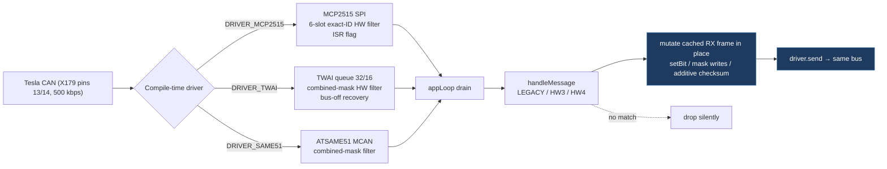

# sahilcc7-tesla_can

Deep-dive analysis of the `legacy/sahilcc7-tesla_can` submodule. Replace mode: this document supersedes the previous summary in-place; the pre-replace summary remains citable from git history as `git show HEAD:docs/legacy/sahilcc7-tesla_can.md`. The YAML frontmatter above is preserved byte-for-byte from the previous doc (the description line is inherited and truncated mid-sentence; see section 6). No `## Upstream (...)` sections existed in the pre-replace doc, so nothing beyond the frontmatter required verbatim preservation.

## 1. Provenance

- Submodule path: `legacy/sahilcc7-tesla_can`
- Pinned gitlink (parent repo, canonical form): `160000 12e8709b44653c6190c2624ce326d3bc89535270 0`
- Submodule HEAD at analysis time: `12e8709b44653c6190c2624ce326d3bc89535270` — matches gitlink
- Submodule `status --porcelain`: empty (clean)
- Upstream URL: `https://github.com/sahilcc7/tesla_can` (origin fetch/push)
- License: GPL-3.0 (`LICENSE`, full text; header read, remainder is the canonical unmodified GPL-3.0 text)
- Upstream commit: `12e8709 upload`, dated 2026-04-08 — the only commit in the local clone
- Analysis date: 2026-11-21

Files read (FULL-READ, complete files, line ranges shown as read):

| File | Lines | Coverage |
| --- | --- | --- |
| `include/handlers.h` | 1-243 | FULL-READ |
| `include/app.h` | 1-72 | FULL-READ |
| `include/can_helpers.h` | 1-34 | FULL-READ |
| `include/can_frame_types.h` | 1-11 | FULL-READ |
| `include/drivers/can_driver.h` | 1-13 | FULL-READ |
| `include/drivers/mcp2515_driver.h` | 1-69 | FULL-READ |
| `include/drivers/twai_driver.h` | 1-117 | FULL-READ |
| `include/drivers/same51_driver.h` | 1-70 | FULL-READ |
| `include/drivers/mock_driver.h` | 1-32 | FULL-READ |
| `src/main.cpp` | 1-47 | FULL-READ |
| `RP2040CAN.ino` | 1-69 | FULL-READ |
| `platformio.ini` | 1-35 | FULL-READ |
| `scripts/platformio_sync_ino_defines.py` | 1-107 | FULL-READ |
| `test/test_native_helpers/test_helpers.cpp` | 1-177 | FULL-READ |
| `test/test_native_hw3/test_hw3_handler.cpp` | 1-182 | FULL-READ |
| `test/test_native_hw4/test_hw4_handler.cpp` | 1-281 | FULL-READ |
| `test/test_native_legacy/test_legacy_handler.cpp` | 1-153 | FULL-READ |
| `test/test_native_twai/test_twai_filter.cpp` | 1-208 | FULL-READ |
| `README.md` | 1-389 | FULL-READ |
| `THIRD_PARTY_LICENSES` | 1-80 | FULL-READ |
| `guides/FSD_SUBSCRIPTION_GUIDE.md` | 1-36 | FULL-READ |
| `guides/INSTALLATION_GUIDE_M4_CAN.md` | 1-82 | FULL-READ |
| `guides/WIRING_GUIDE.md` | 1-66 | FULL-READ |
| `lib/README`, `test/README` | 1-46 / 1-11 | FULL-READ (PlatformIO boilerplate stubs) |
| `LICENSE` | 1-5 | RANGE-CITED (lines 1-5 only; remainder is the canonical GPL-3.0 text, not load-bearing) |

Files explicitly NOT read: `guides/images/connected-setup.png`, `guides/images/pinout-labeled.png`, `guides/images/x179-connector.png` (binary images, not read). No other files exist in the tree; inventory was taken via `git -C legacy/sahilcc7-tesla_can ls-files` (25 text files + 3 images), which includes hidden directories — there are no hidden dot-directories in this submodule (contrast: other submodules hide code under `.firmware/`).

No DBC/JSON frame catalog exists in this repo; all frame knowledge is inline C++ code, so STRUCTURAL-PARSE coverage was not needed.

## 2. Executive verdict

This is "Tesla Open Can Mod": a minimal, single-bus, header-only Arduino/PlatformIO firmware that passively echoes a handful of Tesla chassis CAN frames with a few bits flipped — FSD enable (bit 46 + HW4 bits 60/59), nag suppression (bit 19 clear, HW4 bit 47 set), follow-distance-to-profile mapping, HW3 speed offset, and the HW4 ISA chime suppress with its additive ID+payload checksum. Its value to TeslaCANModder is nearly complete cross-validation: every frame layout and bit position it touches is byte-identical to what our `firmware/lib/vehicle/can/handler/variant/` already ships, independently derived — plus three genuinely novel mechanisms we do not have (the TWAI/SAME51 combined-mask acceptance-filter math with a real test suite, TWAI bus-off reinstall recovery, and the RP2040 CAN board target). Nothing in its handler code should be ported — ours is a strict superset with safety gates (AP gate, DLC guards, NVS persistence) the upstream lacks entirely. Do not copy: the whole `include/handlers.h` approach has no DLC validation, no gating, and dense one-liner arithmetic. The FSD subscription guide (Tesla-account region workaround) is a ToS-gray procedure that must never enter our docs.

## 3. Evidence map

No CAPTURE evidence exists in this repo: no frame captures, logs, or decode-tool output are committed. TEST-READ evidence exists (five Unity suites). All frame-shape claims below are CODE-READ and remain independent of any vehicle capture.

| Source file | Lines | What it proves | Grade |
| --- | --- | --- | --- |
| `include/handlers.h` | 13-22 | `CarManagerBase` interface: `speedProfile`, `FSDEnabled`, `handleMessage`, virtual filter list | CODE-READ |
| `include/handlers.h` | 24-72 | `LegacyHandler`: filter IDs {69,1006}; stalk map; mux0 bit 46 + profile; mux1 bit 19 clear | CODE-READ |
| `include/handlers.h` | 74-154 | `HW3Handler`: filter IDs {1016,1021}; fd→profile; mux0 steps read + bit 46; mux1 bit 19; mux2 offset write | CODE-READ |
| `include/handlers.h` | 156-243 | `HW4Handler`: filter IDs {921,1016,1021} under ISA flag; 921 chime+checksum; mux0 bits 46/60(/59); mux1 bits 19/47; mux2 profile | CODE-READ |
| `include/can_helpers.h` | 5-8 | `readMuxID` = `data[0] & 0x07` | CODE-READ |
| `include/can_helpers.h` | 10-13 | `isFSDSelectedInUI` = `data[4] >> 6 & 0x01` (bit 38) | CODE-READ |
| `include/can_helpers.h` | 15-19 | `setSpeedProfileV12V13`: byte 6 bits [2:1], mask `0x06` | CODE-READ |
| `include/app.h` | 13-21 | Compile-time `HW4`/`HW3`/`LEGACY` handler selection via `SelectedHandler` alias | CODE-READ |
| `include/app.h` | 29-53 | `appSetup`: init-failure path prints and continues; filters + ISR attach | CODE-READ |
| `include/app.h` | 55-71 | `appLoop`: ISR-flag gate then drain-all loop; LED heartbeat on `PIN_LED` | CODE-READ |
| `include/drivers/mcp2515_driver.h` | 16-38 | 500 kbps / 16 MHz crystal; six RXF slots, 0x7FF exact masks, padding of unused slots | CODE-READ |
| `include/drivers/twai_driver.h` | 31-58 | Combined-mask acceptance filter: `differ` XOR fold, `code<<21`, `mask=(differ<<21)|0x001FFFFF`, driver reinstall | CODE-READ |
| `include/drivers/twai_driver.h` | 66-110 | Poll-with-HW-filters read; 10 ms TX timeout; `isBusOff` + `recover` reinstall | CODE-READ |
| `include/drivers/same51_driver.h` | 12-39 | Native MCAN begin(500000); same differ-mask trick with 11-bit mask | CODE-READ |
| `test/test_native_twai/test_twai_filter.cpp` | 12-33, 40-180 | Filter math extracted and unit-tested, incl. negative rejects and exact mask values | TEST-READ |
| `test/test_native_hw4/test_hw4_handler.cpp` | 189-222 | ISA suppress bit set, byte preservation, and additive checksum oracle 0xD1 | TEST-READ |
| `test/test_native_hw3/test_hw3_handler.cpp` | 55-91 | `FSDEnabled` latched only from mux 0; mux 2 gated by latch | TEST-READ |
| `platformio.ini` | 1-35 | Four build envs incl. native tests; native env force-defines ISA+EVD flags | CODE-READ |
| `scripts/platformio_sync_ino_defines.py` | 26-101 | Build fails unless .ino defines and env flags agree exactly | CODE-READ |
| `README.md` | 56-118 | Board table, variant table, CAN message tables, "compiles, needs on-vehicle testing" statuses | SUMMARY-ONLY |
| `guides/INSTALLATION_GUIDE_M4_CAN.md` | 27-33 | Stale `HW_TARGET` define and wrong ready-message (see section 6) | SUMMARY-ONLY |

## 4. Architecture and build surface

Entry points: two — `RP2040CAN.ino` (Arduino IDE) and `src/main.cpp` (PlatformIO); both collapse into the same `appSetup`/`appLoop` templates in `include/app.h`. Shared core = `include/handlers.h` + `can_helpers.h` + `app.h`; platform port = one header per driver under `include/drivers/` (`MCP2515Driver`, `SAME51Driver`, `TWAIDriver`, `MockDriver`) behind the `CanDriver` virtual interface (`init`/`setFilters`/`enableInterrupt`/`read`/`send`). Build flags select exactly one driver (`DRIVER_MCP2515`/`DRIVER_SAME51`/`DRIVER_TWAI`) and one variant (`LEGACY`/`HW3`/`HW4`); optional `ISA_SPEED_CHIME_SUPPRESS`, `EMERGENCY_VEHICLE_DETECTION`. The `platformio_sync_ino_defines.py` pre-script hard-fails any mismatch between the .ino's uncommented defines and the chosen PlatformIO env. Dependency boundary: no TeslaCANModder-style transport layer at all — no serial command parsing, no WiFi/BLE, no NVS; the only I/O is CAN RX/TX plus one-way `Serial.printf` debug at 115200.



State diagrams: not applicable. No mechanism in this repo has 3 or more states; the only stateful element is the two-state `FSDEnabled` boolean latch (see mechanism 2 card), and `speedProfile` is a decoded value, not a state machine.

## 5. Mechanism catalogue

### 5.1 Compile-time variant handler dispatch

- **Claim (README / summary):** README:54 says the variant is selected "via the `#define` directive" in `RP2040CAN.ino`, Arduino and PlatformIO alike.
- **Code path:** `RP2040CAN.ino:22-26` / `platformio.ini` flags → `include/app.h:13-21` (`SelectedHandler` alias, `#error` otherwise) → `appSetup` instantiates `SelectedHandler` (`app.h:32`) → `appLoop` → `appHandler->handleMessage(frame, *appDriver)` (`app.h:69`).
- **Frame spec:** None found (dispatch only).
- **Gates and timing:** `scripts/platformio_sync_ino_defines.py:79-96` raises `UserError` unless the .ino defines and env flags agree; `app.h:33` unconditional `delay(1500)` at boot.
- **State machine:** None found.
- **Tests:** None found (no test exercises the alias or the sync script).
- **Evidence grade:** CODE-READ.
- **Verdict:** CONFIRMED.
- **Adapt to TeslaCANModder?** already present — our `handleHW3`/`handleHW4`/`handleLegacy` dispatch (`firmware/lib/vehicle/can/handler/variant/`) is runtime-variant-switched, richer, and NVS-backed.

### 5.2 FSD enable from UI selection (bit-38 latch → mux0 injection)

- **Claim (README / summary):** README:40-43,73 — "checks if 'Traffic Light and Stop Sign Control' is enabled in the Autopilot settings; uses this setting as a trigger for FSD"; sets "FSD enable bit".
- **Code path:** `can_helpers.h:10-13` `isFSDSelectedInUI` reads `data[4]` bit 6 (= frame bit 38) → latched into `FSDEnabled` on mux 0 (`handlers.h:52,110,213`) → mux 0 injection: Legacy sets bit 46 + profile (`handlers.h:53-58`), HW3 sets bit 46 + profile (`handlers.h:129-131`), HW4 sets bits 46+60 (+59 under `EMERGENCY_VEHICLE_DETECTION`, `handlers.h:216-221`) → `driver.send`.
- **Frame spec:** 1006 (Legacy) / 1021 (HW3, HW4), DLC 8, mux in `data[0]` bits[2:0]; write bits: 46 (all variants, byte 5 bit 6), 60 (HW4 only, byte 7 bit 4), 59 (HW4, optional, byte 7 bit 3). Counter untouched; no checksum recomputed on this frame.
- **Gates and timing:** injection only while `FSDEnabled` latched true; latch updates only from a mux-0 frame; HW3/HW4 mux-2 writes are additionally gated by the latch (HW3) or ungated (HW4 — see mechanism 5.6). No interval logic: pure per-frame echo of whatever arrives.
- **State machine:** 2-state boolean latch (`FSDEnabled` false→true only via mux-0 bit 38; never cleared except by object re-creation/reboot).
- **Tests:** `test_hw3_fsd_enabled_only_set_on_mux0` (`test/test_native_hw3/test_hw3_handler.cpp:57-74`) — latch survives a mux-2 frame without the bit; `test_hw4_fsd_mux0_sets_bits_46_and_60` (`test/test_native_hw4/test_hw4_handler.cpp:83-92`); `test_hw4_no_send_when_fsd_disabled_mux0` (104-112); `test_legacy_fsd_enabled_on_mux0` (`test/test_native_legacy/test_legacy_handler.cpp:57-65`).
- **Evidence grade:** CODE-READ + TEST-READ.
- **Verdict:** PARTIAL — bit mechanics CONFIRMED; the claim that bit 38 semantically equals the "Traffic Light and Stop Sign Control" UI setting is UNVERIFIED from code (no capture).
- **Adapt to TeslaCANModder?** already present — ours reads the same `data[4]` bit 6 (`firmware/lib/vehicle/can/ids.h:119-122`) and sets bits 38/39/46/60 (+59 when `evdEnabled`) gated by `s.fsdEnabled` + AP gate (`firmware/lib/vehicle/can/handler/variant/hw4.h:136-147`).

### 5.3 Nag suppression (bit 19 clear; HW4 bit 47 set)

- **Claim (README / summary):** README:75 "clears the hands-on-wheel nag bit"; README:106 mux 1 also "set bit 47".
- **Code path:** `handlers.h:59-63` (Legacy), `handlers.h:133-137` (HW3), `handlers.h:223-228` (HW4): `setBit(frame,19,false)`; HW4 additionally `setBit(frame,47,true)` → `driver.send`.
- **Frame spec:** 1006/1021 mux 1: bit 19 = byte 2 bit 3 cleared; bit 47 = byte 5 bit 7 set (HW4 only). Counter/checksum untouched.
- **Gates and timing:** none — every observed mux-1 frame is echoed modified, unconditionally, no DAS-state awareness.
- **State machine:** None found.
- **Tests:** `test_legacy_nag_suppression_clears_bit19_on_mux1` (`test/test_native_legacy/test_legacy_handler.cpp:99-107`); `test_hw3_nag_suppression_clears_bit19_on_mux1` (`test/test_native_hw3/test_hw3_handler.cpp:107-115`); `test_hw4_nag_suppression_clears_bit19_sets_bit47` (`test/test_native_hw4/test_hw4_handler.cpp:116-125`).
- **Evidence grade:** CODE-READ + TEST-READ.
- **Verdict:** CONFIRMED.
- **Adapt to TeslaCANModder?** already present — bit 19 (`NAG_BIT_HANDS_ON_REQUIREMENT`, `firmware/lib/vehicle/can/handler/variant/bits.h:42`) and bit 47 (`FSD_BIT_NAG_ORGANIC`, `bits.h:27`) match exactly; ours adds DAS-aware organic modes, ECE R79, EAP bit on mux 1 (`firmware/lib/vehicle/can/handler/variant/hw4.h:40-53`) — strictly a superset.

### 5.4 Follow-distance → speed-profile mapping (three variants)

- **Claim (README / summary):** README:46-47,74 — "reads the follow-distance stalk setting, maps it dynamically to a speed profile"; HW4 has "5 levels" (README:60).
- **Code path:** Legacy: `handlers.h:37-47` (`frame.data[1] >> 5`, pos≤1→2, pos==2→1, else 0). HW3: `handlers.h:87-104` (`data[5] & 0b11100000 >> 5`, 1→2, 2→1, 3→0). HW4: `handlers.h:187-207` (same extraction, 1→3, 2→2, 3→1, 4→0, 5→4). No TX on these frames.
- **Frame spec:** 69 (0x045) byte 1 bits[7:5] (stalk positions; byte-level encodings 0x00..0xC8 in the `handlers.h:36` comment); 1016 (0x3F8) byte 5 bits[7:5]. Read-only.
- **Gates and timing:** none; default profile 1 (HW3) / 1 (HW4) on unmatched values; no pin/lock concept — mapping always wins.
- **State machine:** None found (value decode).
- **Tests:** `test_legacy_stalk_pos0..3` (`test/test_native_legacy/test_legacy_handler.cpp:22-53`); `test_hw3_follow_distance_*` (`test/test_native_hw3/test_hw3_handler.cpp:22-53`); `test_hw4_follow_distance_1..5` (`test/test_native_hw4/test_hw4_handler.cpp:22-60`).
- **Evidence grade:** CODE-READ + TEST-READ.
- **Verdict:** CONFIRMED (HW4 5-level claim confirmed: five distinct outputs).
- **Adapt to TeslaCANModder?** already present, byte-identical — our `mapHW3FollowDistToProfile` `{ -1, 2, 1, 0 }` and `mapHW4FollowDistToProfile` `{ -1, 3, 2, 1, 0, 4 }` (`firmware/lib/vehicle/can/feature/fsd/profile.h:43-58`) plus `readFollowDistance` byte 5 bits[7:5] (`firmware/lib/vehicle/can/ids.h:106-109`); ours adds `profileOverride` pin. Two independent implementations agreeing is strong cross-validation of the layout.

### 5.5 HW3 speed-offset pipeline (mux0 steps read → mux2 write)

- **Claim (README / summary):** README:95,97 — mux 0 "calculate speed offset"; mux 2 "write speed offset to bits 6-7 of byte 0 and bits 0-5 of byte 1".
- **Code path:** `handlers.h:113` `speedOffset = clamp((data[3]>>1 & 0x3F) - 30) * 5, 0..100`; `handlers.h:114-128` maps raw steps 2/1/0 → profile 2/1/0; mux 2 write `handlers.h:138-145`: clear `data[0]` bits[7:6] and `data[1]` bits[5:0], then `data[0] |= (speedOffset & 0x03) << 6; data[1] |= speedOffset >> 2`.
- **Frame spec:** 1021 mux 0 byte 3 bits[6:1] (6-bit, bias −30, ×5 → 0..100 after clamp); mux 2 byte 0 bits[7:6] + byte 1 bits[5:0] (offset split low→high: 2 bits then 6 bits). Counter/checksum untouched.
- **Gates and timing:** read only while `FSDEnabled` (mux 0); write only when `index == 2 && FSDEnabled`.
- **State machine:** None found.
- **Tests:** PARTIAL — `test_hw3_fsd_enabled_only_set_on_mux0` and `test_hw3_fsd_disabled_on_mux0_prevents_mux2_send` (`test/test_native_hw3/test_hw3_handler.cpp:57-91`) assert send/no-send only; no test asserts the offset bit layout or the ×5/clamp arithmetic. Risk: silent regression of the encode would pass the suite.
- **Evidence grade:** CODE-READ (TEST-READ for gating only).
- **Verdict:** CONFIRMED for layout (code), coverage gap flagged.
- **Adapt to TeslaCANModder?** already present, byte-identical — `readHW3UiOffsetSteps` (`firmware/lib/vehicle/can/feature/fsd/offsets.h:31-35`), `calculateHW3SpeedOffset` (×5, clamp 0..100, `offsets.h:42-50`), `writeHW3SpeedOffset` (`offsets.h:17-24`).

### 5.6 HW4 mux-2 profile write

- **Claim (README / summary):** README:107 — "Write speed profile to bits 4-6 of byte 7".
- **Code path:** `handlers.h:229-234`: `frame.data[7] &= ~(0x07 << 4); frame.data[7] |= (speedProfile & 0x07) << 4` → `driver.send`.
- **Frame spec:** 1021 mux 2 byte 7 bits[6:4], 3-bit. Counter/checksum untouched.
- **Gates and timing:** none — `if (index == 2)` with no `FSDEnabled` check (`handlers.h:229`), unlike HW3's latched gate at `handlers.h:138`. Profile injected even with FSD off. Test comment acknowledges: "mux 2 always sends for HW4" (`test/test_native_hw4/test_hw4_handler.cpp:78`).
- **State machine:** None found.
- **Tests:** `test_hw4_mux2_injects_speed_profile`, `test_hw4_mux2_clears_old_profile_bits` (`test/test_native_hw4/test_hw4_handler.cpp:129-151`).
- **Evidence grade:** CODE-READ + TEST-READ.
- **Verdict:** CONFIRMED; the missing gate is a behavioral hazard, not a claim conflict.
- **Adapt to TeslaCANModder?** already present, safer — ours gates mux 2 on `s.fsdEnabled && apGateOpen` (`firmware/lib/vehicle/can/handler/variant/hw4.h:157-167`) and writes the same field via `writeHW4SpeedProfile` (`firmware/lib/vehicle/can/feature/fsd/profile.h:30-36`). Do not adopt the ungated behavior.

### 5.7 ISA speed-chime suppression (0x399) with additive checksum

- **Claim (README / summary):** README:30,103 — suppress ISA speed chime, "speed limit sign will be empty while driving"; optional, disabled by default (README:103). Pre-replace doc (`git show HEAD:docs/legacy/sahilcc7-tesla_can.md` line 80) lists it as an additional feature.
- **Code path:** `handlers.h:174-186`: `data[1] |= 0x20`; checksum `sum(data[0..6]) + (921 & 0xFF) + (921 >> 8)` stored in `data[7]`; `driver.send`; early `return`. Filter list grows to include 921 only under `ISA_SPEED_CHIME_SUPPRESS` (`handlers.h:158-170`).
- **Frame spec:** 921 (0x399), DLC 8, suppress bit = byte 1 bit 5 (mask 0x20); checksum byte 7 = (Σ bytes 0-6 + 0x99 + 0x03) & 0xFF. Counter position unknown/not touched (none observed in code).
- **Gates and timing:** compile-time flag only; no runtime toggle, no state gating; native test env force-defines it (`platformio.ini:34`).
- **State machine:** None found.
- **Tests:** `test_hw4_isa_suppress_sets_bit5_of_data1` (189-196), `_preserves_existing_data1_bits` (198-204), `_checksum_correct` (206-222, oracle: inputs 0x10/0x05 → 0xD1), `_returns_early_no_further_processing` (224-230) — all in `test/test_native_hw4/test_hw4_handler.cpp`.
- **Evidence grade:** CODE-READ + TEST-READ.
- **Verdict:** CONFIRMED (mechanics); the "empty speed-limit sign" side effect is SUMMARY-ONLY.
- **Adapt to TeslaCANModder?** already present — identical formula in `computeHW4IsaChecksum` (`firmware/lib/vehicle/can/checksum.h:47-56`), identical mask/bit (`firmware/lib/vehicle/can/handler/variant/bits.h:48-50`), HW4-gated and AP-gated (`firmware/lib/vehicle/can/handler/variant/hw4.h:70-81`); our test oracle already exists (`firmware/test/test_native_checksum/test_checksum.cpp:54-87`). Upstream's 0xD1 oracle independently corroborates our checksum.

### 5.8 MCP2515 six-slot exact-ID hardware filters

- **Claim (README / summary):** README:127 describes `PIN_CAN_INTERRUPT` as "unused; polling mode" — contradicted (see section 6).
- **Code path:** `mcp2515_driver.h:26-38`: config mode, `MASK0/MASK1 = 0x7FF` exact, `RXF0..RXF5` filled with handler IDs, unused slots padded with `ids[0]`, back to normal mode; ISR attach at `mcp2515_driver.h:40-45`.
- **Frame spec:** n/a (filter programming). Accepts only the 2-3 literal IDs per variant; no mask relaxation.
- **Gates and timing:** filter set is compile-time constant per variant (no runtime feature gating; raw-listen mode absent).
- **State machine:** None found.
- **Tests:** None found (driver untested; only the TWAI math replica is tested).
- **Evidence grade:** CODE-READ.
- **Verdict:** CONFIRMED.
- **Adapt to TeslaCANModder?** already present, evolved — our `applyFilters` builds a feature-driven dynamic ID list incl. raw-listen clearing and auto-detect discriminators (`firmware/lib/vehicle/can/handler/filters.h:34-95`).

### 5.9 TWAI/SAME51 combined-mask acceptance filter

- **Claim (README / summary):** README:326-331 describes the driver abstraction; the differ-mask trick itself is documented only in code comments (`twai_driver.h:36-50`, `same51_driver.h:28-30`).
- **Code path:** `twai_driver.h:38-42` fold `differ |= ids[0] ^ ids[i]`; `twai_driver.h:48-51` `acceptance_code = (ids[0] & ~differ) << 21`, `acceptance_mask = (differ << 21) | 0x001FFFFF`, `single_filter = true`; driver stop/uninstall/install/start to apply. SAME51 mirror: `same51_driver.h:31-38` with 11-bit mask.
- **Frame spec:** n/a. Known trade-off: for HW3 {1016,1021} the mask `differ=0x005` also admits 1017 and 1020 (false positives at HW level, discarded in software); for Legacy {69,1006} the mask is wide.
- **Gates and timing:** applied once at setup; reinstall while bus idle.
- **State machine:** None found.
- **Tests:** `test/test_native_twai/test_twai_filter.cpp` — 16 tests: accepts all target IDs (40-101), rejects 1000/500/0/100 (70-133), single-ID exact mask `500<<21` / `0x001FFFFF` (146-163), HW4 mask bits `(0x065<<21)|0x001FFFFF` (165-173), empty-count zero (175-180).
- **Evidence grade:** CODE-READ + TEST-READ.
- **Verdict:** CONFIRMED.
- **Adapt to TeslaCANModder?** candidate for future PR — we ship only MCP2515 (exact per-ID filters + software `IdFilter`, `firmware/lib/core/can/id_filter.h:25-77`); the differ-mask fold is the right tool only if we ever add a native-CAN (TWAI/MCAN) board with a single acceptance filter element.

### 5.10 TWAI bus-off detection and reinstall recovery

- **Claim (README / summary):** none — undocumented behavior.
- **Code path:** `twai_driver.h:96-102` `isBusOff` via `twai_get_status_info`; `twai_driver.h:104-110` `recover` = stop/uninstall/install/start reusing the saved filter config; called from `read` (71-72) and `send` (88-92) on failure.
- **Frame spec:** n/a.
- **Gates and timing:** recovery triggered only when a read/transmit failure coincides with `TWAI_STATE_BUS_OFF`; `send` uses a 10 ms TX timeout.
- **State machine:** None found (binary healthy/bus-off).
- **Tests:** None found.
- **Evidence grade:** CODE-READ.
- **Verdict:** PARTIAL — logic read; `recover` ignores `twai_driver_install`/`twai_start` return codes, so a failed recovery is silent.
- **Adapt to TeslaCANModder?** candidate (same hardware gate as 5.9); if adopted, reimplement with the TWAI alert API and checked returns — do not copy as-is.

### 5.11 ISR-flag + poll-drain application loop

- **Claim (README / summary):** README:326 "abstract `CanDriver` interface"; polling claims muddled (README:127).
- **Code path:** `app.h:26-27` `volatile bool frameReady`, `canISR` on FALLING (MCP2515 only, `app.h:47-50`); `appLoop` gates on the flag, clears it before draining (`app.h:58-63`), then `while (appDriver->read(frame))` → handler; `PIN_LED` toggles as a heartbeat (`app.h:68-71`); `RP2040CAN.ino:60` marks the loop `optimize("O3")`.
- **Frame spec:** n/a.
- **Gates and timing:** clear-before-drain ordering avoids the lost-frame race (a frame arriving during drain re-sets the flag); TWAI/SAME51 paths poll their HW queues directly (`kSupportsISR = false`).
- **State machine:** None found.
- **Tests:** None found.
- **Evidence grade:** CODE-READ.
- **Verdict:** CONFIRMED (and the ISR is real, contradicting README:127).
- **Adapt to TeslaCANModder?** no impact — our lock-free 256-entry ring-buffer consumer architecture supersedes a single `volatile bool` (single-bus design).

### 5.12 Arduino ↔ PlatformIO define-sync guard

- **Claim (README / summary):** README:236-237 "PlatformIO reads the active vehicle and optional feature defines from `RP2040CAN.ino`... If they do not match, the build stops with a clear error."
- **Code path:** `scripts/platformio_sync_ino_defines.py:14-23` parses active `#define`s from the .ino; `:26-32` enforces exactly one driver and one vehicle; `:79-96` cross-checks against env CPPDEFINES and raises `UserError` on mismatch/conflict; `:98-101` appends the missing vehicle/optional defines.
- **Frame spec:** None found.
- **Gates and timing:** SCons pre-build step; hard failure.
- **State machine:** None found.
- **Tests:** None found.
- **Evidence grade:** CODE-READ.
- **Verdict:** CONFIRMED.
- **Adapt to TeslaCANModder?** no impact — we are PlatformIO-only with no dual .ino entry point; porting would add a second source of truth for build flags.

## 6. Summary vs code contradiction table

Pre-replace claims are cited from history as `git show HEAD:docs/legacy/sahilcc7-tesla_can.md` (line numbers per that revision). Upstream README/guide claims cite the live files.

| # | Claim | Claim cite | Code reality | Code cite | Verdict |
| --- | --- | --- | --- | --- | --- |
| 1 | "CRC/counter management for modified messages" | `git show HEAD:docs/legacy/sahilcc7-tesla_can.md` line 91 | No CRC or counter management exists: no `crc` match anywhere in `include/`+`src/` (demonstrated negative anchor N1); the mux/counter nibble `data[0]` bits[2:0] is read but never written; only ISA 921 gets a (non-CRC) additive checksum | `include/handlers.h:50-63,106-145,174-186` | CONTRADICTED |
| 2 | Frontmatter description is a complete sentence | `git show HEAD:docs/legacy/sahilcc7-tesla_can.md` line 3 (inherited, ends mid-word "It runs o") | Frontmatter is factually stale/truncated; preserved byte-for-byte per replace-mode rules and flagged here instead of edited | n/a (frontmatter) | PARTIAL (staleness recorded, not fixed) |
| 3 | "Our `firmware/` directory is essentially this codebase with our modifications" | `git show HEAD:docs/legacy/sahilcc7-tesla_can.md` line 84 | True as lineage, false as description: our handlers are a superset on a different architecture (State-based, per-feature modules, AP gates, NVS, 3-bus dispatch, ring buffer) | `firmware/lib/vehicle/can/handler/variant/hw3.h:65-155` vs `include/handlers.h:74-154` | PARTIAL |
| 4 | HW4 "Same CAN IDs as HW3" (1016, 1021 only) | `git show HEAD:docs/legacy/sahilcc7-tesla_can.md` line 59 | HW4 filter list adds 921 whenever `ISA_SPEED_CHIME_SUPPRESS` is defined, and the repo's own native env defines it by default | `include/handlers.h:158-170`; `platformio.ini:34` | PARTIAL |
| 5 | "`PIN_CAN_INTERRUPT` — interrupt pin (unused; polling mode)" | `README.md` line 127 | ISR attached on FALLING and `appLoop` is flag-gated for the MCP2515 driver | `include/drivers/mcp2515_driver.h:40-45`; `include/app.h:47-50,58-63` | CONTRADICTED |
| 6 | Configure with `#define HW_TARGET TARGET_HW3` | `guides/INSTALLATION_GUIDE_M4_CAN.md` line 29 | Real defines are `LEGACY`/`HW3`/`HW4` (no `HW_TARGET`/`TARGET_*` symbols exist) | `include/app.h:13-21`; `RP2040CAN.ino:22-26` | CONTRADICTED (stale guide) |
| 7 | Serial Monitor shows `CANSAME5x ready @ 500k` | `guides/INSTALLATION_GUIDE_M4_CAN.md` line 33 | Actual ready message is `SAME51 CAN ready @ 500k` | `src/main.cpp:32` | CONTRADICTED |
| 8 | X179 is "behind the driver's side trunk panel" | `guides/INSTALLATION_GUIDE_M4_CAN.md` line 57 | Upstream's own wiring guide says "passenger side footwell, behind the panel on the right" — the guides contradict each other; code makes no location claim | `guides/WIRING_GUIDE.md:16-17` | CONTRADICTED (doc-vs-doc; CAPTURE/photo would settle) |
| 9 | CAN 921 (0x399) is named "DAS_status" | `README.md` line 103 (same row's Action column calls it ISA speed chime) | Code never names the frame; our reference docs assign 0x399 = ISA speed chime (chassis, HW4) and DAS_status to 0x39B (vehicle bus), so the README name conflicts with both its own Action column and our `docs/reference/can-protocol.md` | `include/handlers.h:175`; `docs/reference/can-protocol.md` CAN IDs table | PARTIAL (naming conflict; real semantics UNVERIFIED without capture) |

## 7. CAN frame and signal inventory

All frames observed on the single chassis-side CAN lane (X179 pins 13/14 per `README.md:285-292`; upstream has no multi-bus concept). No frame periods are specified anywhere in this repo — the firmware is a passive per-frame echo, so "period = whatever the vehicle emits".

| ID (hex + dec) | Bus | Period | DLC | Byte/bit layout | Scale/units | Counter | Checksum | R/W | Grade |
| --- | --- | --- | --- | --- | --- | --- | --- | --- | --- |
| 0x045 (69) STW_ACTN_RQ | single chassis lane | None found in code | 8 (assumed; no DLC check) | byte 1 bits[7:5] stalk position; byte-level positions 0x00,0x21,0x42,0x64,0x85,0xA6,0xC8 (`handlers.h:36`) | 7 positions, read as `data[1]>>5` | None found | None found | read-only (no TX) | CODE-READ |
| 0x399 (921) ISA speed chime | same lane | None found in code | 8 | byte 1 bit 5 suppress flag (mask 0x20); checksum byte 7 | n/a | None found in code | additive: `(Σ data[0..6] + (id&0xFF) + (id>>8)) & 0xFF` = `data[7]` (`handlers.h:178-182`) | read + modify + write | CODE-READ + TEST-READ (0xD1 oracle) |
| 0x3EE (1006) legacy FSD mux | same lane | None found in code | 8 | mux = data[0] bits[2:0]; mux0: UI-select read data[4] bit 6, write bit 46 (byte 5 bit 6), profile byte 6 bits[2:1] (mask 0x06); mux1: bit 19 (byte 2 bit 3) cleared | profile 0-2 | mux nibble untouched | None found | read + modify + write | CODE-READ + TEST-READ |
| 0x3F8 (1016) UI_driverAssistControl | same lane | None found in code | 8 | byte 5 bits[7:5] follow distance | HW3: fd 1/2/3 → profile 2/1/0; HW4: fd 1-5 → 3/2/1/0/4 | None found | None found | read-only (no TX) | CODE-READ + TEST-READ |
| 0x3FD (1021) UI_autopilotControl | same lane | None found in code | 8 | mux = data[0] bits[2:0]; mux0: UI-select read data[4] bit 6, HW3 writes bit 46 + profile byte 6 bits[2:1] + reads steps byte 3 bits[6:1] (bias −30, ×5, clamp 0..100), HW4 writes bits 46/60(/59); mux1: bit 19 cleared, HW4 also sets bit 47 (byte 5 bit 7); mux2: HW3 offset = byte 0 bits[7:6] + byte 1 bits[5:0], HW4 profile = byte 7 bits[6:4] (3-bit) | steps −30..+33 → offset 0..100; profile 0-4 (HW4) / 0-3 (HW3) | mux nibble untouched | None found | read + modify + write | CODE-READ + TEST-READ |

No DBC/JSON catalog is vendored; nothing to STRUCTURAL-PARSE. All five rows are code-referenced only.

## 8. Constants and tuning table

| Constant | Value | File:line | Meaning | Grade |
| --- | --- | --- | --- | --- |
| mux mask | `0x07` | `include/can_helpers.h:7` | FSD-frame mux selector, data[0] bits[2:0] | CODE-READ |
| UI FSD-selected bit | `data[4] >> 6 & 0x01` (bit 38) | `include/can_helpers.h:12` | gate/latch source for FSD injection | CODE-READ |
| FSD enable bit | 46 | `include/handlers.h:55,129,216` | set on mux 0, all variants | CODE-READ |
| HW4 FSD v14 bit | 60 | `include/handlers.h:217` | set on HW4 mux 0 | CODE-READ |
| EVD bit | 59 | `include/handlers.h:219` | emergency vehicle detection, HW4, optional flag | CODE-READ |
| nag bit | 19 | `include/handlers.h:61,135,225` | cleared on mux 1 | CODE-READ |
| HW4 mux-1 extra bit | 47 | `include/handlers.h:226` | set on HW4 mux 1 (upstream README: "ASS no longer EU-restricted" claim) | CODE-READ |
| V12/V13 profile field | byte 6, mask `0x06`, shift 1 | `include/can_helpers.h:17-18` | 2-bit speed profile, legacy + HW3 | CODE-READ |
| HW4 profile field | byte 7 bits[6:4], mask `0x07 << 4` | `include/handlers.h:231-232` | 3-bit speed profile | CODE-READ |
| HW3 steps read | `data[3] >> 1 & 0x3F`, bias −30 | `include/handlers.h:113-114` | 6-bit UI offset steps | CODE-READ |
| HW3 offset scale | steps × 5, clamp 0..100 | `include/handlers.h:113` | steps → speed offset | CODE-READ |
| HW3 offset write | data[0] bits[7:6] + data[1] bits[5:0] | `include/handlers.h:140-143` | offset encode on mux 2 | CODE-READ |
| legacy stalk map | pos≤1→2, pos==2→1, else→0 | `include/handlers.h:39-45` | stalk → profile | CODE-READ |
| HW3 fd map | 1→2, 2→1, 3→0 | `include/handlers.h:89-104` | follow distance → profile | CODE-READ |
| HW4 fd map | 1→3, 2→2, 3→1, 4→0, 5→4 | `include/handlers.h:189-207` | 5-level map | CODE-READ |
| fd extraction | `data[5] & 0b11100000 >> 5` | `include/handlers.h:89,189` | follow-distance nibble, byte 5 bits[7:5] | CODE-READ |
| ISA suppress mask | `0x20` on data[1] | `include/handlers.h:177` | chime suppress flag | CODE-READ |
| ISA checksum | Σ data[0..6] + id low byte + id high byte | `include/handlers.h:178-182` | additive checksum in data[7] | CODE-READ |
| CAN bitrate/crystal | 500 kbps, MCP_16MHZ | `include/drivers/mcp2515_driver.h:19` | MCP2515 config (16 MHz crystal assumed, no auto-detect) | CODE-READ |
| filter masks | `0x7FF` exact, 6 slots, pad with `ids[0]` | `include/drivers/mcp2515_driver.h:29-36` | exact-ID acceptance | CODE-READ |
| TWAI queues | rx 32, tx 16 | `include/drivers/twai_driver.h:18-19` | driver queue depths | CODE-READ |
| TWAI filter layout | `code << 21`, `mask = (differ << 21) \| 0x001FFFFF` | `include/drivers/twai_driver.h:48-51` | single standard-frame acceptance filter | CODE-READ |
| TWAI TX timeout | 10 ms | `include/drivers/twai_driver.h:88` | transmit block limit | CODE-READ |
| TWAI default pins | TX GPIO5, RX GPIO4 | `src/main.cpp:18-22` | ESP32 default transceiver wiring | CODE-READ |
| M5Stack Atom pins | PIN_LED=27, TX GPIO22, RX GPIO19 | `platformio.ini:30` | Atomic CAN Base variant | CODE-READ |
| boot delay | 1500 ms unconditional | `include/app.h:33` | settle time before Serial/can setup | CODE-READ |

## 9. Failure modes and edge cases

| Failure | Handling code path | Tested? | Grade |
| --- | --- | --- | --- |
| CAN controller init failure | `app.h:41-44` prints "CAN init failed" and continues — filters and ISR are still programmed; `read()` then fails forever; no retry/backoff | no | CODE-READ |
| TWAI bus-off | `twai_driver.h:96-110` detect + stop/uninstall/install/start; reinstall return codes ignored; saved filter reused | no | CODE-READ |
| TWAI TX failure / timeout | `twai_driver.h:88-93` 10 ms timeout, recovery only if bus-off; queue-full drop is silent | no | CODE-READ |
| MCP2515 read error | `mcp2515_driver.h:50-51` returns false silently; no error counter | no | CODE-READ |
| Short frames (DLC < 8) | No DLC guards in handlers — `frame.dlc` never referenced in `handlers.h` (demonstrated negative anchor N3); e.g. `handlers.h:37` reads `data[1]` after only checking `frame.id` | no | CODE-READ |
| RX buffer overflow | HW-queue only (TWAI rx 32); overflow silently dropped by driver, no counter, no watermark | no | CODE-READ |
| Reboot/state loss | `speedProfile`/`FSDEnabled`/offset are RAM-only; no persistence layer exists (no `Preferences`/`NVS` match — negative anchor N2); defaults 1/false/0 restored on power cycle | no | CODE-READ |
| ISR flag race | `app.h:60-63` clears flag before drain; a frame arriving mid-drain re-sets it — design correct, but untested | no | CODE-READ |
| Watchdog / OTA pause / brownout | None found — no watchdog feed, no OTA-aware TX pause, no brownout hook anywhere in `include/`+`src/` | no | CODE-READ |

## 10. Test coverage map

Per test file (all Unity, host-native, `pio test -e native`):

- `test/test_native_helpers/test_helpers.cpp` — 14 tests: `setBit` byte/bit math incl. bits 46/60/19, `readMuxID` masking, `isFSDSelectedInUI` bit-6-only, `setSpeedProfileV12V13` mask `0x06` with bit preservation.
- `test/test_native_hw3/test_hw3_handler.cpp` — 12 tests: fd→profile 1/2/3, fd=0 keeps default, latch regression (mux-0-only update; mux-2 gated), mux-0 bit 46 send, mux-1 bit 19 clear, unrelated-ID no-send, send counts, filter IDs {1016,1021}.
- `test/test_native_hw4/test_hw4_handler.cpp` — 19 tests: fd 5-level map, latch, mux-0 bits 46+60+59, no-send when FSD off, mux-1 bit 19 clear + bit 47 set, mux-2 profile inject/clear, ISA bit set/preserve/checksum 0xD1/early-return, filter IDs {921,1016,1021}.
- `test/test_native_legacy/test_legacy_handler.cpp` — 11 tests: stalk positions 0-3, mux-0 latch/bit 46/profile bits, no-send when off, mux-1 bit 19 clear, filter IDs {69,1006}.
- `test/test_native_twai/test_twai_filter.cpp` — 16 tests: extracted filter math — accepts target IDs, rejects 100/500/0/1000, exact single-ID mask values, HW4 differ mask `0x065`, empty-count zero.

Critical paths with NO test (risk in one line):

- HW3 offset arithmetic and mux-2 bit layout — `speedOffset` value and encode never asserted; a broken clamp or bit spill passes CI (regression risk on a frame we also inject).
- MCP2515 / SAME51 / TWAI drivers at runtime — no driver test exists; filter padding, bus-off recovery, queue behavior all untested.
- `app.h` loop, ISR flag ordering, init-failure path — no test.
- `platformio_sync_ino_defines.py` — no test; a SCons/env API change breaks builds silently at users' machines.
- `enableInterrupt` no-op paths (TWAI/SAME51) — no test confirms polling fallback correctness.

## 11. Parity matrix with TeslaCANModder

Our-side citations are CODE-READ against the shipping tree (commit at analysis time). Every row carries an our-side code citation.

| Signal/frame | Upstream decode (cite) | Our decode (cite) | Delta | Action |
| --- | --- | --- | --- | --- |
| mux read `data[0]&0x07` | `include/can_helpers.h:5-8` | `firmware/lib/core/types.h:63-66` (`MUX_MASK`) | identical; ours DLC-guards | ignore (aligned) |
| UI FSD-selected read | `include/can_helpers.h:10-13` (data[4] bit 6) | `firmware/lib/vehicle/can/ids.h:119-122` | identical, ours DLC-guards | ignore (aligned) |
| V12/V13 profile write | `include/can_helpers.h:15-19` (byte 6, mask 0x06) | `firmware/lib/vehicle/can/feature/fsd/profile.h:17-23` | identical; ours clamps `profile & 0x03` + DLC guard | ignore (aligned) |
| Legacy stalk map | `include/handlers.h:37-47` | `firmware/lib/vehicle/can/handler/variant/legacy.h:40-52` | identical thresholds; ours adds DLC≥2 + `profileOverride` pin | ignore (aligned) |
| HW3 fd→profile | `include/handlers.h:87-104` | `firmware/lib/vehicle/can/feature/fsd/profile.h:43-47` via `hw3.h:74` | identical {2,1,0}; ours returns −1 and keeps prior on invalid | ignore (aligned) |
| HW4 fd→profile | `include/handlers.h:187-207` | `firmware/lib/vehicle/can/feature/fsd/profile.h:54-58` | identical {-1,3,2,1,0,4} | ignore (aligned) |
| FSD mux-0 injection HW3 | `include/handlers.h:129-131` (bit 46 + profile) | `firmware/lib/vehicle/can/handler/variant/hw3.h:131-134` (bits 38,39,46 + profile) | ours sets bits 38/39 additionally; gating: upstream latched bool vs ours `fsdEnabled`+(`fsdForce`\|\|UI) per frame | ignore (ours superset) |
| FSD mux-0 injection HW4 | `include/handlers.h:216-221` (bits 46,60,+59) | `firmware/lib/vehicle/can/handler/variant/hw4.h:136-147` (bits 38,39,46,60,+59) | same as above | ignore (ours superset) |
| FSD latch semantics | `include/handlers.h:52,110,213` latch only from mux 0 | `firmware/lib/vehicle/can/handler/variant/hw3.h:120-121` per-frame UI read + persistent command flag | upstream latch survives UI deselect between mux-0 frames; ours requires UI bit unless `fsdForce` | ignore (ours has NVS-backed force path) |
| Nag bit 19 clear | `include/handlers.h:61,135,225` | `firmware/lib/vehicle/can/handler/variant/bits.h:42` via `hw3.h:42`,`hw4.h:42` | identical bit | ignore (aligned) |
| HW4 mux-1 bit 47 set | `include/handlers.h:226` | `firmware/lib/vehicle/can/handler/variant/bits.h:27` via `hw4.h:43` | identical; ours conditionally adds EAP bit 46 on mux 1 (`hw4.h:44-45`) which upstream never sets there | ignore (ours superset) |
| HW3 offset read (steps) | `include/handlers.h:113-114` (>>1 &0x3F, −30, ×5, clamp) | `firmware/lib/vehicle/can/feature/fsd/offsets.h:31-50` via `hw3.h:125-129` | identical incl. clamp 0..100; ours honors `offsetOverride` | ignore (aligned) |
| HW3 offset write (mux 2) | `include/handlers.h:140-143` | `firmware/lib/vehicle/can/feature/fsd/offsets.h:17-24` | identical layout; ours DLC-guards | ignore (aligned) |
| HW4 mux-2 profile write | `include/handlers.h:231-232` (byte 7 bits[6:4]) | `firmware/lib/vehicle/can/feature/fsd/profile.h:30-36` | identical bits | ignore (aligned) |
| HW4 mux-2 gating | `include/handlers.h:229` ungated (always sends) | `firmware/lib/vehicle/can/handler/variant/hw4.h:157` gated `fsdEnabled && apGateOpen` | upstream injects profile even with FSD off | keep ours (do not adopt upstream behavior) |
| HW4 mux-2 offset | None found upstream | `firmware/lib/vehicle/can/handler/variant/hw4.h:160-164` (byte 1 bits[5:0]) | ours extends with HW4 offset write | capture-first (our extension, upstream silent) |
| Legacy mux-0 steps→profile | None found upstream (legacy mux 0 only sets bit 46 + profile, `include/handlers.h:50-58`) | `firmware/lib/vehicle/can/handler/variant/legacy.h:65-67` reads `readHW3UiOffsetSteps` on 0x3EE | our extension assumes HW3-style field exists on 0x3EE | capture-first |
| ISA chime suppress | `include/handlers.h:175-185` | `firmware/lib/vehicle/can/handler/variant/hw4.h:70-81` + `checksum.h:47-56` + `bits.h:48-50` | identical mask, bit, checksum; ours HW4-gated, AP-gated, DLC-guards | ignore (aligned) |
| ISA checksum oracle | `test/test_native_hw4/test_hw4_handler.cpp:206-222` (0xD1) | `firmware/test/test_native_checksum/test_checksum.cpp:54-87` | both sides test independently; values agree | ignore (cross-validated) |
| EVD bit 59 | `include/handlers.h:218-220` | `firmware/lib/vehicle/can/handler/variant/hw4.h:142-144` (`FSD_BIT_EVD=59`) | identical | ignore (aligned) |
| Filter strategy | compile-time `filterIds()` (2-3 IDs) + 6-slot MCP2515 exact masks (`include/drivers/mcp2515_driver.h:26-38`) | dynamic feature-driven `applyFilters` + raw-mode clear + auto-detect discriminators (`firmware/lib/vehicle/can/handler/filters.h:34-95`) + SW `IdFilter` (`firmware/lib/core/can/id_filter.h:25-77`) | ours runtime-dynamic, upstream static | ignore (ours superset) |
| Bus-off recovery | TWAI `isBusOff`+`recover` (`include/drivers/twai_driver.h:96-110`) | None found — we are MCP2515-based; health tracking only (`firmware/lib/core/can/health.h:18-34`) | upstream has a recovery path we lack (different controller class) | capture-first / candidate only if TWAI hardware is ever added |
| DLC guards | none (negative anchor N3) | guards throughout (`legacy.h:43`, `profile.h:19,32`, `offsets.h:19`, `hw4.h:72`) | ours safer on short frames | ignore (ours superset) |
| Injection gates | none — unconditional echo on matched mux | AP gate everywhere (`firmware/lib/vehicle/can/handler/variant/hw4.h:67,136,150,157`) | ours injects only when AP gate open | ignore (ours safer) |

## 12. Surface inventory and security notes

Transport surfaces exposed by the upstream firmware:

- USB serial, output-only: `Serial.printf` debug lines at 115200 (`include/handlers.h:67,149,238`), boot ready-message (`include/app.h:52`, `src/main.cpp:30-34`), init failure line (`include/app.h:43`). There is no serial input parser of any kind — no command surface exists. Toggle is compile-time only (`enablePrint` field, `include/handlers.h:17`).
- CAN injection surface: every matched frame is re-transmitted with mutated bits on the same bus (the mechanisms above). No BLE, no WiFi, no web, no REST.
- Build-time surface: `platformio.ini` envs `feather_rp2040_can` (uses a git-URL platform fork `maxgerhardt/platform-raspberrypi`), `feather_m4_can`, `esp32_twai`, `m5stack-atomic-can-base`, `native`.

Security/provenance findings:

- No hardcoded credentials, keys, or certs anywhere in the tree. Nothing secret-looking to flag.
- No dangerous build flags beyond `optimize("O3")` on the Arduino loop (`RP2040CAN.ino:60`).
- `guides/FSD_SUBSCRIPTION_GUIDE.md:1-36` documents a Tesla-account region-transfer workaround to obtain FSD subscriptions outside supported regions — a ToS-gray procedure. Never adapt this content into our client or docs.
- `guides/images/*.png` are untrusted binary blobs; not read, not rendered by this analysis.
- Third-party licenses are properly vendored (`THIRD_PARTY_LICENSES`: autowp/MCP2515 MIT, Adafruit_CAN MIT, ESP-IDF Apache-2.0) — clean attribution practice worth keeping.

## 13. Adaptation assessment

| Mechanism | Value | Cost | Risk | Evidence | Decision |
| --- | --- | --- | --- | --- | --- |
| 5.1 Variant dispatch | cross-check only | none | none | CODE-READ | already present |
| 5.2 FSD UI-latch + mux-0 bits | independent confirmation of bits 38/46/59/60 layout | none | none | CODE-READ + TEST-READ | already present (ours superset: bits 38/39, force path, AP gate) |
| 5.3 Nag bits 19/47 | independent confirmation | none | none | CODE-READ + TEST-READ | already present |
| 5.4 fd→profile maps | byte-identical double-implementation = strong layout evidence | none | none | CODE-READ + TEST-READ | already present |
| 5.5 HW3 offset pipeline | confirmation of −30/×5/clamp + split encode | none | none | CODE-READ | already present |
| 5.6 HW4 mux-2 profile write | confirmation of byte 7 bits[6:4] | none | upstream's missing gate must NOT be ported | CODE-READ + TEST-READ | already present (keep our gate) |
| 5.7 ISA chime + additive checksum | 0xD1 test oracle corroborates our `computeHW4IsaChecksum` | none | none | CODE-READ + TEST-READ | already present (incl. our test oracle) |
| 5.8 MCP2515 6-slot exact filters | low — we solved filtering better | none | none | CODE-READ | already present (dynamic superset) |
| 5.9 Combined-mask acceptance filter | high if we ever add a native-CAN (TWAI/MCAN) board with one filter element | small (pure math + test suite exists) | false-positive IDs admitted (1017/1020 for HW3 set) — software discard covers it | CODE-READ + TEST-READ | candidate for future PR (hardware-gated) |
| 5.10 TWAI bus-off recovery | medium — real failure-path handling we lack on any controller | small | untested; unchecked reinstall returns | CODE-READ | candidate for future PR (hardware-gated; reimplement with alert API, capture-first) |
| 5.11 ISR-flag + drain loop | low — single-bus pattern | — | — | CODE-READ | no impact (our ring-buffer pipeline supersedes) |
| 5.12 Define-sync guard script | low — we have no dual entry point | — | adds a second build-flag source of truth | CODE-READ | no impact |

Overall: the repo's main value is evidentiary, not portable code. The only true adaptation candidates (5.9, 5.10) are gated on ever shipping a TWAI/native-CAN hardware target, which we currently do not (ESP32 + MCP2515). A third, hardware-level candidate is the Feather RP2040 CAN board target itself (`platformio.ini:1-8`, earlephilhower core, MCP2515 @16 MHz) as a cheap alternate board riding our existing driver abstraction — board decision, not code port.

## 14. Do-not-copy list

- `include/handlers.h:113` — the one-liner `std::max(std::min(((uint8_t)((frame.data[3] >> 1) & 0x3F) - 30) * 5, 100), 0)` — dense, promotion-heavy, no DLC guard. Our split `readHW3UiOffsetSteps`/`calculateHW3SpeedOffset` (`firmware/lib/vehicle/can/feature/fsd/offsets.h:31-50`) is the clean independent implementation. Never copy.
- `include/handlers.h` (whole file) — GPL-3.0 upstream text implementing a strict subset of our handlers with zero DLC guards, zero injection gates, zero persistence. Copying would regress safety and violate the derived-idea rule; ours already credits the lineage architecturally.
- `include/drivers/mcp2515_driver.h:31-36` — padding unused RXF slots by repeating `ids[0]`. Harmless upstream, but a blind copy into our driver layer would fight our raw-listen clearing and dynamic filter counts (`firmware/lib/vehicle/can/handler/filters.h:37-95`).
- `include/drivers/twai_driver.h:104-110` — `recover()` ignoring reinstall return codes. If TWAI support is ever added, reimplement with the TWAI alert API and checked returns; do not port as-is.
- `scripts/platformio_sync_ino_defines.py` — exists solely to keep a dual Arduino/PlatformIO entry point honest; we are PlatformIO-only, and the script adds a second source of truth for build flags.
- `guides/FSD_SUBSCRIPTION_GUIDE.md:1-36` — Tesla-account region-transfer workaround (ToS-gray). Never adapt into our client, docs, or marketing.
- `platformio.ini:2` — pinning a platform via git URL to a personal fork (`maxgerhardt/platform-raspberrypi`). If we add the RP2040 board, pin a released platform version instead.

## 15. History and evolution

Mined from the submodule's local `git log` (no network):

- Exactly one commit exists: `12e8709 upload` (2026-04-08). All 28 tracked files arrived together — there is no local evolution, no abandoned approaches, no rollbacks to analyze.
- Consequence for trust: nothing in this repo has a public commit-level provenance trail. The code state is whatever the author squashed on upload day. Pre-pin history was NOT reviewed (it does not exist locally to review; the upstream GitHub history beyond this SHA is UNVERIFIED network territory).
- The dual `.ino` + PlatformIO layout and the elaborate define-sync script strongly suggest an Arduino-IDE-first project that gained PlatformIO+tests second; the stale M4 install guide (section 6, rows 6-7) shows docs written before a refactor and never revisited.
- `THIRD_PARTY_LICENSES` and signal-name attribution to `tesla-can-explorer` (`README.md:109`) indicate deliberate provenance hygiene by the author.
- Network-only references (Community Discord link `README.md:3`, Enhance Auto video links in the guides) are UNVERIFIED and were not fetched.

## 16. Re-verification recipe

Pinned snapshot: gitlink `160000 12e8709b44653c6190c2624ce326d3bc89535270 0` (from `git ls-files -s legacy/sahilcc7-tesla_can`), submodule HEAD `12e8709b44653c6190c2624ce326d3bc89535270`, upstream `https://github.com/sahilcc7/tesla_can`.

After an upstream bump:

```bash
OLD=12e8709b44653c6190c2624ce326d3bc89535270
git -C legacy/sahilcc7-tesla_can fetch --tags --prune
git -C legacy/sahilcc7-tesla_can log --oneline $OLD..origin/main
git -C legacy/sahilcc7-tesla_can diff --stat $OLD..origin/main
git -C legacy/sahilcc7-tesla_can diff $OLD..origin/main -- include/ src/ test/ platformio.ini
git ls-files -s legacy/sahilcc7-tesla_can   # compare gitlink to rev-parse HEAD
```

Grep anchors (all demonstrated at write time with the pinned SHA):

Upstream-side (`git -C legacy/sahilcc7-tesla_can grep -nE ...`):

```text
git grep -nE 'frame\.id == 921' include/handlers.h
  -> include/handlers.h:175: if (frame.id == 921)
git grep -nE 'setBit\(frame, 46, true\)' include/handlers.h
  -> lines 55, 129, 216 (legacy, HW3, HW4 mux-0 FSD bit)
git grep -nE 'sum \+= \(921 & 0xFF\)' include/handlers.h
  -> include/handlers.h:181 (ISA additive checksum term)
git grep -nE 'enableInterrupt|attachInterrupt' include/app.h include/drivers/mcp2515_driver.h
  -> app.h:49 enableInterrupt call; mcp2515_driver.h:40,43 (ISR is real — README:127 wrong)
git grep -nE 'if \(index == 2 && FSDEnabled\)' include/handlers.h
  -> include/handlers.h:138 (HW3 mux-2 gate)
git grep -nE 'if \(index == 2\)' include/handlers.h
  -> include/handlers.h:229 (HW4 mux-2 UNGATED — expect no FSDEnabled on this line)
git grep -nE 'speedProfile = 4' include/handlers.h
  -> include/handlers.h:205 (HW4 5th profile level, fd=5)
```

Negative anchors (absence claims — expect no output):

```text
git grep -nEi 'crc' include/ src/
  -> no output (no CRC/counter management; refutes pre-replace doc line 91)
git grep -nE 'watchdog|esp_task_wdt|NVS|Preferences' include/ src/
  -> no output (no watchdog, no persistence)
git grep -nE 'frame\.dlc' include/handlers.h
  -> no output (zero DLC guards in handlers)
```

Our-side drift anchors (the `already present` decisions rest on these; pin by symbol, not line number alone):

```text
git grep -nE 'computeHW4IsaChecksum' firmware/lib/vehicle/can/checksum.h
  -> checksum.h:47 inline definition
git grep -nE 'mapHW4FollowDistToProfile|mapHW3FollowDistToProfile' firmware/lib/vehicle/can/feature/fsd/profile.h
  -> profile.h:43 and profile.h:54
git grep -nE 'writeHW3SpeedOffset' firmware/lib/vehicle/can/feature/fsd/offsets.h
  -> offsets.h:17
git grep -nE 'NAG_BIT_HANDS_ON_REQUIREMENT|FSD_BIT_NAG_ORGANIC' firmware/lib/vehicle/can/handler/variant/bits.h
  -> bits.h:42 (bit 19) and bits.h:27 (bit 47)
git grep -nE 'FSD_BIT_AP_ACTIVE|FSD_BIT_EAP ' firmware/lib/vehicle/can/handler/variant/bits.h
  -> bits.h:19 (bit 38) and bits.h:21 (bit 46)
git grep -nE 'apGateOpen' firmware/lib/vehicle/can/handler/variant/hw4.h
  -> lines 67, 70, 92, 136, 150, 157 (gate absent upstream)
git grep -nE 'void handleLegacy' firmware/lib/vehicle/can/handler/variant/legacy.h
  -> legacy.h:38
git grep -nE 'driverSetBusFilters' firmware/lib/vehicle/can/handler/filters.h
  -> lines 39, 86, 94, 101, 145, 151, 156 (dynamic filter pipeline)
git grep -nE 'setSpeedProfileV12V13' firmware/lib/vehicle/can/feature/fsd/profile.h firmware/lib/vehicle/can/handler/variant/hw3.h firmware/lib/vehicle/can/handler/variant/legacy.h
  -> profile.h:17; hw3.h:134; legacy.h:69
```

If line numbers drift more than ~10, re-read the whole function; do not trust this document's numbers. Upstream history before the pinned SHA was not reviewed (none exists locally).

## 17. Open questions and explicitly not investigated

UNVERIFIED items — each names what would settle it:

- Bit 38 semantic claim: that `data[4]` bit 6 on 0x3FD mux 0 equals the "Traffic Light and Stop Sign Control" UI setting (README:42,73). Would be settled by a listen-only bench capture correlating the UI toggle with the frame bit.
- README:312-318 profile table's "Distance 2..6" column with labels Hurry/Max/Normal/Chill/Sloth — the code reads raw fd 1..5; the distance-number-to-fd mapping and the label order (which end is aggressive) are not in code. Capture + UI observation would settle.
- 0x399 frame naming: upstream README:103 calls 921 "DAS_status"; our reference docs call it ISA speed chime (HW4 chassis). Which name the real HW4 bus deserves needs a capture.
- Bit 47 "ASS no longer EU-restricted" semantics (README:33 vs `handlers.h:226`): the bit-set is CODE-READ, the claimed effect is SUMMARY-ONLY. Vehicle capture would settle.
- X179 physical location: the two upstream guides disagree (trunk panel vs passenger footwell). A photo/manual check would settle; not investigated further here.
- On-vehicle status of the M4 CAN and ESP32 TWAI builds ("Compiles, needs on-vehicle testing", README:116-117): no capture evidence exists in the repo; treat those board paths as bench-unproven.
- Whether upstream's ungated HW4 mux-2 injection (mechanism 5.6) is intentional or a gate omission — compare against a real HW4 bus capture before judging our stricter gate "too strict".
- Upstream history before the pinned SHA: not reviewed (single squashed commit locally; anything earlier lives only on the network).
- `LICENSE` lines 6-553 were not read; assumed canonical GPL-3.0 text from the header and file length.

Explicitly not investigated: GitHub issues/PRs/discussions (network), the Discord community link, the Enhance Auto product links, and the three PNG images (binary). No firmware builds or flash tests were performed on the upstream tree — this is a read-only analysis.
