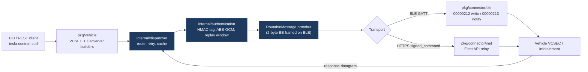
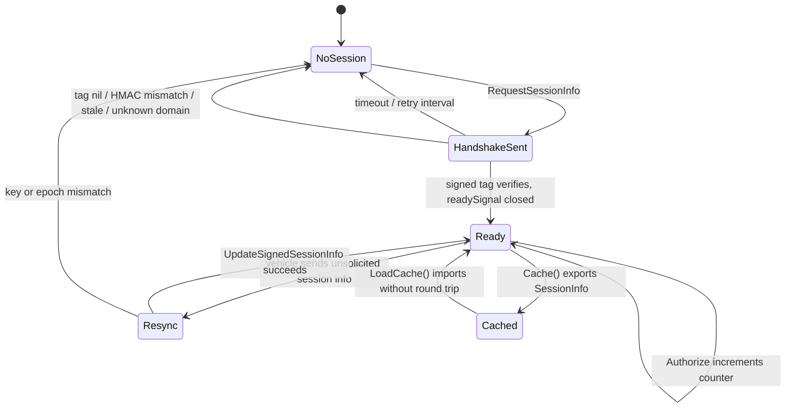
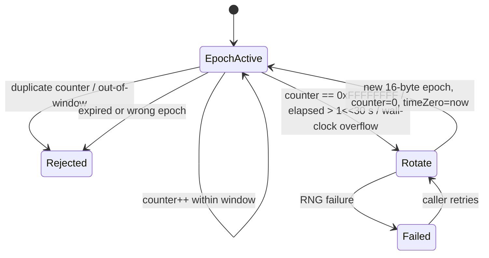
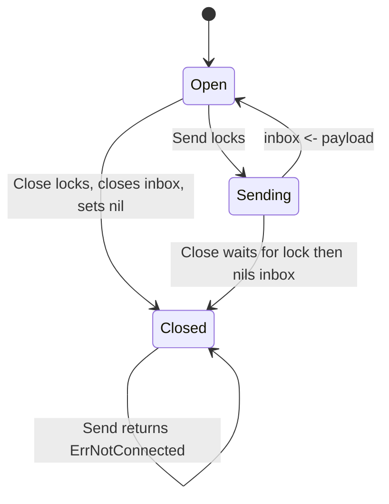

# sethterashima/vehicle-command - legacy deep dive

## 1. Provenance

- Submodule: `legacy/sethterashima-vehicle-command`; upstream: https://github.com/sethterashima/vehicle-command.
- Pinned gitlink (canonical form from `git ls-files -s`): `160000 02e5f702900acc5de0cc8c9b583161dae897b0f6 0`. `git -C legacy/sethterashima-vehicle-command rev-parse HEAD` matches; `status --porcelain` is empty.
- Commit at pin: `02e5f702900acc5de0cc8c9b583161dae897b0f6 Fix session info error handling` (2025-01-22). License: Apache-2.0 (`LICENSE:1-5`). Go module is still `github.com/teslamotors/vehicle-command` (`go.mod:1`).
- Analysis date: 2026-11-21. Mode: replace, per user instruction.
- **Preservation note:** the pre-replace doc had **no YAML frontmatter** and **no `## Upstream (...)` section** (verified against `git show HEAD:docs/legacy/sethterashima-vehicle-command.md`). Per the skill, none was invented; all pre-replace claims are cited through `git show HEAD:docs/legacy/sethterashima-vehicle-command.md#<line>` in section 6. No bytes were preserved verbatim because nothing matched the preserve list.
- Cross-references: `docs/legacy/teslamotors-vehicle-command.md`, `docs/legacy/tesla-local-control-vehicle-command.md`, `docs/legacy/tesla-local-control-vehicle-command-seth.md`. Those three are the upstream and two sibling fork snapshots; they are treated as leads, not evidence, except where their §11 rows are cited as prior CODE-READ work.

Identity verification (done before claiming any fork delta):

- Five sampled SHAs common to this clone and the `legacy/teslamotors-vehicle-command` clone have byte-identical trees: `07123bf4` → `39b3a7ba99a8c77cb9be8dec32c6cb985fb44fb2`, `e4b0b1f4` → `c332faf927f2ca273d6a08fe0954d66ed7ba2f77`, `fef8f3a5` → `a362eed76290aa30910bf710bb96947e80d5eb2a`, `8e16f0d0` → `f4a8a63f9a8a123192bccd92484e87190408f3b5`, `7457011b` → `5903ea1ce839e4857263881b1cbb97ce3d3f7241`. Same SHA, same tree in both clones → deltas below are real fork deltas, not clone artifacts.
- Divergence point: `07123bf4` (2025-01-17, shared). This snapshot adds exactly **2** commits (`d2dbec3a Fix panic on inet Send/Close race`, `02e5f702 Fix session info error handling`, both 2025-01-22; `git rev-list bd191bb..HEAD --count` = 69 relative to `tesla-local-control-seth`, `git -C ../teslamotors-vehicle-command rev-list 07123bf4..HEAD --count` = 69 upstream commits absent here).
- `tesla-local-control-seth` tip `bd191bb` is an **ancestor** of this pin (merge-base = `bd191bb`); this fork is its linear continuation, not a sibling branch. Upstream tip `0a582da` is 2026-10-21 — this pin is roughly 21 months stale relative to upstream.
- Docker support is **not** a fork delta: `Dockerfile`, `docker-compose.yml`, `.dockerignore`, `Makefile`, `check-all.sh` and `.github/workflows/publish.yml` all exist at upstream tip `0a582da`.

Files read this pass (CODE-READ unless noted): `go.mod:1-35`; `README.md:1-315`; `LICENSE:1-6` (RANGE-CITED); `Dockerfile:1-17`; `docker-compose.yml:1-15`; `Makefile:1-22`; `check-all.sh:1-17`; `SECURITY.md:1-4`; `.github/workflows/build.yml:1-26`; `.github/workflows/publish.yml:1-49`; `pkg/connector/connector.go:1-72`; `pkg/connector/ble/ble.go:1-229`; `pkg/connector/inet/inet.go:1-278`; `pkg/connector/inet/inet_test.go:1-28`; `internal/dispatcher/dispatcher.go:1-522`; `internal/dispatcher/session.go:1-146`; `internal/dispatcher/receiver.go:1-57`; `internal/dispatcher/dispatcher_test.go:564-604` (RANGE-CITED, plus 21 test names enumerated); `internal/authentication/signer.go:1-242`; `verifier.go:1-329`; `ecdh.go:1-18`; `crypto.go:1-66`; `window.go:1-68`; `native.go:1-212`; `peer.go:1-117`; `metadata.go:1-84`; `pkg/protocol/domains.go:1-17`; `pkg/protocol/receiver.go:1-14`; `pkg/vehicle/vehicle.go:1-276`; `actions.go:1-132`; `security.go:1-346`; `vcsec.go:1-249`; `charge.go:1-299`; `climate.go:1-271`; `infotainment.go:1-170`; `pkg/account/version.txt:1`; our side `firmware/lib/vehicle/ble/msg.h:1-481`, `firmware/lib/vehicle/ble/feature/key.h:1-151`, `firmware/lib/vehicle/ble/feature/session.h:1-282`.

Files RANGE-CITED or STRUCTURAL-PARSE (schema/grep only, never called FULL-READ): `pkg/protocol/protocol.md` headings plus ranges 9-30, 146-164, 338-360, 511-533, 719-740 (RANGE-CITED); `universal_message.proto:11-16,69-101`, `signatures.proto:18-20,36-37,43-51,66-70,87-94`, `keys.proto:7-15`, `vcsec.proto:29-36` (RANGE-CITED); `cmd/tesla-control/commands.go`, `pkg/proxy/proxy.go`, `pkg/proxy/command.go`, `pkg/account/account.go`, `pkg/protocol/error.go` (grep-level RANGE-CITED).

Files explicitly NOT read: all generated `*.pb.go` (11,304-line `vehicle.pb.go` etc. — schemas were read instead); bodies of all other `*_test.go` files (names/counts only); `internal/authentication/jwt.go`, `internal/authentication/dispatcher.go`, `internal/authentication/error.go`, `internal/schnorr/*`, `internal/log/*`; `pkg/cli/*`, `pkg/cache/*`, `pkg/account/account.go` in full; `pkg/vehicle/state.go`; `pkg/proxy/*` in full; `examples/*`; `cmd/tesla-keygen`, `cmd/tesla-auth-token`, `cmd/tesla-jws`, `cmd/tesla-http-proxy`, `cmd/tesla-control/main.go` in full; `doc/*.puml` and `doc/*.png` binaries; PEM fixtures; `.gitignore`, `.dockerignore`, `PULL_REQUEST_TEMPLATE.md`. No CAPTURE evidence exists in this repo or in our workspace for this pass.

## 2. Executive verdict

This is Tesla's own `vehicle-command` SDK at the 2025-01-17 upstream state plus two defensive fixes; it is not a feature-divergent fork of its own upstream, despite the old summary's framing. It has no CAN bus code at all: the vehicle interface is a 2-byte-length-prefixed protobuf `RoutableMessage` over BLE GATT, plus an HTTPS Fleet API relay that fronts the same protocol. The mechanisms worth studying are the handshake with HMAC-authenticated session info, canonical metadata TLV binding, sliding-window anti-replay with epoch/clock guards, response decryption with request hashing, session caching, and the two race fixes that are the fork's only code delta. For TeslaCANModder all of these are *reference only*: our BLE side uses a disjoint protobuf field schema, ephemeral rather than static ECDH keys, and no response authentication (fully documented in `docs/legacy/teslamotors-vehicle-command.md` §11). Adapt the defensive ideas (tag check before session acceptance, send-after-close guard, replay window) after a live capture and the CAN review checklist; never copy Go code, generated protobuf, constants, or the Docker publishing workflow.

## 3. Evidence map

| Source file | Lines | What it proves | Grade |
| --- | --- | --- | --- |
| `git ls-files -s` / `rev-parse` / `git log` | n/a | Pin SHA, clean tree, 2-commit delta, 69-commit upstream lag, fork-point tree equality | CODE-READ |
| `pkg/connector/connector.go` | 11-26, 29-64 | Auth methods (none/GCM/HMAC), inbox cap 5, 100000-byte response cap, `Connector` contract | CODE-READ |
| `pkg/connector/ble/ble.go` | 19-32, 62-122, 128-229 | 1024-byte cap, 1 s chunk timeout, GATT UUIDs, SHA1(VIN) name, 20-byte chunks, connect retry | CODE-READ |
| `pkg/connector/inet/inet.go` | 21-22, 55-81, 83-156, 158-278 | HTTPS relay, 421 redirect allowlist, 10 s latency cap, mutex-protected Send/Close | CODE-READ |
| `pkg/connector/inet/inet_test.go` | 13-28 | `TestSendAfterClose` asserts `ErrNotConnected` after `Close` | TEST-READ |
| `internal/dispatcher/dispatcher.go` | 73-111, 168-210, 231-301, 317-447, 478-521 | Session bootstrap, unauthenticated-session-info rejection, message routing, retry send, cache | CODE-READ |
| `internal/dispatcher/dispatcher_test.go` | 564-604 | `TestDiscardUnauthenticatedSessionInfo` asserts no session is built from untagged info | TEST-READ |
| `internal/dispatcher/session.go` | 16, 48-59, 61-98, 127-146 | 5 s session expiration, GCM/HMAC authorize, response replay gate | CODE-READ |
| `internal/dispatcher/receiver.go` | 11-17, 30-57 | buffer 10, UUID/address 16 bytes, stale-session gate | CODE-READ |
| `internal/authentication/signer.go` | 49-62, 132-176, 187-242 | Session-info HMAC check, counter rollover guard, GCM/HMAC auth, response decrypt | CODE-READ |
| `internal/authentication/verifier.go` | 63-74, 148-186, 190-298 | Epoch rotation, one-way clock correction, sliding window, expiry/domain/epoch gates | CODE-READ |
| `internal/authentication/crypto.go` | 12-22, 50 | counter max, epoch id 16, 30 s no-counter TTL, 32-entry window, 1<<30 s epoch | CODE-READ |
| `internal/authentication/window.go` | 9-68 | 32-entry sliding-window update algorithm | CODE-READ |
| `internal/authentication/native.go` | 38-51, 94-136, 138-179, 206-212 | P-256 static ECDH, SHA1(sharedX)[:16] AES key, PEM key loading, Schnorr | CODE-READ |
| `internal/authentication/peer.go` / `metadata.go` | 34-117 / 34-84 | Metadata TLV (tag,len,value), BE uint32, TAG_END, subkey labels | CODE-READ |
| `pkg/vehicle/vehicle.go` | 22, 77-99, 149-167, 201-257, 259-275 | Domain routing, session bootstrap retry, response retry, wakeup selection | CODE-READ |
| `pkg/vehicle/vcsec.go` | 23-62, 85-105, 107-169, 174-249 | VCSEC reply terminal tests, whitelist ops, RKE and closure actions | CODE-READ |
| `pkg/vehicle/security.go` | 19-29, 184-200, 220-263, 302-335 | 4-digit PIN, Fleet-API-only PIN-to-Drive, add-key roles, BLE-only add-key request | CODE-READ |
| `pkg/vehicle/actions.go` / `charge.go` / `climate.go` / `infotainment.go` | see §1 | CarServer action builders (trunk, windows, charging, HVAC, media) | CODE-READ |
| `pkg/protocol/protobuf/*.proto` | ranges in §1 | Field numbers for RoutableMessage, SignatureData, SessionInfo, roles, form factors | CODE-READ |
| `pkg/protocol/protocol.md` | ranges in §1 | Vendor's own wire spec, including BLE UUIDs and VIN-name rule | RANGE-CITED |
| `Dockerfile` / `docker-compose.yml` / workflows | full | Non-root runtime image, 4443 proxy, Docker Hub publish from fork workflow | CODE-READ |
| `go.mod` | 1-13, 35 | No gRPC dependency; Go 1.23; protobuf 1.34.2 | CODE-READ |
| `docs/legacy/teslamotors-vehicle-command.md` §11 | 381-412 | Prior CODE-READ of our side's disjoint BLE schema; reused as cross-reference, not re-derived | SUMMARY-ONLY |

No TEST-READ evidence exists for the BLE connector, the proxy, or any end-to-end vehicle exchange at this pin. No vehicle capture was available; all frame claims are CODE-READ of code and schema, never CAPTURE.

## 4. Architecture and build surface

- Entry points: five Go binaries — `cmd/tesla-control` (CLI), `cmd/tesla-keygen`, `cmd/tesla-auth-token`, `cmd/tesla-jws`, `cmd/tesla-http-proxy` (REST relay). `cmd/tesla-control/commands.go` registers the CLI command surface (grep inventory only, §1).
- Shared core vs platform port: `pkg/vehicle` (commands), `internal/dispatcher` (message routing/session), `internal/authentication` (crypto), `pkg/protocol` (schema/wire); platform ports are `pkg/connector/ble/device_{darwin,linux,windows}.go` and `pkg/connector/inet`. Key storage is OS keyring via `github.com/99designs/keyring` or PEM files (`native.go:147-179`).
- Build flags: none at compile time in the C/C++ sense; behavior is selected by CLI flags, `TESLA_*` environment variables (`README.md:109-145`), and Go build metadata (`pkg/account/account.go:42-57`, grep-level). Container build: `Dockerfile:1-17` (Go 1.23.0 builder, `distroless/base-debian12:nonroot`, entrypoint `tesla-http-proxy`).
- Dependency boundaries: `internal/*` cannot be imported by external consumers; `pkg/protocol/protobuf/*` is generated from `.proto`; no gRPC, no CAN library, no PlatformIO.



RX → decode (`proto.Unmarshal`, `dispatcher.go:339-344`) → validate/gate (source/destination/UUID/address, `checkForSessionUpdate`, `decrypt`, `:231-300`) → route to receiver channel → command layer; TX → `Signer.Encrypt`/`AuthorizeHMAC` (`:401-417`) → connector `Send` → vehicle. There is no frame mutation step and no CAN bus.

## 5. Mechanism catalogue

### 5.1 BLE length-prefixed datagram framing and VIN beacon scan

- **Claim (README / summary):** "BLE Protocol: Implements Tesla vehicle command protocol over BLE" (`git show HEAD:docs/legacy/sethterashima-vehicle-command.md#39`).
- **Code path:** `ble.go:103-122` `Connection.Send()` → 2-byte BE length prefix → 20-byte `WriteCharacteristic` chunks; `ble.go:93-101` `rx()` → `flush()` at `:62-82` → `inbox` (cap 5).
- **Frame spec:** prefix `uint8(len>>8), uint8(len)`; declared length > `maxBLEMessageSize=1024` drops and clears; GATT service `00000211-...`, write `00000212-...`, notify `00000213-...` (`:29-31`); advertisement local name `S` + lower-case hex of `SHA1(VIN)[:8]` + `C` (`:168-181`).
- **Gates and timing:** inter-chunk timeout `rxTimeout=1 s` clears partial buffer (`:24,94-97`); `RetryInterval()=1 s` (`:54-56`); `AllowedLatency()=4 s` (`:25,89-91`); connect loop retries until ctx cancel, but `operation not permitted` is terminal (`:128-147`); `ErrMaxConnectionsExceeded` when the beacon is not connectable (`:21,188-190`).
- **State machine:** None found — connect path is linear (device reuse → connect → discover → subscribe).
- **Tests:** None found under `pkg/connector/ble/` (negative inventory, §16 anchor A-B3).
- **Evidence grade:** CODE-READ.
- **Verdict:** CONFIRMED; identical to the framing described in `docs/legacy/teslamotors-vehicle-command.md` §5.1.
- **Adapt to TeslaCANModder?** already present (our `ble_client.h` framing per sibling §11); no action.

### 5.2 Static-key ECDH session handshake with authenticated session info

- **Claim (README / summary):** two-step authentication: OAuth token plus public key enrolled in the vehicle (`README.md:23-40`).

- **Code path:** `dispatcher.go:73-111` `StartSession` → `RequestSessionInfo` (`:449-474`) → `checkForSessionUpdate` (`:168-210`) → `session.ProcessHello` (`session.go:127-146`) → `authentication.NewAuthenticatedSigner` (`signer.go:49-62`) → `hmac.Equal(validTag, tag)`.
- **Frame spec:** `SessionInfoRequest{public_key=1, challenge=2}` (`universal_message.proto:69-73`); vehicle reply `SessionInfo{counter=1, publicKey=2, epoch=3, clock_time=4, status=5, handle=6}` (`signatures.proto:87-94`); tag is `HMAC(session subkey, TAG_SIGNATURE_TYPE|TAG_PERSONALIZATION|TAG_CHALLENGE|encodedInfo)` (`native.go:76-88`).
- **Gates and timing:** 16-byte request UUID and routing address (`receiver.go:13-17`); session info older than `maxLatency` (4 s BLE / 10 s HTTPS) is dropped (`dispatcher.go:180-187`); missing tag is dropped (`:189-193`, with the fork's added `return`); unregistered domain dropped (`:199-203`).
- **State machine:**



- **Tests:** `TestStartSession`, `TestUnsolicitedSessionInfo`, `TestCorruptedSessionInfo`, `TestDiscardUnauthenticatedSessionInfo` at `dispatcher_test.go:564-604` (last read this pass); signer tests `TestNewAuthenticatedSigner`, `TestBadSessionInfoTag`.
- **Evidence grade:** CODE-READ plus TEST-READ.
- **Verdict:** CONFIRMED. Key distinction from our firmware: upstream uses a **static long-term P-256 key** (`ecdh.go:3-8` explains why `crypto/ecdh` was rejected) and derives `K = SHA1(sharedX)[:16]` (`native.go:112-135`), while our `session.h:81-113` generates an ephemeral key and HKDF-derives 16+32-byte keys.
- **Adapt to TeslaCANModder?** candidate for the *tag-check-before-accept gate only*; never port the static-key derivation (our design differs and the wire schema is disjoint).

### 5.3 Canonical metadata TLV and HMAC subkeys

- **Claim (summary):** "Uses gRPC for service communication" (`git show HEAD:docs/legacy/sethterashima-vehicle-command.md#40`) — wrong; this is protobuf + tagged metadata, not gRPC (see §6).
- **Code path:** `metadata.go:34-50` `Add` → `AddUint32` `:52-56` → `Checksum` `:80-84`; `peer.go:34-71` `extractMetadata` → `hmacTag` `:74-80`; `native.go:66-74` `subkey`.
- **Frame spec:** each field is `tag||len||value`, len ≤ 255, tags strictly increasing, big-endian uint32, `TAG_END=255` written before hashing the message (`signatures.proto:18-20`, `metadata.go:80-84`); signed tags: SIGNATURE_TYPE, DOMAIN (bounds-checked 0-255), PERSONALIZATION (VIN/name), EPOCH, EXPIRES_AT, COUNTER, optional FLAGS (`peer.go:38-68`). Subkeys are `HMAC-SHA256(K, label)` with labels `"session info"` and `"authenticated command"` (`crypto.go:13-15`).
- **Gates and timing:** `expiresAt` bounded by `epochLength` (1<<30 s) and non-negative (`peer.go:51-57`); flags omitted when zero for backwards hash compatibility (`:63-68`).
- **State machine:** None found.
- **Tests:** `TestOutOfOrder`, `TestValueTooLong`, `TestCheckSum`, `metadata_test.go` (names enumerated); not re-read this pass.
- **Evidence grade:** CODE-READ.
- **Verdict:** CONFIRMED; matches `docs/legacy/teslamotors-vehicle-command.md` §5.3.
- **Adapt to TeslaCANModder?** candidate for the injective-serialization idea only if we add authenticated vehicle responses; our `buildAuthMessage` binds no metadata (`msg.h:291-302`).

### 5.4 AES-GCM personalized command encryption and HMAC alternative

- **Claim (summary):** "BLE transport" only (`git show HEAD:docs/legacy/sethterashima-vehicle-command.md#47`) — transport claim is incomplete; auth is protocol-level.
- **Code path:** `signer.go:132-176` `encryptWithCounter`/`Encrypt` → `universal.Message` payload replaced with ciphertext, AAD = `meta.Checksum(nil)`; `signer.go:187-213` `AuthorizeHMAC` for the HTTPS proxy path.
- **Frame spec:** `SignatureData` oneof field 5 = `AES_GCM_Personalized_Signature_Data{epoch=1, nonce=2, counter=3, expires_at=4, tag=5}` (`signatures.proto:43-49,66-70`); random 12-byte nonce from `native.go:38-51`; 16-byte tag split from ciphertext. HMAC variant is field 8 with counter, expires_at, epoch, tag.
- **Gates and timing:** counter rollover at `0xFFFFFFFF` is fatal (`signer.go:171-173`); `expiresAt` computed relative to `timeZero` (`:149`); HTTP proxy requires plaintext-HMAC so it can inspect OAuth scopes (`signer.go:178-186`).
- **State machine:** None found (counter monotonic; covered by §5.6 resync).
- **Tests:** `TestValidGCMEncryption`, `TestHMAC`, `TestSignerCounterRollover`, `TestInvalidExpirationTime` (names enumerated).
- **Evidence grade:** CODE-READ.
- **Verdict:** CONFIRMED. Our `session.h:223-255` instead uses a deterministic little-endian counter IV and null AAD — a documented divergence, not a bug to copy.
- **Adapt to TeslaCANModder?** candidate only as a paired change (random nonce + metadata AAD) with independent oracle and capture; never merge wire layouts.

### 5.5 Anti-replay sliding window, epoch and clock guards

- **Claim (summary):** not present in old doc; this is an inherited gap.
- **Code path:** `window.go:9-50` `updateSlidingWindow`; `session.go:48-59` response replay gate; `verifier.go:63-74` `rotateEpochIfNeeded`; `verifier.go:148-186` `adjustClock`; `verifier.go:265-298` `verifySessionInfo`.
- **Frame spec:** counter uint32, 32-entry bit window (`crypto.go:18-22`); epoch 16 random bytes; `expiresAt==0` disables counter checks but is then capped to `maxSecondsWithoutCounter=30` (`:286-295`).
- **Gates and timing:** epoch rotates on RNG failure, counter rollover, or elapsed > `epochLength`; wall clock is allowed to run ahead of monotonic after sleep but never backward (`:148-184`, one-way by design because wall clock is UDP-settable); year-bound overflow forces rotation (`:163-167`).
- **State machine:**



- **Tests:** `TestSlidingWindow`, `TestGCMWindow`, `TestGCMWindowRecent`, `TestEpochChange`, `TestGCMExpired`, `TestGCMEpochRotation` (names enumerated).
- **Evidence grade:** CODE-READ.
- **Verdict:** CONFIRMED.
- **Adapt to TeslaCANModder?** candidate for a future PR: our side tracks only a TX counter (`session.h:221`) and no RX replay window.

### 5.6 Response decryption, request hash, and session cache resync

- **Claim (summary):** not present in old doc.
- **Code path:** `signer.go:215-241` `Decrypt` → `peer.go:105-117` `responseMetadata` (TAG_REQUEST_HASH, TAG_COUNTER, TAG_FAULT) → `session.go:55-57` replay check; cache at `dispatcher.go:476-521` `Cache`/`LoadCache`, `signer.go:84-94` `ExportSessionInfo`, `:69-82` `ImportSessionInfo`.
- **Frame spec:** response auth data = `AES_GCM_Response_Signature_Data{nonce=1, counter=2, tag=3}` (`signatures.proto:51-55`); request ID = signature-type byte + auth tag (VCSEC HMAC truncated to 16 bytes, `peer.go:82-103`).
- **Gates and timing:** `DefaultFlags` sets `FLAG_ENCRYPT_RESPONSE` (`vehicle.go:22`); vehicle firmware < 2024.38 ignores the flag (`protocol.md:737-740`, RANGE-CITED); cache entries embed `CreatedAt` to reconstruct `timeZero` (`signer.go:80`).
- **State machine:** see §5.2's `Ready ⇄ Cached` transitions; cache hit skips the handshake round trip (`dispatcher.go:81-88`).
- **Tests:** `TestCache`, `TestVehicleEncryption`/`TestVerifierEncryption` (names enumerated).
- **Evidence grade:** CODE-READ.
- **Verdict:** CONFIRMED at this pin, but weaker than upstream tip: detached AES-GCM and response-metadata error surfacing arrived in the 69 commits absent here (`docs/legacy/teslamotors-vehicle-command.md` §15).
- **Adapt to TeslaCANModder?** candidate — largest gap; our `dispatch.h:87-95` disconnects after `sendCommand` and never reads a reply.

### 5.7 Fork delta 1: inet Send/Close race fix

- **Claim (commit message):** "The Send method of the Connector interface should be safe to run from a goroutine ... if the inet Connector implementation is closed before the client receives a response, this results in Send writing to a closed channel and causing a panic."
- **Code path:** commit `d2dbec3a` changed `client http.Client` → `*http.Client`, merged `wakeLock`/inbox locking into one `lock sync.Mutex`, locked `Close()` (`inet.go:200-207`) and `Send()` (`:267-277`), and added `if c.inbox == nil { return protocol.ErrNotConnected }` (`:269-271`).
- **Frame spec:** None found (control flow).
- **Gates and timing:** none beyond connection open state.
- **State machine:**



- **Tests:** `TestSendAfterClose` at `inet_test.go:13-28` asserts success while open and `protocol.ErrNotConnected` after `Close()` — added by the same fork commit (TEST-READ).
- **Evidence grade:** CODE-READ plus TEST-READ.
- **Verdict:** CONFIRMED; genuine fork delta, not upstream code at this pin.
- **Adapt to TeslaCANModder?** no impact on CAN; the *pattern* (single mutex + explicit closed-state sentinel on a shared TX queue) is a candidate if our BLE disconnect path grows async senders.

### 5.8 Fork delta 2: session-info early return

- **Claim (commit message):** "the session info message in question could contain a 'Key Not Paired' error, and the client would continue trying to process session info messages that contained this error."
- **Code path:** commit `02e5f702` added one `return` at `dispatcher.go:193` after `log.Warning("Discarding unauthenticated session info", ...)` at `:191`, before `ProcessHello` at `:205`; also bumped `pkg/account/version.txt` 0.3.0 → 0.3.1.
- **Frame spec:** None found (control flow).
- **Gates and timing:** tag presence is checked before session lookup (`dispatcher.go:189-203`); age and domain gates still apply first (`:180-187,199-203`).
- **State machine:** None found.
- **Tests:** no test was added by this commit; the pre-existing `TestDiscardUnauthenticatedSessionInfo` (`dispatcher_test.go:564-604`) passes both with and without the `return` because `NewAuthenticatedSigner` rejects a nil tag anyway (`signer.go:54-60`). Gap recorded in §10.
- **Evidence grade:** CODE-READ plus TEST-READ (pre-existing test).
- **Verdict:** CONFIRMED as a defense-in-depth fix; the older `tesla-local-control-seth` snapshot documents the same missing `return` (`docs/legacy/tesla-local-control-vehicle-command-seth.md` §5.5).
- **Adapt to TeslaCANModder?** candidate — our `session.h:103-113` accepts session-info fields with **no tag at all**, which is a strictly larger gap.

### 5.9 VCSEC / CarServer command builders and reply routing

- **Claim (summary):** "Vehicle commands (lock, climate, etc.)" (`git show HEAD:docs/legacy/sethterashima-vehicle-command.md#48`) — true but understated.
- **Code path:** `vehicle.go:181-214` `getReceiver`/`trySend`; `vcsec.go:23-62` `unmarshalVCSECResponse` → `:67-82` `readUntil` → `:85-105` `getVCSECResult`; `infotainment.go:19-50` `getCarServerResponse`; command families in `actions.go`, `charge.go`, `climate.go`, `security.go`.
- **Frame spec:** protobuf payloads, not CAN frames: `vcsec.UnsignedMessage` (RKE action = field 4, closure move = field 5, whitelist op = field 2), `carserver.Action{VehicleAction=field 1}`; terminal tests use `OperationStatus` OK/WAIT/ERROR (`vcsec.go:47-60`), `slotNone=0xFFFFFFFF` (`:107`).
- **Gates and timing:** retry on `protocol.ShouldRetry` with `RetryInterval()` (`vcsec.go:94-104`, `vehicle.go:239-256`); PIN-to-Drive is Fleet-API-only (`security.go:184-187`), add-key request BLE-only (`:317-319`), PIN must be 4 digits (`:19-29`).
- **State machine:** None found (request/reply loops only).
- **Tests:** `vcsec_test.go` (4 names), `security_test.go` `TestValidPIN`, `vehicle_test.go` (8 names) — enumerated, not re-read.
- **Evidence grade:** CODE-READ.
- **Verdict:** CONFIRMED.
- **Adapt to TeslaCANModder?** no impact: different transport and authorization model; our CAN commands are frame-based.

### 5.10 HTTP proxy and Fleet API relay surface

- **Claim (summary):** "gRPC Services: Uses gRPC for service communication" (`git show HEAD:docs/legacy/sethterashima-vehicle-command.md#40`) — false.
- **Code path:** `inet.go:83-134` `SendFleetAPICommand`; `proxy.go` fallback for `/api/1/*` (`:176`, grep-level) and `/api/1/vehicles/` prefix at `:307`; `command.go` maps REST names such as `charge_max_range`, `set_charge_limit`, `speed_limit_activate` (grep-level).
- **Frame spec:** HTTP POST `api/1/vehicles/<VIN>/signed_command` with `{"routable_message": <bytes>}` (`inet.go:247-253`); response `{"response": <bytes>}` (`:258-273`); OAuth bearer header on proxy requests (`README.md:271-290`).
- **Gates and timing:** 421 "use base URL" redirect only accepted for `.tesla.com`, `.tesla.cn`, `.teslamotors.com` suffixes (`inet.go:55,136-156`); 503 → `ErrVehicleNotAwake`, 422 → `ErrProtocolNotSupported` (`:124-127`); wake-up polls every 10 s (`:213-245`); proxy `DefaultTimeout=10 s`, `MaxAttempts=2`, `MaxResponseLength=10000000`, `maxRequestBodyBytes=512` (`proxy.go:31-36`).
- **State machine:** None found.
- **Tests:** `cmd/tesla-http-proxy/main_test.go` `TestParseConfig`, `pkg/proxy/command_test.go` `TestExtractCommandAction` — names enumerated.
- **Evidence grade:** CODE-READ for `inet.go`, RANGE-CITED for proxy files.
- **Verdict:** PARTIAL for the proxy internals (grep-level only), CONFIRMED for the relay.
- **Adapt to TeslaCANModder?** no impact; our WiFi REST API is a different trust domain.

## 6. Summary vs code contradiction table

All "old doc" citations are to the pre-replace file via `git show HEAD:docs/legacy/sethterashima-vehicle-command.md#<line>`.

| Old claim / source | Code evidence | Verdict |
| --- | --- | --- |
| "Fork of Tesla's official vehicle-command ... by Seth Terashima" — old doc `#10` | True at GitHub level, but at the pin it is upstream `07123bf` + exactly 2 commits; 69 upstream commits missing (`git log`, §1) | CONTRADICTED as a description of a feature-divergent fork |
| "This fork includes pre-built Docker containers for easy deployment" — old doc `#10`, "Docker Support" at `#41` | Docker landed upstream at `96af672` (2024-08-23); `Dockerfile`, `docker-compose.yml`, `.dockerignore`, `Makefile`, `publish.yml` all exist at upstream tip `0a582da`; README badges point at `teslamotors/vehicle-command` | CONTRADICTED — not a fork differentiator |
| "gRPC Services: Uses gRPC for service communication" — old doc `#40` | `go.mod:5-13` has no gRPC module; negative anchor A8/A-B4 finds no `grpc` in `go.mod` or Go sources | CONTRADICTED |
| "Interface: gRPC/BLE" — old doc `#49` | BLE + HTTPS Fleet API + local REST proxy (`inet.go:83-134`, `proxy.go:307`); no gRPC | CONTRADICTED |
| Mermaid tree lists only `cmd/ pkg/ internal/ doc/ examples/ Dockerfile docker-compose.yml Makefile go.mod check-all.sh` — old doc `#24-35` | Inventory also contains `.github/workflows/{build,publish}.yml`, `SECURITY.md`, `LICENSE`, `PULL_REQUEST_TEMPLATE.md`, `pkg/{account,cache,cli,connector,proxy,vehicle}`, `internal/{authentication,dispatcher,log,schnorr}` | PARTIAL — incomplete surface map |
| "Transport: BLE" vs "Target: Tesla API commands" — old doc `#47,#50` | Both transports are first-class; PIN-to-Drive and fleet telemetry are Fleet-API-only (`security.go:184-187`) | PARTIAL — not BLE-only |
| "pkg/ — Protocol implementation reference" — old doc `#54` | Also contains generated `.pb.go` (11k-line `vehicle.pb.go`) and the HTTP proxy; schema is source-of-truth via `.proto` | PARTIAL |
| No mention of the two race fixes anywhere — old doc `#8-56` | They are the entire fork delta (`d2dbec3a`, `02e5f702`) | CONTRADICTED by omission |
| No frontmatter / no `## Upstream` section exists | `git show HEAD:...` starts at `# sethterashima/vehicle-command` | Not a contradiction — preservation list was empty; recorded in §1 |
| Our-side role constants | sibling docs already record `key.h:22-23` mismatch; re-verified CODE-READ in §11 | CONFIRMED contradiction on our side, not on upstream |

## 7. CAN frame and signal inventory

None found: this repo contains no CAN bus code — no MCP2515 driver, no frame decode/mutate/inject path, no DBC or JSON frame catalog. Negative anchor (run 2026-11-21):

```text
git grep -nE 'mcp2515|CANFrame|can_id|DLC' -- legacy/sethterashima-vehicle-command  -> no output
```

The closest equivalent is the BLE wire contract. One row per load-bearing wire fact (no wholesale `.proto` or `.pb.go` dump):

| Wire fact | Layout / value | Source | Grade |
| --- | --- | --- | --- |
| BLE datagram | 2-byte BE length prefix + payload; >1024 clears buffer; 20-byte TX chunks | `ble.go:109-120,64-68,111` | CODE-READ |
| GATT IDs | service `00000211-…`, write `00000212-…`, notify `00000213-…` | `ble.go:29-31` | CODE-READ |
| Beacon name | `S` + hex(SHA1(VIN)[:8]) + `C` | `ble.go:168-181` | CODE-READ |
| Domain IDs | BROADCAST=0, VCSEC=2, INFO=3 | `universal_message.proto:11-13` | CODE-READ |
| RoutableMessage envelope | to=6, from=7, payload=10, session_req=14, session_info=15, sig=13, status=12, request_uuid=50, uuid=51, flags=52; reserved 1-5, 11, 16-40 | `universal_message.proto:80-100` | CODE-READ |
| SessionInfoRequest | public_key=1, challenge=2 | `universal_message.proto:69-73` | CODE-READ |
| Command auth block | `epoch=1, nonce=2, counter=3, expires_at=4, tag=5` in SignatureData field 5 | `signatures.proto:43-49,66-70` | CODE-READ |
| SessionInfo reply | counter=1, publicKey=2, epoch=3, clock_time=4, status=5, handle=6 | `signatures.proto:87-94` | CODE-READ |
| Response auth block | nonce=1, counter=2, tag=3 | `signatures.proto:51-55` | CODE-READ |
| Metadata TLV | `tag||len||value`, BE uint32, increasing tags, 255-byte cap, TAG_END before message hash | `metadata.go:34-56,80-84`; `signatures.proto:18-20` | CODE-READ |
| HTTPS signed command | POST `api/1/vehicles/<VIN>/signed_command`, `routable_message` field | `inet.go:247-253,258-273` | CODE-READ |
| VCSEC key roles | OWNER=2, DRIVER=3, FM=4, VM=5, CHARGING_MANAGER=6 | `keys.proto:7-15` | CODE-READ |
| Key form factors | UNKNOWN=0, NFC_CARD=1, IOS=6, ANDROID=7, CLOUD=9 | `vcsec.proto:29-36` | CODE-READ |
| Vehicle BLE connection limit | up to 3 simultaneous, shared with keyfobs/phones | `protocol.md:163-164` | SUMMARY-ONLY |

`protocol.md` rows are vendor spec text (RANGE-CITED), so the last row stays SUMMARY-ONLY. Generated `*.pb.go` catalogs were not read; the `.proto` schemas above are STRUCTURAL-PARSE plus the cited RANGE-CITED ranges. No CAPTURE evidence exists.

## 8. Constants and tuning table

| Constant | Value | File:line | Meaning | Grade |
| --- | --- | --- | --- | --- |
| `BufferSize` | 5 | `connector.go:23` | Inbound datagram queue per connector | CODE-READ |
| `MaxResponseLength` | 100000 | `connector.go:26` | Max wire response bytes | CODE-READ |
| `maxBLEMessageSize` | 1024 | `ble.go:19` | Declared-length cap; over-cap resets buffer | CODE-READ |
| `rxTimeout` / `maxLatency` | 1 s / 4 s | `ble.go:24-25` | Inter-chunk reset / BLE clock-sync tolerance | CODE-READ |
| `blockLength` | 20 | `ble.go:111` | Fixed BLE write chunk size | CODE-READ |
| inet `MaxLatency` / retry / wake poll | 10 s / 1 s / 10 s | `inet.go:22,192-194,238-243` | HTTPS clock tolerance, retry, wake polling | CODE-READ |
| `receiverBufferSize` | 10 | `receiver.go:11` | Per-request response channel capacity | CODE-READ |
| `uuidLength` / `challengeLength` / `addressLength` | 16 / 16 / 16 | `receiver.go:13-17` | Routing identifiers | CODE-READ |
| `defaultExpiration` | 5 s | `session.go:16` | Command lifetime when ctx has no deadline | CODE-READ |
| `counterMax` | 0xFFFFFFFF | `crypto.go:18` | Fatal counter rollover point | CODE-READ |
| `epochIdLength` / `windowSize` | 16 / 32 | `crypto.go:19,21` | Epoch bytes and replay-window bits (≤64) | CODE-READ |
| `maxSecondsWithoutCounter` | 30 | `crypto.go:20` | Max TTL when counter check is disabled | CODE-READ |
| `epochLength` | 1<<30 s | `crypto.go:50` | Epoch lifetime; rotation trigger | CODE-READ |
| `SharedKeySizeBytes` | 16 | `ecdh.go:11` | SHA1(sharedX) truncated to AES-128 key | CODE-READ |
| metadata labels | `"session info"`, `"authenticated command"` | `crypto.go:13-15` | HMAC subkey derivation labels | CODE-READ |
| `TAG_END` | 255 | `signatures.proto:20` | Metadata serialization terminator | CODE-READ |
| `slotNone` | 0xFFFFFFFF | `vcsec.go:107` | "no key slot" sentinel | CODE-READ |
| PIN length | 4 digits | `security.go:19-29` | Valet/speed-limit PIN validator | CODE-READ |
| Proxy limits | 10 s / 2 / 10000000 / 512 | `proxy.go:31-36` | Timeout, attempts, response cap, request cap | RANGE-CITED |
| SDK version | 0.3.1 | `version.txt:1`, `account.go:25-30` | User-Agent `tesla-sdk/0.3.1` | CODE-READ |

## 9. Failure modes and edge cases

| Failure | Handling code path | Tested? | Grade |
| --- | --- | --- | --- |
| BLE partial message / inter-chunk gap | `rx()` clears buffer if `time.Since(lastRx) > 1 s` (`ble.go:93-101`) | No BLE tests found | CODE-READ |
| BLE declared length over 1024 | `flush()` drops and clears (`ble.go:64-68`) | No | CODE-READ |
| BLE inbox full (non-blocking send) | `flush()` returns false, datagram dropped (`ble.go:73-77`) | No | CODE-READ |
| Vehicle at BLE connection limit (max 3) | non-connectable beacon → `ErrMaxConnectionsExceeded` (`ble.go:188-190`) | No | CODE-READ |
| BLE connect failure | retry loop until ctx; `operation not permitted` terminal (`ble.go:128-147`) | No | CODE-READ |
| HTTPS send after Close (fork fix) | mutex + nil-inbox sentinel → `ErrNotConnected` (`inet.go:200-207,267-277`) | Yes — `TestSendAfterClose` | CODE-READ + TEST-READ |
| HTTPS 421 to foreign domain | allowlist `.tesla.com/.tesla.cn/.teslamotors.com` (`inet.go:136-156`) | `TestDomainExtraction` (name only) | CODE-READ |
| Oversized HTTP response | 100001-byte read cap → error (`inet.go:110-118`) | No | CODE-READ |
| Vehicle asleep / 503 / offline 408 | `ErrVehicleNotAwake`; wake polls 10 s (`inet.go:44,126-131,213-245`) | No | CODE-READ |
| Session info without tag (fork fix) | early `return` (`dispatcher.go:189-193`) — now never reaches `ProcessHello` | Yes, but pre-existing test passes without the fix (§5.8) | CODE-READ + TEST-READ |
| Session info stale (> maxLatency) | `handler.expired()` drop (`dispatcher.go:184-187`; `receiver.go:55-57`) | `TestCorruptedSessionInfo` (name only) | CODE-READ |
| Duplicate/replayed response | per-receiver `SlidingWindow.Update` → `ErrReplayedResponse` (`session.go:48-59`) | `TestSlidingWindow` (name only) | CODE-READ |
| Counter rollover | fatal `errCodeInvalidToken` (`signer.go:171-173`) | `TestSignerCounterRollover` (name only) | CODE-READ |
| Epoch expiry / RNG failure / sleep clock skew | `rotateEpochIfNeeded`, one-way `adjustClock` (`verifier.go:63-74,148-186`) | `TestEpochChange`, `TestGCMEpochRotation` (names only) | CODE-READ |
| Response metadata construction fails | **error swallowed**: `signer.go:224-226` returns `0, nil` when `responseMetadata` errors — decryption then proceeds with nil AAD | No | CODE-READ |
| Dispatcher response queue full | log-and-drop (`dispatcher.go:296-300`) | No | CODE-READ |
| OTA / brownout / reboot state | None found — no CAN OTA guard; session state survives via `TESLA_CACHE_FILE` only (`README.md:125-129`) | No | CODE-READ |

## 10. Test coverage map

- `internal/authentication/signer_test.go` — 15 tests: session-info import/tag/counter/epoch/public-key failures, rollover, export/import, expiry (names enumerated; bodies not re-read).
- `internal/authentication/verifier_test.go` — 30 tests: GCM/HMAC validation, flags, broadcast, domain out of range, epoch, out-of-order, window, corrupted ciphertext/metadata, invalid time/epoch, response encryption.
- `internal/dispatcher/dispatcher_test.go` — 21 tests: session start, timeout, invalid messages, dropped replies, unsolicited/corrupted session info, unreachable vehicle, retry, stop, cache; `TestDiscardUnauthenticatedSessionInfo` read at `:564-604`.
- `internal/authentication/window_test.go` — `TestSlidingWindow`; `metadata_test.go` — TLV ordering/length/checksum (4); `native_test.go` — public key/secret padding (3); `ecdh_test.go` — key load/shared secret/zero (3); `schnorr` — 12 tests across two files.
- `pkg/vehicle/` — `vehicle_test.go` (8 retry/timeout tests), `vcsec_test.go` (4), `security_test.go` `TestValidPIN`.
- `pkg/connector/inet/inet_test.go` — one test, `TestSendAfterClose` (read in full).
- Others: `pkg/cache` (2), `pkg/account` (3), `pkg/cli` (1), `pkg/protocol` (2), `pkg/proxy/command_test.go` (1), `cmd/tesla-control/commands_test.go` (2), `cmd/tesla-http-proxy/main_test.go` (1).

Critical paths with NO test: all BLE framing/scan/connect logic (zero `_test.go` under `pkg/connector/ble/`); the proxy request pipeline beyond action extraction; real vehicle handshakes and response decryption end to end; the fork's early-return fix (no new test); the swallowed AAD error at `signer.go:224-226`; HTTP 421 redirect handling; OTA/sleep/wake transitions. Risk: every BLE race in this snapshot is field-found, the same pattern the upstream history records (`docs/legacy/teslamotors-vehicle-command.md` §15).

## 11. Parity matrix with TeslaCANModder

Upstream citations are CODE-READ from this pass. Our-side citations are CODE-READ from `firmware/lib/vehicle/ble/msg.h`, `feature/key.h`, `feature/session.h`, `handler/dispatch.h` (the last read in a prior pass and frozen in `docs/legacy/teslamotors-vehicle-command.md` §11 — rows relying on it are marked). The full 15-row envelope matrix already lives in that sibling doc; the rows below are the deltas and re-verifications added this pass. No row is a decision basis without an our-side CODE-READ citation.

| Signal / frame | Upstream decode (cite) | Our decode (cite) | Delta | Action |
| --- | --- | --- | --- | --- |
| Key roles | `keys.proto:11` OWNER=2, `:15` CHARGING_MANAGER=6 | `feature/key.h:22-23` OWNER=4, CHARGING_MANAGER=5 | Upstream 4/5 are FM/VEHICLE_MONITOR; our values are wrong roles | align constants after bench capture (transport-visible) |
| Key form factor | `vcsec.proto:32` NFC_CARD=1, `:33-35` IOS=6/ANDROID=7/CLOUD=9 | `msg.h:25-26` NFC_CARD=3, BLE_KEY=2 | Our values do not exist in upstream enum; no IOS/ANDROID/CLOUD | capture-first; do not "fix" from schema alone |
| RoutableMessage envelope | `universal_message.proto:84` to=6, `:88` payload=10, `:94` sig=13, `:99` uuid=51 | `msg.h:90-92,131-133,311-314` to=2, payload=5, sig=7, uuid=14 | Disjoint; ours sits in upstream reserved 1-5 (sibling §11 row 6) | capture-first; reconcile before any builder port |
| Command auth submessage | `signatures.proto:43-49` epoch/nonce/counter/expires_at/tag at SignatureData field 5 | `msg.h:291-302` tag/counter/component_id at field 2 | Upstream has no field 2 or component_id | never merge; capture-first |
| SessionInfoRequest inner | `universal_message.proto:69-73` public_key=1, challenge=2 | `msg.h:118-119` same | None | keep |
| SessionInfo reply parse | `signatures.proto:88-89` counter=1, publicKey=2 | `msg.h:446-457` publicKey at field 1 (≤65), challenge at field 2 (≤32) | Upstream reply parsed as invalid by our parser (sibling §11 row 11) | capture-first — top wire question |
| Session-info authentication | `dispatcher.go:189-205` tag verified via `signer.go:54-60` | `session.h:103-113` raw fields accepted, no tag check | Our side trusts unauthenticated session info | candidate — align the gate |
| Session-info early return | `dispatcher.go:193` (fork fix) | no equivalent gate in `session.h` | Extra defense on upstream side | candidate |
| Key derivation | static P-256 ECDH, `SHA1(sharedX)[:16]` (`ecdh.go:3-8,11`; `native.go:112-135`) | ephemeral P-256 + HKDF-SHA256, salt=vehicle challenge (`session.h:81-185`) | Different protocol family | never port the core |
| GCM nonce / AAD | random 12-byte, AAD=SHA256(metadata TLV) (`native.go:38-51`; `signer.go:158-159`) | counter-as-IV LE, AAD null (`session.h:223-255`) | Deterministic IV, no binding | candidate as paired change + oracle |
| RX replay defense | 32-entry window + per-request window (`window.go:9-50`; `session.go:48-59`) | TX counter only (`session.h:221`, prior CODE-READ) | None on our side | candidate |
| Response round trip | encrypted reply + request hash + counter (`signer.go:215-241`; `peer.go:105-117`) | fire-and-forget (`dispatch.h:87-95`, prior CODE-READ) | Largest gap | candidate; capture required |
| CarServer action coverage | lock/climate/charge/keys/schedules/PIN (`actions.go`, `security.go`, `charge.go`) | wake, charge start/stop, amps, limit, climate (`msg.h:165-269`; prior CODE-READ) | Upstream superset | per-command, only after schema decision |
| inet Send-after-close guard | single mutex + nil-inbox sentinel (`inet.go:200-207,267-277`) | no fresh CODE-READ of our BLE client this pass; see sibling §11 | Unknown on our side | SUMMARY-ONLY — no decision; re-read before acting |

Whether a real vehicle accepts either wire layout remains UNVERIFIED without a capture.

## 12. Surface inventory and security notes

| Surface | Semantics | Source |
| --- | --- | --- |
| BLE GATT write/notify | length-prefixed protobuf commands and replies | `ble.go:29-31,103-122` |
| BLE advertisement scan | `S`+hex(SHA1(VIN)[:8])+`C`, 6 s-style connect retry bounded by ctx | `ble.go:128-229` |
| HTTPS Fleet API | `signed_command`, `wake_up`, region redirect | `inet.go:83-156,247-278` |
| Local REST proxy | `/api/1/vehicles/<VIN>/command/*`, fallback `/api/1/*` | `proxy.go:176,307`; `command.go` (grep) |
| CLI | `tesla-control` verbs + `tesla-keygen`, `tesla-auth-token`, `tesla-jws`, `tesla-http-proxy` | `README.md:76-86`; `commands.go` (grep) |
| Environment config | `TESLA_KEY_NAME`, `TESLA_TOKEN_NAME`, `TESLA_KEYRING_TYPE`, `TESLA_VIN`, `TESLA_CACHE_FILE`, `TESLA_HTTP_PROXY_{TLS_CERT,TLS_KEY,HOST,PORT,TIMEOUT}`, `TESLA_VERBOSE` | `README.md:109-145` |
| Container | non-root distroless image, defaults to `tesla-http-proxy`, compose maps 4443 | `Dockerfile:13-17`; `docker-compose.yml:1-15` |

Security findings:

- The fork's `.github/workflows/publish.yml:30-49` logs in with `secrets.DOCKERHUB_USERNAME`/`DOCKERHUB_TOKEN` and pushes `tesla/vehicle-command:latest` plus a version tag — the **official Tesla Docker Hub namespace**, from a fork workflow. Supply-chain concern: if these secrets are ever present in the fork, the fork could publish under Tesla's name. Never copy this workflow.
- CI actions are unpinned mutable tags (`actions/checkout@v3` at `build.yml:13`, `@v4` at `publish.yml:17`, `docker/build-push-action@v4` at `:45`); base images are unpinned except the Go minor (`Dockerfile:1,13`).
- `README.md:226-245` instructs creating an unencrypted self-signed TLS key; acceptable for localhost only, dangerous if copied to production guidance.
- Private keys live in OS keyring or PEM files (`native.go:147-179`); no HSM enforcement in the native path, though `ecdh.go:3-8` documents why the interface is HSM-friendly.
- 421 redirect is allowlisted to Tesla domains (`inet.go:136-156`) — positive control, but the regex captures only `[-a-z0-9.]*` and trusts the server-supplied body.
- No gRPC surface exists (negative anchor A8). No CAN surface exists (negative anchor A9).

## 13. Adaptation assessment

| Mechanism | Value | Cost | Risk | Evidence | Decision |
| --- | --- | --- | --- | --- | --- |
| BLE framing / GATT IDs | low (we have it) | zero | none | CODE-READ | already present |
| Static-key ECDH + metadata TLV + AES-GCM core | medium as reference | high | wire schema disjoint; wrong nonce/AAD model | CODE-READ | never port; keep as spec reference |
| Session-info tag verification | **high** (our side accepts raw fields) | low — add a verify gate in `session.h` | transport-visible; capture required | CODE-READ both sides | candidate for future PR |
| Session-info early return | medium | one line | no new test; add one that distinguishes the path | CODE-READ + TEST-READ | candidate, bundle with above |
| Anti-replay sliding window | medium | medium | new state on our side | CODE-READ | candidate after capture |
| Response decryption + request hash | high | high | largest wire change | CODE-READ | candidate, gated on schema decision |
| inet Send/Close guard | low for CAN | low | concurrency semantics differ | CODE-READ + TEST-READ | no impact; borrow the pattern only if our TX queue gains async senders |
| VCSEC/CarServer command catalog | low (different domain) | high | authorization model differs | CODE-READ | no impact |
| Session cache | low today | medium | key storage/security | CODE-READ | no impact |
| Docker publish workflow | none | low | publishes to Tesla's Docker Hub namespace | CODE-READ | never port |

## 14. Do-not-copy list

| Item | File:line | Reason |
| --- | --- | --- |
| Generated protobuf Go | `pkg/protocol/protobuf/**/*.pb.go` (e.g. `vehicle.pb.go:1-11304`) | Generated code; our `proto.h` encoder is hand-written and wire-incompatible |
| Upstream field numbers | `universal_message.proto:80-100`; `signatures.proto:43-70` | Disjoint from our schema; copying them breaks our builders |
| Key role / form-factor constants | `keys.proto:7-15`; `vcsec.proto:29-36`; our `key.h:22-23`, `msg.h:25-26` | Upstream values differ from ours; align only after capture, never blind-copy either direction |
| Static-key session code | `ecdh.go:3-18`; `native.go:94-136` | Our design is ephemeral ECDH + HKDF |
| Signer/Verifier implementations | `internal/authentication/signer.go`, `verifier.go` | Protocol-level auth our link does not implement; also contains the swallowed AAD error at `signer.go:224-226` |
| Docker Hub publish workflow | `.github/workflows/publish.yml:30-49` | Pushes to `tesla/vehicle-command` with fork-held secrets |
| Unpinned CI action tags | `build.yml:13`, `publish.yml:17,45` | Supply-chain risk |
| Test PEM fixtures | `internal/authentication/test_data/*`, `pkg/protocol/test/*` | Test-only key material; no value in our tree |
| README TLS-key recipe | `README.md:226-245` | Self-signed key instructions are localhost-only |
| Verbatim source text | any file | Skill rule: port behavior, constants and byte layout only, with our names/types and an independent test oracle |

## 15. History and evolution

Mined from the submodule's local `git log` (102 commits, 2023-10-09 → 2025-01-22; no network sources). Only commit subjects were used except for the two fork-unique commit bodies, which were read in full.

- **Initial release and early commands (2023-10 to 2023-12):** `7f69552`; actuate trunk `1b9451d`, charge amps `35a5462`, scheduled charging `e78fa57`, ship proto files `afa65d5`, basic CI `d6a8c0f` then `f796b38` removed `make format` from CI.
- **Fork lineage point:** `bd191bb Removed unnecessary code` (2023-12-23, the `tesla-local-control-seth` tip) sits inside this history; this fork continues from it with `beb8735` (ErrProtocolNotSupported race), `d7a3e30` (protocol spec), `7c9d6d8` (session-info regression).
- **Handshake hardening (2024-01 to 2024-03):** handshake retry `eca5ba5`, configurable timeouts `1bab583`/`b57e560`, window vent/close `7084a0f` and proxy mapping `2185350`; `281db4f` fixed BLE wakeup.
- **Key roles and BLE reliability (2024-04 to 2024-07):** `9d11f68` added key roles, `d49bf21` one-way verifier clock correction, `eaf6ee1` BLE reliability, `dd5b389` erase-guest-data, `7bfff28` removed the vent-window location parameter.
- **Docker and release wave (2024-08):** `96af672` added Docker support, `693c4cf` bumped to v0.2.0, `18058ce` removed the `latest` tag and `fa40a30` reverted it the same day, `5a61b6a` moved to a non-root image. These are upstream commits, present at the upstream tip.
- **Response features (2024-10 to 2025-01):** `856a76e` encrypted vehicle responses, `fef8f3a` session cache default-on, `8e16f0d` BLE location, `e4b0b1f` version 0.3.0, `07123bf` error logging, then the two **fork-only** commits: `d2dbec3` (inet Send/Close panic) and `02e5f702` (session-info early return + 0.3.1).
- **Rolled back or abandoned:** `7bfff28` removed vent-window location; `18058ce`/`fa40a30` latest-tag churn; `f796b38` dropped `make format` from CI then `4c4e5ae` reinstated a format check.
- **What is absent vs upstream:** all 69 commits after `07123bf`, including detached AES-GCM (`f7be19a`/`b583561`), nonce-length rejection (`777b18e`/`1381b44`), response-metadata error surfacing (`50bb383`), Go 1.27.2 build (`83baa07`), reproducible protoc CI (`d6239bf`), and PIN-to-Drive CLI (`0a582da`) — see `docs/legacy/teslamotors-vehicle-command.md` §15.
- Pre-pin upstream history: reviewed at subject-line depth down to the initial release; diff bodies were read only for `d2dbec3` and `02e5f702`. Network issues/PR bodies were not consulted.

## 16. Re-verification recipe

```bash
OLD=02e5f702900acc5de0cc8c9b583161dae897b0f6
git ls-files -s legacy/sethterashima-vehicle-command
git -C legacy/sethterashima-vehicle-command rev-parse HEAD
git -C legacy/sethterashima-vehicle-command status --porcelain
git -C legacy/sethterashima-vehicle-command fetch --tags --prune
git -C legacy/sethterashima-vehicle-command log --oneline $OLD..origin/main
git -C legacy/sethterashima-vehicle-command diff --stat $OLD..origin/main
git -C legacy/sethterashima-vehicle-command diff $OLD..origin/main -- pkg/ internal/
```

Demonstrated anchors (run 2026-11-21 in this workspace; `git grep -nE` is used because this shell has no GNU `grep` — same extended-regex semantics). If line numbers drift more than ~10, re-read the whole function; do not trust this document's numbers.

```text
git ls-files -s legacy/sethterashima-vehicle-command
  -> 160000 02e5f702900acc5de0cc8c9b583161dae897b0f6 0
git -C legacy/sethterashima-vehicle-command log -2 --format='%h %ad %s' --date=short
  -> 02e5f70 Fix session info error handling / d2dbec3 Fix panic on inet Send/Close race
git -C legacy/sethterashima-vehicle-command rev-parse '07123bf4e03444538a62361f790fd7e6da835ab5^{tree}'
  -> 39b3a7ba99a8c77cb9be8dec32c6cb985fb44fb2
git -C legacy/teslamotors-vehicle-command rev-parse '07123bf4e03444538a62361f790fd7e6da835ab5^{tree}'
  -> 39b3a7ba99a8c77cb9be8dec32c6cb985fb44fb2
git -C legacy/sethterashima-vehicle-command grep -nE 'Discarding unauthenticated session info' -- internal/dispatcher/dispatcher.go
  -> line 191; verify a `return` immediately follows (fork fix 2)
git -C legacy/sethterashima-vehicle-command grep -nE 'c\.lock\.Lock\(\)|c\.inbox == nil|client     \*http\.Client' -- pkg/connector/inet/inet.go
  -> lines 162, 201, 222, 267, 269 (fork fix 1)
git -C legacy/sethterashima-vehicle-command grep -nE 'TestSendAfterClose' -- pkg/connector/inet/inet_test.go
  -> line 13
git -C legacy/sethterashima-vehicle-command grep -nE 'func TestDiscardUnauthenticatedSessionInfo' -- internal/dispatcher/dispatcher_test.go
  -> line 564
git -C legacy/sethterashima-vehicle-command grep -nE 'maxBLEMessageSize =|rxTimeout  =|blockLength := 20|00000211-b2d1' -- pkg/connector/ble/ble.go
  -> lines 19, 24, 111, 29
git -C legacy/sethterashima-vehicle-command grep -nE 'ROLE_OWNER|ROLE_CHARGING_MANAGER' -- pkg/protocol/protobuf/keys.proto
  -> lines 11 (OWNER=2), 15 (CHARGING_MANAGER=6)
git -C legacy/sethterashima-vehicle-command grep -nE 'KEY_FORM_FACTOR_NFC_CARD|KEY_FORM_FACTOR_IOS_DEVICE' -- pkg/protocol/protobuf/vcsec.proto
  -> lines 32 (NFC_CARD=1), 33 (IOS=6)
git -C legacy/sethterashima-vehicle-command grep -nE 'to_destination = 6|protobuf_message_as_bytes = 10|signature_data = 13|session_info_request = 14|bytes uuid' -- pkg/protocol/protobuf/universal_message.proto
  -> lines 84, 88, 94, 89, 99
git -C legacy/sethterashima-vehicle-command grep -nE '0\.3\.1' -- pkg/account/version.txt
  -> line 1
git grep -nE 'ROLE_OWNER = 4|ROLE_CHARGING_MANAGER = 5' -- firmware/lib/vehicle/ble/feature/key.h
  -> lines 22, 23 (our-side drift anchor)
git grep -nE 'KEY_FORM_FACTOR_NFC_CARD = 3|KEY_FORM_FACTOR_BLE_KEY = 2' -- firmware/lib/vehicle/ble/msg.h
  -> lines 25, 26 (our-side drift anchor)
git grep -nE 'to_destination = field 2|protobuf_message_as_bytes = field 5|signature_data = field 7|session_info = field 10|uuid = field 14' -- firmware/lib/vehicle/ble/msg.h
  -> lines 90-92, 131-133, 311-314, 366 (our-side drift anchor)
git grep -nE 'iv\[0\] = |nullptr, 0' -- firmware/lib/vehicle/ble/feature/session.h
  -> lines 225 (LE counter IV), 242 (null AAD)
```

Negative anchors (must produce **no output**):

```text
git -C legacy/sethterashima-vehicle-command grep -nE 'grpc' -- go.mod
git -C legacy/sethterashima-vehicle-command grep -nE 'google\.golang\.org/grpc|grpc\.New' -- '*.go' go.mod
git grep -nE 'mcp2515|CANFrame|can_id|DLC' -- legacy/sethterashima-vehicle-command
git -C legacy/sethterashima-vehicle-command ls-files 'pkg/connector/ble/*_test.go'
```

Pre-pin upstream history status: reviewed only at subject-line depth in §15; diff bodies of pre-`07123bf` commits were not re-read for this doc.

## 17. Open questions and explicitly not investigated

UNVERIFIED items inherited by the next agent:

- Whether a real Tesla vehicle accepts our BLE envelope layout (`msg.h:90-92,129-133,311-314,364-366`) or upstream's — no CAPTURE exists; needs a listen-only BLE capture and a bench write test.
- Whether our role values (`key.h:22-23`) and form factors (`msg.h:25-26`) actually work against a vehicle; the upstream enum mismatch is proven, the practical consequence is not.
- Whether the swallowed AAD error at `signer.go:224-226` is reachable in practice (needs an instrumented run or a unit test that forces `responseMetadata` to fail).
- Runtime behavior of the 421 redirect allowlist, 503/408 classification, and wake polling — no tests were read for these paths.
- Proxy internals beyond grep inventory (`proxy.go`, `command.go` bodies); REST endpoint list is incomplete in this doc.
- Generated `*.pb.go` files were not read; any byte-level claim depending on generated wire code is STRUCTURAL-PARSE only.
- All test bodies except `TestSendAfterClose` and `TestDiscardUnauthenticatedSessionInfo` were enumerated, not read.
- Network-only claims (GitHub issues, PR discussions, Docker Hub state, upstream intent) — none consulted; all history is local `git log` subjects.
- Pre-`07123bf` diff bodies and the 69 upstream commits after the fork point — known to exist, not diff-reviewed here.
- No hardware-in-the-loop, bus-off, OTA, brownout, or reboot-state testing was performed; this repo has no CAN bus to test.
- Whether the 2023-era `bd191bb` "Removed unnecessary code" deletion removed anything that matters to our BLE work — not diff-inspected.
