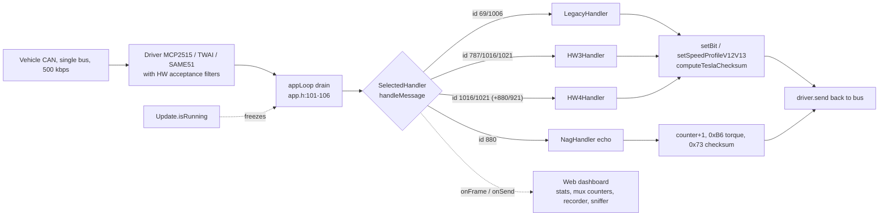
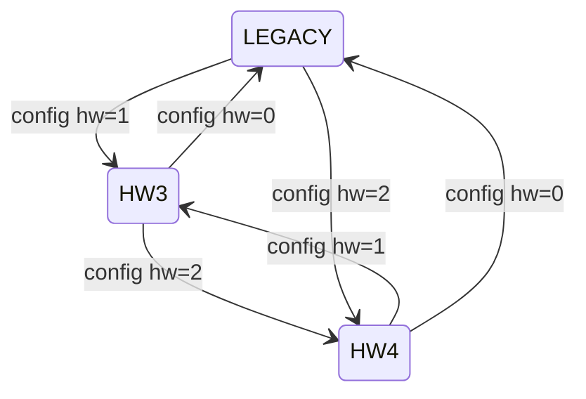
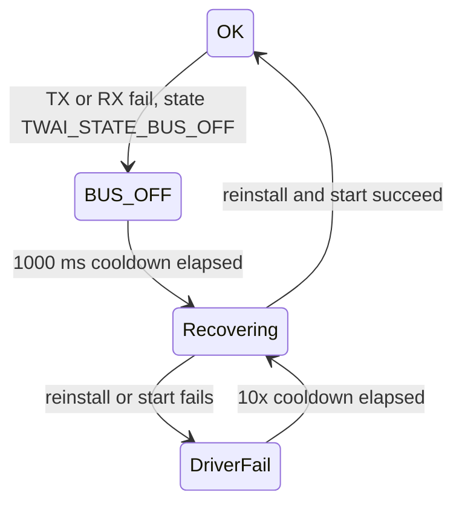
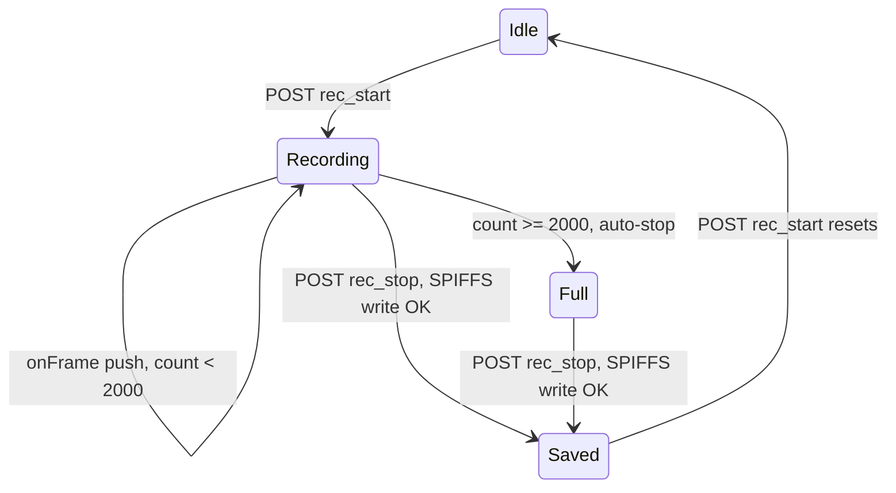

# slxslx-tesla-open-can-mod-slx-repo

Deep code-grounded analysis (legacy-repo-deep-dive skill, replace mode). The pre-replace summary still exists in git history; pre-replace claims are cited as `git show HEAD:docs/legacy/slxslx-tesla-open-can-mod-slx-repo.md#L<n>`.

## 1. Provenance

- Submodule: `legacy/slxslx-tesla-open-can-mod-slx-repo`
- Pinned gitlink (canonical form from `git ls-files -s`): `160000 df75420cc3af0de9438503f41d4b4cfda12f3279 0`
- `git -C legacy/slxslx-tesla-open-can-mod-slx-repo rev-parse HEAD` matches: `df75420cc3af0de9438503f41d4b4cfda12f3279`
- Worktree clean (`git status --porcelain` empty). HEAD subject: `Merge branch 'feature/esp32s3-mcp2515-dash' into 'main'`
- Upstream: <https://gitlab.com/slxslx/tesla-open-can-mod-slx-repo> (fork lineage: multiple `Merge branch tesla-open-can-mod:main into main` commits; parent is `Tesla-OPEN-CAN-MOD/tesla-open-can-mod`)
- License: GPL-3.0 (`LICENSE`). Third-party: autowp/arduino-mcp2515 (MIT), Adafruit_CAN (MIT), esp-idf TWAI (Apache-2.0) — `THIRD_PARTY_LICENSES`
- Upstream version at pin: `VERSION` = `2.0.0`, dated 2026-04-06
- Analysis date: 2026-11-21
- Replace-mode preservation note: the original doc had **no YAML frontmatter** (stated here per skill; none was invented) and **no `## Upstream (...)` sections** to preserve. Nothing was carried over byte-for-byte.

Files read (upstream, FULL-READ with line ranges):

- `include/handlers.h` (1-520) — all variant handlers + NagHandler
- `include/can_helpers.h` (1-111), `include/can_frame_types.h` (1-11), `include/shared_types.h` (1-11), `include/app.h` (1-108), `include/arduino_entrypoint.h` (1-48), `include/log_buffer.h` (1-52)
- `include/drivers/can_driver.h` (1-13), `mcp2515_driver.h` (1-69), `esp32_mcp2515_driver.h` (1-72), `twai_driver.h` (1-151), `same51_driver.h` (1-70), `mock_driver.h` (1-32)
- `include/web/mcp2515_dashboard.h` (1-940)
- `src/main.cpp` (1-84), `platformio.ini` (1-143), `RP2040CAN/sketch_config.h` (1-34), `RP2040CAN/RP2040CAN.ino` (1-7)
- `scripts/platformio_sync_ino_defines.py` (1-172), `scripts/platformio_native_env.py` (1-20), `scripts/check_release_metadata.py` (1-115)
- `test/test_native_helpers/test_helpers.cpp` (1-249), `test/test_native_hw3/test_hw3_handler.cpp` (1-242), `test/test_native_hw4/test_hw4_handler.cpp` (1-332), `test/test_native_legacy/test_legacy_handler.cpp` (1-153), `test/test_native_nag/test_nag_handler.cpp` (1-399), `test/test_native_bypass_tlssc_requirement/test_bypass_tlssc_requirement.cpp` (1-110), `test/test_native_log_buffer/test_log_buffer.cpp` (1-101), `test/test_native_twai/test_twai_filter.cpp` (1-219)
- `CHANGELOG.md` (1-84), `VERSION` (1), `.gitlab-ci.yml` (1-231), `LICENSE` (1-10, standard GPL-3.0 text), `THIRD_PARTY_LICENSES` (1-80)
- Docs read after code, for contradiction hunting only: `README.md` (1-80), `docs-site/docs/features/{fsd-activation,nag-suppression,autosteer-nag-killer,enhanced-autopilot,smart-summon,speed-profiles,isa-speed-chime,emergency-vehicle-detection,web-interface}.md`, `docs-site/docs/wiki/compatibility.md`

STRUCTURAL-PARSE: `include/web/mcp2515_dashboard_ui.h` (940-line HTML/CSS/JS blob in one PROGMEM string; claims limited to endpoint calls and the `H4O` preset array extracted by targeted grep).

Files explicitly NOT read:

- `scripts/platformio_set_ino_profile.py` — behavior inferred only from CI call sites (`.gitlab-ci.yml:83,97,111,125,139,151,168`)
- `docs-site/` build config and remaining pages (`docusaurus.config.ts`, `sidebars.ts`, `package.json`, getting-started/wiki/hardware pages), `guides/*.md` (duplicative of docs-site), all images, `lib/README`, `test/README`, `.gitlab/merge_request_templates/Default.md`, `.gitignore`, `RP2040CAN/src` (symlink → `../include`, target already read)
- `THIRD_PARTY_LICENSES` beyond line 80 (license text continuation)

Our-side files read for parity (CODE-READ citations): `firmware/lib/vehicle/can/handler/variant/{hw4,hw3,legacy,bits,helpers}.h` (full), `firmware/lib/vehicle/can/feature/fsd/{profile,offsets,isa_chime}.h` (full), `firmware/lib/vehicle/can/feature/fsd/nag.h` (RANGE-CITED: 1-399 plus grep-anchored 451-483), `firmware/lib/vehicle/can/feature/das/tlssc.h` (1-60), `firmware/lib/vehicle/can/feature/body/track_mode.h` (1-58), `firmware/lib/vehicle/can/{ids,checksum}.h` (full), `firmware/lib/core/can/{health,recorder}.h` (head regions), `firmware/lib/core/driver/common.h` (160-234).

## 2. Executive verdict

Single-bus Tesla CAN "FSD unlock" firmware (PlatformIO, 8 hardware envs, GPL-3.0) that passively mirrors frames it cares about and re-injects mutated copies: FSD mux bit writes (0x3EE/0x3FD), mux-1 nag bit-19 clear with bit 46/47 set, a fixed-torque 0x370 counter+1 EPAS echo (NagHandler), HW4 ISA chime bit on 0x399, follow-distance→profile mapping, and an unconditional HW3 Track-Mode mutation on 787. The genuinely valuable, test-backed material for TeslaCANModder is byte-level: the 0x370 echo spec (checksum `sum(d0..d6)+0x73`, counter d6 low nibble, 12-bit torque `0x8B6`=1.80 Nm, handsOnLevel d4 bits 7:6) — which our richer nag pipeline already covers except for two deltas (their 2050 vs our 2048 raw center, and their forced `handsOnLevel=1` which our feifan research says trips 2026.14.x preflight); the 921 ISA bit + checksum (bit-identical to ours); and the follow-distance profile maps (bit-identical to ours). The dashboard's SPIFFS CSV recorder with HTTP download is the best low-risk adaptation candidate. Must not be ported: unconditional Track-Mode mutation, unauthenticated web control endpoints, CI artifacts shipping placeholder WiFi/OTA credentials, and the forced-handsOn echo variant. The repo's own docs are systematically stale (wrong profile tables, wrong endpoints, nonexistent build envs), so treat every upstream README/docs claim as SUMMARY-ONLY until re-checked.

## 3. Evidence map

| source file | lines | what it proves | grade |
| ----------- | ----- | -------------- | ----- |
| `include/handlers.h` | 40-110 | LegacyHandler: filter IDs {69,1006}; stalk→profile; mux0 bit46+profile; mux1 bit19 clear | CODE-READ |
| `include/handlers.h` | 112-260 | HW3Handler: {787,1016,1021}(+880 dash); 787 unconditional mutate; 1016 fd map; 1021 mux0/1/2 | CODE-READ |
| `include/handlers.h` | 262-347 | NagHandler 0x370 echo: 0xB6, 0x40, counter+1, +0x73 checksum | CODE-READ |
| `include/handlers.h` | 349-520 | HW4Handler: {1016,1021}(+880/921); mux0 bits 46/60/59; mux1 19/47; mux2 profile+offset | CODE-READ |
| `include/can_helpers.h` | 56-94 | readMuxID=d0&0x07; isFSDSelectedInUI=d4 bit6; profile mask 0x06; computeTeslaChecksum=ID bytes+data | CODE-READ |
| `include/drivers/twai_driver.h` | 32-56, 96-142 | acceptance filter math (`<<21`), 2 ms TX timeout, bus-off cooldown 1000 ms, ×10 retry | CODE-READ |
| `include/drivers/mcp2515_driver.h` | 16-38 | MCP_16MHZ hardcoded, 6-filter 0x7FF-mask reload | CODE-READ |
| `include/drivers/esp32_mcp2515_driver.h` | 16-27 | MCP_CRYSTAL_FREQ default MCP_8MHZ | CODE-READ |
| `include/web/mcp2515_dashboard.h` | 901-925 | actual HTTP routes; no auth except `/update` | CODE-READ |
| `include/web/mcp2515_dashboard.h` | 253-312, 824-859 | NVS keys, prefs roundtrip, 3-handler runtime hot-swap + filter reload | CODE-READ |
| `include/web/mcp2515_dashboard.h` | 361-387, 395-401 | MCP2515 EFLG 0x20 bus-off poll every 5000 ms; 10000 ms canOnline timeout | CODE-READ |
| `include/web/mcp2515_dashboard.h` | 637-704 | recorder: REC_CAP 2000, SPIFFS `/rec.csv`, download endpoint | CODE-READ |
| `include/web/mcp2515_dashboard_ui.h` | 408 | H4O presets raw {0,7,10,14,21} labeled Off/+5/+7/+10/+15 km/h | STRUCTURAL-PARSE |
| `RP2040CAN/sketch_config.h` | 23-26 | placeholder credentials `changeme1`/`changeme2`, SSID `FSDUnlock` | CODE-READ |
| `scripts/platformio_sync_ino_defines.py` | 12-17, 55-61, 142-166 | NAG_KILLER absent from OPTIONAL_DEFINES; exactly-one-vehicle-define enforced; placeholder credential guard + SKIP env | CODE-READ |
| `.gitlab-ci.yml` | 47-50 | CI sets `SKIP_DASH_CREDENTIAL_CHECK: "1"` for all ESP32 jobs | CODE-READ |
| `test/test_native_nag/test_nag_handler.cpp` | 12-34, 129-269 | torque raw=(Nm+20.5)/0.01; 0x8B6→1.80 Nm; counter wrap; checksum law; safety canaries | TEST-READ |
| `test/test_native_hw4/test_hw4_handler.cpp` | 26-64, 87-150, 229-262 | HW4 fd map 1→3…5→4; mux0 bits 46/60/59; mux1 19 clear+47 set; ISA bit+checksum 0xD1 | TEST-READ |
| `test/test_native_hw3/test_hw3_handler.cpp` | 23-74, 128-170 | HW3 fd map 1→2,2→1,3→0; bit46 on mux1; 787 checksum 0xE7 | TEST-READ |
| `test/test_native_legacy/test_legacy_handler.cpp` | 22-53, 99-107 | stalk pos map; 1006 mux0 bit46; mux1 bit19 | TEST-READ |
| `test/test_native_helpers/test_helpers.cpp` | 16-50, 158-178 | setBit indexing; checksum 0xE7 for 787 frame | TEST-READ |
| `test/test_native_bypass_tlssc_requirement/test_bypass_tlssc_requirement.cpp` | 19-95 | BYPASS_TLSSC forces FSD send with UI bit clear on all variants | TEST-READ |
| `test/test_native_twai/test_twai_filter.cpp` | 12-33, 168-182 | filter math extracted and verified incl. mask bits | TEST-READ |
| `platformio.ini` | 1-143 | 8 hardware envs; pin maps; native test envs with flag sets | CODE-READ |

No CAPTURE evidence exists in this repo: no frame logs, no .dbc, no decode dumps ship in-tree. The only capture-derived claims (Model Y 2022 test, bus-4-only anti-spoofing matrix) live in `docs-site/docs/features/autosteer-nag-killer.md` and are UNVERIFIED here.

## 4. Architecture and build surface

Entry points: `src/main.cpp` (PlatformIO, selects driver by `DRIVER_*` define, wires dashboard callbacks) and `RP2040CAN/RP2040CAN.ino` → `src` symlink → `include/arduino_entrypoint.h` (Arduino IDE path). Shared logic is header-only under `include/`: `app.h` (template setup/loop, handler selection via `SelectedHandler` alias from `HW4`/`HW3`/`LEGACY`/`NAG_KILLER`/`DASH_DEFAULT_HW` defines), `handlers.h` (variant handlers), `can_helpers.h` (mux/bit/checksum helpers + runtime flags), `log_buffer.h` (32×128 ring). Drivers behind `CanDriver` interface: MCP2515 SPI (autowp, 16 MHz crystal, ISR-capable), ESP32 ext MCP2515 (8 MHz default, polling), TWAI (ESP32 native), SAME51 native MCAN, Mock for tests. Build flags: `DRIVER_*`, vehicle `HW3/HW4/LEGACY`, optional `ISA_SPEED_CHIME_SUPPRESS`, `EMERGENCY_VEHICLE_DETECTION`, `BYPASS_TLSSC_REQUIREMENT`, `ENHANCED_AUTOPILOT`, `NAG_KILLER`, dashboard `ESP32_DASHBOARD` + `DASH_SSID/PASS/OTA_USER/OTA_PASS` + `DASH_DEFAULT_HW`. A pre-build script (`scripts/platformio_sync_ino_defines.py`) cross-validates `sketch_config.h` against the env and blocks placeholder dashboard credentials (bypassable via `SKIP_DASH_CREDENTIAL_CHECK`, which CI itself sets). Native tests run under PlatformIO `native*` envs with `NATIVE_BUILD` (Shared<T> degrades to plain T).

Dependency boundary: handlers depend only on `CanDriver` (send/read) — no transport coupling. The dashboard hooks in via two C callbacks (`onFrame`, `onSend`) set in `src/main.cpp:37-38,47-48,58-59`.



## 5. Mechanism catalogue

### FSD activation (0x3FD mux 0, and 0x3EE on Legacy)

- **Claim (README / summary):** "FSD Activation (bit46) — HW3/HW4/Legacy" (`git show HEAD:docs/legacy/slxslx-tesla-open-can-mod-slx-repo.md#L32`); docs-site adds HW4 bits 59/60 ("Enable detection", "Enable V14").
- **Code path:** `handlers.h:49-108` (Legacy), `handlers.h:191-258` (HW3), `handlers.h:446-518` (HW4) — `readMuxID` → `isFSDSelectedInUI` → `setBit` → `driver.send`.
- **Frame spec:** 0x3FD/1021 (HW3/HW4) and 0x3EE/1006 (Legacy), DLC≥8, mux in `data[0]&0x07`. Mux 0: read UI-selection at `data[4]` bit 6 (frame bit 38); write frame bit 46 on all variants; HW4 additionally bit 60 unconditionally and bit 59 when `emergencyVehicleDetectionRuntime`; HW3/Legacy also write profile via `setSpeedProfileV12V13` (`data[6]` bits 2:1). No counter or checksum recomputed on 0x3FD/0x3EE.
- **Gates and timing:** event-driven on each received mux-0 frame; gated on `FSDEnabled` latched from last mux-0 UI bit (or forced true under BYPASS_TLSSC) and optional `checkFsd()` callback (never wired — defaults to pass).
- **State machine:** `FSDEnabled` latch: set on every mux-0 from the UI bit; survives mux-1/2 frames (regression tests `test_hw3_fsd_enabled_only_set_on_mux0`, `test_hw4_fsd_enabled_only_set_on_mux0`).
- **Tests:** `test_legacy_fsd_sets_bit46` (`test_legacy_handler.cpp:77-85`), `test_hw3_fsd_mux0_sends_with_bit46` (`test_hw3_handler.cpp:116-124`), `test_hw4_fsd_mux0_sets_bits_46_and_60` and `..._sets_emergency_bit59` (`test_hw4_handler.cpp:87-117`).
- **Evidence grade:** CODE-READ + TEST-READ.
- **Verdict:** CONFIRMED (docs omit that HW3 mux1 also writes bit 46 — see contradiction table).
- **Adapt to TeslaCANModder?** already present — our `handleHW3`/`handleHW4` write the same bits plus 38/39 (see parity).

### Nag suppression via mux-1 bit-19 clear (+ bit 46/47 set)

- **Claim (README / summary):** clears the "hands-on-wheel ECE R79 nag bit" (`docs-site/features/nag-suppression.md:11`); "part of the `ENHANCED_AUTOPILOT` option on HW3/HW4, always active on Legacy" (`nag-suppression.md:13`).
- **Code path:** `handlers.h:84-91` (Legacy mux1), `handlers.h:208-230` (HW3), `handlers.h:466-489` (HW4) → `setBit(frame,19,false)` → `driver.send`.
- **Frame spec:** 0x3EE/1006 and 0x3FD/1021 mux 1 (`data[0]&0x07 == 1`), DLC≥8. Clears frame bit 19; HW3 also sets bit 46, HW4 also sets bit 47. No checksum recomputed.
- **Gates and timing:** Legacy: ungated. HW3/HW4: if `ENHANCED_AUTOPILOT` or `ESP32_DASHBOARD` is compiled in, gated on `enhancedAutopilotRuntime`; **otherwise the `#else` branch makes it always-on** (`handlers.h:218-222,476-481`) — docs say opt-in, code is default-on for plain RP2040/M4 builds.
- **State machine:** None found.
- **Tests:** `test_legacy_nag_suppression_clears_bit19_on_mux1` (`test_legacy_handler.cpp:99-107`), `test_hw3_nag_suppression_clears_bit19_on_mux1`, `test_hw3_mux1_sets_track_labels_bit46`, `test_hw3_nag_suppression_skips_mux1_changes_when_eap_runtime_disabled` (`test_hw3_handler.cpp:128-154`), `test_hw4_nag_suppression_clears_bit19_sets_bit47` (`test_hw4_handler.cpp:131-140`).
- **Evidence grade:** CODE-READ + TEST-READ.
- **Verdict:** PARTIAL (mechanism confirmed; the opt-in claim is contradicted by the `#else` default-on path; the `UI_applyEceR79` signal name for bit 19 is not code-verifiable).
- **Adapt to TeslaCANModder?** already present (`applyHW3NagSuppressBits`/`applyHW4NagSuppressBits` clear bit 19 and set bit 47).

### NagHandler — 0x370 fixed-torque counter+1 echo

- **Claim (README / summary):** "Nag Killer (EPAS 0x370 echo method)" (`git show HEAD:...md#L33`); replicates "Chinese TSL6P module", tested on Model Y Performance 2022 HW3 Basic Autopilot, X179 pin 2/3 ("CAN bus 4") only (`docs-site/features/autosteer-nag-killer.md:8,41,89-93`).
- **Code path:** `handlers.h:280-347` — `handleMessage` (id 880, DLC≥8) → handsOn check → build echo → `driver.send`. Dashboard builds reuse the same byte edits inline in HW3Handler/HW4Handler (`handlers.h:132-155,374-397`).
- **Frame spec:** 0x370/880, DLC 8. Read `handsOnLevel = (data[4]>>6)&0x03`. Echo: `data[0..1]` copied; `data[2]=(d2&0xF0)|0x08`; `data[3]=0xB6` (12-bit torque raw 0x8B6 = 2230 = (1.80+20.5)/0.01); `data[4]=d4|0x40` (handsOnLevel forced to 1); `data[5]` copied; `data[6]=(d6&0xF0)|((d6+1)&0x0F)` (counter+1, low nibble, wraps 0x0F→0x00); `data[7]=(sum(d0..d6)+0x73)&0xFF` (0x70=ID low byte, 0x03=ID high byte).
- **Gates and timing:** echo only when `nagKillerActive && nagKillerRuntime && handsOn==0`. Event-driven per frame. Log every 500th echo (`handlers.h:330`).
- **State machine:** None found (stateless per-frame decision).
- **Tests:** `test_nag_handler.cpp` — 30 tests incl. `test_nag_torque_value_is_1_80_nm` (185-193), `test_nag_counter_wraps_from_f_to_0` (138-145), `test_nag_checksum_correct_with_various_inputs` (233-244), safety canaries `test_nag_output_torque_never_exceeds_safe_range` / `test_nag_output_handson_never_exceeds_1` (250-277). Doc example frame checksum verified by hand: `12 00 08 B6 5F 89 4D` → `0x78` ✓.
- **Evidence grade:** CODE-READ + TEST-READ.
- **Verdict:** CONFIRMED as code; the bus-4-only claim and vehicle test are UNVERIFIED (docs-only).
- **Adapt to TeslaCANModder?** never port the forced `handsOnLevel=1` fixed-torque variant (see do-not-copy); the routing insight (works only on X179 pins 2/3) is a capture-first backlog item for our nag bus choice.

### Follow-distance → speed-profile mapping

- **Claim (README / summary):** "Speed Profiles (5 levels HW4, 3 levels HW3/Legacy)" (`git show HEAD:...md#L37`); docs-site tables claim HW3 fd 2/3/4 → Hurry/Normal/Chill and HW4 fd 2..6 → Max..Sloth (`speed-profiles.md:13-29`).
- **Code path:** Legacy `handlers.h:55-67` (id 69, `data[1]>>5`); HW3 `handlers.h:167-189`; HW4 `handlers.h:419-445` (id 1016, `data[5]` bits 7:5) — no TX, state update only.
- **Frame spec:** 0x045/69 stalk byte `data[1]` bits 7:5 (pos 0-7); 0x3F8/1016 `data[5]` bits 7:5. HW3 map: fd 1→profile 2, 2→1, 3→0, else keep. HW4 map: 1→3, 2→2, 3→1, 4→0, 5→4. Legacy stalk: pos≤1→2, pos 2→1, else 0.
- **Gates and timing:** HW3/HW4 gated on `!speedProfileLocked`.
- **State machine:** None found.
- **Tests:** `test_hw3_follow_distance_1_sets_profile_2` … `_3_sets_profile_0` (`test_hw3_handler.cpp:23-46`), `test_hw4_follow_distance_1_sets_profile_3` … `_5_sets_profile_4` (`test_hw4_handler.cpp:26-64`), `test_legacy_stalk_pos0..3` (`test_legacy_handler.cpp:22-53`).
- **Evidence grade:** CODE-READ + TEST-READ.
- **Verdict:** CONFIRMED for code; docs-site mapping tables CONTRADICTED (see section 6).
- **Adapt to TeslaCANModder?** already present — our maps are bit-identical (parity row below).

### HW3 speed-offset decode (mux 0) and write (mux 2)

- **Claim (README / summary):** dashboard "Speed Offset" display (`docs-site/features/web-interface.md:28`).
- **Code path:** `handlers.h:200` (decode on mux-0 FSD frames) → `handlers.h:231-241` (mux-2 write).
- **Frame spec:** 0x3FD/1021 mux 0: read 6-bit field `data[3]` bits 6:1, bias −30, ×5, clamp 0..100 → `speedOffset`. Mux 2: write `data[0]` bits 7:6 = offset&0x03, `data[1]` bits 5:0 = offset>>2 (8-bit offset split across two bytes). No checksum on this frame.
- **Gates and timing:** decode only when `FSDEnabled && checkFsd` passes; mux-2 write gated on `FSDEnabled`.
- **State machine:** None found.
- **Tests:** `test_hw3_follow_distance_profile_survives_mux0_with_zero_offset` (`test_hw3_handler.cpp:56-74`) asserts decode at raw 60 → offset 0; `test_hw3_fsd_disabled_on_mux0_prevents_mux2_send` (97-112).
- **Evidence grade:** CODE-READ + TEST-READ.
- **Verdict:** CONFIRMED (CHANGELOG 2.0.0:17 documents the earlier uint8_t-underflow bug as fixed).
- **Adapt to TeslaCANModder?** already present — identical formula in our `readHW3UiOffsetSteps`/`writeHW3SpeedOffset`.

### HW4 mux-2 speed profile + offset injection

- **Claim (README / summary):** "HW4 speed offset injection on mux 2, dashboard presets: Off / +5 / +7 / +10 / +15 km/h" (`CHANGELOG.md:23`).
- **Code path:** `handlers.h:490-501` — profile field then offset field → `driver.send`.
- **Frame spec:** 0x3FD/1021 mux 2: `data[7]` bits 6:4 = profile&0x07 (old bits cleared); if `hw4OffsetRuntime>0`: `data[1]=(d1&0xC0)|(off&0x3F)`. UI presets write raw values `{0,7,10,14,21}` labeled Off/+5/+7/+10/+15 km/h (`mcp2515_dashboard_ui.h:408`) — raw↔km/h is not 1:1 (≈×5/7).
- **Gates and timing:** gated on `FSDEnabled` (no `checkFsd` on this mux).
- **State machine:** None found.
- **Tests:** `test_hw4_mux2_injects_speed_profile`, `test_hw4_mux2_clears_old_profile_bits` (`test_hw4_handler.cpp:153-187`).
- **Evidence grade:** CODE-READ + TEST-READ (raw preset values themselves STRUCTURAL-PARSE from the UI blob).
- **Verdict:** CONFIRMED; preset raw→km/h mapping UNVERIFIED (needs capture).
- **Adapt to TeslaCANModder?** candidate for our client offset presets, capture-first.

### ISA speed chime suppression (0x399)

- **Claim (README / summary):** "ISA Speed Chime Suppression (HW4, 0x399)" (`git show HEAD:...md#L35`); signal `DAS_suppressSpeedWarning` bit 13, checksum bits 56-63 (`isa-speed-chime.md:13-20`).
- **Code path:** `handlers.h:399-418` (HW4 only) → bit set → checksum → `driver.send`.
- **Frame spec:** 0x399/921, DLC≥8: `data[1] |= 0x20` (frame bit 13); checksum `data[7] = (sum(data[0..6]) + (921&0xFF) + (921>>8)) & 0xFF` (= `+0x99+0x03`).
- **Gates and timing:** gated on `isaSpeedChimeSuppressRuntime` (compile default on with `ISA_SPEED_CHIME_SUPPRESS`, dashboard-toggleable). Early-return skips all other processing for this frame.
- **State machine:** None found.
- **Tests:** `test_hw4_isa_suppress_checksum_correct` computes 0xD1 for a concrete frame (`test_hw4_handler.cpp:246-262`), plus bit-set/preserve/runtime-off tests (229-278).
- **Evidence grade:** CODE-READ + TEST-READ.
- **Verdict:** CONFIRMED (HW4-only in code; CHANGELOG's "HW3 and HW4" is wrong — section 6).
- **Adapt to TeslaCANModder?** already present — bit-identical to our `computeHW4IsaChecksum`; delta: we additionally require the AP gate.

### HW3 forced Track Mode (0x313/787)

- **Claim (README / summary):** none — feature is undocumented in README, docs-site, and the old legacy doc; only `e45f5a3` ("+ track mode") mentions it.
- **Code path:** `handlers.h:157-165` — every 787 frame → `setTrackModeRequest(f,0x01)` → `computeTeslaChecksum` → `driver.send`.
- **Frame spec:** 0x313/787, DLC≥8: `data[0]` bits 1:0 forced to `0x01` (`kTrackModeRequestOn`, `can_helpers.h:6`); checksum `data[7] = (idLo + idHi + sum(data[0..6] except checksum byte)) & 0xFF` (`computeTeslaChecksum`, `can_helpers.h:80-94`).
- **Gates and timing:** **no gate, no runtime toggle, no dashboard switch** — every received 787 frame is mutated and retransmitted on HW3 builds (787 is in the HW3 filter set, `handlers.h:122`). HW4 does not handle 787 at all.
- **State machine:** None found.
- **Tests:** `test_hw3_track_mode_request_forces_on_and_updates_checksum` asserts `data[0]=0xFD`, `data[7]=0xE7` (`test_hw3_handler.cpp:158-170`).
- **Evidence grade:** CODE-READ + TEST-READ.
- **Verdict:** CONFIRMED as code behavior; undocumented and unconditional.
- **Adapt to TeslaCANModder?** never port the unconditional mutation; the checksum-preserving mutate-in-flight *construction* is capture-first material for our zero-based 0x313 burst (parity row below).

### BYPASS_TLSSC_REQUIREMENT (FSD-selected override)

- **Claim (README / summary):** "bypasses the toggle check and always sets the FSD enable bit" (`fsd-activation.md:53`); renamed from FORCE_FSD/FORCE_FSC (`CHANGELOG.md:82`).
- **Code path:** `can_helpers.h:61-66` — `isFSDSelectedInUI` returns true when `bypassTlsscRequirementRuntime`, else reads `data[4]` bit 6.
- **Frame spec:** no frame bytes changed by the bypass itself; it only forces the mux-0 gate.
- **Gates and timing:** compile default on with the define; runtime toggle via dashboard `/features?ffsd=1` (`mcp2515_dashboard.h:551-556`), persisted as NVS key `ffsd`.
- **State machine:** None found.
- **Tests:** all six tests in `test_native_bypass_tlssc_requirement` (helper true with bit clear; Legacy/HW3/HW4 send without UI toggle).
- **Evidence grade:** CODE-READ + TEST-READ.
- **Verdict:** CONFIRMED.
- **Adapt to TeslaCANModder?** already present — semantically our `fsdForceEnabled` in `handleHW3`/`handleHW4`/`handleLegacy`. Naming trap: upstream "TLSSC" ≠ our `tlssc:on` 0x331 tier spoof (a mechanism upstream lacks entirely).

### ESP32 web dashboard (AP + HTTP + OTA + handler hot-swap)

- **Claim (README / summary):** "Web Interface with WiFi control (ESP32 variants)" (`git show HEAD:...md#L38`); "comprehensive CAN signal handling" (`#L9`).
- **Code path:** `mcp2515_dashboard.h:812-926` — `dnsTask`/`webTask` pinned to core 0; `mcpDashboardSetup` binds routes; `mcpDashboardLoop` health checks.
- **Frame spec:** None found (no frame mutation here; consumes `onFrame`/`onSend` hooks).
- **Gates and timing:** whole loop frozen while `Update.isRunning()` (`app.h:84-90`, `mcp2515_dashboard.h:928-931`).
- **State machine:** runtime handler selection, persisted in NVS key `hw`:



  Every switch re-applies driver acceptance filters (`dashSwapHandler` → `setFilters`, `mcp2515_dashboard.h:851-852`) and, for ext-MCP2515, reloads the 6 filter registers per mode (`dashApplyFilters`, 316-359).
- **Tests:** None found — no native test compiles the dashboard; all behavior UNTESTED.
- **Evidence grade:** CODE-READ.
- **Verdict:** CONFIRMED as surface; docs-site endpoint list CONTRADICTED (section 6).
- **Adapt to TeslaCANModder?** mixed — recorder CSV export is a candidate; unauthenticated control endpoints and placeholder-credential CI artifacts are never-port.

### TWAI driver (filters, bus-off recovery)

- **Claim (README / summary):** "TWAI driver: non-blocking TX, bus-off cooldown and recovery, driver-fail guard" (`CHANGELOG.md:65`).
- **Code path:** `twai_driver.h:32-56` (single-filter acceptance math), `60-80` (read), `82-101` (send with 2 ms timeout), `103-142` (recovery).
- **Frame spec:** filters: `acceptance_code = (ids[0] & ~differ) << 21`, `acceptance_mask = (differ << 21) | 0x001FFFFF` where `differ = OR(ids[0] ^ ids[i])`. RX queue 32, TX queue 16.
- **Gates and timing:** TX timeout 2 ms; bus-off cooldown 1000 ms; after a failed recovery, `tryRecover` only re-attempts after 10× cooldown.



- **Tests:** `test_native_twai` re-implements the filter math standalone and verifies accept/reject sets and exact mask bits (`test_twai_filter.cpp:168-182`); the recovery state machine itself is UNTESTED.
- **Evidence grade:** CODE-READ + TEST-READ (filter math only).
- **Verdict:** CONFIRMED for filters; recovery path PARTIAL (code-read only).
- **Adapt to TeslaCANModder?** no impact — our stack is MCP2515-based and already has EFLG_TXBO auto-recovery (`driverPollBusErrors`).

### MCP2515 drivers and bus health poll

- **Claim (README / summary):** "MCP2515 8MHz crystal support" relevance (`git show HEAD:...md#L67`).
- **Code path:** `mcp2515_driver.h:16-38` (16 MHz hardcoded for RP2040/Feather-V2), `esp32_mcp2515_driver.h:16-27` (default `MCP_8MHZ`, overridable), `mcp2515_dashboard.h:361-387` (EFLG poll).
- **Frame spec:** None found (driver layer). Filter reload uses mask 0x7FF with 6 RXF registers filled per handler ID list.
- **Gates and timing:** EFLG polled every 5000 ms; bit 0x20 (BOFF) triggers `reset()` → `setBitrate` → `dashApplyFilters`. `canOnline` drops after 10000 ms without any frame (`mcp2515_dashboard.h:397-401,933-937`).
- **State machine:** None found (threshold checks, not a machine).
- **Tests:** None found.
- **Evidence grade:** CODE-READ.
- **Verdict:** CONFIRMED.
- **Adapt to TeslaCANModder?** already present (`driverPollBusErrors` in `core/driver/common.h`).

### CAN recorder, sniffer, and log rings

- **Claim (README / summary):** not mentioned in the pre-replace doc; "CAN Recorder" card exists in the dashboard UI.
- **Code path:** `mcpDashOnFrame` (`mcp2515_dashboard.h:181-210`) pushes to sniffer ring (cap 30) and recorder (cap 2000); `handleRecStop` writes CSV to SPIFFS `/rec.csv` (637-677); `handleRecDownload` streams it (693-704); `LogRingBuffer` (`log_buffer.h`) 32×128 with `readSince`.
- **Frame spec:** None found (storage only; entries are `{ts,id,dlc,data[8]}`).
- **Gates and timing:** recorder auto-stops at 2000 frames, silently (`mcp2515_dashboard.h:206-208`).



- **Tests:** `test_native_log_buffer` covers the 32-entry log ring (push/wrap/truncate); recorder and sniffer have None found.
- **Evidence grade:** CODE-READ (+ TEST-READ for log ring only).
- **Verdict:** CONFIRMED.
- **Adapt to TeslaCANModder?** candidate — CSV export/download for bench work; our ring recorder (256 entries) has no export path.

## 6. Summary vs code contradiction table

Pre-replace summary is cited as `git show HEAD:docs/legacy/slxslx-tesla-open-can-mod-slx-repo.md#L<n>` (worktree had no uncommitted changes, so those line numbers are the HEAD bytes).

| claim source | claim | code evidence | verdict |
| ------------ | ----- | ------------- | ------- |
| `git show HEAD:...md#L49` | "920 \| 0x398 \| GTW carConfig \| HW version detect" | zero matches for `920\|0x398` in `include/ src/ test/` (negative anchor demonstrated); handler selection is manual via build flags or dashboard `/config?hw=N` | CONTRADICTED |
| `git show HEAD:...md#L34` + `README.md:31` | ASS "removes EU regulatory restrictions … (HW3/HW4)" | `docs-site/features/smart-summon.md:21` says HW4-only; code: HW3 mux1 sets bit 46, never bit 47 (`handlers.h:214-216`); bit 47 set only in HW4Handler (`handlers.h:473`) | CONTRADICTED (HW3 half) |
| `CHANGELOG.md:52` | "ISA speed chime suppression for HW3 and HW4" | HW3Handler has no 921 branch and its filter set is {787,1016,1021} (`handlers.h:114-126`); `isa-speed-chime.md:73` says HW4 only | CONTRADICTED (HW3 half) |
| `docs-site/features/speed-profiles.md:13-17` | HW3: fd 2→Hurry, 3→Normal, 4→Chill | `handlers.h:174-187` + `test_hw3_handler.cpp:23-46`: fd 1→profile 2, 2→1, 3→0 | CONTRADICTED (off by one; tests prove code) |
| `docs-site/features/speed-profiles.md:23-29` | HW4: fd 2→Max, 3→Hurry, 4→Normal, 5→Chill, 6→Sloth | `handlers.h:425-443` + `test_hw4_handler.cpp:26-64`: fd 1→3, 2→2, 3→1, 4→0, 5→4 | CONTRADICTED (completely different map) |
| `docs-site/features/autosteer-nag-killer.md:11` | "Nag Suppression (ISA Speed Chime): Modifies CAN 39F message" | no 0x39F/927 anywhere; ISA is 921/0x399 (`handlers.h:400`); bit-19 nag is 1021/0x3FD mux 1 (`handlers.h:208-230`) | CONTRADICTED |
| `docs-site/features/autosteer-nag-killer.md:101-108` | build envs `lilygo_tcan485_nag_killer`, `esp32_twai_nag_killer` | absent from `platformio.ini` (negative anchor demonstrated); additionally `NAG_KILLER` is missing from `OPTIONAL_DEFINES` and the sync script requires exactly one vehicle define (`platformio_sync_ino_defines.py:12-17,55-61`), so the standalone NagHandler is unreachable via PlatformIO | CONTRADICTED |
| `docs-site/features/web-interface.md:94-98` | endpoints `/api/status`, `/api/bypass-tlssc`, `/api/isa-speed-chime-suppress`, `/api/emergency-vehicle-detection`, `/api/log` | actual routes are `/status`, `/config`, `/features`, `/frames`, `/log`, `/reset_stats`, `/rec_*`, `/disable`, `/reboot`, `/update` (`mcp2515_dashboard.h:901-914`) | CONTRADICTED |
| `docs-site/features/web-interface.md:14-16` + `isa-speed-chime.md:65` | WiFi `TeslaCAN` / `canmod12` | `sketch_config.h:23-24` defaults `DASH_SSID "FSDUnlock"` / `DASH_PASS "changeme1"` | CONTRADICTED (stale pre-fork text) |
| `docs-site/features/web-interface.md:102` | "web interface is only compiled when using DRIVER_TWAI" | `platformio.ini:39-47` (feather V2, DRIVER_MCP2515) and `platformio.ini:103-116` (S3 ext MCP2515) both define `ESP32_DASHBOARD` | CONTRADICTED |
| `docs-site/docs/wiki/compatibility.md:10` vs `:16` + `emergency-vehicle-detection.md:30` | "Do not update to 2026.2.9.x & 2026.8.6 — FSD is not working on HW4" vs "2026.2.9.X … HW4 gets full v14 features" / "FSD v14 (firmware 2026.2.9.X or later)" | no code can settle vehicle-firmware compatibility; the two docs pages contradict each other | CONTRADICTED (docs-internal) |
| `docs-site/features/enhanced-autopilot.md:11,20-22` | ENHANCED_AUTOPILOT only clears bit 19 (+ sets bit 47 on HW4) | HW3 mux1 also sets bit 46 (`handlers.h:214-216`, asserted by `test_hw3_mux1_sets_track_labels_bit46`, `test_hw3_handler.cpp:147-154`) | PARTIAL (undocumented bit write) |
| `docs-site/features/nag-suppression.md:13` | HW3/HW4 nag override is opt-in via ENHANCED_AUTOPILOT | `#else` branch makes it always-on when neither `ENHANCED_AUTOPILOT` nor `ESP32_DASHBOARD` is compiled (`handlers.h:218-222,476-481`) | PARTIAL (default-on vs opt-in) |

Treat the rest of the pre-replace summary and the docs-site as SUMMARY-ONLY until re-checked. Its verified claims (frame IDs, board list, 8 MHz S3 crystal, GPL-3.0, 5/3-level profiles) are folded into this document's tables.

## 7. CAN frame and signal inventory

| ID (hex+dec) | bus | period | DLC | byte/bit layout | scale/units | counter | checksum | R/W | grade |
| ----------- | --- | ------ | --- | -------------- | ----------- | ------- | -------- | --- | ----- |
| 0x045 / 69 | single bus (build-defined; docs claim X179 pin 2/3 for nag builds) | on RX | ≥2 | stalk pos in `data[1]` bits 7:5 | positions 0-7 | None found | None found | read | CODE-READ |
| 0x3EE / 1006 | same as above | on RX | 8 | mux `data[0]&0x07`; mux0: UI-select `data[4]` bit 6 (bit 38), write bit 46, profile `data[6]` bits 2:1; mux1: clear bit 19 | — | None found | None found | read + mutated write | CODE-READ + TEST-READ |
| 0x313 / 787 | HW3 builds only | on RX | 8 | `data[0]` bits 1:0 forced 0x01 | — | None found | `data[7]` = (idLo+idHi+sum d0..d6) & 0xFF | read + mutated write (unconditional) | CODE-READ + TEST-READ |
| 0x370 / 880 | docs: X179 pins 2/3 "CAN bus 4" only | on RX | 8 | handsOn `data[4]` bits 7:6; torque 12-bit `data[2]` bits 3:0 + `data[3]`; counter `data[6]` bits 3:0; checksum `data[7]` | torque = raw×0.01 − 20.5 Nm | `data[6]` low nibble, echo writes +1 (wrap 0x0F→0) | sum(d0..d6)+0x73 & 0xFF | read + echo write | CODE-READ + TEST-READ |
| 0x399 / 921 | HW4 builds only | on RX | 8 | suppress bit `data[1]` bit 5 (frame bit 13) | — | None found | sum(d0..d6)+0x99+0x03 & 0xFF in `data[7]` | read + mutated write | CODE-READ + TEST-READ |
| 0x3F8 / 1016 | all HW3/HW4 builds | on RX | ≥6 | follow distance `data[5]` bits 7:5 | 0-7 | None found | None found | read | CODE-READ + TEST-READ |
| 0x3FD / 1021 | all HW3/HW4 builds | on RX | 8 | mux `data[0]&0x07`; mux0: read bit 38, write bits 46, 60 (HW4), opt 59 (HW4), profile `data[6]` bits 2:1 (HW3), offset read `data[3]` bits 6:1 (HW3); mux1: clear bit 19, set bit 46 (HW3) / 47 (HW4); mux2: HW3 offset `data[0]` bits 7:6 + `data[1]` bits 5:0; HW4 profile `data[7]` bits 6:4 + offset `data[1]` bits 5:0 | HW3 offset: (raw−30)×5, clamp 0..100; HW4 offset: raw 0..63 | None found | None found | read + mutated write | CODE-READ + TEST-READ |

Display-only labels in the dashboard sniffer (`decodeCanId`, `mcp2515_dashboard.h:120-149`) — STRUCTURAL-PARSE, one line: maps 0x045/0x129/0x175/0x186/0x257/0x293/0x321/0x329/0x399/0x3E8/0x3FD to names; two are wrong (0x257 labeled "State of charge", 0x3E8 is a typo for 0x3F8) and 0x370/0x3F8 frames show no label. No vendored DBC/JSON catalog exists in this repo.

## 8. Constants and tuning table

| constant | value | file:line | meaning | grade |
| -------- | ----- | --------- | ------- | ----- |
| torque raw center | 2050 (=(0+20.5)/0.01) | `test_nag_handler.cpp:19` | 0 Nm point of the 12-bit EPAS torque field | TEST-READ |
| fixed echo torque | 0x8B6 = 2230 raw = 1.80 Nm | `handlers.h:311-312` | NagHandler fixed `torsionBarTorque` | CODE-READ + TEST-READ |
| `0x08` | data[2] low nibble in echo | `handlers.h:308` | high nibble of the 12-bit torque raw | CODE-READ |
| `0xB6` | data[3] in echo | `handlers.h:312,143,385` | low byte of torque raw | CODE-READ |
| `0x40` | data[4] OR mask | `handlers.h:315` | forces handsOnLevel = 1 | CODE-READ |
| `0x73` | checksum adder for 0x370 | `handlers.h:324` | = ID bytes 0x70 + 0x03 | CODE-READ |
| `0x20` | ISA suppress mask on data[1] | `handlers.h:406` | frame bit 13 | CODE-READ + TEST-READ |
| ISA checksum adder | 0x99 + 0x03 | `handlers.h:410` | ID 921 split bytes | CODE-READ + TEST-READ |
| HW3 offset bias/scale | −30, ×5, clamp 0..100 | `handlers.h:200` | mux-0 UI offset decode | CODE-READ + TEST-READ |
| HW4 offset field | mask 0x3F, preserve 0xC0 | `handlers.h:492-496` | data[7] profile bits 6:4; data[1] offset bits 5:0 | CODE-READ |
| HW4 offset presets | raw {0, 7, 10, 14, 21} labeled Off/+5/+7/+10/+15 km/h | `mcp2515_dashboard_ui.h:408` | dashboard pill values written to hw4OffsetRuntime | STRUCTURAL-PARSE |
| profile mask V12/V13 | 0x06 (data[6] bits 2:1) | `can_helpers.h:70-72` | 2-bit profile field (overflow risk, see section 9) | CODE-READ |
| `kTrackModeRequestOn` | 0x01 | `can_helpers.h:6` | data[0] bits 1:0 on 0x313 | CODE-READ |
| `computeTeslaChecksum` | idLo+idHi+data (excl. checksum byte) & 0xFF | `can_helpers.h:80-94` | additive Tesla checksum (787 et al.) | CODE-READ + TEST-READ |
| MCP filter mask | 0x7FF on both masks, 6 RXF slots | `mcp2515_driver.h:29-36` | exact-match filters per handler ID list | CODE-READ |
| TWAI filter shift | `<<21`, low mask 0x001FFFFF | `twai_driver.h:44-45` | single 11-bit acceptance filter computed from ID set | CODE-READ + TEST-READ |
| TWAI TX timeout | 2 ms | `twai_driver.h:96` | compromise between drops and RX-queue overflow (comment cites ~8 frames/2 ms at 500 kbps) | CODE-READ |
| `BUSOFF_COOLDOWN_MS` | 1000 | `twai_driver.h:104` | bus-off recovery cooldown; ×10 in `tryRecover` (line 133) | CODE-READ |
| TWAI queues | RX 32, TX 16 | `twai_driver.h:18-19` | queue depths | CODE-READ |
| EFLG poll interval | 5000 ms, BOFF bit 0x20 | `mcp2515_dashboard.h:368-373` | MCP2515 bus-off detection cadence | CODE-READ |
| canOnline timeout | 10000 ms | `mcp2515_dashboard.h:397,933` | no-frame → "Bus OFFLINE" | CODE-READ |
| `REC_CAP` | 2000 frames | `mcp2515_dashboard.h:94` | recorder capacity, silent auto-stop | CODE-READ |
| `SNIFFER_CAP` | 30 | `mcp2515_dashboard.h:108` | live sniffer ring | CODE-READ |
| `LOG_CAP` / `kCapacity` | 80 / 32×128 chars | `mcp2515_dashboard.h:160`, `log_buffer.h:10-11` | web log ring / native log ring | CODE-READ + TEST-READ |
| CAN bitrate | 500 kbps everywhere | `platformio.ini`, all drivers | bus speed | CODE-READ |
| MCP crystal | 16 MHz (RP2040, Feather V2) vs 8 MHz (S3 ext, default) | `mcp2515_driver.h:19`, `esp32_mcp2515_driver.h:19-22` | per-board crystal profile | CODE-READ |
| DNS task stack | 4096, answer IP 192.168.4.1 | `mcp2515_dashboard.h:888,799-801` | captive portal (2.0.0 fixed 2048→4096 for S3) | CODE-READ |
| dashboard profile slider | `v <= 4` regardless of HW mode | `mcp2515_dashboard.h:490-495` | allows profile 3/4 on HW3/Legacy (field overflow, section 9) | CODE-READ |

## 9. Failure modes and edge cases

| failure | handling code path | tested? | grade |
| ------- | ------------------ | ------- | ----- |
| TWAI bus-off | `isBusOff` → `recoverWithCooldown` (1000 ms); `driverOK=false` → `tryRecover` after 10× window (`twai_driver.h:96-142`) | no — only the filter math is tested | CODE-READ |
| MCP2515 bus-off | dashboard EFLG poll every 5 s, bit 0x20 → `reset()` + bitrate + filter reload (`mcp2515_dashboard.h:364-382`) | no | CODE-READ |
| CAN silent (unplugged) | `canOnline` false after 10000 ms without frames, log line (`mcp2515_dashboard.h:397-401,933-937`) | no | CODE-READ |
| short frames | DLC guards on every handler branch (`handlers.h:57,70,159,169,193,294,402,421,448`) | partially — `test_nag_ignores_short_dlc`; 787/1016 short-frame paths untested | CODE-READ + TEST-READ |
| `setBit` out of range | bounds guard returns silently (`can_helpers.h:98-99`) | no test exercises the guard | CODE-READ |
| recorder overflow | `recCount >= REC_CAP` → `recActive=false` silently; frames after that are dropped with no counter until user stops (`mcp2515_dashboard.h:206-208`) | no | CODE-READ |
| OTA in progress | `appLoop` and `mcpDashboardLoop` early-return while `Update.isRunning()`; `esp_task_wdt_deinit()` during upload (`app.h:84-90`, `mcp2515_dashboard.h:758,930`) — CAN processing frozen | no | CODE-READ |
| emergency stop persistence | `/disable` clears all features + `canActive=false`, but boot forces `canActive=true` with a warning log (`mcp2515_dashboard.h:706-719,292-294`) — stop is per-session by design | no | CODE-READ |
| NVS first boot | `dashLoadPrefs` opens namespace read-write to avoid NOT_FOUND (CHANGELOG 2.0.0:15) | no | CODE-READ |
| profile field overflow | dashboard `sp` accepts 0..4 on all HW modes; `setSpeedProfileV12V13` only clears bits 2:1, so profile 4 writes `data[6]` bit 3 (frame bit 51) outside the field (`mcp2515_dashboard.h:491`, `can_helpers.h:68-72`) | no | CODE-READ |
| cross-task log race | `dashLog` mutates `logBuf`/`logSeq` from web task while handlers `logRing`-print from the loop task; no locking (`mcp2515_dashboard.h:171-178` vs `handlers.h` log blocks) | no | CODE-READ |
| ISR flag | only `MCP2515Driver` supports interrupt (`kSupportsISR`); ext-MCP2515 and TWAI fall back to polling (`app.h:92-97`) | no | CODE-READ |
| handler hot-swap in flight | `dashSwapHandler` swaps `appActiveHandler` and re-applies filters without pausing the RX drain (`mcp2515_dashboard.h:836-859`) | no | CODE-READ |

## 10. Test coverage map

| test file | what it asserts |
| --------- | --------------- |
| `test_native_helpers/test_helpers.cpp` (26 tests) | `setBit` byte/bit indexing; `readMuxID` 3-bit mask; `isFSDSelectedInUI` bit-6-only; `setSpeedProfileV12V13` field writes; `setTrackModeRequest`; `computeTeslaChecksum` = 0xE7 for a concrete 787 frame; TLSSC bypass runtime on/off |
| `test_native_hw3/test_hw3_handler.cpp` (18 tests) | fd→profile map; FSDEnabled latch survives mux2; mux0 bit 46; mux1 bit 19 clear + bit 46 set + EAP-runtime gate; 787 forced-on + checksum; filter IDs {787,1016,1021} |
| `test_native_hw4/test_hw4_handler.cpp` (26 tests) | fd 5-level map; FSDEnabled latch; mux0 bits 46/60 + conditional 59; mux1 19 clear + 47 set + EAP gate; mux2 profile inject/clear; ISA bit 0x20, preserve, checksum 0xD1, runtime-off skip; filter IDs {921,1016,1021} |
| `test_native_legacy/test_legacy_handler.cpp` (12 tests) | stalk pos→profile; 1006 mux0 latch/bit 46/profile write; mux1 bit 19 clear; filter IDs {69,1006} |
| `test_native_nag/test_nag_handler.cpp` (30 tests) | full 0x370 echo contract: handsOn==0 gating, counter +1/wrap/upper-nibble preserve, fixed 0xB6, 1.80 Nm decode, byte preservation, checksum law incl. counter sweep, torque/handsOn safety canaries, count tracking |
| `test_native_bypass_tlssc_requirement/test_bypass_tlssc_requirement.cpp` (6 tests) | bypass forces FSD send on all three variants with UI bit clear |
| `test_native_log_buffer/test_log_buffer.cpp` (8 tests) | log ring push/readSince/wrap/truncate/maxOut |
| `test_native_twai/test_twai_filter.cpp` (21 tests) | extracted TWAI acceptance-filter math: accept/reject sets for all handler ID lists, exact mask bits |

Critical paths with NO test:

- Entire web dashboard (routes, prefs roundtrip, hot-swap, recorder, sniffer, OTA) — risk: every runtime control is unverified; the contradiction-table endpoint drift shows docs already diverged from it.
- TWAI/MCP2515 bus-off recovery state machines — risk: silent CAN loss on a real bus error.
- 787 mutation on HW4 (absent by design but never asserted absent) — risk: filter/env drift could enable it unnoticed.
- `setSpeedProfileV12V13` with profile 3 or 4 — risk: the dashboard slider can write outside the 2-bit field (section 9).
- Recorder auto-stop at cap — risk: silent data loss presented as a successful short recording.
- Note: `test_native_twai` hardcodes `{787, 921, 1016, 1021}` as the "HW4 filter", which matches no actual handler filter set (HW4 dashboard set is {880,921,1016,1021}, non-dash is {921,1016,1021} or {1016,1021}) — the math is right, the fixture is not read from `filterIds()`.

## 11. Parity matrix with TeslaCANModder

Our-side citations are CODE-READ from the files listed in section 1.

| signal/frame | upstream decode/mutate (cite) | our decode/mutate (cite) | delta | action |
| ------------ | ---------------------------- | ------------------------ | ----- | ------ |
| FSD-selected-in-UI bit | `(data[4]>>6)&1`, frame bit 38 (`can_helpers.h:61-66`) | `(f.data[4]>>6)&1` (`firmware/lib/vehicle/can/ids.h:119-122`) | none — bit-identical | align (no change needed) |
| FSD force/bypass | `bypassTlsscRequirementRuntime` forces the gate (`can_helpers.h:63-64`) | `s.fsdForceEnabled \|\| isFSDSelectedInUI(f)` (`handler/variant/hw3.h:121`) | none semantically; naming differs (upstream "TLSSC" ≠ our 0x331 `tlssc:` feature) | already present |
| 0x3FD mux0 writes | sets bits 46, 60 (HW4) + opt 59; HW3 bit 46 (`handlers.h:453-465,198-207`) | sets bits 38 (`FSD_BIT_AP_ACTIVE`), 39, 46, 60, opt 59 (`handler/variant/hw4.h:136-147`, `bits.h:19-23`) | we additionally set 38 (which upstream only *reads*) and 39 | ignore — deliberate, documented difference |
| 0x3FD mux1 writes | clears 19; HW3 sets 46, HW4 sets 47 under EAP (`handlers.h:208-230,466-489`) | clears 19 (`NAG_BIT_HANDS_ON_REQUIREMENT`), sets 47 (`FSD_BIT_NAG_ORGANIC`), opt 46 under `s.enhancedAutopilot`, opt lane-graph 45, opt ECE R79 20 (`handler/variant/hw4.h:40-53`, `bits.h:26-27,42`) | upstream sets 46/47 together; we split 47 (always) from 46 (EAP-gated); we add bit 20 | already present — upstream validates our bit-47 "Summon EU unlock" comment |
| ECE R79 bit 20 | never touched (upstream believes bit 19 is ECE R79) | `applyEceR79Bypass` clears bit 20, EU-region gated (`handler/variant/hw4.h:49-50`, `bits.h:26`) | upstream lacks the mechanism entirely | already present (ours) |
| HW4 mux2 profile | `data[7]` bits 6:4, `(profile&0x07)<<4`, old bits cleared (`handlers.h:492-493`) | `writeHW4SpeedProfile` same field and mask (`feature/fsd/profile.h:30-36`) | none — bit-identical | already present |
| HW4 mux2 offset | `data[1]=(d1&0xC0)\|(off&0x3F)` (`handlers.h:494-496`) | same masks (`handler/variant/hw4.h:163`, `bits.h:53-54`) | none — bit-identical; upstream ships preset raws {7,10,14,21} for km/h labels | capture-first: adopt preset raws into client only with bench validation |
| HW3 mux0 offset decode | `((d3>>1)&0x3F −30)×5`, clamp 0..100 (`handlers.h:200`) | `readHW3UiOffsetSteps` + `calculateHW3SpeedOffset`, identical (`feature/fsd/offsets.h:31-50`) | none — formula-identical | already present |
| HW3 mux2 offset write | `d0` bits 7:6 + `d1` bits 5:0 (`handlers.h:231-241`) | `writeHW3SpeedOffset` identical (`feature/fsd/offsets.h:17-24`) | none; we clamp profile to the 2-bit field (`profile.h:22`), upstream can overflow to bit 51 | already present (ours is safer) |
| follow-distance read + HW3 map | `d5` bits 7:5; fd 1→2, 2→1, 3→0 (`handlers.h:167-189`) | `readFollowDistance` + `mapHW3FollowDistToProfile {-1,2,1,0}` (`ids.h:106-109`, `feature/fsd/profile.h:43-47`) | none — identical | align (validates ours) |
| HW4 fd map | fd 1→3, 2→2, 3→1, 4→0, 5→4 (`handlers.h:425-443`) | `mapHW4FollowDistToProfile {-1,3,2,1,0,4}` (`feature/fsd/profile.h:54-58`) | none — identical (both contradict upstream's own docs table) | align (validates ours) |
| legacy stalk map | pos≤1→2, 2→1, else 0 (`handlers.h:55-67`) | identical (`handler/variant/legacy.h:43-52`) | none | already present |
| ISA 0x399 bit + checksum | `d1\|=0x20`; `data[7]=sum(d0..6)+0x99+0x03` (`handlers.h:399-418`) | `computeHW4IsaChecksum` identical (`vehicle/can/checksum.h:47-56`, `bits.h:48-50`) | we also require `apGateOpen` (`handler/variant/hw4.h:70`) | already present; gate delta is ours-by-design |
| 0x370 echo | counter `d6` low nibble +1; handsOn OR `0x40`; torque 12-bit 0x8B6; checksum +0x73 (`handlers.h:292-346`) | counter byte 1 or 6 +1 (`feature/fsd/nag.h:462-465`); handsOnLevel replaces d4 bits 7:6 (`nag.h:482-483`); torque 12-bit center 2048 (`nag.h:79`); checksum `nagChecksum` = +0x70+0x03 (`checksum.h:67-75`) | raw center 2050 vs 2048 (0.02 Nm); forced handsOn=1 vs our mode-controlled 0/1/2; counter-byte choice differs per mode | never port the forced-handsOn variant (2026.14 preflight risk); center delta is capture-first |
| Track Mode 0x313 | mutate real 787 frame, bits 1:0=0x01, recompute additive checksum, no gate (`handlers.h:157-165`) | zero-based frame, 20-frame burst @20 ms on vehicle bus, no checksum (`feature/body/track_mode.h:22-33`) | construction differs entirely; ours is command-gated, theirs unconditional | capture-first: if our burst proves ineffective on bench, consider cached-real-frame + checksum construction |
| TLSSC tier spoof 0x331 | absent (no equivalent) | `handleTlssc` writes 0x1B into d0 bits 5:0 (`feature/das/tlssc.h:46-60`) | upstream lacks it | already present (ours) |
| HW auto-detect (0x398/920) | absent — negative anchor proven | `CAN_ID_GTW_CAR_CFG` 0x398 vehicle bus, HW gen byte[0] bits 7:6 (`ids.h:62`) | upstream relies on manual build flags/dashboard | already present (ours) |
| bus-off recovery | TWAI cooldown 1000 ms; MCP EFLG 0x20 poll 5 s (`twai_driver.h:104-142`, `mcp2515_dashboard.h:364-382`) | `driverPollBusErrors` EFLG_TXBO → reset + `configureBitrateWithFallback` (`core/driver/common.h:204-220`) | equivalent intent, different layering | already present |
| recorder export | 2000-frame RAM capture → SPIFFS CSV → HTTP download (`mcp2515_dashboard.h:637-704`) | 256-entry RAM ring with `dropped` counter, no export (`core/can/recorder.h:12-38`) | ours lacks any export path | candidate for future PR (bench tooling, no frame-mutation risk) |
| EVD bit 59 | set when runtime flag on (`handlers.h:457-460`) | `setBit(f, FSD_BIT_EVD=59)` when `s.evdEnabled` (`handler/variant/hw4.h:143-144`) | none — identical | already present |

## 12. Surface inventory and security notes

Transports exposed:

| surface | semantics |
| ------- | ---------- |
| USB serial (115200) | debug prints only — **no command parser exists**; `appSetup` prints a ready banner, handlers print stats. All control is via web. |
| WiFi AP (`DASH_SSID`/`DASH_PASS`, 192.168.4.1) | HTTP dashboard; captive portal DNS on UDP 53 answering 192.168.4.1 (`mcp2515_dashboard.h:777-810`) |
| HTTP `GET /` | dashboard HTML (PROGMEM blob) |
| HTTP `GET /status` | JSON: hw, sp, soff, fsd, ffsd, eprn, can, ci, rx/tx/txerr, fd, fps, eflg, up, feat{fsd,nag,summon,isa,evd,nk,h4o,spl}, mux[3]{rx,tx,err} |
| HTTP `POST /config` | `hw` 0..2 (hot-swaps handler + filters), `sp` 0..4, `spl` lock, `can` — persists to NVS |
| HTTP `POST /features` | `fsd`, `nag`, `summon`, `isa`, `evd`, `h4o` 0..63, `ffsd`, `nk`, `eprn` toggles — persists to NVS |
| HTTP `GET /frames` | last 30 sniffed frames with display names |
| HTTP `GET /log?since=N` | incremental log lines |
| HTTP `POST /reset_stats` | zero counters |
| HTTP `POST /rec_start` / `/rec_stop` / `GET /rec_status` / `GET /rec_download` | recorder; CSV via SPIFFS with `Content-Disposition` attachment |
| HTTP `POST /disable` | emergency stop: clears all feature flags + `canActive=false` (not persisted as off — auto-resets at boot with warning) |
| HTTP `POST /reboot` | `ESP.restart()` |
| HTTP `POST /update` | OTA upload — **the only authenticated route** (basic auth `DASH_OTA_USER`/`DASH_OTA_PASS`) |
| ArduinoOTA | password-protected OTA alongside HTTP OTA |

Security findings:

- **Unauthenticated control surface:** `/config`, `/features`, `/disable`, `/reboot`, `/rec_*` require no credentials (`mcp2515_dashboard.h:901-914`) — anyone on the AP can disable injection, swap HW handler, or reboot; `/reboot` is unconfirmed in the UI only by a JS `confirm()` (`mcp2515_dashboard_ui.h:483`).
- **CI artifacts ship placeholder credentials:** `.gitlab-ci.yml:47-50` sets `SKIP_DASH_CREDENTIAL_CHECK: "1"` for all ESP32 jobs, and `sketch_config.h:23-26` still holds `changeme1`/`changeme2`/`admin` — so released binaries carry known AP and OTA credentials.
- Placeholder guard is real but bypassable by design (env var, `scripts/platformio_sync_ino_defines.py:147-162`); the guard checks only equality with two placeholder strings, not length/entropy.
- OTA is HTTP basic auth over plaintext WiFi.
- `server.onNotFound(handleRoot)` plus captive-portal paths serve the dashboard on any URL.
- Discord webhook release notification uses CI-injected `$DISCORD_WEBHOOK_URL` (`.gitlab-ci.yml:218-231`) — no secret in-tree.
- No hardcoded keys/certs, no untrusted archives, no dangerous compiler flags found.

## 13. Adaptation assessment

| mechanism | value | cost | risk | evidence | decision |
| --------- | ----- | ---- | ---- | -------- | -------- |
| 0x370 echo byte contract (checksum 0x73, counter d6 nibble, 12-bit torque, handsOn field) | validates our nag pipeline; upstream adds a second independent confirmation of the frame layout | zero — comparison only | none | CODE-READ + TEST-READ | already present (our nag.h is a superset) |
| 0x370 routing claim (only X179 pins 2/3 work, anti-spoofing on other buses) | high — our nag echo currently targets our vehicle bus; upstream's tested matrix says body pins 2/3 is the only working lane | one listen-only bench capture | none (read-only test) | SUMMARY-ONLY (their docs) | capture-first backlog item, cannot decide without a capture |
| forced handsOnLevel=1 fixed 1.80 Nm echo variant | low — 2026.14.x preflight trips on forced handsOn per our feifan capture research (`feature/fsd/nag.h:89-96`) | — | detection risk | CODE-READ (theirs) + our feifan research | never port |
| HW4 offset preset raws {7,10,14,21} ↔ +5/+7/+10/+15 km/h | fills a UX gap (our client has raw 0..63 only) | small client-side preset map | wrong mapping without validation | STRUCTURAL-PARSE + CHANGELOG | capture-first, then candidate for client presets |
| recorder CSV export (SPIFFS + `/rec_download`) | real bench value; our 256-ring has no export | moderate — extend our `client/api` with an export route, no frame mutation | low | CODE-READ | candidate for future PR |
| follow-distance profile maps | none — already bit-identical | zero | none | CODE-READ + TEST-READ both sides | already present (validates ours) |
| ISA 921 bit + checksum | none — bit-identical; our AP-gate is stricter | zero | none | CODE-READ + TEST-READ | already present |
| Track Mode mutate-in-flight with additive checksum | alternative construction for 0x313 that preserves unknown fields | medium — would change our burst builder | frame mutation — requires can-review-checklist + capture | CODE-READ (theirs), ours CODE-READ | capture-first only if our zero-based burst fails on bench |
| unconditional HW3 787 mutation | none | — | uncommanded vehicle-state change | CODE-READ + TEST-READ | never port |
| dashboard handler hot-swap + per-mode MCP filter reload | slick, but our `variant:*` commands + `applyFilters` already cover it | — | — | CODE-READ (theirs) | already present on our side |
| bus-off auto-recovery (TWAI cooldown / MCP EFLG poll) | none — our `driverPollBusErrors` equivalent | — | — | CODE-READ both sides | already present |
| unauth web endpoints / placeholder-cred CI artifacts | negative example | — | security | CODE-READ | never port; keep our auth layer |
| TWAI `<<21` acceptance-filter compaction | clever for a 1-filter peripheral; our MCP2515 has 6 exact-match slots so it is unnecessary | — | — | CODE-READ + TEST-READ | no impact |

## 14. Do-not-copy list

- `include/handlers.h:157-165` — unconditional Track-Mode mutation on every 787 frame, no gate or toggle. Reason: uncommanded vehicle-state change; our command-gated burst is the correct pattern.
- `include/handlers.h:312-315` (and dash clones 137-148, 379-390) — forced `handsOnLevel=1` + fixed 1.80 Nm echo. Reason: forced-handsOn echoes trip Tesla 2026.14.x preflight per our feifan capture analysis (`firmware/lib/vehicle/can/feature/fsd/nag.h:89-96` names this exact invariant).
- `include/web/mcp2515_dashboard.h:490-495` — `sp` slider accepts 0..4 on all HW modes while the HW3/Legacy field is 2 bits. Reason: profile 4 writes outside the field (frame bit 51) via the `setSpeedProfileV12V13` mask gap (`can_helpers.h:68-72`).
- `include/web/mcp2515_dashboard.h:901-914` — unauthenticated `/config`, `/features`, `/reboot`, `/disable`. Reason: our transports require auth; this is a regression to copy.
- `.gitlab-ci.yml:50` + `RP2040CAN/sketch_config.h:23-26` — CI bypasses the credential placeholder check and ships known WiFi/OTA credentials in release artifacts.
- `include/web/mcp2515_dashboard.h:120-149` — `decodeCanId` mislabels (0x257 "State of charge", 0x3E8 typo for 0x3F8). Reason: wrong signal names propagate into research notes.
- `include/web/mcp2515_dashboard.h:171-178` — `dashLog` mutates shared log state from two FreeRTOS tasks with no lock. Reason: race-prone pattern; our log ring is single-consumer.
- `include/handlers.h:218-222,476-481` — `#else` default-on nag suppression for non-dashboard builds. Reason: implicit behavior that contradicts the project's own docs; features should default off and be gated.
- `scripts/platformio_sync_ino_defines.py:12-17` + `NAG_KILLER` omission — build plumbing that makes a documented feature (standalone NagHandler) unreachable via PlatformIO. Reason: copy their *test suite* for the echo contract, not this build config.
- `include/handlers.h` overall structure — 520-line monolithic header with global `inline Shared<...>` state and copy-pasted echo blocks in three places. Reason: our feature/handler split already avoids this.

## 15. History and evolution

Mined from the submodule's local `git log` (221 commits, 2026-03-28 initial → 2026-04-06 pin; full log reviewed by subject, per-commit diffs not walked):

- Fork lineage: repeated `Merge branch tesla-open-can-mod:main into main` commits (e.g. `ea00d7e`, `8393007`, `9074303`, `34a006c`) — this repo is a GitLab fork of `Tesla-OPEN-CAN-MOD/tesla-open-can-mod` with its own feature branches layered on.
- `6eff520` added `FORCE_FSD`; `618b8ff`/`505a3b2` renamed it to `BYPASS_TLSSC_REQUIREMENT` — naming settled late, which explains the stale `TeslaCAN`/`canmod12` docs remnants.
- `1c0a89a` "Fix FSDEnabled shadowing bug in HW3 and HW4 handlers" — the latch now asserted by regression tests in both test suites.
- Nag Killer: added `66ba36e` (2026-04-02), then the torque encoding was fixed three times — `21b064f` ("fix: nag handler torque value calculation"), `abe966b` ("fix: correct nag handler test expectation for byte 2"), `a346399` ("fix … NagHandler torque encoding", sets `data[2]` low nibble to 0x08). CHANGELOG 1.0.0:76 records the abandoned approach: copying the original frame's torque was replaced by the fixed 1.80 Nm write.
- `a346399` also removed the obsolete speed-offset-to-profile mapping in HW3Handler (CHANGELOG 1.1.0:40) — an approach tried and rolled back.
- ASS/summon instability: `f61ba76` "hopefully fix ASS", `81056f8` "fix for hw3 too", `4b561e8` "make sure to not adjust stuff when fsd is disabled in hw4", `bec79bb` "Code clean up and fix ASS" — four fix commits on 2026-04-06 alone, and `65a34d5`/`697815c` "Changing incorrect data" already corrected smart-summon.md once on 2026-04-03.
- TWAI TX timeout evolved 0 ms → 2 ms as an explicit compromise (`57af532`, CHANGELOG 1.0.0:78).
- Lint churn: `c9264c7` "undo linting" reverted by `f72266c` — process noise, no behavior change.
- v2.0.0 (`ec574b0`, final feature commit) unified three web variants into `mcp2515_dashboard.h`, replacing the older `web_server.h`/`web_ui.h` (CHANGELOG 2.0.0:22), and added the ESP32-S3 external-MCP2515 env.
- The "do not update to 2026.2.9.x" banner (`70a8a31`, README.md:1) landed before the EVD feature docs that *require* 2026.2.9.x — the docs never reconciled.
- Network-only claims (Discord community help, TSL6P provenance, DBC credits, "tested on Model Y Performance 2022") remain UNVERIFIED; they appear only in docs/README text.

## 16. Re-verification recipe

Pinned SHA and gitlink (compare both after any upstream bump):

```bash
OLD=df75420cc3af0de9438503f41d4b4cfda12f3279
git ls-files -s legacy/slxslx-tesla-open-can-mod-slx-repo   # expect: 160000 df75420cc3af0de9438503f41d4b4cfda12f3279 0
git -C legacy/slxslx-tesla-open-can-mod-slx-repo rev-parse HEAD
git -C legacy/slxslx-tesla-open-can-mod-slx-repo fetch --tags --prune
git -C legacy/slxslx-tesla-open-can-mod-slx-repo log --oneline $OLD..origin/main
git -C legacy/slxslx-tesla-open-can-mod-slx-repo diff --stat $OLD..origin/main
git -C legacy/slxslx-tesla-open-can-mod-slx-repo diff $OLD..origin/main -- include/ src/ test/ platformio.ini scripts/
```

All anchors below were executed at write time inside the submodule (via `git grep -nE`); expected hits are pasted. If line numbers drift more than ~10, re-read the whole function; do not trust this document's numbers.

Upstream anchors:

```text
git -C legacy/slxslx-tesla-open-can-mod-slx-repo grep -nE 'sum \+ 0x73|echo.data\[3\] = 0xB6' -- include/handlers.h
  -> expect: handlers.h:143, :312, :324, :385 (0x370 echo checksum + fixed torque, incl. dashboard clones)

git -C legacy/slxslx-tesla-open-can-mod-slx-repo grep -nE 'computeTeslaChecksum' -- include/can_helpers.h include/handlers.h
  -> expect: can_helpers.h:80 (definition), handlers.h:162 (787 track-mode use)

git -C legacy/slxslx-tesla-open-can-mod-slx-repo grep -nE 'setBit\(frame, 46, true\)|setBit\(frame, 60, true\)' -- include/handlers.h
  -> expect: handlers.h:77, :201, :215, :455, :456 (FSD bits across all variants)

git -C legacy/slxslx-tesla-open-can-mod-slx-repo grep -nE 'frame.data\[1\] = \(frame.data\[1\] & 0xC0\)' -- include/handlers.h
  -> expect: handlers.h:496 (HW4 offset field)

git -C legacy/slxslx-tesla-open-can-mod-slx-repo grep -nE 'case 5:' -- include/handlers.h
  -> expect: handlers.h:440 (HW4 fd 5 -> profile 4)

git -C legacy/slxslx-tesla-open-can-mod-slx-repo grep -nE 'changeme1|DASH_SSID' -- RP2040CAN/sketch_config.h
  -> expect: sketch_config.h:23 (DASH_SSID "FSDUnlock"), :24 (DASH_PASS "changeme1")

git -C legacy/slxslx-tesla-open-can-mod-slx-repo grep -nE 'SKIP_DASH_CREDENTIAL_CHECK' -- .gitlab-ci.yml scripts/platformio_sync_ino_defines.py
  -> expect: .gitlab-ci.yml:50, scripts/platformio_sync_ino_defines.py:147

git -C legacy/slxslx-tesla-open-can-mod-slx-repo grep -nE '/api/status|/api/bypass-tlssc' -- docs-site/docs/features/web-interface.md
  -> expect: web-interface.md:94, :95 (proof the endpoint list is stale)
```

Upstream negative anchors (absence claims):

```text
git -C legacy/slxslx-tesla-open-can-mod-slx-repo grep -nE '920|0x398' -- include src test RP2040CAN platformio.ini
  -> no output (no HW auto-detect from GTW_carConfig; manual handler selection only)

git -C legacy/slxslx-tesla-open-can-mod-slx-repo grep -nE 'lilygo_tcan485_nag_killer|esp32_twai_nag_killer' -- platformio.ini
  -> no output (documented nag-killer build envs do not exist)

git -C legacy/slxslx-tesla-open-can-mod-slx-repo grep -nE 'NAG_KILLER' -- scripts/platformio_sync_ino_defines.py
  -> no output (standalone NagHandler unreachable via PlatformIO sync script)
```

Our-side drift anchors (the "already present" decisions rest on these):

```text
git grep -nE 'NAG_BIT_HANDS_ON_REQUIREMENT|FSD_BIT_NAG_ECE_R79|FSD_BIT_NAG_ORGANIC' -- firmware/lib/vehicle/can/handler/variant/bits.h
  -> expect: bits.h:26 (bit 20), :27 (bit 47), :42 (bit 19)

git grep -nE 'mapHW4FollowDistToProfile' -- firmware/lib/vehicle/can/feature/fsd/profile.h
  -> expect: profile.h:54 (definition); body at :56 contains {-1, 3, 2, 1, 0, 4}

git grep -nE 'static const int8_t map\[\] = \{-1, 3, 2, 1, 0, 4\}' -- firmware/lib/vehicle/can/feature/fsd/profile.h
  -> expect: profile.h:56

git grep -nE 'EFLG_TXBO' -- firmware/lib/core/driver/common.h
  -> expect: common.h:211 (bus-off auto-recovery)

git grep -nE 'modified = \(original & 0xC0\) \| 0x1B' -- firmware/lib/vehicle/can/feature/das/tlssc.h
  -> expect: tlssc.h:54 (0x331 SELF_DRIVING tier spoof, absent upstream)

git grep -nE 'computeHW4IsaChecksum' -- firmware/lib/vehicle/can/checksum.h
  -> expect: checksum.h:47 (identical ISA checksum law)

git grep -nE 'sum \+= \(CAN_ID_EPAS_TORQUE & 0xFF\)' -- firmware/lib/vehicle/can/checksum.h
  -> expect: checksum.h:72 (= upstream's +0x73 on 0x370)

git grep -nE 'readHW3UiOffsetSteps' -- firmware/lib/vehicle/can/feature/fsd/offsets.h
  -> expect: offsets.h:31 (definition), :39 (doc comment)

git grep -nE 'startBurst\(s, f, BUS_VEHICLE, 20, 20\)' -- firmware/lib/vehicle/can/feature/body/track_mode.h
  -> expect: track_mode.h:32 (our zero-based burst vs their mutate-in-flight)

git grep -nE 'f.data\[1\] = \(f.data\[1\] & HW4_OFFSET_PRESERVE_MASK\)' -- firmware/lib/vehicle/can/handler/variant/hw4.h
  -> expect: hw4.h:163 (identical HW4 offset field)
```

## 17. Open questions and explicitly not investigated

- **Pre-pin upstream history:** reviewed only via the local `git log` subject list (all 221 commits from the initial commit); per-commit diffs before the pin were not walked. The upstream parent repo (`Tesla-OPEN-CAN-MOD/tesla-open-can-mod`) was not analyzed and is a separate submodule if present.
- **UNVERIFIED — 0x370 routing:** the claim that the echo works only on X179 pins 2/3 ("CAN bus 4") and is blocked by anti-spoofing on other buses (`autosteer-nag-killer.md:89-135`) is docs-only here. A listen-only bench capture on our body bus (pins 2-3) vs vehicle bus (pins 9-10) would settle which lane our nag echo should target. This is the single highest-value open question.
- **UNVERIFIED — bit 47 as `UI_hardCoreSummon`:** upstream's summon claim rests on an unnamed DBC; no capture in-tree. Our `FSD_BIT_NAG_ORGANIC` comment already assumes it; an HW4 capture would confirm.
- **UNVERIFIED — HW4 offset preset mapping:** raw {7,10,14,21} labeled +5/+7/+10/+15 km/h; the raw↔km/h law is only in the UI blob. Needs a capture or a Tesla DBC reference before adopting into our client.
- **UNVERIFIED — torque raw center 2050 vs our 2048:** a 2-raw-unit (0.02 Nm) discrepancy between upstream's `(Nm+20.5)/0.01` and our `NAG_ORG_RAW_CENTER 2048`. Probably rounding of the same DBC scale; a shared capture would settle it.
- **UNVERIFIED — standalone NagHandler reachability:** inferred unreachable via PlatformIO from the sync script's exactly-one-vehicle-define rule plus the `OPTIONAL_DEFINES` gap (CODE-READ, but no build was run to prove the failure). The Arduino IDE path should still reach it (`arduino_entrypoint.h` has no sync script).
- **UNVERIFIED — 2026.2.9.x/2026.8.x compatibility truth:** the repo contradicts itself (banner vs EVD requirement); no in-tree evidence can resolve it.
- **Not investigated:** `docs-site/` remaining pages and build config, `guides/*.md`, all images, `scripts/platformio_set_ino_profile.py` internals, the undecoded display-only IDs in `decodeCanId` (0x186, 0x293, 0x321, 0x329), and whether the M5Stack CA-IS3050G transceiver behaves like the TWAI driver assumes.
