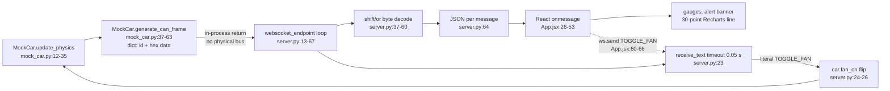

# stylylsty-TelemetryX

Replace-mode deep dive. This file supersedes the prior summary; pre-replace claims are cited as `git show HEAD:docs/legacy/stylylsty-TelemetryX.md` (70-line LF blob) with line numbers. The prior doc had no `## Upstream (...)` sections, so there is nothing to re-append after section 14.

## 1. Provenance

- **Submodule path:** `legacy/stylylsty-TelemetryX`
- **Pinned gitlink:** `160000 46d66a4356d7cdcd4959927ccc56c3e336176e7e 0` (from `git ls-files -s legacy/stylylsty-TelemetryX`); matches `git -C legacy/stylylsty-TelemetryX rev-parse HEAD`. Worktree clean (`status --porcelain` empty).
- **Upstream URL:** https://github.com/stylylsty/TelemetryX (submodule `origin`)
- **License:** None found. No `LICENSE`, `COPYING`, or `NOTICE` in the 21 tracked files. The prior doc's `License: None` (HEAD L034) agrees. Default copyright applies — see section 14.
- **Analysis date:** 2026-11-21
- **Frontmatter preservation:** the YAML block above is preserved byte-for-byte from the HEAD blob with exactly one change — the description line carried inherited trailing whitespace after `generates`, stripped per instruction. The line remains truncated mid-sentence, as in the original. Prior-doc structural defects not carried forward: the old body had two duplicate `## Architecture` headings (HEAD L017 and L036).

Files read (upstream, all FULL-READ unless labeled):

| File | Lines | Coverage |
| ------------------------------------ | ----- | ----------------- |
| `server.py` | 1-72 | FULL-READ |
| `mock_car.py` | 1-69 | FULL-READ |
| `dashboard/src/App.jsx` | 1-145 | FULL-READ |
| `dashboard/src/main.jsx` | 1-10 | FULL-READ |
| `dashboard/src/App.css` | 1-173 | FULL-READ |
| `dashboard/src/index.css` | 1-68 | FULL-READ |
| `dashboard/index.html` | 1-13 | FULL-READ |
| `dashboard/package.json` | 1-29 | FULL-READ |
| `dashboard/vite.config.js` | 1-7 | FULL-READ |
| `dashboard/eslint.config.js` | 1-29 | FULL-READ |
| `dashboard/README.md` | 1-16 | FULL-READ |
| `README.md` | 1-35 | FULL-READ |
| `.gitignore` | 1-21 | FULL-READ |
| `dashboard/.gitignore` | 1-24 | FULL-READ |
| `dashboard/package-lock.json` | 1-27 | STRUCTURAL-PARSE (name/version/dependency keys only) |
| `dashboard/public/vite.svg`, `dashboard/src/assets/react.svg` | 1 | STRUCTURAL-PARSE (confirmed plain boilerplate `<svg>` roots) |
| `assets/cooling off.png`, `assets/cooling on.png` | — | NOT read (binary screenshots; see section 17) |

Files explicitly NOT read: the two PNGs above. No hidden directories were skipped; the inventory came from `git ls-files`, which lists all 21 tracked files including dotfiles.

No TEST-READ evidence exists: this repo ships no tests. No CAPTURE evidence exists in this repo: both "frames" are synthetic in-process dicts and never touch a physical bus, so no bus capture is possible.

Our-side files read for parity (section 11) and drift anchors (section 16): `firmware/lib/vehicle/can/ids.h` (lines 33-49), `firmware/lib/vehicle/can/feature/telemetry/powertrain.h` (14-73), `firmware/lib/vehicle/can/feature/telemetry/bms.h` (14-74), `firmware/lib/vehicle/can/feature/misc/can_sim.h` (1-115), `firmware/lib/vehicle/can/feature/misc/stream.h` (1-35), `firmware/lib/io/serial/usb/esp32/common.h` (555-594), `firmware/lib/client/dashboard/dashboard.h` (1-60, plus grep hits at 770-1219), `firmware/lib/client/command/dispatch.h` (grep hits 30-60), `firmware/lib/client/api/routes.h` (grep hit 44), `firmware/lib/core/types.h` (grep hits 381-785), `client/src/components/controls/BmsPanel.tsx` (grep hits 50-70), `client/src/components/TelemetryPanel.tsx` (grep hits 86-90).

## 2. Executive verdict

TelemetryX is a small full-stack demo: a Python/FastAPI WebSocket server that fabricates two synthetic CAN frames from a toy physics model, decodes them in-line, and pushes JSON to a React gauge/chart dashboard that can toggle a cooling fan and see the simulated battery temperature respond. There is no Tesla protocol content: the IDs 0x101/0x201 are invented, frames carry no counter and no checksum, and nothing is ever transmitted on a bus. What matters for TeslaCANModder is purely the application-layer pattern — a bidirectional WebSocket telemetry loop with closed-loop active control and client-side threshold alerting — plus one negative lesson (unsigned `to_bytes` encoding of occasionally-negative physics values crashes the connection handler; two such paths exist and both are untested). No code should be ported (no license), and no frame format is worth anything; the pattern-level candidates are WebSocket push for our WiFi dashboard, a thermal-simulated extension of our existing `canSimTick`, and a client-side alert banner.

## 3. Evidence map

| Source | Lines | What it proves | Grade |
| ----------------------------------------- | --------- | ------------------------------------------------------------------------------ | ------------- |
| `server.py` | 12-28 | Single WS route `/ws`; 0.05 s non-blocking receive; literal `TOGGLE_FAN` command | CODE-READ |
| `server.py` | 31-64 | In-process decode of 0x101 (speed, rpm) and 0x201 (temp, voltage, fan); JSON push | CODE-READ |
| `server.py` | 69-72 | `WebSocketDisconnect` handled; generic `except Exception` exits the handler loop | CODE-READ |
| `server.py` | 3 | `import time` is unused (minor defect) | CODE-READ |
| `mock_car.py` | 12-35 | Physics walk: speed delta `randint(-2,5)` clamp 0..120; rpm `speed*30 ±50`; temp coupled to fan; voltage decays with no lower clamp | CODE-READ |
| `mock_car.py` | 37-63 | Frame builders for 0x101 and 0x201; no counter, no checksum; 50/50 frame choice | CODE-READ |
| `mock_car.py` | 44-52 | `int(x).to_bytes(2,'big')` unsigned encoding; raises `OverflowError` on negatives (demonstrated on Python 3.10.11 on the analysis host) | CODE-READ |
| `dashboard/src/App.jsx` | 17-57 | WS client pinned to `ws://127.0.0.1:8000/ws`; fanStatus taken from server; alert at `temp > 50`; 30-point history | CODE-READ |
| `dashboard/src/App.jsx` | 60-66 | Fan toggle sends bare text `TOGGLE_FAN`; no reconnect logic | CODE-READ |
| `dashboard/src/App.jsx` | 84-140 | Gauge cards; progress denominator 120; chart Y-domain `[20, 80]`; red text at `temp > 45` | CODE-READ |
| `dashboard/package.json` | 12-27 | Deps: react 19, recharts 3, lucide-react, vite 7; no Tailwind anywhere | CODE-READ |
| `README.md` | 8-17 | Feature claims incl. `<50ms latency`, `Tailwind CSS (Custom)` | SUMMARY-ONLY |
| `README.md` | 19-35 | Run instructions; stale clone URL `stylylsty/ev-diag.git`; unpinned `pip install` | SUMMARY-ONLY |
| `git ls-files` (submodule) | — | 21 tracked files; no LICENSE, no tests, no CI config | CODE-READ |
| `git log` (submodule) | — | Single commit `46d66a4`, all 21 files added at once | CODE-READ |
| Prior doc at HEAD | L040, L045, L048 | Prior summary claims (Tailwind, `speed ±5`, `~20Hz`) | SUMMARY-ONLY |

## 4. Architecture and build surface

Entry points:

- Backend: `uvicorn server:app --reload` (README.md:28) → `app = FastAPI()` at `server.py:7`; one route, `/ws` (`server.py:12`). No HTTP REST routes exist.
- Frontend: `npm run dev` → Vite dev server (`dashboard/package.json:7`, `dashboard/vite.config.js:5-7`) rendering `App.jsx` via `main.jsx:6-10`.
- Standalone mock: `python mock_car.py` prints one random frame per second (`mock_car.py:65-69`).

There are no build flags, no platform ports, no hardware abstraction, and no feature gating anywhere in the repo. The only dependency boundary is `from mock_car import MockCar` (`server.py:5`); the frontend couples to the server only through the ad-hoc JSON shapes pushed by `server.py:40-60`. Notably, the frame layout exists twice — encoder (`mock_car.py:43-58`) and decoder (`server.py:37-60`) — with no shared schema or DBC keeping them in sync; that duplication is a drift risk our `packages/protocol` shared definitions already solve on our side.

The skill's canonical RX → decode → mutate/gate → TX pipeline does not exist here: nothing is received from a bus and nothing is transmitted to one. The equivalent loop is generate → decode → push:



## 5. Mechanism catalogue

### Synthetic CAN frame generator with coupled physics

- **Claim (README / summary):** "CAN Bus Simulation: Python backend generates mock CAN frames (Hex) and decodes them using Bitwise Operations" (README.md:10); prior doc L039 (IDs 0x101/0x201) agrees.
- **Code path:** `mock_car.py:37-63` — `MockCar.generate_can_frame()` → `update_physics()` (`mock_car.py:12-35`) → returns `{"id": ..., "data": <hex>}`.
- **Frame spec:** 0x101: `data[0..1]` speed big-endian u16 (km/h, clamped 0..120), `data[2..3]` rpm big-endian u16, `data[4..7]` zero. 0x201: `data[0]` temp+40, `data[1..2]` voltage big-endian u16 (V), `data[3..6]` zero, `data[7]` fan status `0x00`/`0x01`. Counter position: None found. Checksum: None found.
- **Gates and timing:** one physics tick per generated frame; frame choice is a coin flip (`random.random() > 0.5`, `mock_car.py:60`), so each ID appears ~50% of ticks; fan cooling is −0.5 °C/tick vs passive +0.1..0.3 °C/tick with clamp 20..100 (`mock_car.py:24-32`).
- **State machine:** None found (fan is a boolean; physics are stateless walks).
- **Tests:** None found.
- **Evidence grade:** CODE-READ
- **Verdict:** CONFIRMED
- **Adapt to TeslaCANModder?** already present — our `canSimTick()` (`firmware/lib/vehicle/can/feature/misc/can_sim.h:33-92`) injects synthetic frames into the real decode pipeline every 200 ms without bus TX; the actual gap is thermal (see section 13).

### WebSocket telemetry pump with in-line decode

- **Claim (README / summary):** "Real-time Telemetry ... with <50ms latency using WebSockets" (README.md:9); prior doc L048 says "~20Hz".
- **Code path:** `server.py:13-67` — `receive_text` with 0.05 s timeout → `generate_can_frame()` → manual byte decode (`server.py:37-60`) → `websocket.send_text(json.dumps(...))` (`server.py:64`).
- **Frame spec:** 0x101 → `speed=(b0<<8)|b1`, `rpm=(b2<<8)|b3` (`server.py:38-39`); 0x201 → `temp=b0-40`, `voltage=(b1<<8)|b2`, `fanStatus=(b7==1)` (`server.py:47-53`).
- **Gates and timing:** loop period ≈ 0.05 s receive timeout + 0.05 s sleep (`server.py:23,67`) ≈ 100 ms → ~10 messages/s total, ~5/s per frame type; per-type update cadence ≈ 200 ms. No variant gate, no freshness gate, no OTA guard — none exist in this repo.
- **State machine:** None found (single while-loop).
- **Tests:** None found.
- **Evidence grade:** CODE-READ
- **Verdict:** CONTRADICTED (both latency claims; see section 6 rows 1-2)
- **Adapt to TeslaCANModder?** candidate — the push pattern (not the code) could replace/augment our 2 s REST dashboard polling; see section 13.

### Active-control loop (fan toggle with physics feedback)

- **Claim (README / summary):** "Active Control: Bi-directional communication allowing users to toggle the Cooling Fan and observe immediate physical feedback (Temp drop)" (README.md:11).
- **Code path:** `dashboard/src/App.jsx:60-66` `ws.send("TOGGLE_FAN")` → `server.py:24-26` `car.fan_on = not car.fan_on` → `mock_car.py:24-29` temp responds → fan status rides 0x201 `data[7]` (`mock_car.py:56-58`) → `server.py:52-59` `fanStatus` in JSON → `App.jsx:36-38` UI state.
- **Frame spec:** 0x201 `data[7]` fan status byte, values `0x00`/`0x01`; no other bits involved.
- **Gates and timing:** no debounce, no auth, no ack; feedback only arrives with the next battery frame (~every 200 ms), so the button label lags up to ~200 ms. Confirmed "closed loop" only in the mock physics — nothing real is actuated.
- **State machine:** None found (two-state boolean flip; no 3+ state machine).
- **Tests:** None found.
- **Evidence grade:** CODE-READ
- **Verdict:** CONFIRMED
- **Adapt to TeslaCANModder?** already present conceptually (our JSON-RPC command dispatch + state readback); no impact.

### Frontend threshold alerting and rolling thermal chart

- **Claim (README / summary):** "Automated Diagnostics: Front-end logic to monitor thresholds and trigger alerts (e.g., Battery Overheat)" (README.md:12).
- **Code path:** `dashboard/src/App.jsx:26-53` — `onmessage` → alert banner when `data.temp > 50` (`App.jsx:41-45`); red value styling at `temp > 45` (`App.jsx:106`); history push with `slice(-30)` (`App.jsx:48-51`); Recharts `LineChart` with Y-domain `[20, 80]` (`App.jsx:127-137`).
- **Frame spec:** None found (consumes decoded JSON only, never frames).
- **Gates and timing:** thresholds 45 °C (color) and 50 °C (banner); history capped at 30 points; Y-domain `[20, 80]` visually clips temps above 80 even though the mock clamps to 100 (`mock_car.py:32`).
- **State machine:** None found (banner is boolean visibility).
- **Tests:** None found.
- **Evidence grade:** CODE-READ
- **Verdict:** CONFIRMED
- **Adapt to TeslaCANModder?** candidate — small client-only enhancement; see section 13.

No mechanism in this repo has 3 or more states, so no `mermaid` state diagrams apply.

## 6. Summary vs code contradiction table

| # | Claim (source) | Code reality (citation) | Status |
| - | ------------------------------------------------------------- | ----------------------------------------------------------------------------- | ------------- |
| 1 | "Sends decoded JSON to frontend via WebSocket at ~20Hz" (prior doc, HEAD L048) | Loop = 0.05 s receive timeout (`server.py:23`) + 0.05 s sleep (`server.py:67`) → ~10 messages/s, ~5/s per type | CONTRADICTED |
| 2 | "Real-time Telemetry ... with <50ms latency" (README.md:9) | Same two 0.05 s stalls per iteration → ≥ ~100 ms per message, ~200 ms per-type cadence (`server.py:23,67`) | CONTRADICTED |
| 3 | "Tailwind CSS (Custom)" (README.md:15; prior doc HEAD L040 repeats it) | No Tailwind in `dashboard/package.json:12-27`; styling is hand-written `dashboard/src/App.css` | CONTRADICTED |
| 4 | "simulates physics (speed ±5 ...)" (prior doc, HEAD L045) | `random.randint(-2, 5)` — asymmetric delta, not ±5 (`mock_car.py:17`) | CONTRADICTED |
| 5 | Clone URL `https://github.com/stylylsty/ev-diag.git` (README.md:22) | Submodule remote is `https://github.com/stylylsty/TelemetryX`; `ev-diag` is the project's earlier name | CONTRADICTED |
| 6 | "generates mock CAN frames via WebSocket" (prior doc, HEAD L015, inherited into the frontmatter description) | The WS carries decoded JSON only (`server.py:64`); frames never leave the process (`mock_car.py:61-63` → `server.py:31-35`) | PARTIAL |

The prior doc's CAN-frame section (HEAD L056-059) is accurate against the code; the contradictions above are about stack, rates, and naming. Treat any other un-rechecked prior-doc claim as SUMMARY-ONLY.

## 7. CAN frame and signal inventory

Both frames below are synthetic, in-process objects. Neither is decoded from, or transmitted to, any bus, and neither carries a counter or checksum. There is no vendored DBC or JSON frame catalog in this repo.

| ID (hex+dec) | Bus | Period | DLC | Byte/bit layout | Scale/units | Counter | Checksum | R/W | Grade |
| ------------ | --- | ------ | --- | ------------------------------------------------------------------ | --------------------------------------- | ------- | -------- | --- | --------- |
| 0x101 (257) | none (in-process) | ~50% of ~10 Hz ticks ≈ 5 Hz when streamed | 8 | `data[0..1]` speed BE u16; `data[2..3]` rpm BE u16; `data[4..7]` 0x00 | speed: 0..120 raw km/h; rpm: raw RPM (intended `speed*30 ±50`) | None found | None found | generated (`mock_car.py:44-46`), decoded (`server.py:37-44`) | CODE-READ |
| 0x201 (513) | none (in-process) | ~50% of ~10 Hz ticks ≈ 5 Hz when streamed | 8 | `data[0]` temp; `data[1..2]` voltage BE u16; `data[3..6]` 0x00; `data[7]` fan | temp: raw − 40 °C (encode +40); voltage: raw V (init 350, decays); fan: 0x00/0x01 | None found | None found | generated (`mock_car.py:50-58`), decoded (`server.py:46-60`) | CODE-READ |

Neither ID collides with a real Tesla frame we decode; upstream 0x201 = 513 dec is numerically close to our `CAN_ID_VEHICLE_SPEED` 0x257 = 599 dec (`firmware/lib/vehicle/can/ids.h:42`) but is unrelated.

## 8. Constants and tuning table

| Constant | Value | File:line | Meaning | Grade |
| ------------------------------------- | ----------------- | ----------------- | ---------------------------------------------------------------- | --------- |
| Motor frame ID | 0x101 | `mock_car.py:43`, `server.py:37` | Synthetic motor frame selector | CODE-READ |
| Battery frame ID | 0x201 | `mock_car.py:48`, `server.py:46` | Synthetic battery frame selector | CODE-READ |
| Temperature offset | +40 encode / −40 decode | `mock_car.py:50`, `server.py:47` | Same offset convention as Tesla 0x312 on our side | CODE-READ |
| Speed delta | `randint(-2, 5)` | `mock_car.py:17` | Asymmetric random walk per tick | CODE-READ |
| Speed clamp | 0..120 | `mock_car.py:18` | Also hard-coded as the UI progress denominator (`App.jsx:92`) | CODE-READ |
| RPM factor/jitter | `speed*30 ± 50` | `mock_car.py:21` | Jitter can push rpm negative at standstill (crash path, section 9) | CODE-READ |
| Fan cooling rate | −0.5 °C/tick | `mock_car.py:26` | Fast active response | CODE-READ |
| Passive heat rate | +0.1..0.3 °C/tick | `mock_car.py:29` | Slow drift toward alert threshold | CODE-READ |
| Temp clamp | 20..100 °C | `mock_car.py:32` | Upper bound exceeds chart Y-domain (80) | CODE-READ |
| Voltage decay | `uniform(0, 0.05)` V/tick, no lower clamp | `mock_car.py:35` | Unbounded decay; crash after crossing −1 V (section 9) | CODE-READ |
| Fan byte | 0x01 on / 0x00 off | `mock_car.py:56` | Status bit carried in 0x201 `data[7]` | CODE-READ |
| Frame coin flip | `random.random() > 0.5` | `mock_car.py:60` | Frame-type multiplexer (probability, not a mux field) | CODE-READ |
| WS receive timeout | 0.05 s | `server.py:23` | Half of the loop period; the latency claim's refutation | CODE-READ |
| Loop sleep | 0.05 s | `server.py:67` | Other half; ~10 Hz total message rate | CODE-READ |
| Alert threshold | temp > 50 °C | `App.jsx:41` | Banner trigger | CODE-READ |
| Color threshold | temp > 45 °C | `App.jsx:106` | Red value styling | CODE-READ |
| Chart Y-domain | [20, 80] | `App.jsx:132` | Clips temps up to the 100 °C clamp | CODE-READ |
| History window | 30 points | `App.jsx:50` | Rolling chart memory | CODE-READ |
| WS endpoint | `ws://127.0.0.1:8000/ws` | `App.jsx:18` | Hard-coded localhost, no TLS | CODE-READ |
| Standalone print interval | 1 s | `mock_car.py:68` | `__main__` smoke loop | CODE-READ |

## 9. Failure modes and edge cases

| Failure | Handling code path | Tested? | Grade |
| ----------------------------------------------- | ------------------------------------------------------------------------------- | ------------- | --------- |
| Negative RPM at standstill → `OverflowError: can't convert negative int to unsigned` in `int(self.rpm).to_bytes(2,'big')` | Raised at `mock_car.py:45` whenever `speed == 0` and `randint(-50,50) < 0` (`mock_car.py:21`); uncaught inside the loop → `server.py:71-72` generic `except Exception` prints and returns, killing the connection handler. Demonstrated on Python 3.10.11 on the analysis host | No | CODE-READ |
| Voltage decays below −1 → same `OverflowError` at `mock_car.py:52` | 350 V at ~0.025 V/tick × ~10 ticks/s ≈ 20-25 min of connected streaming, then `int(voltage) ≤ −1` crashes; same handler-exit path. Note `int()` truncates toward zero, so [−1, 0) is silently safe — no | No | CODE-READ |
| Generic exception swallowing | `server.py:71-72` catches everything, prints, and ends the session; no retry, no re-accept | No | CODE-READ |
| Client disconnect | `server.py:69-70` prints only; server keeps running, state (fan) persists in process memory | No | CODE-READ |
| Client has no reconnect | `App.jsx:55-56` sets the badge to Offline on close; recovery requires a page reload | No | CODE-READ |
| Malformed server message | `App.jsx:27` `JSON.parse` without try/catch; a bad line throws inside `onmessage` and that update is lost | No | CODE-READ |
| State loss on server restart | Fan defaults to `False` (`mock_car.py:10`); no persistence layer exists | No | CODE-READ |
| No watchdog, no bus-off, no brownout concepts | None found — there is no bus, no OTA guard, no queue; the only timing paths are the two 0.05 s stalls (`server.py:23,67`) | No | CODE-READ |

Every error path in this repo is untested.

## 10. Test coverage map

None found: this repo ships no tests (no test files in `git ls-files`, no CI config, no `test` script in `dashboard/package.json:6-11`).

Critical paths with no test, and the risk in one line: both crash paths in section 9 (negative RPM within seconds at standstill; voltage decay after ~20-25 min) would have been caught by a single unit test per frame builder feeding edge physics values — the absence means the demo's flagship demo (fan toggle) can silently die mid-presentation.

## 11. Parity matrix with TeslaCANModder

| Signal/frame | Upstream decode (cite) | Our decode (cite) | Delta | Action |
| -------------------------- | ------------------------------------------------------------- | ----------------------------------------------------------------------------- | ------------------------------------------------------------------ | ------------------------ |
| Battery temp −40 offset | 0x201 `data[0]`: encode +40 (`mock_car.py:50`), decode −40 (`server.py:47`) | 0x312 `data[0]/data[1]` − 40: `decodeBmsTempMin/Max` (`firmware/lib/vehicle/can/feature/telemetry/bms.h:61-74`) | Same offset convention; ours reads a real frame, upstream fabricates it | ignore (convention matches) |
| Pack voltage | 0x201 `data[1..2]` raw volts (`mock_car.py:52`, `server.py:48`) | 0x132 bytes 0-1 big-endian × 0.01 V: `decodeBmsVoltage` (`firmware/lib/vehicle/can/feature/telemetry/bms.h:18-22`) | Different ID, bytes, and scale; upstream is synthetic | ignore |
| Vehicle speed | 0x101 `data[0..1]` raw km/h unsigned (`mock_car.py:44`, `server.py:38`) | 0x257 bytes 2-3 signed × 100: `decodeVehicleSpeed` (`firmware/lib/vehicle/can/feature/telemetry/powertrain.h:18-22`) | Upstream ID/layout is invented; ours is the real signal | ignore (never adopt upstream's) |
| Motor RPM | 0x101 `data[2..3]` unsigned (`server.py:39`); can go negative and crash | 0x106/0x115 bytes 4-5 signed: `decodeMotorRpm` (`firmware/lib/vehicle/can/feature/telemetry/powertrain.h:70-73`) | Ours handles sign correctly; upstream's unsigned encode is the crash path | ignore |
| Synthetic frame injection for testing | `MockCar.generate_can_frame` (`mock_car.py:37-63`), ~10/s random-choice fake IDs, in-process only | `canSimTick` (`firmware/lib/vehicle/can/feature/misc/can_sim.h:33-92`): 200 ms fixed, real Tesla IDs, fed straight to `handleMessage`, never on the bus | Ours is already the safer, protocol-accurate equivalent | already present (gap: no 0x312 thermal sim) |
| Real-time telemetry streaming | WS push ~10 Hz (`server.py:18-67`) | `sendFrame` JSON per frame gated by `streamEnabled` (`firmware/lib/io/serial/usb/esp32/common.h:568-585`, `firmware/lib/vehicle/can/feature/misc/stream.h:23-35`); dashboard polls REST every 2000 ms (`firmware/lib/client/dashboard/dashboard.h:1219`) | Ours exists but is poll-based in the browser; upstream's push is smoother at the same order of latency | candidate (see section 13) |
| Fan/actuator status byte in frame | 0x201 `data[7]` 0x00/0x01 (`mock_car.py:56-58`, `server.py:52-53`) | No fan-status frame is decoded; our RX set (`firmware/lib/vehicle/can/ids.h:33-49`) contains no such signal | Upstream invents a bit we have no counterpart for | ignore |
| UI battery-temp display | Values + threshold alert (banner > 50, red > 45) (`App.jsx:41,106`) | Display only in `client/src/components/controls/BmsPanel.tsx:50-70` and `client/src/components/TelemetryPanel.tsx:86-90`; no threshold alert found in those panels | We show temps but raise no UI alarm | candidate (client-only) |
| Bidirectional control on one channel | Bare text `TOGGLE_FAN` over the same WS (`server.py:23-26`, `App.jsx:60-66`) | JSON-RPC envelope `{"cmd":...}` parsed by `parseRpcCmd` (`firmware/lib/io/serial/usb/esp32/common.h:588-594`) and dispatched (`firmware/lib/client/command/dispatch.h`) | Ours is structured and transport-shared (serial/BLE/WiFi); upstream's is a bare literal | already present (ours is stricter) |

## 12. Surface inventory and security notes

| Surface | Location | Semantics |
| ------------------------- | ---------------------------------------- | ------------------------------------------------------------------------------ |
| WebSocket `/ws` | `server.py:12-67` | Pushes `{"type":"motor"|"battery",...}` JSON ~10 Hz; accepts the bare literal `TOGGLE_FAN`; no other commands; no auth, no TLS, no rate limit |
| FastAPI HTTP | `server.py` (whole file) | None found — no REST routes are registered; the framework's default docs/auto routes are incidental |
| Vite dev server | `dashboard/package.json:7`, `vite.config.js:5-7` | Standard boilerplate dev server serving the React app on localhost |
| Standalone mock printer | `mock_car.py:65-69` | Prints one random frame dict per second to stdout for smoke-testing the generator |

Security and provenance: no credentials, keys, certs, or secrets in any of the 21 tracked files; no archives; no dangerous build flags. The WS endpoint is unauthenticated plaintext and the client pins it to `127.0.0.1:8000` (`App.jsx:18`) — acceptable as a bench demo, never to be exposed. `dashboard/package-lock.json` is a normal generated lockfile. `README.md:27` installs a `websockets` package that `server.py` never imports (FastAPI/starlette provides the WS layer) — stale instruction.

## 13. Adaptation assessment

| Mechanism | Value | Cost | Risk | Evidence | Decision |
| ------------------------------------ | ------------------------------------------------------------ | -------------------------------------------------------------------------- | --------------------------------------------------------- | ------------- | ----------------------------------------- |
| Synthetic frame generator | Low — we already simulate 4 real frames | Zero if we extend `canSimTick` | None (native tests + bench only) | CODE-READ both sides | already present; candidate: add 0x312 temp min/max simulation so client thermal UIs can be exercised offline (upstream's fan↔temp coupling is the idea to mimic, not the code) |
| WS telemetry pump | Medium — smoother than our 2 s dashboard poll; upstream proves the UX pattern | Medium — a WS server on ESP32 costs RAM and a transport-visible change | Requires `docs/checklists/can-review-checklist.md` and listen-only bench capture before landing; push rate must not starve CAN handling | CODE-READ upstream, CODE-READ our poll side | candidate for future PR — port the pattern, never the code (no license) |
| Active-control loop | Low — our command pipeline already does real actuation with readback | — | — | CODE-READ both sides | no impact |
| Threshold alert banner | Medium — visible battery-overheat UX for little code | Low — pure client change, no CAN surface | None to frame integrity | CODE-READ upstream, RANGE-CITED our panels | candidate for future PR (client only) |
| Frame formats 0x101/0x201 | None — invented IDs, no counter, no checksum | — | Adopting any of it would corrupt nothing but teach nothing | CODE-READ | never port |

## 14. Do-not-copy list

| Item | Citation | Reason |
| ----------------------------------- | ------------------------- | ------------------------------------------------------------------------- |
| `server.py` | 1-72 | No license (default all-rights-reserved); also trivial against our REST/WS surfaces |
| `mock_car.py` | 1-69 | No license; toy constants are not Tesla-derived; contains the two `to_bytes` crash patterns |
| `dashboard/src/App.jsx`, `App.css` | 1-145 / 1-173 | No license; our client is Expo/React Native — wrong stack, no reusable code |
| `dashboard/package-lock.json` | whole file | Generated lockfile; never copy lockfiles between projects |
| `assets/*.png` | binary | Screenshots only; no code or data value |

If any behavior is ever adapted, write `derived idea, independent implementation` with the upstream file:symbol reference in a comment, use our `Frame`/`State` types and naming, and recompute expected values in tests rather than snapshotting our own output.

## 15. History and evolution

The local history is a single commit: `46d66a4` (2026-03-30, subject "Update README.md", author stylylsty `<2805961495@qq.com>`), which adds all 21 tracked files at once (`git log --numstat` shows all-add, zero modifications). The clone is shallow (`git rev-parse --is-shallow-repository` → true), so no earlier local history exists to mine. The all-add commit carrying the subject "Update README.md" suggests the upstream history was squashed on import; whether GitHub hosts earlier commits is UNVERIFIED (network not consulted). Nothing in the local history shows abandoned approaches, rollbacks, or design churn — there is exactly one snapshot.

## 16. Re-verification recipe

Pinned SHA (canonical gitlink form): `160000 46d66a4356d7cdcd4959927ccc56c3e336176e7e 0`.

```bash
OLD=46d66a4356d7cdcd4959927ccc56c3e336176e7e
git -C legacy/stylylsty-TelemetryX fetch --tags --prune
# the pinned clone is shallow; if the fetch reports shallowness limits, run:
# git -C legacy/stylylsty-TelemetryX fetch --unshallow
git -C legacy/stylylsty-TelemetryX log --oneline $OLD..origin/main
git -C legacy/stylylsty-TelemetryX diff --stat $OLD..origin/main
git ls-files -s legacy/stylylsty-TelemetryX   # expect: 160000 46d66a4356d7cdcd4959927ccc56c3e336176e7e 0
```

All anchors below were demonstrated at write time with the identical ERE alternation patterns on the analysis host (PowerShell `Select-String`/ripgrep, because `grep.exe` is not on this host's pwsh PATH — BRE alternation was not used anywhere). Expected hits are from the pinned snapshot:

```text
grep -nE '0x101|0x201' legacy/stylylsty-TelemetryX/mock_car.py legacy/stylylsty-TelemetryX/server.py
  -> expect mock_car.py: 43, 48, 61, 63; server.py: 37, 46
grep -nE 'TOGGLE_FAN' legacy/stylylsty-TelemetryX/server.py legacy/stylylsty-TelemetryX/dashboard/src/App.jsx
  -> expect server.py: 24; App.jsx: 62
grep -nE 'to_bytes' legacy/stylylsty-TelemetryX/mock_car.py
  -> expect 44, 45, 51, 52
grep -nE 'wait_for|sleep\(' legacy/stylylsty-TelemetryX/server.py
  -> expect 23, 67
grep -nE 'ws://127.0.0.1|temp > 50|temp > 45|slice\(-30\)' legacy/stylylsty-TelemetryX/dashboard/src/App.jsx
  -> expect 18, 41, 50, 106
```

Negative anchors (absence claims):

```text
grep -nE 'tailwind|postcss' legacy/stylylsty-TelemetryX/dashboard/package.json legacy/stylylsty-TelemetryX/dashboard/vite.config.js
  -> no output (exit 1)
grep -nriE 'crc|checksum|counter' legacy/stylylsty-TelemetryX/server.py legacy/stylylsty-TelemetryX/mock_car.py
  -> no output (exit 1)
git -C legacy/stylylsty-TelemetryX ls-files | grep -iE 'test|spec|licen'
  -> no output (exit 1)
```

Our-side drift anchors (the `already present` decisions rest on these):

```text
grep -nE 'decodeBmsTempMin' firmware/lib/vehicle/can/feature/telemetry/bms.h
  -> expect 61
grep -nE 'decodeVehicleSpeed' firmware/lib/vehicle/can/feature/telemetry/powertrain.h
  -> expect 18
grep -nE 'canSimTick|simu:start' firmware/lib/vehicle/can/feature/misc/can_sim.h
  -> expect 33, 95, 102
grep -nE 'void sendFrame' firmware/lib/io/serial/usb/esp32/common.h
  -> expect 568
grep -nE 'setInterval\(poll, 2000\)' firmware/lib/client/dashboard/dashboard.h
  -> expect 1219
grep -nE 'stream:' firmware/lib/vehicle/can/feature/misc/stream.h
  -> expect 16, 19, 25
grep -nE 'vehicleSpeed|rearMotorRpm' firmware/lib/core/types.h
  -> expect 671, 675, 785
```

If line numbers drift more than ~10 lines from the cited values, re-read the whole function; do not trust this document's numbers. Pre-pin upstream history was not reviewed (only the pinned snapshot; see section 17).

## 17. Open questions and explicitly not investigated

- Pre-pin upstream history was not reviewed — the pinned clone is shallow with a single squashed commit, and the network (GitHub) was not consulted. Fetching `--unshallow` would settle whether earlier design iterations exist.
- `assets/cooling off.png` and `assets/cooling on.png` were not read (binary screenshots); presumed to be local copies of the README's `user-attachments` images (README.md:4-5). UNVERIFIED — would verify by fetching those URLs and comparing bytes.
- README.md:4-5 user-attachment URLs were not fetched (network claims stay UNVERIFIED).
- The ~10 Hz loop-rate figure is static code reasoning from `server.py:23,67`; it was not measured against a live `uvicorn`/FastAPI runtime. README.md:27 pins no versions (`pip install fastapi uvicorn websockets`), so runtime behavior across FastAPI releases is UNVERIFIED.
- The absence of a threshold alert in our client is claimed only for the two panels that render battery temps (`BmsPanel.tsx`, `TelemetryPanel.tsx`); the full client tree was not swept for alerting.
- `README.md:27` installs a `websockets` package that `server.py` never imports — stale instruction, or a leftover from an earlier server revision. UNVERIFIED which; would verify by checking FastAPI/starlette WS requirements at the project's creation date.
- Whether the README's exact `uvicorn server:app --reload` invocation binds to 127.0.0.1 only (the default) was not executed on this host; the localhost-bound security note rests on uvicorn's documented default.
