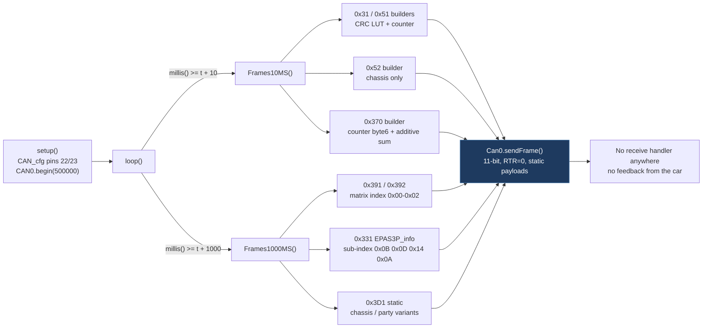

# sydneyg007-Tesla-Model-3-EPAS-emulator

Deep code analysis of the pinned submodule snapshot, following `legacy-repo-deep-dive` (replace mode). Pre-replace summary recoverable via `git show HEAD:docs/legacy/sydneyg007-Tesla-Model-3-EPAS-emulator.md`.

## 1. Provenance

- **Submodule path:** `legacy/sydneyg007-Tesla-Model-3-EPAS-emulator`
- **Pinned gitlink (canonical form from `git ls-files -s`):** `160000 dfe0711ca7740a663a1c0182d595c35014de7b25 0`
- **`git -C legacy/sydneyg007-Tesla-Model-3-EPAS-emulator rev-parse HEAD`:** `dfe0711ca7740a663a1c0182d595c35014de7b25` — matches the gitlink.
- **`git status --porcelain` inside the submodule:** empty (clean).
- **Upstream URL:** `https://github.com/sydneyg007/Tesla-Model-3-EPAS-emulator` (origin fetch/push).
- **License:** none found — no `LICENSE` file in the tree at the pinned SHA and no license statement in the README. Default all-rights-reserved applies; nothing here may be copied as source text. (GitHub-side license metadata was not consulted; network claims stay UNVERIFIED.)
- **Analysis date:** 2026-11-21.
- **Upstream files read (all FULL-READ — the tree is only these three files):**
    - `ESP32CanbusEmulatorChassisCanEpasV2/ESP32CanbusEmulatorChassisCanEpasV2.ino` (lines 1–214)
    - `ESP32CanbusEmulatorPartyCanEpasV2/ESP32CanbusEmulatorPartyCanEpasV2.ino` (lines 1–248)
    - `README.md` (lines 1–3)
- **Files explicitly NOT read:** none in-tree (inventory via `git -C legacy/sydneyg007-Tesla-Model-3-EPAS-emulator ls-files` returned exactly the three files above; no hidden directories exist). The external Arduino dependency `esp32_can.h` is not vendored in the tree and was not read (see §17).
- **Our-side files read for parity:** `firmware/lib/vehicle/can/feature/fsd/nag.h` (1–524, FULL-READ), `firmware/lib/vehicle/can/checksum.h` (1–75, FULL-READ), `firmware/lib/vehicle/can/ids.h` (1–122, FULL-READ), `firmware/lib/vehicle/can/crc8.h` (1–80, FULL-READ), `firmware/lib/vehicle/can/feature/misc/can_sim.h` (1–115, FULL-READ), `firmware/lib/vehicle/can/handler/bus/vehicle.h` (RANGE-CITED: 118–142, 300–359, 500–529), `firmware/lib/vehicle/can/feature/auto_lane_change.h` (RANGE-CITED: line 58 via grep), `firmware/lib/core/types.h` (RANGE-CITED: line 498 via grep).
- **Frontmatter / Upstream-section preservation:** the inherited YAML frontmatter above is preserved byte-for-byte. Its `description` line is truncated mid-word (`…Electric Power-Assisted Steeri`, 133 chars, no trailing whitespace); that is an inherited defect kept per replace-mode rules, not re-edited. The original doc contained **no `## Upstream (...)` sections**, so nothing beyond the frontmatter was preserved.
- **No TEST-READ evidence exists: this repo ships no tests.** **No CAPTURE evidence exists in this repo** — the lookup tables and static payloads are capture-derived per their own comments, but no capture files ship with the tree.

## 2. Executive verdict

This is a pair of small, unlicensed Arduino sketches (single commit, Feb 2023) that make an ESP32 impersonate the EPAS module of a 2019 Tesla Model 3 Performance on two CAN buses ("Chassis" and "Party") so the rest of the car does not flag the missing steering ECU. For TeslaCANModder it matters in exactly three ways: (1) it is an independent, real-module-derived confirmation that the 0x370 EPAS frame uses an **additive checksum `sum(bytes 0–6) + 0x70 + 0x03` with the alive counter in byte 6** — numerically identical to our `nagChecksum`, and it contradicts our dead `MAGIC_0x370` CRC-8 table; (2) its 16-entry "CRC lookup tables" for 0x31/0x51 decompose to the closed form **CRC-8/SAE-J1850 (poly 0x1D, init 0xFF, xorout 0xFF) over `[counter, data]`** — verified against all 32 table entries; (3) it demonstrates the bench-frame-generator role our `canSimTick` lacks (no synthetic EPAS frames today). Nothing here should be ported as code: the tree is unlicensed, the payloads are a stale 2019 capture, and 0x331/0x392 sender-identity claims conflict with our `DAS_autopilotConfig`/`GTW_versionInfo` interpretations and need bench capture before anyone acts on them.

## 3. Evidence map

| Source file | Lines | What it proves | Grade |
| --- | --- | --- | --- |
| `ESP32CanbusEmulatorChassisCanEpasV2.ino` (chassis below) | 1–2, 4–5 | V1 was brake-triggered; V2 sends immediately, powered from the EPAS wake pin | CODE-READ |
| chassis | 7, 194–196 | `esp32_can.h` library, TX GPIO 22 / RX GPIO 23, `CAN0.begin(500000)` | CODE-READ |
| chassis | 38–148 | 10 ms TX block: 0x31, 0x51, 0x52, 0x370 with per-frame send-then-update counters | CODE-READ |
| chassis | 54–71, 87–104 | 16-entry CRC lookup tables for 0x31 (counter 0x50–0x5F) and 0x51 (counter 0x60–0x6F) | CODE-READ |
| chassis | 106–125 | 0x52 layout `31 FE 08 <powerTrace> 20 4C <ctr> <sum>`, sum = ctr + powerTrace + 0x16 | CODE-READ |
| chassis | 127–145 | 0x370 chassis layout `31 FF 08 08 20 4D <ctr> <sum>`, sum = ctr + 0x20 | CODE-READ |
| chassis | 151–188 | 1 Hz block: 0x391 matrix index 0x00–0x02 and static 0x3D1 `8F 8F 11 09 7D 00 00 00` | CODE-READ |
| chassis | 201–213 | `millis()` scheduler, 10 ms and 1000 ms arms; no RX anywhere | CODE-READ |
| chassis | 24, 34 | stale comment (checksum "runs from 0x35 to 0x44" — code emits 0x48–0x57); `startTrigger` declared, never used | CODE-READ |
| `ESP32CanbusEmulatorPartyCanEpasV2.ino` (party below) | 1–2 | V1 used brake signal 0x118 as trigger and fixed RTR (was 1); V2 sends immediately from EPAS wake power | CODE-READ |
| party | 31–121 | party 10 ms TX block: 0x31, 0x51, and 0x370 party variant `31 FF 08 08 20 4B <ctr> <sum>`, sum = ctr + 0x1E, counter 0x20–0x2F | CODE-READ |
| party | 125–221 | 1 Hz block: four 0x331 sub-index frames (0x0B, 0x0D, 0x14, 0x0A), 0x392 matrix index, and party 0x3D1 `91 91 FB 07 7D 00 00 00` | CODE-READ |
| party | 206–207 | **the party sketch also sends 0x3D1** — contradicts the old summary's "Chassis only" | CODE-READ |
| `README.md` | 1–3 | purpose claim: emulate EPAS chassis + party CAN messages, from a 2019 Model 3 Performance | SUMMARY-ONLY |
| pre-replace doc (`git show HEAD:docs/legacy/sydneyg007-Tesla-Model-3-EPAS-emulator.md`) | 44–49, 55–59, 65–74 | frame table largely code-accurate, except the 0x3D1 bus column (see §6) | SUMMARY-ONLY |

Computational check performed at analysis time (reproducible via §16): every 0x370 frame emitted by both sketches satisfies our `nagChecksum` (`sum(data[0..6]) + 0x70 + 0x03 & 0xFF`), and every 0x31/0x51 frame satisfies CRC-8/SAE-J1850 over `[counter, data]` for all 32 table entries.

## 4. Architecture and build surface

- **Entry points:** `setup()` (pin config + `CAN0.begin(500000)`) and `loop()` (`millis()`-driven 10 ms / 1000 ms arms). No other tasks, no interrupts.
- **Shared core vs platform port:** none. Two standalone sketches duplicate ~90 % of their code; 0x31/0x51 builders are duplicated verbatim with cosmetically different (but behaviorally equivalent) counter-wrap logic.
- **Build flags:** none (plain Arduino IDE build).
- **Dependency boundary:** external Arduino library `esp32_can.h` (ESP32 on-chip CAN controller, i.e. the TWAI peripheral, via a collin80-lineage wrapper). Not vendored, not reviewed. The sketches mix the identifiers `Can0.sendFrame` (chassis:48) and `CAN0.begin` (chassis:196) — whether the library aliases the two is UNVERIFIED without the library source.
- **No frame pipeline in the upstream sense:** there is no RX, no decode, no gate. This is a pure TX generator — `None found: no frame pipeline in this repo` for the RX→decode→mutate→TX shape. The actual generation flow:



## 5. Mechanism catalogue

### 0x31 / 0x51 CRC-LUT status pair (10 ms, both buses)

- **Claim (README / summary):** "3 bytes, 10ms cycle, CRC + counter (0x50–0x5F / 0x60–0x6F) with lookup table".
- **Code path:** chassis:38–104 and party:31–99 `Frames10MS()` → build → `Can0.sendFrame()` (chassis:48, 81; party:42, 76).
- **Frame spec:** 0x31 (49): DLC 3, `[crc, counter 0x50–0x5F, 0x02]`; 0x51 (81): DLC 3, `[crc, counter 0x60–0x6F, 0x0A]`. Counter is a full byte at b1. The b0 "CRC" is **CRC-8/SAE-J1850 (poly 0x1D, init 0xFF, xorout 0xFF, MSB-first) computed over exactly `[b1, b2]`** — the CAN ID is not part of the CRC input. This decomposition reproduces all 32 table entries in both sketches (brute-forced over poly × init × xorout × reflection × input layout; `[b1,b2]` with 0x1D/0xFF/0xFF was the unique match). The two tables are related by `crc51(c) = crc31(c − 0x10) XOR 0x29`, consistent with input delta `[0x10, 0x08]`.
- **Gates and timing:** 10 ms arm only; no DAS/AP gating; send-then-update (frame sent, then counter incremented and next CRC selected from the LUT, so every *transmitted* pair satisfies the formula).
- **State machine:** None found (16-step counter cycle only).
- **Tests:** None found — repo ships no tests.
- **Evidence grade:** CODE-READ.
- **Verdict:** CONFIRMED, and enriched: the "lookup tables" have a closed form.
- **Adapt to TeslaCANModder?** no impact — we decode neither ID (`f.id == 0x(31|51)` has no hits in `firmware/lib`); the formula is recorded as EPAS-frame knowledge.

### 0x52 chassis steering power trace (10 ms)

- **Claim (README / summary):** "8 bytes, 10ms cycle, counter (0x20–0x2F) + checksum (counter + powerTrace + 0x16)".
- **Code path:** chassis:106–125 `Frames10MS()` → `Can0.sendFrame()` (chassis:119).
- **Frame spec:** 0x52 (82): DLC 8, `31 FE 08 <powerTrace=0x12> 20 4C <ctr> <sum>`; counter full byte at b6, base 0x20, wraps 0x2F→0x20; checksum b7 = b6 + b3 + 0x16 (additive, no ID term). Every transmitted frame satisfies `data[7] = data[6] + data[3] + 0x16`; transmitted checksum range is **0x48–0x57**, not the 0x35–0x44 claimed by the stale comment at chassis:24.
- **Gates and timing:** 10 ms arm; chassis sketch only; `powerTrace` is a captured constant (`//most common number?`, chassis:25).
- **State machine:** None found (16-step counter cycle only).
- **Tests:** None found.
- **Evidence grade:** CODE-READ.
- **Verdict:** CONFIRMED (with the stale-comment exception noted above).
- **Adapt to TeslaCANModder?** no impact — no handler for 0x52 on our side. Note: because the payload is static, *any* additive checksum collapses to `ctr + pt + K`; upstream's K=0x16 does not match our `dasChecksum` (which sums the ID bytes too and yields K=0x07 for this payload), so the formula family is indistinguishable from a static capture — capture-first if 0x52 is ever needed.

### 0x370 EPAS_sysStatus emulator — chassis and party variants (10 ms)

- **Claim (README / summary):** chassis "counter (0x00–0x0F) + checksum (counter + 0x20)"; party "counter (0x20–0x2F) + checksum (counter + 0x1E)".
- **Code path:** chassis:127–145 and party:101–119 `Frames10MS()` → `Can0.sendFrame()` (chassis:140; party:114).
- **Frame spec:** chassis: `31 FF 08 08 20 4D <ctr 0x00–0x0F> <sum>` with `sum = ctr + 0x20`; party: `31 FF 08 08 20 4B <ctr 0x20–0x2F> <sum>` with `sum = ctr + 0x1E`. Counter is a full byte at **b6** (chassis high nibble 0, party high nibble 0x2); checksum at b7.
- **Gates and timing:** 10 ms arm, always-on (V2 design: device is powered from the EPAS wake pin so it starts exactly when the real EPAS would). No DAS/AP gating.
- **State machine:** None found (16-step counter cycle only).
- **Tests:** None found.
- **Evidence grade:** CODE-READ.
- **Verdict:** CONFIRMED — and both per-bus constants are exactly our `nagChecksum` applied to the static payload: chassis `sum(b0..b6)=0x1AD`, `+0x70+0x03` → `0x20+ctr`; party byte5 is 2 lower (`0x4B`) → `0x1E+ctr`. Every frame this emulator transmits is checksum-valid under our `firmware/lib/vehicle/can/checksum.h:67` `nagChecksum`. Under our decoder (`firmware/lib/vehicle/can/handler/bus/vehicle.h:319–325`) the static chassis frame decodes as `steeringMode = 3` (b0=0x31 bits[7:4]) and `nagOrganicRealHandsOn = 0` (b4=0x20 bits[7:6]).
- **Adapt to TeslaCANModder?** already present — this is an independent confirmation of our shipped 0x370 checksum and of the byte-6 counter family used by our organic/feifan modes (`firmware/lib/vehicle/can/feature/fsd/nag.h:438,443,464`). The generator pattern itself is a candidate: `canSimTick` produces no EPAS frames today (see §11 row 8).

### 0x391 / 0x392 EPAS3S / EPAS3P matrix index frames (1 Hz)

- **Claim (README / summary):** "8 bytes, 1000ms cycle, matrix index (0x00–0x02)".
- **Code path:** chassis:154–171 (0x391) and party:186–204 (0x392) `Frames1000MS()` → `Can0.sendFrame()` (chassis:167; party:199).
- **Frame spec:** 0x391 (913, chassis, named EPAS3S) and 0x392 (914, party, named EPAS3P): DLC 8, `[index 0x00→0x01→0x02, 0,0,0,0,0,0,0]`; index at b0 wraps at 0x03. No counter, no checksum.
- **Gates and timing:** 1000 ms arm; always-on.
- **State machine:** None found (3-step index cycle only).
- **Tests:** None found.
- **Evidence grade:** CODE-READ.
- **Verdict:** CONFIRMED for the frame shape; the *sender identity* claim (EPAS3S/EPAS3P vs our GTW reading of 0x392) is a conflict, see §11 row 6.
- **Adapt to TeslaCANModder?** no impact; the 0x392 identity question is capture-first backlog.

### 0x331 EPAS3P_info multi-sub-index block (1 Hz, party only)

- **Claim (README / summary):** "EPAS3P_info with multiple sub-frames (ASSYID, APP_CRC, UDS_PROTOCOL, BUILD_HWID)".
- **Code path:** party:128–183 `Frames1000MS()` → four back-to-back `Can0.sendFrame()` calls (party:141, 155, 169, 183).
- **Frame spec:** 0x331 (817), DLC 8, four frames per 1 s tick, sub-index at b0, no counter, no checksum:
    - `0x0B` PCBAID_ASSYID_USAGEID: `00 01 01 01 00 00 00` (party:133)
    - `0x0D` APP_CRC: `00 00 00 B5 B5 7B 44` (party:147)
    - `0x14` UDS_PROTOCOL_BOOTCRCC: `05 00 00 41 00 65 50` (party:161)
    - `0x0A` BUILD_HWID_COMPONENTID: `01 00 00 00 00 31 00` (party:175)
- **Gates and timing:** 1000 ms arm; always-on.
- **State machine:** None found (fixed sub-index sequence).
- **Tests:** None found.
- **Evidence grade:** CODE-READ.
- **Verdict:** CONFIRMED. These are captured ECU-identity bytes from the author's specific EPAS unit — do-not-copy material (§14). The ID collides with our `DAS_autopilotConfig` interpretation (§11 row 5).
- **Adapt to TeslaCANModder?** never port the payloads; the sender-identity conflict is capture-first.

### 0x3D1 static EPAS status (1 Hz, both buses)

- **Claim (README / summary):** "0x3D1 — Chassis only — Static EPAS data".
- **Code path:** chassis:173–186 → `Can0.sendFrame()` (chassis:186); party:206–219 → `Can0.sendFrame()` (party:219).
- **Frame spec:** 0x3D1 (977), DLC 8, static: chassis `8F 8F 11 09 7D 00 00 00`; party `91 91 FB 07 7D 00 00 00`. No counter, no checksum.
- **Gates and timing:** 1000 ms arm; always-on.
- **State machine:** None found.
- **Tests:** None found.
- **Evidence grade:** CODE-READ.
- **Verdict:** **CONTRADICTED** on the bus claim — the party sketch also sends 0x3D1 with a different payload (the old summary's "Chassis only" and its party frame list are both wrong here).
- **Adapt to TeslaCANModder?** no impact.

### millis() scheduler + V1→V2 trigger and power model

- **Claim (README / summary):** not covered by the old doc beyond timing.
- **Code path:** chassis:201–213 / party:235–247 `loop()` → `Frames10MS()` / `Frames1000MS()`; comments chassis:4–5, party:1–2.
- **Frame spec:** None found (mechanism is timing-only).
- **Gates and timing:** `millis() >= timer + N` arms at 10 ms and 1000 ms; timer reset via `timer=millis()` (drift-prone); `timer100ms` declared but never used (chassis:11). V1 gated sending on the brake signal 0x118 (party:1 comment); V2 sends immediately, hardware powered from the EPAS wake pin.
- **State machine:** None found (two independent timer arms).
- **Tests:** None found.
- **Evidence grade:** CODE-READ (V1 behavior is comment-only, hence the V1 specifics are SUMMARY-ONLY).
- **Verdict:** PARTIAL — V2 code confirmed; V1 only exists as comments, no V1 source ships.
- **Adapt to TeslaCANModder?** no impact for code; the "power the emulator from the EPAS wake pin so it boots exactly when the real ECU would" idea is worth a line in our hardware-setup docs, nothing more.

## 6. Summary vs code contradiction table

| Claim in pre-replace doc (`git show HEAD:docs/legacy/sydneyg007-Tesla-Model-3-EPAS-emulator.md`) | Code says | Verdict |
| --- | --- | --- |
| Line 74: `0x3D1 | Chassis only | 1000ms | Static EPAS data` (and the party list at lines 53–59 omits it) | Party sketch sends 0x3D1 at party:206–219 with payload `91 91 FB 07 7D 00 00 00`, chassis sends a different payload at chassis:173–186 | CONTRADICTED — 0x3D1 is sent on **both** buses |

Everything else in the old summary re-checked against code: frame tables (0x31, 0x51, 0x52, both 0x370 variants, 0x391, 0x392, 0x331 sub-indexes), timing, pins, baud, and "License: None" are all code-accurate — those agreements are recorded in the §3 evidence map. One nuance that is *not* a contradiction: the old doc describes the 0x370 checksums as "counter + 0x20 / counter + 0x1E", which is exact for this static payload; the general form behind both is our additive `nagChecksum` (§5, 0x370 card).

Upstream-internal data defect (not a doc contradiction, recorded so it is not inherited): the comment at chassis:24 claims checksum0x52 "runs from 0x35 to 0x44" while the code emits 0x48–0x57.

## 7. CAN frame and signal inventory

All rows are write-only (TX); the repo decodes nothing. "Bus" uses upstream naming — mapping to our X179 lanes is UNVERIFIED (§17).

| ID (hex+dec) | Bus | Period | DLC | Byte/bit layout | Scale/units | Counter position | Checksum | R/W | Grade |
| --- | --- | --- | --- | --- | --- | --- | --- | --- | --- |
| 0x31 (49) | Chassis + Party | 10 ms | 3 | b0=CRC, b1=ctr 0x50–0x5F, b2=0x02 static | — | b1, full byte, wrap 0x5F→0x50 | CRC-8/SAE-J1850 in b0 over [b1,b2] | write | CODE-READ |
| 0x51 (81) | Chassis + Party | 10 ms | 3 | b0=CRC, b1=ctr 0x60–0x6F, b2=0x0A static | — | b1, full byte, wrap 0x6F→0x60 | CRC-8/SAE-J1850 in b0 over [b1,b2] | write | CODE-READ |
| 0x52 (82) | Chassis only | 10 ms | 8 | `31 FE 08 <pt=0x12> 20 4C <ctr> <sum>` | pt = "steering power trace", units unknown | b6, full byte, base 0x20, wrap 0x2F→0x20 | b7 = b6 + b3 + 0x16 (additive, no ID term) | write | CODE-READ |
| 0x370 (880) chassis variant | Chassis only | 10 ms | 8 | `31 FF 08 08 20 4D <ctr> <sum>` | — | b6, full byte 0x00–0x0F | b7 = b6 + 0x20 ≡ our `nagChecksum` over payload | write | CODE-READ |
| 0x370 (880) party variant | Party only | 10 ms | 8 | `31 FF 08 08 20 4B <ctr> <sum>` | — | b6, full byte 0x20–0x2F (high nibble 0x2) | b7 = b6 + 0x1E ≡ our `nagChecksum` over payload | write | CODE-READ |
| 0x391 (913) | Chassis only | 1000 ms | 8 | b0=index 0x00–0x02, b1–b7=0 | — | b0 matrix sub-index (not an alive counter) | — | write | CODE-READ |
| 0x392 (914) | Party only | 1000 ms | 8 | b0=index 0x00–0x02, b1–b7=0 | — | b0 matrix sub-index | — | write | CODE-READ |
| 0x331 (817) | Party only | 1000 ms ×4 frames | 8 | b0=sub-index ∈ {0x0B,0x0D,0x14,0x0A}, b1–b7 fixed identity payload (see §5) | captured ECU identity | b0 sub-index, no rollover | — | write | CODE-READ |
| 0x3D1 (977) chassis variant | Chassis only | 1000 ms | 8 | `8F 8F 11 09 7D 00 00 00` | — | — | — | write | CODE-READ |
| 0x3D1 (977) party variant | Party only | 1000 ms | 8 | `91 91 FB 07 7D 00 00 00` | — | — | — | write | CODE-READ |

## 8. Constants and tuning table

| Constant | Value | File:line | Meaning | Grade |
| --- | --- | --- | --- | --- |
| counter base 0x31 | 0x50 (wraps at 0x60) | chassis:16, party:16 | 0x31 alive-counter range 0x50–0x5F | CODE-READ |
| counter base 0x51 | 0x60 (wraps at 0x70) | chassis:20, party:20 | 0x51 alive-counter range 0x60–0x6F | CODE-READ |
| static data 0x31 | 0x02 | chassis:47, party:41 | constant b2 of 0x31, part of CRC input | CODE-READ |
| static data 0x51 | 0x0A | chassis:80, party:75 | constant b2 of 0x51, part of CRC input | CODE-READ |
| CRC LUT 0x31 | 0xDA, 0x96, 0x42, 0x0E, 0xF7, 0xBB, 0x6F, 0x23, 0x80, 0xCC, 0x18, 0x54, 0xAD, 0xE1, 0x35, 0x79 | chassis:54–71, party:48–66 | 16-entry table = CRC-8/SAE-J1850 over [ctr, 0x02] | CODE-READ |
| CRC LUT 0x51 | 0xF3, 0xBF, 0x6B, 0x27, 0xDE, 0x92, 0x46, 0x0A, 0xA9, 0xE5, 0x31, 0x7D, 0x84, 0xC8, 0x1C, 0x50 | chassis:87–104, party:82–99 | 16-entry table = CRC-8/SAE-J1850 over [ctr, 0x0A] | CODE-READ |
| CRC-8/SAE-J1850 params | poly 0x1D, init 0xFF, xorout 0xFF, MSB-first, input `[b1,b2]` | derived (not in code) | closed form reproducing both LUTs, 32/32 entries; spot-checks crc([0x50,0x02])=0xDA, crc([0x60,0x0A])=0xF3 (reproduce via §16) | CODE-READ |
| powerTrace | 0x12 | chassis:25 | b3 of 0x52, "most common number?" — author-captured | CODE-READ |
| 0x52 checksum constant | 0x16 | chassis:125 | b7 = b6 + b3 + 0x16; transmitted range 0x48–0x57 (comment 0x35–0x44 is stale) | CODE-READ |
| 0x370 chassis checksum constant | 0x20 | chassis:29, 145 | b7 = b6 + 0x20 ≡ `nagChecksum` over the static chassis payload | CODE-READ |
| 0x370 party checksum constant | 0x1E | party:24, 119 | b7 = b6 + 0x1E ≡ `nagChecksum` over the static party payload | CODE-READ |
| 0x370 b5 | chassis 0x4D (chassis:137) vs party 0x4B (party:111) | — | the 2-unit b5 delta is exactly the 0x20 vs 0x1E checksum delta | CODE-READ |
| 0x331 sub-indexes | 0x0B, 0x0D, 0x14, 0x0A | party:133, 147, 161, 175 | EPAS3P_info multiplex selectors | CODE-READ |
| tick intervals | 10 ms, 1000 ms | chassis:202, 208; party:236, 242 | frame pacing | CODE-READ |
| CAN config | 500 kbps, TX GPIO 22, RX GPIO 23 | chassis:194–196, party:229–231 | ESP32 on-chip CAN via `esp32_can.h` | CODE-READ |
| our nagChecksum | sum(b0–b6) + 0x70 + 0x03, low 8 bits | `firmware/lib/vehicle/can/checksum.h:67–75` | reproduces both upstream 0x370 checksum constants exactly | CODE-READ |

## 9. Failure modes and edge cases

| Failure | Handling code path | Tested? | Grade |
| --- | --- | --- | --- |
| `millis()` rollover (~49.7 days) stalls all TX | `millis() >= timer + N` with `timer = millis()` (chassis:202–213) — after wrap the condition stays false until the timer itself wraps | no | CODE-READ |
| CAN TX failure / bus-off / error frames | `Can0.sendFrame()` return value ignored at every call site (chassis:48, 81, 119, 140, 167, 186; party:42, 76, 114, 141, 155, 169, 183, 199, 219) | no | CODE-READ |
| Tick drift under load | `timer10ms = millis()` (not `+= 10`) — period becomes 10 ms + processing; 10 ms frames also fire as one back-to-back burst | no | CODE-READ |
| Library identifier mismatch | sketches mix `Can0.sendFrame` and `CAN0.begin` (chassis:48 vs 196) — compiles only if the external library aliases them | no | UNVERIFIED (library not vendored) |
| No closed-loop verification | no RX handler anywhere — device cannot detect that the car still reports EPAS faults | no | CODE-READ |
| Dead code | `startTrigger` (chassis:34) and `timer100ms` (chassis:11) declared, never used | no | CODE-READ |
| All frame layouts unasserted | no tests of any kind — a single typo'd LUT entry would ship silently (the stale 0x52 comment shows drift already happened) | no | CODE-READ |

## 10. Test coverage map

None found — the repo ships no test files. Critical paths with no test: every frame layout, every checksum/counter invariant, and the scheduler. Risk in one line: nothing in this repo has ever been mechanically verified; treat all constants as one author's 2019 bench capture, reproducible only against a real EPAS module.

## 11. Parity matrix with TeslaCANModder

Every row carries a our-side CODE-READ citation. Rows without one would be SUMMARY-ONLY and cannot drive decisions — none are.

| Signal / frame | Upstream decode or emit (cite) | Our decode or emit (cite) | Delta | Action |
| --- | --- | --- | --- | --- |
| 0x370 frame | TX, static, on both upstream buses (chassis:127–145, party:101–119) | RX + echo on `BUS_VEHICLE` only (`firmware/lib/vehicle/can/handler/bus/vehicle.h:319–345`) | upstream fakes the ECU on two buses; we intercept a live frame and re-inject one bus | align — our live-echo design supersedes emulation |
| 0x370 checksum | b7 = ctr + 0x20 / + 0x1E (chassis:145, party:119) | `nagChecksum` = sum(b0–b6) + 0x70 + 0x03 (`firmware/lib/vehicle/can/checksum.h:67–75`) | none — upstream's constants are `nagChecksum` over their static payload (verified numerically for both variants) | align — independent confirmation, no change |
| 0x370 counter position | full byte at b6 (chassis:138, 142–143; party:112, 116–117) | low nibble at b6 for organic/feifan, b1 for legacy/safe/natural (`firmware/lib/vehicle/can/feature/fsd/nag.h:438, 443, 420, 426, 464–465`) | 2019 capture supports the b6 family; our b1 modes rest on a different capture lineage | capture-first for the b1 modes on a 2024+ vehicle |
| 0x370 CRC-8 magic table | absent — upstream uses additive only | `MAGIC_0x370` "verified" table at `firmware/lib/vehicle/can/crc8.h:56–58`, **no call site** (only `MAGIC_0x249` is used, at `firmware/lib/vehicle/can/feature/auto_lane_change.h:58`) | dead table contradicts the upstream-confirmed additive checksum | capture-first, then remove the dead table in a tiny PR |
| 0x331 | EPAS3P_info identity block on Party bus (party:128–183) | `DAS_autopilotConfig`, TLSSC rewrites b0 low 6 bits to 0x1B (`firmware/lib/vehicle/can/ids.h:53`, `handler/bus/vehicle.h:508–515`) | same 11-bit ID, different sender claim — resolvable only if the buses differ | capture-first (which physical bus carries which meaning) |
| 0x392 | EPAS3P_matrixIndex, b0 cycles 0x00–0x02 (party:186–204) | `GTW_versionInfo` muxed decode (`firmware/lib/vehicle/can/ids.h:60`, `handler/bus/vehicle.h:518–525`) | sender-identity conflict; both agree b0 is a mux/sub-index | capture-first |
| 0x31, 0x51, 0x52, 0x391, 0x3D1 | TX with layouts per §7 (chassis:38–148, 151–188; party:31–121) | no define and no handler branch (`f.id == 0x(31\|51\|52\|391\|3D1)` → no hits in `firmware/lib`) | absent on our side | ignore |
| bench frame generation | the entire repo is an EPAS bench generator | `canSimTick` generates only 0x132, 0x292, 0x219, 0x257, 0x118 (`firmware/lib/vehicle/can/feature/misc/can_sim.h:47–91`) — no 0x370, no 0x39B, so `nagEchoShouldEcho` never passes (`dasSeen` requires 0x39B, `firmware/lib/core/types.h:498`) | our nag pipeline cannot run bench-only today | candidate — extend `canSimTick` with synthetic 0x370 (+ 0x39B) using the upstream-confirmed layout |
| 0x118 brake trigger (V1) | comment only (party:1) | `CAN_ID_DI_STATE` gear/pedal (`firmware/lib/vehicle/can/ids.h:35`) | compatible readings of the same ID | ignore |

## 12. Surface inventory and security notes

- **Command/transport surfaces:** None found — no serial commands (the `Serial.begin` at party:227 is commented out), no BLE, no WiFi, no web endpoints. The only surfaces are two CAN TX lanes at 500 kbps and (V2 design intent) power tapped from the EPAS wake pin.
- **Hardcoded credentials / keys / certs:** none found.
- **Untrusted archives / dangerous build flags:** none found.
- **License risk:** the tree is unlicensed (see §1) — behavior and constants may be documented and reimplemented, source text may not be copied.
- **Safety note:** running this emulator on a live vehicle broadcasts *static* EPAS status from a 2019 capture on steering-relevant buses; any vehicle logic that watches EPAS dynamics for fault detection is fed constants. For us, the useful mode is the inverse direction: feed its frames into our sniffer on the bench.

## 13. Adaptation assessment

| Mechanism | Value | Cost | Risk | Evidence grade | Decision |
| --- | --- | --- | --- | --- | --- |
| 0x370 emulator (incl. checksum + counter layout) | independent confirmation of our `nagChecksum` and byte-6 counter family; bench generator for nag pipeline | extend `canSimTick` with one synthetic frame (+ 0x39B for `dasSeen`) | low — simu frames never hit the physical bus (`can_sim.h:26` "never transmits") | CODE-READ | already present (checksum) + **candidate for future PR** (bench generation) |
| CRC-8/SAE-J1850 closed form for 0x31/0x51 | replaces 16-entry mystery tables with a 3-parameter formula if EPAS 3-byte status frames ever matter | zero now | none — we have no handler | CODE-READ | no impact now; record as knowledge |
| 0x52 layout | marginal (we don't touch it) | — | checksum family indistinguishable on static payload | CODE-READ | no impact |
| 0x391 / 0x392 frames | raises a sender-identity question for our 0x392 GTW decode | a bench capture | misattributing 0x392 could break fwcompat decode assumptions | CODE-READ | capture-first backlog, no port |
| 0x331 identity block | exposes the 0x331 dual-interpretation risk next to our TLSSC feature | a bench capture | high if misattributed — TLSSC rewrites b0 of 0x331 | CODE-READ | never port payloads; capture-first on identity |
| 0x3D1 static frame | none beyond the bus-assignment correction | — | — | CODE-READ | no impact |
| scheduler / EPAS-wake power model | hardware-integration idea (boot exactly when the ECU would) | a docs line | none | CODE-READ (code) / SUMMARY-ONLY (V1 comments) | no impact — candidate docs note only |
| dead `MAGIC_0x370` on our side | removes a contradicted, unused table | tiny PR | low — no call site exists | CODE-READ | candidate for future PR (after the capture-first row above) |

## 14. Do-not-copy list

- **Entire tree** — no LICENSE file at the pinned SHA; default all-rights-reserved. Copy behavior, constants and byte layouts only, with independent implementation and `derived idea, independent implementation` attribution.
- `party:133–183` — captured ECU identity payloads (PCB AssyID, APP_CRC `B5 B5 7B 44`, UDS/boot CRC, BUILD_HWID). Re-broadcasting another vehicle's EPAS identity is a provenance hazard and forensic fingerprint.
- `chassis:106–145`, `party:101–119` — static 0x52/0x370 payloads are a 2019 Model 3 Performance capture; our target fleet is 2024+ HW3/HW4 and the values may not hold.
- `chassis:54–71, 87–104`, `party:48–66, 82–99` — do not copy the 16-entry LUTs as tables; the closed form (CRC-8/SAE-J1850, §8) is the portable artifact.
- `chassis:201–213`, `party:235–247` — `millis() >= timer + N` scheduler pattern carries the rollover stall bug (§9); do not reuse.

## 15. History and evolution

- The submodule's local history is a **single commit**: `dfe0711` "Create README.md", author `sydneyg007`, dated Thu Feb 2 20:41:37 2023 +1100. Both sketches and the README landed together despite the commit title.
- No tags, no branches beyond `main`, no changelog, no pre-pin history — there is nothing earlier to review.
- Evolution is visible only in code comments: **V1** was triggered by the brake signal (0x118, party:1) and reportedly shipped frames with RTR=1 ("was 1 in can due"); **V2** sends immediately and is designed to be powered from the EPAS wake pin (chassis:4–5, party:2). No V1 source exists in the tree — those claims are comment-only and stay SUMMARY-ONLY.
- Network-side history (GitHub issues, forks, later commits beyond the pin) was not consulted; any such claims are UNVERIFIED.

## 16. Re-verification recipe

Pinned SHA: `dfe0711ca7740a663a1c0182d595c35014de7b25` (gitlink `160000 dfe0711ca7740a663a1c0182d595c35014de7b25 0`).

```bash
OLD=dfe0711ca7740a663a1c0182d595c35014de7b25
git -C legacy/sydneyg007-Tesla-Model-3-EPAS-emulator fetch --tags --prune
git -C legacy/sydneyg007-Tesla-Model-3-EPAS-emulator log --oneline $OLD..origin/main
git -C legacy/sydneyg007-Tesla-Model-3-EPAS-emulator diff --stat $OLD..origin/main
git ls-files -s legacy/sydneyg007-Tesla-Model-3-EPAS-emulator   # compare gitlink to rev-parse HEAD
```

Anchors below use `grep -nE` (extended regex; run from inside the submodule unless a repo path is given). Every anchor was demonstrated at write time with the identical regex via `git grep -nE` on Windows pwsh; expected hits are from the pinned snapshot.

```text
grep -nE 'case 0x50: crc0x31=0xDA' ESP32CanbusEmulatorChassisCanEpasV2/ESP32CanbusEmulatorChassisCanEpasV2.ino
  -> expect 1 hit, line 55
grep -nE 'case 0x5F: crc0x31=0x79' ESP32CanbusEmulatorChassisCanEpasV2/ESP32CanbusEmulatorChassisCanEpasV2.ino
  -> expect 1 hit, line 70
grep -nE 'checksum0x370=counter0x370\+0x20' ESP32CanbusEmulatorChassisCanEpasV2/ESP32CanbusEmulatorChassisCanEpasV2.ino
  -> expect 1 hit, line 145
grep -nE 'counterByte7_0x370= counterByte6_0x370\+0x1E' ESP32CanbusEmulatorPartyCanEpasV2/ESP32CanbusEmulatorPartyCanEpasV2.ino
  -> expect 1 hit, line 119
grep -nE 'CAN0\.begin\(500000\)' ESP32CanbusEmulatorChassisCanEpasV2/ESP32CanbusEmulatorChassisCanEpasV2.ino ESP32CanbusEmulatorPartyCanEpasV2/ESP32CanbusEmulatorPartyCanEpasV2.ino
  -> expect 2 hits, lines 196 and 231
grep -cE 'Can0\.sendFrame' ESP32CanbusEmulatorChassisCanEpasV2/ESP32CanbusEmulatorChassisCanEpasV2.ino ESP32CanbusEmulatorPartyCanEpasV2/ESP32CanbusEmulatorPartyCanEpasV2.ino
  -> expect 6 and 9
grep -nE '0x3D1' ESP32CanbusEmulatorPartyCanEpasV2/ESP32CanbusEmulatorPartyCanEpasV2.ino
  -> expect 2 hits, lines 206-207 (the party-bus 0x3D1 contradiction anchor)
grep -nE 'PCBAID_ASSYID_USAGEID|APP_CRC|UDS_PROTOCOL_BOOTCRCC|BUILD_HWID_COMPONENTID' ESP32CanbusEmulatorPartyCanEpasV2/ESP32CanbusEmulatorPartyCanEpasV2.ino
  -> expect 4 hits, lines 133, 147, 161, 175
grep -nE '0x118' ESP32CanbusEmulatorPartyCanEpasV2/ESP32CanbusEmulatorPartyCanEpasV2.ino
  -> expect 1 hit, line 1 (comment only — V1 brake trigger)
grep -nE 'rtr=1' ESP32CanbusEmulatorChassisCanEpasV2/ESP32CanbusEmulatorChassisCanEpasV2.ino ESP32CanbusEmulatorPartyCanEpasV2/ESP32CanbusEmulatorPartyCanEpasV2.ino
  -> expect no output (negative anchor: V2 always sends RTR=0)
grep -rnE 'f\.id == 0x(31|51|52|391|3D1)\b' firmware/lib        # from repo root
  -> expect no output (negative anchor: we have no handler for those IDs)
```

Our-side drift anchors (from repo root; the `already present` decisions rest on these):

```text
grep -nE 'nagChecksum' firmware/lib/vehicle/can/checksum.h
  -> expect 1 hit, line 67
grep -nE 'sum \+= \(CAN_ID_EPAS_TORQUE & 0xFF\)' firmware/lib/vehicle/can/checksum.h
  -> expect 1 hit, line 72
grep -nE 'CAN_ID_EPAS_TORQUE && f.dlc >= 8' firmware/lib/vehicle/can/handler/bus/vehicle.h
  -> expect 1 hit, line 319
grep -nE 'counterByte' firmware/lib/vehicle/can/feature/fsd/nag.h
  -> expect 3 hits, lines 111, 464, 465
grep -rnE 'MAGIC_0x370' firmware/lib
  -> expect 1 hit, crc8.h:57 (definition only — no call site anywhere)
grep -nE 'CAN_ID_DAS_AP_CONFIG' firmware/lib/vehicle/can/handler/bus/vehicle.h
  -> expect 1 hit, line 508
```

CRC decomposition spot-checks (recompute with any CRC-8/SAE-J1850 implementation — poly 0x1D, init 0xFF, xorout 0xFF, MSB-first, input `[counter, data]`): `crc([0x50,0x02]) = 0xDA`, `crc([0x5F,0x02]) = 0x79`, `crc([0x60,0x0A]) = 0xF3`, `crc([0x6F,0x0A]) = 0x50`. The full 32/32-entry equivalence was brute-force-verified at analysis time (unique match over poly × init × xorout × reflection × input layout).

If line numbers drift more than ~10, re-read the whole function; do not trust this document's numbers.

## 17. Open questions and explicitly not investigated

- **Bus mapping is UNVERIFIED:** how upstream's "Chassis" and "Party" buses map onto our X179 chassis/vehicle lanes is unknown from code alone — both sketches use identical pins and baud. Our own `ids.h:12` even annotates `BUS_CHASSIS (0)` as "Autopilot / Party CAN", which cuts both ways. Verification: bench capture on X179 pins 13–14 vs 9–10 looking for 0x370 with b5 = 0x4D (chassis variant) vs 0x4B (party variant).
- **Fleet freshness is UNVERIFIED:** all layouts are a 2019 Model 3 Performance capture; whether the 0x370 b6-counter family, the 0x31/0x51 CRC frames, and the additive checksum hold for the 2024+ HW3/HW4 vehicles our firmware targets needs a modern capture. Our b1-counter nag modes (legacy/safe/natural) in particular rest on a different lineage than this 2019 evidence.
- **0x331 / 0x392 sender identity is UNVERIFIED:** EPAS3P_info / EPAS3P_matrixIndex (upstream, Party bus) vs `DAS_autopilotConfig` / `GTW_versionInfo` (ours, vehicle bus) — both readings agree that b0 is a mux/sub-index, but who transmits on which physical bus settles it.
- **Library compatibility is UNVERIFIED:** `esp32_can.h` is not vendored; the `Can0` vs `CAN0` identifier mix (chassis:48 vs 196) and the library's exact TWAI mapping were not investigated.
- **V1 sketches:** claimed in comments only; their existence outside this tree was not investigated.
- **Network state:** GitHub metadata (license shown on the web UI, issues, forks, any commits after the pin) was not consulted — everything here comes from the pinned snapshot and its local log.
- **Pre-pin upstream history:** not reviewed — the repo has exactly one commit, so no pre-pin history exists.
- **LUT provenance:** the tables are consistent with a real-module capture (comments like "most common number?", "Set start crc"), but no capture artifact ships; provenance stays SUMMARY-ONLY.
- **Not investigated:** whether other TeslaCANModder legacy repos share these tables (provenance chain of the LUT values), and whether our `simu:start` UI surfaces a way to exercise nag modes today (client-side only, out of scope for this doc).
