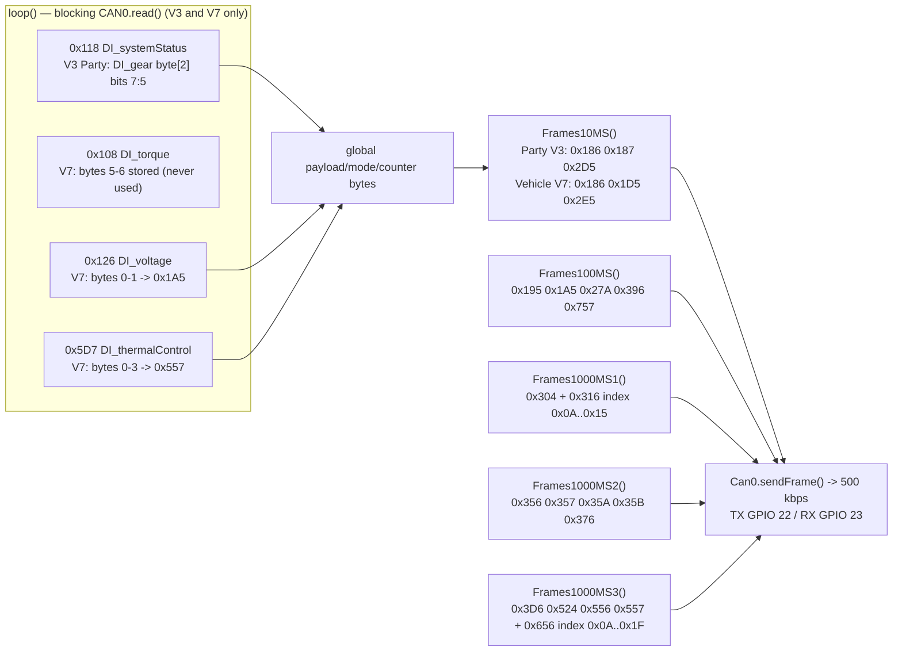
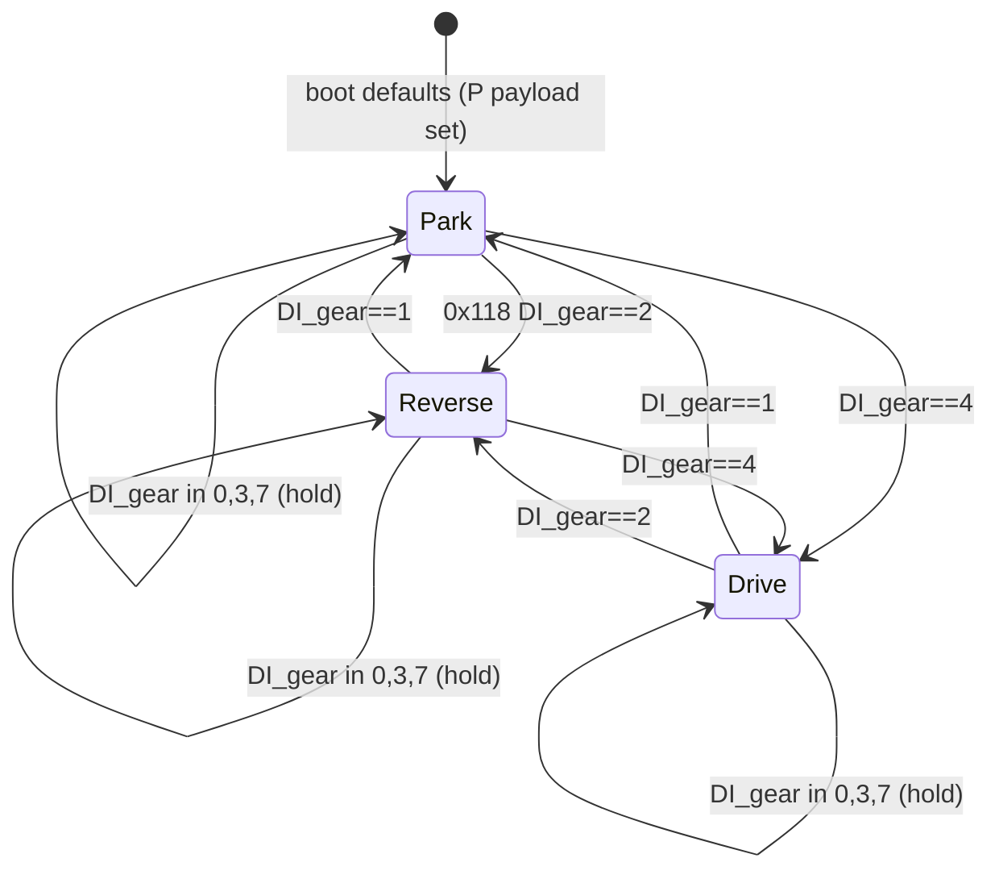
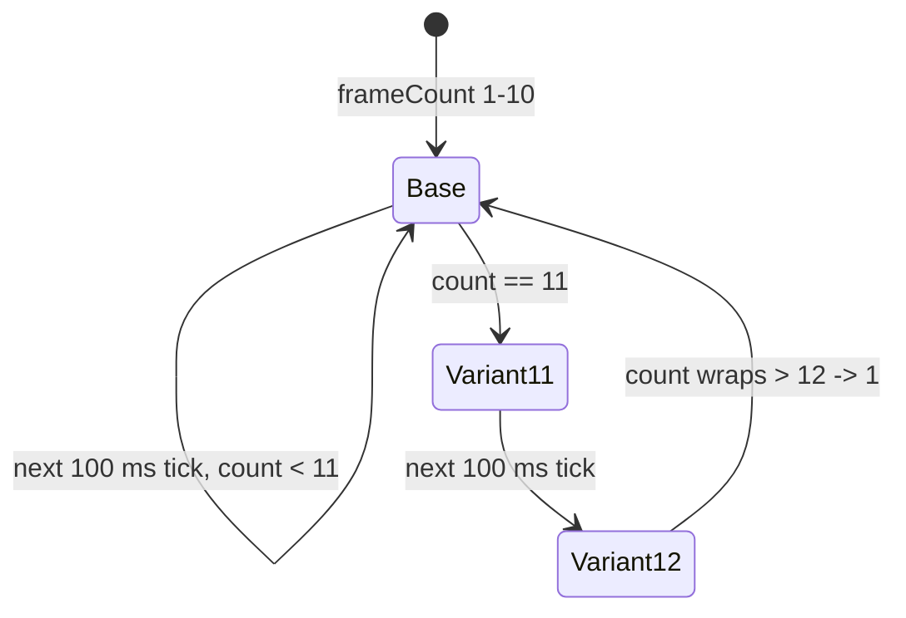

# sydneyg007-Tesla-Model-3-Front-DI-emulator

## 1. Provenance

| Field | Value |
| --- | --- |
| Submodule path | `legacy/sydneyg007-Tesla-Model-3-Front-DI-emulator` |
| Pinned gitlink | `160000 88025f7ad47a2cd7fc2ffecfa5b5015c18e1a6c4 0` (`git ls-files -s legacy/sydneyg007-Tesla-Model-3-Front-DI-emulator`) |
| Submodule HEAD | `88025f7ad47a2cd7fc2ffecfa5b5015c18e1a6c4` — matches gitlink; `git status --porcelain` clean |
| Upstream URL | https://github.com/sydneyg007/Tesla-Model-3-Front-DI-emulator |
| License | None — no LICENSE file anywhere in `git ls-files`; default copyright applies |
| Analysis date | 2026-11-21 |
| Mode | Replace (per caller instruction) |

Files read — all five repo files, FULL-READ (every line):

| File | Lines | Coverage |
| --- | --- | --- |
| `README.md` | 1–4 | FULL-READ |
| `ESP32CanbusEmulatorPartyCanFrontDiV2/ESP32CanbusEmulatorPartyCanFrontDiV2.ino` | 1–114 | FULL-READ |
| `ESP32CanbusEmulatorPartyCanFrontDiV2/ESP32FrontDiPartyCanV3.ino` | 1–123 | FULL-READ |
| `ESP32CanbusEmulatorVehicleCanFrontDiV4/ESP32CanbusEmulatorVehicleCanFrontDiV4.ino` | 1–679 | FULL-READ |
| `ESP32CanbusEmulatorVehicleCanFrontDiV4/ESP32FrontDiVehicleCanV7.ino` | 1–688 | FULL-READ |

Files explicitly NOT read: none exist beyond the five above. The external Arduino library `esp32_can.h` (provides `CAN_FRAME`, `Can0`, `CAN_cfg`) is **not vendored in this repo**; its TX-queue and `sendFrame` semantics are outside the evidence base and stay UNVERIFIED.

Replace-mode notes:

- The pre-replace YAML frontmatter is preserved byte-for-byte. Its `description` line is truncated mid-sentence (`... on both th`); it carried no trailing whitespace, so nothing was stripped. The truncation is recorded in section 6, not fixed.
- No `## Upstream (...)` sections existed in the pre-replace document, so the verbatim-preserve list is empty.
- The pre-replace doc had a duplicate `## Architecture` heading (lines 13 and 36 of the old file); that defect is gone in this rewrite.
- Pre-replace claims are cited below as `git show HEAD:docs/legacy/sydneyg007-Tesla-Model-3-Front-DI-emulator.md` (94 lines at HEAD; working tree was identical).

## 2. Executive verdict

Two Arduino sketches for an ESP32 (TWAI via the external `esp32_can.h` library, GPIO 22/23, 500 kbps) that impersonate a removed Front Drive Inverter on two buses of a 2019 Model 3 Performance: one sketch for the Party CAN (two generations, V2 static then V3 gear-adaptive), one for the Vehicle CAN (V4 static ensemble then V7 with live rear-mirror dynamics). What matters for TeslaCANModder is not the emulation itself — we ship no DI emulation and our firmware has zero frame-ID overlap with this repo (proven by negative anchor in section 16) — but three pieces of protocol knowledge embedded in the code: (a) a third independent corroboration that `DI_gear` on 0x118 lives at bits 21–23 (byte[2] bits 7:5, `ESP32FrontDiPartyCanV3.ino:112`), where our `decodeGearState` reads byte[0] bits 3:1; (b) the DI-family additive checksum convention `chk = (ID>>8) + (ID&0xFF) + Σ(data except chk byte) mod 256`, which differs from our data-only `driveChecksum`; (c) captured payloads plus inline DBC-style signal definitions for 0x186/0x187/0x2D5/0x1D5/0x27A/0x396/0x1A5/0x557 and for rear-DI frames 0x108/0x126/0x5D7 that our decoders do not yet touch. None of the code text may be copied (no upstream license); the two candidate adaptations are capture-first decoder work, not ports. The emulators' own correctness is UNVERIFIED — the repo contains no captures and no tests.

## 3. Evidence map

No TEST-READ evidence exists: this repo ships no tests. No CAPTURE evidence exists in this repo — every payload is a hardcoded literal whose capture provenance is unstated. Reading coverage: all five files were FULL-READ (small repo; no DBC/JSON catalogs to structurally parse).

| Source file | Lines | What it proves | Grade |
| --- | --- | --- | --- |
| `ESP32CanbusEmulatorPartyCanFrontDiV2.ino` | 8–15 | V2 counter/checksum state variables and ranges (0x07 base, −0x44 base, 0x8E base) | CODE-READ |
| `ESP32CanbusEmulatorPartyCanFrontDiV2.ino` | 30–92 | V2 TX layout of 0x186/0x187/0x2D5, static payloads, post-send increment | CODE-READ |
| `ESP32CanbusEmulatorPartyCanFrontDiV2.ino` | 100–108 | GPIO 22/23, `CAN0.begin(500000)`, no `watchFor` → V2 never reads the bus | CODE-READ |
| `ESP32FrontDiPartyCanV3.ino` | 5, 9–23 | V3 changelog comment ("dynamics based on 0x118") and gear-dependent payload variables | CODE-READ |
| `ESP32FrontDiPartyCanV3.ino` | 36–50 | V3 0x186 sum-form checksum `0x01 + 0x86 + counter + 0x80`; DBC comments for torque/axle-speed/pedal signals | CODE-READ |
| `ESP32FrontDiPartyCanV3.ino` | 53–68 | V3 0x187 mode nibble + counter layout, sum-of-bytes checksum | CODE-READ |
| `ESP32FrontDiPartyCanV3.ino` | 72–87 | V3 0x2D5 mode nibble layout, checksum `0x02 + 0xD5 + ...` | CODE-READ |
| `ESP32FrontDiPartyCanV3.ino` | 111–117 | RX decode of 0x118 `DI_gear` at byte[2] bits 7:5 (`21\|3@1+`), P/R/D payload branches, N branch commented out | CODE-READ |
| `ESP32CanbusEmulatorVehicleCanFrontDiV4.ino` | 1–2 | V4 header: 1000 ms frames split out, staggered timing "so all get sent" | CODE-READ |
| `ESP32CanbusEmulatorVehicleCanFrontDiV4.ino` | 12–18 | V4 counter state (0x1D5 step 0x20, 0x27A 0xC0–0xCF) | CODE-READ |
| `ESP32CanbusEmulatorVehicleCanFrontDiV4.ino` | 30–218 | V4 10 ms (0x1D5, 0x2E5) and 100 ms (0x186, 0x195, 0x1A5, 0x27A, 0x396, 0x757) TX, including the 0x757 every-10th-cycle double variant | CODE-READ |
| `ESP32CanbusEmulatorVehicleCanFrontDiV4.ino` | 222–656 | V4 1000 ms tier: 0x304, 0x316×8 indexed, 0x356, 0x357, 0x35A, 0x35B, 0x376, 0x3D6, 0x524, 0x556, 0x557, 0x656×9 indexed; timers 1004/1002/1000/998 ms | CODE-READ |
| `ESP32CanbusEmulatorVehicleCanFrontDiV4.ino` | 660–678 | V4 has no RX (`loop()` only calls frame builders) | CODE-READ |
| `ESP32FrontDiVehicleCanV7.ino` | 1–10 | V7 changelog: v5 axle-speed + voltage mirrors, v6 0x557 from 0x5D7, v7 DLC fixes and 0x186 → 10 ms | CODE-READ |
| `ESP32FrontDiVehicleCanV7.ino` | 49–96 | V7 10 ms: 0x186 (sum checksum, counter pre-increment), 0x1D5 (sum checksum), 0x2E5 | CODE-READ |
| `ESP32FrontDiVehicleCanV7.ino` | 110–203 | V7 100 ms with corrected DLCs: 0x195 (6), 0x1A5 (7, mirrored bytes), 0x27A (4, sum checksum), 0x396 (full per-byte DBC comments), 0x757 (12-frame cycle) | CODE-READ |
| `ESP32FrontDiVehicleCanV7.ino` | 205–626 | V7 1000 ms tier consolidated to three timers (1004/1002/1000) | CODE-READ |
| `ESP32FrontDiVehicleCanV7.ino` | 474–496, 666–677 | 0x557 bytes 0–3 copied live from rear 0x5D7 `DI_thermalControl` | CODE-READ |
| `ESP32FrontDiVehicleCanV7.ino` | 629–649 | `CAN0.watchFor()`, commented-out TCAN485 alternative pinout (GPIO 27/26) | CODE-READ |
| `ESP32FrontDiVehicleCanV7.ino` | 651–687 | V7 RX: 0x108 (dead store), 0x126 → 0x1A5, 0x5D7 → 0x557; frame builders interleaved 3× per `loop()` | CODE-READ |
| `README.md` | 1–4 | Purpose: front DI emulation on Party + Vehicle CAN, 2019 Model 3 Performance, suppresses errors when DI logic unplugged | CODE-READ |
| `git show HEAD:docs/legacy/sydneyg007-Tesla-Model-3-Front-DI-emulator.md` | 1–94 | Pre-replace summary claims (contradiction table entries in section 6) | SUMMARY-ONLY |

## 4. Architecture and build surface

- Entry points: Arduino `setup()` + `loop()` in each `.ino`. No build system beyond the Arduino IDE; no build flags; no PlatformIO. Platform is ESP32 classic (TWAI), pins hardcoded.
- Shared core vs port: none. Each sketch is a self-contained single file with global state. The only shared element is the external `esp32_can.h` library (not in this repo).
- Dependency boundary: `CAN_FRAME outframe` global is reused across all frame builders; RX state is a handful of global bytes. No queues, no ring buffers, no error paths.
- Transport surface: CAN TX only (plus blocking RX in V3/V7). `Serial.begin` is commented out in all four sketches (`...V2.ino:102`, `...V3.ino:98`, `...V4.ino:662`, `...V7.ino:631`) — no serial surface at all.



## 5. Mechanism catalogue

### M1 — Party CAN static DI emulation (V2)

- **Claim (README / summary):** Party CAN carries 0x186/0x187/0x2D5 at 10 ms with counter+0x07 / counter−0x44 / lockstep checksums (pre-replace doc lines 44–46).
- **Code path:** `...V2.ino:110 loop()` → `Frames10MS()` (:21) → `Can0.sendFrame(outframe)` (:42, :63, :84) — no decode stage, pure TX.
- **Frame spec:** 0x186: DLC 8, `[0]=chk [1]=ctr 0x00–0x0F [2..5]=00 [6]=0x80 [7]=00`, chk = ctr+0x07 (:34–48). 0x187: `[0]=chk [1]=ctr 0x60–0x6F [2]=EA [3]=00 [4]=60 [5]=EA [6]=00 [7]=00`, chk = ctr−0x44 (:55–69). 0x2D5: `[0]=chk [1]=ctr 0x40–0x4F [2]=14 [3]=92 [4]=03 [5]=00 [6]=02 [7]=CC`, chk walks 0x8E–0x9D in lockstep with ctr (:76–92).
- **Gates and timing:** single `millis()` gate ≥10 ms; sends immediately at boot by design — comment `ver = 2: starts sending frames immediately - esp32 designed to be powered from Di wake pin` (:4).
- **State machine:** None found (counters only).
- **Tests:** None found (repo ships no tests).
- **Evidence grade:** CODE-READ.
- **Verdict:** CONFIRMED for V2; the pre-replace doc's 0x187/0x2D5 spec describes this file only (see section 6).
- **Adapt to TeslaCANModder?** no impact — superseded by the author's own V3; Park-only derivations.

### M2 — Party CAN gear-adaptive DI emulation (V3)

- **Claim (README / summary):** Not mentioned in the pre-replace doc at all — the 0x118-driven adaptation is missing from the old summary.
- **Code path:** `...V3.ino:106 loop()` → `CAN0.read(message)` → `if (message.id == 0x118)` (:111) → `byte DI_gear = ((message.data.byte[2] & B11100000) >> 5)` (:112) → sets globals `Dis_frontMode_driveMode`, `Dis_frontMode_driveMode2`, `Dis_frontMode_driveModeByte0x03`, `Dis_frontActivated0x187`, `mode0x2D5`, `Dis_frontByte0x05`, `Dis_frontByte0x06` (:113–116) → consumed by `Frames10MS()` frame builders (:55, :61–66, :74, :80).
- **Frame spec:** 0x186 unchanged in wire bytes (sum-form checksum `0x01 + 0x86 + counter + 0x80` at :37 is congruent to counter+0x07 since 0x01+0x86+0x80 = 0x107). 0x187: byte[1] = `driveMode + counter` (mode nibble high, counter low 0x00–0x0F), chk = `0x01 + 0x87 +` all of bytes 1–6 (:55). 0x2D5: byte[1] = `mode + counter`, mode 0x10 in Park / 0x40 in R or D, chk = `0x02 + 0xD5 + mode + counter + 0x14 + 0x88 + 0x03 + 0x02 + 0x4C` (:74); DBC comment maps mode 1 "off" / 4 "on" (:80).
- **Gates and timing:** 10 ms TX gate; gear update on every received 0x118; no staleness timeout — if 0x118 stops (DI asleep), the last gear's payloads persist forever.
- **State machine:** three gear states plus hold; see diagram. Neutral (`DI_gear==3`) branch is commented out (:115) and INVALID(0)/SNA(7) are unhandled, so those codes hold the previous state.



- **Tests:** None found.
- **Evidence grade:** CODE-READ.
- **Verdict:** CONFIRMED — including the DBC-annotated gear position `DI_gear: 21|3@1+ ... 0 "INVALID" 1 "P" 2 "R" 3 "N" 4 "D" 7 "SNA"` (:112), the load-bearing claim for our parity matrix.
- **Adapt to TeslaCANModder?** candidate — not the emulation, but the 0x118 gear-position evidence, which is a third independent corroboration against our `decodeGearState` bit choice (section 11, row 1). The P/R/D payload constants themselves: no impact (we do not emulate the DI).

### M3 — Vehicle CAN DI ensemble, static (V4)

- **Claim (README / summary):** "10ms, 100ms cycles" with 8 frame IDs (pre-replace doc line 50) — incomplete, see section 6.
- **Code path:** `...V4.ino:671 loop()` → `Frames10MS()` (:22, 0x1D5 + 0x2E5), `Frames100MS()` (:75, 0x186 + 0x195 + 0x1A5 + 0x27A + 0x396 + 0x757), `Frames1000MS1..4()` (:222, :338, :452, :559 — 0x304, 0x316×8, 0x356, 0x357, 0x35A, 0x35B, 0x376, 0x3D6, 0x524, 0x556, 0x557, 0x656×9) → `Can0.sendFrame`.
- **Frame spec:** see section 7 rows; V4 sends all listed frames at DLC 8 (including the later-corrected 0x195/0x1A5/0x27A) with static payloads; only 0x1D5 (ctr byte[6] step 0x20, chk byte[7] base 0xF7 wrap 0x17), 0x27A (ctr byte[1] 0xC0–0xCF, chk byte[0] base 0x38 wrap 0x47), 0x186 (ctr+0x07) and the 0x757 cycle are dynamic.
- **Gates and timing:** header comment (:1): "seperating 1000ms frames out and varying timing slightly so all get sent" — four 1 s timers deliberately offset: ≥1004 ms (:225), ≥1002 ms (:341), ≥1000 ms (:455), ≥998 ms (:562).
- **State machine:** None found (counters and the 0x757 repeat counter :18, :186–218 only).
- **Tests:** None found.
- **Evidence grade:** CODE-READ.
- **Verdict:** CONFIRMED; the pre-replace doc's "(10ms, 100ms cycles)" scope is wrong (section 6, row 3).
- **Adapt to TeslaCANModder?** no impact.

### M4 — Vehicle CAN ensemble with rear-mirror dynamics (V7)

- **Claim (README / summary):** Pre-replace doc presents 0x1A5/0x27A/0x195 as "static data" at DLC 8 (lines 55–57) — stale for V7.
- **Code path:** `...V7.ino:651 loop()` → `CAN0.read` → 0x108 (:655, stores bytes 5–6, never used), 0x126 (:660, `DI_hvBusStatusByte0/1`), 0x5D7 (:666, `DI_frontThermalControlByte0..3`) → `Frames10MS()` (:41), `Frames100MS()` (:102), `Frames1000MS1/2/3()` (:205, :342, :427) → `Can0.sendFrame`. V7 also fixes DLCs per header comment (:5) and moves 0x186 into the 10 ms tier (:49–64).
- **Frame spec:** 0x1A5 → DLC 7; byte[0] = rear 0x126 byte[0], byte[1] = rear byte[1] & 0x03 (`DI_frontVoltage 0|10@1+ scale 0.5 V` comment, :128–129), rest static `00 00 00 E2 03`. 0x27A → DLC 4; chk = `0x02 + 0x7A + counter + 0xFC` (:139). 0x195 → DLC 6. 0x557 → DLC 4, bytes 0–3 copied verbatim from 0x5D7 (:488–496 ← :673–676). 0x396 gets full DBC annotations per byte (:155–162). 0x1D5 checksum becomes sum-form `0x01 + 0xD5 + 0x21 + counter` (:68).
- **Gates and timing:** three 1 s timers (1004/1002/1000) — the 998 ms fourth timer was consolidated away; `Frames10MS()` and `Frames100MS()` are called three times per `loop()` pass (:679–687) to compensate for the blocking read.
- **State machine:** None found beyond counter cycles.
- **Tests:** None found.
- **Evidence grade:** CODE-READ.
- **Verdict:** CONFIRMED; contradicts the pre-replace doc on DLCs, staticness, and 0x186 rate (section 6).
- **Adapt to TeslaCANModder?** candidate — the rear→front mirror *pattern* and the 0x126/0x5D7/0x108 signal layouts are decoder backlog; never as TX.

### M5 — DI additive checksum family (cross-cutting)

- **Claim (README / summary):** Pre-replace doc lists per-frame shortcuts ("counter + 0x07", "counter − 0x44", "increments by 0x20") without stating the general formula.
- **Code path:** `...V3.ino:37,55,74` and `...V7.ino:51,68,139` write the checksum explicitly as "frame id numbers plus remaining frames": `chk = (ID >> 8) + (ID & 0xFF) + Σ(data[1..7]) mod 256`. V2's shortcuts are special cases: for 0x186 all non-counter payload is zero except byte[6]=0x80, so 0x01+0x86+0x80 collapses to +0x07; for 0x187 in Park, `counter − 0x44` equals the full sum (0x60 carries the mode nibble 6 "Park"); V4's 0x1D5/0x27A increment-lockstep forms are the same sums unwound.
- **Frame spec:** checksum byte position varies per frame (0x186/0x187/0x2D5/0x27A byte[0]; 0x1D5 byte[7]); counter nibble position likewise (byte[1] low nibble for 0x186/0x187/0x2D5, full byte for 0x27A byte[1] and 0x1D5 byte[6]).
- **Gates and timing:** recomputed every frame send.
- **State machine:** None found.
- **Tests:** None found.
- **Evidence grade:** CODE-READ (multiple congruent derivations across four files).
- **Verdict:** CONFIRMED — the ID-bytes-included additive sum is the DI-family convention, distinct from our data-only `driveChecksum` (`firmware/lib/vehicle/can/ids.h:90`).
- **Adapt to TeslaCANModder?** candidate — knowledge only: any future DI-frame decode/validation must use the ID-bytes form. Backlog, not a change today.

### M6 — 0x757 ID757DIF_debug periodic variant cycle

- **Claim (README / summary):** "periodic variant frame every 10th cycle" / "0x757 alternates every 10 cycles" (pre-replace doc lines 59, 91).
- **Code path:** V4: `...V4.ino:172–218` — base frame every 100 ms, `repeat0x757++`, at ==10 send two extra variant frames back-to-back, reset. V7: `...V7.ino:165–201` — `frameCount0x757++`, wrap >12 → 1 (:166); frames 1–10 base, frame 11 variant A, frame 12 variant B, one per 100 ms slot.
- **Frame spec:** base `32 0E 00 00 00 00 00 00`. V7 variant A (frame 11): `46 3A 3A 3A 3A 43 3B 3B`; V7 variant B (frame 12): `48 3A 3A 00 00 80 0E 00`. V4's variants differ in bytes: A `46 3C 3C 3C 3D 58 42 41`, B `48 3B 3B 00 00 C0 0E 00` (`...V4.ino:193–214`).
- **Gates and timing:** 100 ms slot; cycle length 10 (V4) vs 12 (V7).
- **State machine:** three states, V7 form:



- **Tests:** None found.
- **Evidence grade:** CODE-READ.
- **Verdict:** PARTIAL — true for V4, wrong for V7 (11th/12th frames in their own slots, and different variant bytes).
- **Adapt to TeslaCANModder?** no impact.

### M7 — Indexed-mux frame emulation (0x316 PM_info, 0x656 DI_Info)

- **Claim (README / summary):** Not mentioned in the pre-replace doc.
- **Code path:** `...V7.ino:226–337` — 0x316 sent eight times per 1 s tick with index in byte[0]: 0x0A, 0x0B, 0x0D, 0x11, 0x12, 0x13, 0x14, 0x15, each with its own static payload; `...V7.ino:498–623` — 0x656 sent nine times per tick with indices 0x0A, 0x0B, 0x0D, 0x10, 0x11, 0x12, 0x13, 0x14, 0x1F. Comment: "sends all 8 indexed frames at once (every 1000ms)" (:226) / "all 9" (:498). V4 spreads the same indices across two timers (:244–372, :510–653).
- **Frame spec:** DLC 8; mux/index selector = byte[0] whole byte (not a nibble); payloads are opaque captures.
- **Gates and timing:** whole mux burst inside one 1 s timer slot.
- **State machine:** None found.
- **Tests:** None found.
- **Evidence grade:** CODE-READ.
- **Verdict:** CONFIRMED.
- **Adapt to TeslaCANModder?** no impact — but note the index-at-byte[0] layout if 0x316/0x656 ever enter our decoder catalog.

## 6. Summary vs code contradiction table

Pre-replace citations are `git show HEAD:docs/legacy/sydneyg007-Tesla-Model-3-Front-DI-emulator.md` at the given line; code citations are working-tree lines at the pinned SHA. Only actual contradictions are listed; agreements (GPIO 22/23, 500 kbps, `esp32_can.h`, "License: None", 0x186 counter range, 0x1D5 0x20-step, 0x27A counter range, additive-vs-subtractive characterization) are in section 3.

| # | Pre-replace claim (HEAD line) | Code reality (cite) | Verdict |
| --- | --- | --- | --- |
| 1 | `0x187` "checksum = counter - 0x44, counter 0x60–0x6F" (:45) | V2-only. V3 uses counter 0x00–0x0F with a mode nibble in byte[1] and a sum-of-bytes checksum (`...V3.ino:54–55`) | CONTRADICTED for V3 |
| 2 | `0x2D5` "counter 0x40–0x4F, checksum 0x8E–0x9D" (:46) | V2-only. V3 counter 0x00–0x0F, mode nibble 0x10/0x40, byte[3] 0x88 (V2: 0x92), checksum `0x02+0xD5+...` (`...V3.ino:73–74, :81–83`) | CONTRADICTED for V3 |
| 3 | Vehicle CAN has "(10ms, 100ms cycles)" (:50) | A third tier exists: 1000 ms frames 0x304, 0x316×8, 0x356, 0x357, 0x35A, 0x35B, 0x376, 0x3D6, 0x524, 0x556, 0x557, 0x656×9 (`...V4.ino:222–656`, `...V7.ino:205–626`) | CONTRADICTED (scope omission) |
| 4 | `0x186` Vehicle CAN at "100ms" (:54, :69) and "appears on both buses at different rates" (:92) | V7 sends 0x186 at 10 ms, same rate as Party (`...V7.ino:5` changelog, `:49–64`) | CONTRADICTED for V7 |
| 5 | `0x195` "8 bytes" (:55) | V7 sends DLC 6 (`...V7.ino:112, :5`) | CONTRADICTED for V7 |
| 6 | `0x1A5` "8 bytes, 100ms, static data" (:56) | V7: DLC 7, bytes 0–1 mirrored live from rear 0x126 (`...V7.ino:123–135, :660–665`) | CONTRADICTED for V7 |
| 7 | `0x27A` "8 bytes" (:57) | V7: DLC 4, checksum `0x02 + 0x7A + counter + 0xFC` (`...V7.ino:141, :139`) | CONTRADICTED for V7 |
| 8 | `0x757` "periodic variant frame every 10th cycle" (:59) / "alternates every 10 cycles" (:91) | V4: variants fired as an extra burst at the 10th cycle (`...V4.ino:186–218`); V7: dedicated 11th/12th frames with different bytes (`...V7.ino:166–200`) | PARTIAL |
| 9 | "Multiple .ino files suggest iterative development (V2, V3, V4, V7 versions)" (:61) | The pairs are alternate generations of the same sketch (V2→V3 Party, V4→V7 Vehicle), and V7's header references ver 5 and 6 features (`...V7.ino:3–4`) whose files are absent from the repo | PARTIAL (missing V5/V6 nuance) |
| 10 | Frontmatter `description:` ends mid-sentence "...on both th" (:3) | Cosmetic truncation inherited from the original summary; per replace-mode rules the bytes are preserved and only recorded here | Defect preserved, not fixed |

## 7. CAN frame and signal inventory

All rows are upstream-injected (write) or upstream-decoded (read) frames, CODE-READ. No vendored DBC/JSON catalog exists in this repo — the DBC-style definitions below are inline code comments. "V4:" / "V7:" / "V2:" / "V3:" mark generation-specific deltas.

| ID (hex) | ID (dec) | Bus | Period | DLC | Byte/bit layout | Scale / units | Counter | Checksum | R/W | Grade |
| --- | --- | --- | --- | --- | --- | --- | --- | --- | --- | --- |
| 0x118 | 280 | Party | on RX | 8 | `DI_gear` byte[2] bits 7:5 (`21\|3@1+`) | 0 INVALID, 1 P, 2 R, 3 N, 4 D, 7 SNA | n/a | n/a | RX (V3:111–116) | CODE-READ |
| 0x186 | 390 | Party + Vehicle | 10 ms (V4 Vehicle: 100 ms) | 8 | [0]=chk [1]=ctr [2..5]=00 [6]=0x80 [7]=00; DBC: torque cmd bits 12\|13 scale 2 Nm, actual 27\|13, `DIS_frontAxleSpeed` 40\|16 scale 0.1 RPM (bytes 5–6), `DIS_frontSlavePedalPos` 56\|8 scale 0.4 % | Nm / RPM / % | byte[1] low nibble 0x00–0x0F | byte[0] = ctr+0x07 (V2/V4) ≡ `0x01+0x86+ctr+0x80` (V3:37, V7:51) | TX | CODE-READ |
| 0x187 | 391 | Party | 10 ms | 8 | V3: [0]=chk [1]=mode<<4\|ctr [2]=driveMode2 [3]=byte03 [4]=activated [5]=byte05 [6]=byte06 [7]=00; V2: [1]=0x60–0x6F static `EA 00 60 EA 00` | mode nibble: 6 P, 1 R, 5 D (V3:61–62) | byte[1] low nibble (V3:54) | V3: `0x01+0x87+` bytes 1–6 (:55); V2: ctr−0x44 (Park-equivalent) | TX | CODE-READ |
| 0x2D5 | 725 | Party | 10 ms | 8 | V3: [0]=chk [1]=mode<<4\|ctr [2]=0x14 [3]=0x88 [4]=0x03 [5]=00 [6]=0x02 [7]=0x4C (or 0xCC); V2: [1]=0x40–0x4F, [3]=0x92 | mode 1 "off" (P), 4 "on" (R/D) (V3:80, :113–116) | byte[1] low nibble (V3:73) | V3: `0x02+0xD5+` bytes 1–7 (:74); V2: lockstep 0x8E–0x9D | TX | CODE-READ |
| 0x1D5 | 469 | Vehicle | 10 ms | 8 | [0]=0x21 [1..5]=00 [6]=ctr [7]=chk; `FrontTorqueRequest1D5` 8\|13 scale 0.222 Nm, `FrontTorque1D5` 21\|13 (V7:74–76) | Nm | byte[6], step 0x20, cycle 0x00–0xE0 (V7 phase-shifted, sends 0x20 first) | byte[7] = `0x01+0xD5+0x21+ctr` (V7:68); V4 base 0xF7 wrap 0x17 (V4:49–51) | TX | CODE-READ |
| 0x2E5 | 741 | Vehicle | 10 ms | 8 | static `00 00 03 0D 00 00 DD 00` ("DIS_power //Doesn't change") | n/a | none | none | TX | CODE-READ |
| 0x195 | 405 | Vehicle | 100 ms | V4: 8, V7: 6 | static `00 08 08 00 28 00` | n/a | none | none | TX | CODE-READ |
| 0x1A5 | 421 | Vehicle | 100 ms | V4: 8, V7: 7 | V7: [0]=rear 0x126 b0, [1]=rear b1 & 0x03 (`DI_frontVoltage` 0\|10 scale 0.5 V, `DI_frontCurrent` 10\|11), [2..4]=00 [5]=E2 [6]=03; V4: static `E4 02 00 00 00 E2 03 00` | V (0.5/LSB) | none | none | TX | CODE-READ |
| 0x27A | 634 | Vehicle | 100 ms | V4: 8, V7: 4 | [0]=chk [1]=ctr [2]=0xFC (or 0x0C) [3]=00 (or 0x01) | n/a | byte[1], 0xC0–0xCF step 1 (V7 sends 0xC1–0xCF) | byte[0] = `0x02+0x7A+ctr+0xFC` (V7:139); V4 base 0x38 wrap 0x47 | TX | CODE-READ |
| 0x396 | 918 | Vehicle | 100 ms | 8 | V7: `01 32 32 38 4B 3C 19 7D` — `DI_frontOilPumpState` 0\|3, `FluidConfidence` 3\|1, `LeadAngle` 4\|4 scale 1.875 deg, `FlowTarget` 8\|8 scale 0.06 LPM, `FlowActual` 16\|8, `PcbT` 24\|8 (−40) DegC, `FluidT` 32\|8 (−40), `Voltage` 40\|8 scale 0.1 V, `Current` 48\|8 scale 0.1 A, `Offset` 56\|8 scale 0.005 A (V7:155–162); V4: `00 11 00 40 FF 00 00 7D` | LPM / DegC / V / A | none | none | TX | CODE-READ |
| 0x757 | 1879 | Vehicle | 100 ms | 8 | base `32 0E 00 00 00 00 00 00`; V7 frame 11 `46 3A 3A 3A 3A 43 3B 3B`, frame 12 `48 3A 3A 00 00 80 0E 00`; V4 variants `46 3C 3C 3C 3D 58 42 41` / `48 3B 3B 00 00 C0 0E 00` | n/a | frame-cycle counter, period 12 (V7) / 10 (V4) | none | TX | CODE-READ |
| 0x304 | 772 | Vehicle | 1000 ms | 8 | all zero | n/a | none | none | TX | CODE-READ |
| 0x316 | 790 | Vehicle | 1000 ms (8 frames per tick) | 8 | mux index byte[0]: 0x0A `01 4B 32 FC 00 09 00`, 0x0B `00 1C 51 01 00 00 00`, 0x0D `00 00 00 A8 B7 3F 79`, 0x11 zeros, 0x12 `16 48 B4 7A 66 41 FD`, 0x13 `03 00..`, 0x14 `06 00 00 ED 43 34 4A`, 0x15 `01 4B 32 BF 97 29 DB` | opaque capture | n/a | n/a | TX | CODE-READ |
| 0x356 | 854 | Vehicle | 1000 ms | 8 | `DI_alertMatrix1` all zero | n/a | none | none | TX | CODE-READ |
| 0x357 | 855 | Vehicle | 1000 ms | 8 | `DI_alertMatrix2` all zero ("motor speed mismatch (leave at zero)") | n/a | none | none | TX | CODE-READ |
| 0x35A | 858 | Vehicle | 1000 ms | 8 | `DI_alertMatrix3` all zero | n/a | none | none | TX | CODE-READ |
| 0x35B | 859 | Vehicle | 1000 ms | 8 | `DI_alertMatrix4` all zero | n/a | none | none | TX | CODE-READ |
| 0x376 | 886 | Vehicle | 1000 ms | 8 | V7: `3D 3A 3A 50 3A 8A 7D 02`; V4: `3C 3D 3D 50 3E 8F 7D 03` — `DI_frontInverterTemperature`; our decoder reads bytes 1/2/4 with −40 offset and V7's 0x3A bytes decode to plausible 18 °C | DegC (−40 offset) | none | none | TX | CODE-READ |
| 0x3D6 | 982 | Vehicle | 1000 ms | 8 | V7: `3E 3E 3E 3D 3E 85 10 4D`; V4: `3B 3B 3B 3B 3A 90 00 4D` | n/a | none | none | TX | CODE-READ |
| 0x524 | 1316 | Vehicle | 1000 ms | 7 | static `64 03 08 0A 18 B0 02` | n/a | none | none | TX | CODE-READ |
| 0x556 | 1366 | Vehicle | 1000 ms | 5 | V7: `3A 3A 00 3B FF`; V4: `3D 3D 00 3D FF` ("ID556FrontDItemps") | n/a | none | none | TX | CODE-READ |
| 0x557 | 1367 | Vehicle | 1000 ms | 4 | V7: bytes 0–3 copied from rear 0x5D7; V4: static `8C 8C 00 00` — `DI_frontThermalControl`: active/passive inlet temp req (−40), coolant flow 0.2 LPM, oil flow 0.06 LPM (V7:474–496) | DegC / LPM | none | none | TX | CODE-READ |
| 0x656 | 1622 | Vehicle | 1000 ms (9 frames per tick) | 8 | mux index byte[0]: 0x0A `01 4B 32 FC 00 05 00`, 0x0B `00 1C 51 01 00 00 00`, 0x0D `00 00 00 BF 97 29 DB`, 0x10 `01 C4 27 CC 6A FF 00`, 0x11 zeros, 0x12 `16 48 B4 7A 66 41 FD`, 0x13 `03 00..`, 0x14 `05 00 00 10 7E 86 67`, 0x1F zeros | opaque capture | n/a | n/a | TX | CODE-READ |
| 0x108 | 264 | Vehicle | on RX | 8 | `DI_axleSpeed` 40\|16 scale 0.1 RPM at bytes 5–6 (V7:657–658) — values stored but never used (dead store) | RPM | n/a | n/a | RX (V7) | CODE-READ |
| 0x126 | 294 | Vehicle | on RX | 8 | `DI_voltage` 0\|10 scale 0.5 V at bytes 0–1 (V7:662–664) → mirrored into 0x1A5 | V | n/a | n/a | RX (V7) | CODE-READ |
| 0x5D7 | 1495 | Vehicle | on RX | 8 | rear `DI_thermalControl`: passiveInlet 0\|8 (−40), activeInlet 8\|8 (−40), coolantFlow 16\|8 0.2 LPM, oilFlow 24\|8 0.06 LPM (V7:476–480, :668–676) → copied into 0x557 bytes 0–3 | DegC / LPM | n/a | n/a | RX (V7) | CODE-READ |

## 8. Constants and tuning table

| Constant | Value | File:line | Meaning | Grade |
| --- | --- | --- | --- | --- |
| 0x186 checksum offset | +0x07 (≡ 0x01+0x86+0x80) | `...V2.ino:8,48`; `...V3.ino:37`; `...V7.ino:51` | additive DI checksum for all-zero torque payload with byte[6]=0x80 | CODE-READ |
| 0x187 V2 checksum base | −0x44 (= +0x1C) | `...V2.ino:11,69` | Park-only shortcut; equals full sum only with mode nibble 6 | CODE-READ |
| 0x2D5 V2 checksum band | 0x8E–0x9D | `...V2.ino:15,90–92` | lockstep walk with counter 0x40–0x4F; V2 only | CODE-READ |
| 0x2D5 V3 checksum terms | 0x02+0xD5+0x14+0x88+0x03+0x02+0x4C | `...V3.ino:74` | ID bytes + static payload sum; byte[3]=0x88 differs from V2's 0x92 | CODE-READ |
| 0x1D5 counter step | 0x20, cycle 0x00–0xE0 | `...V4.ino:12,45–47`; `...V7.ino:31,67` | non-mod-16 counter; V7 wrap check `>0xFF` is dead (byte truncates first) | CODE-READ |
| 0x1D5 checksum base | 0xF7 wrap >0xF7 → 0x17 (V4); sum form (V7) | `...V4.ino:13,49–51`; `...V7.ino:68` | equivalent sums, different code shape | CODE-READ |
| 0x27A counter band | 0xC0–0xCF step 1 | `...V4.ino:15,149–151`; `...V7.ino:34,138` | V7 pre-increments, so 0xC0 is never transmitted | CODE-READ |
| 0x27A checksum | `0x02+0x7A+ctr+0xFC` (V7) / base 0x38 wrap 0x47 (V4) | `...V7.ino:139`; `...V4.ino:16,153–155` | ID-byte additive form vs lockstep form | CODE-READ |
| Park payload set | driveMode 0x60, mode2 0xEA, byte03 0x00, activated 0x60, mode0x2D5 0x10, byte05 0xEA, byte06 0x00 | `...V3.ino:113` | injected 0x187/0x2D5 shape while `DI_gear==1` | CODE-READ |
| Reverse payload set | 0x10, 0xA6, 0x01, 0x64, 0x40, 0xC6, 0x40 | `...V3.ino:114` | injected shape while `DI_gear==2` | CODE-READ |
| Drive payload set | 0x50, 0xAA, 0x45, 0x64, 0x40, 0xC6, 0x40 | `...V3.ino:116` | injected shape while `DI_gear==4` | CODE-READ |
| DI_gear extract mask | `B11100000 >> 5` on byte[2] | `...V3.ino:112` | gear field at bits 21–23 of 0x118 | CODE-READ |
| 0x1A5 voltage mask | `& B00000011` on byte[1] | `...V7.ino:129` | keeps 2 low bits of `DI_frontCurrent`/voltage overlay | CODE-READ |
| 1 s timer stagger | ≥1004 / ≥1002 / ≥1000 / ≥998 ms | `...V4.ino:225,341,455,562`; V7 drops the 998 (`...V7.ino:208,345,430`) | keeps four (V4) / three (V7) timer slots from colliding | CODE-READ |
| TX periods | 10 / 100 / 1000 ms | `...V4.ino:26,79,225` etc. | DI frame cadence tiers | CODE-READ |
| 0x757 cycle length | 10 (V4) / 12 (V7) | `...V4.ino:187`; `...V7.ino:166` | variant-frame period | CODE-READ |
| Bus config | 500000 baud, TX GPIO 22, RX GPIO 23 | `...V2.ino:1–2,104–106`; `...V7.ino:644–647` | TWAI pins/speed; TCAN485 alt (GPIO 27/26) commented out at `...V7.ino:633–641` | CODE-READ |
| 0x396 payload constants | `01 32 32 38 4B 3C 19 7D` | `...V7.ino:155–162` | oil-pump state/flow/temps/voltage/current resting capture with per-byte scales | CODE-READ |

## 9. Failure modes and edge cases

No TEST-READ evidence exists for any row — the repo ships no tests, so every path is untested.

| Failure | Handling code path | Tested? | Grade |
| --- | --- | --- | --- |
| Bus-off / TX error | None — `Can0.sendFrame()` return value ignored at every call site; no busOff/TWAI-alert/wdt code exists anywhere (negative anchor, section 16) | No | CODE-READ (absence) |
| CAN init failure | `CAN0.begin(500000)` return ignored (`...V2.ino:106`, `...V3.ino:102`, `...V4.ino:666`, `...V7.ino:647`) — sketch TXes into a dead bus without noticing | No | CODE-READ (absence) |
| RX flood / timing drift | V7's `loop()` blocks on `CAN0.read()`; mitigated by calling `Frames10MS()`/`Frames100MS()` three times per pass (`...V7.ino:679–687`) but the 10 ms cadence is not guaranteed under load | No | CODE-READ |
| Stale gear (DI asleep) | V3 holds last gear payload forever — no missing-frame timeout on 0x118 (`...V3.ino:106–119`) | No | CODE-READ (absence) |
| Neutral gear code | `DI_gear==3` branch commented out (`...V3.ino:115`); INVALID(0)/SNA(7) unhandled — all three hold previous state silently | No | CODE-READ |
| Counter byte overflow | V7 0x1D5 wrap check `if (counter0x1D5>0xFF)` is dead code — `byte` truncates 0x100 to 0x00 before the compare (`...V7.ino:67`) | No | CODE-READ |
| V2 Park-only formulas | 0x187 `ctr−0x44` and 0x2D5 lockstep break for R/D mode nibbles; superseded by V3's sum form | No | CODE-READ |
| Advertised-but-unwired feature | V5 "front axlespeed from rear 0x108" — `DI_axleSpeedByte5/6` assigned (`...V7.ino:657–658`) but never read; 0x186 bytes 5–6 stay hardcoded 0x00/0x80 | No | CODE-READ |
| millis() rollover | Unsigned subtraction in `millis() - timer >= N` is rollover-safe by construction | No | CODE-READ |
| Watchdog / brownout / OTA awareness | None present — emulator has no watchdog, no reboot-state handling, no OTA guard | No | CODE-READ (absence) |

## 10. Test coverage map

Test files: None found. The repo contains no test of any kind.

Critical paths with no test, and the risk in one line each:

- Every checksum formula — a single transcription typo in any constant would transmit frames the car silently drops, and nothing in the repo would catch it.
- The 0x118 gear decode — the one RX path that drives dynamic behavior (V3) has no assertion that bits 7:5 of byte[2] are the real field.
- The 0x757 cycle arithmetic (wrap at 12) and 0x1D5 step-0x20 arithmetic — off-by-one here changes wire phase, undetectable without a bus analyzer.
- The V7 mirror wiring (0x126→0x1A5, 0x5D7→0x557) — mask errors (e.g. `& 0x03`) would corrupt voltage/current fields invisibly.

## 11. Parity matrix with TeslaCANModder

Every row carries a our-side CODE-READ citation. Negative anchors proving absence claims were run (section 16). Existing related rows live in `docs/legacy/ev-open-can-tools-ev-open-can-tools.md:509` and `docs/legacy/talas9-tesla_can_signals.md:376` — this matrix adds the sydneyg007 corroboration.

| Signal / frame | Upstream decode/emulate (cite) | Our decode (cite) | Delta | Action |
| --- | --- | --- | --- | --- |
| 0x118 `DI_gear` bit position | byte[2] bits 7:5, DBC `21\|3@1+`, SNA=7 (`...V3.ino:112`) | byte[0] bits 3:1, comment SNA=5 (`firmware/lib/vehicle/can/feature/telemetry/powertrain.h:29–32`, `:27`) | **different bit position for the same frame** — third independent upstream corroboration (after ev-open-can-tools and talas9 DBC) that ours decodes the wrong field; feeds `apGateParked` (`firmware/lib/vehicle/can/handler/bus/vehicle.h:387–395`) and is pinned by `test_gear_park`/`test_gear_masks_correctly` (`firmware/test/test_native_powertrain/test_powertrain.cpp:42–67`), which only prove self-consistency, not wire truth | capture-first (listen-only bench; then fix `decodeGearState` + SNA comment + re-pin tests) |
| 0x118 gear value map | 1 P, 2 R, 3 N, 4 D (`...V3.ino:112`) | 1 P, 2 R, 3 N, 4 D (`powertrain.h:80–95`) | values agree; upstream SNA=7 vs our comment SNA=5, and `vehicle.h:393` treats gear 5 as parked while `gearName(3)` is "N" — internal our-side inconsistency | fold into the capture above |
| 0x118 accelerator pedal | upstream decodes only gear from 0x118; no pedal signal claimed (`...V3.ino:111–117`) | `decodeAccelPedal` byte[1] (`powertrain.h:39–42`), consumed at `vehicle.h:390` | upstream silent — no corroboration either way (talas9 DBC row already flagged "no accelerator-pedal signal") | capture-first (inherited concern; this repo adds no evidence) |
| 0x376 `DI_frontInverterTemperature` | upstream injects captured payload V7 `3D 3A 3A 50 3A 8A 7D 02` (`...V7.ino:409–422`) | decode bytes 1/2/4 with −40 offset (`firmware/lib/vehicle/can/feature/telemetry/motor_temps.h:50–75`, handler `vehicle.h:427–434`, `firmware/lib/vehicle/can/ids.h:61`) | upstream's resting capture decodes to plausible 18 °C under our formula — cross-repo agreement on layout | align (no change; positive corroboration of our decode) |
| 0x186 (390) `DIS/DIF_frontTorque` | upstream TXes on Party + Vehicle (`...V3.ino:35–50`, `...V7.ino:49–64`) | no firmware handler — `0x186` absent from `firmware/lib/vehicle/can/ids.h` (negative anchor, section 16) | no shared firmware surface; the client's generated ap-gate docs mention a "CAN 390 DIF_torque DI_gear fallback" (`client/src/docs/_generated-docs.ts:6662–6667`) that has no firmware counterpart | ignore for firmware; note the generated-docs claim as SUMMARY-ONLY |
| DI checksum convention | `chk = (ID>>8)+(ID&0xFF)+Σ(data except chk)` (`...V3.ino:37,55,74`, `...V7.ino:51,68,139`) | `driveChecksum` sums payload bytes only, no ID bytes (`firmware/lib/vehicle/can/ids.h:90–96`) | both additive, but DI-family frames include ID bytes; ours is used for UI-family frames (0x334 etc.) | awareness — do not "unify" `driveChecksum`; use the ID-bytes form only if DI-frame validation is ever added |
| 0x108 / 0x126 / 0x5D7 rear-DI frames | upstream reads: axle speed bytes 5–6, voltage bytes 0–1, thermal bytes 0–3 (`...V7.ino:655–677`) | no handlers — all three IDs absent from `firmware/lib/vehicle/can/ids.h` (negative anchor); our pack voltage comes from BMS 0x132 (`vehicle.h:75–84`) not DI 0x126 | different source frames for similar quantities; no conflict, but 0x126/0x5D7/0x108 are decoder-backlog candidates | ignore now; capture-first before adding any of the three |
| 0x118 counter/checksum | upstream makes no claim about 0x118 counter/checksum (RX-only, gear) | none in firmware for 0x118 | nothing to compare | none |

## 12. Surface inventory and security notes

Transport surfaces (complete — this repo has exactly one):

| Surface | Direction | Semantics |
| --- | --- | --- |
| CAN 500 kbps, Party bus (TX GPIO 22 / RX GPIO 23) | TX (V2/V3); TX+RX (V3) | impersonates front DI: 0x186/0x187/0x2D5 at 10 ms; V3 additionally listens for 0x118 |
| CAN 500 kbps, Vehicle bus | TX (V4); TX+RX (V7) | impersonates front DI: 21 frame IDs across 10/100/1000 ms tiers; V7 listens for 0x108/0x126/0x5D7 |

- Serial: commented out in all four sketches — no serial surface.
- Web/BLE/OTA: None found.
- Credentials/keys/certs: None found — no secrets anywhere in the five files.
- Untrusted content: every injected payload is an opaque capture with unstated provenance (0x316/0x656 blobs are pure hex); none has independent validation.
- Dangerous build flags: None found (no build system at all).
- Safety note: the emulator transmits safety-relevant drive-inverter frames (torque, HV bus status, thermal control) with zero input validation, powered from the DI wake pin so it starts TXing immediately at boot. Reimplementing this on a live vehicle without a listen-only capture first would be reckless; our `docs/checklists/can-review-checklist.md` applies to any future work touching these frames.

## 13. Adaptation assessment

| Mechanism | Value | Cost | Risk | Evidence grade | Decision |
| --- | --- | --- | --- | --- | --- |
| M1 V2 static Party emulation | Low — superseded even upstream | n/a | Park-only formulas would mislead | CODE-READ | no impact |
| M2 V3 gear-adaptive emulation | High as **evidence** (0x118 bit position, P/R/D payload constants); zero as emulation for us | Low — read-only bench capture to use it | None (listen-only) | CODE-READ | candidate for future PR (capture-first fix of our 0x118 gear decode; never the emulation itself) |
| M3 V4 static ensemble | Low — we do not remove the front DI | n/a | Injecting unverified blobs would trip vehicle faults | CODE-READ | no impact |
| M4 V7 mirror dynamics | Medium — rear→front mirror pattern + 0x126/0x5D7/0x108 signal layouts | Low as decoder backlog; high if ever TXed | TX never (checksum convention unverified against real captures) | CODE-READ | candidate for future PR (decoder additions only, capture-first) |
| M5 DI additive checksum family | Medium — the ID-bytes convention is required knowledge for any DI-frame validation | Low (knowledge) | None while RX-only | CODE-READ | candidate for future PR (backlog; no change today) |
| M6 0x757 variant cycle | None for us | n/a | n/a | CODE-READ | no impact |
| M7 0x316/0x656 mux emulation | Low — index-at-byte[0] layout note only | n/a | Injecting opaque blobs: never | CODE-READ | no impact |

Top 3 adaptation candidates: (1) the 0x118 `DI_gear` bits 21–23 corroboration driving a capture-first fix of `decodeGearState` (`powertrain.h:29–32`) and its `apGateParked` consumer (`vehicle.h:393`); (2) the DI additive checksum-with-ID-bytes convention for any future DI-frame decode/validation; (3) 0x126 `DI_voltage`, 0x5D7 `DI_thermalControl`, 0x108 `DI_torque` axle-speed as decoder-backlog frames we do not yet read.

## 14. Do-not-copy list

Upstream has **no license file** — default copyright reserves all rights, so no source text may be copied at all; the items below are the specific traps even a behavior-level port must avoid:

| Item | File:line | Reason |
| --- | --- | --- |
| All four `.ino` files, wholesale | whole repo | unlicensed; Arduino global-state style incompatible with our header-only Allman/tab firmware pattern |
| V2 0x187 `ctr−0x44` and 0x2D5 lockstep checksums | `...V2.ino:69, 90–92` | Park-only derivations; baking them in would break R/D payloads (author's own V3 replaced them) |
| V7 dead wrap check `if (counter0x1D5>0xFF)` | `...V7.ino:67` | dead code on a `byte`; copying it imports a misleading guard |
| V7 dead stores `DI_axleSpeedByte5/6` | `...V7.ino:17–18, 657–658` | advertised V5 feature never wired; do not copy the pattern of documenting a mirror that does not exist |
| Blocking `CAN0.read()` + 3×-interleaved busy loop | `...V7.ino:651–687` | would regress our ring-buffer consumer pipeline (`firmware/lib/core/can/`) back to a busy-wait loop |
| Raw 0x316/0x656 payload blobs | `...V7.ino:226–337, 498–623` | opaque captures with unknown meaning; never inject unverified blobs |

## 15. History and evolution

The submodule's local `git log` contains exactly one commit: `88025f7ad47a2cd7fc2ffecfa5b5015c18e1a6c4` (2025-03-16, "Add files via upload") adding all five files. There is no earlier local history; the upload squashes whatever development preceded it. Network-side history (PRs, issues, earlier GitHub commits) was not consulted — any such claims stay UNVERIFIED.

The only changelog is the in-file version comments:

- V2 (Party): `ver = 2: starts sending frames immediately - esp32 designed to be powered from Di wake pin` (`...V2.ino:4`) — boot-and-blast design decision.
- V3 (Party): `code cleanup and adding a lot more dynamics (based on 0x118 drive modes)` (`...V3.ino:5`) — the author replaced V2's Park-static frames with gear-adaptive ones and swapped the shortcut checksums for full sum forms; V2's `ctr−0x44` survives only as the Park special case.
- V4 (Vehicle): header notes its own "V2" lineage: `seperating 1000ms frames out and varying timing slightly so all get sent` plus the same wake-pin note (`...V4.ino:1–2`).
- V5 (referenced, file absent): `adding front axlespeed from rear 0x108 to front 0x186, and voltage from rear 0x126 to front 0x1A5` (`...V7.ino:3`) — in the surviving V7 code the voltage half is wired but the axle-speed half is a dead store (section 9), so the V5 feature was partially abandoned during later tidying.
- V6 (referenced, file absent): `maybe modify 0x557 front thermal control to not be 100c required? (use rear motor thermal control signals 0x5D7 instead?)` (`...V7.ino:4`) — phrased as a question, implemented in V7.
- V7 (Vehicle): `tidying up 0x195 should be 6 bytes (not 8), 0x1A5 shouyld be 7 bytes (not 8), 0x27A 4 bytes (not 8), 0x186 changed to 10ms (was 100ms)` (`...V7.ino:5`) — DLC corrections against a real DBC, plus consolidating V4's four 1 s timers into three.

Rollbacks visible in code: V3 discards V2's per-frame checksum shortcuts; V7 discards V4's 998 ms fourth timer and its static 0x557/0x1A5 payloads. Whether standalone V5/V6 files ever existed is UNVERIFIED (no local history, files absent).

## 16. Re-verification recipe

Pinned snapshot: `160000 88025f7ad47a2cd7fc2ffecfa5b5015c18e1a6c4 0` (parent gitlink; `git -C legacy/sydneyg007-Tesla-Model-3-Front-DI-emulator rev-parse HEAD` must return `88025f7ad47a2cd7fc2ffecfa5b5015c18e1a6c4`).

After an upstream bump:

```bash
OLD=88025f7ad47a2cd7fc2ffecfa5b5015c18e1a6c4
git -C legacy/sydneyg007-Tesla-Model-3-Front-DI-emulator fetch --tags --prune
git -C legacy/sydneyg007-Tesla-Model-3-Front-DI-emulator log --oneline $OLD..origin/main
git -C legacy/sydneyg007-Tesla-Model-3-Front-DI-emulator diff --stat $OLD..origin/main
git -C legacy/sydneyg007-Tesla-Model-3-Front-DI-emulator diff $OLD..origin/main
git ls-files -s legacy/sydneyg007-Tesla-Model-3-Front-DI-emulator   # compare gitlink to rev-parse HEAD
```

Every anchor below was executed at write time (2026-11-21) with the expected hits shown. Paths are abbreviated: `P2/` = `legacy/sydneyg007-Tesla-Model-3-Front-DI-emulator/ESP32CanbusEmulatorPartyCanFrontDiV2/`, `V4/` = `legacy/sydneyg007-Tesla-Model-3-Front-DI-emulator/ESP32CanbusEmulatorVehicleCanFrontDiV4/`.

Upstream anchors:

```text
grep -nE 'DI_gear' P2/ESP32FrontDiPartyCanV3.ino
  -> :112 DI_gear byte[2] bits 7:5 with DBC 21|3@1+ and 0/1/2/3/4/7 enum; branches at :113,:114,:116; N commented at :115
grep -nE '0x01 \+ 0x86' P2/ESP32FrontDiPartyCanV3.ino -> :37 (0x186 sum checksum)
grep -nE '0x01 \+ 0x87' P2/ESP32FrontDiPartyCanV3.ino -> :55 (0x187 sum checksum)
grep -nE '0x02 \+ 0xD5' P2/ESP32FrontDiPartyCanV3.ino -> :74 (0x2D5 sum checksum)
grep -nE 'checksum0x27A = 0x02 \+ 0x7A' V4/ESP32FrontDiVehicleCanV7.ino -> :139
grep -nE 'counter0x1D5>0xFF' V4/ESP32FrontDiVehicleCanV7.ino -> :67 (dead wrap check)
grep -nE 'message.id==0x108|message.id==0x126|message.id==0x5D7' V4/ESP32FrontDiVehicleCanV7.ino
  -> :655, :660, :666 (the three V7 RX mirrors)
grep -nE 'frameCount0x757' V4/ESP32FrontDiVehicleCanV7.ino -> :37, :166, :171, :181, :191 (12-frame cycle)
grep -nE 'void Frames' V4/ESP32FrontDiVehicleCanV7.ino -> :41, :102, :205, :342, :427
grep -nE 'outframe.length = 4' V4/ESP32FrontDiVehicleCanV7.ino -> :141 (0x27A), :489 (0x557) — DLC corrections
grep -nE 'watchFor' (whole submodule) -> P2/ESP32FrontDiPartyCanV3.ino:103 and V4/ESP32FrontDiVehicleCanV7.ino:648 only
grep -nE '>= 998|>= 1004|>= 1002' V4/ESP32CanbusEmulatorVehicleCanFrontDiV4.ino -> :225, :341, :562 (V4 stagger)
grep -nE '>= 1004|>= 1002' V4/ESP32FrontDiVehicleCanV7.ino -> :208, :345 (V7 stagger)
```

Upstream negative anchors (absence claims):

```text
grep -nE 'DI_axleSpeedByte[56];' V4/ESP32FrontDiVehicleCanV7.ino -> no output (dead store: assigned at :17-18/:657-658, never read)
grep -nE 'busOff|bus_off|TWAI_ALERT|esp_restart|wdt|watchdog' (whole submodule) -> no output (no failure handling anywhere)
grep -nE 'watchFor' P2/ESP32CanbusEmulatorPartyCanFrontDiV2.ino V4/ESP32CanbusEmulatorVehicleCanFrontDiV4.ino -> no output (V2/V4 never read the bus)
```

Our-side drift anchors (the `already present` / decode-conflict decisions rest on these):

```text
grep -nE 'decodeGearState' firmware/lib/vehicle/can/feature/telemetry/powertrain.h -> :29 (impl), :31 (bit mask), :77 (doc)
grep -nE 'CAN_ID_DI_STATE' firmware/lib/vehicle/can/handler/bus/vehicle.h -> :387; apGateParked at :393
grep -nE 'apGateParked = ' firmware/lib/vehicle/can/handler/bus/vehicle.h -> :393
grep -nE 'CAN_ID_FRONT_INV_TEMPS' firmware/lib/vehicle/can/handler/bus/vehicle.h -> :427
grep -nE 'decodeFrontInvTemp|decodeFrontStatorTemp|decodeFrontHeatsinkTemp' firmware/lib/vehicle/can/feature/telemetry/motor_temps.h -> :50, :61, :72
grep -nE 'driveChecksum' firmware/lib/vehicle/can/ids.h -> :90
grep -nE '0x118' firmware/lib/vehicle/can/ids.h -> :35 (CAN_ID_DI_STATE)
grep -nE 'test_gear_park|test_gear_masks_correctly' firmware/test/test_native_powertrain/test_powertrain.cpp -> :42, :63 (also RUN_TEST at :163, :166)
```

Our-side negative anchors:

```text
grep -nE '0x186|0x1D5|0x2D5|0x396|0x757|0x2E5|0x27A|0x195|0x1A5|0x316|0x656' firmware/lib/vehicle/can/ids.h -> no output (zero frame-ID overlap with the emulator)
grep -nE '0x108|0x126|0x5D7' firmware/lib/vehicle/can/ids.h -> no output (V7 mirror sources unknown to our firmware)
```

If line numbers drift more than ~10, re-read the whole function or file; do not trust this document's numbers. Anchor commands were run with `git grep -nE` at the pinned SHA; plain `grep -nE` from the repo root against the same files is equivalent.

## 17. Open questions and explicitly not investigated

- Pre-pin upstream history was NOT reviewed beyond the pinned snapshot — there is no earlier local history to review (single squashed "Add files via upload" commit). Whether GitHub holds older commits, PRs, or the absent V5/V6 files is UNVERIFIED; fetching the upstream remote's full log would settle it.
- Whether the emulators actually suppress the vehicle's DI-error messages is UNVERIFIED — the repo contains no capture, no screenshot, no issue link; the 2019 Model 3 Performance claim rests on the README alone. A listen-only bench capture on a DI-removed car would settle it.
- The mapping "upstream Party CAN = our chassis lane (X179 13–14), upstream Vehicle CAN = our vehicle lane (X179 9–10)" is inferred from naming and the openpilot harness topology, not from a capture. UNVERIFIED.
- The `esp32_can.h` library (TX queueing, `sendFrame` return semantics, `watchFor` filter behavior) is not in the repo; all claims about it are UNVERIFIED. Which exact library version the author used is unknown.
- Why V7's 0x2D5 sibling byte[3] is 0x88 where V2 used 0x92, and which is correct at rest, is unresolved — both are CODE-READ, neither is CAPTURE.
- The meaning of the 0x316/0x656 indexed payloads is unknown (opaque captures, no DBC names for their sub-frames).
- Our-side, inherited: whether our `decodeAccelPedal` (0x118 byte[1]) and the `DIF_torque CAN 390` claim in the generated client docs (`client/src/docs/_generated-docs.ts:6662–6667`) have any firmware basis — the 390 claim has no counterpart in `firmware/lib/` (negative anchor) and was not investigated further here.
- Front motor RPM provenance: we decode 0x106/0x115 bytes 4–5 (`powertrain.h:70–73`); upstream sources axle speed from 0x108 bytes 5–6. Whether both are valid per hardware variant is capture territory, not investigated here.

Preserved `## Upstream (...)` sections: none existed in the pre-replace document, so nothing was carried over.
