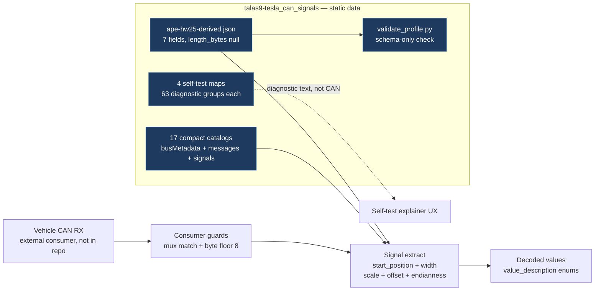
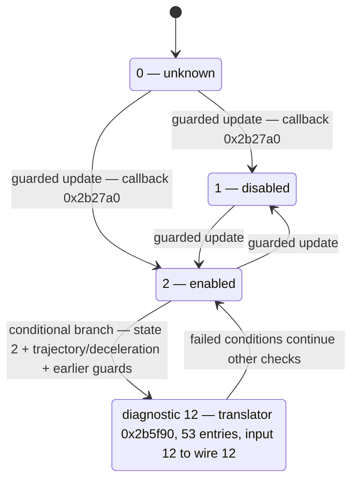

# talas9-tesla_can_signals

Deep-dive at pinned gitlink `c62fdf279dca0273889c0081a52e17695e766518`. Supersedes the shallow summary that previously occupied this file; summary claims are retained only in section 6 (contradiction table). Code and data are evidence; README and the old summary are leads only.

## 1. Provenance

| Item | Value |
| --- | --- |
| Submodule path | `legacy/talas9-tesla_can_signals` |
| Pinned gitlink SHA | `c62fdf279dca0273889c0081a52e17695e766518` (`git ls-files -s`: `160000 <sha> 0 ...`) |
| `rev-parse HEAD` | `c62fdf279dca0273889c0081a52e17695e766518` — **matches gitlink** |
| Worktree | `git status --porcelain` empty at analysis time |
| Upstream URL | `https://github.com/talas9/tesla_can_signals` (origin fetch + push) |
| Upstream tip subject | `Add separate derived HW2.5 APE research profile` |
| License | None. No `LICENSE`, `COPYING`, or license field anywhere in the tracked tree (`git ls-tree -r --name-only HEAD`). Summary's "License: None" is confirmed. |
| Analysis date | 2026-11-20 |
| Evidence method | Direct file reads plus read-only `json.load` parse of every tracked JSON at the pinned SHA. No upstream fetch, no commits, no writes outside this doc. |

**Files read (with line ranges / coverage):**

- `README.md:1-6` (full).
- `research/README.md:1-36` (full).
- `research/validate_profile.py:1-54` (full; executed read-only, rc=0, `PASS: 4 messages, 7 scoped fields`).
- `research/ape-hw25-derived.json:1-233` (full).
- `Model3/Model3_ETH.compact.json:1-120`, `:495-508`, `:2772-2941`; plus anchor lines 769 (`BMS_status`), 14662 (`VCSEC_TPMSStatus`), 1768 (`DI_speed`); whole file parsed structurally.
- `Model3/legacy_self_test_parser.json:1-120` (full head); whole file parsed structurally (63 top-level entries).
- `ModelS/ModelS_ETH.compact.json.json:1-80`; all 17 `*.compact.json*` databases parsed structurally (message counts, signal counts, baud, bus metadata, `messageValidation`, and full `message_id` scan).
- All four `legacy_self_test_parser.json` files parsed structurally (63 entries each).

**Files explicitly NOT read:**

- Raw APE/ firmware binaries, original disassembly, raw CAN captures, bulk source definitions — not present in the repo (`research/README.md:5`); cannot be read.
- Upstream history beyond the pinned commit — no `git fetch` was run; see section 9 recipe for the next agent.
- The other three `legacy_self_test_parser.json` copies and 16 compact databases were parsed by key, not manually line-scanned; per-line claims below are limited to the files with cited ranges.
- Our-side files were read only at the symbols needed for adaptation decisions (section 7); no exhaustive audit of `firmware/` or `client/` was performed.

## 2. Executive verdict

A **static reference-data repository**, not a firmware or tooling project. It ships 17 compact CAN signal databases (Model 3/Y ETH `caneth` + Model S/X BDY/BFT/CH/ETH/OBDII/PT/PT_BMSDBG/TH), four identical-in-shape self-test diagnostic message maps, and — as of the pinned commit — a small, deliberately partial HW2.5 APE research sidecar with its own validator. The durable mechanisms are the **compact schema** (`busMetadata` / `messages` / `signals`), the **validation metadata** (`messageChecksum` / `messageCounter` as *names*, never formulas), the **mux metadata** (`is_muxer` / `mux_ids` / `mux_id`), the **diagnostic message mapping** (`metric_name` / `metric_value` / `tasks` / `prefix` / `postfix`), and the sidecar's **provenance-gated, unverified-by-design research discipline** (`length_bytes: null`, no enum names, `current_hw4: unverified`, explicit request-vs-acknowledgement warnings).

Adaptation verdict: **nothing from the archived signal databases should be ported into shipping code.** Zero of our mutation-critical IDs (0x3FD, 0x370, 0x398, 0x392, 0x39B, 0x2B9, 0x488) appear in them, our client already ships far richer decoder datasets, and several numerically colliding IDs carry *different* semantics. The only real candidates are the self-test diagnostic message map (client UX reference data), the sidecar's provenance/unverified schema as a pattern for future `docs/legacy/` research notes, and the request-vs-ack + defensive-DLC discipline as a CAN-review note. The seven HW2.5 field tuples are **never port** — upstream itself marks network identity and HW4 compatibility unknown.

## 3. Evidence map

| Source file | Lines | What it proves | Grade |
| --- | --- | --- | --- |
| `README.md` | 1-6 | Repo scope "messages and signals for 3, Y, S and X"; research sidecar pointer | SUMMARY-ONLY (upstream README) |
| `research/README.md` | 3, 5, 19, 23-30, 34, 36 | Sidecar is separate schema; provenance from Lunars; DLC/mux guard rule; addresses are old-image only; validator checks scope not runtime compatibility | SUMMARY-ONLY (README) / CODE-READ where it restates JSON |
| `research/validate_profile.py` | 6-48, 51-54 | `validate()` asserts exact 7 tuples, mux widths, `length_bytes is None`, unsigned LE scale1/offset0, evidence presence, excludes modern enums; ran PASS | TEST-READ |
| `research/ape-hw25-derived.json` | 4-7, 20-24, 28-125, 226-232 | `profile_id=ape-hw25-static`, HW2.5, `network=null`, `current_hw4=unverified`, `0x3EE` transport warning, 7 scoped fields, explicit limits | CODE-READ |
| `Model3/Model3_ETH.compact.json` | 2-8 | `busMetadata`: baud 500000, `canFrameFormat=base`, bus id 3, `protocol=caneth` | CODE-READ |
| `Model3/Model3_ETH.compact.json` | 9-68 | `messages` map shape: `cycle_time`, `length_bytes`, `message_id`, `senders`, `signals`, `transmitConditions` | CODE-READ |
| `Model3/Model3_ETH.compact.json` | 22-40 | Signal shape: `start_position`, `width`, `endianness`, `signedness`, `scale`, `offset`, `min`/`max`, `units`, `value_description`, `receivers` | CODE-READ |
| `Model3/Model3_ETH.compact.json` | 72-74, 1470 | `messageValidation.messageCounter` / `messageChecksum` store a **signal name**, not a formula (e.g. `DIF_statusChecksum`) | CODE-READ |
| `Model3/Model3_ETH.compact.json` | 2772-2807, 2919-2941 | `0x7FF` is `GTW_carConfig`, muxer width 8 with mux ids 1-6; `GTW_mapRegion` is a 12-value enum at `start_position` 8 on mux 3 | CODE-READ |
| `Model3/Model3_ETH.compact.json` | 495-498 | `message_id: 914` (0x392) is `BMS_packConfig` — collides with our `GTW_versionInfo` | CODE-READ |
| `Model3/legacy_self_test_parser.json` | 2-17, 82-101, 114-118 | Diagnostic map shape: `metric_name` / `metric_value` → human text, `postfix`, `prefix`, `tasks` (service `RUN - TEST-SELF_*` strings) | CODE-READ |
| All 17 compact DBs (structural parse) | `messages`/`signals` keys | Per-file counts: Model3/Y ETH 148 msgs / 375 sigs each; ModelS ETH 134 / 314; ModelX ETH 130 / 280; ModelS CH 26 / 39; ModelX BDY 32 / 62; ModelS PT 48 / 62; `PT_BMSDBG` 0 msgs; `OBDII` 1 msg. No 0x3FD anywhere. | CODE-READ |
| `packages/protocol/src/decoder.ts` | 3-28, 43-69, 71-80 | Our `DecoderDataset` / `DecoderFrame` / `DecoderSignal` shape and `buildDecoderIndex` — the only plausible ingestion target | CODE-READ (our side) |
| `client/src/assets/can-decoder/legacy_mcu2.json` | 18-22 | Our shipped decoder dataset: 577 frames / 40,484 signals / 62,007 enum rows — strictly richer than upstream's best DB | CODE-READ (our side) |
| `firmware/lib/vehicle/can/crc8.h` | 12-80 | Our CRC-8/OPENSAFETY table + per-ID magic tables for 0x229/0x249/0x370 and `teslaCrc8()` | CODE-READ (our side) |
| `firmware/lib/vehicle/can/ids.h` | 15-72 | Our ID map: 0x3FD FSD, 0x370 EPAS, 0x398 car config, 0x392 GTW version, 0x219 TPMS, etc. | CODE-READ (our side) |
| `firmware/lib/vehicle/can/feature/telemetry/tpms.h` | 22-76 | Our TPMS scale 0.025 bar, −40 °C, `dlc < 8` guard | CODE-READ (our side) |
| `firmware/lib/vehicle/can/feature/telemetry/fw_compat.h` | 46-94 | Our 0x392 mux decode (year/release/minor, build) | CODE-READ (our side) |
| `firmware/lib/vehicle/can/feature/telemetry/vehicle_config.h` | 50-85 | Our 0x398 platform/year decode | CODE-READ (our side) |
| No CAPTURE evidence in repo | — | The repo contains zero captured frames and zero decode-tool runs; every byte-level claim is static | UNVERIFIED |

## 4. Architecture and build surface

- **Entry points:** none executable in the archived profile set (data only). The only executable entry point is `research/validate_profile.py:51-54` (`__main__` → `validate(json.loads(...)`, prints PASS line).
- **Shared core vs platform port:**
    - Archived core = the compact schema: top-level `busMetadata` + `messages` object; each message has `length_bytes`, `cycle_time`, `send_type`, `senders`, `signals`, `transmitConditions`, optional `messageValidation` and `atomicGroups` (ModelS ETH `:11`).
    - Platform/data ports = one file per vehicle/bus; Model 3/Y use `protocol: "caneth"` (Model3 ETH `:7`), Model S/X use `protocol: "can"` with per-bus baud (BDY/BFT 125000 at ModelS BDY/BFT metadata, CH/ETH 500000, PT/OBDII `baudrate: 0`).
    - Research sidecar = parallel schema (`messages` **array**, per-field `evidence`, `length_bytes: null`) explicitly *not* a drop-in for the compacts (`research/README.md:34`).
- **Build flags / dependency boundaries:** none. No build system, no package manifest, no imports between files. `validate_profile.py` depends only on Python stdlib (`json`, `pathlib`). No license file. `legacy/` is read-only research per repo `AGENTS.md`; nothing here may enter `firmware/`, `client/`, `packages/`, or `tools/`.

No frame pipeline exists in this repo — the skill's `None found: no frame pipeline` case applies. For orientation only, the diagram below shows the *external consumption flow* the data describes; nothing in it executes here:



## 5. Mechanism catalogue

### M1 — Compact signal-database schema

- **Claim (README / summary):** "Tesla CAN bus messages and signals for 3, Y, S and X"; summary calls them "compact DBC-like signal databases".
- **Code path:** `Model3/Model3_ETH.compact.json:1-8` — `busMetadata` → `:9` `messages` → `:21` `signals` → per-signal fields at `:22-40`.
- **Frame spec:** Not a transmitter. Each message records decimal `message_id`, `length_bytes`, `cycle_time`, `originNode`/`origin_id`, `senders`, and `transmitConditions`. Each signal records `start_position` (zero-based LSB-first), `width`, `endianness` (`LITTLE`), `signedness`, `scale`, `offset`, `min`/`max`, `units`, `value_description` (enum map), `value_table_name`, `receivers`.
- **Gates and timing:** `cycle_time` is metadata only (e.g. `1000` at `:11`, `500` at `:70`, `10` for `DI_speed` at `:1768`); no scheduler exists.
- **State machine:** None.
- **Tests:** None for the compacts. Sidecar validator covers only the research profile (`validate_profile.py:6-48`).
- **Evidence grade:** CODE-READ.
- **Verdict:** CONFIRMED.
- **Adapt to TeslaCANModder?** already present / superseded — our `packages/protocol/src/decoder.ts:3-28` plus shipped datasets (`client/src/assets/can-decoder/legacy_mcu2.json:18-22`: 577 frames, 40,484 signals) cover the same shape at vastly greater depth.

### M2 — Validation metadata (CRC / counter *references*)

- **Claim (README / summary):** Not claimed. Summary mentions "message IDs, signal names, bit positions, factors, offsets, and units" only.
- **Code path:** `Model3/Model3_ETH.compact.json:72-74` — `messageValidation.messageCounter: "APS_statusCounter"`; `:1470` — `messageChecksum: "DIF_statusChecksum"` (both point at a signal name in the same `signals` object).
- **Frame spec:** No polynomial, no magic table, no byte position for the checksum itself. 26 messages in Model3 ETH carry `messageChecksum`, 28 carry `messageCounter`; ModelS ETH 11/13. The referenced checksum/counter signals are ordinary signal entries with `start_position` and `width`.
- **Gates and timing:** None.
- **State machine:** None.
- **Tests:** None.
- **Evidence grade:** CODE-READ.
- **Verdict:** CONFIRMED — but the schema deliberately omits the algorithm.
- **Adapt to TeslaCANModder?** already present. Our `firmware/lib/vehicle/can/crc8.h:12-43` (polynomial 0x2F table) and `:45-80` (per-ID magic tables for 0x229/0x249/0x370, `teslaCrc8()`) are independent implementations backed by captures; upstream names are not an oracle.

### M3 — Multiplexed-frame metadata

- **Claim (README / summary):** Summary says message IDs / signal names / bit positions; does not describe mux semantics.
- **Code path:** `Model3/Model3_ETH.compact.json:2784-2807` — `GTW_carConfigMultiplexer` with `is_muxer: true`, `start_position: 0`, `width: 8`, `mux_ids: [1..6]`; per-page fields use `mux_id` (e.g. `GTW_chassisType` `:2808-2829` mux 3, `GTW_mapRegion` `:2919-2941` mux 3).
- **Frame spec:** `0x7FF`, len 8, muxer in byte[0] 8 bits, pages 1-6. `GTW_mapRegion` enum has 12 entries (`EU=1, CN=3, AU=4, JP=5, KR=7, ME=8, HK=9, ...`), unlike our 5-region model.
- **Gates and timing:** A decoder must match `mux_id` and check `length_bytes` before extracting (structural requirement, not enforced by any code here).
- **State machine:** None.
- **Tests:** None.
- **Evidence grade:** CODE-READ.
- **Verdict:** CONFIRMED for upstream; CONTRADICTED as a description of our 0x7FF (see section 6, C6).
- **Adapt to TeslaCANModder?** never port this layout. Our `0x7FF` is the AP-tier readback (`docs/reference/can-protocol.md`, mux 2 byte[5] bits[4:2]) — a different generation with the same numeric ID.

### M4 — Self-test diagnostic message mapping

- **Claim (README / summary):** "Legacy self-test parser data could be useful for diagnostics features" (SUMMARY-ONLY).
- **Code path:** `Model3/legacy_self_test_parser.json:2-17` — `P2_armrest` → `metric_name` / `postfix` / `tasks`; `:82-101` — `autopilot` → `metric_name` (`CH_CAN_STATUS`, `PARK_CAN_STATUS`, ...) and `metric_value` (`Request Timed Out`, `verbose_status` with `{value}` placeholder); `:114-118` — `brake_stiffness` with `{metadata[FormattedResults][PRESSURE_P100]}` interpolation.
- **Frame spec:** Not a CAN frame. Keys are diagnostic top-level groups (63 per file); values map raw self-test metric names to human explanations plus `prefix`/`postfix` advice and `tasks` like `RUN - TEST-SELF_APS_X_CAN-COMMS`.
- **Gates and timing:** None; all four model files have the same 63 top-level keys.
- **State machine:** None.
- **Tests:** None.
- **Evidence grade:** CODE-READ (data present); value as *our* UX is UNVERIFIED (no capture of a real self-test result run).
- **Verdict:** CONFIRMED as data; usefulness UNVERIFIED.
- **Adapt to TeslaCANModder?** candidate for future PR — reference text for a client "self-test result explainer", not firmware. Needs a real self-test capture to validate phrasing/limits.

### M5 — Provenance-gated HW2.5 APE research sidecar

- **Claim (README / summary):** Summary does not mention it (commit `c62fdf2` added it after the summary was written).
- **Code path:** `research/ape-hw25-derived.json:2-26` — `schema_version: 1`, `profile_id: ape-hw25-static`, `hardware: HW2.5`, `network: null`, `source.provenance: "Firmware and APE images acquired from Lunars."`, `compatibility.current_hw4: "unverified"`, explicit "Do not substitute 0x3FD for the recovered 0x3EE request transport"; `:28-224` — 7 fields across 4 messages; `:226-232` — `limits`.
- **Frame spec:** 7 recovered tuples, zero-based little-endian, unsigned, scale 1, offset 0, empty `value_description`: `(0x3EE, mux0, bit37, w1)`, `(0x3EE, mux0, bit38, w1)`, `(0x3EE, mux1, bit45, w1)`, `(0x3EE, mux0, bit46, w1)`, `(0x399, no mux, bits0-3, w4)`, `(0x247, no mux, bits32-38, w7)`, `(0x5D9, mux2, bits46-52, w7)`. Evidence carries binary, instruction addresses, `verified` and `unresolved` text for each.
- **Gates and timing:** `length_bytes: null` everywhere (unknown, not zero); `required_decode_bytes: 8` for 0x3EE; decoder must check mux and sufficient bytes.
- **State machine:** Upstream AP state machine referenced as source (`source_files[2]`) but not shipped.
- **Tests:** `research/validate_profile.py:12-17` pins the exact 7 tuples; `:18-47` enforces uniqueness, mux bounds, evidence presence, and exclusion of modern enums; executed PASS (4 messages, 7 fields).
- **Evidence grade:** CODE-READ + TEST-READ for *schema integrity*; UNVERIFIED for wire/runtime truth (no binaries, no captures, no current-hardware check).
- **Verdict:** PARTIAL — internally consistent and validated, but compatibility explicitly unknown.
- **Adapt to TeslaCANModder?** candidate for future PR **as a process pattern only** (provenance + unverified markers for future research notes). Never port the 7 fields; never port the instruction addresses as current addresses.

### M6 — Defensive extraction guards (DLC floor + mux match)

- **Claim (README / summary):** Not claimed in the old summary.
- **Code path:** `research/README.md:19` — "A decoder must check that enough payload bytes exist for the selected field and that its mux matches"; `research/ape-hw25-derived.json:35-36` — `required_decode_bytes: 8`, `dlc_behavior: "Decoder rejects lengths below8; length8 continues; above8 logs a diagnostic and continues. This is not exact-DLC validation."`
- **Frame spec:** Guard applies to recovered 0x3EE decoder only; exact-DLC acceptance would misrepresent it.
- **Gates and timing:** Length floor 8; oversize is logged, not rejected.
- **State machine:** None.
- **Tests:** `validate_profile.py:23` asserts `length_bytes is None`; no test of decoder runtime behavior.
- **Evidence grade:** CODE-READ (for the JSON/README assertion); the described decoder binary is **not** in the repo → UNVERIFIED behavior.
- **Verdict:** PARTIAL.
- **Adapt to TeslaCANModder?** already present for the core guard (`firmware/lib/vehicle/can/feature/telemetry/tpms.h:53,72` `dlc < 8` early return; `ids.h:106-109` `readFollowDistance` DLC guard). Candidate minor: consider "log on oversize DLC" in our decoders — requires `can-review-checklist.md` before any frame-shape change.

### M7 — Request-vs-acknowledgement and conditional-diagnostic discipline

- **Claim (README / summary):** Not claimed in old summary; present in `research/README.md:24-30`.
- **Code path:** `research/ape-hw25-derived.json:80-82` — stops-control bit is "a request, not an acknowledgement"; `:218-220` — check result is "not a request-receipt acknowledgement"; `:219` — 53-entry translator, input 12 → wire 12, unsigned input > 52 → 45; `research/README.md:25-28` — `canrx` decoder `0x2eccc0`, packing `0x2edcc4`-`0x2edcec`, callback `0x2b2df4`, accepted-state callback `0x2b27a0` (+0x4cc, publication +0x10 → snapshot +0x4dc), abort translator `0x2b6300`, paired diagnostic load `0x26c884`, translator `0x2b5f90`.
- **Frame spec:** Bit 38 "accepted stops-control state" uses 0=unknown, 1=disabled, 2=enabled; diagnostic branch to 12 requires state 2 **plus** extra trajectory/deceleration and earlier guards; failed conditions continue other checks. HOLD Boolean at ASM +0x68 has no proven CAN consumer and is deliberately excluded (`:30-31`, `:231`).
- **Gates and timing:** Guarded/conditional, not unconditional acknowledgement.
- **State machine:** Accepted-state transitions exist upstream (0/1/2) with receiver guards; no current-hardware equivalence.
- **Tests:** Partial — `validate_profile.py:41-43` only requires non-empty `evidence.locations`/`verified`/`unresolved`, not semantic correctness.
- **Evidence grade:** CODE-READ (JSON + README assertions); underlying disassembly UNVERIFIED (binaries absent).
- **Verdict:** PARTIAL / UNVERIFIED.
- **Adapt to TeslaCANModder?** never port the fields or addresses; candidate for a CAN-review checklist note distinguishing request bits from acknowledgement bits.

M7's accepted stops-control state is the only 3-state machine in this catalogue (0=unknown, 1=disabled, 2=enabled, `research/ape-hw25-derived.json:80`):



Transition directions between 0/1/2 are UNVERIFIED: upstream establishes only the value encoding (`research/ape-hw25-derived.json:80`), the guarded conditional update (`research/README.md:26`), and the state-2-gated diagnostic branch (`research/README.md:28`).

**Mechanism count: 7.**

## 6. Summary vs code contradiction table

| ID | Old summary / upstream claim | Code evidence | Verdict |
| --- | --- | --- | --- |
| C1 | Overview: "This is a data-only repository with no executable code." (`docs/legacy/talas9-tesla_can_signals.md:15`, pre-overwrite) | `research/validate_profile.py:1-54` is executable Python with `validate()` and `__main__`; ran PASS at pinned SHA | CONTRADICTED |
| C2 | Overview enumerates only 3/Y/S/X compact DBs + self-test parsers; no `research/` sidecar (old summary `:15, 41-46`) | `README.md:4-6`, `research/README.md:1-36`, `research/ape-hw25-derived.json:1-233`, added by pinned commit `c62fdf2` | CONTRADICTED (material omission) |
| C3 | "Reusability: High", "comprehensive CAN signal definitions ... across multiple vehicle models and bus types" (old summary `:54-56`) | Zero of our mutation-critical IDs (0x3FD/0x370/0x398/0x392/0x39B/0x2B9/0x488) in any compact DB; our client ships 577 frames / 40,484 signals (`client/src/assets/can-decoder/legacy_mcu2.json:18-22`) vs upstream's best 148/375 | CONTRADICTED → treat as SUMMARY-ONLY |
| C4 | "Model S has the most detailed coverage" (old summary `:59`) | Structurally true but marginal: ModelX also has 8 bus files; ModelS ETH 134/314 vs ModelX ETH 130/280; Model3/Y ETH 148/375 each | AGREES, marginal — keep precise |
| C5 | Upstream `0x7FF` = `GTW_carConfig` mux 1-6, `GTW_mapRegion` 12-value enum (`Model3_ETH.compact.json:2772-2807, 2919-2941`) | Our docs: `0x7FF` mux 2 byte[5] bits[4:2] autopilot tier; our region model has 5 codes (`docs/reference/can-protocol.md`, `commands.md`) | CONTRADICTED across sources — different generation, same ID |
| C6 | Upstream `message_id: 914` (0x392) = `BMS_packConfig` (`Model3_ETH.compact.json:495-498`); `0x318` = `GTW_carConfig`; `0x219` = `BMS_status` (`:769`) | Our `ids.h:60` 0x392 = `GTW_versionInfo`; `:52` 0x318 = `GTW_carState` (OTA guard); `:39` 0x219 = VCSEC_TPMSData | CONTRADICTED across sources — numeric collisions, not shared meaning |
| C7 | Research README warns "Do not substitute 0x3FD for the recovered 0x3EE request transport" (`ape-hw25-derived.json:22`, `research/README.md:19`) | Confirms our 0x3FD FSD mux (`ids.h:25`) is *not* the HW2.5 request transport | AGREES — keep as do-not-copy rule |

Checked and agreed (not contradictions): "License: None" and "CAN Interface: N/A" (`tools`-free tree); per-file bus/baud metadata; `scale`/`offset`/`start_position` field vocabulary.

## 7. CAN frame and signal inventory

Reading coverage for this section: `research/ape-hw25-derived.json` (233 lines) and `research/validate_profile.py` are FULL-READ. `Model3/Model3_ETH.compact.json` (15,191 lines) and `ModelS/ModelS_ETH.compact.json.json` (9,163 lines) are RANGE-CITED — only the line ranges cited below were read. All 17 `*.compact.json*` catalogs are STRUCTURAL-PARSE (read-only `json.load` scan at the pinned SHA: per-file message/signal/checksum/counter counts, `busMetadata`, and a 21-ID `message_id` probe). Vendored catalogs get the per-file summary at the end of this section — never a wholesale row dump.

The repo decodes, mutates, and injects nothing: there is no runtime, so every row below is a static frame *definition*. The counter/checksum columns record what the schema actually carries — `messageValidation` stores a referenced *signal name*, never a byte position or formula (mechanism M2).

### Range-cited definitions — `Model3/Model3_ETH.compact.json`

| ID (hex / dec) — name (cited lines) | Bus | Period | DLC | Byte/bit layout | Scale / units | Counter position | Checksum | R/W | Grade |
| --- | --- | --- | --- | --- | --- | --- | --- | --- | --- |
| `0x499 / 1177` — APP_cameraTemperatures (`:10-67`) | ETH (`caneth`, bus id 3, 500 kbps) | 1000 ms | 8 | `rRepeaterCameraTemperature` bits 24-31, `lRepeaterCameraTemperature` bits 32-39, both UNSIGNED LITTLE | scale 1, offset −60, °C, SNA 255 | None found | None found | definition only | CODE-READ |
| `0x3CA / 970` — APS_status (`:69-80`) | ETH | 500 ms | 7 | payload signals not read (cited range ends at `:80`); `origin_id` 969 ≠ `message_id` 970 (`:75-77`) | — | named signal only: `APS_statusCounter` (`:72-74`) | None found | definition only | CODE-READ |
| `0x132 / 306` — BMS_hvBusStatus (`:306-346`) | ETH | 10 ms | 8 | `BMS_packCurrent` bits 16-31, SIGNED LITTLE; no voltage signal in this message | scale 0.1 A, SNA −32768 (`:334`) | None found | None found | definition only | CODE-READ |
| `0x212 / 530` — BMS_status (`:769-943`) | ETH | 100 ms | 8 | `BMS_contactorState` bits 8-10 (enum `:796-804`); `BMS_userChargeStatus` bits 11-13 (`:910-934`); `BMS_ecuLogUploadRequest` bits 14-15 (`:808-829`); `BMS_hvState` bits 16-18 (enum `:845-853`); `BMS_isolationResistance` bits 19-28 (`:857-878`); `BMS_state` bits 32-35, 11-value enum (`:879-909`) | scale 1; isolation ×10 kOhm, SNA 1023 (`:874`) | None found | None found | definition only | CODE-READ |
| `0x292 / 658` — BMS_socStatus (`:599-684`) | ETH | 100 ms | 8 | `BMS_socMin` bits 0-9 (`:643-660`); `BMS_socUI` bits 10-19 (`:661-676`); `BMS_socMax` bits 20-29 (`:626-642`); `BMS_socAvg` bits 30-39 (`:611-625`) | scale 0.1 % each, max 102.2 (socUI 100) | None found | None found | definition only | CODE-READ |
| `0x118 / 280` — DI_systemStatus (`:1817-1907`) | ETH | 10 ms | 8 | `DI_brakePedalState` bits 19-20, OFF=0 / ON=1 / INVALID=2 (`:1833-1852`); `DI_gear` bits 21-23, P=1 / R=2 / N=3 / D=4 / INVALID=0 / SNA=7 (`:1853-1878`); `DI_hvilSystemStatus` bits 27-28 (`:1879-1899`); no accelerator-pedal signal | scale 1 | named signal only: `DI_systemStatusCounter` (`:1822`) | named signal only: `DI_systemStatusChecksum` (`:1821`) | definition only | CODE-READ |
| `0x257 / 599` — DI_speed (`:1768-1815`) | ETH | 20 ms | 8 | single signal `DI_vehicleSpeed` bits 43-55, UNSIGNED LITTLE | scale 0.08 (`:1795`), offset −40 (`:1789`), kph, SNA 8191 (`:1800`) | named signal only: `DI_speedCounter` (`:1773`) | named signal only: `DI_speedChecksum` (`:1772`) | definition only | CODE-READ |
| `0x392 / 914` — BMS_packConfig (`:495-512`) | ETH | 1000 ms | 8 | `BMS_packConfigMultiplexer` at bit 0, `is_muxer: true`; `mux_ids` list begins at `:512` and continues past the cited range | — | None found | None found | definition only | CODE-READ |
| `0x23A / 570` — VCSEC_TPMSStatus (`:14662-14729`) | ETH | 1000 ms | 8 | mux pages 0-3; `VCSEC_TPMSSensorMACAddress0..3` bits 8-55 (48-bit sensor MAC) per page, UNSIGNED LITTLE; signals continue past `:14729` | scale 1 | None found | None found | definition only | CODE-READ |
| `0x7FF / 2047` — GTW_carConfig (`:2772-2950`) | ETH | 100 ms | 8 | muxer bit 0 width 8, `mux_ids` 1-6 (`:2784-2807`); mux 1: `GTW_deliveryStatus` bit 8 (`:2830-2850`), `GTW_drivetrainType` bits 56-59 (`:2852-2872`); mux 2: `GTW_headlightLevelerType` bits 59-60 (`:2896-2917`), `GTW_numberHVILNodes` start 62 (`:2951-2965`, width past cited range); mux 3: `GTW_chassisType` bits 18-20 (`:2808-2828`), `GTW_mapRegion` bits 8-11, 12-value enum (`:2919-2949`); mux 6: `GTW_epasType` bits 33-35 (`:2874-2894`) | scale 1 | None found | None found | definition only | CODE-READ |

### Range-cited definitions — `ModelS/ModelS_ETH.compact.json.json` (Model S/X generation)

| ID (hex / dec) — name (cited lines) | Period | DLC | Byte/bit layout | Notes | Grade |
| --- | --- | --- | --- | --- | --- |
| `0x219 / 537` — BMS_status (`:1718-1786`) | 30000 ms | 5 | `BMS_contactorState` bits 16-19, w4, enum CLOSED=2 / OPEN=0 / OPENING=3 / PRECHARGE=1 / SNA=4 / WELD=5 / CLEANING=6 (`:1746-1754`); `BMS_contactorStateFC` bits 32-33 (`:1758-1781`); `BMS_hvilOn` (`:1782-1786`, cut) | slow config-ish BMS frame on the S/X generation — same numeric ID as our TPMS | CODE-READ |
| `0x318 / 792` — GTW_carConfig (`:3494-3543`) | 1000 ms | 8 | `GTW_auxHvacType` bit 60 (`:3507-3525`); `GTW_country` bits 7-22, w16 (`:3527-3542`); `GTW_memorySeatsInstalled` (`:3544+`, cut) | **BIG-endian signals** — unlike every Model3/Y ETH frame cited above | CODE-READ |

### Sidecar frames — `research/ape-hw25-derived.json` (HW2.5 research labels, FULL-READ)

| ID (hex / dec) — label (cited lines) | Bus | Period | DLC | Layout | Counter | Checksum | Direction | Grade |
| --- | --- | --- | --- | --- | --- | --- | --- | --- |
| `0x3EE / 1006` — request_input (`:28-126`) | null (`network: null`, `:6-7`) | None found | `length_bytes: null`; floor 8 (`:34-36`) | mux bits 0-2, w3 (`:37-40`); request bits 37 (`:43-61`), 38 (`:63-83`), 46 (`:105-124`) on mux 0; bit 45 (`:84-104`) on mux 1; all w1, UNSIGNED LITTLE, scale 1, offset 0, empty enums | None found | None found | into_APE (`:31`) | CODE-READ |
| `0x399 / 921` — state_output (`:127-157`) | null | None found | null | `translated_state_raw` bits 0-3, w4 (`:136-138`); recovered helper never emits 6 (`:152`) | None found | None found | out_of_APE | CODE-READ |
| `0x247 / 583` — abort_output (`:158-187`) | null | None found | null | `translated_abort_reason_raw` bits 32-38, w7 (`:167-169`) | None found | None found | out_of_APE | CODE-READ |
| `0x5D9 / 1497` — diagnostic_output (`:188-224`) | null | None found | null | mux bits 0-3, w4 (`:194-197`); `translated_check_result_raw` bits 46-52, w7, on mux 2 (`:200-207`) | None found | None found | out_of_APE | CODE-READ |

### Vendored-catalog structural summary (one line per file, STRUCTURAL-PARSE scan)

| File (`busMetadata` at `:3` in every catalog) | Baud | Messages | Signals | Checksum names | Counter names |
| --- | --- | --- | --- | --- | --- |
| `Model3/Model3_ETH.compact.json` | 500000 | 148 | 375 | 26 | 28 |
| `ModelY/ModelY_ETH.compact.json` | 500000 | 148 | 375 | 26 | 28 |
| `ModelS/ModelS_ETH.compact.json.json` | 500000 | 134 | 314 | 11 | 13 |
| `ModelX/ModelS_ETH.compact.json.json` | 500000 | 130 | 280 | 11 | 13 |
| `ModelS/ModelS_CH.compact.json.json` and `ModelX/ModelS_CH…` | 500000 | 26 | 39 | 2 | 2 |
| `ModelS/ModelS_BDY.compact.json.json` | 125000 | 11 | 25 | 0 | 0 |
| `ModelX/ModelS_BDY.compact.json.json` | 125000 | 32 | 62 | 0 | 0 |
| `ModelS/ModelS_BFT…` and `ModelX/ModelS_BFT…` | 125000 | 5 | 5 | 0 | 0 |
| `ModelS/ModelS_PT.compact.json.json` | 0 | 48 | 62 | 0 | 0 |
| `ModelX/ModelS_PT.compact.json.json` | 0 | 45 | 57 | 0 | 0 |
| `ModelS/ModelS_OBDII…` and `ModelX/ModelS_OBDII…` | 0 | 1 | 2 | 0 | 0 |
| `ModelS/ModelS_PT_BMSDBG…` and `ModelX/ModelS_PT_BMSDBG…` | 500000 | 0 | 0 | 0 | 0 |
| `ModelX/ModelS_TH.compact.json.json` | 500000 | 2 | 2 | 0 | 0 |

Scan notes:

- Probed and **absent from every compact catalog**: 1021 (0x3FD), 880 (0x370), 920 (0x398), 923 (0x39B), 697 (0x2B9), 1160 (0x488), 1006 (0x3EE), 921 (0x399), 583 (0x247), 1497 (0x5D9), 627 (0x273), 786 (0x312).
- 530 (0x212) has three meanings across files: `BMS_status` on Model3/Y ETH **and** ModelS/X PT, but `BCFRONT_lightStatus` on ModelS/X ETH.
- 280 (0x118) is `DI_systemStatus` on Model3/Y ETH but `DI_torque2` on ModelS/X CH; 257 (0x101) is `RCM_inertial1` on Model3/Y ETH.
- The four `legacy_self_test_parser.json` files are not CAN frames — 63 diagnostic text groups each, identical key sets across all four files (verified by read-only `json.load` count).

## 8. Constants and tuning table

| Constant | Value | Location | Meaning | Grade |
| --- | --- | --- | --- | --- |
| CAN baud — ETH/CH/BMSDBG/TH | 500000 | `Model3_ETH.compact.json:3` and 12 other catalogs, all at `:3` | 500 kbps bus rate | CODE-READ |
| CAN baud — BDY/BFT | 125000 | `ModelS_BDY.compact.json.json:3`, `ModelS_BFT…:3` (+ ModelX copies) | 125 kbps body / fault-tolerant buses | CODE-READ |
| CAN baud — PT/OBDII | 0 | `ModelS_PT.compact.json.json:3`, `ModelS_OBDII…:3` (+ ModelX copies) | baud unspecified in metadata — a gap, not a real 0-baud bus | CODE-READ |
| `0x3EE` mux width | 3 (bits 0-2) | `research/ape-hw25-derived.json:38-39` | request-frame selector | CODE-READ |
| `0x5D9` mux width | 4 (bits 0-3) | `research/ape-hw25-derived.json:195-196` | diagnostic-frame selector | CODE-READ |
| `0x3EE` byte floor | 8 (`required_decode_bytes`) | `research/ape-hw25-derived.json:35` | minimum payload for any field extract | CODE-READ |
| `0x3EE` DLC behavior | reject <8; log + continue >8 | `research/ape-hw25-derived.json:36` | deliberately not exact-DLC validation | CODE-READ |
| Accepted stops-control encoding | 0=unknown, 1=disabled, 2=enabled | `research/ape-hw25-derived.json:80` | HW2.5 accepted-state values | UNVERIFIED |
| cantx state ceiling | never emits 6 | `research/ape-hw25-derived.json:152` | old state helper lacks the modern state 6 | UNVERIFIED |
| Diagnostic translator | 53 entries; input 12 → wire 12; unsigned >52 → 45 | `research/ape-hw25-derived.json:219` | check-result clamping before packing bits 46-52 | UNVERIFIED |
| `origin_id` ≠ `message_id` | APS 969/970; BMS_log1 882/884; GTW_carConfig 999/2047 | `Model3_ETH:75-77`, `:351-353`, `:2775-2777` | origin-ID remapping — never treat `origin_id` as the wire ID | CODE-READ |
| `DI_vehicleSpeed` | scale 0.08, offset −40, SNA 8191 | `Model3_ETH:1795`, `:1789`, `:1800` | archived speed encoding (bits 43-55) | CODE-READ |
| `GTW_mapRegion` enum | 12 values: US=0, EU=1, NONE=2, CN=3, AU=4, JP=5, TW=6, KR=7, ME=8, HK=9, MO=10, SE=11 | `Model3_ETH:2934-2949` | upstream region model; numerically collides with our 5-code model | CODE-READ |
| `BMS_packCurrent` SNA | −32768 | `Model3_ETH:334` | invalid-current marker | CODE-READ |
| `cycle_time: 0` | sporadic marker | `Model3_ETH:687` (BMS_stateOfHealth), `:945` (BMS_udsResponse) | not a 0 ms period | CODE-READ |
| Validator ID domain | `0 <= mid <= 0x7FF`, unique per profile | `research/validate_profile.py:21` | sidecar arbitration-ID ceiling | TEST-READ |
| Validator field bounds | `width > 0`, `start + width <= 64` | `research/validate_profile.py:29` | bit-addressable payload ceiling | TEST-READ |
| Validator mux rule | width 3 iff `mid == 0x3EE`, else 4 | `research/validate_profile.py:26` | per-message selector width | TEST-READ |
| Instruction addresses | decoder `0x2eccc0`; callbacks `0x2b2df4` / `0x2b27a0` / `0x2b5da0` / `0x2b6300` / `0x2b5f90`; packing `0x2edcc4`-`0x2edcec`; ASM offsets `+0x4cc` / `+0x10` / `+0x70` / `+0x74` / `+0x84` | `research/README.md:25-28`; `research/ape-hw25-derived.json:55-57`, `:75-79`, `:96-99`, `:117-120`, `:148-151`, `:179-181`, `:212-217` | provenance for the 7 recovered fields; valid for one old image only — binaries absent, so the addresses cannot be re-checked | UNVERIFIED |

## 9. Failure modes and edge cases

This repo has no runtime, so classic firmware failure paths do not exist here: bus-off handling, watchdog, OTA guard, queue overflow, brownout/reboot state — **None found**. What the data does encode are consumer-side failure modes:

| Failure | Handling / evidence path | Tested? | Grade |
| --- | --- | --- | --- |
| Payload shorter than the field (0x3EE) | decoder rejects lengths below 8 — described at `research/ape-hw25-derived.json:36`; the decoder binary is not in the repo | untested | UNVERIFIED |
| Payload longer than 8 (0x3EE) | logs a diagnostic and continues — "This is not exact-DLC validation" (`research/ape-hw25-derived.json:36`) | untested | UNVERIFIED |
| Mux/page mismatch | decoder must check "that its mux matches" (`research/README.md:19`); sidecar limits repeat it (`research/ape-hw25-derived.json:229`) | untested | UNVERIFIED |
| Checksum/counter treated as formulas | not possible — `messageValidation` stores signal *names* only (`Model3_ETH:72-74`, `:1469-1472`); a consumer assuming an algorithm fails silently | untested | CODE-READ |
| Cross-generation ID collision | 0x219, 0x212, 0x318, 0x392, 0x7FF, 0x399 carry different names/semantics per model DB (section 7 scan notes); no collision detection ships anywhere in the repo | untested | CODE-READ |
| Mixed endianness | ModelS/X ETH signals are BIG (`GTW_country`, `ModelS_ETH:3529`) while the Model3/Y ETH frames cited in section 7 are LITTLE — a little-endian-only consumer corrupts S/X values | untested | CODE-READ |
| Empty / minimal catalogs | `ModelS/X_PT_BMSDBG` 0 messages, `OBDII` 1, `ModelX_TH` 2 — import yields almost nothing, with no warning metadata | untested | CODE-READ |
| `cycle_time: 0` misread as a period | sporadic frames (`Model3_ETH:687`, `:945`) — a consumer scheduling at 0 ms floods | untested | CODE-READ |
| HW4 compatibility unknown | `current_hw4: "unverified"` (`research/ape-hw25-derived.json:21`); limits forbid runtime claims (`:226-232`) | untested by design | CODE-READ |
| Validator failure path | bare `assert`s with no messages — halts on first mismatch (`research/validate_profile.py:7-47`) | untested (no negative test exists) | CODE-READ |

No CAPTURE evidence exists in this repo: no frame can be cross-checked against a real bus from inside the submodule.

## 10. Test coverage map

### `research/validate_profile.py` — the only test file

Re-run at the pinned SHA on 2026-11-20 (read-only, exit 0):

```text
$ python legacy/talas9-tesla_can_signals/research/validate_profile.py
PASS: 4 messages, 7 scoped fields; originals unchanged by this validator
```

Note the trailing clause: section 1 quotes only the `PASS: 4 messages, 7 scoped fields` prefix; the script also prints `; originals unchanged by this validator` (`validate_profile.py:54`).

What it actually asserts (TEST-READ, all bare `assert`):

- Profile pins: `schema_version` 1, `profile_id` `ape-hw25-static`, `hardware` `HW2.5`, `network` None (`:7-10`); `current_hw4` `unverified` (`:11`).
- Exact recovered set: the 7 `(id, mux, start, width)` tuples (`:12-17`) must equal `found` (`:47`).
- Message hygiene: `0 <= mid <= 0x7FF`, IDs unique (`:21`); `length_bytes` None (`:23`); mux is `{'start_position': 0, 'width': 3 if mid == 0x3EE else 4}` (`:26`).
- Field hygiene: `width > 0` and `0 <= start < start + width <= 64` (`:29`); unique names (`:30-31`); LITTLE, UNSIGNED, scale 1, offset 0 (`:32-34`); empty `value_description` — modern enums excluded (`:35`).
- Mux pages: in-range and `start >= mux['width']` (`:36-38`); `mux_id` is None when no mux (`:39-40`).
- Evidence: owning binary is `canrx` iff `0x3EE` (`:42`); `locations`, `verified`, `unresolved` all non-empty (`:43`); tuple uniqueness (`:44-46`).

### Critical paths with NO test

- All 17 compact catalogs: zero validation of any kind — nothing checks signal bounds, endianness consistency, or ID collisions across files. Risk: corrupt or colliding reference data ships silently as "verified-looking" JSON.
- The 0x3EE decoder behaviors described in `research/README.md:19` (floor-8 reject, oversize log): no code and no test exist in the repo.
- The four self-test maps: unvalidated; their phrasing is only README-backed (mechanism M4).
- The validator's own failure path: no negative test mutates the profile to confirm a clean failure.
- No CAPTURE evidence anywhere: every byte-level claim in this repo is static.

## 11. Parity matrix with TeslaCANModder

Our-side reads for this section (all CODE-READ): `firmware/lib/vehicle/can/ids.h:1-120`; `feature/telemetry/powertrain.h:1-75`; `feature/telemetry/bms.h:1-60` and `:340-404`; `feature/telemetry/tpms.h:1-80`; `feature/telemetry/fw_compat.h:40-99`; `feature/telemetry/vehicle_config.h:40-94`; `handler/frame_readers.h:1-72`; `handler/bus/vehicle.h:250-289`; `handler/variant/legacy.h:40-84`; `handler/variant/bits.h:21` and `:42`; `feature/fsd/region.h:15-20`; `packages/protocol/src/decoder.ts:1-85`; `client/src/assets/can-decoder/legacy_mcu2.json:1-25`. Our shipped decoder dataset is strictly richer than upstream's best catalog: 577 frames / 40,484 signals / 62,007 enum rows (`legacy_mcu2.json:18-22`; Model 3 / fw 2026.2 / MCU2, `:3-8`) versus 148/375. Every row below carries an our-side CODE-READ citation; none is SUMMARY-ONLY. Wire truth for every row is UNVERIFIED — no captures exist on either side of the comparison.

| Frame / signal | Upstream definition | Our decode | Delta | Action |
| --- | --- | --- | --- | --- |
| `0x7FF` (2047) GTW_carConfig, mux 1-6 | `Model3_ETH:2772-2950` — mux 2 = `GTW_headlightLevelerType` bits 59-60 (`:2896-2917`); mux 3 = 12-value `GTW_mapRegion` bits 8-11 (`:2919-2949`) | `ids.h:72` (`CAN_ID_GTW_CONFIG_ETH`); `handler/frame_readers.h:65-71` — mux 2 byte 5 bits [4:2] = AP hardware tier; `feature/safety/ban_shield.h:84` defends the same ID | same frame name and numeric ID, different generation: upstream mux 2 ≠ our tier slot; region models differ (12-value vs our 5-code `feature/fsd/region.h:15-20`) | ignore |
| `0x392` (914) | `BMS_packConfig`, `Model3_ETH:495-512` | `ids.h:60` + `fw_compat.h:56-94` — mux 0 year/release/minor, mux 1 build | numeric collision only | ignore |
| `0x212` (530) BMS_status | `Model3_ETH:769-943` — contactor bits 8-10 (enum `:796-804`), HV state bits 16-18 (enum `:845-853`) | `ids.h:38` + `bms.h:374-387` (contactor bits 8-10, HV bits 16-18) + `handler/bus/vehicle.h:264-271` | **field positions agree** (bits 8-10 and 16-18); we pass raw codes, upstream supplies enum labels; upstream carries no precondition/heating/min-temp fields in this message (block closes at six signals, `:934-943`) | capture-first (labels are display-level only) |
| `0x219` (537) | `BMS_status` on the S/X generation — `ModelS_ETH:1718-1786`, 5 bytes, contactor bits 16-19 | `ids.h:39` + `tpms.h:12`, `:22-63` — TPMS pressures bytes 0-3 (×0.025 bar) + temps bytes 4-7 (−40 °C) | cross-generation collision | ignore |
| `0x318` (792) | `GTW_carConfig` (S/X), BIG-endian, `GTW_country` bits 7-22 — `ModelS_ETH:3494-3543` | `ids.h:52` (`CAN_ID_GTW_CAR_STATE`) and `decoder.ts:83` — define only; a grep of `firmware/lib` finds no consumer of the ID | collision; additionally our side wires no 0x318 reader at all today | ignore (our-side gap noted; not upstream-driven) |
| `0x257` (599) vehicle speed | `DI_speed`, `Model3_ETH:1768-1815` — `DI_vehicleSpeed` bits 43-55, UNSIGNED LITTLE, scale 0.08, offset −40, SNA 8191 | `ids.h:42` + `powertrain.h:18-22` — bytes 2-3 (bits 16-31), signed, ×0.01, offset 0 | every parameter differs: position, width, signedness, byte order, scale, offset. `feature/misc/can_sim.h:78` round-trips our own convention — self-consistent, not an oracle | **capture-first** |
| `0x118` (280) gear / brake | `DI_systemStatus`, `Model3_ETH:1817-1907` — `DI_gear` bits 21-23, SNA=7 (`:1868-1875`); `DI_brakePedalState` bits 19-20, INVALID=2 (`:1845-1849`); no pedal signal | `ids.h:35` + `powertrain.h:29-52` — gear bits 1-3 (comment maps SNA=5, `:27`), pedal byte 1, brake bits 19-20 (comment maps 2=hard applied) | brake slot agrees (bits 19-20); gear slot and SNA value differ; pedal absent upstream | capture-first (gear) |
| `0x132` (306) pack current | `BMS_hvBusStatus`, `Model3_ETH:306-346` — `BMS_packCurrent` bits 16-31, LITTLE, SIGNED, ×0.1; no voltage signal in the message | `bms.h:18-32` — voltage bytes 0-1 (BE, ×0.01) + current bytes 2-3 (BE, signed, ×0.1) | field slot agrees (bits 16-31); byte order differs (LITTLE vs our BE); upstream has no voltage field here | capture-first |
| `0x292` (658) SoC | `BMS_socStatus`, `Model3_ETH:599-684` — socMin bits 0-9, socUI bits 10-19, socMax bits 20-29, socAvg bits 30-39 | `bms.h:50-54` — bits 0-9, ×0.1 | our decode reads the slot upstream labels `socMin`; upstream splits four SoCs | capture-first / align-optional (expose socUI too) |
| `0x3EE` (1006) mux 0 bit 46 | recovered HW2.5 raw bit — `research/ape-hw25-derived.json:105-124`; "normalized consumer and semantic identity" unresolved (`:122`) | `ids.h:23` + `handler/variant/legacy.h:56-83` — legacy mux 0 sets bit 46 (`FSD_BIT_EAP`, `handler/variant/bits.h:21`) then re-injects on chassis; mux 1 clears bit 19 (`bits.h:42`) | same frame, same mux, same bit: we assign EAP/FSD semantics where upstream explicitly refuses to assign any | **capture-first** before any change to legacy bit-46 behavior |
| `0x399` (921) | HW2.5 `state_output` bits 0-3 — `research/ape-hw25-derived.json:127-157` | `ids.h:21` (ISA speed alert, chassis HW4) and `ids.h:63` (blind-spot monitor, vehicle bus) | three-way cross-generation and cross-bus collision | ignore |

Drift anchors — our side plus the load-bearing upstream rows. Run at write time with the repo's ripgrep tooling (no GNU grep binary on this host); every expected hit below was confirmed. `grep -nE` equivalents for the next agent:

```text
grep -nE 'FSD_BIT_EAP' firmware/lib/vehicle/can/handler/variant/bits.h
  -> expect :21  #define FSD_BIT_EAP 46
grep -nE 'NAG_BIT_HANDS_ON_REQUIREMENT' firmware/lib/vehicle/can/handler/variant/bits.h
  -> expect :42  #define NAG_BIT_HANDS_ON_REQUIREMENT 19
grep -nE 'raw / 100.0f' firmware/lib/vehicle/can/feature/telemetry/powertrain.h
  -> expect :21 (inside decodeVehicleSpeed)
grep -nE 'data\[1\] & 0x07' firmware/lib/vehicle/can/feature/telemetry/bms.h
  -> expect :376 (decodeBmsContactorState, bits 8-10)
grep -nE 'CAN_ID_BMS_STATUS' firmware/lib/vehicle/can/handler/bus/vehicle.h
  -> expect :264 (dlc >= 3 dispatch)
grep -nE 'CAN_ID_LEGACY_FSD_MUX' firmware/lib/vehicle/can/handler/variant/legacy.h
  -> expect :56 (mux 0 / mux 1 mutation)
grep -nE '"scale": 0.08' legacy/talas9-tesla_can_signals/Model3/Model3_ETH.compact.json
  -> expect :1795 (DI_vehicleSpeed)
grep -nE '"message_id": 530' legacy/talas9-tesla_can_signals/Model3/Model3_ETH.compact.json
  -> expect :772 (BMS_status)
grep -nE '"message_id": 537' legacy/talas9-tesla_can_signals/ModelS/ModelS_ETH.compact.json.json
  -> expect :1722 (BMS_status, S/X generation)
grep -nE '"message_id": 792' legacy/talas9-tesla_can_signals/ModelS/ModelS_ETH.compact.json.json
  -> expect :3498 (GTW_carConfig, S/X generation)
```

## 12. Surface inventory and security notes

### Transport surfaces

None found. The repo exposes no serial, web, BLE, or other endpoint — it is data plus one local script, with no command surface to audit.

### Executable surface

- `research/validate_profile.py` — local, stdlib-only (`json`, `pathlib`, `:2-3`), reads its sibling JSON, prints one PASS line (`:51-54`). No arguments, no writes, no network. Safe to re-run.

### Provenance and security findings

- Third-party firmware provenance: "Firmware and APE images acquired from Lunars." (`research/README.md:5`, `research/ape-hw25-derived.json:17`) — only derived addresses ship; "Original binaries, original code, raw captures and bulk source definitions are not included" (`research/README.md:5`). Treat the sidecar's instruction addresses as claims about one old image, never as current firmware facts.
- License: none anywhere in the tracked tree (section 1) — redistribution risk for any reuse beyond research.
- Hardcoded credentials / keys / certificates: None found. Negative anchor run at write time (case-insensitive, whole submodule): `password|secret|api[_-]?key|credential|BEGIN |private key` → no output.
- Untrusted archives or binaries: None found — all 24 tracked files are `.json` / `.md` / `.py` (`git ls-files`).
- Dangerous build flags: None found — there is no build system at all.
- Path confusion hazard: the `ModelX/` tree ships files named `ModelS_*` (e.g. `ModelX/ModelS_BDY.compact.json.json`, `git ls-files`); an importer keying on basename rather than directory silently loads S/X-generation data under a Model X path.

## 13. Adaptation assessment

Decisions follow evidence strength → delta from our shipped code → safety → cost → license. Our counterparts were read before deciding (section 3, our-side rows).

| Mechanism | Value | Cost | Risk | Evidence grade | Decision |
| --- | --- | --- | --- | --- | --- |
| M1 compact schema | Low — superseded by our 577-frame datasets | Zero | Low | CODE-READ + our CODE-READ | **already present** — do not port data files |
| M2 CRC/counter references | Low — names only, no formula | Zero | High if mistaken for an oracle | CODE-READ | **already present** — our `crc8.h` is authoritative |
| M3 mux metadata | Low for shipping; medium as cautionary example | Zero | High — 0x7FF/0x392 collisions | CODE-READ | **never port layout**; reference only |
| M4 self-test diagnostic map | Medium — client diagnostics text we lack | Medium (curation + capture) | Medium if presented as verified without capture | CODE-READ, value UNVERIFIED | **candidate for future PR** (client reference data) |
| M5 provenance sidecar pattern | Medium — improves research-note hygiene | Low | Low | CODE-READ + TEST-READ (schema only) | **candidate for future PR** (pattern only, not fields) |
| M6 DLC guard | Low — core guard already shipped | Low | Medium — frame-shape change | CODE-READ + our CODE-READ | **already present**; oversize-log is minor candidate behind can-review |
| M7 request-vs-ack discipline | Medium — prevents wrong bit semantics | Low | High if fields ported | PARTIAL / UNVERIFIED | **never port fields**; candidate checklist note |

No decision above relies on SUMMARY-ONLY or UNVERIFIED evidence. Any future port of a frame-shape claim additionally requires `docs/checklists/can-review-checklist.md` and a listen-only bench capture; no such change is proposed here.

## 14. Do-not-copy list

| Item | Location | Reason |
| --- | --- | --- |
| `0x7FF` `GTW_carConfig` mux layout / 12-value `GTW_mapRegion` | `Model3/Model3_ETH.compact.json:2772-2807, 2919-2941` | Different generation; our 0x7FF is AP-tier readback, our region enum has 5 codes |
| `0x392` = `BMS_packConfig` semantics | `Model3/Model3_ETH.compact.json:495-498` | Collides with our `GTW_versionInfo` (`ids.h:60`); copying would break `fwcompat` |
| `0x318` = `GTW_carConfig`, `0x219` = `BMS_status` | `Model3/Model3_ETH.compact.json:769` and message scan | Our 0x318 is `GTW_carState` OTA guard, 0x219 is TPMS |
| CRC/counter signal *names* as checksum source | `Model3/Model3_ETH.compact.json:72-74, 1470` | Names only, no algorithm; our `crc8.h:12-80` is independently capture-verified |
| All 7 HW2.5 APE field tuples and instruction addresses | `research/ape-hw25-derived.json:28-224`; `research/README.md:25-28` | HW2.5 only, `network=null`, `current_hw4=unverified`, addresses valid for one old image; upstream forbids 0x3FD substitution |
| "HOLD-related Boolean at ASM +0x68" | `research/README.md:30`; `ape-hw25-derived.json:231` | No proven CAN consumer — upstream deliberately excludes it; do not invent a wire mapping |
| Self-test `RUN - TEST-SELF_*` task strings | `Model3/legacy_self_test_parser.json:82-101` | Service-tool UX text, not CAN wire behavior; no capture validates it for our client |
| Any legacy file into shipping dirs | entire `legacy/` tree | Repo `AGENTS.md`: read-only research; never import into `firmware/`, `client/`, `packages/`, `tools/` |

## 15. History and evolution

Mined from the submodule's local git log at the pinned SHA (`git log --format='%H | %ad | %s' --date=short --all`; no fetch, no network access).

- `847fe2e0d9c921a8a8748f3b3cb80e9d235f449a | 2023-09-10 | Initial` — 22 files, 62,308 insertions: all 17 compact catalogs (Model 3/Y ETH ~15k lines each; 8 Model S/X bus DBs), four identical-shape self-test parsers (1,290 lines each), and a 2-line README.
- `c62fdf279dca0273889c0081a52e17695e766518 | 2026-11-07 | Add separate derived HW2.5 APE research profile` — 4 files, +327 lines: `research/README.md` (36), `research/ape-hw25-derived.json` (233), `research/validate_profile.py` (54), README pointer (+4). No existing file was touched; the sidecar is additive by design ("none of the archived vehicle/bus profiles are changed", `research/README.md:3`; "Separate schema; not merged with archived bus profiles", `research/ape-hw25-derived.json:23`).
- Schema evolution between the two commits: the compacts use a `messages` *object* keyed by name; the sidecar switched to a `messages` *array* with per-field `evidence` blocks (`binary` / `locations` / `verified` / `unresolved`) and `length_bytes: null` — evidence metadata the compact schema lacks entirely.
- Nothing was abandoned or rolled back: the full local history is exactly these two commits; no branches beyond `main`, no tags (`git branch -a`, `git tag`). Rejections are visible only as deliberate omissions inside the sidecar: modern enum tables excluded (`research/ape-hw25-derived.json:230`, `research/validate_profile.py:35`), the HOLD Boolean at ASM `+0x68` excluded for lack of a proven consumer (`research/ape-hw25-derived.json:231`), and state 6 not emitted by the recovered helper (`:152`).
- Pre-pin history: fully covered — no commit exists before `847fe2e`; no `git fetch` was run, so any remote state beyond the pinned `c62fdf2` is unobserved (gitlink matches HEAD, section 1).
- Network-only claims (issues, PRs): None found — none were consulted.
- Naming quirk never corrected: `ModelX/` files have carried `ModelS_*` filenames since the Initial commit (`git ls-files`) — consistent with a copy-and-adapt authoring workflow, and a live import hazard (section 12).

Document note for future readers: this file was restructured from the 10-section to the 17-section contract on 2026-11-20. Sections 1-6 and the former sections 7-10 kept their content byte-identical; only heading numbers changed (7→13, 8→14, 9→16, 10→17). Two preserved cross-references in section 1 therefore still use the old numbering: "see section 9 recipe" now points to section 16, and "(section 7)" now points to section 13 — kept verbatim per the preserve-bytes rule; fix only on a future full rewrite. One preserved anchor is also imprecise: the section 6 row C6 cites `Model3…:769` for "0x219 = BMS_status", but `:769` is `0x212/530 BMS_status`; the accurate mapping is `0x219/537 = BMS_status` in the Model S/X ETH files (`ModelS_ETH.compact.json.json:1722`) — see section 7 for the verified layout.

## 16. Re-verification recipe

Run from repo root. Pinned SHA: `c62fdf279dca0273889c0081a52e17695e766518`.

```bash
OLD=c62fdf279dca0273889c0081a52e17695e766518
git -C legacy/talas9-tesla_can_signals fetch --tags --prune
git -C legacy/talas9-tesla_can_signals log --oneline $OLD..origin/main
git -C legacy/talas9-tesla_can_signals diff --stat $OLD..origin/main
git -C legacy/talas9-tesla_can_signals diff $OLD..origin/main -- Model3 ModelS ModelX ModelY research README.md
git ls-files -s legacy/talas9-tesla_can_signals          # gitlink must equal rev-parse HEAD
git -C legacy/talas9-tesla_can_signals rev-parse HEAD
git -C legacy/talas9-tesla_can_signals status --porcelain # must be empty
python3 legacy/talas9-tesla_can_signals/research/validate_profile.py  # expect: PASS: 4 messages, 7 scoped fields
```

Grep anchors with expected hits (re-check after line drift):

```text
grep -n '"protocol": "caneth"' legacy/talas9-tesla_can_signals/Model3/Model3_ETH.compact.json
  -> expect line ~7
grep -n '"messageChecksum": "DIF_statusChecksum"' legacy/talas9-tesla_can_signals/Model3/Model3_ETH.compact.json
  -> expect ~1470
grep -n '"message_id": 914' legacy/talas9-tesla_can_signals/Model3/Model3_ETH.compact.json
  -> expect under "BMS_packConfig" (~498), NOT GTW_versionInfo
grep -n '"GTW_carConfigMultiplexer"' legacy/talas9-tesla_can_signals/Model3/Model3_ETH.compact.json
  -> expect ~2784, with "is_muxer": true and "mux_ids" 1..6
grep -n '"GTW_mapRegion"' legacy/talas9-tesla_can_signals/Model3/Model3_ETH.compact.json
  -> expect ~2919, 12-entry value_description incl. EU=1, CN=3, ME=8
grep -n '"profile_id": "ape-hw25-static"' legacy/talas9-tesla_can_signals/research/ape-hw25-derived.json
  -> expect line 4
grep -n '"message_id": 1006' legacy/talas9-tesla_can_signals/research/ape-hw25-derived.json
  -> expect line 29 (0x3EE request_input)
grep -n 'expected = {' legacy/talas9-tesla_can_signals/research/validate_profile.py
  -> expect line 12 with the 7 pinned tuples
grep -rn '0x3FD' legacy/talas9-tesla_can_signals/
  -> expect only the compatibility warning in research/ape-hw25-derived.json:22; NO 0x3FD in compact DBs
grep -c '"length_bytes": null' legacy/talas9-tesla_can_signals/research/ape-hw25-derived.json
  -> expect 4 (one per sidecar message)
```

Also re-run the structural ID scan: parse every `*.compact.json*` `messages[*].message_id` and confirm 0x3FD/0x370/0x398/0x39B/0x2B9/0x488 are still absent. If line numbers drift more than ~10, re-read the whole function/message block; do not trust this document's numbers.

## 17. Open questions and explicitly not investigated

- **UNVERIFIED:** whether any HW2.5 recovered bit (0x3EE bits 37/38/45/46, 0x399 low nibble, 0x247 bits32-38, 0x5D9 bits46-52) maps to a current HW4 frame. Would need a current-image binary or a listen-only bench capture with simultaneous APE state access. Upstream marks `current_hw4: unverified` (`ape-hw25-derived.json:21`).
- **UNVERIFIED:** the 0x3EE decoder's actual over-length logging behavior — described in README/JSON but binary absent.
- **UNVERIFIED:** whether the self-test diagnostic explanations match real `legacy_self_test_parser.json` output on a vehicle; no capture in repo.
- **UNVERIFIED:** license intent — no license file anywhere; summary says "None". Confirm with upstream owner before any redistribution.
- **Not investigated:** upstream history before/after the pinned commit (no fetch run); the other 16 compact databases line-by-line; whether ModelX BDY's extra messages (32 vs ModelS 11) reflect a genuine bus difference or a data-entry artifact.
- **Not investigated:** whether `ModelS_PT_BMSDBG` (0 messages) and `OBDII` (1 message) are intentionally empty/minimal.
- **Pre-existing doc defect preserved:** frontmatter `description` ends mid-word ("... Include") — kept verbatim per task; not corrected here.
- **Cross-link:** periodic sweep context in `docs/legacy/upstream-review-2026-11-20.md`; keep this deep-dive separate from that summary doc.

## Upstream (2026-11-20)

- `c62fdf2`: separate derived HW2.5 APE research profile added. Signal database shape unchanged.
- Full list: `docs/legacy/upstream-review-2026-11-20.md`.
