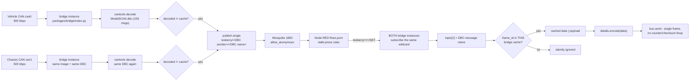
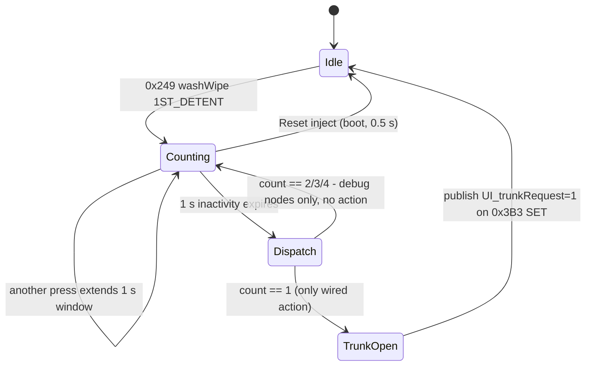

# tesberry-tesberry

## 1. Provenance

- **Submodule path:** `legacy/tesberry-tesberry`
- **Pinned gitlink (canonical form):** `160000 4366970172cfe12a353475ece36b0fef132957cf 0` — matches `git -C legacy/tesberry-tesberry rev-parse HEAD`; `status --porcelain` empty at analysis time.
- **Upstream URL:** https://github.com/tesberry/tesberry
- **Upstream license:** No root `LICENSE` file exists (`git -C legacy/tesberry-tesberry ls-files` shows none). `packages/carplay/package.json:7` declares `"license": "MIT"` for that sub-package only. Treat the overall repo as unlicensed unless upstream clarifies.
- **Analysis date:** 2026-11-21
- **Replace mode:** This doc replaces the former summary in place. The pre-replace summary is retrievable as `git show HEAD:docs/legacy/tesberry-tesberry.md` (blob `5540158b9702678b098c5d346b915b730e239c89`, 69 lines, LF).
- **Frontmatter preservation:** Kept byte-for-byte. The `description` line in the committed blob is already truncated mid-word (133 chars, ends `bridgi`) and carries no trailing whitespace, so nothing was stripped. No `## Upstream (...)` sections existed in the pre-replace doc, so the preserve list is frontmatter-only.
- **Files read in FULL (code and config):** `README.md` (1-48); `compose.yml` (1-99); `setup.sh` (1-49); `update.sh` (1-15); `debug/dump.sh` (1-7); `debug/play.sh` (1-3); `docs/database.md` (1-7); `docs/development.md` (1-7); `docs/hardware.md` (1-5); `docs/mqtt.md` (1-24); `docs/notes.md` (1-25); `packages/bridge/index.py` (1-132); `packages/bridge/Dockerfile` (1-9); `packages/bridge/requirements.txt` (1-7); `packages/bridge/setup.sh` (1-3); `packages/bridge/.env.example` (1-2); `packages/savvycan-mqtt/savvycan-mqtt.py` (1-86); `packages/savvycan-mqtt/Dockerfile` (1-9); `packages/savvycan-mqtt/requirements.txt` (1-2); `packages/carplay/src/index.ts` (1-58); `packages/carplay/Dockerfile` (1-14); `packages/carplay/package.json` (1-23); `packages/ui/Dockerfile` (1-11); `packages/ui/package.json` (1-29); `packages/ui/pages/carplay.tsx` (1-61); `packages/ui/components/carplay/Carplay.tsx` (1-189); `packages/ui/components/carplay/Settings.tsx` (1-55); `packages/ui/next.config.js` (1-7); `config/mosquitto.conf` (1-2); `config/nodered/flows.json` (1-897); `config/nodered/flows_cred.json` (1-3); `config/nodered/.config.users.json` (1-20); `config/nodered/.config.runtime.json` (1-3); `config/nodered/package.json` (1-9); `.gitignore` (1-3).
- **Files RANGE-CITED:** `packages/bridge/db/Model3CAN.dbc` — 322 KB; only lines 36, 135, 157, 201, 447-486, 1068-1092, 2153-2159, 3485, 3494, 3495, 4059 were read, plus a `grep -cE '^BO_ '` count (159 messages). `config/nodered/settings.js` — only the grep-cited lines (28-50, 65-126, 132-155, 222, 230-232, 274, 289, 312, 386-419, 427). `packages/ui/pages/index.tsx` — lines 1-17 and 19-64; line 18 is a decorative inline-SVG path truncated by tooling at 2000 chars, no logic lost.
- **Files explicitly NOT read:** `packages/ui/yarn.lock`, `packages/carplay/yarn.lock` (generated lockfiles); `config/nodered/.config.nodes.json` and its `.backup` (node palette inventory); `config/nodered/.config.users.json.backup`; `config/nodered/.flows.json.backup` (byte-level duplicate of `flows.json`); `packages/ui/README.md`; `packages/ui/pages/_app.tsx`; `packages/ui/tsconfig.json`; `packages/carplay/tsconfig.json`; `packages/ui/.eslintrc.json`; `packages/ui/styles/globals.css`; `packages/ui/components/carplay/Carplay.css`; `packages/ui/.gitignore`; `packages/ui/.dockerignore`; `packages/bridge/.gitignore`; `packages/carplay/.gitignore`; `resources/assets/logo.png`; `packages/ui/public/favicon.ico`; `packages/ui/public/vercel.svg` (binaries, images, boilerplate).
- **Reading-coverage labels:** all FULL-READ list items above are FULL-READ; the DBC and `settings.js` claims are limited to the cited ranges (RANGE-CITED); the DBC additionally gets STRUCTURAL-PARSE for schema-level claims (159 `BO_` messages, 4 declared senders). No TEST-READ evidence exists: this repo ships no tests. No CAPTURE evidence exists in this repo.

## 2. Executive verdict

Tesberry is a Raspberry Pi Docker stack (single commit, Dec 2023, author Paul Tiedtke) that bridges two SocketCAN buses (can0 vehicle, can1 chassis, 500 kbps) to MQTT using python-can 4.0.0 + cantools with a vendored 159-message Model 3 DBC, publishes every decoded frame under `tesberry/<DBC sender>/<DBC message name>` with change-detection, and accepts writes back via `tesberry/+/+/SET` topics that merge the payload into the last cached real frame before re-encoding — with no counter or checksum fixup, which is why the author concedes checksummed frames are effectively read-only. The only wired automation (Node-RED) turns a wiper-stalk first-detent press (0x249 `SCCM_washWipeButtonStatus`) into a single-press action that opens the rear trunk via 0x3B3 `UI_trunkRequest`. Adaptation candidates for TeslaCANModder are the MQTT `.../SET` ingest pattern (auth-gated), the stalk multi-press dispatcher concept, and the publish-on-change gate; the CarPlay pipeline and the Pi/browser network trick have no bearing on our firmware, and the DBC-as-decode-source, `os.system` bus bring-up, per-frame `publish.single`, and the SET fan-out to every bridge instance must not be ported.

## 3. Evidence map

| Source file | Lines | What it proves | Grade |
| ----------- | ----- | -------------- | ----- |
| `packages/bridge/index.py` | 41-42 | Bridge bus: `can.interface.Bus(..., bitrate=500000)`; DBC: `cantools.database.load_file('./db/Model3CAN.dbc')` | CODE-READ |
| `packages/bridge/index.py` | 17, 19-27 | Channel from `CHANNEL` env; bus bring-up via raw `os.system('ip link ...')`, no error checking; virtual `vcan` mode when channel starts with `v` | CODE-READ |
| `packages/bridge/index.py` | 51-52 | Subscribes `$SYS/#` and `tesberry/+/+/SET` on (re)connect | CODE-READ |
| `packages/bridge/index.py` | 97 | Publish topic is `tesberry/<details.senders[0]>/<details.name>` — DBC-declared sender, not the runtime bus | CODE-READ |
| `packages/bridge/index.py` | 72-77 | SET path: `cache.get(details.frame_id) \| payload` merge, `details.encode`, single `bus.send` | CODE-READ |
| `packages/bridge/index.py` | 94-95 | Change-detection gate: publishes only when decoded dict differs from cache | CODE-READ |
| `packages/bridge/index.py` | 14, 102, 37 | `mqttc = None` global; `main()` assigns `mqttc` without `global`; `closeConnection()` calls `mqttc.loop_stop()` — shutdown hits `None` | CODE-READ |
| `packages/bridge/index.py` | 85-86, 90-92 | Bare `except: pass` around DBC lookup and decode — silent failure paths | CODE-READ |
| `packages/bridge/index.py` | 53, 57, 97 | `publish.single` per event — one fresh MQTT TCP connection per status/decoded frame | CODE-READ |
| `compose.yml` | 4-28, 15, 28 | Two bridge instances, same image, same DBC mount, `CHANNEL=can0` (vehicle) and `CHANNEL=can1` (chassis), `cap_add NET_ADMIN` | CODE-READ |
| `compose.yml` | 46-68, 70-80, 92-99 | SavvyCAN bridges and CarPlay have no `profiles:` gating; CarPlay runs `privileged` with `/dev` mount; Portainer mounts `docker.sock` | CODE-READ |
| `config/nodered/flows.json` | 105-126, 239-259 | Only wired action: `SCCM_washWipeButtonStatus == 1ST_DETENT` → counter → single press → `{"UI_trunkRequest":1}` to `tesberry/VehicleBus/ID3B3UI_vehicleControl2/SET` | CODE-READ |
| `config/nodered/flows.json` | 85, 96-98, 873-895, 695-720 | Two frunk payload nodes and the wiper-park node are dead ends (no output wires, or no input wires at all) | CODE-READ |
| `config/nodered/flows.json` | 41, 165, 202, 743, 797 | MQTT topics actually in use: `tesberry/VehicleBus/ID249SCCM_leftStalk`, `ID102/ID103/ID122 doorStatus`, `ID273UI_vehicleControl` | CODE-READ |
| `packages/bridge/db/Model3CAN.dbc` | 36, count 159 | `BU_: Receiver ChassisBus VehicleBus PartyBus`; 159 `BO_` messages | STRUCTURAL-PARSE |
| `packages/bridge/db/Model3CAN.dbc` | 447-486, 1068-1092, 2153-2159, 3485, 3494-3495, 4059 | Bit layouts and enums for 0x273, 0x3B3, 0x249 (cited per row in section 7) | RANGE-CITED |
| `packages/savvycan-mqtt/savvycan-mqtt.py` | 74-86 | RX-only mirror: per frame publishes `topic/<id>` with 8-byte little-endian micros stamp + 1 flags byte + raw data; subscribe path only prints | CODE-READ |
| `packages/carplay/src/index.ts` | 5-45 | `node-carplay` feeds an mp4 `Readable`; WebSocket server on 3001 forwards stream, ingests JSON touch `{type,x,y}` | CODE-READ |
| `packages/ui/components/carplay/Carplay.tsx` | 90-118, 58-69 | Touch opcodes 14/15/16 (down/move/up) with coords normalized to container size; jmuxer feeds `buf.slice(4)` | CODE-READ |
| `packages/ui/pages/index.tsx` | 25 | Browser unlock anchor: link to `https://www.youtube.com/redirect?q=http://tesberry/` | CODE-READ |
| `config/mosquitto.conf` | 2 | `allow_anonymous true` on listener 1883 | CODE-READ |
| `config/nodered/settings.js` | 76, 125-126, 410 | Node-RED `adminAuth`/`httpNodeAuth` commented out; `functionExternalModules: true` | RANGE-CITED |
| `config/nodered/.config.runtime.json` | 2 | Committed plaintext `_credentialSecret` (decrypts `flows_cred.json`) | CODE-READ |
| `README.md` | 7, 13, 19-24, 29-32, 40 | Pi OS Lite 32-bit; curl-to-bash installer; service table (SavvyCan "Enabled: false"); public-IP port-forward trick; checksum-write limitation | SUMMARY-ONLY (for prose claims not backed by code read above) |

## 4. Architecture and build surface

- **Entry points:** `packages/bridge/index.py` (one process per CAN channel, launched twice by `compose.yml:4-28` with `CHANNEL=can0`/`can1`); `packages/savvycan-mqtt/savvycan-mqtt.py` (debug mirror, same double-launch pattern); `packages/carplay/src/index.ts` (WebSocket CarPlay server); `packages/ui` (Next.js 12 static-ish site, port 80).
- **Shared core vs platform port:** no shared library — each package is standalone; bridge and savvycan-mqtt duplicate the same `os.system` SocketCAN bring-up code (`index.py:19-27` vs `savvycan-mqtt.py:38-46`).
- **Build flags / dependency boundaries:** no feature flags; everything is env-driven (`CHANNEL`, `MQTT_HOST`, `MQTT_PORT`, `TOPIC`, `SPEED`, `BUSTYPE`, `MQTT_USERNAME`, `MQTT_PASSWORD` in `savvycan-mqtt.py:29-36`; bridge only honors `CHANNEL` and `MQTT_HOST`, `index.py:17,62`). `.env.example` declares `VEHICLE_CAN=vcan0` which nothing reads — dead config.
- **Capability grants:** all CAN-touching containers use `cap_add: NET_ADMIN` (`compose.yml:12-13,25-26,51-52,63-64,77-78`); CarPlay adds `privileged: true` plus `/dev` bind (`compose.yml:76,80`); Portainer mounts the Docker socket (`compose.yml:95-96`).
- **Pinned dependency:** `python-can == 4.0.0` (`packages/bridge/requirements.txt:6`, `packages/savvycan-mqtt/requirements.txt:2`); `node-carplay ^2.0.9` (`packages/carplay/package.json:14`).



## 5. Mechanism catalogue

### DBC-driven CAN-to-MQTT bridge with cache-merge write-back

- **Claim (README / summary):** `git show HEAD:docs/legacy/tesberry-tesberry.md` line 42 — bridge "decodes CAN frames, publishes to MQTT, and writes CAN messages received via MQTT"; line 56 — "Caches last-seen message data to merge partial updates before sending".
- **Code path:** `packages/bridge/index.py:99-132` `main()` → `can.Notifier` (`:120`) → `onCANMessage()` (`:82-97`) → `publish.single` (`:97`); write-back: MQTT → `onMQTTMessage()` (`:65-81`) → `db.get_message_by_name(topic[2])` (`:70`) → `cache.get(frame_id) | payload` (`:74`) → `details.encode` (`:75`) → `bus.send` (`:77`).
- **Frame spec:** any DBC frame; topic = `tesberry/<senders[0]>/<name>` (`index.py:97`); SET topic wildcard `tesberry/+/+/SET` (`index.py:52`); send is a single frame per SET message, DLC per DBC.
- **Gates and timing:** RX publish gated by decoded-dict change vs cache (`index.py:94`); TX gated by `frame_id in cache` (`index.py:72`) — this is the only thing that keeps a SET from being encoded on a bus where the frame was never seen. No periods, no jitter, no retry.
- **State machine:** None found — cache dict plus MQTT connect/subscribe state only.
- **Tests:** None found — repo ships no tests.
- **Evidence grade:** CODE-READ
- **Verdict:** CONFIRMED (summary lines 42/56 accurate; line 54's topic scheme is contradicted, see section 6)
- **Adapt to TeslaCANModder?** candidate (SET-ingest pattern and change-detection gate only; see section 13)

### Node-RED stalk multi-press action dispatcher

- **Claim (README / summary):** `git show HEAD:docs/legacy/tesberry-tesberry.md` line 46 — NodeRED is "the rule engine to listen to and write CAN messages". README:40 suggests "trigger actions instead e.g. opening the frunk".
- **Code path:** `config/nodered/flows.json:35-56` mqtt-in `tesberry/VehicleBus/ID249SCCM_leftStalk` → json node (`:129-143`) → switch `payload.SCCM_washWipeButtonStatus == "1ST_DETENT"` (`:101-127`) → trigger (1 s, extend) `:430-452` → counter `:676-693` → count switch 1-4 (`:380-428`) → Single Press change (`:526-552`) → openTrunk change `{"UI_trunkRequest":1}` (`:234-260`) → mqtt-out `tesberry/VehicleBus/ID3B3UI_vehicleControl2/SET` (`:57-74`).
- **Frame spec:** input 0x249 DLC 4, `SCCM_washWipeButtonStatus` at bits 14-15 (byte 1 bits 6:5), enum `1 = 1ST_DETENT` (`Model3CAN.dbc:2159,4059`); output 0x3B3 DLC 4, `UI_trunkRequest` at bit 1 (`Model3CAN.dbc:1068,1090`).
- **Gates and timing:** press window = trigger node `duration 1, units s, extend true` (`flows.json:436-440`); counter init 0 step 1 (`:680-681`); boot Reset inject after 0.5 s (`:318-319`); 2-second-equivalent debouncing absent — window extension is the only suppression.
- **State machine:** idle → counting → dispatch, diagram below.
- **Tests:** None found — Node-RED flows carry debug nodes (`flows.json:332-345, 481-524`) but no assertions.
- **Evidence grade:** CODE-READ
- **Verdict:** PARTIAL — the mechanism exists, but only the single-press output is wired to an action; double/triple/four-press outputs end in debug nodes only, both frunk payload nodes and the wiper-park node are dead ends (`flows.json:96-98, 695-720, 873-895`).
- **Adapt to TeslaCANModder?** candidate — see section 13



### SavvyCAN raw MQTT mirror

- **Claim (README / summary):** README:22 — "Bridges the CAN Messages to MQTT to debug them with SavvyCAN".
- **Code path:** `packages/savvycan-mqtt/savvycan-mqtt.py:74-86` — loop over `bus` → build payload → `client.publish(topic + "/" + str(msg.arbitration_id), ...)`.
- **Frame spec:** payload = `int(msg.timestamp * 1000000).to_bytes(8, 'little')` + flags byte + raw data (`:84-86`); flags bits: +1 extended, +2 remote, +4 FD, +8 ESI (`:79-83`).
- **Gates and timing:** none — every RX frame published, qos 0; MQTT `loop(timeout=0.02)` per iteration (`:75`). Optional TLS when port is 8883 (`:66-67`), optional username/password (`:68-69`).
- **State machine:** None found.
- **Tests:** None found.
- **Evidence grade:** CODE-READ
- **Verdict:** CONFIRMED as RX-only — the MQTT-in path (`:21-25`) subscribes `topic + "/+"` and only prints, so despite `compose.yml:51-52` granting NET_ADMIN this package never transmits CAN.
- **Adapt to TeslaCANModder?** no impact — our side already streams frames (`firmware/lib/core/types.h:381` `streamEnabled`; `can:raw:on` asserted in `firmware/test/test_native_can_raw/test_can_raw.cpp:41`).

### CarPlay WebSocket streaming pipeline

- **Claim (README / summary):** `git show HEAD:docs/legacy/tesberry-tesberry.md` line 44 — "CarPlay integration".
- **Code path:** `packages/carplay/src/index.ts:45` `new Carplay(config, mp4Reader)` → `mp4Reader.on('data')` → `ws.send` (`:16-18`); reverse: `ws.on('message')` → `carplay.sendTouch(type,x,y)` (`:20-24`); UI side `packages/ui/components/carplay/Carplay.tsx:59-69` jmuxer-feed of `buf.slice(4)`.
- **Frame spec:** video bytes prefixed with 4 bytes (duration in the socket.io path, `Carplay.tsx:71-77`); touch JSON `{type,x,y}` with normalized 0..1 coords (`Carplay.tsx:90-118`); opcodes 14=down, 15=move, 16=up.
- **Gates and timing:** `ws://tesberry:3001` fixed (`packages/ui/pages/carplay.tsx:17`); config dpi 240, 800x480, 30 fps, nightMode 0 hard-coded (`carplay/src/index.ts:35-43`, TODO comment at `:34`).
- **State machine:** None found — `status`/`quit` events logged only (`:47-58`).
- **Tests:** None found.
- **Evidence grade:** CODE-READ
- **Verdict:** CONFIRMED — but zero CAN involvement; requires a Carlinkit-class USB dongle (`setup.sh:46` udev rule for vendor `1314`, product `1520`).
- **Adapt to TeslaCANModder?** never port (see section 13).

### Tesla-browser access path (network + redirect)

- **Claim (README / summary):** README:29-32 — Tesla will not join an internet-less WiFi and its browser only opens public IPs; solution is a 4G/5G router, static lease, and port 80 forwarding from a public IP; `git show HEAD:...` line 47 mentions "clever network routing".
- **Code path:** `packages/ui/pages/index.tsx:25` — `<a href="https://www.youtube.com/redirect?q=http://tesberry/">` is the only code artifact; the router/port-forward setup is manual prose.
- **Frame spec:** None found — no CAN frames involved.
- **Gates and timing:** None found.
- **State machine:** None found.
- **Tests:** None found.
- **Evidence grade:** CODE-READ for the redirect link (`index.tsx:25`); SUMMARY-ONLY for the router/port-forward claims (README prose, unverifiable without the car).
- **Verdict:** PARTIAL — the mechanism is documentation plus one anchor tag, not implemented software.
- **Adapt to TeslaCANModder?** no impact (our client targets the user's phone/browser, not the in-car browser).

## 6. Summary vs code contradiction table

| # | Claim (source) | Code says | Verdict |
| - | -------------- | --------- | ------- |
| 1 | `git show HEAD:docs/legacy/tesberry-tesberry.md` line 54: publishes to `tesberry/{bus}/{message}` | `packages/bridge/index.py:97` — topic segment is `details.senders[0]`, the DBC-declared sender (`VehicleBus`/`ChassisBus`/`PartyBus`/`Receiver`, `Model3CAN.dbc:36`), never the runtime `CHANNEL`; flows confirm `tesberry/VehicleBus/...` (`flows.json:41`) | CONTRADICTED |
| 2 | Upstream `docs/mqtt.md:4,18`: example topics `tesberry/vehicle/ID273UI_vehicleControl[/SET]` | Actual topic is `tesberry/VehicleBus/...` (`index.py:97`, `flows.json:41,62`) | CONTRADICTED |
| 3 | Upstream README:22: SavvyCan MQTT Bridge "Enabled: false" | `compose.yml:46-68` has no `profiles:` key — `restart: "no"` only affects restart policy; the service still starts on `docker-compose up` | CONTRADICTED |
| 4 | Upstream README:40: actions example "opening the frunk" | Only wired action in `flows.json` opens the rear trunk via 0x3B3 `UI_trunkRequest` (`flows.json:234-260`); both frunk payload nodes are dead ends (`flows.json:96-98` output wires empty; `flows.json:873-895` fully orphaned) | CONTRADICTED |
| 5 | Upstream `packages/bridge/.env.example:1`: `VEHICLE_CAN=vcan0` | Nothing reads `VEHICLE_CAN`; the bridge reads `CHANNEL` (`index.py:17`, set only by `compose.yml:15,28`); `grep -nE 'VEHICLE_CAN' packages/bridge/index.py` → no output | CONTRADICTED (dead config) |
| 6 | `git show HEAD:docs/legacy/tesberry-tesberry.md` line 51: "dual bus support (can0, can1 for vehicle and chassis)" | True at compose level (`compose.yml:4-28`), but the SET path is not bus-scoped: both instances subscribe the same `tesberry/+/+/SET` wildcard (`index.py:52`) and both will encode+send if the frame ID is in their cache (`index.py:72-77`) | PARTIAL — routing claim overstates isolation |
| 7 | Preserved frontmatter `description` (this file, byte-preserved): "…bridging it to MQTT, and expo…" is cut off mid-word at `bridgi` | The committed blob itself is truncated (133-char line, `git show HEAD:docs/legacy/tesberry-tesberry.md` line 3); kept byte-for-byte per replace-mode rules | Stale-but-preserved frontmatter, recorded not edited |

Agreements that survived verification (kept out of this table on purpose): SET wildcard `tesberry/+/+/SET` (`index.py:52` = old summary line 55), cache-merge behavior (old line 56 = `index.py:72-77`), checksum-write limitation (old line 57 ≈ README:40, mechanically confirmed: the SET path has no CRC/counter fixup — `grep -nE '0xAA|crc|Crc|CRC' packages/bridge/index.py` → no output; the only mention of checksums is a TODO comment at `index.py:96`).

## 7. CAN frame and signal inventory

One row per frame the repo's code actually decodes, mutates, or injects. The vendored DBC itself is STRUCTURAL-PARSE: 159 `BO_` messages, senders `Receiver`/`ChassisBus`/`VehicleBus`/`PartyBus` (`Model3CAN.dbc:36`), source attribution unresolved (see section 17). All rows: 500 kbps, `is_extended_id=False`, counter position and checksum fields are present in real Tesla traffic for some frames but the repo never recomputes them on write (stale re-encode).

| ID (hex / dec) | Bus per DBC sender | Period | DLC | Byte/bit layout (DBC) | Scale / units | Counter | Checksum | R/W | Grade |
| -------------- | ----------------- | ------ | --- | --------------------- | ------------- | ------- | -------- | --- | ----- |
| 0x249 / 585 `ID249SCCM_leftStalk` | VehicleBus (decoders run on both can0+can1) | not specified | 4 | `SCCM_highBeamStalkStatus` 12\|2 (`dbc:2154`); `SCCM_washWipeButtonStatus` 14\|2 (`dbc:2159`) | enum: washWipe 0=NOT_PRESSED, 1=1ST_DETENT, 2=2ND_DETENT, 3=SNA (`dbc:4059`) | in-frame, not recomputed | in-frame, not recomputed | read (stalk input trigger) | CODE-READ |
| 0x273 / 627 `ID273UI_vehicleControl` | VehicleBus | not specified | 8 | `UI_accessoryPowerRequest` 0\|1 (`dbc:448`); `UI_frunkRequest` 5\|1 (`dbc:460`); `UI_wiperMode` 6\|2 (`dbc:484`); `UI_lockRequest` 17\|3 (`dbc:464`); `UI_ambientLightingEnabled` 40\|1 (`dbc:450`); `UI_wiperRequest` 56\|3 (`dbc:485`) | wiperMode 3=WIPER_MODE_PARK (`dbc:3494`); lockRequest 1=LOCK, 2=UNLOCK, 3=REMOTE_UNLOCK, 4=REMOTE_LOCK (`dbc:3485`); wiperRequest 0=SNA, 1=OFF, 2=AUTO, 3-6 speed levels (`dbc:3495`) | in-frame, not recomputed | in-frame, not recomputed | read + write (SET merges into cached payload) | CODE-READ |
| 0x3B3 / 947 `ID3B3UI_vehicleControl2` | VehicleBus | not specified | 4 | `UI_trunkRequest` 1\|1 (`dbc:1090`); `UI_UMCUpdateInhibit` 2\|1 (`dbc:1071`); `UI_PINToDriveEnabled` 6\|1 (`dbc:1069`); `UI_windowRequest` 20\|3 (`dbc:1092`) | 1-bit request / 3-bit enum | in-frame, not recomputed | in-frame, not recomputed | write (trunk open action) | CODE-READ |
| 0x102 / 258 `ID102VCLEFT_doorStatus` | VehicleBus | not specified | 8 | DBC-decoded generically by cantools; flows only debug-subscribe (`flows.json:165`) | per DBC | in-frame, not recomputed | in-frame, not recomputed | read | CODE-READ (usage); layout RANGE-CITED (`dbc:135`) |
| 0x103 / 259 `ID103VCRIGHT_doorStatus` | VehicleBus | not specified | 8 | DBC-decoded generically; flows debug-subscribe (`flows.json:202`) | per DBC | in-frame, not recomputed | in-frame, not recomputed | read | CODE-READ (usage); layout RANGE-CITED (`dbc:157`) |
| 0x122 / 290 `ID122VCLEFT_doorStatus2` | VehicleBus | not specified | 6 | DBC-decoded generically; flows debug-subscribe (`flows.json:797`) | per DBC | in-frame, not recomputed | in-frame, not recomputed | read | CODE-READ (usage); layout RANGE-CITED (`dbc:201`) |

Remaining 153 DBC messages: any frame on can0/can1 whose ID exists in the DBC is decoded and published change-gated (`index.py:82-97`) — STRUCTURAL-PARSE, not dumped here.

## 8. Constants and tuning table

| Constant | Value | File:line | Meaning | Grade |
| -------- | ----- | --------- | ------- | ----- |
| CAN bitrate | `500000` | `packages/bridge/index.py:22,26,41`; `savvycan-mqtt.py:33,45,60` | SocketCAN bus speed for both buses | CODE-READ |
| SET wildcard | `tesberry/+/+/SET` | `index.py:52` | MQTT write channel; `topic[2]` must equal a DBC message name | CODE-READ |
| Publish topic prefix | `tesberry/<senders[0]>/<name>` | `index.py:97` | DBC-sender-based namespace (not bus) | CODE-READ |
| jsonpickle `max_depth` | `1` | `index.py:97` | flattens nested decoded values; also the quote-replace hack lives here | CODE-READ |
| Press window | `1` s, `extend: true` | `flows.json:436-440` | multi-press timing window for the stalk dispatcher | CODE-READ |
| Counter init/step | `0` / `1` | `flows.json:680-681` | press counting for 1-4 dispatch | CODE-READ |
| Boot reset delay | `0.5` s `onceDelay` | `flows.json:318-319` | counter cleared at Node-RED startup | CODE-READ |
| SavvyCAN stamp | micros `to_bytes(8,'little')` | `savvycan-mqtt.py:84` | binary payload layout: 8-byte LE timestamp | CODE-READ |
| SavvyCAN flags | +1 ext, +2 remote, +4 FD, +8 ESI | `savvycan-mqtt.py:79-83` | per-frame flag byte | CODE-READ |
| CarPlay video | dpi 240, 800x480, fps 30, nightMode 0 | `carplay/src/index.ts:35-43` | hard-coded stream config (TODO env vars at `:34`) | CODE-READ |
| Touch opcodes | `14` down / `15` move / `16` up | `Carplay.tsx:98,108,117` | node-carplay event types, coords normalized 0..1 | CODE-READ |
| Ports | UI 80, mosquitto 1883/9001, node-red 1880, portainer 9000, carplay ws 3001 | `compose.yml:35,43-44,74,88-89,98-99`; `carplay.tsx:17` | service surface | CODE-READ |
| SavvyCAN defaults | `TOPIC=can`, `MQTT_PORT=1883`, `SPEED=500000`, `BUSTYPE=socketcan` | `savvycan-mqtt.py:31-36` | debug mirror defaults | CODE-READ |

## 9. Failure modes and edge cases

| Failure | Handling code path | Tested? | Grade |
| ------- | ----------------- | -------- | ----- |
| SIGTERM/SIGINT shutdown | `index.py:115-117` schedules `closeConnection()` → `notifier.stop()` then `mqttc.loop_stop()`; `mqttc` is a `main()` local (`:102`) while the global stays `None` (`:14`) → `AttributeError` at shutdown | No | CODE-READ |
| SocketCAN bring-up failure | `os.system('ip link set ...')` with no return-code check (`index.py:26-27`); `can.Bus` ctor (`:41`) would raise and kill the container; compose `restart: always` is the only recovery | No | CODE-READ |
| SET for a frame never seen on this bus | `if details.frame_id in cache.keys()` (`index.py:72`) silently drops it — implicit bus filter, no error feedback to publisher | No | CODE-READ |
| Same frame ID on both buses (can0 + can1) | Both bridges cache it; one SET message is encoded and sent by BOTH instances — double injection on two buses | No | CODE-READ |
| Checksummed/countered frames written via SET | Stale counter + stale checksum re-encoded as-is (`index.py:74-77`); author admits writes limited (`README:40`); TODO to filter them (`index.py:96`) | No; vehicle-side rejection is UNVERIFIED (needs bench capture) | CODE-READ for code path |
| MQTT broker outage | paho auto-reconnect resubscribes (`index.py:45-52`); every publish is a fresh connection (`publish.single`, `:53,57,97`) so each failed publish blocks the notifier thread per message | No | CODE-READ |
| DBC lookup/decode failure | bare `except: pass` (`index.py:85-86,90-92`) — silently ignored, no counter, no log | No | CODE-READ |
| CAN send failure | `except can.CanError: print('CAN message not sent')` (`index.py:79-80`) — print only, no retry, no telemetry | No | CODE-READ |
| Malformed SET payload | `jsonpickle.decode` (`index.py:69`) inside broad try; any bad JSON falls into the same silent `except`-less path? — no: exceptions from decode propagate to `can.CanError`-only catch and crash the MQTT callback thread | No | CODE-READ |
| Invalid JSON out (quote hack) | `.replace('"\'','"').replace('\'"','"')` (`index.py:97`) munges jsonpickle output into pseudo-JSON; values containing quotes corrupt output | No | CODE-READ |
| savvycan-mqtt bus error / broker loss | no try/except around `for msg in bus` (`savvycan-mqtt.py:76`) or publish (`:86`); crash loop under compose `restart: "no"` means it just dies | No | CODE-READ |
| Node-RED editor exposure | `adminAuth` commented out (`settings.js:76`), host network, port 1880 — unauthenticated flow editing = unauthenticated CAN injection via the SET path | No | RANGE-CITED |

## 10. Test coverage map

Per test file: **None found — this repo ships no tests.** Verified: `grep -nE 'def test|assert' packages/bridge/index.py` → no output; no test directory, no CI workflow in `git -C legacy/tesberry-tesberry ls-files`.

Critical paths with no test, and the risk in one line:

- SET cache-merge + encode (`index.py:65-81`) — a wrong merge silently corrupts injected frames; risk: uncontrolled vehicle actions.
- Change-detection gate (`index.py:94`) — a stuck cache means no telemetry or duplicated telemetry; risk: misleading dashboards.
- Stale counter/checksum re-encode — risk: frames rejected or, worse, accepted with stale counters; no oracle exists at all upstream.
- Node-RED flow semantics (press window, counter reset) — risk: miscounted presses trigger the wrong action in the car.
- SavvyCAN binary layout (`savvycan-mqtt.py:84-86`) — risk: debug tooling decodes garbage.

## 11. Parity matrix with TeslaCANModder

Our-side citations are CODE-READ unless flagged otherwise; the one SUMMARY-ONLY row cannot drive a decision.

| Signal / frame | Upstream decode (cite) | Our decode (cite) | Delta | Action |
| -------------- | ---------------------- | ----------------- | ----- | ------ |
| 0x273 `UI_frunkRequest` bit 5 | DBC `5\|1@1+` (`Model3CAN.dbc:460`); SET payload node exists but is dead-wired (`flows.json:85,96-98`) | `firmware/lib/vehicle/can/feature/body/trunk.h:50` `f.data[0] \|= 0x20` on cached 0x273 (`fwd.h:24-28`) | bit position identical; upstream never actually sends it from the wired flow | align (no change; ours already bursts 20×20 ms vs upstream single-frame) |
| 0x273 `UI_lockRequest` bits 17-19 | DBC `17\|3@1+`, VAL_ 1=LOCK 2=UNLOCK 3=REMOTE_UNLOCK 4=REMOTE_LOCK (`dbc:464,3485`) | `firmware/lib/vehicle/can/feature/body/lock.h:31` mask `0x0E`, `<<1`, enum LOCK=1/UNLOCK=2 (`lock.h:17-20`) | values match DBC exactly | align (confirmed by upstream DBC, no code change) |
| 0x273 `UI_wiperRequest` bits 56-58 | DBC `56\|3@1+`, VAL_ 0=SNA 1=OFF 2=AUTO 3..6 speeds (`dbc:485,3495`) | `firmware/lib/vehicle/can/feature/comfort/wiper.h:33` writes bits 56-58, but enum `WIPER_OFF=0, WIPER_1=1, WIPER_2=2, WIPER_3=3` (`wiper.h:17-20`) | position matches; our `wiper:off` sends 0 which the DBC labels SNA (not OFF=1), our `wiper:1` sends the DBC's OFF | capture-first — bench capture of a real wiper-request frame to reconcile enum semantics before touching `wiper.h` |
| 0x3B3 trunk byte 0 | DBC `UI_trunkRequest` `1\|1@1+` (`dbc:1068,1090`); flow sends `{"UI_trunkRequest":1}` (`flows.json:244,62`) | `firmware/lib/vehicle/can/feature/body/trunk.h:70` `f.data[0] = open ? 0x02 : 0x03` (close sets bit 0 too), glovebox `0x01` (`trunk.h:90`) | upstream model is a 1-bit request; our close code `0x03` adds bit 0 which the DBC does not define | capture-first — validate 0x3B3 byte-0 open/close codes on the bench |
| 0x3B3 bus routing | DBC sender VehicleBus (`dbc:1068`); bridge injects wherever the frame was cached | `trunk.h:75,95` burst on `BUS_BODY` | upstream assumes vehicle bus, ours sends body bus | capture-first (ours may be intentional for 3-bus builds; reconcile with `docs/reference/can-ids.md`) |
| 0x249 stalk frame | DBC `SCCM_washWipeButtonStatus` 14\|2 (`dbc:2159,4059`); used RX-only as trigger (`flows.json:105-126`) | `firmware/lib/vehicle/can/handler/bus/vehicle.h:373-376` decodes byte 0 bits 6:5 as drive mode; TX injection with CRC-8 in `feature/fsd/auto_lane_change.h:50-58` | same ID, different signals; upstream never injects 0x249 | ignore for injection; the RX stalk-decode is the interesting half (row below) |
| Stalk/button multi-press dispatcher | flows.json CODE-READ: 1 s extend window + counter + count-switch (`flows.json:430-452,676-693,380-428`) | our side: `docs/reference/commands.md` documents `btnmap:lamp/parking` short/long/double — but `grep -rnE 'btnmap' firmware/` → no output; no implementation exists | our feature is documented but vapor; upstream proves the pipeline end-to-end | SUMMARY-ONLY row (our side) — backlog: implement or retract `btnmap` docs; upstream flow is the design reference |
| 0x102/0x103 door status | bridge publishes all DBC frames; flows only debug-subscribe (`flows.json:165,202`) | `firmware/lib/vehicle/can/handler/bus/vehicle.h:178-190` decodes latch nibbles via `drive_context.h:50-53,60-83` | both read the same frames; ours consumes them into state | align (no change) |
| 0x122 `VCLEFT_doorStatus2` | DBC frame subscribed (`flows.json:797`, `dbc:201`) | no counterpart — `grep -rnE '0x122|CAN_ID_VCLEFT_DOOR_STATUS2' firmware/lib` → no output (toolchain-header hits only) | none on our side | ignore (no state consumed upstream either) |
| MQTT channel direction | bidirectional: publish + `tesberry/+/+/SET` ingest (`index.py:52,97`) | one-way telemetry only: `firmware/lib/vehicle/can/feature/misc/mqtt_bridge.h:18` prefix `teslacanmodder/`, publish-gate `mqttShouldPublish` (`mqtt_bridge.h:26-73`, tests `test_native_mqtt/test_mqtt.cpp:32-70`) | we have no MQTT ingest; commands arrive via serial/BLE/REST | candidate — auth-gated MQTT command ingest through our existing dispatch |
| Raw frame mirror for tooling | binary LE-timestamp+flags+data per frame over MQTT (`savvycan-mqtt.py:84-86`) | JSON `frame` stream + `can:raw:on` (`firmware/lib/core/types.h:381`; `test_native_can_raw/test_can_raw.cpp:41`) | different format, same purpose | already present (different format) — ignore |

## 12. Surface inventory and security notes

| Surface | Semantics | Provenance / security note |
| ------- | --------- | -------------------------- |
| Mosquitto 1883 / 9001 | broker for all services | `allow_anonymous true` (`config/mosquitto.conf:2`) — anyone on the car's WiFi can publish SET topics, i.e. inject CAN frames |
| Bridge MQTT ingest `tesberry/+/+/SET` | write channel to both CAN buses | no auth, no ACL (`index.py:52`); fan-out to every bridge instance (`compose.yml:4-28`) |
| Node-RED editor :1880 | flow editing = CAN rule editing | `adminAuth` commented out (`config/nodered/settings.js:76`), host network (`compose.yml:85`), `functionExternalModules: true` (`settings.js:410`) |
| Tesberry UI :80 | static Next.js page + carplay view | no auth; the only CAN-relevant artifact is the YouTube-redirect link (`packages/ui/pages/index.tsx:25`) |
| CarPlay WebSocket :3001 | video stream + touch ingest | unauthenticated `ws` (`carplay/src/index.ts:10`), container `privileged` with `/dev` bind (`compose.yml:76,80`) |
| Portainer :9000 | container management | Docker socket mounted (`compose.yml:95-96`) — full host compromise surface |
| SavvyCAN mirror | RX-only MQTT debug feed | subscribe path only prints (`savvycan-mqtt.py:24-25`); NET_ADMIN granted anyway (`compose.yml:51-52`) |

Hardcoded credentials and dangerous patterns (do-not-import, see section 14): committed Node-RED `_credentialSecret` `config/nodered/.config.runtime.json:2` plus the encrypted `flows_cred.json:2` blob (the secret decrypts it — treat both as leaked); commented example bcrypt hash in `settings.js:125-126`; `curl | bash` installer (`README.md:13`, `setup.sh:13-36`); raw append to `/boot/cmdline.txt` (`setup.sh:42`); `os.system` shell-outs with format strings (`index.py:21-27`); `python:3` floating base images (`packages/bridge/Dockerfile:1`).

## 13. Adaptation assessment

| Mechanism | Value | Cost | Risk | Evidence | Decision |
| --------- | ----- | ---- | ---- | -------- | -------- |
| MQTT `.../SET` ingest (topic-named command channel, partial-payload merge into cached frame) | lets HA/MQTT clients drive features without REST | extend our `mqtt_bridge.h` + route through existing command dispatch; we already persist broker/port/interval | unauthenticated ingest = remote CAN write; must gate with auth + command allowlist; needs `docs/checklists/can-review-checklist.md` | CODE-READ (`index.py:65-81,52`) | candidate for future PR (low priority) |
| Stalk multi-press dispatcher (0x249 SCCM decode → press-count state machine → bound action) | matches our documented-but-unimplemented `btnmap`; upstream proves feasibility | new 0x249 RX decode for `SCCM_washWipeButtonStatus` bits 14-15 + small state machine; CRC knowledge already in `auto_lane_change.h:58` | action misfire in the car; press window tuning needs capture | CODE-READ (`flows.json:430-452,676-693`; `dbc:2159,4059`) | candidate — capture-first, implement only with an independent decode test |
| Publish-on-change gate | cuts MQTT chatter in our telemetry bridge | a few lines in our publish tick (`mqtt_bridge.h` mqttShouldPublish path) | a stuck cache hides fresh data; needs change+interval OR-combine | CODE-READ (`index.py:94-95`) | candidate (minor) |
| SavvyCAN raw mirror | debug tooling | our stream JSON + `can:raw` already cover it | none | CODE-READ + TEST-READ both sides | already present (different format) — no impact |
| DBC-as-decode-source (cantools pipeline) | 159-frame coverage for free | we ship curated decoders in `firmware/lib/vehicle/can/handler/` + `packages/protocol`; a runtime DBC parser does not fit ESP32 constraints | drift from our signal-matrix source of truth | STRUCTURAL-PARSE | no impact — keep DBC as bench reference only |
| CarPlay pipeline | in-car CarPlay screen | native USB dongle + `node-carplay` + ffmpeg; zero CAN mechanism | out of scope for firmware/client | CODE-READ (`carplay/src/index.ts`) | never port |
| Tesla-browser access trick (public IP + YouTube redirect) | in-car browser entry point | router config + port forward; not code | exposes an unauthenticated UI on a public IP — actively dangerous with this stack | CODE-READ for the link (`index.tsx:25`), SUMMARY-ONLY for the network claims | never port as-is; irrelevant to our phone-first client |

## 14. Do-not-copy list

- `packages/bridge/index.py:21-27` — `os.system` shell-outs with format strings for bus bring-up: shell-injection-shaped, no error handling. Port behavior (programmatic bring-up) with our MCP2515 driver, never the calls.
- `packages/bridge/index.py:97` — jsonpickle + `.replace('"\'','"')` quote-munging: produces non-strict JSON. Use a real serializer.
- `packages/bridge/index.py:14,102,37` — the `mqttc` global/local mix-up: the shutdown path dereferences `None`. Copying it imports a guaranteed crash.
- `packages/bridge/index.py:53,57,97` — `publish.single` per frame: one TCP connection per CAN event. Never copy; keep a persistent client.
- `packages/bridge/index.py:52,72-77` — SET wildcard shared by all bridge instances with cache-as-filter: silent double-bus injection. Any ingest we build must be bus-scoped and auth-gated.
- `packages/bridge/index.py:85-92` — bare `except: pass` swallows decode errors. Never copy.
- `config/mosquitto.conf:2` — `allow_anonymous true`. Never ship an anonymous broker.
- `config/nodered/.config.runtime.json:2` + `config/nodered/flows_cred.json:2` — committed credential secret and its decryptable blob. Never commit key material.
- `compose.yml:76,80,95-96` — `privileged` + `/dev` bind and Docker-socket mount. Flag as the upstream's biggest deployment risk; never replicate.
- `setup.sh:13,42` + `README.md:13` — `curl | bash` bootstrap and raw `/boot/cmdline.txt` append. Never copy install patterns.
- `packages/bridge/db/Model3CAN.dbc` — vendored, unattributed 159-message catalog. Never import as decode source of truth; use as bench cross-reference only (see section 17 for provenance question).

## 15. History and evolution

- The submodule checkout is a **shallow clone**: local `git log` shows exactly one commit — `4366970172cfe12a353475ece36b0fef132957cf` "fix: typo in README", author Paul Tiedtke <PaulTiedtke@web.de>, 2023-12-19. `git -C legacy/tesberry-tesberry rev-parse --is-shallow-repository` → `true`.
- Pre-pin upstream history was therefore **not** reviewed (network fetch required; see section 17).
- No CHANGELOG, no tags, no branches exist locally. README:3 self-declares "still work in progress"; roadmap items (`README.md:35-37`: USB power state check, boot speedup, 64-bit support) are unimplemented prose.
- `docs/notes.md:1-25` records what the author was probing next: VehicleBus targets (`UI_rearCenterSeatHeatReq`, `UI_rearWindowLockout`, `VCFRONT_preconditionRequest`, `UI_ambientLightingEnabled`, `UI_frunkRequest`) and Chassis Bus targets (`DAS_blindSpotRearLeft/Right`, `DAS_forwardCollisionWarning`, plus an autopark/self-park cluster: `DAS_autoparkReady`, `UI_autoParkRequest`, `UI_smartSummonType`, `UI_selfParkTune`, `UI_selfParkRequest` with values `SELF_PARK_FORWARD/REVERSE/PAUSE/RESUME`). None of the chassis/autopark targets have any code beyond the DBC itself — leads only, SUMMARY-ONLY.
- The dead frunk and wiper-park nodes in `flows.json` (section 5) are the visible remains of an abandoned direction: multi-press actions were scaffolded but only trunk-open was ever wired.

## 16. Re-verification recipe

Pinned snapshot: gitlink `160000 4366970172cfe12a353475ece36b0fef132957cf 0` (`git ls-files -s legacy/tesberry-tesberry`). The clone is shallow — fetch first to see post-pin history:

```bash
OLD=4366970172cfe12a353475ece36b0fef132957cf
git -C legacy/tesberry-tesberry fetch --tags --prune
git -C legacy/tesberry-tesberry log --oneline $OLD..origin/main
git -C legacy/tesberry-tesberry diff --stat $OLD..origin/main
git ls-files -s legacy/tesberry-tesberry   # compare gitlink to rev-parse HEAD
```

Upstream anchors (run from `legacy/tesberry-tesberry/`, all demonstrated 2026-11-21):

```text
grep -nE 'senders\[0\]' packages/bridge/index.py                      -> expect line 97 (topic uses DBC sender)
grep -nE 'tesberry/\+/\+/SET' packages/bridge/index.py                -> expect line 52
grep -nE 'cache.get\(details.frame_id\)' packages/bridge/index.py     -> expect line 74 (cache-merge write path)
grep -nE '1ST_DETENT' config/nodered/flows.json                      -> expect line 110
grep -nE 'UI_trunkRequest' config/nodered/flows.json                 -> expect line 244
grep -nE 'UI_frunkRequest' config/nodered/flows.json                 -> expect lines 85 and 882 (dead-end nodes)
grep -nE 'allow_anonymous' config/mosquitto.conf                     -> expect line 2: allow_anonymous true
grep -nE '_credentialSecret' config/nodered/.config.runtime.json     -> expect line 2 (committed secret)
grep -nE '^BO_ (627|947|585) ' packages/bridge/db/Model3CAN.dbc     -> expect 447, 1068, 2153
grep -nE 'UI_wiperRequest' packages/bridge/db/Model3CAN.dbc          -> expect 485 (56|3 signal) and 3495 (VAL_ enum)
grep -nE 'SCCM_washWipeButtonStatus' packages/bridge/db/Model3CAN.dbc -> expect 2159 (signal) and 4059 (VAL_ enum)
grep -nE 'to_bytes\(8' packages/savvycan-mqtt/savvycan-mqtt.py      -> expect line 84 (LE micros stamp)
grep -nE '0xAA|crc|Crc|CRC' packages/bridge/index.py                 -> no output (no checksum fixup on write)
grep -nE 'checksum' packages/bridge/index.py                         -> expect only line 96 (TODO comment)
grep -nE 'VEHICLE_CAN' packages/bridge/index.py                      -> no output (dead .env.example var)
grep -nE 'def test|assert' packages/bridge/index.py                  -> no output (repo ships no tests)
```

Our-side drift anchors (run from repo root, all demonstrated 2026-11-21):

```text
grep -nE 'CAN_ID_UI_VEHICLE_CTRL|CAN_ID_TRUNK_CTRL|CAN_ID_DI_STEER' firmware/lib/vehicle/can/ids.h -> expect lines 43, 78, 40
grep -nE '0x20' firmware/lib/vehicle/can/feature/body/trunk.h                                  -> expect lines 50, 54 (frunk bit 5)
grep -nE 'open \? 0x02 : 0x03' firmware/lib/vehicle/can/feature/body/trunk.h                   -> expect line 70
grep -nE '0x0E' firmware/lib/vehicle/can/feature/body/lock.h                                  -> expect line 31 (lock bits 17-19)
grep -nE 'MQTT_TOPIC_PREFIX' firmware/lib/vehicle/can/feature/misc/mqtt_bridge.h               -> expect line 18: "teslacanmodder/"
grep -nE 'WIPER_OFF = 0|speed & 0x07' firmware/lib/vehicle/can/feature/comfort/wiper.h          -> expect lines 17, 33
grep -nE 'CAN_ID_DI_STEER' firmware/lib/vehicle/can/handler/bus/vehicle.h                      -> expect line 373 (drive-mode readback)
grep -nE 'streamEnabled' firmware/lib/core/types.h                                              -> expect line 381
grep -rnE 'btnmap' firmware/                                                                    -> no output (our doc-only feature)
```

If line numbers drift more than ~10, re-read the whole function; do not trust this document's numbers.

## 17. Open questions and explicitly not investigated

- **Pre-pin upstream history was NOT reviewed** — the submodule clone is shallow (single commit). Fetching full history could reveal why the frunk and wiper-park flow nodes were abandoned.
- **Vendored DBC provenance UNVERIFIED:** `docs/database.md:3-6` lists four candidate sources (joshwardell `model3dbc`, commaai `opendbc`, onyx-m2, thezim); the vendored `Model3CAN.dbc` has `VERSION ""` and no attribution header. The filename matches joshwardell's, but confirming requires a checksum comparison against each source repo. Every DBC-derived bit layout in section 7 inherits this caveat.
- **UNVERIFIED — whether a single SET frame actually actuates the vehicle.** The bridge sends exactly one frame per SET (`index.py:76-77`) with a stale counter; README:40 claims reads-mostly. Our trunk path bursts 20 frames (`trunk.h:75`). Only a listen-only bench capture settles whether one frame is enough, and whether stale counters are rejected.
- **UNVERIFIED — wiper enum semantics on our side** (parity row 3): our `WIPER_OFF=0` vs DBC `0=SNA, 1=OFF`. A captured wiper-request frame resolves it.
- **UNVERIFIED — 0x3B3 close semantics** (parity row 4): our `0x03` close code sets a bit the DBC does not define. Capture needed.
- **UNVERIFIED — Carlinkit assumption:** `setup.sh:46` whitelists USB vendor `1314`/product `1520`, presumed Carlinkit; no in-repo confirmation.
- **Our-side gap (out of scope for this doc):** `docs/reference/commands.md` documents `btnmap:*` and `gvret:*` commands with no corresponding firmware code (`grep -rnE 'btnmap' firmware/` → no output; GVRET likewise). The btnmap parity row above is SUMMARY-ONLY on our side and cannot drive a decision until that is resolved.
- **Not investigated:** GitHub issues/PRs on the upstream repo (network-only); actual Node-RED runtime behavior beyond the committed flow JSON; the four `yarn.lock`/backup JSON files (see not-read list in section 1); whether the Tesla browser redirect trick still works on 2026 firmware.
