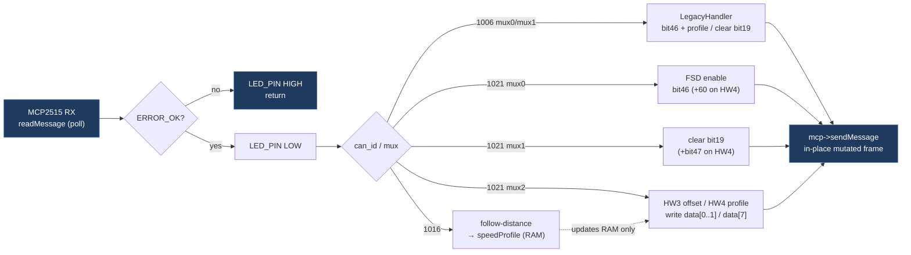
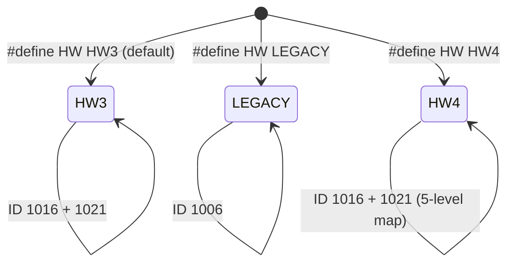
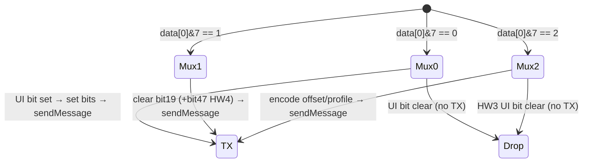

# tesla-fsd-can-mod-main

## 1. Provenance

- **Special provenance:** this is a **CONVERTED FOLDER, not an active git submodule**. `git ls-files -s legacy/tesla-fsd-can-mod-main` returns two regular blobs (`100644 ... 0`), **not** a `160000` gitlink; `.gitmodules` has no entry for this path. `git -C legacy/tesla-fsd-can-mod-main ...` therefore resolves to the **parent** TeslaCANModder repo (parent HEAD `7d90b9a32fb07b7cb9fa07538d06d3c87936112b`, origin `https://github.com/babico/TeslaCANModder.git`) — it is *not* an upstream remote. No upstream fetch was performed.
- **Pinned gitlink SHA:** none exists (converted folder). No SHA for this repo is noted in any `docs/legacy/*` review doc (search of `tesla-fsd-can-mod-main` / `CanFeather` returned only `docs/legacy/README.md:54` and sibling-repo analyses). Content is pinned instead by **blob hashes**:
    - `160000` analog → `100644 01fdbcfce6f63fedfd7f08a5f30cadfff32af26b 0 legacy/tesla-fsd-can-mod-main/CanFeather.ino` (220 lines, FULL-READ)
    - `100644 e9b54ee87b3c3537f59e58a5d0d958f1dff4f26e 0 legacy/tesla-fsd-can-mod-main/README.md` (153 lines, FULL-READ)
- **Upstream URL:** not recorded inside the folder and not recoverable from a submodule config — **UNVERIFIED** (upstream name/URL could be confirmed only by network lookup, which was out of scope).
- **License:** GPL-3.0 — source header `CanFeather.ino:1-14`, restated `README.md:151-153`.
- **Analysis date:** 2026-11-21.
- **Files read (with ranges):** `CanFeather.ino:1-220` (FULL-READ), `README.md:1-153` (FULL-READ). Our-side CODE-READ for parity: `firmware/lib/vehicle/can/feature/fsd/{fsd,profile,offsets}.h` (FULL-READ), `firmware/lib/vehicle/can/handler/variant/{bits,hw3,hw4,legacy}.h` (FULL-READ for bits/legacy, RANGE-CITED `hw3.h:1-155`, `hw4.h:1-169`), `firmware/lib/vehicle/can/{ids.h:98-122,handler/frame_readers.h:1-60}`, `firmware/lib/core/driver/common.h:24-31`, `firmware/lib/core/persist/nvs.h:66`. Prior doc `docs/legacy/tesla-fsd-can-mod-main.md` (64 lines, FULL-READ before replace) and `docs/legacy/README.md:54`.
- **Files explicitly NOT read:** none in the converted folder (inventory = 2 files, both read). Not read: upstream history before the import (no upstream remote), the sibling `tesla-fsd-can-mod-2-main` tree (cross-repo lineage claims left UNVERIFIED), network issues/PRs.
- **Replace-mode preservation:** existing YAML frontmatter (lines 1-9) preserved byte-for-byte. Verified line 3 has **no** trailing whitespace (`ends-with-space=False`, length 133), so no strip was applied. The original doc had **no** `## Upstream (...)` section, so nothing was preserved there. Pre-replace claims are cited below as `git show HEAD:docs/legacy/tesla-fsd-can-mod-main.md#<line>`.

## 2. Executive verdict

Tiny single-file Arduino sketch (one `.ino`, one README) that runs on an Adafruit Feather RP2040 CAN board with an MCP2515-class controller, polls one CAN bus at 500 kbit/s, and re-injects three Tesla frames after in-place bit mutation: FSD enable (0x3FD mux0 / 0x3EE mux0 on Legacy), nag clear (mux1), and speed profile/offset (0x1016 read, 0x3FD mux2 write). Variant selection is compile-time (`#define HW HW3` default). Mechanism-grade result: **every mechanism in this snapshot is already present in TeslaCANModder** with richer gating (AP gate, FSD force, feature flags), DLC guards, NVS persistence and multi-bus routing — see section 11. Net-new adaptation candidates: **none**; the durable value is an independent cross-check of our profile/offset constants and a captured list of doc-vs-code errors (section 6). Must-not-port: verbatim source (GPL-3.0, upstream identifiers), unchecked `data[]` writes, blocking `delay(1500)`, compile-time-only variant selection, and the README's entitlement/region-workaround advice. Evidence base: CODE-READ only; **no TEST-READ and no CAPTURE evidence exists in this repo**.

## 3. Evidence map

Reading coverage: both folder files are FULL-READ (220 and 153 lines). No vendored DBC/JSON catalog, generated code, or large data file exists, so STRUCTURAL-PARSE / RANGE-CITED apply only to our-side handler files as noted in section 1.

| Source file | Lines | What it proves | Grade |
| --- | --- | --- | --- |
| `CanFeather.ino` | 1-14 | GPL-3.0 header | CODE-READ |
| `CanFeather.ino` | 16-18 | `SPI.h`, `mcp2515.h`, `<memory>` dependencies | CODE-READ |
| `CanFeather.ino` | 21-26 | `LEGACY/HW3/HW4` aliases, `HW4` 2026.2.3 note, default `#define HW HW3` | CODE-READ |
| `CanFeather.ino` | 28, 31-37 | `enablePrint=true`; RP2040 Feather pin macros; `unique_ptr<MCP2515>` | CODE-READ |
| `CanFeather.ino` | 39-43 | `CarManagerBase` with `speedProfile=1`, `FSDEnabled=false`, virtual `handelMessage` | CODE-READ |
| `CanFeather.ino` | 45-69 | `readMuxID` (`data[0]&0x07`), `isFSDSelectedInUI` (`data[4]>>6&1`), `setSpeedProfileV12V13` (`data[6] & ~0x06 | profile<<1`), generic `setBit` | CODE-READ |
| `CanFeather.ino` | 72-97 | `LegacyHandler`: ID 1006, mux0 profile + bit46, mux1 clear bit19 | CODE-READ |
| `CanFeather.ino` | 99-151 | `HW3Handler`: ID 1016 follow→profile, ID 1021 mux0/mux1/mux2, offset clamp×5 | CODE-READ |
| `CanFeather.ino` | 153-188 | `HW4Handler`: 5-level follow map, mux0 bits 46+60, mux1 bit47, mux2 `data[7]` profile | CODE-READ |
| `CanFeather.ino` | 191, 194-208 | `make_unique<HW>()`; 1500 ms delay, Serial 115200, 1 s wait, MCP2515 500 kbit/s @16 MHz, normal mode | CODE-READ |
| `CanFeather.ino` | 211-220 | Polling `loop()`: `readMessage`, LED-HIGH-on-error + return, `handelMessage` | CODE-READ |
| `README.md` | 1-153 | Platform claims, prerequisite narrative, variant tables, hardware/wiring, license | SUMMARY-ONLY |
| `docs/legacy/tesla-fsd-can-mod-main.md` (pre-replace) | 15, 31-53 | "simpler predecessor", platform, "identical CAN logic" claims | SUMMARY-ONLY |
| `docs/legacy/README.md` | 54 | Catalog row labels this repo platform "ESP32" | SUMMARY-ONLY |
| our `firmware/lib/vehicle/can/feature/fsd/profile.h` | 17-58 | Our V12V13/HW4 profile encoders and follow-distance maps | CODE-READ |
| our `firmware/lib/vehicle/can/feature/fsd/offsets.h` | 17-50 | Our HW3 offset encode/read/clamp | CODE-READ |
| our `firmware/lib/vehicle/can/handler/variant/{hw3,hw4,legacy}.h` | 40-155 / 40-169 / 38-84 | Our mux dispatch and bit mutation | CODE-READ |
| our `firmware/lib/vehicle/can/handler/variant/bits.h` | 18-58 | Our named bit constants (46/60/47/19/20/38/39) | CODE-READ |
| our `firmware/lib/vehicle/can/ids.h` | 23-25, 106-122 | Our CAN IDs and `readFollowDistance`/`isFSDSelectedInUI` | CODE-READ |

No TEST-READ evidence exists: this repo ships no tests. No CAPTURE evidence exists in this repo (no logs, traces, or DBC with recorded frames).

## 4. Architecture and build surface

- **Entry points:** `setup()` `CanFeather.ino:194-208`; `loop()` `:211-220`. No `main()` (Arduino core generated).
- **Shared core vs platform port:** no separation. One translational unit. "Core" = `CarManagerBase` (`:39-43`) + four inline helpers (`:45-69`); "port" = the three derived handlers (`:72-188`) selected by the `HW` macro (`:26`). Pin macros (`:31-35`) are the only board-specific layer; `CAN_STBY`/`CAN_RESET` are **defined but never driven** in code.
- **Build surface:** no `platformio.ini`, `CMakeLists.txt`, `Makefile`, `library.properties` or manifest in the folder (negative anchor verified). Arduino IDE compiles the `.ino` directly. Only build knob is `#define HW LEGACY|HW3|HW4` (`:21-26`); `HW4` is gated by the firmware-date note at `:23` (2026.2.3 cutoff). `enablePrint` (`:28`) is a runtime bool, not a build flag.
- **Dependency boundary:** external autowp `mcp2515.h` library (**unpinned version** — `README.md:78`), Arduino `SPI.h`, C++ `<memory>`. No internal protocol contract beyond the `can_frame` struct supplied by the library.
- **Transport surface:** single MCP2515 on SPI; 500 kbit/s, `MCP_16MHZ` crystal, normal mode (`:204-207`); polling (`CAN_INT_PIN` comment says "unused here; polling", `:33`). Debug output only on USB Serial at 115200 (`:197`).



## 5. Mechanism catalogue

### Compile-time variant selection

- **Claim (README / summary):** "three Tesla hardware generations, selected at compile time via the `#define HW` directive" (`README.md:23-33`).
- **Code path:** `CanFeather.ino:21-26` — aliases → `#define HW HW3` → `:191` `std::make_unique<HW>()` → `:195` assigns `handler`.
- **Frame spec:** none (no frame shape).
- **Gates and timing:** compile-time only; no runtime detection, no NVS. A legacy note (`:23`) tells HW4 vehicles below firmware 2026.2.3 to compile as HW3.
- **State machine:** three build-time variants.



- **Tests:** None found.
- **Evidence grade:** CODE-READ.
- **Verdict:** CONFIRMED.
- **Adapt to TeslaCANModder?** no impact — our side uses runtime `s.detectedHW` / `s.variant` (our `offsets.h:87`), which is strictly more capable than a compile-time switch.

### FSD mux dispatch (0x3FD / 0x3EE)

- **Claim (README / summary):** "listens for autopilot-related CAN frames … modifies the relevant bits … re-transmitting it onto the bus" (`README.md:17-21`).
- **Code path:** `CanFeather.ino:211-220` `loop()` → `:42` virtual `handelMessage(frame)` → per-handler `if (frame.can_id …)` → `mcp->sendMessage(&frame)`.
- **Frame spec:** ID 1021 (0x3FD) or 1006 (0x3EE, Legacy only); mux = `data[0] & 0x07` (`:45-47`); frame mutated **in place** and re-sent unchanged otherwise (no copy, no checksum recompute).
- **Gates and timing:** event-driven per received frame; no AP/DAS gate, no feature flag, no rate limit.
- **State machine:** mux 0 → FSD enable; mux 1 → nag clear; mux 2 → profile/offset (HW3/HW4 only).



- **Tests:** None found.
- **Evidence grade:** CODE-READ.
- **Verdict:** CONFIRMED.
- **Adapt to TeslaCANModder?** already present — our `hw3.h:114-154`, `hw4.h:128-168`, `legacy.h:56-83`.

### FSD enable bit injection (mux 0)

- **Claim (README / summary):** FSD enable bit set when "Traffic Light and Stop Sign Control" is enabled (`README.md:21,43`).
- **Code path:** `:119-134` HW3 (`isFSDSelectedInUI` `:49-51` → `setBit(46)` `:131` → `setSpeedProfileV12V13` `:132` → TX `:133`); `:165-172` HW4 (`setBit(46)` `:169`, `setBit(60)` `:170`); `:74-87` Legacy (`setBit(46)` `:84`).
- **Frame spec:** 0x3FD mux0: bit 46 (EAP/Summon) always; bit 60 only on HW4; profile in `data[6] bits[2:1]` (`setSpeedProfileV12V13` `:53-56`, mask `0x06`). UI trigger = `data[4] bit 6` (`:50`). Legacy uses 0x3EE mux0 with the same bit 46 and profile writer.
- **Gates and timing:** UI-FSD bit must be 1 (`:76,122,168`); no `fsdEnabled` command flag (base member `FSDEnabled` at `:41` is never read); no AP gate; no force override.
- **State machine:** none beyond mux dispatch (covered above).
- **Tests:** None found.
- **Evidence grade:** CODE-READ.
- **Verdict:** CONFIRMED.
- **Adapt to TeslaCANModder?** already present, our side is a superset: our `FSD_BIT_AP_ACTIVE=38`, `FSD_BIT_CONTINUE_ON_GREEN=39`, `FSD_BIT_EAP=46`, `FSD_BIT_DAS_DEV=60` (our `bits.h:19-23`), gated by `s.fsdEnabled && (s.fsdForceEnabled || fsdUI) && apGateOpen` (our `hw3.h:121-123`, `hw4.h:134-136`). Our extra bits 38/39 are not upstream — keep ours.

### Nag suppression (mux 1)

- **Claim (README / summary):** "Nag suppression — clears the hands-on-wheel nag bit" (`README.md:45`).
- **Code path:** HW3 `:135-138`; HW4 `:173-177` (`setBit(19,false)` `:174`, `setBit(47,true)` `:175`); Legacy `:88-91`.
- **Frame spec:** 0x3FD mux1 bit 19 cleared in all handlers; HW4 additionally sets bit 47 (our `bits.h:27` calls this "Summon EU unlock"). No checksum/counter update.
- **Gates and timing:** unconditional on mux1 (no DAS hands-on request check, no mode selection, no AP state).
- **State machine:** none.
- **Tests:** None found.
- **Evidence grade:** CODE-READ.
- **Verdict:** CONFIRMED.
- **Adapt to TeslaCANModder?** already present — our `applyHW3NagSuppressBits`/`applyHW4NagSuppressBits` (`hw3.h:40-53`, `hw4.h:40-53`) clear bit 19 (`NAG_BIT_HANDS_ON_REQUIREMENT=19`, `bits.h:42`), set bit 47, and add UI bits + ECE R79, gated by `nagModeUsesBit19(s.nagMode) && apGateOpen` (`hw3.h:140`, `hw4.h:150`); Legacy clears only bit 19 (`legacy.h:75-82`).

### Follow-distance → speed profile (0x1016)

- **Claim (README / summary):** HW3/HW4 map follow distance to speed profile; tables at `README.md:121-141`.
- **Code path:** HW3 `:102-118` (`(data[5]&0b11100000)>>5` `:103` → switch `:104-116` → RAM `speedProfile`); HW4 `:155-164` (same mask `:156`, 5-level switch `:157-163`). No TX on 0x1016.
- **Frame spec:** ID 1016 (0x3F8), field `data[5] bits[7:5]`. HW3 map `1→2, 2→1, 3→0` (default leaves value). HW4 map `1→3, 2→2, 3→1, 4→0, 5→4` (default leaves value).
- **Gates and timing:** no pin/lock gate — every valid frame overwrites `speedProfile`. RAM only; defaults to 1 on boot (`:40`).
- **State machine:** none.
- **Tests:** None found.
- **Evidence grade:** CODE-READ.
- **Verdict:** CONFIRMED (code); README tables CONTRADICTED (section 6, C3/C4).
- **Adapt to TeslaCANModder?** already present, exact match — our `mapHW3FollowDistToProfile` map `{-1,2,1,0}` and `mapHW4FollowDistToProfile` map `{-1,3,2,1,0,4}` (`profile.h:43-58`), `readFollowDistance` (`ids.h:106-109`), gated by `!s.profileOverride` (`hw3.h:72`, `hw4.h:86`).

### Legacy UI-offset → speed profile (0x3EE mux0)

- **Claim (README / summary):** "Because the Legacy variant transmits follow distance differently, it uses a speed offset value (in km/h)" (`README.md:111-119`).
- **Code path:** `:77-85` — `off = ((data[3]>>1)&0x3F) - 30` → switch `2→2, 1→1, 0→0` → `speedProfile`.
- **Frame spec:** ID 1006 mux0, 6-bit field `data[3] bits[6:1]` biased by −30. Only offsets 0/1/2 (raw 30/31/32) change the profile.
- **Gates and timing:** only when mux0 **and** UI-FSD bit set (`:76`); RAM only.
- **State machine:** none.
- **Tests:** None found.
- **Evidence grade:** CODE-READ.
- **Verdict:** CONFIRMED (code); README km/h table CONTRADICTED (section 6, C5).
- **Adapt to TeslaCANModder?** already present — our `readHW3UiOffsetSteps` (`offsets.h:31-35`) returns the same biased step, consumed with `steps>=0 && steps<=2` in `legacy.h:65-67` and `hw3.h:125-127`.

### HW3 speed offset control (0x3FD mux2)

- **Claim (README / summary):** "HW3 … Adds speed-offset control via follow-distance" (`README.md:30`).
- **Code path:** `:123` compute `speedOffset = clamp(((steps)*5), 0, 100)` → `:139-144` mux2 encode `data[0] &= ~0b11000000; data[1] &= ~0b00111111; data[0] |= (speedOffset&3)<<6; data[1] |= speedOffset>>2` → TX.
- **Frame spec:** ID 1021 mux2; offset 0..100 encoded as 2 bits in `data[0] bits[7:6]` + 6 bits in `data[1] bits[5:0]`. Steps from `data[3] bits[6:1]` biased −30 on mux0.
- **Gates and timing:** encode gated on `index==2 && FSDEnabled` (`:139`). Steps read from mux0 (`:123`). No pin/lock; no TX if UI bit clear.
- **State machine:** none.
- **Tests:** None found.
- **Evidence grade:** CODE-READ.
- **Verdict:** CONFIRMED.
- **Adapt to TeslaCANModder?** already present, byte-for-byte equivalent — our `writeHW3SpeedOffset` (`offsets.h:17-24`) uses masks `0xC0`/`0x3F`, `readHW3UiOffsetSteps` (`:31-35`), `calculateHW3SpeedOffset` (`:42-50`, clamp 0..100), called at `hw3.h:128-129,147-150`. Our version adds a `dlc<2` guard.

### HW4 speed profile control (0x3FD mux2)

- **Claim (README / summary):** "HW4 supports an extended range of five speed profiles" (`README.md:131-141`).
- **Code path:** `:178-182` — `data[7] &= ~(0x07<<4); data[7] |= (speedProfile & 0x07)<<4` → TX.
- **Frame spec:** ID 1021 mux2, profile in `data[7] bits[6:4]` (3-bit, values 0..4 actually used). No counter/checksum update.
- **Gates and timing:** `index==2` only (no UI-FSD gate here, unlike HW3 mux2); profile from 0x1016 map; RAM default 1.
- **State machine:** none.
- **Tests:** None found.
- **Evidence grade:** CODE-READ.
- **Verdict:** CONFIRMED.
- **Adapt to TeslaCANModder?** already present — our `writeHW4SpeedProfile` (`profile.h:30-36`) writes the same `data[7] & ~0x70 | (profile&7)<<4` with a `dlc<8` guard, called at `hw4.h:157-167` (plus our HW4 offset on `data[1]`, absent upstream).

### MCP2515 init, polling RX, error LED

- **Claim (README / summary):** 500 kbit/s, interrupt unused/polling (`README.md:19,53,56`).
- **Code path:** `:201-207` `make_unique<MCP2515>(CAN_CS)` → `reset()` → `setBitrate(CAN_500KBPS, MCP_16MHZ)` → `setNormalMode()`; `:211-219` `readMessage` → LED high/low → dispatch.
- **Frame spec:** none (transport only).
- **Gates and timing:** 1500 ms blocking startup delay (`:196`); Serial wait up to 1000 ms (`:198-199`); one frame read per loop iteration (no batching, no queue).
- **State machine:** none.
- **Tests:** None found.
- **Evidence grade:** CODE-READ.
- **Verdict:** CONFIRMED.
- **Adapt to TeslaCANModder?** no impact — our `setBitrate(CAN_500KBPS, clk)` with clock from `BOARD_CAN_CLOCK_MHZ` (our `core/driver/common.h:24-31`), default 8 MHz (our `platformio.ini:118,157`), is configurable where upstream hardcodes 16 MHz. Do not copy the blocking delay or the single-frame polling loop; our ring-buffer/health pipeline is superior.

### Serial debug logging

- **Claim (README / summary):** "Debug output is printed over Serial at 115200 baud when `enablePrint` is `true`" (`README.md:46,143-145`).
- **Code path:** `:28` `enablePrint=true`; `:93,147,184` `Serial.printf` of FSD/profile/offset state.
- **Frame spec:** none.
- **Gates and timing:** `enablePrint` checked in the three mux0 print blocks only.
- **State machine:** none.
- **Tests:** None found.
- **Evidence grade:** CODE-READ.
- **Verdict:** CONFIRMED.
- **Adapt to TeslaCANModder?** no impact — our logging uses `ONCE_LOG` / debug ring (e.g. `hw3.h:136`), not per-frame prints.

## 6. Summary vs code contradiction table

Pre-replace claims are pinned to git history, not live links.

| # | Doc claim (SUMMARY-ONLY) | Code evidence (CODE-READ) | Verdict |
| --- | --- | --- | --- |
| C1 | `docs/legacy/README.md:54` labels this repo platform "ESP32". | `CanFeather.ino:31-35` uses RP2040 Feather defines `PIN_CAN_CS/PIN_CAN_INTERRUPT/PIN_CAN_STANDBY/PIN_CAN_RESET`; `README.md:72` selects "Adafruit Feather RP2040 CAN". Pre-replace frontmatter `git show HEAD:docs/legacy/tesla-fsd-can-mod-main.md#3` also says "Feather RP2040 CAN board". | CONTRADICTED — catalog row is wrong; frontmatter is correct/stale-free on this point. |
| C2 | `README.md:125-129`: HW3 follow distance 2→Hurry, 3→Normal, 4→Chill. | `CanFeather.ino:104-116` switch cases are 1→profile2, 2→profile1, 3→profile0 — read-values shifted by one; fd=4 has no case. | CONTRADICTED — code map wins and matches our `profile.h:45`. |
| C3 | `README.md:135-141`: HW4 follow distance 2→Max, 3→Hurry, 4→Normal, 5→Chill, 6→Sloth. | `CanFeather.ino:157-163` cases 1→3, 2→2, 3→1, 4→0, 5→4; fd=6 absent. | CONTRADICTED — code map wins and matches our `profile.h:56`. |
| C4 | `README.md:115-119`: Legacy speed offset 28→Chill, 29→Normal, 30→Hurry (km/h). | `CanFeather.ino:77` computes `off = raw6bit - 30`; `:78-82` switch handles off 2→profile2, 1→profile1, 0→profile0. No 28/29 values. | CONTRADICTED — table appears inverted/shifted. |
| C5 | Pre-replace doc `git show HEAD:docs/legacy/tesla-fsd-can-mod-main.md#51` calls HW4 "Same as HW3 with extended features". | HW4 differs structurally: mux0 sets extra bit 60 (`:170`), mux1 sets bit 47 (`:175`), mux2 writes `data[7]` profile (`:178-182`) vs HW3 offset bytes 0-1 (`:139-144`), and no UI-FSD gate on mux2. | PARTIAL / misleading — not "same". |
| C6 | `README.md:54-55` lists `PIN_CAN_STANDBY` / `PIN_CAN_RESET` as required hardware controls. | `CanFeather.ino:34-35` only `#define`s them; `setup()`/`:194-208` and `loop()` never drive either pin. | CONTRADICTED — pins unused in firmware. |
| C7 | `README.md:19` "FeatherWing (MCP25625/MCP2515)"; `:207` prints "MCP25625 ready". | `:18,201` include/instantiate `MCP2515` only. | MINOR INCONSISTENCY — label is misleading; controller code is MCP2515. |
| C8 | `README.md:21` says it checks "Traffic Light and Stop Sign Control" setting; our `ids.h:114` labels the same bit "STEERING_MODE = 5 (FSD selected)". | `CanFeather.ino:49-51` reads `data[4] bit 6`; our `ids.h:119-122` reads the identical bit. | AGREEMENT on bit, LABEL ONLY differs — not a functional contradiction; recorded here for traceability. |

## 7. CAN frame and signal inventory

One row per frame the repo decodes, mutates or injects. Period is **None found** in code for all rows (pure event-driven per received frame).

| ID (hex+dec) | Bus | Period | DLC | Byte/bit layout | Scale/units | Counter position | Checksum | Read or write | Grade |
| --- | --- | --- | --- | --- | --- | --- | --- | --- | --- |
| 0x3EE / 1006 (Legacy FSD mux) | single MCP2515 bus (README: X179 pins 13–14, `:96-103`) | None found | None found (code reads `data[0]`, `data[3]`, `data[4]`, `data[6]` unchecked) | `data[0][2:0]`=mux; `data[4] bit6`=UI-FSD; `data[3][6:1]`=offset steps−30; `data[6][2:1]`=profile; bit46 (byte5 bit6) | offset steps integer; profile 0..2 | None found | None computed | Read + mutate + re-inject (mux0/mux1 only) | CODE-READ |
| 0x3F8 / 1016 (follow distance) | same single bus | None found | None found (code reads `data[5]`) | `data[5][7:5]`=stalk position; HW3 cases 1/2/3, HW4 cases 1..5 | integer stalk code | None found | None | Read only (updates RAM `speedProfile`) | CODE-READ |
| 0x3FD / 1021 mux0 (FSD enable) | same single bus | None found | None found (code writes `data[6]`, `data[4]`) | `data[0][2:0]`=mux; `data[4] bit6`=UI-FSD trigger; bit46; bit60 (HW4 only); `data[6][2:1]`=profile | boolean bits; profile 0..3 | None found | None recomputed on mutated frame | Read + mutate + re-inject | CODE-READ |
| 0x3FD / 1021 mux1 (nag) | same single bus | None found | None found (code writes bit19/47) | `data[0][2:0]`=mux; bit19 cleared; bit47 set (HW4) | boolean bits | None found | None recomputed | Read + mutate + re-inject | CODE-READ |
| 0x3FD / 1021 mux2 (profile/offset) | same single bus | None found | None found (code writes `data[0]`, `data[1]`, `data[7]`) | HW3: `data[0][7:6]` + `data[1][5:0]`=offset 0..100; HW4: `data[7][6:4]`=profile 0..4 | offset km/h-equivalent integer; profile index | None found | None recomputed | Read + mutate + re-inject | CODE-READ |

No vendored DBC/JSON catalog exists — nothing to label STRUCTURAL-PARSE.

## 8. Constants and tuning table

| Constant | Value | file:line | Meaning | Grade |
| --- | --- | --- | --- | --- |
| `HW` default | `HW3` | `CanFeather.ino:26` | Compile target; HW4 requires ≥2026.2.3 (`:23`) | CODE-READ |
| CAN bitrate | `CAN_500KBPS` | `:204` | Bus speed | CODE-READ |
| Crystal | `MCP_16MHZ` | `:204` | MCP2515 oscillator (our shipping default is 8 MHz) | CODE-READ |
| Startup delay | `1500` ms | `:196` | Blocking wait before Serial init | CODE-READ |
| Serial wait | `1000` ms | `:199` | `while(!Serial && millis()-t0<1000){}` | CODE-READ |
| Serial baud | `115200` | `:197` | Debug output | CODE-READ |
| `enablePrint` | `true` | `:28` | Debug prints on by default | CODE-READ |
| Mux mask | `0x07` | `:46` | `data[0] & 0x07` | CODE-READ |
| UI-FSD bit | `data[4]>>6 & 1` | `:50` | Trigger for FSD edits | CODE-READ |
| V12/V13 profile field | `data[6] & ~0x06 | (profile<<1)` | `:54-55` | 2-bit profile at bits[2:1] | CODE-READ |
| FSD enable bit | `46` | `:84,131,169` | EAP/Summon unlock | CODE-READ |
| HW4 DAS-dev bit | `60` | `:170` | Set only on HW4 mux0 | CODE-READ |
| Nag clear bit | `19` (false) | `:89,136,174` | Hands-on requirement clear | CODE-READ |
| HW4 nag bit | `47` (true) | `:175` | Summon EU unlock | CODE-READ |
| Follow-distance mask | `0b11100000 >> 5` | `:103,156` | `data[5][7:5]` | CODE-READ |
| HW3 offset bias | `-30` | `:77,123,124` | 6-bit field centered at zero | CODE-READ |
| HW3 offset scale / clamp | `×5`, `[0,100]` | `:123` | `std::max(std::min(...,100),0)` | CODE-READ |
| HW3 offset encode masks | `0b11000000`, `0b00111111` | `:140-143` | Split 2+6 bits across byte0/1 | CODE-READ |
| HW4 profile field | `0x07 << 4` | `:179-180` | `data[7][6:4]`, 3-bit | CODE-READ |
| HW3 offset→profile map | `2→2,1→1,0→0` | `:125-129` | Legacy/HW3 mux0 profile selection | CODE-READ |
| HW3 follow→profile map | `1→2,2→1,3→0` | `:104-116` | RAM profile | CODE-READ |
| HW4 follow→profile map | `1→3,2→2,3→1,4→0,5→4` | `:157-163` | RAM profile, 5 levels | CODE-READ |
| `speedProfile` default | `1` | `:40` | RAM init | CODE-READ |

## 9. Failure modes and edge cases

| Failure | Handling code path | Tested? | Grade |
| --- | --- | --- | --- |
| `readMessage` error / no frame | `:213-217` sets `LED_PIN` HIGH and `return`s; next loop retries | No | CODE-READ |
| Bus-off / controller fault | only generic `readMessage != ERROR_OK` branch (`:214`); no bus-off counter, reset or re-init | No | CODE-READ |
| `setBitrate` failure | `:205` prints "setBitrate failed" then still calls `setNormalMode()` (`:206`) and proceeds | No | CODE-READ |
| Short CAN frame (DLC < needed) | no DLC checks anywhere; `setBit` (`:58-69`) indexes `frame.data[byteIndex]` up to byte 7; reads `data[7]` at `:179-180` | No | CODE-READ |
| Checksum/counter integrity after mutation | none recomputed; modified frames re-sent with original trailing bytes (`:86,90,133,137,144,171,176,181`) | No | CODE-READ |
| Missing-frame timeout | none; `speedProfile`/`speedOffset` keep last RAM value indefinitely | No | CODE-READ |
| OTA update in progress | no guard; frames always mutated when seen (contrast our 0x318 OTA guard) | No | CODE-READ |
| Brownout / reboot state | no persistence; defaults `speedProfile=1` (`:40`), `speedOffset=0` (`:100`), `FSDEnabled=false` (`:41`, unused) | No | CODE-READ |
| Watchdog | none found | No | CODE-READ |
| Queue overflow | single stack `can_frame` per loop (`:212`); no queue by design | No | CODE-READ |
| Serial not ready | `:198-199` 1 s bounded wait, then continues | No | CODE-READ |
| Standby/reset pin state | `CAN_STBY`/`CAN_RESET` defined (`:34-35`) but never driven; transceiver may sit in standby depending on board default | No | CODE-READ |
| Offset underflow | `uint8_t - 30` (`:77,123,124`) yields negative for raw<30; Legacy switch defaults (no update); HW3 clamps to 0 (`:123`) | No | CODE-READ |
| Debug flood | `enablePrint=true` default (`:28`) prints on every matching mux0 frame (`:92-94,146-148,183-185`) | No | CODE-READ |

## 10. Test coverage map

None found. No test files, no test framework config, no CI config in the folder (negative anchor verified). No TEST-READ evidence exists: this repo ships no tests.

Critical paths with NO test (each is an unmitigated risk):

- FSD mux0 bit mutation (bit 46 / 60) and UI-FSD gating — wrong bit would enable/disable the wrong feature.
- Nag bit 19 clear / HW4 bit 47 set — wrong bit would leave the nag active or alter Summon unlock.
- HW3 offset encode split across `data[0][7:6]` + `data[1][5:0]` — an independent oracle test is required to prove byte packing.
- HW4 profile field `data[7][6:4]` — mask/shift error would write a different signal.
- Follow-distance maps (HW3 4-level, HW4 5-level) — README already disagrees with code (C2/C3).
- No test oracle exists for any checksum/counter behavior because the code computes none.

## 11. Parity matrix with TeslaCANModder

Every row has our-side CODE-READ citation (no SUMMARY-ONLY rows drive decisions).

| Signal/frame | Upstream decode/mutate (cite) | Our decode/mutate (CODE-READ cite) | Delta | Action |
| --- | --- | --- | --- | --- |
| Legacy FSD mux 0x3EE | `CanFeather.ino:74-91` | `ids.h:23`; `legacy.h:56-83` | Ours adds `fsdEnabled`/`fsdForceEnabled` + `apGateOpen` gates, one-shot logs, `eapModCount` | align (already present) |
| Follow distance 0x1016 field | `CanFeather.ino:103,156` | `ids.h:106-109` (`data[5]&0xE0>>5`) | identical bitfield; ours adds `dlc>=6` guard | align (already present) |
| HW3 follow→profile map | `CanFeather.ino:104-116` | `profile.h:43-47` map `{-1,2,1,0}` | identical | align (already present) |
| HW4 follow→profile map | `CanFeather.ino:157-163` | `profile.h:54-58` map `{-1,3,2,1,0,4}` | identical | align (already present) |
| UI-FSD bit | `CanFeather.ino:49-51` | `ids.h:119-122` (`data[4] bit6`, `dlc>=5`) | identical; ours adds DLC guard | align (already present) |
| mux0 FSD bits 46/60 | `CanFeather.ino:84,131,169-170` | `bits.h:19-23`; `hw3.h:131-135`; `hw4.h:138-145` | ours also sets bits 38/39 and gates on AP/FSD flags | ignore (ours is superset) |
| mux1 nag bit 19 / bit 47 | `CanFeather.ino:89,136,174-175` | `bits.h:26-27,42`; `hw3.h:40-53`; `hw4.h:40-53`; `legacy.h:75-82` | ours adds UI bits, ECE R79, `nagModeUsesBit19` gate | align (already present) |
| HW3 offset steps read/clamp | `CanFeather.ino:77,123-124` | `offsets.h:31-50` | identical (bias −30, ×5, clamp 0..100); ours adds DLC guard | align (already present) |
| HW3 offset encode (mux2) | `CanFeather.ino:139-144` | `offsets.h:17-24`; `hw3.h:147-150` | identical masks `0xC0`/`0x3F`; ours adds `dlc<2` guard | align (already present) |
| V12/V13 profile writer | `CanFeather.ino:53-56` | `profile.h:17-23` | identical `&~0x06 | (p&3)<<1`; ours adds `dlc<7` guard + `&0x03` mask | align (already present) |
| HW4 profile writer (mux2) | `CanFeather.ino:178-182` | `profile.h:30-36`; `hw4.h:157-167` | identical `data[7] &~0x70 | (p&7)<<4`; ours adds `dlc<8` guard + HW4 offset on `data[1]` | align (already present) |
| `speedProfile` default | `CanFeather.ino:40` (=1) | `persist/nvs.h:66` (`getUChar(PKEY_SPEED_PROF, 1)`) | identical default; ours persists to NVS | align (already present) |
| MCP2515 clock | `CanFeather.ino:204` (`MCP_16MHZ` hardcoded) | `core/driver/common.h:24-31` (`BOARD_CAN_CLOCK_MHZ`), `platformio.ini:118,157` (8 MHz default) | ours configurable; upstream fixed 16 MHz | ignore (ours better) |
| Startup delay | `CanFeather.ino:196` (1500 ms blocking) | no equivalent in variant handlers | ours non-blocking init | never port |

## 12. Surface inventory and security notes

- **Transport surfaces:** none in the command sense. No serial command parser, no web server, no BLE, no REST endpoints, no OTA. The only outbound surface is `Serial.printf` debug at 115200 (`CanFeather.ino:93,147,184,205,207`) and the inbound surface is raw CAN frames via `readMessage` (`:213`) plus USB serial monitor observation.
- **Provenance / security findings:**
    - GPL-3.0 header present (`:1-14`) — copyleft; port behavior only, never source text.
    - No hardcoded credentials, keys, certs, tokens or secrets found (negative anchor: no such symbols in 2-file inventory).
    - No untrusted archives, downloaders, update channels or dynamic code loading.
    - No dangerous build flags; sole compile switch is `HW` (`:26`). `enablePrint=true` (`:28`) leaks FSD/profile state over USB serial — low severity.
    - Unpinned external MCP2515 library (`README.md:78`) is a supply-chain note for any bench reproduction, not a shipping risk for us.
    - README region-workaround instructions (`README.md:9-15`: create account in another region, transfer vehicle, subscribe) are social/entitlement advice with **no code path**; treat as out of scope and do not reproduce in our docs.
    - Hardware note: "cut the onboard 120 Ω termination resistor" (`README.md:105`) is a bench-wiring fact, not firmware; relevant only if reproducing this board.

## 13. Adaptation assessment

| Mechanism | Value | Cost | Risk | Evidence grade | Decision |
| --- | --- | --- | --- | --- | --- |
| Compile-time variant selection | low | n/a | compile-only, can't adapt at runtime | CODE-READ | no impact |
| 0x3FD mux dispatch | low | n/a | a parallel dispatcher would duplicate ours | CODE-READ | already present |
| FSD bit46/60 injection | low | n/a | frame mutation needs can-review + capture | CODE-READ | already present |
| Nag bit19/47 clear | low | n/a | mode policy differs (ours has 8 modes) | CODE-READ | already present |
| Follow-distance→profile maps | medium (constant cross-check) | zero | none — values already match ours | CODE-READ | already present; add independent oracle tests only |
| Legacy UI-offset→profile | low | n/a | none | CODE-READ | already present |
| HW3 offset encode | medium (byte-pack oracle) | zero | none — encoding already matches | CODE-READ | already present; add independent oracle test only |
| HW4 profile encode | low | n/a | none | CODE-READ | already present |
| MCP2515 500k/16MHz init | low | n/a | our clock is configurable | CODE-READ | no impact |
| Serial debug prints | low | n/a | verbose | CODE-READ | no impact |
| No-checksum mutation | negative (gap in both) | n/a | mutating CRC-bearing frames without recompute | CODE-READ | no impact (no upstream solution to port); capture-first if we ever add checksum handling |
| Blocking 1500 ms delay | negative | n/a | delays boot | CODE-READ | never port |

## 14. Do-not-copy list

- `CanFeather.ino:1-220` as source text — GPL-3.0 upstream identifiers (`handelMessage`, `CarManagerBase`, `buffer`-style names) must become our `Frame`/`State`, tab/Allman style; attribute idea only.
- `CanFeather.ino:58-69` generic `setBit` — our handler `setBit(Frame&, int, bool)` already exists with our conventions; copying would create a parallel helper.
- `CanFeather.ino:26` compile-time `HW` macro — our runtime `detectedHW`/`variant` (`offsets.h:87`) supersedes it.
- `CanFeather.ino:53-56,84,131,169-182,139-144` unchecked `frame.data[...]` writes — our `profile.h:19,32` / `offsets.h:19` DLC guards are required; dropping them regresses safety.
- `CanFeather.ino:196` `delay(1500)` — blocking startup.
- `CanFeather.ino:16` `#include "memory"` — malformed include; would not compile under our toolchain.
- `CanFeather.ino:211-220` single-frame polling loop with LED error return — our ring-buffer/health pipeline is the correct architecture.
- `README.md:9-15` region/entitlement workaround — no code path, out of scope, potential legal risk.
- `README.md:105` termination-resistor hardware advice — board-specific; do not turn into firmware guidance.
- Any claim from `docs/legacy/tesla-fsd-can-mod-main.md` (pre-replace) that survived contradiction C1/C5 — treat as SUMMARY-ONLY until re-checked.

## 15. History and evolution

- Converted folder has **no sub-repository history**: `git -C legacy/tesla-fsd-can-mod-main log` is the parent repo's log. Parent-repo history for this path: single commit `5131fb3 Initial TeslaCANModder import` (verified with `git log --oneline --all -- legacy/tesla-fsd-can-mod-main`).
- No upstream `git log` was available (no submodule config, no fetch), so **pre-import upstream history was not reviewed**. Sibling analyses in `docs/legacy/*` record lineage for *other* forks (`60d0e61` initial commit, `d620b1c` license, `01ba780` HW4Handler refactor, `3bfb430` rename to `RP2040CAN.ino` — e.g. `docs/legacy/binfen1-tesla-fsd-can-mod.md:257,286`, `docs/legacy/1-v-1-tesla-open-can-mod.md:532`). Those SHAs belong to those repos; none is asserted for this snapshot — **UNVERIFIED** here.
- No changelog, release notes, or issue references exist inside this folder. Network-only claims (issues, PRs, upstream discussion) are **UNVERIFIED** and were not investigated.
- Evidence of internal evolution within the snapshot itself: source header `:1-14` (GPL added) + README "Why is this public?" (`:3`) indicate a public release after an initial private build; exact sequencing unknown.

## 16. Re-verification recipe

Snapshot pin (converted folder — no gitlink; use blob hashes):

```bash
git ls-files -s legacy/tesla-fsd-can-mod-main
# expect: 100644 01fdbcfce6f63fedfd7f08a5f30cadfff32af26b 0 .../CanFeather.ino
# expect: 100644 e9b54ee87b3c3537f59e58a5d0d958f1dff4f26e 0 .../README.md
git hash-object legacy/tesla-fsd-can-mod-main/CanFeather.ino legacy/tesla-fsd-can-mod-main/README.md
# expect the same two hashes above
git log --oneline --all -- legacy/tesla-fsd-can-mod-main
# expect: 5131fb3 Initial TeslaCANModder import
```

If this folder is ever re-converted into a submodule, switch to the canonical pin and diff:

```bash
OLD=160000  # placeholder — no real gitlink SHA exists for this snapshot
git ls-files -s legacy/tesla-fsd-can-mod-main          # compare gitlink to rev-parse HEAD
git -C legacy/tesla-fsd-can-mod-main fetch --tags --prune
git -C legacy/tesla-fsd-can-mod-main log --oneline $OLD..origin/main
git -C legacy/tesla-fsd-can-mod-main diff --stat $OLD..origin/main
git -C legacy/tesla-fsd-can-mod-main diff $OLD..origin/main -- CanFeather.ino README.md
```

Demonstrated anchors below (all run at write time with `git grep -nE`, which is `grep -E` semantics on tracked files; run from repo root). Use `grep -nE '<pattern>' <file>` equivalently in a bash shell.

```text
# upstream: variant + transport
grep -nE '#define HW HW3' legacy/tesla-fsd-can-mod-main/CanFeather.ino
  -> :26  #define HW HW3  //for what car to compile
grep -nE 'CAN_500KBPS, MCP_16MHZ' legacy/tesla-fsd-can-mod-main/CanFeather.ino
  -> :204  mcp->setBitrate(CAN_500KBPS, MCP_16MHZ)
grep -nE 'delay\(1500\)|115200' legacy/tesla-fsd-can-mod-main/CanFeather.ino
  -> :196  delay(1500);   /   :197  Serial.begin(115200);

# upstream: frame IDs, bits, encodings
grep -nE 'can_id == 1006|can_id == 1016|can_id == 1021' legacy/tesla-fsd-can-mod-main/CanFeather.ino
  -> :74, :102, :119, :155, :165
grep -nE 'setBit\(frame, 46, true\)' legacy/tesla-fsd-can-mod-main/CanFeather.ino
  -> :84, :131, :169
grep -nE 'setBit\(frame, 19, false\)' legacy/tesla-fsd-can-mod-main/CanFeather.ino
  -> :89, :136, :174
grep -nE 'data\[3\] >> 1' legacy/tesla-fsd-can-mod-main/CanFeather.ino
  -> :77, :123, :124  ((data[3] >> 1) & 0x3F) - 30
grep -nE '0b11100000' legacy/tesla-fsd-can-mod-main/CanFeather.ino
  -> :103, :156  follow-distance mask
grep -nE '0x07 << 4' legacy/tesla-fsd-can-mod-main/CanFeather.ino
  -> :179  frame.data[7] &= ~(0x07 << 4);   (and :180  |= (speedProfile & 0x07) << 4)

# negative anchors (expect NO output)
grep -niE 'checksum|crc|verify' legacy/tesla-fsd-can-mod-main/CanFeather.ino
  -> no output (no checksum recomputation)
grep -nE 'platformio|CMake|Makefile|library.properties' $(git ls-files legacy/tesla-fsd-can-mod-main)
  -> no output (no build manifest)

# our-side drift anchors (parity decisions rest on these)
grep -nE 'CAN_ID_LEGACY_FSD_MUX|CAN_ID_FOLLOW_DIST|CAN_ID_FSD_MUX' firmware/lib/vehicle/can/ids.h
  -> :23 (0x3EE), :24 (0x3F8), :25 (0x3FD)
grep -nE 'FSD_BIT_AP_ACTIVE|FSD_BIT_EAP|FSD_BIT_DAS_DEV|FSD_BIT_NAG_ORGANIC|NAG_BIT_HANDS_ON_REQUIREMENT' firmware/lib/vehicle/can/handler/variant/bits.h
  -> :19 (38), :21 (46), :23 (60), :27 (47), :42 (19)
grep -nE 'mapHW3FollowDistToProfile|mapHW4FollowDistToProfile|setSpeedProfileV12V13|writeHW4SpeedProfile' firmware/lib/vehicle/can/feature/fsd/profile.h
  -> :17, :30, :43, :54
grep -nE 'writeHW3SpeedOffset|readHW3UiOffsetSteps|calculateHW3SpeedOffset' firmware/lib/vehicle/can/feature/fsd/offsets.h
  -> :17, :31, :42
grep -nE 'readFollowDistance|isFSDSelectedInUI' firmware/lib/vehicle/can/ids.h
  -> :106, :119
grep -nE 'CAN_500KBPS|MCP_16MHZ|BOARD_CAN_CLOCK_MHZ' firmware/lib/core/driver/common.h
  -> :24, :26, :31
```

If line numbers drift more than ~10, re-read the whole function; do not trust this document's numbers. Pre-pin upstream history was **not** reviewed (converted folder, no upstream remote); only the two pinned blob contents were analyzed.

## 17. Open questions and explicitly not investigated

- Upstream repository URL and true commit SHA — **UNVERIFIED**; would need a network lookup of the project named in `README.md:1` ("CanFeather – Tesla FSD CAN Bus Enabler") and the GitHub API.
- Whether the README's follow-distance/offset tables come from an earlier firmware revision (plausible given C2/C3/C4) — **UNVERIFIED**; would need pre-import upstream history or a bench capture against a real vehicle.
- The lineage claim in the pre-replace doc (`git show HEAD:docs/legacy/tesla-fsd-can-mod-main.md#15,40,47`: "predecessor to tesla-fsd-can-mod-2-main", "same polymorphic handler pattern", "identical CAN logic") — **UNVERIFIED**; sibling repo `docs/legacy/tesla-fsd-can-mod-2-main.md` was not read.
- Which MCP2515 library version the sketch was built against — **UNVERIFIED** (`README.md:78` names the library but pins no version); only relevant if reproducing on hardware.
- Whether bit 60 (HW4) / bit 47 (mux1) actually map to "DAS developer" / "Summon EU unlock" on this upstream firmware — naming inferred from our `bits.h:23,27`, **UNVERIFIED** against a capture.
- Whether mutated frames need checksum recomputation on these specific IDs — no code or capture either way; **UNVERIFIED**. Would require a listen-only bench capture of 0x3FD/0x3EE frames plus a checksum tool.
- Behavior of `CAN_STBY`/`CAN_RESET` on the actual Feather board (C6) — **UNVERIFIED**; hardware schematic review needed.
- No test suite exists, so all dynamic behavior (timing, gating, bit mutation) is CODE-READ only; no CAPTURE or TEST-READ corroboration.
- Network-only claims (issues, PRs, upstream discussion, author intent) were intentionally not investigated.
