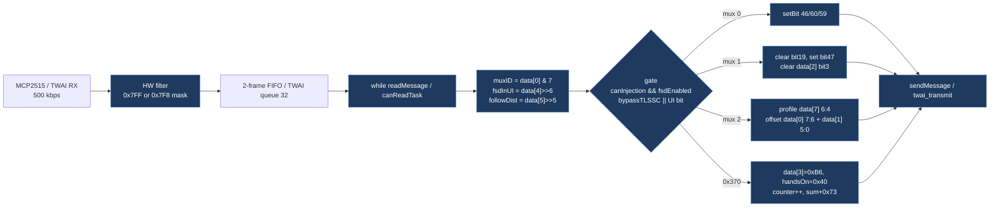
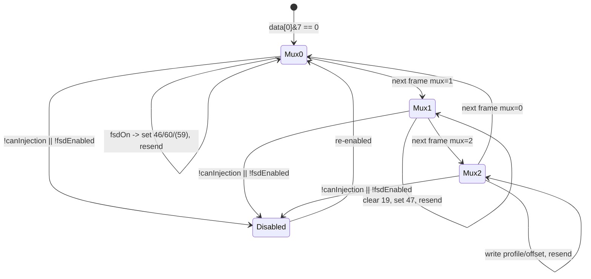

# tesla-fsd.netlify.app

## 1. Provenance

- **Path:** `legacy/tesla-fsd.netlify.app` — 32 tracked files.
- **Converted folder, NOT a submodule.** `git ls-files -s` reports only regular `100644` blobs; there is no `160000` gitlink entry, no `.gitmodules` entry, and no `.git` directory inside the folder. `docs/legacy/README.md:56` lists the pin column as `—`; no SHA for this repo exists anywhere under `docs/legacy/`. Per task instructions no upstream fetch was performed; the analysis uses only the file inventory, git blob hashes, and `_scrape_report.txt`.
- **Snapshot anchor:** `_scrape_report.txt:1-18` records a live-site fetch on `2026-04-15 23:46:06 GMT` (HTTP/2 200, Netlify, etag `aff4fbe0639b466abdf81c4dc81459db-ssl`) and `SHA256 635AFCC905B4569D8DF300BC2591F74BEE64C56E05E6F76F8C2DE60E22810132` for `index.html` (12,629,992 bytes). The report's `Lines: 6284` uses `Measure-Object -Line` (non-blank lines); raw LF count is 6,971 — a counting-method difference, not a content conflict.
- **CI deletion fact:** every build/test job explicitly removes this path before work: `.github/workflows/ci.yml:31,55,79,105,130,153,167,192,205,221,249`, `.github/workflows/release.yml:35,81,116`, `.github/workflows/auto-tag-release.yml:28` all run `rm -rf legacy/tesla-fsd.netlify.app ...`. The folder is research-only and must never become a build input.
- **License:** GPL-3.0-or-later header at lines 1-14 of all seven `.ino` files. The pre-replace doc claimed `License: None` (see section 6).
- **Analysis date:** 2026-11-21.
- **Frontmatter handling:** preserved byte-for-byte in content, including the truncated description ending `...distribution si` and all five other fields. No trailing whitespace was present on line 3 in either the worktree or `HEAD` (verified by byte inspection), so no stripping was needed. Line endings normalized CRLF→LF per the hygiene rule; that is the only frontmatter-byte change. No `## Upstream (...)` section existed in the pre-replace doc, so none is preserved.
- **Files read, with line ranges and coverage label:**
  - `codes/CanFeather_ESP32_LITE.ino` 1-459 — FULL-READ.
  - `codes/CanFeather_RP2040.ino` 1-1092 — FULL-READ.
  - `codes/ESP32C3_WiFiBridge.ino` 1-769 — FULL-READ.
  - `codes/CanFeather_ESP32_WiFi.ino` 1-540, 541-1100, 1240-1771 — RANGE-CITED (1101-1239 is dashboard HTML markup, skipped).
  - `codes/CanFeather_ArduinoUno.ino` 280-648 — RANGE-CITED (header/config 1-279 not read).
  - `codes/CanFeather_ESP32S3_TWAI.ino` 95-154, 305-379 — RANGE-CITED plus full symbol inventory via line scan.
  - `codes/CanFeather_ESP8266_WiFi.ino` 1588-1655 — RANGE-CITED plus full symbol inventory via line scan.
  - `README.md` 1-18, `SKILL.md` 1-69, `_scrape_report.txt` 1-19, `board-code-map.csv` 1-7, `markdown/README.md` 1-9, `markdown/esp32.md` 1-269, `recreate_site_mirror.ps1` 210-259 and 300-341 plus line scan — RANGE-CITED.
  - `index.html` (12.6 MB) — STRUCTURAL-PARSE only: 9 `INO_B64` hits and `tab-content` anchors confirmed; body not read.
  - `boards/*.html`, `boards/*.txt` (12 files) — STRUCTURAL-PARSE only: keyword anchors confirmed in `boards/*.txt`; contents not read in full.
  - `markdown/{esp32lite,esp32s3,esp8266,feather,uno}.md` — inventoried, not read.
- **Explicitly not read:** full `index.html`; six board HTML exports; six board TXT exports beyond anchors; five of seven board markdown docs; `ArduinoUno.ino:1-279`; `ESP32_WiFi.ino:1101-1239`; most of `ESP32S3_TWAI.ino` and `ESP8266_WiFi.ino` outside cited ranges; no git history of any kind.

## 2. Executive verdict

This is a scraped, offline mirror of a Turkish-language CanFeather/Tesla FSD enabler site plus seven decoded Arduino `.ino` firmware images for ESP8266, ESP32, ESP32-S3 (native TWAI), ESP32-C3, RP2040 Feather and Arduino UNO. The load-bearing mechanisms are bit-level FSD mux injection (0x3FD mux 0/1/2, 0x3EE on Legacy), 0x370 EPAS torque spoofing with `sum+0x73` checksum, 0x399 ISA chime suppression, a runtime-configurable ISA speed-override multiplier, cached-frame listen-modify-send vehicle commands on 0x273/0x334/0x2F3/0x333, MCP2515 `0x7F8` mask-trick filters, and — in the newest ESP32 build — a Core-0 CAN task behind a recursive SPI mutex. Most of this is a single shared logic copied seven times; our firmware already has stronger, gated equivalents. The genuinely interesting adaptation leads are the 0x334 checksum/counter discrepancy (capture-first), the driver-hands-on bypass guard that upstream applies to all 0x370 injection but we gate to organic mode only, and confirmation that our round-robin ISR reader does not suffer the frame-loss failure the upstream author documented. Must not be ported: hardcoded `tesla1234` AP credentials, unauthenticated HTTP/OTA/rollback endpoints, the C3 arbitrary-command forwarder, site-doc frame claims for 0x33F/0x352/BMS frames that the code never implements, and the PowerShell scrape pipeline. All findings below are CODE-READ on the shipped `.ino` files; there are no tests or captures in this repo.

## 3. Evidence map

| Source file | Lines | What it proves | Grade |
| --- | --- | --- | --- |
| `codes/CanFeather_ESP32_WiFi.ino` | 65-126, 95-120 | FW v3.1 defaults, config struct, `isaSpeedMul=7` | CODE-READ |
| `codes/CanFeather_ESP32_WiFi.ino` | 326-345 | mux/bit helpers, `setBit`, `canSend` under SPI lock | CODE-READ |
| `codes/CanFeather_ESP32_WiFi.ino` | 354-367 | 0x370 nag spoof bytes and `sum+0x73` checksum | CODE-READ |
| `codes/CanFeather_ESP32_WiFi.ino` | 384-520 | Legacy/HW3/HW4 FSD mux 0/1/2 handlers, ISA override | CODE-READ |
| `codes/CanFeather_ESP32_WiFi.ino` | 589-790 | cached-frame vehicle command builders and burst timing | CODE-READ |
| `codes/CanFeather_ESP32_WiFi.ino` | 1295-1328 | `0x7F8` mask trick, 500 kbps, crystal selection | CODE-READ |
| `codes/CanFeather_ESP32_WiFi.ino` | 1565-1656 | HTTP endpoint inventory, unauthenticated OTA/rollback | CODE-READ |
| `codes/CanFeather_ESP32_WiFi.ino` | 1667-1723 | Core-0 `canReadTask`, recursive SPI mutex, frame-loss history | CODE-READ |
| `codes/CanFeather_ESP32_LITE.ino` | 17-50, 91-138 | compile-time config; LITE exists because WiFi dropped 0x3FD frames | CODE-READ |
| `codes/CanFeather_ESP32_LITE.ino` | 191-355 | MCP2515 filters, three variant handlers, offset formula | CODE-READ |
| `codes/CanFeather_RP2040.ino` | 319-355, 784-980 | shared CAN logic + plain-text serial command set incl. `send` | CODE-READ |
| `codes/CanFeather_RP2040.ino` | 1081-1092 | `while` RX loop fix rationale (2-frame MCP2515 FIFO) | CODE-READ |
| `codes/ESP32C3_WiFiBridge.ino` | 104-120, 561-602, 664-669 | UART command forwarder and `/cmd` vs `/vcmd` split | CODE-READ |
| `codes/ESP32C3_WiFiBridge.ino` | 334-339, 671-754 | hidden vehicle-control UI, unauthenticated C3 OTA | CODE-READ |
| `codes/CanFeather_ESP32S3_TWAI.ino` | 97-101, 313-371 | native TWAI 500 kbps, queues 32/16, accept-all, 10 ms TX timeout | CODE-READ |
| `codes/CanFeather_ESP8266_WiFi.ino` | 569, 1573-1574, 1601-1655 | time-based boot apply, no rollback, `yield()` watchdog, RX loop fix | CODE-READ |
| `codes/CanFeather_ArduinoUno.ino` | 296-318, 495-594, 617-648 | simple filters, 9600-baud token command interface | CODE-READ |
| `recreate_site_mirror.ps1` | 227-254, 304-341 | untrusted fetch, base64→`.ino`, recursive generation cleanup | CODE-READ |
| `_scrape_report.txt` | 1-18 | snapshot date, etag, SHA256 of `index.html` | CODE-READ |
| `board-code-map.csv` | 1-7 | six boards, seven code IDs (`feather` maps to two) | CODE-READ |
| `index.html` | structural anchors only | 9 `INO_B64` blobs, `tab-content` layout | STRUCTURAL-PARSE |
| `markdown/esp32.md` | 100-243 | site's own prose claim set; source of contradictions in section 6 | RANGE-CITED |

No TEST-READ evidence exists: this repo ships no tests. No CAPTURE evidence exists: there are no captured frames or decoder logs, only scraped site text and source code.

## 4. Architecture and build surface

- **Entry points:** each `.ino` is standalone (`setup()`/`loop()`); no shared core library, no build flags. Board selection is an Arduino IDE choice; variants are selected by `#define HW_VERSION` (LITE:91) or runtime `cfg.hw`.
- **Dependencies:** `mcp2515` (autowp), `ArduinoJson` v6, `SPI`, `EEPROM`, ESP32/ESP8266 `WiFi`+`WebServer`+`Update`+`esp_ota_ops`, ESP32-S3 `driver/twai.h`.
- **Split hardware:** RP2040 owns the MCP2515 and all CAN logic; UART1 (115200) carries plain-text commands to the ESP32-C3, which owns WiFi, web UI and OTA. The C3 has no CAN peripheral path in this design.
- **No DBC/JSON frame catalog is vendored** — frame layouts live only in hand-written C++ and in the scraped prose.



## 5. Mechanism catalogue

### FSD mux injection (Legacy / HW3 / HW4)

- **Claim (README / summary):** "Each variant handles CAN IDs 1006/1016/1021 for FSD activation" (`git show HEAD:docs/legacy/tesla-fsd.netlify.app.md#L55`).
- **Code path:** `codes/CanFeather_ESP32_WiFi.ino:526-564` `processFrame()` → `handleLegacy():373` / `handleHW3():401` / `handleHW4():461` → `canSend():340` → TX.
- **Frame spec:** ID 1006 (0x3EE, Legacy) or 1021 (0x3FD, HW3/HW4), DLC 8, mux = `data[0] & 0x07`. Mux 0: set bit 46, plus 60 (and 59 when emergencyDetect); Legacy uses `setSpeedV12V13` = `data[6] = (data[6] & ~0x06) | ((p & 3) << 1)`. Mux 1: clear bit 19, set bit 47 on HW3/HW4, optionally clear `data[2] &= ~0x08`. Mux 2: `data[7] = (data[7] & ~0x70) | ((profile & 7) << 4)`; offset split `data[0] = (data[0] & ~0xC0) | ((off & 3) << 6)`, `data[1] = (data[1] & ~0x3F) | (off >> 2)`. No checksum recomputation on 0x3FD.
- **Gates and timing:** `canInjection && fsdEnabled`; `fsdOn = fsdEnabled && (bypassTLSSC || fsdSelectedInUI)`; UI bit = `(data[4] >> 6) & 1`; no AP-state gate, no DLC guard, no force flag.
- **State machine:** three mux states plus an injection-disabled state.



- **Tests:** None found.
- **Evidence grade:** CODE-READ.
- **Verdict:** CONFIRMED.
- **Adapt to TeslaCANModder?** already present, with our extra AP gate, `fsdForce`, EAP/TLSSC and DLC guards.

### EPAS hands-free steering / nag killer (0x370)

- **Claim (README / summary):** not mentioned in the pre-replace doc; site UI calls it "Hands-Free Steering".
- **Code path:** `codes/CanFeather_ESP32_WiFi.ino:354-367` `handleNagKiller()`, called unconditionally from `processFrame():555` before the injection gate.
- **Frame spec:** ID 880 (0x370), DLC assumed 8. Guard: `realHandsOn = (data[4] >> 6) & 3`; return if non-zero. Writes `data[3] = 0xB6`, `data[4] = (data[4] & ~0xC0) | 0x40`, counter `data[1] = (data[1] & ~0x0F) | ((cnt+1) & 0x0F)`, checksum `data[7] = (sum(data[0..6]) + 0x73) & 0xFF`.
- **Gates and timing:** `cfg.nagKiller` plus real-hands-on == 0; runs even when `canInjection` is false.
- **State machine:** None found (single fixed pattern).
- **Tests:** None found.
- **Evidence grade:** CODE-READ.
- **Verdict:** CONFIRMED.
- **Adapt to TeslaCANModder?** already present (seven richer nag modes); the driver-hands-on guard is a small candidate for extension beyond organic mode.

### ISA speed chime suppression (0x399)

- **Claim (README / summary):** not mentioned in the pre-replace doc.
- **Code path:** `codes/CanFeather_ESP32_WiFi.ino:403-411` (HW3) and `:463-470` (HW4), duplicated in RP2040/S3/Uno/LITE.
- **Frame spec:** ID 921 (0x399), `data[1] |= 0x20`, checksum `data[7] = (sum(data[0..6]) + (921 & 0xFF) + (921 >> 8)) & 0xFF` = `sum + 0x9C`.
- **Gates and timing:** `cfg.isaSuppress`; on ESP32-LITE compile-time `ISA_SUPPRESS` (line 123); upstream comment warns the speed-limit sign goes blank.
- **State machine:** None found.
- **Tests:** None found.
- **Evidence grade:** CODE-READ.
- **Verdict:** CONFIRMED.
- **Adapt to TeslaCANModder?** already present; our `hw4.h:70-81` applies an AP gate and DLC guard the upstream lacks.

### ISA speed override / configurable multiplier (mux 2 offset)

- **Claim (README / summary):** site prose says "speedOffset (0-100)" written to bytes 0-1 (`markdown/esp32.md:150-155`).
- **Code path:** `codes/CanFeather_ESP32_WiFi.ino:429-430` and `:490-491` compute `off = ((data[3] >> 1) & 0x3F) - 30`, `lastSpeedOff = constrain(off * cfg.isaSpeedMul, 0, 200)`; `:449-453` / `:510-518` write it into mux 2. Multiplier stored at EEPROM byte 19, validated 1-15 at load (`:228`) and via `/config` (`:1477-1480`) or `isamul` serial command (RP2040:811-819).
- **Frame spec:** 6-bit biased step field in `data[3] bits[6:1]`; result clamped 0..200; encoded as 2 bits in `data[0] bits[7:6]` + 6 bits in `data[1] bits[5:0]`; HW3 requires `fsdOn` before writing offset, HW4 writes profile unconditionally and offset only when `isaSpeedOverride && fsdOn`.
- **Gates and timing:** `cfg.isaSpeedOverride`, default false; multiplier default 7.
- **State machine:** None found.
- **Tests:** None found.
- **Evidence grade:** CODE-READ.
- **Verdict:** CONFIRMED.
- **Adapt to TeslaCANModder?** candidate for capture-first comparison — our offset path uses a fixed ×5 clamp 0..100 and a different HW4 byte layout.

### Follow-distance → speed profile mapping

- **Claim (README / summary):** "profile changes with follow-distance stalk" (`markdown/esp32.md:171`).
- **Code path:** `codes/CanFeather_ESP32_WiFi.ino:417-421` (HW3 read-only) and `:472-481` (HW4 switch `1→3, 2→2, 3→1, 4→0, 5→4`); Legacy `:374-381` uses `data[1] >> 5` with `pos<=1→2, pos==2→1, else→0`.
- **Frame spec:** ID 1016 (0x3F8), `followDist = (data[5] & 0xE0) >> 5`; read-only, never transmitted.
- **Gates and timing:** `!cfg.profileOverride`; HW3 mapping deliberately removed (comment at `:414-416` says the old switch was broken).
- **State machine:** None found.
- **Tests:** None found.
- **Evidence grade:** CODE-READ.
- **Verdict:** PARTIAL — HW4/Legacy confirmed, HW3 auto-mapping explicitly removed.
- **Adapt to TeslaCANModder?** already present for HW4 (identical map) and HW3 (we still auto-map — capture-first).

### Cached-frame vehicle command bursts

- **Claim (README / summary):** "10 vehicle-control features from WiFi panel" (`git show HEAD:docs/legacy/tesla-fsd.netlify.app.md#L34`).
- **Code path:** `codes/CanFeather_ESP32_WiFi.ino:132-140` caches `buf_273/buf_2F3/buf_333/buf_334`; `:589-661` `sendModified273`, `sendBitSet273`, `sendInjectFrame`, `sendWithChecksum334`, `sendRegen334`; `:663-790` `execVehicleCmd` dispatch.
- **Frame spec:** 0x273 byte/bit table in `:669-730` (mirror `data[3] bits1:0`, lock `data[2] bits3:1`, wiper `data[7] bits2:0`, seat FL/FR/RL `data[5]`, RR/RC `data[6]`, brightness `data[4]`, horn `data[7] bit5`); 0x334 counter in `data[6] bits[7:4]`, checksum `sum(data[0..6]) + 0x34 + 0x03`; regen value in `data[3]`; 0x119 vent `{0x1F,100}`; 0x3B3 glovebox `{0x01,0,0,0}` / trunk `{0x02,...}`; 0x284 sentry `{0x20,0,0,0,0}`.
- **Gates and timing:** `has_*` cache flags gate mutation; bursts 30×20 ms (0x273/0x334/0x2F3/0x333), 50×20 ms (mirror), 20×100 ms (fixed-ID injects).
- **State machine:** None found.
- **Tests:** None found.
- **Evidence grade:** CODE-READ.
- **Verdict:** CONFIRMED.
- **Adapt to TeslaCANModder?** already present; 0x334 checksum and regen byte differ — capture-first.

### MCP2515 mask-trick hardware filters

- **Claim (README / summary):** not mentioned.
- **Code path:** `codes/CanFeather_ESP32_WiFi.ino:1295-1313`, `CanFeather_RP2040.ino:280-298`; simple variant in `CanFeather_ESP32_LITE.ino:191-213` and `CanFeather_ArduinoUno.ino:296-318`.
- **Frame spec:** RXB0 exact mask `0x7FF` for 1021/1016 (or 1006/69); RXB1 mask `0x7F8` with filters 0x370, 0x2F0, 0x330, 0x398 covering eight-ID ranges; false positives rejected in `processFrame`.
- **Gates and timing:** filters re-applied on HW change (`:1449-1453`) and crystal change (`:1464-1470`).
- **State machine:** None found.
- **Tests:** None found.
- **Evidence grade:** CODE-READ.
- **Verdict:** CONFIRMED.
- **Adapt to TeslaCANModder?** already present; our `id_filter.h` is per-ID rather than range-based (stricter).

### Core-0 CAN task with recursive SPI mutex (v2.8 fix)

- **Claim (README / summary):** site UI mentions "CAN bridge settings"; pre-replace doc does not mention concurrency.
- **Code path:** `codes/CanFeather_ESP32_WiFi.ino:309-320` mutex macros, `:1667-1687` task creation, `:1706-1723` `canReadTask`, `:1729-1770` HTTP-only loop.
- **Frame spec:** not frame-shaping; 4096-byte stack, priority `configMAX_PRIORITIES-2`, pinned core 0, `vTaskDelay(1)`, nested `SPI_LOCK()` because `canReadTask → processFrame → canSend` re-enters the same recursive semaphore.
- **Gates and timing:** created only if `xSemaphoreCreateRecursiveMutex()` succeeds; errors printed, no fallback.
- **State machine:** None found.
- **Tests:** None found.
- **Evidence grade:** CODE-READ.
- **Verdict:** CONFIRMED.
- **Adapt to TeslaCANModder?** candidate, capture-first — we use ISR flags + round-robin poll in `driverRead()`; keep unless our REST path ever shows frame loss.

### Bus-off auto-recovery

- **Claim (README / summary):** LITE header lists it as a feature (`CanFeather_ESP32_LITE.ino:37`).
- **Code path:** `codes/CanFeather_ESP32_WiFi.ino:1754-1769`, `CanFeather_ESP32S3_TWAI.ino:333-341`, `CanFeather_RP2040.ino:1068-1079`, `CanFeather_ESP32_LITE.ino:433-447`.
- **Frame spec:** MCP2515 `EFLG & 0x20` → `reset()` + `setBitrate()` + filters + normal mode; TWAI `TWAI_STATE_BUS_OFF` → `stop` + `uninstall` + `initTWAI()`. Poll interval 2000 ms.
- **Gates and timing:** `cfg.busAutoRecover` (WiFi) or compile-time `BUS_AUTO_RECOVER` (LITE).
- **State machine:** None found.
- **Tests:** None found.
- **Evidence grade:** CODE-READ.
- **Verdict:** CONFIRMED.
- **Adapt to TeslaCANModder?** already present via `driverReinit()` in `firmware/lib/core/driver/esp32/board.h:133-144`.

### EEPROM persistence and boot replay

- **Claim (README / summary):** "EEPROM Kaydi" in site docs (`markdown/esp32.md:92`).
- **Code path:** `codes/CanFeather_ESP32_WiFi.ino:146-233` (`EEPROM_MAGIC 0xCF`, WiFi `0xAA` at offset 64), `:537-552` boot replay of pedal/regen/stop/sentry once `has_273 && has_334`; ESP8266 uses time-based trigger instead (`:569`).
- **Frame spec:** 20 bytes config (WiFi ESP32) / 23 bytes (RP2040), with `0xFF` sentinel handling for newer fields and range clamps on `crystal`, `isaMul`, `pedalMode`, `stopMode`.
- **Gates and timing:** boot replay once per boot; `saveConfig()` called from `/cmd` vehicle commands and `save` serial command.
- **State machine:** `bootApplied` one-shot flag.
- **Tests:** None found.
- **Evidence grade:** CODE-READ.
- **Verdict:** CONFIRMED.
- **Adapt to TeslaCANModder?** already present (NVS rather than EEPROM); no impact.

### WiFi AP, web dashboard and OTA/rollback

- **Claim (README / summary):** WiFi variants "add OTA update and web dashboard capabilities" (`git show HEAD:docs/legacy/tesla-fsd.netlify.app.md#L64`).
- **Code path:** `codes/CanFeather_ESP32_WiFi.ino:796-1284` PROGMEM HTML, `:1330-1537` handlers, `:1578-1656` OTA and partition routes; `ESP32C3_WiFiBridge.ino:561-602` and `:671-754` equivalent C3 routes.
- **Frame spec:** not frame-shaping; JSON responses hand-built or ArduinoJson v6 `StaticJsonDocument` (256→512 and 768/1024 capacities).
- **Gates and timing:** none — no authentication on any route; SSID `CanFeather`, password `tesla1234`, AP `192.168.4.1`; UI only warns the user to change the password (`mustChgPw`).
- **State machine:** None found.
- **Tests:** None found.
- **Evidence grade:** CODE-READ.
- **Verdict:** CONFIRMED.
- **Adapt to TeslaCANModder?** never port — our REST API already has auth and structured JSON-RPC.

### RP2040 ↔ ESP32-C3 UART bridge

- **Claim (README / summary):** "ESP32-C3 variant serves as a WiFi bridge for the RP2040 Feather" (`git show HEAD:docs/legacy/tesla-fsd.netlify.app.md#L65`).
- **Code path:** `codes/ESP32C3_WiFiBridge.ino:104-120` `sendToRP2040()` (500 ms default timeout, 8000 ms for `/vcmd`), `:561-602` `/cmd` and `/vcmd`; `CanFeather_RP2040.ino:784-980` `processCommand()` on both USB Serial and `Serial1`.
- **Frame spec:** newline-terminated plain-text commands, lowercased and trimmed on the RP2040; arbitrary `send ID DLC D0..D7` accepted (`:845-872`).
- **Gates and timing:** none on the C3 side; 500 ms/8000 ms reply timeouts.
- **State machine:** None found.
- **Tests:** None found.
- **Evidence grade:** CODE-READ.
- **Verdict:** CONFIRMED.
- **Adapt to TeslaCANModder?** never port; our wire format is JSON-RPC with a `cmd` field and an allowlist.

### Auto-off timer, log rings and FSD history

- **Claim (README / summary):** not mentioned in pre-replace doc; site docs list them as panel features.
- **Code path:** `codes/CanFeather_ESP32_WiFi.ino:245-260` history structs, `:274-301` `LOG_CAP 20` / `SLOG_CAP 16`, `:1743-1752` auto-off, `:1510-1537` `/stats` and `/slog`.
- **Frame spec:** 60-sample 1 Hz RX histogram, 16-entry FSD transition log, 20-entry CAN log, 16-entry serial log.
- **Gates and timing:** `autoOffMinutes` 0 = disabled; timer `minutes * 60000UL`; `pushLog` drops Serial output on the hot path to avoid blocking (`:283-286`).
- **State machine:** one-shot auto-off flag.
- **Tests:** None found.
- **Evidence grade:** CODE-READ.
- **Verdict:** CONFIRMED.
- **Adapt to TeslaCANModder?** already present (recorder ring, status streams); no impact.

### Site mirror rebuild pipeline

- **Claim (README / summary):** SKILL.md:3-22 describes reproducible rebuild.
- **Code path:** `recreate_site_mirror.ps1:227-246` download + report, `:248-259` recursive cleanup, `:304-341` base64 decode to `codes/*.ino`, `:369-390` markdown/CSV/README regeneration.
- **Frame spec:** not applicable.
- **Gates and timing:** idempotent; no signature/hash verification of embedded blobs before writing `.ino` files; `Invoke-WebRequest` follows up to 10 redirects with default TLS validation.
- **State machine:** None found.
- **Tests:** None found (validation is a manual checklist in `SKILL.md:44-57`).
- **Evidence grade:** CODE-READ.
- **Verdict:** CONFIRMED.
- **Adapt to TeslaCANModder?** never port into shipping code; research-only tooling.

## 6. Summary vs code contradiction table

| Pre-replace / upstream claim (citation) | Code reality (citation) | Verdict |
| --- | --- | --- |
| `git show HEAD:docs/legacy/tesla-fsd.netlify.app.md#L34` — "License: None" | GPL-3.0-or-later header at `codes/CanFeather_ESP32_WiFi.ino:1-14` and all six other `.ino` files | CONTRADICTED |
| `git show HEAD:docs/legacy/tesla-fsd.netlify.app.md#L55` — "Each variant handles CAN IDs 1006/1016/1021 for FSD activation" | FSD mutation uses 1006 (Legacy) or 1021 (HW3/HW4); 1016 is read-only follow distance (`codes/CanFeather_ESP32_WiFi.ino:417-421,472-481`); also 921, 880, 0x273/0x2F3/0x333/0x334/0x119/0x3B3/0x284 are touched | PARTIAL |
| `git show HEAD:docs/legacy/tesla-fsd.netlify.app.md#L3` — frontmatter description ends `...distribution si` (truncated) | Full sentence at `git show HEAD:docs/legacy/tesla-fsd.netlify.app.md#L15` ends "...mirror from the live site"; frontmatter preserved as instructed, staleness recorded here rather than fixed | CONTRADICTED (inherited) |
| `markdown/esp32.md:165` — "canSend has two safety checks: MODE_ACTIVE and fsdEnabled" | `canSend()` only takes the SPI lock and calls `sendMessage()` (`codes/CanFeather_ESP32_WiFi.ino:340-345`); the gate is in `processFrame():557` | CONTRADICTED |
| `markdown/esp32.md:171` — profile from 1016 is written into mux 0 via `writeSpeedProfile` | HW3 fd→profile mapping removed as broken (`codes/CanFeather_ESP32_WiFi.ino:414-421`); HW4 writes profile in mux 2 `data[7]` (`:511`) | CONTRADICTED |
| `markdown/esp32.md:150-155` — speedOffset range 0-100 | `constrain(off * isaSpeedMul, 0, 200)`, multiplier 1-15 default 7 (`codes/CanFeather_ESP32_WiFi.ino:429-430,490-491`) | CONTRADICTED |
| `markdown/esp32.md:212-243` — tables name 0x33F, 0x257, 0x118, 0x241, 0x2B9, 0x352, 0x3A1 and 0x399 UI_autopilotStatus | None of these IDs appear in any `.ino`; 0x399 is ISA chime (`codes/CanFeather_ESP32_WiFi.ino:403-411`), 880 is nag (`:354-367`) | CONTRADICTED |
| `markdown/esp32.md:249-267` — BMS telemetry on 0x132/0x292/0x312/0x33A and preconditioning 0x082 | No BMS decode or preconditioning code in any of the seven `.ino` files | CONTRADICTED |
| `markdown/esp32.md:91` — "Raw CAN Sniffer — all traffic shown" | No sniffer route; only `logFilter` ID filtering (`codes/CanFeather_ESP32_WiFi.ino:278-280`) | CONTRADICTED |
| `markdown/esp32.md:126-136` — mux 0 sets bit 46 and profile in `data[6]` bits 1-2 | True only for Legacy (`codes/CanFeather_ESP32_LITE.ino:239-243`); HW3/HW4 mux 0 sets 46+60(+59) and never writes profile (`:283-300`) | PARTIAL |
| `_scrape_report.txt:3` — `Lines: 6284` | Raw LF count of `index.html` is 6,971; report's `Measure-Object -Line` ignores blank lines | CONTRADICTED (measurement method) |
| `git show HEAD:docs/legacy/tesla-fsd.netlify.app.md#L64` — "6+ board variants" | Six boards in `board-code-map.csv:2-7` but seven `.ino` images (feather maps to two code IDs) — agree in substance | agreement, not a contradiction (recorded in evidence map) |

## 7. CAN frame and signal inventory

No vendored DBC/JSON catalog exists — every row below is from code. "Period" is the burst used on write, not a periodic scheduler.

| ID (hex+dec) | Bus | Period | DLC | Byte/bit layout | Scale/units | Counter position | Checksum | R/W | Grade |
| --- | --- | --- | --- | --- | --- | --- | --- | --- | --- |
| 0x3EE / 1006 | Chassis-like single bus | per RX frame | 8 | `data[0]&7` mux; mux0 bit46 + `data[6] bits2:1` profile; mux1 clear bit19 | profile 2-bit | none | none | R+W | CODE-READ |
| 0x45 / 69 | Chassis-like single bus | per RX frame | 8 | Legacy stalk `data[1]>>5` | pos→profile 0-2 | none | none | R | CODE-READ |
| 0x3F8 / 1016 | Chassis-like single bus | per RX frame | 8 | `data[5] bits7:5` follow distance | fd 1-5 | none | none | R | CODE-READ |
| 0x3FD / 1021 mux0 | Chassis-like single bus | per RX frame | 8 | `data[0]&7=0`; `data[4]>>6` UI bit; set bits 46,60, optional 59 | boolean flags | none | none | R+W | CODE-READ |
| 0x3FD / 1021 mux1 | Chassis-like single bus | per RX frame | 8 | clear bit19, set bit47, `data[2]&=~0x08` | boolean flags | none | none | R+W | CODE-READ |
| 0x3FD / 1021 mux2 | Chassis-like single bus | per RX frame | 8 | `data[7] bits6:4` profile; `data[0] bits7:6` + `data[1] bits5:0` offset | profile 3-bit, offset 0-200 | none | none | R+W | CODE-READ |
| 0x399 / 921 | Chassis/Vehicle (site calls ISA) | per RX frame | 8 | `data[1] |= 0x20` | boolean | none | `sum(data[0..6]) + 0x99 + 0x03` | R+W | CODE-READ |
| 0x370 / 880 | Vehicle/EPAS | per RX frame | 8 | `data[3]=0xB6`, `data[4]|=0x40`, real hands-on guard `(data[4]>>6)&3` | torque byte | `data[1] & 0x0F`, +1 | `sum(data[0..6]) + 0x73` | R+W | CODE-READ |
| 0x273 / 627 | Vehicle | 20-50 frames × 20 ms | 8 | mirror `data[3] bits1:0`; lock `data[2] bits3:1`; wiper `data[7] bits2:0`; seats `data[5]`/`data[6]`; brightness `data[4]`; horn `data[7] bit5` | enumerated | inherited from cached frame | inherited (not recomputed) | W (cached base) | CODE-READ |
| 0x334 / 820 | Vehicle | 30 × 20 ms | 8 | pedal `data[0] mask 0x60` (0x20 Chill / 0x40 Sport); regen `data[3]`; stop `data[5] mask 0x03` | pedal enum, regen 0/50/100/200 | `data[6] bits7:4`, +1 per frame | `sum(data[0..6]) + 0x34 + 0x03` | W (cached base) | CODE-READ |
| 0x2F3 / 755 | Vehicle | 30 × 20 ms | 5 | climate keep `data[4] bits2:1` | enum | none | none | W (cached base) | CODE-READ |
| 0x333 / 819 | Vehicle | 20 × 20 ms | 5 | `data[0] bit2` charge, `bit0` port | boolean | none | none | W (cached base) | CODE-READ |
| 0x119 / 281 | Vehicle | 30 × 20 ms | 2 | `{0x1F, percent}` | vent 0-100 | none | none | W (fixed) | CODE-READ |
| 0x3B3 / 947 | Vehicle | 20 × 100 ms | 4 | `{0x01,0,0,0}` glovebox; `{0x02,...}` trunk | enum | none | none | W (fixed) | CODE-READ |
| 0x284 / 644 | Vehicle | 30 × 100 ms (boot) / 30 × 20 ms (cmd) | 5 | `{0x20,0,0,0,0}` sentry on | boolean | none | none | W (fixed) | CODE-READ |

## 8. Constants and tuning table

| Constant | Value | File:line | Meaning | Grade |
| --- | --- | --- | --- | --- |
| `FW_VERSION` / `FW_DATE` | `v3.1` / `15.04.2026` | `codes/CanFeather_ESP32_WiFi.ino:65-66` | current build identity | CODE-READ |
| `HW_VERSION` (LITE) | `1` (HW3) | `codes/CanFeather_ESP32_LITE.ino:91` | compile-time variant | CODE-READ |
| `CAN_CRYSTAL` (LITE) | `MCP_8MHZ` | `codes/CanFeather_ESP32_LITE.ino:96` | 8 MHz vs WiFi default 16 MHz | CODE-READ |
| `SPEED_PROFILE` (LITE) | `2` (Hurry) | `codes/CanFeather_ESP32_LITE.ino:100` | default profile | CODE-READ |
| `isaSpeedMul` | 7, valid 1-15 | `codes/CanFeather_ESP32_WiFi.ino:119,228,1477-1480` | offset multiplier | CODE-READ |
| `off` bias | `-30` from `(data[3]>>1)&0x3F` | `codes/CanFeather_ESP32_WiFi.ino:429,490` | UI step centering | CODE-READ |
| offset clamp | `0..200` | `codes/CanFeather_ESP32_WiFi.ino:430,491` | override ceiling | CODE-READ |
| FSD bit 46 / 60 / 59 / 47 / 19 | set/set/optional/set/clear | `codes/CanFeather_ESP32_WiFi.ino:436-439,444-445,497-505` | FSD mux bits | CODE-READ |
| ISA chime mask | `0x20` on `data[1]` | `codes/CanFeather_ESP32_WiFi.ino:404,464` | suppress bit | CODE-READ |
| nag torque byte | `0xB6` on `data[3]` | `codes/CanFeather_ESP32_WiFi.ino:358` | fixed spoof torque | CODE-READ |
| nag hands-on | `0x40` on `data[4] bits7:6` | `codes/CanFeather_ESP32_WiFi.ino:359` | handsOnLevel=1 | CODE-READ |
| nag checksum addend | `0x73` | `codes/CanFeather_ESP32_WiFi.ino:365` | `sum + ID bytes` | CODE-READ |
| 0x334 checksum addend | `0x34 + 0x03` | `codes/CanFeather_ESP32_WiFi.ino:636,656` | ID-derived checksum | CODE-READ |
| 0x334 counter | `data[6] >> 4`, `&0x0F`, +1 | `codes/CanFeather_ESP32_WiFi.ino:627-633` | rolling nibble | CODE-READ |
| burst sizes | 30×20 ms, 50×20 ms, 20×100 ms | `codes/CanFeather_ESP32_WiFi.ino:593-597,619,628-638` | injection bursts | CODE-READ |
| RXB1 filter mask | `0x7F8` | `codes/CanFeather_ESP32_WiFi.ino:1308` | 8-ID range accept | CODE-READ |
| CAN bitrate | `CAN_500KBPS` | `codes/CanFeather_ESP32_WiFi.ino:1318` | bus speed | CODE-READ |
| TWAI queues | rx 32, tx 16, TX timeout 10 ms | `codes/CanFeather_ESP32S3_TWAI.ino:315-316,366` | S3 timing budget | CODE-READ |
| bus-off poll | 2000 ms | `codes/CanFeather_ESP32_WiFi.ino:1756` | recovery cadence | CODE-READ |
| `HIST_LEN` / `LOG_CAP` / `SLOG_CAP` / `FSD_HIST_LEN` | 60 / 20 / 16 / 16 | `codes/CanFeather_ESP32_WiFi.ino:246,274,293,253` | history/ring sizes | CODE-READ |
| `EEPROM_MAGIC` / `WIFI_MAGIC` / `WIFI_EE_START` | `0xCF` / `0xAA` / 64 | `codes/CanFeather_ESP32_WiFi.ino:87-89` | persistence layout | CODE-READ |
| `DEFAULT_PASS` / `WIFI_SSID` | `tesla1234` / `CanFeather` | `codes/CanFeather_ESP32_WiFi.ino:67-70` | AP credentials | CODE-READ |
| `EEPROM_SIZE` | 140 (ESP32) / 64 (RP2040) | `codes/CanFeather_ESP32_WiFi.ino:86`, `codes/CanFeather_RP2040.ino:83` | NVS footprint | CODE-READ |

## 9. Failure modes and edge cases

| Failure | Handling code path | Tested? | Grade |
| --- | --- | --- | --- |
| HTTP handler blocks MCP2515 2-frame FIFO → 0x3FD loss → FSD flicker | `codes/CanFeather_ESP8266_WiFi.ino:1603-1606`; `CanFeather_RP2040.ino:1081-1083`; fixed by Core-0 task `CanFeather_ESP32_WiFi.ino:1667-1723`; LITE removes WiFi entirely (`CanFeather_ESP32_LITE.ino:26-30`) | No | CODE-READ |
| MCP2515 RX FIFO overflow at ~500 fps | `while (readMessage() == ERROR_OK)` drain loops (`CanFeather_ESP32_WiFi.ino:1710`, `CanFeather_RP2040.ino:1085`) | No | CODE-READ |
| SPI contention between CAN task and HTTP handlers | recursive `spiMutex` with `portMAX_DELAY` (`CanFeather_ESP32_WiFi.ino:309-316`) | No | CODE-READ |
| CAN bus-off (MCP2515) | 2 s `EFLG & 0x20` poll, reset + re-init (`CanFeather_ESP32_WiFi.ino:1754-1769`) | No | CODE-READ |
| CAN bus-off (TWAI S3) | `twaiRecover()` stop/uninstall/re-install (`CanFeather_ESP32S3_TWAI.ino:333-341`) | No | CODE-READ |
| Cached vehicle frame never seen | `has_273/has_334/...` guard and early return (`CanFeather_ESP32_WiFi.ino:589-590,623-624`) | No | CODE-READ |
| Wrong MCP2515 crystal | `setBitrate` error increments `errCount`, logs; LITE uses compile-time 8/16 MHz (`CanFeather_ESP32_LITE.ino:215-223`) | No | CODE-READ |
| Invalid `HW_VERSION` | `#error` at `CanFeather_ESP32_LITE.ino:370` | No | CODE-READ |
| EEPROM invalid/corrupt values | magic-byte check, `0xFF` sentinels for newer fields, clamps for crystal/pedal/stop/isaMul (`CanFeather_ESP32_WiFi.ino:199-232`) | No | CODE-READ |
| OTA failure on ESP8266 | no rollback; UI warns user to back up `.bin` (`CanFeather_ESP8266_WiFi.ino:1244`) | No | CODE-READ |
| Serial blocking on hot CAN path | `pushLog()` deliberately does not call `Serial.println` (`CanFeather_ESP32_WiFi.ino:283-286`) | No | CODE-READ |
| ESP8266 watchdog starvation | `yield()` inside RX loop and at loop end (`CanFeather_ESP8266_WiFi.ino:1614,1654`) | No | CODE-READ |
| Unauthenticated config/injection disable | no auth on `/config`, `/disable`, `/cmd`, `/update`, `/rollback` (`CanFeather_ESP32_WiFi.ino:1565-1624`) | No | CODE-READ |

## 10. Test coverage map

None found — no test files, no test framework, no CI job for these artifacts.

| Critical path with no test | Risk in one line |
| --- | --- |
| 0x3FD mux 0/1/2 bit writes | A bit-position slip silently disables FSD or nag on a real vehicle. |
| ISA chime / 0x370 checksums | `sum+ID` constants are copied, never recomputed by an independent oracle. |
| 0x334 checksum and counter advance | Wrong addend or stale counter can make injected config frames be ignored. |
| Cached-frame mutation | No test that `has_*` guards prevent zero-filled frames being sent. |
| TWAI bus-off recovery | Uninstall/re-install race could leave the bus silent after recovery. |
| Dual-core SPI lock | Nested lock depth and failure path (`spiMutex == NULL`) untested. |
| WiFi route surface | No test that default credentials are rejected or that `/disable` works. |
| EEPROM load with `0xFF` sentinels | Corrupt NVS could restore an unsafe profile/offset combination. |

## 11. Parity matrix with TeslaCANModder

Our-side citations are CODE-READ unless marked otherwise; a row without a CODE-READ our-side citation would be SUMMARY-ONLY and could not drive a decision.

| Signal / frame | Upstream decode/mutation (cite) | Our decode/mutation (cite) | Delta | Action |
| --- | --- | --- | --- | --- |
| 0x3FD mux0 FSD bits | `CanFeather_ESP32_WiFi.ino:436-439` → 46, 60, optional 59 | `handler/variant/bits.h:19-23` (`38,39,46,59,60`) + `handler/variant/hw4.h:136-145` | We add bits 38/39 and gate on `apGateOpen` | already present |
| 0x3FD mux1 nag bits | `CanFeather_ESP32_WiFi.ino:443-447` → clear 19, set 47, clear `data[2] bit3` | `bits.h:42,27` + `hw4.h:40-53` + `region.h:94` | We add EAP/lane-graph/ECE R79 and gate on nag mode | already present |
| 0x3FD mux2 profile | `CanFeather_ESP32_WiFi.ino:450,511` → `data[7] & ~0x70 | p<<4` | `feature/fsd/profile.h:30-36` identical formula | none | already present |
| HW4 profile map | `CanFeather_ESP32_WiFi.ino:476-479` → `1→3,2→2,3→1,4→0,5→4` | `feature/fsd/profile.h:54-58` → `{-1,3,2,1,0,4}` | Same for valid fd; we reject fd=0 | already present |
| HW3 profile map | explicitly removed as broken `CanFeather_ESP32_WiFi.ino:414-421` | `feature/fsd/profile.h:43-47` → `{-1,2,1,0}` | We still auto-map; upstream does not | capture-first |
| Speed offset derivation | `CanFeather_ESP32_WiFi.ino:429-430` → steps×isaMul (1-15, default 7), clamp 200 | `feature/fsd/offsets.h:31-50` → steps×5, clamp 100 | Multiplier and ceiling differ | capture-first |
| HW4 offset encoding | `CanFeather_ESP32_WiFi.ino:515-516` → 2 bits in `data[0]`, 6 bits in `data[1]` | `handler/variant/hw4.h:160-164` → 6 bits in `data[1]`, preserve 0xC0 | Different byte layout | capture-first |
| 0x399 ISA chime | `CanFeather_ESP32_WiFi.ino:403-411` → `data[1]|=0x20`, `sum+0x9C` | `handler/variant/hw4.h:70-81` + `checksum.h:47-56` identical | We add AP gate + DLC guard | already present |
| 0x370 nag | `CanFeather_ESP32_WiFi.ino:354-367` → `0xB6`, handsOn `0x40`, counter `data[1]`, `sum+0x73` | `checksum.h:67-75` (`sum+0x73`) + `feature/fsd/nag.h:457-487` (7 modes) | Same checksum/counter; ours richer torque/handsOnLevel; our bypass is organic-only | already present; candidate to extend bypass |
| 0x334 checksum | `CanFeather_ESP32_WiFi.ino:634-637` → `sum + 0x34 + 0x03` | `ids.h:90-96` `driveChecksum` → `sum` only | We omit the ID-derived `0x37` | capture-first (safety-relevant) |
| 0x334 counter per frame | `CanFeather_ESP32_WiFi.ino:627-638` → +1 each of 30 frames | `feature/drive/pedal.h:28-51`, `regen.h:22-35` → one frame repeated 30× | We do not advance the counter in the burst | capture-first |
| 0x334 regen byte | `CanFeather_ESP32_WiFi.ino:651` → `data[3]` | `feature/drive/regen.h:31` → `data[2]` | Different byte | capture-first |
| 0x334 pedal mode | `CanFeather_ESP32_WiFi.ino:779-781` → `data[0] & ~0x60` with 0x00/0x20/0x40 | `feature/drive/pedal.h:35-49` identical | none | already present |
| 0x273 cached mutation | `CanFeather_ESP32_WiFi.ino:589-613` | `vehicle/can/fwd.h:22-26`, `body/lock.h`, `body/mirror.h`, `comfort/seat.h` | Same pattern, our bit tables are explicit | already present |
| 0x2F3 climate keep | `CanFeather_ESP32_WiFi.ino:749-757` → `data[4] & ~0x06 | 1<<1` | `comfort/climate.h:35` identical | none | already present |
| 0x333 charge/port | `CanFeather_ESP32_WiFi.ino:762-776` → `data[0] |= 0x04 / 0x01` | `body/charge.h:38-44` identical | none | already present |
| CAN read concurrency | `CanFeather_ESP32_WiFi.ino:1706-1723` Core-0 task + recursive SPI lock | `core/driver/esp32/board.h:108-127` ISR flags + round-robin poll, `core/can/ring_buffer.h:65-133` | Different architecture | capture-first; no port unless frame loss observed |
| Bus-off recovery | `CanFeather_ESP32_WiFi.ino:1754-1769` reset | `core/driver/esp32/board.h:133-144` `driverReinit()` | equivalent | already present |
| CAN filtering | `CanFeather_ESP32_WiFi.ino:1295-1313` mask `0x7F8` ranges | `core/can/id_filter.h`, `handler/dispatch.h` | Ours per-ID, stricter | already present |
| Transport command surface | plain-text `/cmd?c=`, serial `send ID DLC ...` (`ESP32C3_WiFiBridge.ino:561-602`, `CanFeather_RP2040.ino:845-872`) | JSON-RPC `{"cmd":...}` with allowlist (`docs/reference/commands.md`) | Different wire format; ours authenticated | never port |

## 12. Surface inventory and security notes

- **ESP32 / ESP32-S3 HTTP routes** (`CanFeather_ESP32_WiFi.ino:1565-1595,1599-1656`): `/` (dashboard), `/status`, `/config` POST, `/disable`, `/log`, `/saveee`, `/stats`, `/slog`, `/cmd?c=` (allowlisted vehicle command names), `/wifi` GET/POST, `/wifireset`, `/update` GET/POST, `/rollback`, `/partinfo`. None require authentication.
- **ESP32-C3 routes** (`ESP32C3_WiFiBridge.ino:664-754`): `/`, `/cmd?c=` (arbitrary string forwarded to RP2040 `processCommand`), `/vcmd?c=` (vehicle commands), `/wifi`, `/wifireset`, `/update`, `/rollback`, `/partinfo`. The C3 UI hides the vehicle-control card behind a `lc-hidden`/`SOON` CSS block (`:334-341`) but `/vcmd` is live.
- **Serial surfaces:** RP2040 USB Serial and UART1 both accept the full command set including `send ID DLC D0..D7` (`CanFeather_RP2040.ino:784-980`); Uno accepts token commands at 9600 baud (`CanFeather_ArduinoUno.ino:495-594,617`); LITE is status-print only at 115200 (`CanFeather_ESP32_LITE.ino:399`).
- **Credentials:** `WIFI_SSID "CanFeather"` and `WIFI_PASSWORD/DEFAULT_PASS "tesla1234"` hardcoded in all WiFi images (`CanFeather_ESP32_WiFi.ino:67-70`, `ESP32C3_WiFiBridge.ino:53-58`, `CanFeather_ESP32S3_TWAI.ino:72-75`, `CanFeather_ESP8266_WiFi.ino:40`); UI only nags the user to change it (`mustChgPw`, `:1415`). Anyone nearby can reach `/cmd`, `/config` and `/disable`.
- **OTA exposure:** `/update` accepts arbitrary `.bin` via `Update.begin(UPDATE_SIZE_UNKNOWN)` with no signature check on ESP32/S3/C3 (`CanFeather_ESP32_WiFi.ino:1582-1595`, `ESP32C3_WiFiBridge.ino:683-696`); ESP8266 uses `Update.begin(maxSketchSpace)` and has no rollback (`CanFeather_ESP8266_WiFi.ino:1573-1578`).
- **Command injection to CAN:** `/cmd?c=send 1021 8 ...` on the C3 reaches `processCommand():845-872`, which builds and transmits an arbitrary frame. On the ESP32 variant `/cmd` is allowlisted through `execVehicleCmd` and unknown names only log (`:789`), so exposure is narrower there.
- **Scraper supply chain:** `recreate_site_mirror.ps1:229` fetches untrusted HTML, `:305-330` base64-decodes embedded blobs to `.ino` with no signature verification, `:249-254` recursively removes generated directories. No secrets, keys or certificates are tracked in this folder; no dangerous build flags beyond `Update`/OTA APIs.
- **CI deletion** documented in section 1 is itself a safety boundary: this tree cannot silently become a shipping input.

## 13. Adaptation assessment

| Mechanism | Value | Cost | Risk | Evidence grade | Decision |
| --- | --- | --- | --- | --- | --- |
| FSD mux bit injection | low (we ship a gated, richer version) | n/a | forcing bit 46 without our AP gate is unsafe | CODE-READ | already present |
| 0x370 nag spoof | low | n/a | fixed torque pattern is noisier than our modes | CODE-READ | already present |
| Driver-hands-on bypass guard on 0x370 | medium | low: add guard in `nagEchoApply` (`nag.h:457`) | low, fail-safe (stops injection) | CODE-READ | candidate for future PR — extend beyond organic mode |
| ISA chime suppress | low | n/a | none | CODE-READ | already present |
| ISA multiplier + offset encoding | medium as a *validation target* | medium | wrong byte split could fight the vehicle's speed limit | CODE-READ | capture-first, no port |
| HW3 fd→profile mapping | low | n/a | upstream removed it as broken | CODE-READ | ignore (keep ours pending capture) |
| 0x334 checksum/counter | high as a *validation target* | low for capture, high for change | transport-visible frame shape; needs CAN review checklist | CODE-READ | capture-first — verify `sum+0x37` and per-frame counter before touching `driveChecksum` |
| Cached-frame command bursts | low | n/a | already implemented | CODE-READ | already present |
| Mask-trick filters | low | n/a | ours is stricter | CODE-READ | no impact |
| Core-0 CAN task + SPI mutex | medium | high (freeRTOS restructure) | race conditions | CODE-READ | capture-first; do not port on CODE-READ alone |
| Bus-off recovery | low | n/a | equivalent | CODE-READ | already present |
| WiFi/OTA/rollback surface | none | — | unauthenticated firmware write | CODE-READ | never port |
| RP2040/C3 UART bridge | none | — | arbitrary CAN frame injection | CODE-READ | never port |
| Mirror rebuild pipeline | research-only | — | untrusted base64 into code | CODE-READ | never port into shipping dirs |

Top three adaptation candidates: (1) verify 0x334 checksum constant and rolling counter with a listen-only bench capture; (2) extend the real-hands-on bypass guard to all nag modes; (3) confirm our ISR+ring reader under HTTP load before considering the dual-core task pattern.

## 14. Do-not-copy list

- `codes/CanFeather_ESP32_WiFi.ino:67-70` — hardcoded AP credentials `CanFeather`/`tesla1234`; anyone nearby gains vehicle control.
- `codes/CanFeather_ESP32_WiFi.ino:1565-1624` and `ESP32C3_WiFiBridge.ino:664-696` — unauthenticated `/config`, `/disable`, `/update`, `/rollback`; arbitrary firmware write.
- `codes/ESP32C3_WiFiBridge.ino:561-602` + `CanFeather_RP2040.ino:845-872` — arbitrary command forwarding into a `send ID DLC ...` frame builder.
- `codes/CanFeather_ESP32_WiFi.ino:340-345` — `canSend()` with no gate, no DLC guard, no counters; our `driverSend` + AP gate must stay.
- `codes/CanFeather_ESP32_WiFi.ino:436-439` — unconditional `setBit(46)`/bit-60 forcing; our `fsdForce`, `apGateOpen` and TLSSC tier logic supersede it.
- `markdown/esp32.md:212-243,249-267` — 0x33F/0x352/BMS/preconditioning frame claims; not implemented in the code and UNVERIFIED on a real bus.
- `recreate_site_mirror.ps1:227-330` — fetch and base64-decode pipeline; never import generated `.ino` into `firmware/`, `client/`, `packages/` or `tools/`.
- The seven near-duplicate `.ino` files themselves — copy behavior/constants only, into one pipeline; never replicate the per-board copies.
- `codes/CanFeather_ESP32_WiFi.ino:799-1284` and `ESP32C3_WiFiBridge.ino:128-553` — PROGMEM HTML/CSS dashboard blobs; our React client owns UI.

## 15. History and evolution

No local git history exists (converted folder, no `.git`), so this section is version archaeology from source comments only; all network-only claims (issues, PRs, live-site changes) are UNVERIFIED.

- **v2.3** — `nagKiller`, `bypassTLSSC`, `busAutoRecover` added at EEPROM bytes 15-17 (`CanFeather_ESP32_WiFi.ino:113-116,163-166`).
- **v2.4** — ISA speed override and multiplier at EEPROM bytes 18/19 (`CanFeather_ESP32_WiFi.ino:117-119,167-168`); site docs still describe the older fixed 0-100 offset.
- **v2.6** — dual-partition OTA rollback and `/partinfo` introduced (`CanFeather_ESP32_WiFi.ino:1597-1656`); ESP8266 explicitly excluded because no rollback is available (`CanFeather_ESP8266_WiFi.ino:1244`).
- **v2.7** — default-password warning/`mustChgPw` (`:1412-1415`), `StaticJsonDocument` 256→512 fix (`:1440-1441`), `if`→`while` RX drain fix after FSD "on again, off again" reports (`CanFeather_ESP8266_WiFi.ino:1603-1606`, `CanFeather_RP2040.ino:1081-1083`).
- **v2.8** — CAN reading moved to a Core-0 FreeRTOS task with recursive SPI mutex because HTTP still overflowed the 2-frame MCP2515 FIFO (`CanFeather_ESP32_WiFi.ino:1667-1723`); the LITE firmware is the alternative answer — remove WiFi entirely (`CanFeather_ESP32_LITE.ino:26-30`).
- **v3.1 / 15.04.2026** — current images; aligns with the scrape date in `_scrape_report.txt:13`.
- **Abandoned or rolled back:** HW3 follow-distance→profile auto-mapping removed as broken (`CanFeather_ESP32_WiFi.ino:414-416`); `FORCE_FSD` left commented out (`:75`); per-board duplication retained instead of refactored (seven copies of the same handlers).
- **Not reviewed:** any history predating this snapshot; no upstream fetch was made per instructions.

## 16. Re-verification recipe

**Pin.** There is no gitlink SHA. Pin by git blob SHA of the tracked files plus the scrape SHA256:

```text
160000 <none>            -> no gitlink; git ls-files -s shows 100644 blobs only
index.html               blob c1013047f1a17dcb5dfb5fd24c9649be8c041cd5
_scrape_report.txt       blob 8f8406b0d06321962716e0b05b13bd645fbc6a6c
board-code-map.csv       blob 5b0882f97d4a3a1a3f59794884d90ec1b5b7c602
recreate_site_mirror.ps1 blob 8010de4b5322707959b4e5bea6ff6824b82cef67
CanFeather_ESP32_WiFi.ino  blob dc6be2f5d9e1e7f1fb922454096496674e98c3fc
CanFeather_ESP32_LITE.ino  blob 027a4780588d0badd360ef62ed03e56ffca6060c
CanFeather_ESP8266_WiFi.ino blob e8031e4b0d9a0ddf8ba982e669f063d1e145d40a
CanFeather_ESP32S3_TWAI.ino blob 30c777afbf900764ee76d78e43d89862da662588
CanFeather_ArduinoUno.ino  blob 5c9fac1735fcfd7a7958bb79880e3b8105f0f639
CanFeather_RP2040.ino      blob a7642e4e392f46d3e54c088a58aaf428c4dedec9
ESP32C3_WiFiBridge.ino     blob 2f49396ae5f86acae4052bd362f73b54c4d75885
scrape SHA256           635AFCC905B4569D8DF300BC2591F74BEE64C56E05E6F76F8C2DE60E22810132
```

```bash
git ls-files -s legacy/tesla-fsd.netlify.app          # expect 32 x 100644, zero 160000
git rev-parse HEAD:legacy/tesla-fsd.netlify.app/index.html
git rev-parse HEAD:legacy/tesla-fsd.netlify.app/codes/CanFeather_ESP32_WiFi.ino
```

Upstream fetching is intentionally out of scope here (converted folder, no remote). A future agent with network access can re-download the live site and compare its SHA256 against `_scrape_report.txt:4` to detect a newer snapshot, then re-run the anchors below. `grep -nE` is the canonical form; on this Windows host `git grep -nE` is the verified equivalent, and every anchor below was run on 2026-11-21.

```text
grep -nE 'f\.data\[3\] = 0xB6' codes/*.ino                        -> 4 hits (ESP32 WiFi:358, ESP8266:389, RP2040:346, S3:383)
grep -nE '\(sum \+ 0x73\)' codes/*.ino                            -> 4 hits (same four files)
grep -nE 'constrain\(off \* cfg\.isaSpeedMul, 0, 200\)' codes/*.ino -> 9 hits (HW3/HW4 handlers)
grep -nE 'setBit\(f, (46|60|47|19), (true|false)\)' codes/*.ino   -> 52 hits across handlers
grep -nE 'MCP2515::MASK1, false, 0x7F8' codes/*.ino               -> 3 hits (ESP32 WiFi:1308, ESP8266:336, RP2040:293)
grep -nE 'xTaskCreatePinnedToCore' codes/CanFeather_ESP32_WiFi.ino -> 1 hit (1673)
grep -nE 'g_config\.rx_queue_len = 32' codes/CanFeather_ESP32S3_TWAI.ino -> 1 hit (315)
grep -nE 'Update\.begin\(UPDATE_SIZE_UNKNOWN\)' codes/*.ino       -> 3 hits (ESP32 WiFi:1589, S3:1545, C3:690)
grep -nE 'DEFAULT_PASS' codes/*.ino                               -> 12 hits
grep -nE 'INO_B64' index.html                                     -> 9 hits
grep -nE 'git (clone|fetch|submodule)' legacy/tesla-fsd.netlify.app -> no output (converted folder)
grep -nE 'esp_ota_set_boot_partition' codes/CanFeather_ESP8266_WiFi.ino -> no output (no rollback on ESP8266)
```

Our-side drift anchors (pin by symbol, not by line number alone; all run successfully):

```text
grep -nE 'FSD_BIT_AP_ACTIVE|FSD_BIT_EVD|FSD_BIT_DAS_DEV' firmware/lib/vehicle/can/handler/variant/bits.h -> 3 hits (38/59/60)
grep -nE 'writeHW4SpeedProfile|mapHW4FollowDistToProfile' firmware/lib/vehicle/can/feature/fsd/profile.h -> 2 hits
grep -nE 'nagChecksum|computeHW4IsaChecksum' firmware/lib/vehicle/can/checksum.h -> 2 hits
grep -nE 'driveChecksum' firmware/lib/vehicle/can/ids.h           -> 1 hit (sum only, no ID addend)
grep -nE 'driverRead|mcpFrameReady' firmware/lib/core/driver/esp32/board.h -> 9 hits
```

If line numbers drift more than ~10, re-read the whole function; do not trust this document's numbers. Pre-pin upstream history was **not** reviewed — no git history exists in this folder at all.

## 17. Open questions and explicitly not investigated

- **No capture oracle.** Whether bit 46/60 forcing, `sum+0x73` on 0x370, `sum+0x9C` on 0x399, `sum+0x37` on 0x334, regen in `data[2]` vs `data[3]`, and HW3 fd→profile are correct on 2026.x vehicles is UNVERIFIED. A listen-only bench capture plus an independently coded checksum test is required before any parity decision becomes a PR.
- **No tests and no CAPTURE evidence** in this repo; every mechanism card rests on CODE-READ alone.
- **Pre-pin history not reviewed**; no upstream network fetch was performed. Live-site changes after 2026-04-15 are UNVERIFIED.
- **Unread content:** full `index.html`, all six board HTML exports, all six board TXT exports beyond keyword anchors, five of seven board markdown docs, `ArduinoUno.ino:1-279`, `ESP32_WiFi.ino:1101-1239`, and most of `ESP32S3_TWAI.ino`/`ESP8266_WiFi.ino` outside cited ranges.
- **UNVERIFIED site claims:** FSD v14 requiring firmware 2026.2.9+ (`markdown/esp32.md:202`); the 0x33F/0x352/BMS frame tables; "Raw CAN Sniffer" availability.
- **UNVERIFIED behavior:** whether the CI `rm -rf` of this path has any effect on release artifacts beyond keeping it out of builds; no release packaging trace was followed.
- **UNVERIFIED safety:** 0x370 `sum+0x73` validity across all target firmware versions, and whether our omission of the 0x334 ID addend is a defect or an intentional difference.
