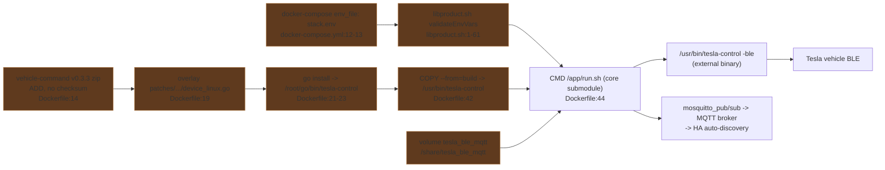
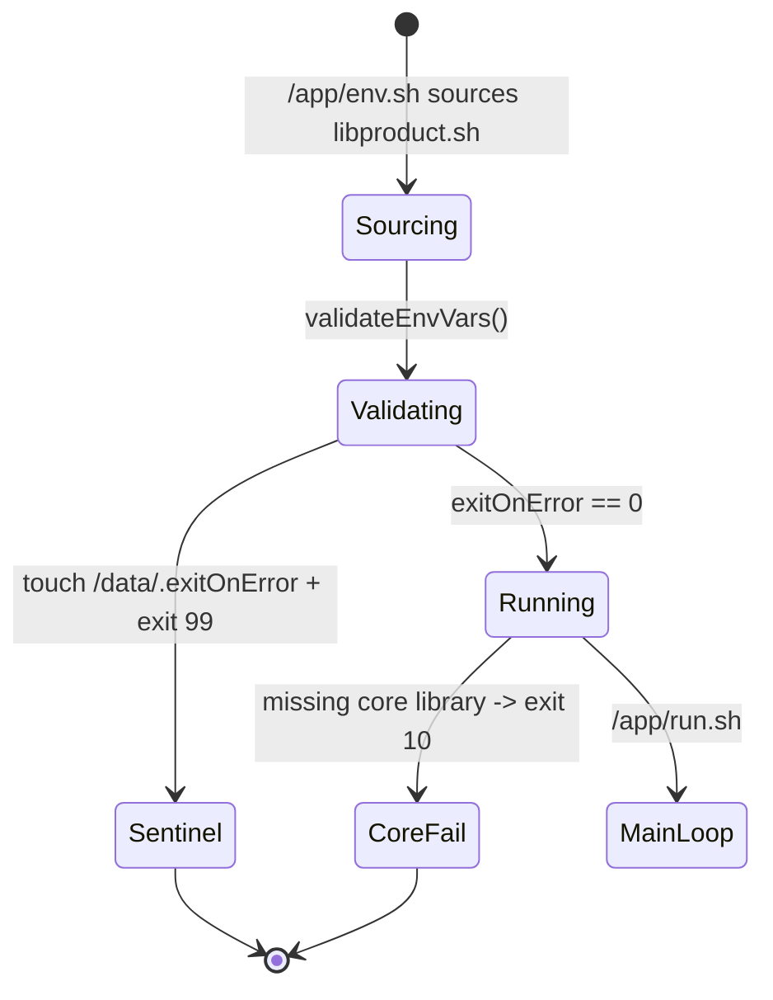

# tesla-local-control / tesla_ble_mqtt_docker

Deep dive per `.opencode/skills/legacy-repo-deep-dive/SKILL.md` (replace mode). The pre-replace summary exists in git history: cite its claims as `git show HEAD:docs/legacy/tesla-local-control-tesla-ble-mqtt-docker.md#<line>` (blob `36c7c78903e84433d7d8034c8b20058410c38be6`), not as live links.

This repo is the **Docker packaging wrapper** around `tesla_ble_mqtt_core`. All MQTT/BLE runtime logic lives in the nested `app` submodule and is analyzed in `docs/legacy/tesla-local-control-tesla_ble_mqtt_core.md`; the sibling HA-Supervisor wrapper is analyzed in `docs/legacy/tesla-local-control-tesla-local-control-addon.md`. This document cross-references both and does not duplicate their analysis.

## 1. Provenance

- **Submodule paths (two, identical pin):** `legacy/tesla-local-control-tesla-ble-mqtt-docker` (hyphen) and `legacy/tesla-local-control-tesla_ble_mqtt_docker` (underscore). `git ls-files -s legacy/tesla-local-control-tesla-ble-mqtt-docker legacy/tesla-local-control-tesla_ble_mqtt_docker` returns `160000 69e3b2b20bbe42b167a30c95bd6d4beee2fb7612 0` for **both** — the parent repo carries the same gitlink twice under two names. `git -C … rev-parse HEAD` returns `69e3b2b20bbe42b167a30c95bd6d4beee2fb7612` for both; both `status --porcelain` outputs were empty at analysis time. Both are clean worktrees of the same commit. **Content was analyzed once**, via the hyphen path; the underscore path adds no code.
- **Pinned gitlink (canonical form):** `160000 69e3b2b20bbe42b167a30c95bd6d4beee2fb7612 0`.
- **HEAD commit:** `69e3b2b20bbe42b167a30c95bd6d4beee2fb7612` — "Merge pull request #106 from tesla-local-control/stage" (2025-03-03). Local history: 471 commits, first `6444394` "Initial commit" 2024-06-08.
- **Upstream URL:** https://github.com/tesla-local-control/tesla_ble_mqtt_docker (origin, fetch+push), from `git -C … remote -v`.
- **License:** Apache-2.0 (`LICENSE:1-2`; RANGE-CITED lines 1-30 of 169 physical lines).
- **Nested submodule:** `app` — gitlink `160000 696d46bd362cfdc6a3bb263a12e63bb2bfeee449 0` (v0.5.0 per `git -C … submodule status`), URL `https://github.com/tesla-local-control/tesla_ble_mqtt_core`, branch `main` (`.gitmodules:1-4`). **That is exactly the pin analyzed in `docs/legacy/tesla-local-control-tesla_ble_mqtt_core.md`**, so the core doc applies verbatim here. The add-on doc's nested pin (`1367f40`, one commit ahead) is a different snapshot.
- **Analysis date:** 2026-11-21.
- **Frontmatter note:** the replaced doc had YAML frontmatter (lines 1-9) and it is preserved byte-for-byte. The `description:` line carries **no** inherited trailing whitespace (verified against `git show HEAD:<doc>` with `grep -nP ' +$'` → no output), so no whitespace strip was applied. No `## Upstream (...)` sections existed in the replaced doc (`grep -n '^## Upstream'` → no output), so nothing had to be preserved after section 14.
- **Files read (FULL-READ, every physical line; counts include blanks):** `Dockerfile` (44), `docker-compose.yml` (30), `stack.env` (54), `liblog.sh` (27), `libproduct.sh` (61), `patches/vehicle-command/device_linux.go` (58), `README.md` (35), `CHANGELOG.md` (329), `UPDATING.md` (140), `INSTALL.md` (143), `INSTALLwDockerfile.md` (147), `INSTALLwPortDFile.md` (48), `INSTALLwPortainer.md` (46), `.gitmodules` (4), `.pre-commit-config.yaml` (14), `.githooks/pre-commit` (57), `.githooks/pre-push` (23), `.github/workflows/build.yml` (51), `.github/workflows/builddev.yml` (51), `.github/workflows/dockerhub-description.yml` (22).
- **Files RANGE-CITED:** `LICENSE` (lines 1-30 of 169).
- **Nested `app` files read as cross-check only (not wrapper-tracked, not re-analyzed):** `app/run.sh` (1-154), `app/env.sh` (1-79), `app/version.sh` (1-6), `app/documentation/how_polling_works.md` (1-23). They confirm the bootstrap chain and the `0.5.0` version claim.
- **Files explicitly NOT read:** `.github/FUNDING.yml`; nested `app/documentation/tesla_ble_mqtt_core_structure.pdf` and `.pptx` (binary slide decks); the remainder of the nested `app` tree (deliberately cross-referenced to the core doc); upstream GitHub issues/PRs, Docker Hub registry state, and any post-pin upstream commits (network-only — no fetch was run).
- **Our-side files read (CODE-READ) for parity:** `firmware/lib/vehicle/can/feature/misc/mqtt_bridge.h` (88), `firmware/lib/io/ble/esp32/ble_client.h` (range 87-266), `firmware/lib/vehicle/ble/handler/dispatch.h` (range 160-190), `firmware/lib/core/types.h` (targeted grep), `firmware/test/test_native_mqtt/test_mqtt.cpp` (targeted grep).
- **Cross-reference docs (RANGE-CITED):** `docs/legacy/tesla-local-control-tesla_ble_mqtt_core.md`, `docs/legacy/tesla-local-control-tesla-local-control-addon.md`.

## 2. Executive verdict

`tesla_ble_mqtt_docker` is a thin Docker packaging wrapper: 25 tracked files, of which the only executable code the wrapper itself owns is a 58-line Go BLE patch, a 61-line env validator, a 27-line color logger, a 44-line two-stage Dockerfile and a 30-line compose file. Every protocol decision is delegated — runtime logic to the nested `tesla_ble_mqtt_core` submodule, BLE framing to the pinned `teslamotors/vehicle-command` v0.3.3 zip, and vehicle I/O to the external `tesla-control` binary. What matters to TeslaCANModder: (a) the same BLE HCI radio constants as the add-on wrapper (10 ms/10 ms active scan, 7.5 ms connection interval, 720 ms supervision timeout, `HCINUM` device selection) — a bench candidate against our much lower-duty NimBLE settings; (b) a typed VIN ingest regex that our `tesla:vin:` handler lacks (it accepts any 5-17 chars); (c) negative lessons — an unresolved merge-conflict marker in `UPDATING.md`, stale install docs advertising deprecated env vars, an unauthenticated remote zip download, and `privileged: true` + host networking for a host-local service. There are **zero** CAN frames, counters, checksums or bus-routing rules in this repo, so nothing here can validate our CAN encoders and no `can-review-checklist.md` gate is triggered. Per-mechanism decisions are in section 13.

## 3. Evidence map

No TEST-READ evidence exists: the wrapper tracks no test files (negative anchor in section 16). No CAPTURE evidence exists: no frame, advertisement or BLE capture ships with the wrapper. Reading coverage for the one large binary is RANGE-CITED, as stated in section 1.

| source file | lines | what it proves | grade |
| ----------- | ----- | -------------- | ----- |
| `Dockerfile` | 1-23 | build stage: `golang:alpine3.21`, `VEHICLE_COMMAND_VERSION=0.3.3`, remote zip `ADD`, patch overlay, `go install` | CODE-READ |
| `Dockerfile` | 25-44 | runtime stage: `alpine:3.21.0`, `bluez`/`mosquitto-clients`/`openssl`/`jq`, `COPY app liblog.sh libproduct.sh /app/`, `tesla-control` to `/usr/bin/`, `CMD /app/run.sh` | CODE-READ |
| `Dockerfile` | 3, 11-12, 17-18 | `git` installed but clone/checkout lines commented out; remote zip + local patch is the actual source | CODE-READ |
| `docker-compose.yml` | 2-3, 23-25 | external volume `tesla_ble_mqtt` mounted at `/share/tesla_ble_mqtt`; host DBus at `/run/dbus` | CODE-READ |
| `docker-compose.yml` | 8, 12-13, 16-17, 30 | mutable Docker Hub image tag, `env_file: stack.env`, `network_mode: host`, `privileged: true`, `restart: unless-stopped` | CODE-READ |
| `stack.env` | 1-54 | full wrapper-level config surface: VIN, MQTT, three timeouts, poll/presence cadence, `MAX_CURRENT`, `IMMEDIATE_UPDATE`, `BLE_HCI_NUM`, `NO_POLL_SECTIONS` | CODE-READ |
| `libproduct.sh` | 1-54 | `validateEnvVars`: VIN/int/MQTT-server/DEBUG/MAX_CURRENT regexes, fail-fast via `/data/.exitOnError` + `exit 99` | CODE-READ |
| `libproduct.sh` | 4 | VIN regex requires exactly 17 chars from `[A-HJ-NPR-Z0-9]`, `\|`-only multi-VIN separator | CODE-READ |
| `libproduct.sh` | 57-61 | `COLOR` default, sources `/app/liblog.sh`, calls `validateEnvVars` at source time | CODE-READ |
| `liblog.sh` | 1-27 | `# shellcheck shell=dash`, `COLOR=false` collapse, six `log_*` helpers via `echo -e` | CODE-READ |
| `patches/vehicle-command/device_linux.go` | 1-3, 16-42 | credited BogdanDIA patch: 20 s timeouts, active scan `0x0010`/`0x0010`, filter policy 0, conn `0x0006`/`0x0006`, supervision `0x0048` | CODE-READ |
| `patches/vehicle-command/device_linux.go` | 44-58 | `newDevice()` reads `HCINUM`, Atoi failure → `-1`, passes all params to `linux.NewDevice` | CODE-READ |
| `.github/workflows/build.yml` | 1-51 | release-triggered multi-arch build/push to GHCR + Docker Hub, 4 platforms, GHA cache | CODE-READ |
| `.github/workflows/builddev.yml` | 1-51 | prerelease-triggered build, same platforms, `iainbullock/tesla_ble_mqtt:dev` tag | CODE-READ |
| `.github/workflows/dockerhub-description.yml` | 1-22 | README → Docker Hub description sync via third-party action and repo secrets | CODE-READ |
| `.githooks/pre-commit` | 13-44 | auto-strips trailing whitespace, rewrites tabs, re-stages files | CODE-READ |
| `.githooks/pre-commit`, `.githooks/pre-push` | 48-54 / 10-22 | blocks or prompts on commits/pushes to `main` (bypass documented) | CODE-READ |
| `.gitmodules` | 1-4 | `app` submodule URL and branch | CODE-READ |
| `README.md` | 3, 11-12, 23-31 | v0.5.0 positioning, ~3 m BLE range, Docker-vs-add-on split into two repos | SUMMARY-ONLY |
| `README.md` | 15-21 | polling design: 30..3600 s multiples of 30, ≥660 s advice, awake-only poll, `NO_POLL_SECTIONS`, `IMMEDIATE_UPDATE` | SUMMARY-ONLY |
| `CHANGELOG.md` | 3-33 | 0.5.0 claims: BT kill timeout, deprecated `BLE_CMD_RETRY_DELAY`, HCI patch, `IMMEDIATE_UPDATE`, Celsius, renames | SUMMARY-ONLY |
| `UPDATING.md` | 1-140 | upgrade/dev-channel/HA-device-deletion recipe; contains unresolved conflict marker at line 71 | CODE-READ (structure), SUMMARY-ONLY (procedure) |
| `INSTALL.md`, `INSTALLwDockerfile.md`, `INSTALLwPortDFile.md`, `INSTALLwPortainer.md` | full | four deploy paths; install docs carry deprecated env vars and a stale `main.zip` build example | CODE-READ (text), SUMMARY-ONLY (procedure) |
| nested `app/env.sh` | 31-43, 47 | core defaults incl. `MAX_CURRENT=${MAX_CURRENT:-48}` and `KEYS_DIR=/share/tesla_ble_mqtt` — cross-check only | CODE-READ |
| nested `app/run.sh` | 8-10, 13 | `#!/bin/ash -e`, sources `/app/env.sh`, splits VIN list on `[|,;]` — cross-check only | CODE-READ |
| nested `app/version.sh` | 5 | `SW_VERSION=0.5.0` — cross-check only | CODE-READ |
| `docs/legacy/tesla-local-control-tesla_ble_mqtt_core.md` | sections 1-17 | authoritative analysis of all runtime behavior behind this wrapper | SUMMARY-ONLY (cross-reference) |

## 4. Architecture and build surface

- **Entry point:** `Dockerfile:44` `CMD [ "/app/run.sh" ]` — the script itself belongs to the nested core submodule, not to this repo. The wrapper's only runtime-local files are `/app/liblog.sh` and `/app/libproduct.sh` (`Dockerfile:39`), sourced by nested `app/env.sh:7-8` before any core library loads.
- **Shared core vs platform port:** pure platform port (Docker/Compose/CI packaging); the shared core is the `app` gitlink. Same relationship the add-on doc describes for HA Supervisor packaging.
- **Build surface:** two-stage image. Builder installs `git`/`unzip` (`Dockerfile:3`, `git` actually unused because clone lines 11-12 are commented), downloads `vehicle-command` v0.3.3 as a zip with `ADD` (no checksum, `Dockerfile:9,14-15`), overwrites `pkg/connector/ble/device_linux.go` with the local patch (`Dockerfile:19`), then `go get`/`go build`/`go install` (`Dockerfile:21-23`). Runtime uses Alpine 3.21.0 with BlueZ, BlueZ-deprecated, mosquitto-clients, OpenSSL and jq (`Dockerfile:25-33`).
- **Build flags:** none (not a firmware repo). All feature gating is runtime env-var based (`stack.env`).
- **CI:** three GitHub Actions workflows — release build (`build.yml`), prerelease build (`builddev.yml`), Docker Hub description sync (`dockerhub-description.yml`). None declares `submodules: true` on `actions/checkout` (negative anchor in section 16).
- **No CAN frame pipeline in this repo** (negative anchor in section 16): no RX → decode → mutate/gate → TX path exists. The wrapper's actual data flow is build + bootstrap + host transport:



## 5. Mechanism catalogue

### Pinned vehicle-command build with local BLE patch overlay

- **Claim (README / summary):** CHANGELOG 0.5.0 says "Patch vehicle-command to allow BT versions <=5.0, and to specify the hci device number using environment variable $BLE_HCI_NUM" and "Use the latest version of vehicle-command (v0.3.3 at the time of writing)" (`CHANGELOG.md:12-13`).
- **Code path:** `Dockerfile:9,14-19` — `ADD` zip → `unzip / -d /` → `COPY patches/vehicle-command/device_linux.go` over `pkg/connector/ble/` → `go get`/`go build`/`go install` → `Dockerfile:42` `COPY --from=build /root/go/bin/tesla-control /usr/bin/`.
- **Frame spec:** None found. No CAN frames in this repo; the patch changes HCI link-layer parameters only (`patches/vehicle-command/device_linux.go:21-42`).
- **Gates and timing:** build-time only. No runtime gate. `bleTimeout = 20 * time.Second` applies to both listener and dialer (`device_linux.go:16,51`).
- **State machine:** None found (linear build pipeline).
- **Tests:** None found — no test files tracked by the wrapper.
- **Evidence grade:** CODE-READ.
- **Verdict:** CONFIRMED for the mechanics; the "BT <= 5.0" benefit is SUMMARY-ONLY (no capture or radio log in repo).
- **Adapt to TeslaCANModder?** no impact — our firmware does not build vehicle-command; see the radio constants as a separate bench candidate below.

### BLE HCI scan/connection parameter patch

- **Claim (README / summary):** `CHANGELOG.md:12` — patch for BT ≤5.0 and `BLE_HCI_NUM`; credited to BogdanDIA in `patches/vehicle-command/device_linux.go:1-3`.
- **Code path:** `patches/vehicle-command/device_linux.go:21-27` `scanParams` → `:29-42` `createConnection` → `:44-58` `newDevice()` → `linux.NewDevice(ble.OptDeviceID(bleDevice), ble.OptListenerTimeout(bleTimeout), ble.OptDialerTimeout(bleTimeout), ble.OptScanParams(scanParams), ble.OptConnParams(createConnection))` (`device_linux.go:51`).
- **Frame spec:** None found — BLE HCI constants, not CAN: active scan type 1, interval/window `0x0010` (`N * 0.625 ms` = 10 ms/10 ms, 100% duty), `ScanningFilterPolicy: 0` (comment says "Change from 0x02 to 0"), `ConnIntervalMin/Max: 0x0006` (`N * 1.25 ms` = 7.5 ms), `ConnLatency: 0x0000`, `SupervisionTimeout: 0x0048` (`N * 10 ms` = 720 ms).
- **Gates and timing:** `HCINUM` env read at `:45`; `strconv.Atoi` failure → `bleDevice = -1` (`:47-49`), which go-ble interprets as "device 0/default" (interpretation UNVERIFIED — no radio log). No retry, no adapter health check in the wrapper.
- **State machine:** None found (single device init; the `HCINUM` branch has two outcomes, not three states).
- **Tests:** None found.
- **Evidence grade:** CODE-READ.
- **Verdict:** CONFIRMED (constants and wiring); the operational claim that these values stabilize weak adapters is SUMMARY-ONLY.
- **Adapt to TeslaCANModder?** candidate — compare against our NimBLE settings on the bench; re-derive values, do not copy the Go file (section 13).

### Host-privileged container packaging

- **Claim (README / summary):** "This is a Docker container which can be deployed on any machine you want" (`README.md:25-27`); `INSTALL.md:20-143` documents CLI/Portainer deployment and key enrolment.
- **Code path:** `docker-compose.yml:5-30` — service `tesla_ble_mqtt`, image `iainbullock/tesla_ble_mqtt:latest`, `env_file: stack.env` (`:12-13`), `network_mode: host` (`:16`), `privileged: true` (`:17`), `tty`/`stdin_open` (`:20-21`), external volume + `/run/dbus` (`:23-25`), `restart: unless-stopped` (`:30`).
- **Frame spec:** None found.
- **Gates and timing:** host network and DBus required for BlueZ access; no resource limits, no healthcheck, no capability refinement (negative anchors in section 16).
- **State machine:** None found (Compose static config).
- **Tests:** None found.
- **Evidence grade:** CODE-READ.
- **Verdict:** CONFIRMED.
- **Adapt to TeslaCANModder?** never port the privilege posture; our host tooling should use scoped capabilities if it ever needs BlueZ.

### Env-var validation with fail-fast sentinel

- **Claim (README / summary):** `stack.env:1-5` marks `VIN_LIST` and `MQTT_SERVER` "Mandatory"; `CHANGELOG.md:27` claims derived vars are read at startup with a <660 s warning.
- **Code path:** `Dockerfile:39` → nested `app/env.sh:7-8` → `/app/libproduct.sh:59-61` → `validateEnvVars()` (`libproduct.sh:1-54`) → on any failure `touch /data/.exitOnError; exit 99` (`libproduct.sh:50-51`).
- **Frame spec:** None found.
- **Gates and timing:** validates `VIN_LIST` (`:11`), `PRESENCE_DETECTION_LOOP_DELAY` (`:16`), `PRESENCE_DETECTION_TTL` (`:21`), `MQTT_SERVER` (`:26`), `MQTT_PORT` (`:31`), `DEBUG` exactly `true`/`false` (`:36`), `MAX_CURRENT` (`:41`); `COLOR` defaults to `true` (`:57`). No validation of the three TC timeouts, `POLL_STATE_LOOP_DELAY`, `NO_POLL_SECTIONS`, `BLE_HCI_NUM` or `IMMEDIATE_UPDATE`.
- **State machine:** three observed states — clean start, validation failure with sentinel, and core-library load failure (`app/env.sh:23-26`, `exit 10`, nested submodule):



- **Tests:** None found.
- **Evidence grade:** CODE-READ.
- **Verdict:** PARTIAL — the sentinel is written (`libproduct.sh:50`) but **no consumer exists anywhere in the checked-out tree** (`grep -rnE '/data/\.exitOnError' . --exclude-dir=.git` → only that one write); its purpose is UNVERIFIED. The VIN separator accepted at validation (`\|` only, `:4`) is narrower than the runtime split (`[|,;]`, nested `app/run.sh:13`).
- **Adapt to TeslaCANModder?** candidate — typed VIN validation at our `tesla:vin:` ingest; do not import the sentinel protocol.

### Multi-arch release and registry publishing

- **Claim (README / summary):** `README.md:33-34` points users to `UPDATING.md` for stable/dev channels; `UPDATING.md:25-51` describes the `dev` tag.
- **Code path:** `.github/workflows/build.yml:3-5` release trigger → `:18-35` QEMU/Buildx/logins → `:37-51` build/push; `.github/workflows/builddev.yml:3-5` prerelease trigger → `:50` `iainbullock/tesla_ble_mqtt:dev`; `.github/workflows/dockerhub-description.yml:3-22` README sync on `main`.
- **Frame spec:** None found.
- **Gates and timing:** event-driven only (`released` / `prereleased` / `push:main` with path filter). Four platforms: `linux/amd64,linux/arm64,linux/arm/v7,linux/arm/v6` (`build.yml:41`). GHA cache `type=gha,mode=max` (`:42-43`). `BUILDKIT_CONTEXT_KEEP_GIT_DIR=true` (`:46`).
- **State machine:** None found (event-triggered, no persisted release state).
- **Tests:** None found.
- **Evidence grade:** CODE-READ (workflow contents); registry outcomes are UNVERIFIED without network access.
- **Verdict:** CONFIRMED for declared workflow; whether nested `app` is present in the build context is UNVERIFIED (no `submodules:` key in any workflow).
- **Adapt to TeslaCANModder?** no impact — our releases publish merged firmware assets, not application container images.

### Documented upgrade path with retained-key volume

- **Claim (README / summary):** `UPDATING.md:4,26` — "All previous settings and enrolled keys are preserved" across updates; `:54-70` HA MQTT device deletion recipe.
- **Code path:** `docker-compose.yml:2-3,24` external volume `tesla_ble_mqtt` → `/share/tesla_ble_mqtt`; nested `app/env.sh:47` `KEYS_DIR=/share/tesla_ble_mqtt`; nested `app/run.sh:54-73` reads `${vin}_macaddr` and PEM pairs from that directory.
- **Frame spec:** None found.
- **Gates and timing:** persistence is a host-volume guarantee; no backup/restore logic in the wrapper.
- **State machine:** None found.
- **Tests:** None found.
- **Evidence grade:** CODE-READ for the volume→`KEYS_DIR` mapping; SUMMARY-ONLY for the preservation promise and the HA device-deletion procedure.
- **Verdict:** PARTIAL — mechanism plausible from the volume mapping, but `UPDATING.md:71-140` contains an unresolved merge-conflict marker and a duplicated recipe, so the doc is not trustworthy.
- **Adapt to TeslaCANModder?** no impact; our key persistence is NVS-based (`firmware/lib/core/persist/`), not volume-based.

## 6. Summary vs code contradiction table

| pre-replace claim / upstream doc claim | code reality (with citation) | grade |
| -------------------------------------- | ---------------------------- | ----- |
| "`app/tesla_ble_mqtt.sh` — main loop", "`poll_state.sh`", "`ha_discovery.sh`" (`git show HEAD:docs/legacy/tesla-local-control-tesla-ble-mqtt-docker.md#40-43`) | No such tracked files. `git ls-files -s` shows `app` as gitlink `160000 696d46b…`; real scripts are nested `app/run.sh`, `app/mqtt-listen.sh`, `app/read-state.sh`, `app/mqtt-discovery.sh` (core doc §3) | CODE-READ |
| MQTT topics `tesla/<VIN>/command/...` and `tesla/<VIN>/state/...` (`git show HEAD:docs/legacy/tesla-local-control-tesla-ble-mqtt-docker.md#57-69`) | Actual root is `tesla_ble/$vin/...` (core doc §3, `mqtt-listen.sh:29-48`, `read-state.sh:118-145`, `mqtt-discovery.sh:12-37`). The wrapper itself contains no topic string (negative anchor §16) | CODE-READ (cross-doc) |
| "Language: Shell (bash)" (`git show HEAD:docs/legacy/tesla-local-control-tesla-ble-mqtt-docker.md#33`) | `liblog.sh:1` `# shellcheck shell=dash`; nested `app/run.sh:1` `#!/bin/ash -e` and `app/env.sh:3` `# shellcheck shell=dash` — BusyBox ash/dash runtime, not bash | CODE-READ |
| "Docker container (**and Home Assistant add-on**)" (`git show HEAD:docs/legacy/tesla-local-control-tesla-ble-mqtt-docker.md#15`) | Upstream `README.md:23-31` presents two **separate** options; the add-on is a different repository. This repo tracks no HA manifest | CODE-READ |
| "`mqtt_bridge.h` currently only publishes CAN-decoded telemetry" (`git show HEAD:docs/legacy/tesla-local-control-tesla-ble-mqtt-docker.md#86`) | Our `firmware/lib/vehicle/can/feature/misc/mqtt_bridge.h:1-88` contains only command parsing (`:26-73`) and a publish gate (`:81-88`); `MQTT_TOPIC_PREFIX` (`:18`) has no use site anywhere in shipping firmware (negative anchor §16). No publish call exists to date | CODE-READ (our side) |
| "subscribe to `cmd/+` topics" as this repo's pattern (`git show HEAD:docs/legacy/tesla-local-control-tesla-ble-mqtt-docker.md#88`) | This repo's core subscribes `tesla_ble/+/+` and dispatches the action in a `case` (core doc §3 `mqtt-listen.sh:29-48`); `cmd/+` is a proposed pattern, not an upstream fact | CODE-READ (cross-doc) |
| `stack.env` "Default 32" for `MAX_CURRENT` (`stack.env:37-38`) vs `INSTALL.md:72-74` "Default 48" | Nested `app/env.sh:39` actually defaults to `48`; the wrapper's `stack.env` overrides to `32` when used. Both "default" claims are context-dependent; 0.5.0 changelog `CHANGELOG.md:17` does not reconcile them | CODE-READ |
| `BLE_CMD_RETRY_DELAY` and `TEMPERATURE_UNIT_FAHRENHEIT` still in install docs (`INSTALL.md:58,71`, `INSTALLwDockerfile.md:90,103`) | Deprecated/removed in 0.5.0 (`CHANGELOG.md:9,22`) and absent from `stack.env` (negative anchor §16) | CODE-READ |
| Docker build sample uses `refs/heads/main.zip` (`INSTALLwDockerfile.md:34,40-42`) | `Dockerfile:9,14` pins `refs/tags/v0.3.3.zip` via `VEHICLE_COMMAND_VERSION` | CODE-READ |
| `UPDATING.md` is a coherent recipe | Line 71 is a literal `=======` merge-conflict marker; lines 72-140 duplicate lines 1-70 with slightly different wording | CODE-READ |
| `Dockerfile:3` installs `git` as a build dependency | Clone/checkout lines are commented out (`Dockerfile:11-12`); zip download replaces git. Unused package in build stage | CODE-READ |
| VIN list separator `\|` only at validation (`libproduct.sh:4`) | Runtime splits on `[|,;]` (nested `app/run.sh:13`); `,` and `;` pass at runtime but fail startup validation | CODE-READ |
| Frontmatter claims "Home Assistant add-on" as part of this repo (preserved bytes, line 3) | Preserved verbatim per replace mode; factually stale for this repo. Add-on lives in `tesla-local-control-addon` (`README.md:29-31`) | CODE-READ (staleness recorded here, bytes untouched) |

## 7. CAN frame and signal inventory

None found: no CAN frame, ID, DLC, byte/bit layout, counter or checksum exists in this wrapper's tracked tree (negative anchor in section 16). The BLE patch manipulates HCI link-layer parameters only. For any CAN/vehicle-signal inventory in this ecosystem, see `docs/legacy/tesla-local-control-tesla_ble_mqtt_core.md` §7 (also none) and the Tesla vehicle-command doc.

## 8. Constants and tuning table

| constant | value | file:line | meaning | grade |
| -------- | ----- | --------- | ------- | ----- |
| `VEHICLE_COMMAND_VERSION` | `0.3.3` | `Dockerfile:9` | pinned teslamotors/vehicle-command release | CODE-READ |
| builder / runtime base | `golang:alpine3.21` / `alpine:3.21.0` | `Dockerfile:1,25` | build and runtime images (exact runtime patch, builder minor-unpinned) | CODE-READ |
| `MQTT_PORT` | `1883` | `stack.env:8` | default broker port | CODE-READ |
| `TC_COMMAND_TIMEOUT` | `5` s | `stack.env:17` | `tesla-control -command-timeout` | CODE-READ |
| `TC_CONNECT_TIMEOUT` | `10` s | `stack.env:20` | `tesla-control -connect-timeout` | CODE-READ |
| `TC_KILL_TIMEOUT` | `25` s | `stack.env:23` | hard kill for stuck `tesla-control` (enforced in core, not wrapper) | CODE-READ |
| `POLL_STATE_LOOP_DELAY` | `30` s, multiple of 30 | `stack.env:25-26` | body-controller-state cadence; README recommends ≥660 (`README.md:16`) | CODE-READ |
| `PRESENCE_DETECTION_LOOP_DELAY` | `120` s | `stack.env:29` | BLE presence scan period | CODE-READ |
| `PRESENCE_DETECTION_TTL` | `240` s (`0` disables) | `stack.env:31-32` | presence staleness window | CODE-READ |
| `MAX_CURRENT` | `32` A | `stack.env:37-38` | wrapper default; core default is 48 (see §6) | CODE-READ |
| `DEBUG` | `false` | `stack.env:40-41` | gates `log_debug` (`liblog.sh:22`) and validated as strict bool (`libproduct.sh:36-39`) | CODE-READ |
| `ENABLE_HA_FEATURES` | `true` | `stack.env:43-44` | HA status listener + discovery gate | CODE-READ |
| `BLE_HCI_NUM` | `0` | `stack.env:49-50` | exported as `HCINUM` by nested `app/env.sh:41`, consumed by patch `:45` | CODE-READ |
| `IMMEDIATE_UPDATE` | `true` | `stack.env:52-54` | immediate state_topic refresh after a command | CODE-READ |
| `VIN_PATTERN` | `^([A-HJ-NPR-Z0-9]{17})(\\|[A-HJ-NPR-Z0-9]{17})*$` | `libproduct.sh:4` | 17-char VIN, excludes I/O/Q, `\|`-separated list | CODE-READ |
| `MQTT_SERVER_PATTERN` | IPv4-or-hostname regex with `\\b` | `libproduct.sh:9` | startup validation of broker address | CODE-READ |
| `exitOnError` sentinel | `/data/.exitOnError`, `exit 99` | `libproduct.sh:50-51` | failure marker; no reader found in tree | CODE-READ |
| `bleTimeout` | `20 * time.Second` | `patches/vehicle-command/device_linux.go:16` | listener + dialer timeout | CODE-READ |
| scan interval / window | `0x0010` / `0x0010` (10 ms / 10 ms) | `patches/vehicle-command/device_linux.go:23-24` | 100% duty active scan | CODE-READ |
| `ScanningFilterPolicy` | `0` (was `0x02`) | `patches/vehicle-command/device_linux.go:26` | basic/unfiltered scan policy change | CODE-READ |
| `ConnIntervalMin` / `Max` | `0x0006` / `0x0006` (7.5 ms) | `patches/vehicle-command/device_linux.go:36-37` | BLE connection interval | CODE-READ |
| `SupervisionTimeout` | `0x0048` (720 ms) | `patches/vehicle-command/device_linux.go:39` | link supervision timeout | CODE-READ |
| `bleDevice` fallback | `-1` | `patches/vehicle-command/device_linux.go:45-49` | `HCINUM` parse failure path | CODE-READ |
| CI platforms | 4 (`amd64`, `arm64`, `arm/v7`, `arm/v6`) | `.github/workflows/build.yml:41` | multi-arch image matrix | CODE-READ |

## 9. Failure modes and edge cases

| failure | handling code path | tested? | grade |
| ------- | ------------------ | ------- | ----- |
| Invalid/missing mandatory env var | `libproduct.sh:11-44` sets `exitOnError=1`, then `:50-51` `touch /data/.exitOnError; exit 99` | No | CODE-READ |
| Fail sentinel never consumed | Only writer is `libproduct.sh:50` (`grep -rnE '/data/\.exitOnError' .` → one hit); no restart/read loop in wrapper | No | CODE-READ (absence), purpose UNVERIFIED |
| Missing core library in nested `app` | Nested `app/env.sh:19-26` prints "Fatal error; file not found" and `exit 10`; wrapper `Dockerfile:39` copies `app` | No | CODE-READ (cross-ref) |
| Invalid `HCINUM` | `patches/vehicle-command/device_linux.go:45-49` → `bleDevice = -1` → `linux.NewDevice` error returned (`:53-55`) | No | CODE-READ |
| Remote zip unavailable / corrupted | `Dockerfile:14-15` `ADD` + `unzip` with no checksum, retry or pin-by-digest; build fails hard | No | CODE-READ |
| Nested `app` absent from CI build context | Workflows use `actions/checkout@v4.1.1` with no `submodules:` key; `Dockerfile:39` `COPY app …` would copy an empty dir | No | UNVERIFIED (needs workflow log) |
| Container crash-loop | `docker-compose.yml:30` `restart: unless-stopped`; no healthcheck, no resource limits (negative anchor §16) | No | CODE-READ |
| VIN separator mismatch | Validation rejects `,`/`;` (`libproduct.sh:4`) that runtime accepts (nested `app/run.sh:13`) | No | CODE-READ |
| Stuck `tesla-control` process | Wrapper only supplies `TC_KILL_TIMEOUT` (`stack.env:23`); kill logic is in core `tesla-commands.sh` (core doc §3/§9) | No | CODE-READ (cross-ref) |
| Bus-off / watchdog / OTA pause / queue overflow / brownout / missing-frame timeout | None found in wrapper — no CAN or bus code | No | CODE-READ (absence) |

## 10. Test coverage map

None found: the wrapper tracks no test or spec files (`git -C legacy/tesla-local-control-tesla-ble-mqtt-docker ls-files | grep -nEi '(^|/)(test|tests|spec)(/|$)|test_'` → no output). No TEST-READ evidence exists in this repo. The `tests/` fixtures visible under `app/tests/` belong to the nested core submodule and are analyzed in the core doc.

Critical paths with NO test, and the risk in one line each:

- `validateEnvVars()` (`libproduct.sh:1-61`) — a regex regression could block every startup with `exit 99` while the sentinel stays unread.
- Docker build patch overlay (`Dockerfile:14-19`) — a wrong `COPY` path silently ships unpatched vehicle-command with no build-time assertion.
- `HCINUM` fallback (`device_linux.go:45-51`) — `-1` behavior differs across go-ble versions; no radio test pins it.
- Compose privilege/network posture (`docker-compose.yml:16-17,25`) — no smoke test verifies DBus/BlueZ access or least-privilege boundaries.
- CI nested-submodule availability (workflows `:16`) — no job asserts `app/run.sh` exists before build/push.

## 11. Parity matrix with TeslaCANModder

No CAN signal or frame is shared — this wrapper has none (§7). Rows below are transport/radio/config surfaces, each with a our-side CODE-READ citation; SUMMARY-ONLY rows would not drive a decision.

| signal/frame/surface | upstream decode/config (cite) | our decode/config (cite) | delta | action |
| -------------------- | ----------------------------- | ------------------------ | ----- | ------ |
| MQTT broker config | `MQTT_SERVER`/`MQTT_PORT` via `stack.env:4-8`, `libproduct.sh:9,26-34`; publishing in nested core | `mqtt:broker:`/`mqtt:port:` in `firmware/lib/vehicle/can/feature/misc/mqtt_bridge.h:32-60`, dispatch at `firmware/lib/client/command/dispatch.h:813-818` | Upstream is broker-centric with discovery; ours is config + gate only | no impact (different domain) |
| MQTT topic root | `tesla_ble/<VIN>` (core doc §3: `mqtt-listen.sh:29-48`) | `MQTT_TOPIC_PREFIX "teslacanmodder/"` at `mqtt_bridge.h:18` | Different root; ours has no use site | capture-first: align only when publish is implemented |
| Publish cadence | poll delay 30 s, recommended ≥660 s (`stack.env:25-26`, `README.md:16`); wrapper sets 30 s | `MQTT_DEFAULT_INTERVAL 2000` ms, min 500 (`mqtt_bridge.h:14-16`) | 2 s vs 30 s; telemetry vs car-state semantics | ignore (do not copy car-poll cadence into telemetry) |
| Publish safety gate | awake-only poll, `NO_POLL_SECTIONS` (`README.md:17-18`, `stack.env:46-47`) | `mqttShouldPublish()` gate at `mqtt_bridge.h:81-88` | Upstream gates on vehicle awake state; ours on enable+host+elapsed ms | candidate for future PR: add awake/freshness gate if publish lands |
| BLE scan duty cycle | active scan 10 ms/10 ms (`device_linux.go:23-24`) | `setActiveScan(true)`, `setInterval(97)`, `setWindow(37)` at `firmware/lib/io/ble/esp32/ble_client.h:106-108` (~60.6 ms / 23.1 ms, ~38% duty) | Upstream 100% duty vs ours ~38%; different radio (BlueZ dongle vs ESP32 NimBLE) | candidate: bench A/B only; do not copy |
| BLE connection interval / supervision | `0x0006`/`0x0006`, `0x0048` (`device_linux.go:36-39`) | `setConnectionParams(12, 12, 0, 51)` at `ble_client.h:131` (~15 ms, ~510 ms) | 2× interval, 210 ms shorter supervision | capture-first: needs local RSSI/drop log before change |
| BLE adapter selection | `HCINUM` env → `OptDeviceID`, fallback `-1` (`device_linux.go:45-51`, `stack.env:49-50`) | No HCI/adapter selector in `ble_client.h:101-132` (negative anchor §16) | Upstream supports multi-adapter Linux hosts; ESP32 has one radio | no impact for firmware; consider only for host tools |
| VIN ingest validation | exactly 17 chars `[A-HJ-NPR-Z0-9]` (`libproduct.sh:4`) | `tesla:vin:` accepts any 5-17 chars at `firmware/lib/vehicle/ble/handler/dispatch.h:167-176` | Our handler accepts I/O/Q and short VINs | candidate for future PR: tighten to 17-char charset |
| Key persistence location | volume `/share/tesla_ble_mqtt` (`docker-compose.yml:24`, nested `app/env.sh:47`) | NVS persistence in `firmware/lib/core/persist/nvs.h:93,150` | Host volume vs ESP32 NVS | no impact |

## 12. Surface inventory and security notes

| surface | semantics | gate / auth | grade |
| ------- | --------- | ----------- | ----- |
| Dockerfile build args | `VEHICLE_COMMAND_VERSION`, `BUILDKIT_CONTEXT_KEEP_GIT_DIR` | none; remote zip fetched over HTTPS without checksum | CODE-READ |
| `docker-compose.yml` service | `env_file: stack.env`, host network, privileged, DBus mount, external volume, `tty`/`stdin_open`, entrypoint override commented (`:27-28`) | Docker daemon privileges; no auth declared | CODE-READ |
| `stack.env` | 16 knobs incl. `MQTT_USERNAME`/`MQTT_PASSWORD` (`:10-14`) | plaintext env values; broker auth optional/anonymous | CODE-READ |
| GitHub Actions | release/prerelease build+push to GHCR and Docker Hub; README→Docker Hub description | `GITHUB_TOKEN`, `DOCKER_USER`, `DOCKER_PASSWORD` secrets in third-party actions | CODE-READ |
| Local git hooks | pre-commit auto-fix + blocks `main`; pre-push prompt on `main` | bypass explicitly documented via `--no-verify` (`.githooks/pre-commit:15,52`) | CODE-READ |
| Container runtime command surface | none owned by wrapper; all MQTT commands are in nested core (core doc §12) | VIN allowlist in core | CODE-READ (cross-ref) |

Security/provenance findings:

- **Unauthenticated build input:** `Dockerfile:14` `ADD` of a GitHub zip with no checksum or digest pin; supply-chain trust is the GitHub tag `v0.3.3`.
- **Over-privileged runtime:** `docker-compose.yml:16-17` host network + `privileged: true`, plus host DBus mount (`:25`) — broader than a BLE dongle normally needs.
- **Credentials in env file:** `stack.env:11-14` plaintext MQTT username/password; `INSTALL.md:96` shows passwords "Not Shown" in logs, which is a log-formatting measure, not secret storage.
- **Mutable image tag:** `docker-compose.yml:8` `:latest` means updates are implicit on `docker compose up`; `UPDATING.md:17-21` formalizes that.
- **Auto-mutating hook:** `.githooks/pre-commit:37-43` rewrites and re-stages working-tree files; surprising behavior for contributors (our repo uses explicit Husky/lint-staged instead).
- **No license/copyright header on the Go patch** beyond a credit comment (`device_linux.go:1-3`); Apache-2.0 wrapper license (`LICENSE:1-2`) does not cover the credited upstream source.
- **No healthcheck or capability scoping** in compose (negative anchor §16).

## 13. Adaptation assessment

| mechanism | value | cost | risk | evidence grade | decision |
| --------- | ----- | ---- | ---- | -------------- | -------- |
| Pinned vehicle-command build + patch overlay | low for us (we don't ship that binary) | n/a | n/a | CODE-READ | no impact |
| BLE HCI scan/connection constants | medium — radio robustness reference for weak-adapter bench work | low (two parameters to A/B) | medium — different radio (BlueZ vs NimBLE), unverified benefit | CODE-READ for constants; summary for benefit | candidate for future PR (bench-gated) |
| Host-privileged compose packaging | none | n/a | high if copied (privilege/host network) | CODE-READ | never port |
| Env validation + fail-fast | low-medium — typed VIN validation is a real ingest gap | low (one check in `dispatch.h`) | low | CODE-READ | candidate for future PR (VIN charset only); never port sentinel |
| Multi-arch CI publishing | low — our artifacts are firmware images, not containers | n/a | low | CODE-READ | no impact |
| Retained-key volume upgrade path | low — our keys live in NVS | n/a | low | CODE-READ (mapping), SUMMARY-ONLY (promise) | no impact |
| MQTT discovery/topic schema | already covered by core doc; our path is different | n/a | medium if we claim publish exists | CODE-READ (our side) | already present in research; no shipping change |

## 14. Do-not-copy list

| item (file:line) | reason |
| ---------------- | ------ |
| `Dockerfile:14` unauthenticated `ADD` of remote zip | No checksum/digest; use a pinned, verified source in any of our tooling |
| `Dockerfile:11-12` commented-out git clone + `Dockerfile:3` unused `git` package | Dead build residue; do not inherit as "documentation by comment" |
| `docker-compose.yml:16-17,25` `network_mode: host`, `privileged: true`, host DBus mount | Over-privileged; prefer scoped capabilities and explicit volumes |
| `patches/vehicle-command/device_linux.go:51` whole-file replacement of upstream Go source | Port the parameter values and the idea, never the vendored source text or upstream identifiers |
| `libproduct.sh:5-9,11-44` unquoted `echo $VAR | grep -Eq` | Word-splitting/globbing; use strict typed parsing in our code |
| `libproduct.sh:50` `/data/.exitOnError` sentinel | Write-only protocol with no consumer; do not recreate |
| `UPDATING.md:71-140` duplicated, conflict-marker-laden recipe | Merge-conflict residue; never copy as documentation |
| `.githooks/pre-commit:37-43` auto-edit + `git add` of staged files | Surprise mutation of user work; our Husky/lint-staged policy is explicit |
| `.githooks/pre-commit:15,52` documented `--no-verify` bypass | Conflicts with our no-bypass policy |
| `.github/workflows/*:34-35` third-party actions holding Docker Hub secrets | Requires review before any analogous release workflow in our repo |
| Parent repo's duplicate submodule paths (both gitlinks `69e3b2b…`) | Do not mirror the two-name duplication; analyze once, as done here |

## 15. History and evolution

Mined from the submodule's **local** `git log` only (no fetch, no network claims):

- `6444394` "Initial commit" (2024-06-08); 471 commits to pinned HEAD `69e3b2b` (2025-03-03), which is "Merge pull request #106 from tesla-local-control/stage"; `origin/main`, `origin/HEAD` and local `main` all point at the pin.
- **Dependency pinning was iterative.** `c222dcf` (2024-12-27) "Use default vehicle-command tag" → `e8747c5` (2025-01-15) "Force vehicle-command version v0.2.1" → `1aa84f7` (2025-01-15) "Use vehicle-command v0.3.0" → `d669ccb`/`2416ffb` (2025-02-09) "Set tag"/"Specify v0.3.2 in Dockerfile" → `af19403` (2025-02-09) **"Revert Dockerfile"** (re-commented the forced `git checkout releases/v0.3.2`) → `bf4051a` "Download and unzip vehicle-command", `6e80ad9` "Fix Dockerfile variable", `05ae907` "Fix unzip directory", `e5862b4` "Fix Dockerfile unzip paths" (all 2025-02-09) → final `Dockerfile:9,14-15` uses `VEHICLE_COMMAND_VERSION=0.3.3` zip. The git-clone approach was effectively abandoned in favor of a zip.
- **Patch ownership moved.** `0c7b745` (2025-01-13) "Patch vehicle-command" copied `app/patches/vehicle-command/device_linux.go` (from inside the core submodule) into the build; `5c7b9e3` (2025-01-13) "Fix path to patch" moved it to the wrapper-level `patches/...` path seen today.
- **Feature naming churn.** `f58021d` (2025-01-22) "Optimistic Mode" and `f84da0d` (2025-01-23) "Add $AUTO_UPDATE" were followed by `448f773` (2025-01-24) "IMMEDIATE instead of AUTO" and `d00db6c` "AUTO_UPDATE logic"; final name is `IMMEDIATE_UPDATE` (`stack.env:54`, nested `app/env.sh:43`). `20dad65` (2025-01-26) "May implement optimistic mode" suggests the idea was reconsidered but not shipped. `OPTIMISTIC_MODE=false` still exists in nested `app/env.sh:42` — UNVERIFIED whether any core path reads it.
- **Defaults rolled back.** `9946bc0` (2025-02-26) "Update defaults in stack.env" changed `MAX_CURRENT` 48→32 and `IMMEDIATE_UPDATE` false→true — the opposite of the earlier `AUTO_UPDATE` seed, i.e. the author reversed both after field use.
- **Doc debt accumulated rather than resolved.** `409ae8b`/`7f2ba49`/`0b93357` (2025-01..02) added and twice rewrote `UPDATING.md`; the pinned file still has the `=======` marker at line 71. `fd33f85` (2025-02-25) "Fix updating instructions" did not remove it.
- **Version bumps track the core.** `43ff6e8` "Prep for v0.5.0" and `ab9a4bd` "Bump _core" (both 2025-01..02) changed only `README.md` and the `app` gitlink; `724ccf4`/`69e3b2b` merge the stage/iain-dev branches into release. The add-on doc's `1367f40` core pin is one commit newer (0.5.1), so the two wrappers are not at the same core version.
- **Network-only claims (issues/PRs referenced in `CHANGELOG.md:8-27`, e.g. core #125/#142, docker #78/#79/#82, teslamotors PR #353) were not opened** — they remain UNVERIFIED.

## 16. Re-verification recipe

Snapshot commands (run read-only where possible; `@OLD` is the pinned SHA):

```bash
OLD=69e3b2b20bbe42b167a30c95bd6d4beee2fb7612
git ls-files -s legacy/tesla-local-control-tesla-ble-mqtt-docker legacy/tesla-local-control-tesla_ble_mqtt_docker
# expect BOTH: 160000 69e3b2b20bbe42b167a30c95bd6d4beee2fb7612 0
git -C legacy/tesla-local-control-tesla-ble-mqtt-docker rev-parse HEAD   # must equal $OLD
git -C legacy/tesla-local-control-tesla-ble-mqtt-docker status --porcelain # expect empty
git -C legacy/tesla-local-control-tesla_ble_mqtt_docker rev-parse HEAD    # also must equal $OLD
git -C legacy/tesla-local-control-tesla-ble-mqtt-docker submodule status  # expect 696d46bd... app (v0.5.0)
git -C legacy/tesla-local-control-tesla-ble-mqtt-docker fetch --tags --prune
git -C legacy/tesla-local-control-tesla-ble-mqtt-docker log --oneline $OLD..origin/main
git -C legacy/tesla-local-control-tesla-ble-mqtt-docker diff --stat $OLD..origin/main
git -C legacy/tesla-local-control-tesla-ble-mqtt-docker diff $OLD..origin/main -- Dockerfile docker-compose.yml stack.env libproduct.sh liblog.sh patches .github
git log --oneline -5 -- docs/legacy/tesla-local-control-tesla-ble-mqtt-docker.md
```

Every anchor below was **run** at write time from `legacy/tesla-local-control-tesla-ble-mqtt-docker` unless marked "our side"; expected hits are pasted verbatim.

```text
grep -nE 'VEHICLE_COMMAND_VERSION|ADD https://github.com/teslamotors|COPY patches/vehicle-command|COPY --from=build|CMD \[|FROM alpine|FROM golang' Dockerfile
  -> 1:FROM golang:alpine3.21 AS build / 9:ENV VEHICLE_COMMAND_VERSION=0.3.3 / 10:WORKDIR /vehicle-command-$VEHICLE_COMMAND_VERSION / 14:ADD https://.../v$VEHICLE_COMMAND_VERSION.zip /tmp / 15:RUN unzip ... -d / / 19:COPY patches/vehicle-command/device_linux.go /vehicle-command-$VEHICLE_COMMAND_VERSION/pkg/connector/ble/ / 25:FROM alpine:3.21.0 / 42:COPY --from=build /root/go/bin/tesla-control /usr/bin/ / 44:CMD [ "/app/run.sh" ]

grep -nE 'image:|network_mode|privileged|env_file|/share/tesla_ble_mqtt|/run/dbus|restart:' docker-compose.yml
  -> 8:image: "iainbullock/tesla_ble_mqtt:latest" / 12:env_file: / 16:network_mode: host / 17:privileged: true / 24:- tesla_ble_mqtt:/share/tesla_ble_mqtt / 25:- /run/dbus:/run/dbus / 30:restart: unless-stopped

grep -nE '^(VIN_LIST|MQTT_SERVER|MQTT_PORT|TC_COMMAND_TIMEOUT|TC_CONNECT_TIMEOUT|TC_KILL_TIMEOUT|POLL_STATE_LOOP_DELAY|PRESENCE_DETECTION_LOOP_DELAY|PRESENCE_DETECTION_TTL|MAX_CURRENT|DEBUG|ENABLE_HA_FEATURES|NO_POLL_SECTIONS|BLE_HCI_NUM|IMMEDIATE_UPDATE)=' stack.env
  -> 2,5,8,17,20,23,26,29,32,38,41,44,47,50,54 with values: (empty),(empty),1883,5,10,25,30,120,240,32,false,true,(empty),0,true

grep -nE 'VIN_PATTERN|MQTT_SERVER_PATTERN|INT1PLUS_PATTERN|touch /data/\.exitOnError|exit 99|/app/liblog.sh|validateEnvVars' libproduct.sh
  -> 1:validateEnvVars / 4:VIN_PATTERN / 6:INT1PLUS_PATTERN / 9:MQTT_SERVER_PATTERN / 11,26,31:grep -Eq uses / 50:touch /data/.exitOnError / 51:exit 99 / 59:. /app/liblog.sh / 61:validateEnvVars

grep -nE 'COLOR|GREEN=|log_debug|log_fatal' liblog.sh
  -> 5:if [ "$COLOR" = "false" ] / 6:NOCOLOR / 7-11:collapsed colors / 13-18:color defs / 22:log_debug / 23-27:log_* incl. 27:log_fatal

grep -nE 'bleTimeout|LEScanInterval|LEScanWindow|ScanningFilterPolicy|ConnInterval(Min|Max)|SupervisionTimeout|HCINUM|OptDeviceID|bleDevice = -1' patches/vehicle-command/device_linux.go
  -> 16:bleTimeout = 20 * time.Second / 23-24:0x0010 scan+window / 26:ScanningFilterPolicy: 0 / 30-31:0x0010 conn scan / 36-37:0x0006 conn interval / 39:0x0048 supervision / 45:Getenv("HCINUM") / 48:bleDevice = -1 / 51:linux.NewDevice(... OptDeviceID ...)

grep -nE 'platforms:|tags:|iainbullock/tesla_ble_mqtt:dev|dockerhub-description' .github/workflows/build.yml .github/workflows/builddev.yml .github/workflows/dockerhub-description.yml
  -> build.yml:41:platforms: linux/amd64,linux/arm64,linux/arm/v7,linux/arm/v6 / build.yml:47:tags: / builddev.yml:41,47 / builddev.yml:50:iainbullock/tesla_ble_mqtt:dev / dockerhub-description.yml:8,16:peter-evans/dockerhub-description@v4

grep -nE '^=======$' UPDATING.md
  -> 71:=======

# negative anchors (all produced NO output at write time)
grep -nEi 'CAN bus|CAN frame|DLC|0x[0-9a-fA-F]{3}([^0-9a-fA-F]|$)' README.md CHANGELOG.md Dockerfile docker-compose.yml stack.env liblog.sh libproduct.sh
  -> no output (exit 1): no CAN frames in wrapper docs/config
git -C legacy/tesla-local-control-tesla-ble-mqtt-docker ls-files | grep -nEi '(^|/)(test|tests|spec)(/|$)|test_'
  -> no output (exit 1): no wrapper-owned tests
grep -rnE 'submodules' .github/workflows
  -> no output (exit 1): no explicit submodule checkout
grep -nEi 'healthcheck|cap_add' docker-compose.yml
  -> no output (exit 1): no healthcheck or capability scoping
grep -rnE '/data/\.exitOnError' . --exclude-dir=.git
  -> only libproduct.sh:50 (a write; no reader)
grep -nE 'BLE_CMD_RETRY_DELAY|TEMPERATURE_UNIT_FAHRENHEIT' stack.env
  -> no output: deprecated vars absent from current config
```

Our-side drift anchors (from the repo root; `already present`/`candidate` decisions depend on these):

```text
grep -nE 'MQTT_TOPIC_PREFIX|MQTT_DEFAULT_INTERVAL|MQTT_MIN_INTERVAL|MQTT_MAX_INTERVAL|executeMqttCmd|mqttShouldPublish' firmware/lib/vehicle/can/feature/misc/mqtt_bridge.h
  -> 14:MQTT_DEFAULT_INTERVAL 2000 / 15:MQTT_MIN_INTERVAL 500 / 16:MQTT_MAX_INTERVAL 60000 / 18:MQTT_TOPIC_PREFIX "teslacanmodder/" / 26:executeMqttCmd / 65:interval bounds / 81:mqttShouldPublish
grep -nE 'scanSec = 8|setActiveScan|setInterval\(97\)|setWindow\(37\)|setConnectionParams\(12, 12, 0, 51\)|setConnectTimeout\(10\)' firmware/lib/io/ble/esp32/ble_client.h
  -> 101:scanSec = 8 / 106:setActiveScan(true) / 107:setInterval(97) / 108:setWindow(37) / 131:setConnectionParams(12, 12, 0, 51) / 132:setConnectTimeout(10)
grep -nE 'VIN must be 5-17|vlen < 5|vlen > 17|saveVin' firmware/lib/vehicle/ble/handler/dispatch.h
  -> 171:vlen < 5 || vlen > 17 / 173:"Tesla: VIN must be 5-17 characters" / 176:board.saveVin(vin)
grep -rnE 'MQTT_TOPIC_PREFIX|mqttShouldPublish|mqttPublish' firmware client packages tools --include='*.h' --include='*.cpp' --include='*.ts' --include='*.tsx' --include='*.js'
  -> only mqtt_bridge.h:18 (definition), :81 (gate), test_mqtt.cpp:87,88,89,98 (gate tests); NO shipping publish call site
```

If line numbers drift more than ~10, re-read the whole function; do not trust this document's numbers. Pre-pin upstream history was **not** reviewed beyond what the local clone happens to contain — this analysis covers only the pinned snapshot plus its local ancestor log (471 commits back to 2024-06-08); no fetch was performed and no commits after the pin were inspected.

## 17. Open questions and explicitly not investigated

- No CAPTURE evidence: no BLE advertisement, HCI trace or vehicle capture was collected, so the radio-constant benefit remains SUMMARY-ONLY. A `bluetoothctl`/HCI snoop on a weak adapter would settle it.
- No TEST-READ evidence: the wrapper ships no tests; all behavior claims rest on CODE-READ of scripts and config.
- Whether `actions/checkout` without `submodules: true` still supplies `app` in the published build (e.g. via a self-hosted warm workspace) — UNVERIFIED; a CI workflow log would settle it.
- Whether `/data/.exitOnError` is read by the HA add-on wrapper's different `libproduct.sh` or by an Supervisor health check — not investigated; only the write site in `libproduct.sh:50` was found.
- Whether `OPTIMISTIC_MODE` (nested `app/env.sh:42`) is consumed by any core path — UNVERIFIED; the add-on/core docs do not cite a reader.
- The `HCINUM=-1` fallback semantics in go-ble v0.3.3's `linux.NewDevice` — UNVERIFIED without reading that dependency's source (`legacy/teslamotors-vehicle-command` covers Tesla's SDK, not go-ble).
- Registry state: whether Docker Hub `iainbullock/tesla_ble_mqtt:{latest,dev}` and GHCR tags actually correspond to this source — network-only, not checked.
- Upstream GitHub issues/PRs cited in `CHANGELOG.md` (#125, #142, #78, #79, #82, teslamotors PR #353) — not opened; network-only claims remain UNVERIFIED.
- Post-pin upstream evolution (anything after `69e3b2b` on `origin/main`) — not fetched or reviewed; the re-verification recipe in section 16 is the entry point for that.
- Pre-replace summary claims about "MQTT command ingestion gaps" and "BLE command dispatch gaps" in our firmware were checked only against our MQTT/BLE files named in section 1; a full protocol-package audit is out of scope here (core doc §11 covers it).
