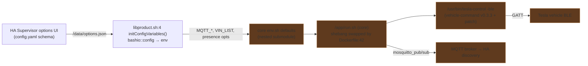

# tesla-local-control/tesla-local-control-addon

Deep dive per `.opencode/skills/legacy-repo-deep-dive/SKILL.md` (replace mode). The pre-replace summary exists in git history: cite its claims as `git show HEAD:docs/legacy/tesla-local-control-tesla-local-control-addon.md` (blob `adcfff91a91e54c6eba9db0f46a529484e93280c`), not as live links.

This repo is the Home Assistant add-on **wrapper** for `tesla_ble_mqtt_core`. All shell/BLE/MQTT runtime logic lives in the nested `tesla_ble_mqtt/app` submodule and is analyzed in `docs/legacy/tesla-local-control-tesla_ble_mqtt_core.md` — this document cross-references it and does not duplicate its analysis.

## 1. Provenance

- **Submodule path:** `legacy/tesla-local-control-tesla-local-control-addon`
- **Pinned gitlink (parent repo):** `160000 750e44b0fa777cc8d88d328e428df51f1ed08f31 0` — matches `git -C legacy/tesla-local-control-tesla-local-control-addon rev-parse HEAD`; `status --porcelain` clean at analysis time.
- **HEAD commit:** `750e44b0fa777cc8d88d328e428df51f1ed08f31` — "Merge pull request #150 from tesla-local-control/iain-dev" (2026-05-10); 273 local commits, first `8749fb4` "Initial commit" 2024-06-15.
- **Nested submodule:** `tesla_ble_mqtt/app` — gitlink `160000 1367f4051afe45ccc3e70d0a682dbc31d49ab3cc 0`, matches `git -C …/tesla_ble_mqtt/app rev-parse HEAD` ("Update CHANGELOG and version to 0.5.1", 2026-05-10). That pin is exactly **one commit ahead** of the separately analyzed `legacy/tesla-local-control-tesla_ble_mqtt_core` submodule (core doc pin `160000 696d46bd362cfdc6a3bb263a12e63bb2bfeee449 0`; the single delta commit is `1367f40` "Update CHANGELOG and version to 0.5.1"). The core doc's analysis therefore applies to this pin essentially verbatim.
- **Upstream URL:** https://github.com/tesla-local-control/tesla-local-control-addon (origin, fetch+push).
- **License:** Apache-2.0 (`LICENSE:1-2`; RANGE-CITED lines 1-10 of 201).
- **Analysis date:** 2026-11-21.
- **Frontmatter note:** the replaced doc had **no YAML frontmatter** (it began with an H1 title) and **no `## Upstream (...)` sections** — verified: `git show HEAD:docs/legacy/tesla-local-control-tesla-local-control-addon.md | grep -nE '^description:|Upstream'` → no output. Nothing to preserve; none invented.
- **Files read (FULL-READ, every line):** `README.md` (45), `CHANGELOG.md` (335), `repository.yaml` (3), `tesla_ble_mqtt/config.yaml` (45), `tesla_ble_mqtt/Dockerfile` (44), `tesla_ble_mqtt/libproduct.sh` (86), `tesla_ble_mqtt/README.md` (65), `tesla_ble_mqtt/DOCS.md` (64), `tesla_ble_mqtt/CHANGELOG.md` (335; byte-identical blob `1016050f…` with root `CHANGELOG.md`), `tesla_ble_mqtt/patches/vehicle-command/device_linux.go` (58), `tesla_ble_mqtt/translations/en.yaml` (31), `tesla_ble_mqtt/translations/fr.yaml` (31), `tools/shells-memory-test/README.md` (62), `tools/shells-memory-test/test.bash` (11), `tools/shells-memory-test/test.bashio` (11), `tools/shells-memory-test/test.sh` (11), `.gitmodules` (3), `.gitignore` (1), `.pre-commit-config.yaml` (9), `.githooks/pre-commit` (59), `.githooks/pre-push` (46).
- **Files RANGE-CITED (only cited ranges read):** `LICENSE` (lines 1-10); nested `tesla_ble_mqtt/app`: `run.sh` (lines 1-8), `env.sh` (lines 1-55 plus targeted `git grep` for the cited constants), `version.sh` (lines 1-5) — read as cross-checks against the core doc, not as the analysis subject.
- **Files explicitly NOT read:** `tesla_ble_mqtt/icon.png`, `tesla_ble_mqtt/logo.png` (binary images); the remainder of the nested `tesla_ble_mqtt/app` tree — deliberately not re-analyzed here, cross-referenced to `docs/legacy/tesla-local-control-tesla_ble_mqtt_core.md` instead (see section 17 for the inherited-coverage caveat).
- **Our-side files read for parity:** FULL-READ `firmware/lib/vehicle/can/feature/misc/mqtt_bridge.h` (88), `firmware/lib/vehicle/ble/feature/key.h` (151), `firmware/lib/vehicle/ble/feature/distance.h` (88); RANGE-CITED `firmware/lib/io/ble/esp32/ble_client.h` (lines 1-140), `firmware/lib/vehicle/ble/handler/dispatch.h` (lines 100-219) plus the grep anchors in section 16.
- **Cross-reference (RANGE-CITED, structure scan + targeted greps):** `docs/legacy/tesla-local-control-tesla_ble_mqtt_core.md` (sections 1-17 headings, parity and do-not-copy rows cited by section); `docs/legacy/tesla-local-control-tesla-ble-mqtt-docker.md` exists for the ecosystem chain.

## 2. Executive verdict

This repo is a thin Home Assistant add-on wrapper: 25 tracked files, of which the only executable code the wrapper itself owns is a 58-line Go patch (BLE HCI scan/connect parameters for Tesla's `vehicle-command` SDK), an 86-line bash→env bridge (`libproduct.sh`), a 44-line Dockerfile, and the HA Supervisor manifest (`config.yaml`). Every protocol, CAN-adjacent, or BLE claim is delegated: runtime logic to the nested `tesla_ble_mqtt_core` submodule (analyzed in the core doc), BLE framing to `tesla-control` v0.3.3. What matters to TeslaCANModder: (a) the BLE patch's radio-tuning constants — 10 ms/10 ms scan (100 % duty), 7.5 ms connection interval, 720 ms supervision timeout — chosen to survive weak/overheating Bluetooth adapters, a bench candidate against our much lower-duty `ble_client.h` parameters; (b) the typed VIN ingest regex `[A-HJ-NPR-Z0-9]{17}` (excludes I/O/Q) that our `tesla:vin:` handler lacks; (c) negative-space lessons — a version-alignment hook pointing at a directory deleted two years earlier, a shipped version drift (config 0.5.0 vs changelog/core 0.5.1), and a deprecated config key still read unconditionally at startup. Nothing here is a CAN mechanism; adaptation decisions are per-mechanism in section 13.

## 3. Evidence map

No TEST-READ evidence exists: this repo ships no test suite (`tools/shells-memory-test/*` are manual benchmark scripts that print memory numbers and assert nothing). No CAPTURE evidence exists in this repo; no frame or advertisement capture ships with it.

| source file | lines | what it proves | grade |
| ----------- | ----- | -------------- | ----- |
| `tesla_ble_mqtt/config.yaml` | 1-45 | add-on manifest: version 0.5.0, privileged `[NET_ADMIN]`, `host_network`/`host_dbus`, `map share:rw`, `init: false`, options + typed schema | CODE-READ |
| `tesla_ble_mqtt/config.yaml` | 28 | VIN list regex `^([A-HJ-NPR-Z0-9]{17})(\|[A-HJ-NPR-Z0-9]{17})*$` — only `\|` separator, I/O/Q excluded | CODE-READ |
| `tesla_ble_mqtt/libproduct.sh` | 4-58 | options→env bridge: `bashio::config` reads, `presence_*` optional via `config.exists`, anti-unbound exports | CODE-READ |
| `tesla_ble_mqtt/libproduct.sh` | 12, 43-47 | `temperature_unit_fahrenheit` still read (line 12 unconditionally) though absent from options/schema | CODE-READ |
| `tesla_ble_mqtt/Dockerfile` | 1-27 | builder: vehicle-command v0.3.3 zip `ADD`, patch copied over `pkg/connector/ble`, `go install` | CODE-READ |
| `tesla_ble_mqtt/Dockerfile` | 25-44 | runtime: bluez(+deprecated), mosquitto-clients, openssl, sed, jq; `COPY app /app/`; shebang sed; `CMD /app/run.sh` | CODE-READ |
| `tesla_ble_mqtt/patches/vehicle-command/device_linux.go` | 16-42 | BLE HCI constants: 20 s bleTimeout, active scan 0x0010/0x0010, filter policy 0, conn 0x0006/0x0006, supervision 0x0048 | CODE-READ |
| `tesla_ble_mqtt/patches/vehicle-command/device_linux.go` | 44-58 | `newDevice()` reads `HCINUM`; Atoi failure → device id `-1` | CODE-READ |
| `.githooks/pre-push` | 16-27 | 3-way version check (changelog == config.yaml version == sw_version) | CODE-READ |
| `.githooks/pre-push` | 18 | greps `tesla_ble_mqtt/rootfs/app/discovery.sh` — path removed at `e56b51e` (2024-06-30, "Remove ghost rootfs") | CODE-READ |
| `.githooks/pre-commit` | 13-48 (sed at 38, re-`git add` at 43) | auto-fixes staged files: strips trailing whitespace, rewrites tabs to 8 spaces, re-stages | CODE-READ |
| `.githooks/pre-commit` | 49-56 | blocks commits to `main`, suggests `--no-verify` bypass | CODE-READ |
| `.pre-commit-config.yaml` | 1-9 | CI/hook lint is shfmt only (`-d -i 2`) — no shellcheck, weaker than core | CODE-READ |
| `tools/shells-memory-test/README.md` | 23-61 | PSS/USS: bashio ≈ 4594-4712 KB vs bash ≈ 935-1039 KB vs sh/ash ≈ 336-368 KB | CODE-READ |
| `README.md` | 3-6 | positioning: wrapper around `tesla_ble_mqtt_docker` (stale — see section 6), Fleet API bypass rationale | CODE-READ |
| `README.md` | 30-45 (tesla_ble_mqtt/) | weak-adapter symptom catalogue: scan/dial errors, `context deadline exceeded`, adapter recovery timeouts; operational claims, no capture backs them | SUMMARY-ONLY |
| `DOCS.md` | 10-11 | key PEM pair at `/share/tesla_ble_mqtt/VIN_{private,public}.pem` — path cross-checked against nested `env.sh:47` (`KEYS_DIR`) | CODE-READ |
| `DOCS.md` | 39-46 | pairing flow UX: Generate Keys → NFC auth → Deploy Key → accept; log markers promised | SUMMARY-ONLY |
| `CHANGELOG.md` | 3-38 | 0.5.0/0.5.1 claims: BT stability work, `BLE_CMD_RETRY_DELAY` deprecated, Celsius standardization, vehicle-command 0.3.3; checked where code-relevant (section 6) | SUMMARY-ONLY |
| nested `env.sh` | 37-38, 41, 45, 47, 49 | core defaults at this pin: presence TTL 240 / loop 120, `HCINUM=${BLE_HCI_NUM:-0}`, `KEYS_DIR=/share/tesla_ble_mqtt`, `VIN_REGEX` matches addon schema | CODE-READ |
| nested `version.sh` | 5 | `SW_VERSION=0.5.1` at the nested pin | CODE-READ |

## 4. Architecture and build surface

- **Entry points:** none at runtime in this repo — the container runs `/app/run.sh` from the nested core submodule (`Dockerfile:44`), after `Dockerfile:42` rewrites its shebang. The wrapper's own runtime contribution is `/app/libproduct.sh` (`Dockerfile:40`), sourced by core `env.sh` before any core library loads.
- **Shared core vs platform port:** the wrapper is pure "platform port" (HA packaging); the shared core is the nested submodule (cross-ref core doc section 4).
- **Build surface:** two-stage Dockerfile. Builder: `ghcr.io/home-assistant/base:latest` + go/git, downloads `vehicle-command` v0.3.3 zip via `ADD` (no checksum, `Dockerfile:10`), overwrites `pkg/connector/ble/device_linux.go` with the local patch (`Dockerfile:15`), `go install ./...`. Runtime: bluez + bluez-deprecated (hciconfig et al.), mosquitto-clients, openssl, jq, sed; copies `app/` and `libproduct.sh`; base image unpinned (`base:latest` in both stages — CHANGELOG 0.5.1 says Supervisor stopped supplying `BUILD_FROM`).
- **Build flags:** none (not a firmware repo). Feature gating is HA options-driven at runtime, not compile-time.
- **CI:** none in-repo — `git ls-files | grep -nE '\.github'` → no output. Lint is local hooks only (shfmt; see section 3), weaker than the core repo's shellcheck+shfmt.
- **No CAN frame pipeline in this repo** (negative anchor: `grep -nEi 'can[_ ]bus' README.md CHANGELOG.md tesla_ble_mqtt/config.yaml tesla_ble_mqtt/libproduct.sh tesla_ble_mqtt/patches/vehicle-command/device_linux.go` → no output). The wrapper's data flow:



## 5. Mechanism catalogue

### Add-on packaging and options→environment bridge

- **Claim (README / summary):** pre-replace doc: "Configuration UI: YAML-based configuration through HA UI" (`git show HEAD:docs/legacy/tesla-local-control-tesla-local-control-addon.md`, line 41).
- **Code path:** `config.yaml:19-38` options/schema → HA Supervisor writes `/data/options.json` → `libproduct.sh:4 initConfigVariables()` → exports `MQTT_SERVER/PORT/USERNAME/PASSWORD`, `MAX_CURRENT`, `VIN_LIST` (lines 7-13) → nested core `env.sh` consumes them with `:-` defaults.
- **Frame spec:** None found (no CAN/BLE frames owned by this repo).
- **Gates and timing:** schema `match()` regex gate on `vin_list` (`config.yaml:28`); optional keys guarded by `bashio::config.exists` (`libproduct.sh:16-32`); `startup: services` (`config.yaml:18`). Anti-unbound exports for core variables the add-on never sets (`libproduct.sh:49-56`).
- **State machine:** None found.
- **Tests:** None found.
- **Evidence grade:** CODE-READ.
- **Verdict:** CONFIRMED.
- **Adapt to TeslaCANModder?** no impact — no options-UI analog on ESP32; the typed-ingest-validation idea is captured as the VIN parity row instead.

### Docker build pipeline for tesla-control v0.3.3

- **Claim (README / summary):** "It will run the official Tesla Vehicle SDK commands via BLE" (`README.md:4`).
- **Code path:** `Dockerfile:1` base → `Dockerfile:7` `ENV VEHICLE_COMMAND_VERSION=0.3.3` → `Dockerfile:10-11` zip download/unzip → `Dockerfile:15` patch copy → `Dockerfile:21-23` `go build/install` → `Dockerfile:27` `/usr/bin/tesla-control` → `Dockerfile:30-36` runtime deps → `Dockerfile:39-44` app copy + `CMD /app/run.sh`.
- **Frame spec:** None found.
- **Gates and timing:** unconditional; no image checksum, no pinned base.
- **State machine:** None found.
- **Tests:** None found (the image build is never exercised inside this repo).
- **Evidence grade:** CODE-READ.
- **Verdict:** CONFIRMED.
- **Adapt to TeslaCANModder?** no impact — we do not ship the Go SDK; protobuf drift between vehicle-command and our `msg.h` is tracked in core doc section 11.

### vehicle-command BLE device patch (BT ≤ 5.0 profile + HCI selection)

- **Claim (README / summary):** CHANGELOG 0.5.0: "Patch vehicle-command to allow BT versions <=5.0, and to specify the hci device number using environment variable $BLE_HCI_NUM" (`CHANGELOG.md:18`).
- **Code path:** `Dockerfile:15` → replaces `pkg/connector/ble/device_linux.go` → `device_linux.go:44 newDevice()` → `linux.NewDevice` with `scanParams` (lines 21-27) and `createConnection` (lines 29-42).
- **Frame spec:** HCI command parameter blocks (not CAN frames): `bleTimeout = 20 * time.Second` (line 16); `LEScanType: 1` active (line 22); `LEScanInterval/LEScanWindow: 0x0010` = 10 ms each, 100 % duty cycle (lines 23-24); `ScanningFilterPolicy: 0` changed from 0x02 — comment "Basic filtered" (line 26); `ConnIntervalMin/Max: 0x0006` = 7.5 ms (lines 36-37); `SupervisionTimeout: 0x0048` = 720 ms (line 39); `bleDevice = -1` when `HCINUM` unset/unparseable (lines 45-49).
- **Gates and timing:** HCI selection gated on `HCINUM` env; nested core sets `HCINUM=${BLE_HCI_NUM:-0}` (nested `env.sh:41`); this wrapper never exports `BLE_HCI_NUM` (negative anchor section 16, A7) → in the HA add-on the selector is always 0 and unreachable from the options UI.
- **State machine:** None found (constants only).
- **Tests:** None found.
- **Evidence grade:** CODE-READ.
- **Verdict:** PARTIAL — constants confirmed; efficacy on real adapters is UNVERIFIED (no capture exists anywhere in this repo).
- **Adapt to TeslaCANModder?** candidate — bench experiment only; our counterpart is `firmware/lib/io/ble/esp32/ble_client.h:107-131` (section 11 row 1).

### Runtime shell selection and shebang swap

- **Claim (README / summary):** nested `run.sh:5` comment: "shebang will be replaced automatically by the HA addon deployment script to `#!/command/with-contenv bashio`".
- **Code path:** `Dockerfile:42` — `sed -i 's|#!/bin/ash.*|#!/command/with-contenv bashio|' /app/run.sh`.
- **Frame spec:** None found.
- **Gates and timing:** `init: false` (`config.yaml:15`) — no in-container process supervision; container lifetime == `run.sh` lifetime.
- **State machine:** None found.
- **Tests:** `tools/shells-memory-test/*` print PSS/USS per shell; asserts nothing. Motivation recorded: bashio ≈ 4.6-4.7 MB PSS vs ash ≈ 0.35 MB (`tools/shells-memory-test/README.md:30-61`), which drove 6a232e8 "[standalone] reduce mem, move bash to sh".
- **Evidence grade:** CODE-READ.
- **Verdict:** CONTRADICTED in part — core `run.sh` carries `#!/bin/ash -e` (nested `run.sh:1`); the sed pattern matches `#!/bin/ash -e` and replaces it wholesale, so the container runs without the `-e` errexit flag. No code path restores `set -e`.
- **Adapt to TeslaCANModder?** never port — the sed-rewrite pattern itself; the transferable lesson (preserve error flags across deployment rewrites) is a review checkpoint, not code.

### Pre-push 3-way version alignment hook

- **Claim (README / summary):** none written anywhere; the hook's intent is self-declared: changelog version == `config.yaml` version == `sw_version` (`.githooks/pre-push:16-27`).
- **Code path:** `.githooks/pre-push:16` `egrep` over `tesla_ble_mqtt/CHANGELOG.md` → `:17` `grep ^version` over `tesla_ble_mqtt/config.yaml` → `:18` `grep "sw_version"` over `tesla_ble_mqtt/rootfs/app/discovery.sh` → `:20-27` compare.
- **Frame spec:** None found.
- **Gates and timing:** fails the push on mismatch; `:36-45` interactive yes/no on `main`; recommends `--no-verify` as the escape hatch.
- **State machine:** None found.
- **Tests:** None found.
- **Evidence grade:** CODE-READ.
- **Verdict:** CONTRADICTED — the third grep targets a directory deleted at `e56b51e` (2024-06-30, "Remove ghost rootfs"); `mqtt_software_version` is always empty, so the 3-way check can never pass as shipped. It would also have caught the live 0.5.0/0.5.1 drift (section 6) had it run.
- **Adapt to TeslaCANModder?** no impact — version alignment on our side is governed by `docs/checklists/release-checklist.md`; the transferable defect is "a gate that greps a dead path looks like a gate".

### Key persistence surface (host-share PEM pair)

- **Claim (README / summary):** DOCS: place an existing key pair at `/share/tesla_ble_mqtt/VIN_private.pem` / `VIN_public.pem` (`DOCS.md:10-11`).
- **Code path:** `config.yaml:16-17` `map: share:rw` → nested core `KEYS_DIR=/share/tesla_ble_mqtt` (nested `env.sh:47`) → core key lifecycle (generate → deploy → accepted) fully analyzed in core doc mechanism "Key provisioning lifecycle".
- **Frame spec:** None found.
- **Gates and timing:** pairing flow gating on NFC-card authentication inside the car (`DOCS.md:39-46`); log markers `KEY DELIVERED…` / `acceptKeyConfirmationLoop; congratulation…` (`DOCS.md:44-46`).
- **State machine:** owned by core — see core doc (generate → deployed → accepted, 300 s/5 s acceptance ping loop at `tesla-commands.sh:270-294` per core doc). None found in this repo.
- **Tests:** None found.
- **Evidence grade:** CODE-READ.
- **Verdict:** CONFIRMED. The lifecycle claims themselves are cross-referenced to the core doc, not re-derived here.
- **Adapt to TeslaCANModder?** already present in different form — our on-device P-256 keypair (`firmware/lib/vehicle/ble/feature/key.h:40-84 keyGenerate`) persisted via board NVS, not host-share PEM; the actual gap is the acceptance-confirmation loop (section 11 row 4).

## 6. Summary vs code contradiction table

| # | summary says | code says | verdict |
| - | ------------ | --------- | ------- |
| 1 | Pre-replace doc ecosystem chain: addon → `tesla_ble_mqtt_docker` → `tesla_ble_mqtt_core` (`git show HEAD:docs/legacy/tesla-local-control-tesla-local-control-addon.md`, lines 46-49) | addon vendors `tesla_ble_mqtt_core` **directly** as nested submodule `tesla_ble_mqtt/app` (`.gitmodules:1-3`); the docker repo is only the historical origin (removed in `e56b51e`) | CONTRADICTED |
| 2 | Pre-replace doc: "**Language:** YAML (Home Assistant Add-on)" (same `git show`, line 6) | the only load-bearing code is a Go BLE patch (`device_linux.go`), a Dockerfile, and a bash env bridge; YAML is packaging only | PARTIAL — misleading emphasis |
| 3 | DOCS: "vin_list: single VIN or list of VINs separated by either of \| , or space" (`DOCS.md:21`); en.yaml "separated by either of ,;\|" (`en.yaml:3`); fr.yaml ",;\|" | schema regex `^([A-HJ-NPR-Z0-9]{17})(\|[A-HJ-NPR-Z0-9]{17})*$` (`config.yaml:28`) — only `\|` accepted; comma/space/semicolon lists fail HA validation | CONTRADICTED |
| 4 | CHANGELOG 0.5.0: Celsius standardization "deprecates the $TEMPERATURE_UNIT_FAHRENHEIT environment variable, and removes associated code" (`CHANGELOG.md:28`) | `libproduct.sh:12` still reads `temperature_unit_fahrenheit` unconditionally (and again at 43-47); the key is absent from options **and** schema (negative anchor A4) | CONTRADICTED |
| 5 | `.githooks/pre-push` claims a 3-way version gate | `:18` greps `tesla_ble_mqtt/rootfs/app/discovery.sh`, removed at `e56b51e` (2024-06-30); `git ls-tree -r HEAD --name-only \| grep rootfs` → no output | CONTRADICTED |
| 6 | Add-on ships 0.5.1 (CHANGELOG `## 0.5.1` at `CHANGELOG.md:3`; nested `version.sh:5` `SW_VERSION=0.5.1`) | `config.yaml:2` `version: "0.5.0"` — the 2026-05-10 commits bumped changelog and gitlink but not the manifest version | CONTRADICTED |
| 7 | README: "contains all the necessary tweaks to make tesla_ble_mqtt_docker work as a Home Assistant add on" (`README.md:3`) | since `e56b51e` the repo packages `tesla_ble_mqtt_core` directly (submodule); nothing references the docker repo except history | PARTIAL — stale positioning |
| 8 | DOCS presents `ble_cmd_retry_delay` as live guidance with default 5 (`DOCS.md:32`) | CHANGELOG 0.5.0: "$BLE_CMD_RETRY_DELAY environment variable is deprecated" (`CHANGELOG.md:15`) — schema (`config.yaml:38`) and both translations still expose it | PARTIAL — deprecated ≠ removed, but the docs do not flag it |

## 7. CAN frame and signal inventory

None found. This repo decodes, mutates, and injects no CAN frames; there is no CAN code at all (negative anchors in sections 4 and 16). All vehicle I/O is BLE GATT via the external `tesla-control` binary built from vehicle-command v0.3.3 — the frame-level surface of that path is analyzed in core doc sections 7 and 11 (also None found there; the SDK owns the protobuf framing).

## 8. Constants and tuning table

| constant | value | file:line | meaning | grade |
| -------- | ----- | --------- | ------- | ----- |
| `VEHICLE_COMMAND_VERSION` | `0.3.3` | `tesla_ble_mqtt/Dockerfile:7` | pins the Tesla Go SDK that owns **all** BLE protocol work in the container | CODE-READ |
| `bleTimeout` | `20 * time.Second` | `device_linux.go:16` | go-ble listener + dialer timeout | CODE-READ |
| `LEScanType` | `1` (active) | `device_linux.go:22` | active scanning (scan requests → adv + scan response) | CODE-READ |
| `LEScanInterval` / `LEScanWindow` | `0x0010` / `0x0010` (10 ms / 10 ms) | `device_linux.go:23-24` | 100 % scan duty — chosen for weak-adapter reliability (see `tesla_ble_mqtt/README.md:30-45`) | CODE-READ |
| `ScanningFilterPolicy` | `0` (changed from `0x02`) | `device_linux.go:26` | accept all advertisements, not just whitelisted | CODE-READ |
| `ConnIntervalMin` / `Max` | `0x0006` (7.5 ms) | `device_linux.go:36-37` | GATT connection interval | CODE-READ |
| `SupervisionTimeout` | `0x0048` (720 ms) | `device_linux.go:39` | link supervision timeout | CODE-READ |
| HCINUM fallback | `-1` on Atoi error | `device_linux.go:45-49` | unset HCI id → device -1 passed to `linux.NewDevice`; in practice nested `env.sh:41` forces 0 | CODE-READ |
| VIN regex | `[A-HJ-NPR-Z0-9]{17}`, separator `\|` | `tesla_ble_mqtt/config.yaml:28` | typed ingest gate: excludes I/O/Q, 17 chars, pipe-separated multi-VIN | CODE-READ |
| `mqtt_port` default | `"1883"` | `config.yaml:22` | plaintext MQTT default port (no TLS option anywhere in schema) | CODE-READ |
| `max_current` | default `"48"`, schema `int(0,)?` | `config.yaml:25,33` | charging-current slider bound passed to core | CODE-READ |
| presence TTL / loop delay | `240` / `120` | nested `env.sh:38,37`; UI claims at `en.yaml:7,31` | advertisement-presence expiry and scan cadence — defaults live in core, verified at this pin | CODE-READ |
| shell PSS budget | ash ≈ 336-368 KB, bashio ≈ 4594-4712 KB | `tools/shells-memory-test/README.md:30-61` | measured cost of the bashio wrapper that motivated the ash runtime | CODE-READ |

## 9. Failure modes and edge cases

| failure | handling code path | tested? | grade |
| ------- | ------------------ | ------- | ----- |
| Version gate dead path — hook greps removed `rootfs/` dir | `.githooks/pre-push:18` → grep fails, `mqtt_software_version` empty, push blocked (or bypassed via `--no-verify`) | no | CODE-READ |
| Manifest version drift (0.5.0 vs 0.5.1) — HA update detection keyed on `config.yaml` version | no code path; introduced by `c9e069c`/`41c5d51`/`d560e20` (2026-05-10) not touching `config.yaml:2` | no | CODE-READ |
| Deprecated key read at every start — `bashio::config 'temperature_unit_fahrenheit'` on absent key | `libproduct.sh:12` unconditional; `:43-47` conditional; no schema entry (anchor A4) | no | CODE-READ |
| Errexit silently dropped in container — `#!/bin/ash -e` rewritten to a flagless shebang | `Dockerfile:42` sed; nothing restores `set -e` | no (needs container run) | CODE-READ |
| HCI adapter selection unreachable via HA options — `BLE_HCI_NUM` never exported by the wrapper | nested `env.sh:41` defaults to 0; negative anchor A7 | no | CODE-READ |
| BLE adapter wedge / overheating (operational) | wrapper adds nothing; core owns kill-timeouts (core doc, `tesla-commands.sh:7-114`); symptoms catalogued `tesla_ble_mqtt/README.md:30-45` | no capture | SUMMARY-ONLY |
| Container crash — `init: false`, no watchdog config in manifest | HA Supervisor restart policy unspecified in `config.yaml` (no `restart:` key) | no | CODE-READ |
| French config labels dangling — fr key `ble_presence_detection_ttl` ≠ schema key `presence_detection_ttl` | `fr.yaml:5` vs `en.yaml:5`/`config.yaml:36`; survived `9bb747e` "fix seperator in translation files" | no | CODE-READ |
| Supply-chain — vehicle-command zip `ADD` without checksum; `base:latest` unpinned | `Dockerfile:10` (and `:1`,`:25`) | no | CODE-READ |
| Unquoted `$DEBUG` + `==` in a POSIX-adjacent script; shfmt-only lint would not catch it | `libproduct.sh:36` | no | CODE-READ |

## 10. Test coverage map

- `tools/shells-memory-test/test.sh` (11 lines) — prints PSS/USS of the running shell; asserts nothing.
- `tools/shells-memory-test/test.bash` (11 lines) — same, under `/bin/bash`.
- `tools/shells-memory-test/test.bashio` (11 lines) — same, under `bashio` via `with-contenv`.
- `tools/shells-memory-test/README.md` (62 lines) — records the benchmark results on Alpine 3.20.1; states sh/ash are the same BusyBox binary.

No test suite exists. Critical untested paths (risk in one line each): the Dockerfile build and patch application never run in-repo — a silent patch-context mismatch with vehicle-command v0.3.3 would only surface at image build (high); the `sed` shebang rewrite is unverified against the actual `run.sh` first line (medium — it works today but the `-e` loss is invisible); the options→env bridge has no assertions, so a renamed HA option silently breaks a core variable (medium); the pre-push gate was never exercised after the restructure that invalidated its path (low — it fails closed).

## 11. Parity matrix with TeslaCANModder

Our-side citations are CODE-READ from the files listed in section 1; upstream citations are this repo's files unless prefixed "core doc" (CODE-READ there).

| signal/frame | upstream (cite) | our decode/implement (cite) | delta | action |
| ------------ | --------------- | --------------------------- | ----- | ------ |
| Vehicle BLE scan/connect parameters | active scan 10 ms/10 ms (100 % duty), conn 7.5 ms, supervision 720 ms, dial/listen timeout 20 s (`device_linux.go:16-42`) | scan interval 97 × 0.625 ms ≈ 60.6 ms, window 37 × 0.625 ms ≈ 23.1 ms (~38 % duty), conn 12/12 units = 15 ms, latency 0, timeout 51 units = 510 ms, connect timeout 10 s (`firmware/lib/io/ble/esp32/ble_client.h:107-131`) | ours is low-duty/relaxed; upstream went aggressive after weak-adapter reliability work (`CHANGELOG.md:13-19`) | capture-first: bench experiment on `TeslaClient::connect` params before any change |
| VIN ingest validation | schema regex: 17 chars, excludes I/O/Q, `\|`-separated multi-VIN (`config.yaml:28`) | length-only gate `vlen < 5 \|\| vlen > 17` (`firmware/lib/vehicle/ble/handler/dispatch.h:171`) | ours accepts partial VINs and I/O/Q characters the standard forbids | align — cheap hardening of the `tesla:vin:` handler |
| Key pair generation (P-256) | via external tesla-control in core (core doc, key lifecycle mechanism); wrapper exposes "Generate Keys" button flow (`DOCS.md:41-43`) | on-device mbedTLS SECP256R1 gen + NVS save (`firmware/lib/vehicle/ble/feature/key.h:40-84`, `dispatch.h:110-126`) | both generate P-256 on-device-adjacent; different persistence (host PEM share vs our NVS) | already present — no port |
| Key acceptance confirmation | core pings up to 300 s every 5 s until the car accepts, then marks `vin_pubkey_accepted` (core doc, `tesla-commands.sh:270-294`) | one-shot `add-key-request` then disconnect; user told to tap NFC card, no acceptance feedback loop (`dispatch.h:183-218`) | ours cannot tell the user whether the key was accepted | candidate — poll-then-report using our existing BLE session infra |
| MQTT bridge | full command+state bridge with HA discovery and retained per-car variables; broker/user/pass via env (`libproduct.sh:7-10`, `config.yaml:29-32`; core doc sections 11-12) | publish-only telemetry to `teslacanmodder/` prefix, interval 500-60000 ms, no subscribe/discovery/credentials (`firmware/lib/vehicle/can/feature/misc/mqtt_bridge.h:26-88`) | ours has no inbound command path and no auth | ignore unless HA integration becomes a goal; if it does, add auth first |
| Presence detection | passive advertisement scan + TTL 240 s gate (`libproduct.sh:16-32`; core doc presence mechanism) | RSSI→meters distance estimator with threshold/formula/kalman modes, no presence TTL gate (`firmware/lib/vehicle/ble/feature/distance.h:29-87`) | different goals: upstream decides in-range/not; ours estimates distance | ignore for porting; the advertisement-gate candidate is already assessed in core doc section 13 |
| Vehicle BLE local-name matching | `BLE_LN_REGEX='S[0-9A-Fa-f]{16}C'` (nested `env.sh:45`); formula analysis in core doc section 11 | advertisement NAME suffix == last 8 VIN chars (`ble_client.h:116-119` via `dispatch.h:36-40`) | inherited finding: our filter cannot match a real Tesla advertisement name (core doc section 11) | align eventually — tracked by the core doc decision, not re-decided here |

## 12. Surface inventory and security notes

- **HA Supervisor options UI** (`config.yaml:19-38`): typed schema; `vin_list` regex-gated; credentials (`mqtt_username`/`mqtt_password`) stored in HA config (standard for add-ons, plaintext at rest in `/data/options.json`).
- **Privilege surface:** `host_network: true`, `host_dbus: true`, `privileged: [NET_ADMIN]`, `map: share:rw`, `init: false`, `stage: experimental` (`config.yaml:7-10,15-17,6`). Broad for a BLE bridge: host networking + host dbus + NET_ADMIN is roughly root-adjacent on the host.
- **MQTT client:** plaintext MQTT only — no TLS option in the schema; core passes credentials on the `mosquitto` argv (visible in process list; core doc section 12 rows).
- **BLE:** host BlueZ via dbus plus go-ble direct HCI access; adapter selection `HCINUM` forced to 0 in the add-on path (section 5, patch card).
- **Filesystem:** private key PEM pair on the host share `/share/tesla_ble_mqtt` (`DOCS.md:10-11`; nested `env.sh:47`); no permissions hardening exists in this repo — inherited from core, flagged there.
- **No ingress/panel:** `# ingress: true` commented out (`config.yaml:40`); the UI is HA entity-driven only.
- **Developer surfaces:** `.githooks/pre-commit` mutates staged files (strips trailing whitespace, rewrites tabs to spaces, re-stages) and blocks `main` with an explicit `--no-verify` bypass suggestion; `.githooks/pre-push` interactive-confirms `main` pushes. Lint is shfmt-only (`.pre-commit-config.yaml`).
- **Supply chain:** `ADD` of the vehicle-command zip without a checksum (`Dockerfile:10`); both base images `:latest` (`Dockerfile:1,25`). CHANGELOG 0.5.1 (`CHANGELOG.md:3-7`) notes Supervisor stopped providing `BUILD_FROM`, which forced the explicit `FROM` — a pinned base was "recommended" upstream but not done.

## 13. Adaptation assessment

| mechanism | value | cost | risk | evidence grade | decision |
| ---------- | ----- | ---- | ---- | -------------- | -------- |
| BLE patch scan/conn constants | medium — operational evidence says high-duty scanning fixed weak-adapter reliability, but that evidence is SUMMARY-ONLY with no capture | low — three NimBLE setter calls | medium — ESP32 radio behavior differs from Linux HCI; airtime/battery cost | CODE-READ | candidate for a bench experiment on `ble_client.h:107-131`; capture-first, can-review checklist before any change |
| VIN charset validation | low-medium — rejects malformed VINs before they poison BLE matching | trivial — one regex helper + test | none | CODE-READ | candidate for a future PR (`dispatch.h:171`) |
| Key acceptance-confirmation loop | medium — closes a UX/robustness gap (today the client cannot know the car accepted) | medium — needs a poll loop on our BLE session path | low — read-only queries | CODE-READ | candidate for a future PR |
| MQTT command bridge / HA discovery | none now — different product shape (our MQTT is telemetry egress) | high | high (new inbound surface) | CODE-READ | no impact; if HA integration is ever requested, add broker auth first (`mqtt_bridge.h:26-88` would change) |
| vehicle-command v0.3.3 pin | watch item only — we do not ship the SDK | — | — | CODE-READ | no impact; SDK protobuf drift is tracked in core doc section 11 |
| Shell memory benchmark | none — ESP32 has no shell | — | — | CODE-READ | no impact |
| Pre-push 3-way version gate | lesson only | — | — | CODE-READ | no impact — ours is `docs/checklists/release-checklist.md`; adopt the idea "gate must grep a live path", not the code |
| Deprecated-key env bridge (`libproduct.sh:12`) | negative example | — | — | CODE-READ | never port |
| `/share` plaintext PEM key surface | negative example | — | — | CODE-READ | never port — our NVS key storage stays |

## 14. Do-not-copy list

- `tesla_ble_mqtt/patches/vehicle-command/device_linux.go:21-42` — vendored replacement of Tesla SDK internals (upstream repo Apache-2.0, patched target also Apache-2.0 per `legacy/teslamotors-vehicle-command/LICENSE:1-3`); port the **constants/behavior** into our NimBLE client as an independent implementation, never the source.
- `.githooks/pre-push:16-27` — version gate greps a dead path and uses non-POSIX `egrep '\d'`; copying it would import a gate that looks active and is vacuous.
- `tesla_ble_mqtt/libproduct.sh:12` — unconditional `bashio::config` read of a key absent from the schema; startup-warning generator.
- `tesla_ble_mqtt/Dockerfile:42` — `sed` shebang rewrite that silently drops `-e` errexit.
- `tesla_ble_mqtt/Dockerfile:10` — `ADD` of a remote zip without a checksum; also unpinned `base:latest` (`:1`,`:25`).
- `tesla_ble_mqtt/translations/fr.yaml:5` — translation key drift (`ble_presence_detection_ttl` vs schema key); pattern to avoid if we ever ship localized config metadata.
- Core-inherited anti-patterns, cross-referenced not re-listed: `eval` of composed strings, MQTT credentials on argv — see core doc section 14 (do-not-copy rows there).

## 15. History and evolution

Mined from the submodule's local `git log` (273 commits, 2024-06-15 → 2026-05-10). Network-only references (issues, PR discussions) are UNVERIFIED.

- **0.0.1-0.0.3 (2024-06):** forked from `iainbullock/tesla_ble_mqtt_docker` (`CHANGELOG.md:334`); early releases were content bumps of the docker repo's shell scripts (`CHANGELOG.md:327`).
- **Shell memory campaign (2024-06-27):** `e583ba0` merged `shell-memory-tests` (#43); `6a232e8` "[standalone] reduce mem, move bash to sh" — driven by the PSS numbers in section 8 (bashio ≈ 4.6 MB vs ash ≈ 0.35 MB). The HA add-on path nonetheless still runs under the bashio wrapper because of the shebang swap.
- **eval bump-and-revert (2024-06-30):** `093a4e6` "Bump & fix unhappy eval statement" → `1b07c7c` "Revert eval" → `65fb2b1` "Quick fix v0.0.10c" → `8cf590d` "finalize revert eval" → `92effa5` "finalize rollback eval". All five are gitlink bumps — the actual add/fix/revert happened inside the core submodule and is covered by core doc section 15; the wrapper only recorded the churn.
- **Restructure (2024-06-30, `e56b51e`):** "Rework file structure and bump to latest tesla_ble_mqtt_docker developments" — removed the in-repo `tesla_ble_mqtt/rootfs/` shell copies (865 deletions) and the `standalone/` compose files, vendoring the core repo as a submodule instead. This is the commit that orphaned the pre-push hook's grep path (section 6 row 5).
- **0.1.0 (2024-07-13):** multi-VIN support, presence TTL, entity renames; `9bb747e` "fix seperator in translation files" — separators fixed, but the fr key-name drift survived it. `87b68ab` bumped core to 0.1.1.
- **0.2.0 (2024-07-26, `ae9e8d3`):** entities regrouped into switches/covers; BLE MAC auto-detection; `tesla-control` command timeout raised 5 s → 20 s (`CHANGELOG.md:148`).
- **0.5.0 (2025-02-23, `522d1f0`):** the big one — BT stability (kill-timeout on stuck `tesla-control`, wait-based serialization deprecating `BLE_CMD_RETRY_DELAY`, the vehicle-command patch, vehicle-command 0.3.3), state polling, Celsius standardization (`CHANGELOG.md:9-38`).
- **Quiet 2025-03 → 2026-05, then a maintenance burst (2026-05-10):** `cb00d1d` switched the Dockerfile to explicit `FROM ghcr.io/home-assistant/base:latest` because Supervisor 2026.04.0 stopped providing `BUILD_FROM` (`CHANGELOG.md:3-7`, PR #149); `41c5d51`/`d560e20` synced the changelogs (root copy created, addon copy aligned byte-identical); `c9e069c` bumped the core gitlink to 0.5.1. `config.yaml:2` was left at `"0.5.0"` — the drift in section 6 row 6 was introduced here, on the same day the version gate would have caught it.

## 16. Re-verification recipe

Pin: `OLD=750e44b0fa777cc8d88d328e428df51f1ed08f31` (canonical gitlink form: `160000 750e44b0fa777cc8d88d328e428df51f1ed08f31 0`). Nested core pin at analysis time: `1367f4051afe45ccc3e70d0a682dbc31d49ab3cc`.

```bash
cd legacy/tesla-local-control-tesla-local-control-addon
git fetch --tags --prune
git log --oneline $OLD..origin/main
git diff --stat $OLD..origin/main
git ls-files -s .          # parent-side gitlink; compare to git rev-parse HEAD
git -C tesla_ble_mqtt/app log --oneline 1367f4051afe45ccc3e70d0a682dbc31d49ab3cc..HEAD   # nested core delta
```

All anchors below were **run at write time** (Git-for-Windows bash, from the repo root unless prefixed) with the pasted expectation. Negative anchors are marked.

```text
# --- upstream anchors (run inside legacy/tesla-local-control-tesla-local-control-addon) ---
grep -nE 'VEHICLE_COMMAND_VERSION' tesla_ble_mqtt/Dockerfile
  -> expect line 7: ENV VEHICLE_COMMAND_VERSION=0.3.3 (plus 4 dependent lines)
grep -nE 'rootfs' .githooks/pre-push
  -> expect line 18: mqtt_software_version=$(grep \"sw_version\" $REPO_ROOT_PATH/tesla_ble_mqtt/rootfs/app/discovery.sh|...)
grep -nE '^  presence_detection_ttl' tesla_ble_mqtt/translations/fr.yaml      # negative
  -> expect NO OUTPUT (fr uses ble_presence_detection_ttl at line 5)
grep -nE 'ble_presence_detection_ttl' tesla_ble_mqtt/translations/fr.yaml
  -> expect line 5
grep -nE 'temperature_unit_fahrenheit' tesla_ble_mqtt/libproduct.sh
  -> expect lines 12 and 43-44
grep -nE 'temperature_unit_fahrenheit' tesla_ble_mqtt/config.yaml             # negative
  -> expect NO OUTPUT (deprecated key absent from options/schema)
grep -nE 'vin_list' tesla_ble_mqtt/config.yaml
  -> expect lines 20 (options) and 28 (schema regex with \| separator only)
grep -nE 'HCINUM' tesla_ble_mqtt/patches/vehicle-command/device_linux.go
  -> expect line 45
grep -nE 'BLE_HCI_NUM' tesla_ble_mqtt/libproduct.sh                           # negative
  -> expect NO OUTPUT (HCI selection unreachable via HA options)
grep -nE 'version:' tesla_ble_mqtt/config.yaml
  -> expect line 2: version: "0.5.0"
grep -nE '^## 0.5.1' CHANGELOG.md
  -> expect line 3
grep -nE 'sw_version' tesla_ble_mqtt/patches/vehicle-command/device_linux.go  # negative
  -> expect NO OUTPUT (patch carries no version; hook greps the wrong tree)
git ls-tree -r HEAD --name-only | grep -nE 'rootfs'                           # negative
  -> expect NO OUTPUT (rootfs removed at e56b51e, hook path dead)
grep -nE 'host_network|host_dbus|privileged|init:' tesla_ble_mqtt/config.yaml
  -> expect lines 7,8,10,15
# --- nested core cross-check ---
git -C tesla_ble_mqtt/app grep -nE 'HCINUM=|KEYS_DIR=' HEAD -- env.sh
  -> expect env.sh:41 HCINUM=${BLE_HCI_NUM:-0}, env.sh:47 KEYS_DIR=/share/tesla_ble_mqtt
# --- our-side drift anchors (run from the TeslaCANModder repo root) ---
grep -nE 'vlen < 5 \|\| vlen > 17' firmware/lib/vehicle/ble/handler/dispatch.h
  -> expect line 171 (VIN gate is length-only — parity row 2 rests on this)
grep -nE 'setInterval\(97\)|setWindow\(37\)' firmware/lib/io/ble/esp32/ble_client.h
  -> expect lines 107-108 (our low-duty scan params — parity row 1 rests on this)
grep -nE 'MQTT_TOPIC_PREFIX|MQTT_MIN_INTERVAL' firmware/lib/vehicle/can/feature/misc/mqtt_bridge.h
  -> expect lines 15 and 18 (our publish-only telemetry bridge — parity row 5)
grep -nE 'keyGenerate\(kp\)' firmware/lib/vehicle/ble/handler/dispatch.h
  -> expect line 114 (on-device keygen — parity row 3 "already present")
```

If line numbers drift more than ~10, re-read the whole function; do not trust this document's numbers.

## 17. Open questions and explicitly not investigated

- **Pre-pin upstream history:** the addon repo's own local log back to `8749fb4` (2024-06-15) was reviewed for section 15. The **nested core repo's** pre-pin history was **not** re-reviewed here — it is covered by the core doc at pin `696d46bd…`; the one-commit delta to `1367f40` was reviewed. The pre-replace summary's claims were checked against code only where cited; everything else in it is superseded.
- **UNVERIFIED items (each names what would settle it):**
  - Efficacy of the patched BLE parameters on real vehicles/adapters — no capture exists; would be settled by an ESP32 bench A/B with scan duty 100 % vs our 38 %.
  - Whether `bashio::config` on an absent key merely warns or hard-fails at startup (`libproduct.sh:12`) — needs a bashio container run or reading bashio source.
  - Whether the sed'd `run.sh` actually loses errexit behavior in the running container (`Dockerfile:42`) — needs a container run with a failing command.
  - Whether vehicle-command v0.3.3 + this patch still applies cleanly at HEAD — the image is never built in-repo; needs `docker build`.
  - Whether the HA add-on store shipped 0.5.1 despite `config.yaml` saying 0.5.0 (update-detection impact of section 6 row 6) — needs a check of the HA registry/GitHub releases; network-only, not investigated.
  - What HA Supervisor's effective restart policy is for this add-on (no `restart:` key in `config.yaml`) — needs Supervisor docs/source.
  - The fr.yaml accented characters render correctly as UTF-8 (`iconv -f UTF-8 -t UTF-8` passed at analysis time) but were not visually verified inside a French HA UI.
- **Explicitly not investigated:** `tesla_ble_mqtt/icon.png` / `logo.png` (binary); `.githooks` portability mechanics beyond what section 5 records; the `legacy/tesla-local-control-tesla-ble-mqtt-docker.md` doc's own analysis (separate subject); anything behind the GitHub issue/PR links quoted from CHANGELOG (network claims).
