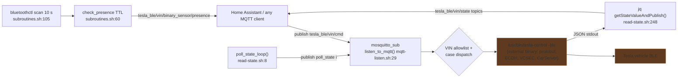
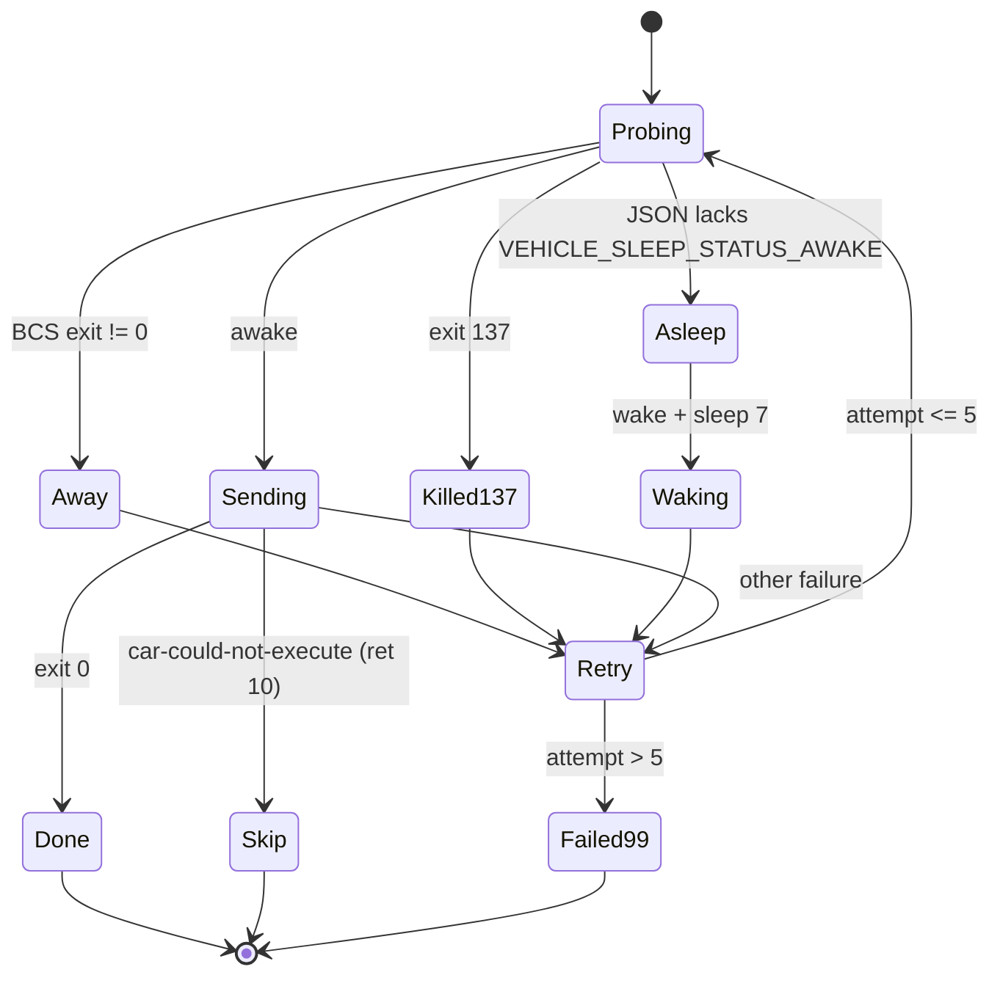
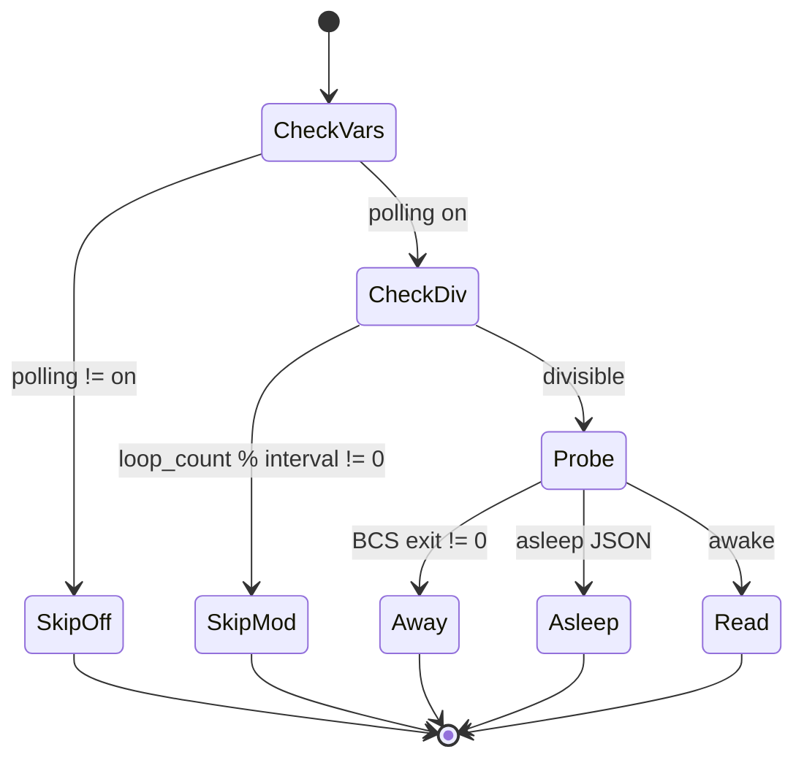
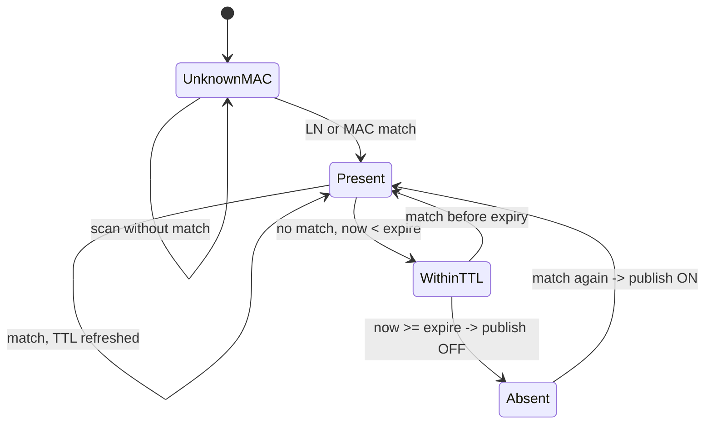
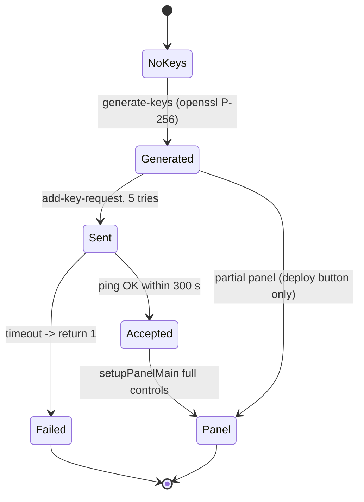

# tesla-local-control/tesla_ble_mqtt_core

Deep dive per `.opencode/skills/legacy-repo-deep-dive/SKILL.md` (replace mode). The pre-replace summary exists in git history: cite its claims as `git show HEAD:docs/legacy/tesla-local-control-tesla_ble_mqtt_core.md` (blob `c30a8de7dd1d534d4a0516f8d2040eac1378d6bb`), not as live links.

## 1. Provenance

- **Submodule path:** `legacy/tesla-local-control-tesla_ble_mqtt_core`
- **Pinned gitlink (parent repo):** `160000 696d46bd362cfdc6a3bb263a12e63bb2bfeee449 0` — matches `git -C legacy/tesla-local-control-tesla_ble_mqtt_core rev-parse HEAD`; `status --porcelain` clean at analysis time.
- **HEAD commit:** `696d46bd362cfdc6a3bb263a12e63bb2bfeee449` — "Merge pull request #159 from tesla-local-control/stage" (2025-02-23); 356 local commits, first `dad66b0` 2024-06-26.
- **Upstream URL:** https://github.com/tesla-local-control/tesla_ble_mqtt_core (origin, fetch+push).
- **License:** Apache-2.0 (`LICENSE:1-2`, RANGE-CITED lines 1-30 of 169).
- **Upstream version:** `SW_VERSION=0.5.0` (`version.sh:5`).
- **Analysis date:** 2026-11-21.
- **Frontmatter note:** the replaced doc had **no YAML frontmatter** (it began with an H1 title) and **no `## Upstream (...)` sections** (verified: `git show HEAD:docs/legacy/tesla-local-control-tesla_ble_mqtt_core.md | grep -nE 'Upstream|description:'` → no output). Nothing to preserve; none invented.
- **Files read (FULL-READ, every line):** `run.sh` (130), `env.sh` (72), `subroutines.sh` (225), `tesla-commands.sh` (336), `read-state.sh` (524), `mqtt.sh` (46), `mqtt-listen.sh` (343), `mqtt-discovery.sh` (1026), `mqtt-discovery-sensors.sh` (820), `version.sh` (6), `bluetoothctl-file` (54), `README.md` (2), `CHANGELOG.md` (329), `tests/README.md` (31), `documentation/README.md` (16), `documentation/how_polling_works.md` (23), `.pre-commit-config.yaml` (14), `.shellcheckrc` (17), `.githooks/pre-commit` (57), `.githooks/pre-push` (23), `.github/workflows/pre-commit.yml` (14).
- **Files RANGE-CITED (only cited ranges read):** `LICENSE` (lines 1-30), `tests/bltctl-devices.out` (lines 1-15), `tests/bltctl-scan.out` (lines 1-8 plus targeted `grep` for the two BLE Local Names).
- **Files explicitly NOT read:** `documentation/tesla_ble_mqtt_core_structure.pdf` and `documentation/tesla_ble_mqtt_core_structure.pptx` (binary slide decks; no code claims rest on them).
- **Our-side files read (FULL-READ) for parity:** `firmware/lib/vehicle/ble/proto.h` (161), `firmware/lib/vehicle/ble/msg.h` (481), `firmware/lib/vehicle/ble/distance.h` (242), `firmware/lib/vehicle/ble/feature/key.h` (151), `firmware/lib/vehicle/ble/feature/session.h` (282), `firmware/lib/vehicle/ble/feature/vcsec.h` (146), `firmware/lib/vehicle/ble/feature/carserver.h` (307), `firmware/lib/vehicle/ble/feature/distance.h` (88), `firmware/lib/vehicle/ble/handler/dispatch.h` (299).
- **Cross-reference (RANGE-CITED, targeted greps only):** `legacy/teslamotors-vehicle-command` (gitlink `160000 0a582da430c4aca6d397fb6cbed5b4d6bb380125 0`) — used to adjudicate our protobuf field numbers in section 11; not the analysis subject.

## 2. Executive verdict

tesla_ble_mqtt_core is a BusyBox-ash shell harness (no C, no Go, no protobuf) that bridges MQTT to a Tesla vehicle by shelling out to the **external, closed-behavior `tesla-control` Go binary** (`/usr/bin/tesla-control`, `tesla-commands.sh:25`). Its value to TeslaCANModder is threefold: (a) operational patterns — a presence/awake gate (`body-controller-state`) in front of every command with proactive wake and bounded retry, a serialized single-thread command queue, passive BLE-advertisement presence with TTL, and a key-provisioning lifecycle (generate → send → ping-until-accepted); (b) one load-bearing constant set the repo gets right — the vehicle BLE Local Name formula `S + sha1(VIN)[first 8 bytes as 16 hex] + C` (`tesla-commands.sh:332`), which is byte-identical to the SDK's `VehicleLocalName()` (`legacy/teslamotors-vehicle-command/pkg/connector/ble/ble.go:131-136`) and which our `dispatch.h` vehicle-discovery filter contradicts; (c) a documented operations history (CHANGELOG + `how_polling_works.md`) explaining *why* each gate exists. It contains zero CAN code and zero BLE protocol code — every byte-level protocol decision is delegated to tesla-control, so nothing here can validate our protobuf encoders; instead, section 11 shows our `msg.h` field numbers diverge from the authoritative protos that tesla-control uses. Not portable: the `eval`-driven dynamic variables, command-line MQTT credentials, and absolute `/app/` paths.

## 3. Evidence map

No TEST-READ evidence exists: this repo ships no tests (see section 10). No CAPTURE evidence of vehicle behavior exists; `tests/bltctl-scan.out` is a synthetic fixture assembled from real `bluetoothctl` output with fake VIN/MAC data (`tests/README.md:1-3`) — it validates the parsing pipeline's input shape only.

| source file | lines | what it proves | grade |
| ----------- | ----- | -------------- | ----- |
| `tesla-commands.sh` | 7-114 | `sendBLECommand`: BCS presence/awake gate → wake → send → 5 retries; exit codes 0/10/99/137 | CODE-READ |
| `tesla-commands.sh` | 25, 56, 73 | vehicle I/O is delegated to `/usr/bin/tesla-control -ble` (external binary) | CODE-READ |
| `tesla-commands.sh` | 207 | add-key: `add-key-request … owner cloud_key`, 60s kill, 20s command timeout | CODE-READ |
| `tesla-commands.sh` | 270-294 | accept-key loop: 300 s window, ping every 5 s, `touch ${vin}_pubkey_accepted` | CODE-READ |
| `tesla-commands.sh` | 327-336 | BLE Local Name = `S` + sha1(VIN) first 16 hex chars + `C` | CODE-READ |
| `read-state.sh` | 8-25 | poll scheduler: 0..86400 counter, step `POLL_STATE_LOOP_DELAY`, per-VIN publish | CODE-READ |
| `read-state.sh` | 33-42 | per-VIN config harvested from retained MQTT `variables/+` (exit 27 gate) | CODE-READ |
| `read-state.sh` | 56-65 | modulo interval gating; <660 s sleep-drain warning | CODE-READ |
| `read-state.sh` | 70-111 | BCS probe classifies away / asleep / awake without waking | CODE-READ |
| `read-state.sh` | 118-145 | `stateMQTTpub` topic root `tesla_ble/$vin/…` | CODE-READ |
| `read-state.sh` | 248-326 | unclean-JSON strip; jq extraction; per-field value remaps | CODE-READ |
| `read-state.sh` | 159-211 | `NO_POLL_SECTIONS` categories: charge, climate, tire-pressure, closures, drive | CODE-READ |
| `mqtt-listen.sh` | 29-48 | QoS-1 subscribe `tesla_ble/+/+`; VIN allowlist before dispatch | CODE-READ |
| `mqtt-listen.sh` | 57-305 | command/config surface (cases); all tesla-control calls serialized here | CODE-READ |
| `mqtt-listen.sh` | 207-215 | `charging-set-amps` ≤4 A sent twice (known SDK quirk) | CODE-READ |
| `mqtt-listen.sh` | 234-248 | rear seat selects command `seat-heater front-*` (bug, section 6) | CODE-READ |
| `mqtt-listen.sh` | 314-343 | HA `homeassistant/status` online → re-run discovery | CODE-READ |
| `subroutines.sh` | 60-102 | presence TTL logic: epoch compare, per-VIN expire list update | CODE-READ |
| `subroutines.sh` | 105-151 | bluetoothctl scan: 10 s window ("Tesla adverstisement each ~9s"), or file mock | CODE-READ |
| `subroutines.sh` | 154-193 | MAC learning: `FF:FF:FF:FF:FF:FF` sentinel → real MAC from scan, persisted | CODE-READ |
| `subroutines.sh` | 200-225 | BlueZ ≥5.63 recommendation check | CODE-READ |
| `mqtt.sh` | 7-15 | mosquitto base commands with credentials on the argv | CODE-READ |
| `mqtt.sh` | 17-55 | `retryMQTTpub`: N attempts with delay, reads payload from stdin | CODE-READ |
| `mqtt-discovery.sh` | 12-37 | device identity from VIN; `TOPIC_ROOT=tesla_ble/${vin}`; QoS 1 | CODE-READ |
| `mqtt-discovery.sh` | 44-90 | panel gating on key files (`_pubkey_accepted`, PEM pair) | CODE-READ |
| `mqtt-discovery.sh` | 101-118, 152-175 | command table: key-state tiers (1/2) and model filter (VIN char 4) | CODE-READ |
| `mqtt-discovery.sh` | 971-1025 | legacy-entity cleanup (null publishes) for migration | CODE-READ |
| `mqtt-discovery-sensors.sh` | 7-33, 36-820 | sensor/cover/switch discovery JSON; presence uses 36 retries | CODE-READ |
| `env.sh` | 31-49 | all tuning defaults + regex constants | CODE-READ |
| `run.sh` | 130-152 | main loop: MQTT listener + poll loop backgrounded, presence foreground | CODE-READ |
| `bluetoothctl-file` | 36-54 | bluetoothctl simulator for bench runs (mock, not pairing data) | CODE-READ |
| `documentation/how_polling_works.md` | 1-23 | author's design rationale: single-thread serialization, MQTT-as-master variables | SUMMARY-ONLY |
| `CHANGELOG.md` | 3-33 | 0.5.0 change claims incl. "Rear heated seats didn't respond" (contradicted, section 6) | SUMMARY-ONLY |
| `tests/bltctl-scan.out` | 1-8 + greps | input shape for the mock: `[NEW]/[DEL]/[CHG] Device <MAC> <LN>` lines with ANSI | CODE-READ |

## 4. Architecture and build surface

- **Entry point:** `run.sh` (shebang `#!/bin/ash -e`; HA addon deployment rewrites it, `run.sh:5`). Sources `env.sh`, which sources an **external** `/app/libproduct.sh` (logging functions `log_info` etc. — not in this repo, `env.sh:7-8`) then the six in-repo libraries (`env.sh:10-27`, exits 10 if one is missing).
- **Target shell:** BusyBox ash/dash (`# shellcheck shell=dash` in every file), not bash.
- **Runtime dependencies (all external binaries):** `tesla-control` (Tesla's Go SDK CLI — all BLE protocol work), `mosquitto_pub`/`mosquitto_sub`, `bluetoothctl` (BlueZ), `openssl` (P-256 keygen, `mqtt-listen.sh:67-72`), `jq` (JSON), GNU `sed`/`awk`/`sha1sum`.
- **Build surface:** none compiled; CI is pre-commit only — shellcheck v0.7.2 + shfmt (`-i 2`) via `.pre-commit-config.yaml:1-14` and `.github/workflows/pre-commit.yml:1-14`; `.shellcheckrc` disables dash-isms (SC3010/SC3014/…) and "TEMPORARILY" SC2015/SC2086/SC1091. Local `.githooks` block commits to `main` and strip trailing whitespace.
- **No CAN frame pipeline in this repo** (negative anchor: `grep -nEi 'can[_ ]bus|0x[0-9a-f]+' -- '*.sh'` → no output). The actual data flow:



## 5. Mechanism catalogue

### Command send with presence/awake gate (sendBLECommand)

- **Claim (README / summary):** pre-replace doc: "Command Execution: Receives MQTT commands and executes via BLE" — implies BLE implemented in this repo; it is not.
- **Code path:** `mqtt-listen.sh:57` case dispatch → `tesla-commands.sh:7 sendBLECommand()` → `body-controller-state` probe (line 25) → optional `-domain vcsec wake` (line 56) → `tesla-control $command` (line 73) → JSON captured into global `TESLACTRLOUT`.
- **Frame spec:** none in repo (delegated to tesla-control).
- **Gates and timing:** BCS probe first; asleep → publish `awake=false`, wake, `sleep 7` (line 65); awake → publish `awake=true`, send. `timeout -k 1 -s SIGKILL $TC_KILL_TIMEOUT` (default 25 s) around every call; `wait` after each (line 28); max 5 attempts (line 18); "car could not execute command" → no retry, return 10 (line 88-91); exhausted → return 99 (line 112-113).
- **State machine:**



- **Tests:** None found (no test suite in repo).
- **Evidence grade:** CODE-READ.
- **Verdict:** CONFIRMED (delegation to external binary confirmed; gate behavior as described).
- **Adapt to TeslaCANModder?** candidate — the BCS-gate/wake/retry pattern maps onto our `tesla:*` dispatch, which currently sends with no presence or awake check (`firmware/lib/vehicle/ble/handler/dispatch.h:63-97 runAuthCommand`).

### State poll scheduler (poll_state_loop / poll_state)

- **Claim (summary):** pre-replace doc never mentions polling; CHANGELOG 0.4.2/0.5.0 describe it.
- **Code path:** `read-state.sh:8 poll_state_loop()` → `stateMQTTpub $vin $i poll_state` → `mqtt-listen.sh:297` → `read-state.sh:27 poll_state()`.
- **Frame spec:** none (BCS + `state <category>` via tesla-control).
- **Gates and timing:** per-VIN `polling`/`polling_interval` read from retained MQTT `tesla_ble/$vin/variables/+` with `mosquitto_sub -W 1`, gated on exit code 27 (`read-state.sh:33-42`); interval hit only when `loop_count % polling_interval == 0` (line 56); counter resets every 86400 (line 14); <660 s → battery-drain warning (line 63); awake cars get a `read-state-envcheck` config message honoring `NO_POLL_SECTIONS` (lines 106-107, 181-203).
- **State machine:**



- **Tests:** None found.
- **Evidence grade:** CODE-READ.
- **Verdict:** CONFIRMED.
- **Adapt to TeslaCANModder?** candidate (pattern) — MQTT-retained per-car config variables beat NVS-only settings for HA-driven control; our `mqtt:on` telemetry bridge (`docs/reference/commands.md` MQTT section) could adopt retained `variables/+` topics. No CAN impact.

### Passive BLE presence with TTL and MAC learning (listen_to_ble)

- **Claim (summary):** pre-replace doc does not describe presence; CHANGELOG 0.1.0 introduced TTL, 0.2.0 auto-MAC.
- **Code path:** `run.sh:144` → `subroutines.sh:154 listen_to_ble()` → `bluetoothctl_read()` (line 105) → `check_presence()` (line 60) → `presenceMQTTpub()` (line 35).
- **Frame spec:** none — parses `bluetoothctl` text: `[NEW]/[DEL]/[CHG] Device <MAC> <LocalName>` (mock sample `tests/bltctl-scan.out:8`).
- **Gates and timing:** scan window `sleep 10` — comment "Tesla adverstisement each ~9s" (line 123-124); TTL default 240 s (env.sh:38), expire-time list per VIN (lines 85-92); `PRESENCE_DETECTION_LOOP_DELAY` default 120 s; unknown MAC = sentinel `FF:FF:FF:FF:FF:FF`, learned from `bluetoothctl devices` output and persisted to `$KEYS_DIR/${vin}_macaddr` (lines 70-77, 184); presence persisted to `${vin}_presence` for restart continuity (line 43).
- **State machine:**



- **Tests:** None found (mock data files exist but no asserting test).
- **Evidence grade:** CODE-READ.
- **Verdict:** CONFIRMED.
- **Adapt to TeslaCANModder?** candidate — an advertisement-based "vehicle present" gate using Local Name `S…C` + TTL would complement our RSSI `blekey:distance` estimator (`firmware/lib/vehicle/ble/distance.h:145-172`); bench capture needed for the ~9 s cadence claim.

### Key provisioning lifecycle (generate → deploy → accepted)

- **Claim (summary):** pre-replace doc: "bluetoothctl-file # Bluetooth pairing data" — wrong (see section 6).
- **Code path:** `mqtt-listen.sh:65-86 generate-keys` (openssl P-256 PEM pair) → `mqtt-listen.sh:88-91 deploy-key` → `tesla-commands.sh:202 teslaCtrlSendKey()` (add-key-request, 60 s kill, 20 s command timeout, 5 tries) → `tesla-commands.sh:270 acceptKeyConfirmationLoop()` → `touch $KEYS_DIR/${vin}_pubkey_accepted` → `mqtt-discovery.sh:44 setupPanelMain()`.
- **Frame spec:** none in repo; role/form factor only as CLI args `owner cloud_key` (`tesla-commands.sh:207`).
- **Gates and timing:** key acceptance = ping every 5 s for 300 s (lines 274-289); panel entities gated on file existence (`mqtt-discovery.sh:62-86`); user must accept on the car screen with an NFC card (`tesla-commands.sh:227`).
- **State machine:**



- **Tests:** None found.
- **Evidence grade:** CODE-READ.
- **Verdict:** CONFIRMED.
- **Adapt to TeslaCANModder?** candidate — our `tesla:key:send` sends the request but has no acceptance feedback loop (`firmware/lib/vehicle/ble/handler/dispatch.h:184-219`); the ping-until-accepted pattern closes that gap (after the msg.h field-number fix in section 11).

### MQTT command listener and VIN allowlist (listen_to_mqtt)

- **Claim (summary):** pre-replace doc: topics `tesla/{vin}/command/` — wrong prefix and shape (section 6).
- **Code path:** `mqtt-listen.sh:13 listen_to_mqtt_loop()` → `listen_to_mqtt()` (line 27) — `mosquitto_sub --qos 1 --topic tesla_ble/+/+ -F "%t %p"` piped to a read loop.
- **Frame spec:** none (MQTT text).
- **Gates and timing:** VIN membership check before any dispatch (lines 37-48); unknown VINs logged and dropped; sub-process death → return 1 → loop restarts after 10 s (lines 19-23, 309).
- **State machine:** None found (two-state restart loop, below 3-state threshold).
- **Tests:** None found.
- **Evidence grade:** CODE-READ.
- **Verdict:** CONFIRMED.
- **Adapt to TeslaCANModder?** candidate (pattern) — the VIN allowlist and the "all vehicle I/O through one serialized consumer" design note (`documentation/how_polling_works.md:6`) are the transferable ideas; our dispatch is already single-threaded.

### Home Assistant discovery panel builder

- **Claim (summary):** pre-replace doc lists `mqtt-discovery.sh` as "HA auto-discovery patterns" — accurate at file level.
- **Code path:** `mqtt-discovery.sh:944 setupHADiscoveryAllVINsMain()` → `setupPanelMain()` (line 44) → `setupButtonControls()` (152), `setupExtendedControls()` (182), `setupStateSensors` (`mqtt-discovery-sensors.sh:36`), `setupDiagnostic()` (730).
- **Frame spec:** none (JSON published to `homeassistant/<type>/<device>/<id>/config`).
- **Gates and timing:** button tiers — commands available pre-key (`carKeyState 0`) vs post-key (`1`), diagnostics always but some `enabled_by_default:false`; model filter uses VIN character 4 (`mqtt-discovery.sh:23`) so tonneau buttons only appear for Cybertruck (`model C`, lines 114-116); every JSON republished with `retryMQTTpub 6 10`, presence sensor with `36 10` (mqtt-discovery-sensors.sh:29); HA restart detected via `homeassistant/status` online → full re-publish (`mqtt-listen.sh:328-332`); stale single-entity topics deleted with null payloads (`delete_legacies*`, `mqtt-discovery.sh:971-1025`).
- **State machine:** None found (tiered visibility, covered by the key-lifecycle card above).
- **Tests:** None found.
- **Evidence grade:** CODE-READ.
- **Verdict:** CONFIRMED.
- **Adapt to TeslaCANModder?** no impact — our firmware's `ha:discovery` (`docs/reference/commands.md`) covers the same ground; the null-publish cleanup trick is worth remembering if we ever rename MQTT entity topics.

### State read and remap pipeline (readState / getStateValueAndPublish)

- **Claim (summary):** pre-replace doc: "read-state.sh — State decoding logic" — accurate but omits that decoding is jq over tesla-control JSON, not protocol decoding.
- **Code path:** `read-state.sh:147 readState()` → `readChargeState/328` / `readClimateState/361` / `readTyreState/395` / `closuresState/418` / `driveState/460` → `sendBLECommand "state <category>"` → `getStateValueAndPublish()` (line 248).
- **Frame spec:** none (jq paths over CarServer JSON).
- **Gates and timing:** trailing-garbage strip `sed 's/\(…date…\).*$//'` with warning (lines 255-258); jq exit-code special cases (line 263); seat levels 0-3 → `off/low/med/high` (266-284); `.closuresState.sentryModeState .Off {}` → bool (287-294); empty `connChargeCable` → `No` (297-302); odometer ÷100 (305-307); ANYWINDOWOPEN aggregate → `cover/windows` (434, 451-456).
- **State machine:** None found (pure function pipeline).
- **Tests:** None found.
- **Evidence grade:** CODE-READ.
- **Verdict:** CONFIRMED.
- **Adapt to TeslaCANModder?** no impact — our BMS/TPMS decode is CAN-side (`docs/reference/can-protocol.md`), no shared surface.

### MQTT client construction and retry (mqtt.sh / retryMQTTpub)

- **Claim (summary):** pre-replace doc: "mqtt.sh # MQTT connection management" — accurate.
- **Code path:** `mqtt.sh:7-15` builds `MOSQUITTO_PUB_BASE`/`MOSQUITTO_SUB_BASE` (authenticated or anonymous) → `retryMQTTpub` (line 17) reads topic payload from stdin, N attempts with delay.
- **Frame spec:** none.
- **Gates and timing:** config publishes 6 attempts × 10 s; sensor/presence discovery 36 × 10 (up to ~6 min broker outage tolerance).
- **State machine:** None found.
- **Tests:** None found.
- **Evidence grade:** CODE-READ.
- **Verdict:** CONFIRMED.
- **Adapt to TeslaCANModder?** already present — our MQTT bridge publishes telemetry (`docs/reference/commands.md` MQTT commands); verify our publish retry policy separately (not audited here).

### bluetoothctl simulator for bench tests (bluetoothctl-file)

- **Claim (summary):** pre-replace doc calls this "Bluetooth pairing data" — CONTRADICTED; it is a test double.
- **Code path:** `bluetoothctl-file:37 processBltctlCmd()` reads commands on stdin; `devices` → random 0-10 lines of `tests/bltctl-devices.out`; `scan*on` → random 0-35 lines of `tests/bltctl-scan.out` (`fileRandomRead`, lines 13-34); `BLECTL_FILE_INPUT` redirects the real `bluetoothctl_read` to it (`subroutines.sh:130-150`).
- **Frame spec:** none.
- **Gates and timing:** `$RANDOM` window picking (test-only nondeterminism).
- **State machine:** None found.
- **Tests:** None found — this file *is* the test harness; no assertions exist around it.
- **Evidence grade:** CODE-READ.
- **Verdict:** CONFIRMED (as simulator; pairing-data claim CONTRADICTED).
- **Adapt to TeslaCANModder?** candidate (low) — the recorded-sample-replay idea mirrors our `simu:start` CAN simulation; a BLE advertisement sample-replay would let us test presence logic without hardware.

## 6. Summary vs code contradiction table

Pre-replace claims cite `git show HEAD:docs/legacy/tesla-local-control-tesla_ble_mqtt_core.md` (blob `c30a8de…`, 71 lines). Upstream doc claims cite the pinned tree.

| # | claim (citation) | code evidence | verdict |
| - | --------------- | ------------- | ------- |
| 1 | pre-replace L38: "bluetoothctl-file # Bluetooth pairing data" | `bluetoothctl-file:36-54` is a mock that replays canned scan/device lines from `tests/*.out`; `tests/README.md:23-31` describes it as interacting "the same way bluetoothctl does" for tests | CONTRADICTED |
| 2 | pre-replace L54: MQTT topic `tesla/{vin}/state/` | topic root is `tesla_ble/$vin/<path>` — `read-state.sh:123 MQTT_TOPIC="tesla_ble/$vin/$topic"`; negative anchor `grep -nE 'tesla/\{vin\}'` → no hits | CONTRADICTED |
| 3 | pre-replace L55: `tesla/{vin}/command/` | command topic is `tesla_ble/$vin/command` (`mqtt-listen.sh:29` subscribes `tesla_ble/+/+`; dispatch cases at 57-305) | CONTRADICTED (prefix + trailing slash) |
| 4 | pre-replace L56: `tesla/{vin}/response/` — command responses topic | no response topic exists anywhere; negative anchor `grep -nE 'response/' -- '*.sh'` → no output; responses surface only via `stateMQTTpub` state topics and logs | CONTRADICTED (nonexistent) |
| 5 | pre-replace L48: "Shell-based: No compiled dependencies" | hard dependencies on compiled binaries: `/usr/bin/tesla-control` (Go), `mosquitto_pub/sub`, `bluetoothctl`, `openssl`, `jq` (`tesla-commands.sh:25,73`; `mqtt.sh:9-14`; `subroutines.sh:128`; `mqtt-listen.sh:67,72`) | CONTRADICTED |
| 6 | pre-replace L40: "tests/ — Test suite" | `tests/` holds only two synthetic `bluetoothctl` data files and a README; no asserting test exists anywhere; CI runs shellcheck/shfmt only (`.github/workflows/pre-commit.yml:1-14`) | CONTRADICTED |
| 7 | pre-replace L10/L46 + architecture diagram: bash core talks to "Tesla BLE" | repo contains zero BLE protocol code; every vehicle byte is produced by the external tesla-control binary (`tesla-commands.sh:25,56,73`; `read-state.sh:70`) | PARTIAL (architecture misleading at the protocol level) |
| 8 | upstream `CHANGELOG.md:24` (0.5.0 fixes): "Rear heated seats didn't respond to commands" | `mqtt-listen.sh:243` maps `heater-seat-rear-left` → `seat-heater front-left`, and line 247 `heater-seat-rear-right` → `seat-heater front-right`; negative anchor `grep -nE 'seat-heater rear'` → no output; `git log -S 'seat-heater rear'` → empty (string never existed in history) | CONTRADICTED — the "fix" commands the front seats; rear entities update state topics while the wrong seat is heated |
| 9 | `run.sh:145` comment: "Run listen_to_ble every 3m" | default `PRESENCE_DETECTION_LOOP_DELAY=120` (2 m, `env.sh:37`); also `listen_to_ble` never returns (infinite loop `subroutines.sh:158-192`), so the outer `while` at `run.sh:130` and its `sleep` at line 146 are dead code | PARTIAL (comment stale + dead outer loop) |
| 10 | upstream `CHANGELOG.md:142` (0.2.0): "Increased tesla-control command-timeout from 5s to 20s" | current default `TC_COMMAND_TIMEOUT:-5` (`env.sh:31`); only the add-key call hardcodes `-command-timeout 20s` (`tesla-commands.sh:207`); 0.5.0 (`CHANGELOG.md:32`) reset the default to 5 s | CONTRADICTED at pinned HEAD (historical change later reverted) |

Pre-replace claims that survived verification: license Apache-2.0 (L5 ↔ `LICENSE:1-2`), submodule URL (L4 ↔ origin remote), shell implementation language (L6, though ash/dash-targeted, not bash — see section 4), and the file-level role descriptions of `read-state.sh`/`tesla-commands.sh`/`mqtt.sh`/`mqtt-discovery.sh` (L28-33, 69-71).

## 7. CAN frame and signal inventory

None found — this repo decodes, mutates, or injects no CAN frames. All vehicle interaction is BLE via the external tesla-control binary; the only wire formats handled in-repo are MQTT topics (section 12) and `bluetoothctl` text output. Negative anchor: `grep -nEi 'can[_ ]bus|0x[0-9a-f]+' -- '*.sh'` → no output.

## 8. Constants and tuning table

| constant | value | file:line | meaning | grade |
| -------- | ----- | --------- | ------- | ----- |
| `PRESENCE_DETECTION_TTL` | 240 (default) | `env.sh:38` | seconds a car stays "present" after last advertisement match | CODE-READ |
| `PRESENCE_DETECTION_LOOP_DELAY` | 120 (default) | `env.sh:37` | presence scan cadence; 0 disables presence (`run.sh:96-101,142`) | CODE-READ |
| scan window | `sleep 10` | `subroutines.sh:124` | one scan burst ≈ one advertisement cycle ("Tesla adverstisement each ~9s", line 123) | CODE-READ |
| `POLL_STATE_LOOP_DELAY` | 30 (default) | `env.sh:34` | poll counter step; must divide `polling_interval` for a poll to ever fire (`read-state.sh:56`) | CODE-READ |
| poll counter cap | 86400 | `read-state.sh:14` | day-long modulus counter, prevents overflow drift | CODE-READ |
| sleep-drain threshold | 660 s | `read-state.sh:63`, `run.sh:45` | polling below 11 min may keep the car awake; warned, not blocked | CODE-READ |
| `polling_interval` slider | 30-3600, step 30 | `mqtt-discovery.sh:496-498` | HA number entity bounds; step 30 keeps divisibility with loop delay | CODE-READ |
| `TC_COMMAND_TIMEOUT` | 5 (default) | `env.sh:31` | per-command tesla-control timeout (s) | CODE-READ |
| `TC_CONNECT_TIMEOUT` | 10 (default) | `env.sh:32` | BLE connect timeout (s) | CODE-READ |
| `TC_KILL_TIMEOUT` | 25 (default) | `env.sh:33` | hard SIGKILL ceiling via `timeout -k 1 -s SIGKILL` (`tesla-commands.sh:25`) | CODE-READ |
| `max_retries` | 5 | `tesla-commands.sh:18,211` | command and key-send attempt ceiling | CODE-READ |
| post-wake settle | `sleep 7` | `tesla-commands.sh:65` | wait after `-domain vcsec wake` before retrying probe | CODE-READ |
| accept-key window | 300 s, ping 5 s | `tesla-commands.sh:274,289` | how long the owner has to tap the NFC card | CODE-READ |
| add-key call | `timeout 60`, `-command-timeout 20s` | `tesla-commands.sh:207` | only place with a 20 s command timeout | CODE-READ |
| BLE Local Name | `S` + sha1(VIN) first 16 hex + `C` | `tesla-commands.sh:332` | vehicle advertisement name; regex `S[0-9A-Fa-f]{16}C` (`env.sh:45`) | CODE-READ |
| MAC sentinel | `FF:FF:FF:FF:FF:FF` | `run.sh:59-60` | "MAC unknown — learn from next devices scan" (`subroutines.sh:68-77`) | CODE-READ |
| `KEYS_DIR` | `/share/tesla_ble_mqtt` | `env.sh:47` | key/pebble-file store (PEM pair, `_macaddr`, `_presence`, `_pubkey_accepted`) | CODE-READ |
| `MAX_CURRENT` | 48 (default) | `env.sh:39` | HA amps slider max (`mqtt-discovery.sh:403`) | CODE-READ |
| low-amps workaround | ≤4 A → send twice | `mqtt-listen.sh:209-215` | tesla-control quirk (ref `iainbullock/tesla_ble_mqtt_docker#4`) | CODE-READ |
| climate temp range | 15-28 °C | `mqtt-discovery.sh:476-477` | HA slider bounds, Celsius-only since 0.5.0 | CODE-READ |
| charge limit range | 50-100 % | `mqtt-discovery.sh:451-452` | HA slider bounds | CODE-READ |
| discovery retry | config 6×10 s; sensors/presence 36×10 s | `mqtt-discovery.sh:166`; `mqtt-discovery-sensors.sh:29` | broker-outage tolerance for HA discovery | CODE-READ |
| BlueZ floor | 5.63 | `subroutines.sh:220` | minimum recommended bluetoothctl version (warn only) | CODE-READ |
| `QOS_LEVEL` | 1 | `mqtt-discovery.sh:30` | all discovery and command QoS | CODE-READ |
| model char | VIN position 4 | `mqtt-discovery.sh:23` | S/3/X/Y/C gating for tonneau etc. (lines 101-118) | CODE-READ |

## 9. Failure modes and edge cases

| failure | handling code path | tested? | grade |
| ------- | ------------------ | ------- | ----- |
| tesla-control hangs (adapter overload) | `timeout -k 1 -s SIGKILL $TC_KILL_TIMEOUT` → exit 137 → warning + issue #142 ref, `wait` drains zombies (`tesla-commands.sh:25-33,70-81`; `read-state.sh:70-80`) | no | CODE-READ |
| car out of BLE range | BCS non-zero → presence_bc/device_tracker `false`, awake `false`, no wake attempted during pure polls (`read-state.sh:83-87`) | no | CODE-READ |
| car asleep when command queued | publish awake `false`, `wake`, `sleep 7`, retry probe (`tesla-commands.sh:49-65`) | no | CODE-READ |
| vehicle rejects command | "car could not execute command" → no retry, return 10 (`tesla-commands.sh:88-91`) | no | CODE-READ |
| command timeout after wake | "context deadline exceeded" → warn + retry up to 5 (`tesla-commands.sh:93-101,107`) | no | CODE-READ |
| retries exhausted | return 99; caller logs and gives up (`tesla-commands.sh:111-113`) | no | CODE-READ |
| broker down / mosquitto_sub dies | `listen_to_mqtt` returns 1 → loop restarts after 10 s (`mqtt-listen.sh:19-23,308-309`) | no | CODE-READ |
| mosquitto_pub fails | `retryMQTTpub` N×delay, then `log_error` + return 1; presence uses 36 attempts (`mqtt.sh:39-48`) | no | CODE-READ |
| unclean tesla-control JSON | sed strips anything from a `YYYY/MM/DD` date onward + warning (`read-state.sh:253-258`) | no | CODE-READ |
| owner never taps NFC card | accept loop times out at 300 s → return 1, panel stays in pre-accepted tier (`tesla-commands.sh:280-293`; `mqtt-discovery.sh:62-86`) | no | CODE-READ |
| retained-variable harvest fails | `mosquitto_sub -W 1` non-27 exit (broker unreachable) → `2>/dev/null`, variables silently keep defaults (`run.sh:26-35`; `read-state.sh:32-42`) | no | CODE-READ |
| presence disabled (`TTL=0`) | publish `Unknown`, null the presence config topic, idle loop `sleep 86400` (`run.sh:96-101,147-152`) | no | CODE-READ |
| mock input file missing | `log_fatal` + exit 30 (`subroutines.sh:135-137`; `bluetoothctl-file:19-21`) | no | CODE-READ |
| library file missing at boot | exit 10 (`env.sh:23-26`) | no | CODE-READ |

Untested paths — all of them (no test suite exists). Highest-risk untested logic: the `eval`-based variable harvest (silent failure mode above), the dead outer main loop (`run.sh:130-152` — a crash of `listen_to_ble` exits the foreground loop and the container stops supervised only by Docker/HA restart), and the rear-seat command mapping bug (section 6 row 8).

## 10. Test coverage map

Per test file:

- `tests/bltctl-devices.out`, `tests/bltctl-scan.out` — data fixtures for the simulator; assert nothing.
- `tests/README.md` — manual test-env instructions (fake VINs `5YJ3F1FB9JF111111`/`…888888`, Local Names `Scc424e6b9eb21875C`/`S4a15fba3fa21e4ceC`, MACs, lines 8-19).
- `bluetoothctl-file` — the mock harness itself (not a test).
- No CI job runs anything except shellcheck v0.7.2 and shfmt on diff (`pre-commit`, `.github/workflows/pre-commit.yml`).

Critical paths with NO test (risk in one line): `sendBLECommand`'s 137/wake/retry branching — a regression here strands every vehicle command; `poll_state` modulus arithmetic — an interval not divisible by 30 silently never polls; presence TTL expiry — off-by-one publishes flapping presence; discovery JSON validity — a malformed publish hides entities in HA with no error surfaced; the key-acceptance loop — a false-positive `ping` marks an unaccepted key as enrolled.

## 11. Parity matrix with TeslaCANModder

Our-side citations are CODE-READ from `firmware/lib/vehicle/ble/**`; protocol cross-checks use the pinned `legacy/teslamotors-vehicle-command` protos (gitlink `160000 0a582da430c4aca6d397fb6cbed5b4d6bb380125 0`) — the same SDK that builds the `tesla-control` binary this repo shells out to. Upstream (tesla_ble_mqtt_core) contributes no protobuf code, so protocol rows compare us against the SDK, and the upstream column records behavior it delegates.

| signal/frame | upstream (tesla_ble_mqtt_core / SDK) | our decode (TeslaCANModder) | delta | action |
| ------------ | ------------------------------------- | -------------------------- | ----- | ------ |
| vehicle BLE Local Name | `"S" + sha1(VIN) hex[0:16] + "C"` (`tesla-commands.sh:332`); identical to SDK `VehicleLocalName()` (`pkg/connector/ble/ble.go:131-136`, `sha1.Sum(vinBytes)`, first 8 bytes) | suffix filter = **last 8 VIN chars** (`dispatch.h:34-42 connectToVehicle`) | ours can never match the advertised name, which is a SHA1 hex string, not the VIN | **align** — derive `S+sha1(VIN)[:8 bytes]+C` in `connectToVehicle` (behavior port, cite upstream symbol `vinToBLEln`) |
| P-256 key pair | openssl `prime256v1` PEM pair on disk (`mqtt-listen.sh:67-72`) | mbedTLS `keyGenerate` raw 32-byte scalar + 65-byte point (`key.h:40-84`) | equivalent curve; storage format differs (PEM vs board blob) | already present |
| key roles | `owner cloud_key` CLI args (`tesla-commands.sh:207`) | `ROLE_OWNER=4`, `ROLE_CHARGING_MANAGER=5` (`key.h:22-23`); `key:send` hardcodes `KEY_FORM_FACTOR_NFC_CARD=3` (`msg.h:25`, `dispatch.h:204`) | upstream registers as **cloud_key** form factor; ours as **NFC card** | capture-first — check which form factor the car's UI prompt expects before changing |
| add-key request encoding | delegated to tesla-control (no proto code) | `buildAddKeyRequest` wraps `addKeyToWhitelistAndAddPermissions` as **UnsignedMessage field 2** with key=1/role=2/formFactor=5 (`msg.h:63-95`) | SDK proto: UnsignedMessage oneof has `RKEAction=2`, `WhitelistOperation=16`; the add-key path is `WhitelistOperation(16) → addKeyToWhitelistAndAddPermissions(5) → PermissionChange{keyToAdd=3, keyRole=4, impermanent=5}` (`pkg/protocol/protobuf/vcsec.proto:121-131,226-231`) | **fix our side** — current `tesla:key:send` writes fields the car will not decode; also the `formFactor=5` we write is `impermanent` in the real `PermissionChange` |
| wake | `-domain vcsec wake` (`mqtt-listen.sh:182`, `tesla-commands.sh:56`); SDK: `RKE_ACTION_WAKE_VEHICLE = 30` (`vcsec.proto:81`) | two builders: correct `buildWakeAction` via RKE 30 (`vcsec.h:139-142`), but `dispatch.h` includes `msg.h`, whose own `buildWakeAction` writes **CarServer field 25** (`msg.h:169`) — field 25 is `vehicleControlCancelSoftwareUpdateAction` (`car_server.proto:42`) | the shipping `tesla:wake` path (`dispatch.h:224` → `msg.h`) sends the wrong message kind | **fix our side** — route wake through the vcsec.h builder |
| CarServer action envelope | n/a (binary) | `msg.h buildAction` wraps VehicleAction in **Action field 1** (`msg.h:153`); `carserver.h wrapCarServerAction` uses **field 2** (`carserver.h:101`) | proto: `VehicleAction vehicleAction = 2` (`car_server.proto:16`) — carserver.h correct, msg.h wrong | fix our side — retire the msg.h action builders |
| charge start/stop | CLI `charging-start`/`charging-stop` (`mqtt-listen.sh:272-274`) | `msg.h` uses `chargingStartStopAction = field 11` with start=1/stop=2 (`msg.h:183-215`); `carserver.h` uses field 6 with start=2/stop=5 (`carserver.h:30,53-56,269-285`) | proto: `chargingStartStopAction = 6`, `start=2, stop=5` (`car_server.proto:27,186-189`) — carserver.h correct, msg.h wrong | fix our side |
| climate on/off | CLI `climate-on/off` (`mqtt-listen.sh:262-270`) | `msg.h` uses `hvacAutoAction = field 14` (`msg.h:267`); `carserver.h` uses field 10 (`carserver.h:27,256-265`) | proto: `hvacAutoAction = 10` (`car_server.proto:31`) | fix our side (carserver.h already right) |
| set amps / set limit | CLI `charging-set-amps/-limit` (`mqtt-listen.sh:207-226`) | `msg.h` fields 13/12 (`msg.h:231,249`); `carserver.h` fields 43/5 (`carserver.h:39,29-30`) | proto: `setChargingAmpsAction = 43`, `chargingSetLimitAction = 5` (`car_server.proto:26,56`) | fix our side (carserver.h already right) |
| seat heater levels/positions | CLI `seat-heater <pos> <level>` — upstream maps rear selects to front positions (bug, section 6 row 8) | `SEAT_HEATER_OFF=2..HIGH=5`, seats `FRONT_LEFT=7, FRONT_RIGHT=8, REAR_LEFT=9, REAR_RIGHT=12` (`carserver.h:60-68`) | proto agrees exactly: `SEAT_HEATER_OFF=2..HIGH=5`, `CAR_SEAT_FRONT_LEFT=7…REAR_RIGHT=12` (`car_server.proto:218-221,225-230`) | already present (ours); never copy upstream's front/rear mapping |
| VCSEC SignedMessage wrap | n/a (binary) | `wrapVCSECSigned`: protobufMessageAsBytes=2, signatureType=3, ToVCSECMessage.signedMessage=1 (`vcsec.h:59-73`) | proto agrees (`vcsec.proto:16-22`) | already present |
| RoutableMessage envelope | n/a (binary) | `msg.h` writes `to_destination=2`, `protobuf_message_as_bytes=5`, `session_info_request=6`, `session_info=10`, `signature_data=7`, `uuid=14` (`msg.h:90-92,131-133,311-314,364`) | proto: `to_destination=6`, `protobuf_message_as_bytes=10`, `session_info_request=14`, `session_info=15`, `signature_data=13`, `uuid=51`; fields 1-5 reserved (`universal_message.proto:81-99`) | **fix our side** — every msg.h RoutableMessage (session establish, auth commands, add-key) targets reserved/wrong fields; `parseSessionInfo` also hunts field 10 for `session_info`, which is 15 |
| ECDH session (HKDF/AES-GCM) | n/a (binary) | `session.h:63-206 establish()` — manual HKDF-SHA256 extract/expand, AES-128-GCM, counter IV (`session.h:216-258`) | upstream repo has no comparable code to compare | UNVERIFIED against a vehicle — validate after the envelope fix, with a tesla-control golden exchange as oracle |

Rows that drive decisions: Local Name, add-key encoding, wake routing, and the RoutableMessage envelope. All four are our-side CODE-READ + SDK CODE-READ; none is SUMMARY-ONLY.

## 12. Surface inventory and security notes

Surfaces:

- **MQTT subscribe** `tesla_ble/+/+` QoS 1 (`mqtt-listen.sh:29`) — the entire command surface: `<vin>/config` (10 messages incl. `generate-keys`, `deploy-key`, `info-bt-adapter`, `read-state-*`, `body-controller-state`) and `<vin>/command` (13 messages: `autosecure-modelx`, `charging-schedule-cancel`, `drive`, `flash-lights`, `frunk-open`, `honk`, `list-keys`, `lock`, `media-toggle-playback`, `ping`, `software-update-cancel/start`, `unlock`, `wake`), plus per-entity topics (`auto-seat-and-climate`, `charging-schedule`, `charging-set-amps[-override]`, `charging-set-limit`, `climate-set-temp`, `heater-seat-*`, `media-set-volume`, `sentry-mode`, `steering-wheel-heater`, `climate`, `charging`, `charge-port`, `trunk`, `tonneau`, `windows`, `poll_state`, `variables`).
- **MQTT publish** state topics `tesla_ble/<vin>/…` (`read-state.sh:118-145`) and HA discovery `homeassistant/<type>/<device>/<id>/config` (sections 5, discovery card).
- **MQTT subscribe** `homeassistant/status` for HA restarts (`mqtt-listen.sh:315`).
- **VIN allowlist** before any dispatch (`mqtt-listen.sh:37-48`) — a message for a non-configured VIN is dropped; this is the repo's only input-trust boundary.
- **Filesystem** `$KEYS_DIR=/share/tesla_ble_mqtt` (`env.sh:47`): `<vin>_private.pem`, `<vin>_public.pem`, `<vin>_macaddr`, `<vin>_presence`, `<vin>_pubkey_accepted`.
- **BLE/serial/web:** none in this repo — delegated entirely to tesla-control and bluetoothctl.

Security and provenance findings:

- **Credentials on the process command line:** `mosquitto_pub -h … -u '${MQTT_USERNAME}' -P '${MQTT_PASSWORD}'` (`mqtt.sh:9-10`) — visible in `ps` output on the host. Never copy.
- **`eval` of composed strings, twice over:** `eval $MOSQUITTO_PUB_BASE $args` (`mqtt.sh:35`) and `eval $MOSQUITTO_SUB_BASE …` (`read-state.sh:33`); `MOSQUITTO_SUB_BASE` embeds the password. Any value that reaches `$args` becomes shell syntax.
- **`eval export var_${vin}_$assign` from MQTT payload-derived names** (`run.sh:33`, `read-state.sh:40`) — the retained-variables channel is trusted as if it were the broker operator; a hostile retained message on `tesla_ble/<vin>/variables/<name>` can inject shell code. The VIN allowlist does not gate the *variable name*.
- **Private key material** written 0600-less to a plain directory; private key printed to logs only under `DEBUG=true` (`mqtt-listen.sh:69-70`) — acceptable, but `log_debug "$(cat ${vin}_private.pem)"` on line 68 does cat the key unconditionally (masked from output only when DEBUG is false).
- **`bluetoothctl-file` mock** reads arbitrary paths from `bltctlDevicesFile`/`bltctlScanFile` env vars — test-only surface.
- **No CAN surfaces, no OTA surfaces, no hardcoded vehicle keys/certs.**

## 13. Adaptation assessment

| mechanism | value | cost | risk | evidence | decision |
| --------- | ----- | ---- | ---- | -------- | -------- |
| BCS presence/awake gate + proactive wake + bounded retry | high — our BLE dispatch sends blind | low — pattern fits `runAuthCommand` | medium — needs an awake-state probe message we must add | CODE-READ | candidate for future PR |
| vehicle Local Name formula (`vinToBLEln`) | high — our current filter cannot match a real advertisement | low — one sha1 + hex format | low | CODE-READ (repo) + CODE-READ (SDK `ble.go:131-136`) | candidate for future PR (with `can-review-checklist` not required — BLE, not CAN) |
| add-key + 300 s ping-until-accepted loop | medium — closes the provisioning UX gap | medium — depends on fixing msg.h encoding first | medium | CODE-READ | candidate for future PR |
| MQTT-retained per-car variables | medium — HA-driven runtime config without reflash | low | low (input validation required; see eval finding) | CODE-READ | candidate for future PR |
| passive presence TTL + MAC learning | medium — car-present gate for CAN-injection safety | medium — needs BLE scan loop on ESP32 | low | CODE-READ | candidate (backlog; capture cadence first) |
| HA discovery rebuild-on-restart + null-publish cleanup | low — we already ship `ha:discovery` | low | low | CODE-READ | already present (pattern overlap) |
| read-state jq remap pipeline | none — no shared surface with CAN decode | — | — | CODE-READ | no impact |
| serialized single-consumer command queue | high — upstream's own lockup postmortem (`documentation/how_polling_works.md:6`) | none — our dispatcher is already single-threaded | none | SUMMARY-ONLY (their rationale) + CODE-READ (our dispatch) | already present |
| bluetoothctl-file sample-replay | low — BLE-side analogue of `simu:start` | low | low | CODE-READ | candidate (backlog, firmware test fixture) |

None of these is a CAN frame mutation, so `docs/checklists/can-review-checklist.md` is not triggered by the doc itself; any BLE frame-shape change that follows from section 11 needs independent validation before landing (bench capture or tesla-control golden exchange), per the skill's safety rule.

## 14. Do-not-copy list

- `mqtt.sh:9-10` — MQTT username/password interpolated into an `eval`-able command string; process-list exposure and injection. Reimplement with argv-safe API calls.
- `read-state.sh:40` / `run.sh:33` — `eval export var_${vin}_$assign` dynamic variables from MQTT payload names. Use a typed config map.
- `mqtt.sh:35` — `eval $MOSQUITTO_PUB_BASE $args` with piped stdin. Same injection class.
- `subroutines.sh:111-128` — piping a here-fed command list into interactive `bluetoothctl` with `sleep 0.2` timing guesses; fragile against BlueZ prompt changes.
- `env.sh:8,19` + `tesla-commands.sh:25` — absolute `/app/libproduct.sh` and `/usr/bin/tesla-control` paths baked into scripts.
- `bluetoothctl-file:26-33` — `$RANDOM` window reads; test-only nondeterminism, never production logic.
- `subroutines.sh:14` — `set -- $original_list` word-splitting positional trick; shell-specific idiom with no C++ analogue.

## 15. History and evolution

Mined from the submodule's local `git log` (356 commits) and `CHANGELOG.md`; network-linked issues are UNVERIFIED.

- **Origin:** forked from iainbullock's docker repo (`dad66b0` 2024-06-26 "Initial commit"; `CHANGELOG.md:314-328` credits `iainbullock/tesla_ble_mqtt_docker`), split out as a shared core for the HA addon and standalone docker apps (`13ffd60` 2024-06-29 "Split core functions from two apps").
- **0.1.0 (2024):** unlimited VINs, presence TTL, retry-on-publish — `CHANGELOG.md:179-201`.
- **0.2.0 (2024):** entity consolidation (buttons → switches/covers, `CHANGELOG.md:112-144`), BLE MAC auto-detection replacing manual `ble_mac_list`, tesla-control timeout raised 5 s → 20 s (`CHANGELOG.md:142`).
- **0.2.2 (2024):** wake-on-`context deadline exceeded` retry (`CHANGELOG.md:93-98`) — implemented in the now-commented-out `teslaCtrlSendCommand` (`tesla-commands.sh:122-199`, the nested-call wake at lines 174-184).
- **0.3.0 → 0.4.2 (2025-01):** BLE state reading arrives — `8956297` 2024-12-31 "call tesla-control to read state", then `b423e2f`, `a6929f4` (tyre parsing), `79a5ee1` (closures), `dc6c71a` (odometer); automatic polling + `NO_POLL_SECTIONS` (`CHANGELOG.md:34-55`).
- **0.5.0 (2025-02):** the stability release — `timeout -k 1 -s SIGKILL` + `wait` (issue #142 credit BogdanDIA), `sendBLECommand` deprecates `teslaCtrlSendCommand` (`221db68` 2025-01-19 "Deprecate teslaCtrlSendCommand"; `52bbef2` "Move sendBLECommand to tesla-commands.sh"; `fd474c3` 2025-01-17 "Check BCS before sending command"), `BLE_CMD_RETRY_DELAY` dropped in favor of process-synchronization (`CHANGELOG.md:9`), Celsius-only (`CHANGELOG.md:22`), env renames `PS_LOOP_DELAY→POLL_STATE_LOOP_DELAY` etc. (`CHANGELOG.md:29-32`), rear-seat entities (`ae9e5ca` 2025-01-05, `ac21802`/`4e7696e` 2025-01-25) — with the rear-seat *command* bug introduced in the very same release (section 6 row 8).
- **Abandoned/rolled back:** the nested-call wake-on-failure approach (commented out at `tesla-commands.sh:122-199`) was superseded by the proactive BCS gate; the 20 s command timeout was reverted to 5 s default with only add-key keeping 20 s; `TEMPERATURE_UNIT_FAHRENHEIT` was removed outright (`CHANGELOG.md:22`); charge-port-latch sensor was disabled with the comment "re-engaged soon after even with no charger" (`mqtt-discovery-sensors.sh:798-816`).
- **What was tried and why (author's own words):** independent threads for commands/polling/BCS caused "unpredictable behaviour sometimes locking up the container", forcing the single-serialized-consumer redesign (`documentation/how_polling_works.md:6`); MQTT is the "master" store for per-car variables because ash has no real globals (`how_polling_works.md:5`).

Pre-pin history beyond these targeted queries was not reviewed commit-by-commit (see section 17).

## 16. Re-verification recipe

Snapshot anchor:

```bash
OLD=696d46bd362cfdc6a3bb263a12e63bb2bfeee449   # pinned gitlink: 160000 696d46bd362cfdc6a3bb263a12e63bb2bfeee449 0
git -C legacy/tesla-local-control-tesla_ble_mqtt_core fetch --tags --prune
git -C legacy/tesla-local-control-tesla_ble_mqtt_core log --oneline $OLD..origin/main
git -C legacy/tesla-local-control-tesla_ble_mqtt_core diff --stat $OLD..origin/main
git ls-files -s legacy/tesla-local-control-tesla_ble_mqtt_core   # compare gitlink to rev-parse HEAD
```

Anchors below were **demonstrated at write time** (2026-11-21) with `git grep -nE` run inside the submodule — identical ERE semantics to `grep -nE`; the workspace shell is Windows pwsh where raw grep is unavailable, so re-run either form from the submodule root:

```text
grep -nE 'MQTT_TOPIC="tesla_ble/\$vin/\$topic"' read-state.sh
  -> 123: MQTT_TOPIC="tesla_ble/$vin/$topic"
grep -nE 'sha1sum \| cut -c 1-16' tesla-commands.sh
  -> 332: ble_ln="S$(echo -n ${vin} | sha1sum | cut -c 1-16)C"
grep -nE 'sleep 10' subroutines.sh
  -> 124: sleep 10   (single hit — the 10 s scan window)
grep -nE 'owner cloud_key' tesla-commands.sh
  -> 207: TESLA_ADD_KEY_CMD='timeout -k 1 -s SIGKILL 60 /usr/bin/tesla-control -ble -command-timeout 20s add-key-request $KEYS_DIR/${vin}_public.pem owner cloud_key 2>&1'
grep -nE 'seat-heater front-left' mqtt-listen.sh
  -> 235: front-left (correct) AND 243: "Turn $msg rear left seat heater" (the rear-seat bug)
grep -nE 'acceptKeyConfirmationLoopSeconds=300' tesla-commands.sh
  -> 274
grep -nE 'PRESENCE_DETECTION_TTL:-240|POLL_STATE_LOOP_DELAY:-30|TC_KILL_TIMEOUT:-25' env.sh
  -> 33, 34, 38
grep -nE 'tesla_ble/\+/\+' mqtt-listen.sh
  -> 29 (QoS-1 subscribe)
grep -nE 'bltctlMinVersion=5.63' subroutines.sh
  -> 220
```

Negative anchors (absence claims):

```text
grep -nE 'seat-heater rear' mqtt-listen.sh                -> no output (rear positions never commanded)
grep -nEi 'can[_ ]bus|0x[0-9a-f]+' -- '*.sh'              -> no output (no CAN/hex constants in repo)
grep -nE 'response/|tesla/\{vin\}' -- '*.sh'              -> no output (pre-replace doc's topics don't exist)
```

Our-side drift anchors (the "fix our side" decisions rest on our files; pin by symbol):

```text
grep -nE 'fieldBytes\(2, destBuf, destLen\)' firmware/lib/vehicle/ble/msg.h
  -> 90, 131, 311  (to_destination written as field 2; proto says 6)
grep -nE 'fieldBytes\(14, uuid16, 16\)' firmware/lib/vehicle/ble/msg.h
  -> 92, 133, 314  (uuid written as field 14; proto says 51)
grep -nE 'fieldEmpty\(25\)' firmware/lib/vehicle/ble/msg.h
  -> 169  (comment claims vehicleControlWakeupAction; field 25 is CancelSoftwareUpdate)
grep -nE 'connectToVehicle' firmware/lib/vehicle/ble/handler/dispatch.h
  -> 29, 66, 197  (last-8-VIN suffix filter lives at ~line 34-42)
grep -nE 'KEY_FORM_FACTOR_NFC_CARD' firmware/lib/vehicle/ble/msg.h firmware/lib/vehicle/ble/handler/dispatch.h
  -> msg.h:25 (value 3), dispatch.h:204 (hardcoded for key:send)
grep -nE 'ROLE_OWNER = 4|ROLE_CHARGING_MANAGER = 5' firmware/lib/vehicle/ble/feature/key.h
  -> 22, 23
grep -nE 'RKE_ACTION_WAKE_VEHICLE' firmware/lib/vehicle/ble/feature/vcsec.h
  -> 29 (value 30), 141 (correct wake builder)
```

SDK cross-reference anchors (pinned gitlink `160000 0a582da430c4aca6d397fb6cbed5b4d6bb380125 0`, run inside `legacy/teslamotors-vehicle-command`):

```text
grep -nE 'to_destination = 6|protobuf_message_as_bytes = 10|uuid += 51|session_info_request' pkg/protocol/protobuf/universal_message.proto
  -> 84, 88, 99, 89
grep -nE 'VehicleAction vehicleAction = 2|chargingStartStopAction = 6|hvacAutoAction = 10|chargingSetLimitAction = 5|setChargingAmpsAction = 43|vehicleControlCancelSoftwareUpdateAction = 25' pkg/protocol/protobuf/car_server.proto
  -> 16, 27, 31, 26, 56, 42
grep -nE 'addKeyToWhitelistAndAddPermissions = 5|RKEAction = 2|WhitelistOperation = 16' pkg/protocol/protobuf/vcsec.proto
  -> 127, 228, 230
grep -nE 'protobufMessageAsBytes = 2|signatureType = 3|signedMessage = 1' pkg/protocol/protobuf/vcsec.proto
  -> 17, 18, 22
grep -nE 'func VehicleLocalName' pkg/connector/ble/ble.go -A4
  -> 131-136 (sha1.Sum(vinBytes), S%02xC of first 8 bytes)
```

If line numbers drift more than ~10, re-read the whole function; do not trust this document's numbers.

## 17. Open questions and explicitly not investigated

- **Pre-pin upstream history was NOT reviewed commit-by-commit** — only the targeted queries shown in section 15 (`log -S`/`log -L`/`--grep`) plus CHANGELOG. Conclusions about design intent beyond those citations remain UNVERIFIED.
- **Whether our msg.h field numbers actually fail against a real vehicle** — strongly implied by the proto deltas (section 11), but no bench exchange was run. A tesla-control `-debug` packet capture or SDK golden-frame test would settle it. UNVERIFIED.
- **Tesla BLE advertisement cadence "~9 s"** (`subroutines.sh:123` comment) — no capture in this repo proves it; our ESP32 scan window design should be measured, not copied. UNVERIFIED.
- **`body-controller-state` JSON schema** (`vehicleSleepStatus`, `chargeState.*`, `climateState.*` …) — no sample JSON exists in the repo; field names are CODE-READ only as jq paths, never validated against vehicle output. UNVERIFIED.
- **All referenced GitHub issues** (#142, #19, docker #4/#74/#75/#78/#82, addon #27) and the tesla-control v0.3.3 claim (`CHANGELOG.md:13`) — network claims, not checked; the binary itself is not vendored here. UNVERIFIED.
- **Whether the `charging-set-amps` ≤4 A double-send quirk still applies** to current vehicle firmware. UNVERIFIED.
- **HA acceptance of the discovery JSON** — no runtime evidence; the `number` entity code was even implicated in an HA bug (`CHANGELOG.md:22`). UNVERIFIED.
- **Not investigated:** the PDF/PPTX slide decks (binary), the HA-addon/docker packaging repos that consume this core (`libproduct.sh` lives there), and the `.githooks` bypass (`--no-verify`) culture it encourages.
