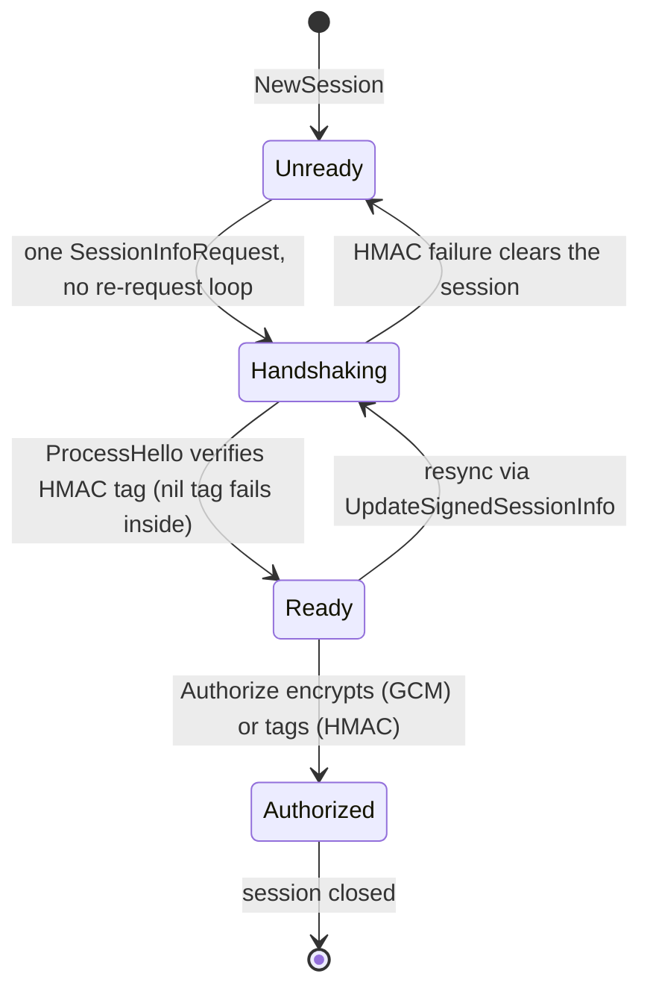

# tesla-local-control/vehicle-command-seth - legacy deep dive

## 1. Provenance

| Field | Value |
| --- | --- |
| Submodule path | `legacy/tesla-local-control-vehicle-command-seth` |
| Pinned gitlink SHA | `bd191bbf33d01615da2c98314b87bdccf142c484` (`git ls-files -s`: `160000 bd191bbf33d01615da2c98314b87bdccf142c484 0`) |
| `rev-parse HEAD` | `bd191bbf33d01615da2c98314b87bdccf142c484` - matches gitlink |
| Worktree status | `git status --porcelain` empty (clean) |
| Last commit | `bd191bb Removed unnecessary code` (2023-12-23, Emanuele Iannone) |
| Upstream URL | `https://github.com/tesla-local-control/vehicle-command-seth` (origin fetch + push) |
| License | Apache-2.0 (`LICENSE:2-3`) |
| Language / module | Go 1.20 (`go.mod:3`); module path kept as `github.com/teslamotors/vehicle-command` (`go.mod:1`) - not renamed by the vendor |
| Analysis date | 2026-11-21 |
| Fork base | upstream commit `e1c70d9` ("fix typos (#97)", 2023-12-11); repo delta over base = **1 commit, 1 file, 3 deleted lines**: `internal/authentication/native.go` (`git show bd191bb --stat`) |
| Repo identity (key finding) | Pinned HEAD is **upstream's own mainline commit**: tree hash `21917b0ec53c794f1621f22e46525d6d1f02b76a` is byte-identical to `git -C legacy/teslamotors-vehicle-command rev-parse bd191bb^{tree}`; `merge-base --is-ancestor bd191bb` succeeds against BOTH pinned parents (`0a582da`, `bb9f0a2`); `bd191bb` sits on the teslamotors first-parent chain. This is a frozen Dec-2023 vendored snapshot of teslamotors/vehicle-command, not a source-divergent fork: 136 commits behind the teslamotors pin, ~13 months behind the tesla-local-control fork's base (`ebad42a`, 2025-01-27) |
| Cross-references | `docs/legacy/teslamotors-vehicle-command.md` (upstream proper, pinned `0a582da430c4aca6d397fb6cbed5b4d6bb380125`); `docs/legacy/tesla-local-control-vehicle-command.md` (fork of the same upstream, pinned `bb9f0a2e23584741ebbd54df50d6fe733d3cfc3f`, base `ebad42a`). This doc analyzes the DELTAS of the seth snapshot against BOTH and only re-reads inherited code where this snapshot's own state had to be cited |
| Frontmatter note | The replaced doc had **no YAML frontmatter** (line 1 was `# tesla-local-control/vehicle-command-seth`) and **no `## Upstream (...)` sections** - nothing to preserve verbatim, none invented. Pre-replace claims are cited below as `git show HEAD:docs/legacy/tesla-local-control-vehicle-command-seth.md` (the replaced summary still exists in git history). The replaced file on disk used CRLF endings; this rewrite uses LF |
| Line-ending caveat for tooling | The submodule working tree is checked out with `core.autocrlf=true` (blobs are LF, working files are CRLF), so `gofmt -l` from this Windows checkout flags every file spuriously. Formatting claims below rest on git blobs, not the working tree |

Files read in the seth snapshot (line ranges):

- Repo-identity evidence: `git show bd191bb` (FULL-READ of the 3-line hunk + stat), `git log` (33 commits, root `7f69552` 2023-10-09, subjects + authors + dates), tree-hash and ancestry comparisons against both pinned parents (executed, outputs in section 3).
- Build/tooling (FULL-READ): `Makefile:1-19`, `check-all.sh:1-17`, `.github/workflows/build.yml:1-26`, `go.mod:1-33`, `README.md:1-252`, `LICENSE:1-5` (RANGE-CITED, standard Apache-2.0 text), `SECURITY.md:1-4` (RANGE-CITED).
- Crypto core (FULL-READ): `internal/authentication/native.go:1-203`, `crypto.go:1-66`, `ecdh.go:1-17`, `peer.go:1-80`, `metadata.go:1-84`, `verifier.go:1-299`, `signer.go:1-211`, `dispatcher.go:1-18` (authentication), `internal/log/logger.go:1-64`.
- Session/router (FULL-READ): `internal/dispatcher/dispatcher.go:1-462`, `session.go:1-126`, `receiver.go:1-54`, `pkg/protocol/error.go:1-258`.
- Transport (FULL-READ): `pkg/connector/connector.go:1-70`, `pkg/connector/ble/ble.go:1-192`, `device_linux.go:1-10`, `device_darwin.go:1-10`.
- Protocol schema (FULL-READ): `pkg/protocol/protobuf/universal_message.proto:1-95`, `signatures.proto:1-82`, `keys.proto:1-16`; `pkg/protocol/domains.go:1-16`.
- Vehicle builders (FULL-READ): `pkg/vehicle/security.go:1-300`, `vcsec.go:1-227`, `actions.go:1-117`, `vehicle.go:1-261`.
- Tests: `internal/authentication/verifier_test.go:553-632` (`TestSlidingWindow`, read in full). Test-function inventory per file via `git grep -c '^func Test'` (14 files, 89 functions).
- Executed builds (go1.26.4, 2026-11-21): `GOOS=linux go build ./...` -> exit 0; `GOOS=windows go build ./pkg/connector/ble/` -> `ble.go:131:17: undefined: newDevice` (exit 1).
- Grep-level only (listed, bodies not read): `cmd/tesla-control/commands.go:164-708` (39 command-map keys), `pkg/cli/config.go:107,183`, `pkg/cli/keyring.go:16-18`.
- Our counterpart (for parity rows): `firmware/lib/vehicle/ble/msg.h` (targeted ranges `:85-134,438-467`), `feature/session.h:100-119,140-189,215-249`, `feature/key.h:15-34`, `handler/dispatch.h:33-46`, `firmware/lib/io/ble/esp32/ble_client.h:14-31,110-124,188-197` - all re-read this pass; remaining our-side context (e.g. `msg.h` signature-submessage lines) is cross-referenced from the two parent deep dives.

Files explicitly NOT read: all generated `*.pb.go`; `pkg/protocol/protobuf/{car_server,common,errors,vehicle,vcsec}.proto` (only `universal_message`, `signatures`, `keys` proto sources were load-bearing for the delta claims); `pkg/vehicle/{charge,climate,infotainment}.go`; `cmd/*` bodies; `pkg/proxy/{command,proxy}.go` bodies (negative greps only); `pkg/account/*`, `pkg/cache/*` bodies; `pkg/cli/{config,keyring}.go` bodies; `pkg/connector/inet/inet.go`; `examples/*`; `internal/authentication/error.go` body; all test-data PEM fixtures; all test bodies except `TestSlidingWindow`; `pkg/vehicle/vehicle_mock_test.go`.

Evidence grades: **CODE-READ**, **TEST-READ**, **CAPTURE**, **SUMMARY-ONLY**, **UNVERIFIED**. Exactly one TEST-READ exists (`verifier_test.go:553-632`); every other test suite was inventoried by count only and is graded UNVERIFIED. No CAPTURE evidence exists: this repo ships no recorded vehicle traffic. Compiler executions are described in prose inside the evidence map; they are not frame captures and are not graded CAPTURE.

## 2. Executive verdict

This repo is not a fork in any source-divergent sense: it is **teslamotors/vehicle-command itself, frozen at upstream commit `bd191bb` (2023-12-23)**, vendored under the tesla-local-control org under the name "vehicle-command-seth". Its single commit over its own base (`e1c70d9`, 2023-12-11) deletes three lines of dead code from `Exchange()` in `internal/authentication/native.go` - an HMAC-SHA256 KDF whose result was discarded - and that commit was **merged into upstream's mainline** (it is on the teslamotors first-parent chain and an ancestor of BOTH already-analyzed pinned parents, with byte-identical tree hash `21917b0e`). Consequence: there are **zero seth-specific code deltas to analyze, port, or avoid**; the entire delta against both parent docs is the snapshot's AGE. What the age means: this tree predates the `window.go` refactor, response encryption with its per-request response replay window (`856a76e`, 2024-10-21), the one-way clock correction (`d49bf21`), nonce-length enforcement (`777b18e`/`1381b44`), the `handle`/`flags` SessionInfo fields, JWT/Schnorr/`tesla-jws`, managed-charging, Docker, golangci, MTU exchange, and even `pkg/protocol/protocol.md` (the spec landed two days after this base) - so it **must not be cited as a protocol reference**; both pinned parents are strictly better. Its only value is negative-confirmatory: the wire schema facts the parent docs relied on (envelope field numbers 6/7/10/13/14/15/50/51/52, key roles OWNER=2/CHARGING_MANAGER=6, the PIN-to-Drive Fleet-API gate, the HMAC-authenticated session-info handshake, the 32-entry sliding window with its exact bitmap semantics) were already stable in Dec-2023, which re-confirms the parent docs' parity rows - including the standing contradiction that our `key.h:22-23` role constants (4/5) request Fleet Manager / Vehicle Monitor instead of Owner / Charging Manager. The old summary's "minimal fork by Seth Terashima" story is contradicted on every checkable attribute (section 6); the whole tree compiles cleanly on Linux, unlike the tesla-local-control fork's broken HEAD.

## 3. Evidence map

| Source file | Lines | What it proves | Grade |
| --- | --- | --- | --- |
| `git show bd191bb` | diff hunk + stat | The repo's only own commit deletes 3 lines from `native.go` `Exchange()`: the dead `kdf := hmac.New(sha256.New, session.key)` / `kdf.Write([]byte(labelSessionInfo))` pair; commit message cites upstream issue #118 (network claim, UNVERIFIED) | CODE-READ |
| `git -C legacy/teslamotors-vehicle-command rev-parse bd191bb^{tree}` vs seth `HEAD^{tree}` | - | Both return `21917b0ec53c794f1621f22e46525d6d1f02b76a` - byte-identical trees; seth pinned HEAD **is** upstream code | CODE-READ (executed comparison) |
| `merge-base --is-ancestor bd191bb 0a582da` (teslamotors pin) and `... bb9f0a2` (local-control pin) | - | Both exit 0: the seth HEAD commit is contained in BOTH already-analyzed parents; nothing seth-specific exists for them to lack | CODE-READ (executed comparison) |
| `git log --first-parent --oneline 0a582da` (teslamotors submodule) | position of `bd191bb`, `e1c70d9` | Both on upstream's first-parent chain - upstream fast-forward-merged the dead-code cleanup; 136 commits follow it at the teslamotors pin | CODE-READ |
| File-list comparison vs `legacy/tesla-local-control-vehicle-command` (`git ls-files` both) | - | Seth tree is a strict file-subset of the local-control tree (0 files only-in-seth); missing: `window.go`+`window_test.go`, `jwt.go`, `internal/schnorr/*`, `cmd/tesla-jws/*`, `protocol.md`, `doc/*`, Docker trio, `.golangci.yml`, `publish.yml`, `device_windows.go`, `state.go`, `security_test.go`, managedcharging, 8 more test files | CODE-READ |
| `GOOS=linux go build ./...` (go1.26.4, executed 2026-11-21) | - | exit 0 - the full snapshot compiles on Linux (contrast: tesla-local-control fork HEAD cannot build its BLE package) | CODE-READ (compiler output) |
| `GOOS=windows go build ./pkg/connector/ble/` | - | `ble.go:131:17: undefined: newDevice` - no Windows BLE file exists at this vintage; package does not compile for GOOS=windows | CODE-READ (compiler output) |
| `internal/authentication/native.go` | 65-69, 71-73, 75-87 | Live subkey derivation `HMAC-SHA256(K, label)` in `subkey()`, exposed via `NewHMAC`; `SessionInfoHMAC` hashes {SIGNATURE_TYPE, PERSONALIZATION, CHALLENGE, info} - the dead `kdf` in `Exchange` computed the same subkey and threw it away (now removed) | CODE-READ |
| `internal/authentication/native.go` | 93-109, 111-135 | Static-key P-256 ECDH: `elliptic.Unmarshal`, point-at-infinity rejected (`:101-103`), shared X big-endian-padded, `K = SHA1(sharedX)[:16]` AES-128 (`:121-123`); `Exchange` has no other derivation | CODE-READ |
| `internal/authentication/crypto.go` | 12-22, 50 | Labels "session info"/"authenticated command"; `counterMax=0xFFFFFFFF`, `epochIdLength=16`, `maxSecondsWithoutCounter=30`, `windowSize=32` (comment "Verifier.windowSize is uint64, so must be ≤ 64" - references a struct field that exists at `verifier.go:21` even though `window.go` does not exist in this tree); `epochLength = 1<<30 s` | CODE-READ |
| `internal/authentication/verifier.go` | 142-178, 186-227 | Command verification: switch over GCM/HMAC personalized data; sliding window applied **only when counter > 0** (`:170`); `updateSlidingWindow` is inline in this file (no `window.go`): equal-counter reject, age > 32 reject, bit-set reject, forward-shift sets `shiftCount-1` (`:194-226`) | CODE-READ |
| `internal/authentication/verifier.go` | 18-22, 62-73, 266-299 | `Verifier{Peer, lock, window uint64}`; epoch rotation only when `timeZero` zero / counter max / `timestamp() > epochLength` - **no wall-clock correction** (`adjustClock` does not exist at this vintage); domain/epoch/expiry/TTL checks incl. counter=0 TTL cap | CODE-READ |
| `internal/authentication/verifier_test.go` | 553-632 | `TestSlidingWindow` - 7 table cases with exact expected {counter, window, ok}: forward+skips, far jump clears window, in-window accept, in-window duplicate reject, out-of-window reject, equal-counter reject | TEST-READ |
| `internal/authentication/signer.go` | 49-62, 71-82, 99-112, 117-130 | `NewAuthenticatedSigner` verifies HMAC tag over {verifierName, challenge, encodedInfo} before use; `ImportSessionInfo` sets `timeZero` unconditionally (`:80`) - **no clock-rollback rejection**; `UpdateSessionInfo` silently ignores older `ClockTime` instead of erroring | CODE-READ |
| `internal/authentication/peer.go` + `metadata.go` | 34-71; 34-56, 80-84 | Canonical TLV `tag||len||value`, uint32 big-endian, increasing tags, 255-byte cap, `TAG_END` + message hashed; AAD = metadata checksum; flags only when non-zero (`peer.go:66-68`) | CODE-READ |
| `internal/dispatcher/dispatcher.go` | 20-21, 66-92, 145-181 | One-shot `StartSession` (single `RequestSessionInfo`, waits on recv or ctx - no periodic re-request); `checkForSessionUpdate` logs "Discarding unauthenticated session info" at `:154` **without returning** - a nil tag continues to `ProcessHello` and is rejected only by the HMAC check inside | CODE-READ |
| `internal/dispatcher/dispatcher.go` + `receiver.go` | 183-246; 10-16, 50-53 | RX drop rules (missing source, bad UUID length, missing destination, bad address length, no handler); receiver-queue overflow drops (`:241-245`); freshness gate = `handler.expired()` vs `sessionInfoRequestTimeout = 5 s` on request age - there is **no `maxLatency`/`AllowedLatency` vehicle-clock gate anywhere in this tree** (negative grep) | CODE-READ |
| `pkg/connector/ble/ble.go` | 17, 20, 24-26, 49-51, 57-77, 84-92, 94-113, 119-192 | 2-byte BE length prefix (`:100`), cap 1024 drop+clear (`:59-63`), **fixed 20-byte chunks** (`:102`, no MTU exchange - negative grep), 1 s chunk-gap clear (`:85-87`), inbox depth 5 (`:172`), RetryInterval 1 s, scan filter = Connectable + local-name `S%02xC` where digest = SHA1(VIN)[:8] (`:139-148`), single global device/`mu`, no scan retry loop, no `ErrMaxConnectionsExceeded` | CODE-READ |
| `pkg/connector/ble/device_{linux,darwin}.go` | 8-10 both | Bare `linux.NewDevice()` / `darwin.NewDevice()` - no scan params, no timeouts, no HCI selection (all added later); no `device_windows.go` exists | CODE-READ |
| `pkg/connector/connector.go` | 11-20, 23, 26, 29-62, 64-70 | AuthMethod None/GCM/HMAC; `BufferSize=5`; `MaxResponseLength=100000`; Connector interface has **no `AllowedLatency()`** method at this vintage; `FleetAPIConnector` superset exists | CODE-READ |
| `pkg/protocol/protobuf/universal_message.proto` | 10-14, 30-56, 64-68, 70-72, 74-94 | Domains 2/3; MessageFault enum ends at 23; `SessionInfoRequest{public_key=1, challenge=2}`; Flags enum has **only `FLAG_USER_COMMAND=0`** (no `FLAG_ENCRYPT_RESPONSE` - negative grep); RoutableMessage to=6/from=7/payload{10,14,15}/sig=13/status=12/request_uuid=50/uuid=51/flags=52, reserved 1-5/11/16-40 - **field numbers identical to both pinned parents** | CODE-READ |
| `pkg/protocol/protobuf/signatures.proto` | 8-19, 21-28, 37-43, 49-64, 76-82 | Tag enum 0-7 + TAG_END=255; SignatureType 0/5/6/8 only (no detached types); `AES_GCM_Personalized{epoch=1,nonce=2,counter=3,expires_at=4 fixed32,tag=5}` in SignatureData field 5; HMAC personalized in field 8; `SessionInfo{counter=1,publicKey=2,epoch=3,clock_time=4,status=5}` - **no `handle`, no `flags`** (negative grep; both parents have handle=6, teslamotors also flags=7) | CODE-READ |
| `pkg/protocol/protobuf/keys.proto` | 7-16 | `ROLE_NONE=0, SERVICE=1, OWNER=2, DRIVER=3, FM=4, VEHICLE_MONITOR=5, CHARGING_MANAGER=6` - identical values to both pinned parents (local-control base; no GUEST here either) | CODE-READ |
| `pkg/vehicle/security.go` | 138-160, 178-190, 265-300 | `SetPINToDrive` hard-gated to `FleetAPIConnector` (`:145-147`) - the parent docs' "never port onto BLE" gate already exists at this vintage; no `IsValidPIN` validator yet; `AddKey` requires P-256 and maps via `addKeyPayload`; `SendAddKeyRequest` rejects Fleet-API connectors with `ErrRequiresBLE` (`:282-284`) | CODE-READ |
| `pkg/vehicle/vcsec.go` | 23-62, 85-105, 126-150 | `addKeyPayload`: isOwner -> `ROLE_OWNER` else `ROLE_DRIVER`; VCSEC reply handling: WAIT -> `ErrBusy`, ERROR -> whitelist info else `ErrUnknown`; retry loop per `RetryInterval` | CODE-READ |
| `pkg/vehicle/actions.go` | 82-95 | `VentWindows` already exists at this vintage (`VehicleControlWindowAction_Vent`) | CODE-READ |
| `pkg/protocol/error.go` | 32-54, 118-131, 196-205, 225-258 | Error taxonomy incl. `ErrRequiresBLE`, `ErrRequiresEncryption`, `ErrKeyNotPaired`; retriable fault codes (BUSY, TIMEOUT, INVALID_SIGNATURE, INVALID_TOKEN_OR_COUNTER, INTERNAL, INCORRECT_EPOCH, TIME_EXPIRED, TIME_TO_LIVE_TOO_LONG); UNKNOWN_KEY_ID -> `ErrKeyNotPaired` mapping | CODE-READ |
| `internal/log/logger.go` | 13-21, 39-43, 45-51 | Level enum None/Error/Warning/Info/Debug; `logLevel()` unexported; stderr with RFC3339 - the same file the tesla-local-control fork's debris broke; clean here | CODE-READ |
| `README.md` | 60-63, 188-195, 199-244 | "tested with Go 1.20" (matches `go.mod:3` - no README-vs-go.mod contradiction at this vintage, unlike the teslamotors pin); "Everything except BLE should run on Windows" (BLE unsupported - matches the compile failure); TLS example uses secp521r1 (upstream later moved its example to P-384); REST proxy usage, no Docker, no `TESLA_CACHE_FILE` mention (env var exists only in `pkg/cli/config.go:107,183`) | CODE-READ |
| `go.mod` | 1, 3, 6-11, 33 | Module unrenamed; `go 1.20`; deps: keyring v1.2.2, go-ble/ble (2022-02 snapshot), shlex, term v0.5.0, protobuf v1.28.1 - **no golang-jwt, no saferith, no jose2go as direct deps** (those arrive with JWT/Schnorr later); `replace github.com/JuulLabs-OSS/cbgo => github.com/tinygo-org/cbgo v0.0.4` | CODE-READ |
| `.github/workflows/build.yml`, `Makefile`, `check-all.sh` | 18, 20-23, 25-26; 3-11; 5-13 | CI: Go 1.20.12, `make format && git diff --exit-code` then `make test`; **no golangci-lint step** (`.golangci.yml` added upstream `29fe990`, post-base); Makefile `set-version` writes `pkg/account/version.txt` from git tags (file contains `0.0.1`) | CODE-READ |
| `pkg/cli/keyring.go` + `pkg/cli/config.go` | 16-18; 107, 183 | Keyring service `com.tesla.auth`, entries `vehicleCommandKey`/`oauthtoken`; `TESLA_CACHE_FILE` env + `-session-cache` flag exist at this vintage (README does not document them) | CODE-READ (grep-level) |
| `cmd/tesla-control/commands.go` | 164-708 | 39 CLI commands incl. `add-key-request`, `session-info`, `charging-schedule`; **no `vent-windows` CLI command, no PIN-to-Drive** (both absent at this vintage); bodies not read | UNVERIFIED (map keys only) |
| Negative greps (run 2026-11-21, all exit 1 / no output) | - | `ExchangeMTU`, `ErrReplayedResponse`, `nonceLength`, `adjustClock`, `MaxBytesReader`, `FLAG_ENCRYPT_RESPONSE`, `handle` in signatures.proto, `grpc`, `tesla-local-control`, `mcp2515|CANFrame|can_id|DLC`: none exist anywhere in this tree | CODE-READ (negative) |
| Old summary (`git show HEAD:docs/legacy/tesla-local-control-vehicle-command-seth.md`) | 4-6, 10, 39-41, 45-50, 52-55 | Pre-replace claims (license/URL/language, "minimal fork by Seth Terashima", "core focus CLI only", comparison table, relevant files) | SUMMARY-ONLY |

No TEST-READ evidence exists beyond `verifier_test.go:553-632`; every other suite is count-only (UNVERIFIED). No CAPTURE evidence exists in this repo.

## 4. Architecture and build surface

- **Module:** single Go module `github.com/teslamotors/vehicle-command` (unrenamed, `go.mod:1`); Go 1.20; deps limited to go-ble/ble, protobuf v1.28.1, 99designs/keyring, shlex, term. Build via Makefile / CI (Go 1.20.12: gofmt-diff gate + `go test` + `go vet`); no Docker, no golangci, no publish workflow at this vintage. The full tree compiles on Linux with a modern toolchain (`GOOS=linux go build ./...` exit 0, go1.26.4).
- **Entry points:** `cmd/tesla-control` (39 commands), `cmd/tesla-keygen`, `cmd/tesla-http-proxy` (REST relay, `server.go` variant), `cmd/tesla-auth-token`; `examples/ble`, `examples/unlock`. No `cmd/tesla-jws` (JWT signing arrives later). Bodies not read.
- **Shared core:** `pkg/protocol` (domains, error taxonomy - no `protocol.md` spec file exists), `internal/authentication` (static-ECDH Signer/Verifier, canonical TLV metadata, inline sliding window), `internal/dispatcher` (per-domain sessions, reply routing), `internal/log` (leveled dev logger).
- **Platform port:** `pkg/connector/ble` - `ble.go` common (single global device, fixed-20 chunking, no MTU exchange); `newDevice()` per-OS: Linux bare `linux.NewDevice()`, Darwin bare `darwin.NewDevice()`. **No Windows file**: the package does not compile for GOOS=windows (`ble.go:131:17: undefined: newDevice`, executed). Both pinned parents carry `device_windows.go` (later upstream addition).
- **What this snapshot lacks vs BOTH parents (all base-age, none of it fork policy):** `window.go`/`window_test.go` as files (the bitmap logic lives inline in `verifier.go`), response encryption + per-request response replay window (`ErrReplayedResponse`), `Verifier.Encrypt`, `adjustClock` one-way clock correction, nonce-length enforcement, detached AES-GCM, `SessionInfo.handle`/`flags`, `FLAG_ENCRYPT_RESPONSE`, JWT/Schnorr/`tesla-jws`, managed-charging proto, `pkg/vehicle/state.go`, `IsValidPIN`, Docker/golangci/publish CI, `doc/` diagrams, `protocol.md`, `AllowedLatency()` freshness gate, MTU-exchange chunking, the scan/connect retry state machine, `GetAvailableHCI`-style HCI handling (the tesla-local-control fork's own addition on the newer base - absent here because the pristine old base had neither).
- **Dependency boundary:** `internal/` unimportable outside the module; `pkg/` is the public API; transport abstracted by `connector.Connector` (no `AllowedLatency()` at this vintage - both parents require it).

```mermaid
flowchart LR
    CLI["tesla-control CLI / examples / proxy"] --> Build["pkg/vehicle builders<br/>vcsec.go, actions.go, security.go"]
    Build --> Sign["Signer.Encrypt / AuthorizeHMAC<br/>AES-GCM + counter + metadata AAD<br/>or HMAC personalized"]
    Sign --> Disp["Dispatcher.Send<br/>session-ready gate, one-shot handshake"]
    Disp --> BLE["pkg/connector/ble<br/>single global device, no retry scan"]
    BLE --> GATT["GATT 00000211 / 0212 / 0213<br/>2-byte BE length prefix<br/>fixed 20-byte chunks, no MTU exchange"]
    GATT --> Vehicle["Tesla vehicle"]
    Vehicle --> RX["Connection.rx reassembly<br/>1024 cap, 1 s chunk timeout, inbox 5"]
    RX --> Route["Dispatcher.process<br/>UUID/address routing, drop rules"]
    Route --> Hello["checkForSessionUpdate -> ProcessHello<br/>HMAC tag check (no early return on nil tag)"]
    Hello --> Ready["session readySignal"]
    Route --> Caller["caller receiver queue (depth 10)"]
```



## 5. Mechanism catalogue

### 5.1 Repo identity: one upstream-merged dead-code removal

- **Claim (old summary):** "Fork of Tesla's official vehicle-command by Seth Terashima under tesla-local-control org. A minimal fork with focus on core functionality without doc/ directory" (`git show HEAD:docs/legacy/tesla-local-control-vehicle-command-seth.md:10`).
- **Code path:** `bd191bb` diff: `internal/authentication/native.go` `Exchange()` loses `kdf := hmac.New(sha256.New, session.key)` + `kdf.Write([]byte(labelSessionInfo))` - a value never read. The live equivalent survives in `subkey()` (`native.go:65-69`).
- **Frame spec:** n/a (dead host-side code).
- **Gates and timing:** none.
- **State machine:** None found (single commit).
- **Tests:** None found - and none needed for a deletion of dead code.
- **Evidence grade:** CODE-READ.
- **Verdict:** CONTRADICTED as a "fork" - the commit is upstream's own mainline commit (tree hash identical to teslamotors `bd191bb^{tree}`; ancestor of both pinned parents; on the first-parent chain). "Minimal fork ... without doc/" is base-age, not policy: upstream at `e1c70d9` had no `doc/` either.
- **Adapt to TeslaCANModder?** no impact - there is nothing seth-specific to port; both pinned parents already contain this commit.

### 5.2 Static-key ECDH handshake with HMAC-authenticated session info (Dec-2023 state)

- **Claim (parent docs):** static-key ECDH, `K = SHA1(BIG_ENDIAN(sharedX))[:16]`, session-info reply authenticated by HMAC over {name, challenge, info} (`docs/legacy/teslamotors-vehicle-command.md` §5.2; `docs/legacy/tesla-local-control-vehicle-command.md` §5.5).
- **Code path:** `Dispatcher.StartSession` (`dispatcher.go:66-92`) sends ONE `SessionInfoRequest` and waits → `checkForSessionUpdate` (`:145-181`) → `session.ProcessHello` (`session.go:107-126`) → `NewAuthenticatedSigner` (`signer.go:49-62`) verifies the tag via `SessionInfoHMAC` (`native.go:75-87`) → `readySignal` closed.
- **Frame spec:** request `SessionInfoRequest{public_key=1, challenge=2}` (`universal_message.proto:64-68`); reply `SessionInfo{counter=1, publicKey=2, epoch=3, clock_time=4, status=5}` (`signatures.proto:76-82`) - **no `handle`, no `flags`** at this vintage; `HMAC_Signature_Data{tag=1}` rides in SignatureData field 6 (`signatures.proto:45-47,61`).
- **Gates and timing:** freshness = request-age only: piggybacked session info is skipped when the receiver is older than `sessionInfoRequestTimeout = 5 s` (`dispatcher.go:237`, `receiver.go:50-53`). There is **no vehicle-clock latency gate** (`maxLatency`/`AllowedLatency` do not exist in this tree - negative grep). `ImportSessionInfo` accepts any `ClockTime` (`signer.go:80`); `UpdateSessionInfo` ignores older clocks silently (`:103-110`) - the wrong-time rejection both parents describe does not exist yet.
- **State machine:**



- **Tests:** suite exists at `internal/dispatcher/dispatcher_test.go` (16 test functions, bodies not read).
- **Evidence grade:** CODE-READ.
- **Verdict:** CONFIRMED for this vintage, with three dated weakenings vs both parents: one-shot handshake (no periodic re-request), no clock-rollback rejection, no clock-latency freshness gate.
- **Adapt to TeslaCANModder?** never port the core (our `session.h` is ephemeral ECDH + HKDF, a different protocol); the actionable gap is unchanged from the parent docs - our `establish` accepts session-info fields with no tag check (`session.h:103-112`). Cite the newer snapshots, not this one, as the reference.

### 5.3 Inline command-verification sliding window (pre-refactor)

- **Claim (parent docs):** 32-entry sliding window, exact bitmap semantics (`docs/legacy/teslamotors-vehicle-command.md` §5.6; local-control §5.7).
- **Code path:** `Verifier.Verify` (`verifier.go:142-178`) → window check only when `counter > 0` (`:170-175`) → `updateSlidingWindow` inline at `:186-227` (no `window.go` file in this tree - negative inventory).
- **Frame spec:** uint32 counter; `windowSize = 32` (`crypto.go:21`); equal-counter reject (`:194-197`); `age > 32` reject (`:199-206`); already-set bit reject (`:207-210`); forward jump shifts and sets `shiftCount-1` (`:217-226`); `counterMax = 0xFFFFFFFF` (`crypto.go:18`).
- **Gates and timing:** counter=0 disables the window check but caps remaining TTL at `maxSecondsWithoutCounter = 30 s` (`verifier.go:287-297`); epoch mismatch/expiry/TTL faults returned as `InvalidSignatureError` with resync info (`verifier.go:51-60`).
- **State machine:** None found with 3+ states (pure bitmap function; the epoch/clock guards rotate in `rotateEpochIfNeeded` `:62-73` but that is a 2-branch refresh, not a state machine).
- **Tests:** `TestSlidingWindow` (`verifier_test.go:553-632`) - 7 cases with exact expected `{counter, window, ok}`, incl. forward jump with skips, far jump (window clears), in-window accept/duplicate, out-of-window, equal-counter. **No first-use rule**: a fresh Verifier (counter=0) rejects a first message carrying counter=0; both parents' `SlidingWindow.Update` accepts any first counter unconditionally (`legacy/tesla-local-control-vehicle-command/internal/authentication/window.go:58-63`, read this pass for comparison).
- **Evidence grade:** TEST-READ (code: CODE-READ).
- **Verdict:** CONFIRMED - same bitmap math as both parents; deltas are location (inline), the missing first-use rule, and the absence of the separate response window (`ErrReplayedResponse` does not exist here).
- **Adapt to TeslaCANModder?** candidate for a future PR - unchanged top security gap (our `session.h:221` only increments a TX counter). Port the MODERN shape (factored helper + first-use rule + response window), not this vintage.

### 5.4 BLE length-prefixed framing and SHA1(VIN) scan (Dec-2023 state)

- **Claim (parent docs):** 2-byte BE prefix, cap 1024, `S%02xC` local name, 1 s chunk timeout (`docs/legacy/tesla-local-control-vehicle-command.md` §5.3-5.4).
- **Code path:** `Connection.Send` (`ble.go:94-113`) writes the BE prefix (`:100`) then chunks at **fixed `blockLength := 20`** (`:102`); `rx`/`flush` (`:84-92`, `:57-77`) reassemble, drop+clear over-cap frames (`:59-63`); `NewConnection` (`:119-192`) globs nothing - it scans once via `ble.Connect(ctx, filter)` (`:151`) with filter = `Connectable() && LocalName() == "S"+hex(SHA1(VIN)[:8])+"C"` (`:139-148`).
- **Frame spec:** `maxBLEMessageSize = 1024` (`:17`); GATT `00000211/00000212/00000213` (`:24-26`); inbox `make(chan []byte, 5)` (`:172`).
- **Gates and timing:** `rxTimeout = 1 s` (`:20`); `RetryInterval() = 1 s` (`:49-51`); single global `device` + `mu` (`:29-32`) - no connection cache, no scan retry loop, no `ErrMaxConnectionsExceeded`, no MTU exchange (all negative greps).
- **State machine:** None found - the connect path is linear (device → connect → discover → subscribe), unlike both parents' retry state machine (scan-refactor wave of 2025-01).
- **Tests:** None found - zero `*_test.go` under `pkg/connector/ble/`.
- **Evidence grade:** CODE-READ.
- **Verdict:** CONFIRMED - this is the pre-MTU-exchange variant both parent docs already describe from the newer forks' bases; our side's MTU-3 chunking matches upstream's LATER behavior, not this one.
- **Adapt to TeslaCANModder?** candidate for constants/guard comparison only, after capturing our own link; nothing here is newer than what the parent docs already cover.

### 5.5 Session-info acceptance without an early return

- **Claim (parent docs):** "session info discarded when ... unauthenticated (tag nil)" (`docs/legacy/tesla-local-control-vehicle-command.md` §4/evidence map, citing its `dispatcher.go:189-205`).
- **Code path:** this snapshot's `checkForSessionUpdate` (`dispatcher.go:145-181`): `tag == nil` → `log.Warning("[%02x] Discarding unauthenticated session info", ...)` at `:154` - **no `return`**; execution falls through to `session.ProcessHello(..., tag)` (`:175`) with the nil tag, and `NewAuthenticatedSigner`/`hmac.Equal` (`signer.go:54-60`) rejects. The newer base added the missing `return` (`legacy/tesla-local-control-vehicle-command/internal/authentication/../dispatcher/dispatcher.go:191-192`, verified by grep this pass).
- **Frame spec:** n/a (control flow).
- **Gates and timing:** unauthenticated info is still rejected, but via the crypto path and after the misleading "Discarding" log; the domain-registration gate (`:161-165`) and the 5 s request-age gate (`:237`) apply first.
- **State machine:** None found.
- **Tests:** none read at this vintage; the newer base's suite (`TestDiscardUnauthenticatedSessionInfo`) targets the fixed code.
- **Evidence grade:** CODE-READ.
- **Verdict:** PARTIAL - the guarantee holds (HMAC check), the documented mechanism ("discarded" at the dispatcher) does not exist yet at this vintage.
- **Adapt to TeslaCANModder?** no impact - the interesting bit for us is unchanged (authenticate session info at all; our `session.h:103-112` does not), and the modern upstream shape is the better reference.

### 5.6 PIN-to-Drive gate, AddKey roles, SendAddKeyRequest BLE gate (Dec-2023 state)

- **Claim (parent docs):** PIN-to-Drive is Fleet API, not BLE; add-key maps owner→ROLE_OWNER else ROLE_DRIVER (`docs/legacy/teslamotors-vehicle-command.md` §5.10/§5.9).
- **Code path:** `SetPINToDrive` (`security.go:144-160`) - `if _, ok := v.conn.(connector.FleetAPIConnector); !ok { return protocol.ErrRequiresEncryption }` (`:145-147`); `AddKey` (`:178-190`) → `addKeyPayload` (`vcsec.go:126-150`) → `PermissionChange{Key, KeyRole=ROLE_OWNER|ROLE_DRIVER}` + `MetadataForKey{KeyFormFactor}`; `SendAddKeyRequest` (`security.go:278-300`) - BLE-only, rejects Fleet-API connectors with `ErrRequiresBLE` (`:282-284`), NFC-card approval documented in the comment.
- **Frame spec:** roles from `keys.proto:7-16`: OWNER=2, DRIVER=3, FM=4, VM=5, CHARGING_MANAGER=6 - values identical to both pinned parents.
- **Gates and timing:** connector type only; **no `IsValidPIN` validator exists yet** (the 4-digit check both parents cite is a later addition).
- **State machine:** None found.
- **Tests:** `pkg/vehicle/security_test.go` does not exist at this vintage (negative inventory vs local-control tree).
- **Evidence grade:** CODE-READ.
- **Verdict:** CONFIRMED - both parent-doc conclusions hold at this vintage, including the standing our-side contradiction: `firmware/lib/vehicle/ble/feature/key.h:22-23` defines `ROLE_OWNER = 4` / `ROLE_CHARGING_MANAGER = 5`, which upstream (already in 2023) assigns to FLEET MANAGER and VEHICLE MONITOR.
- **Adapt to TeslaCANModder?** never port PIN-to-Drive onto BLE; **align** the `key.h` role constants to the upstream enum (transport-visible: walk `docs/checklists/can-review-checklist.md`, bench-capture before/after).

### 5.7 Canonical metadata TLV and HMAC subkeys

- **Claim (parent docs):** TLV `tag||len||value`, BE uint32, increasing tags, 255-byte cap, `TAG_END=255` before the message hash; subkeys `HMAC-SHA256(K, label)` with labels "session info"/"authenticated command" (`docs/legacy/teslamotors-vehicle-command.md` §5.3).
- **Code path:** `metadata.Add` (`metadata.go:34-50`) → `AddUint32` BE (`:52-56`) → `Checksum` (`:80-84`); `Peer.extractMetadata` (`peer.go:34-71`) adds SIGNATURE_TYPE/DOMAIN(bounds-checked 0-255)/PERSONALIZATION/EPOCH/EXPIRES_AT/COUNTER and FLAGS only when non-zero (`:66-68`); `NativeSession.subkey` (`native.go:65-69`); two command auth methods at this vintage: GCM (`signer.go:132-165`, AAD = `meta.Checksum(nil)` at `:158-159`) and HMAC-personalized (`signer.go:185-211`, tag over metadata + plaintext via `peer.hmacTag:74-80`).
- **Frame spec:** `Tag` enum 0-7 + `TAG_END=255` (`signatures.proto:8-19`); `AES_GCM_Personalized{epoch=1, nonce=2, counter=3, expires_at=4 fixed32, tag=5}` (`:37-43`) in SignatureData field 5; `HMAC_Personalized{epoch=1, counter=2, expires_at=3, tag=4}` (`:49-54`) in field 8.
- **Gates and timing:** expiry bounds-checked against `epochLength` (`peer.go:51-57`); nonce length NOT validated anywhere (negative grep - both parents enforce 12).
- **State machine:** None found (pure function).
- **Tests:** `metadata_test.go` (4 functions, bodies not read).
- **Evidence grade:** CODE-READ.
- **Verdict:** CONFIRMED - byte-for-byte the same canonicalization both parents describe; only the nonce-length enforcement is missing at this vintage.
- **Adapt to TeslaCANModder?** candidate as an idea + independent test oracle (unchanged from the parent docs; our `mbedtls_gcm_crypt_and_tag` passes no AAD, `session.h:240-244`).

## 6. Summary vs code contradiction table

Pre-replace claims are cited from `git show HEAD:docs/legacy/tesla-local-control-vehicle-command-seth.md` (line numbers of the replaced file). The replaced doc had no YAML frontmatter and no `## Upstream (...)` sections; both facts are recorded here rather than edited into existence.

| # | Old summary claim | Code evidence | Verdict |
| --- | --- | --- | --- |
| 1 | "Fork of Tesla's official vehicle-command **by Seth Terashima** under tesla-local-control org" (`:10`) | The repo's only own commit `bd191bb` is authored by Emanuele Iannone (2023-12-23); Seth Terashima appears only as the author of five INHERITED upstream commits (`8e8fb14`, `c51a143`, `72860f9`, `12678f4`, `9c37f2a`, all pre-base); `bd191bb` is on the teslamotors first-parent chain with tree hash identical to upstream's | CONTRADICTED - the fork-delta author is not Seth Terashima, and the delta is upstream's own code; what "seth" refers to (his personal mirror, vendored by the org) is UNVERIFIED network context |
| 2 | "A minimal fork with focus on core functionality **without doc/ directory**" (`:10`) | `git show bd191bb --stat` = 1 file, 3 deleted lines, zero deletions of directories; upstream at base `e1c70d9` had no `doc/` and no `protocol.md` either (the spec landed `d7a3e30`, 2023-12-13, two days after the base) | CONTRADICTED - the fork deleted nothing but 3 dead lines; "without doc/" describes the 2023 upstream state, not a fork decision |
| 3 | "Core Focus: CLI tools only" (`:40`) | Full SDK present: `pkg/proxy` (REST relay), `pkg/account`, `pkg/cache`, `pkg/protocol` library, `examples/` - not read in full here but inventoried via `git ls-files`; only `cmd/` is CLI | CONTRADICTED |
| 4 | "Lightweight: No docker-compose or Dockerfile" (`:41`) presented as a fork characteristic | File absence is real (`git ls-files`), but Docker arrived upstream via `96af672` (2024, per the teslamotors pinned log) - after this base; the vendored snapshot simply predates it | CONTRADICTED as a fork attribute - base-age artifact |
| 5 | Comparison table differentiating seth as Docker No / Docs No / Linting No (`:45-50`) | `.golangci.yml` was added upstream `29fe990` (post-base, present in both pinned parents); at Dec-2023 NO upstream tree had linting or Docker; the table compares different upstream vintages and attributes vintage to fork policy | CONTRADICTED as a differentiator |
| 6 | The whole "Key Characteristics / Comparison / Relevant Files" section (`:37-55`) never mentions the repo's actual only change | The real delta is `bd191bb`: 3 dead-code lines removed from `Exchange()` (upstream-merged); the old doc's "key reference: cmd/ entry points" steers readers to the one part with zero delta | CONTRADICTED by omission - every load-bearing claim in the old doc points away from what the repo actually is |

Agreements (kept out of this table, see evidence map): URL (`:4` vs remote -v), license Apache-2.0 (`:5` vs `LICENSE:2-3`), language Go (`:6` vs `go.mod`). The old doc's architecture mermaid and directory sketch (`:12-35`) are shallow but not false. The old doc had no frontmatter - nothing was preserved and none was invented.

## 7. CAN frame and signal inventory

None found: this repo contains no CAN bus code - no MCP2515 driver, no frame decode/mutate/inject path, no DBC/JSON frame catalog. Negative anchor (run 2026-11-21, case-sensitive):

```text
git grep -nE 'mcp2515|CANFrame|can_id|DLC' .   -> no output (exit 1)
```

The BLE wire contract is the closest equivalent to a frame inventory; rows below are from this snapshot's own files (all CODE-READ). Rows identical to the parent docs are marked so the deltas are visible at a glance.

| Wire fact | Layout / value | Source | Grade |
| --- | --- | --- | --- |
| BLE datagram framing | 2-byte big-endian length prefix; RX drops a declared length over 1024 and clears the buffer; TX chunks at fixed 20 bytes (no MTU exchange) | `ble.go:100-102,59-63,17` | CODE-READ |
| GATT service and characteristics | `00000211-…` service, `…0212` write, `…0213` notify | `ble.go:24-26` | CODE-READ |
| Vehicle advertisement local name | `S` + lowerhex(SHA1(VIN)[:8]) + `C`; filter also requires `Connectable()` | `ble.go:139-148` | CODE-READ |
| Domain IDs | `DOMAIN_VEHICLE_SECURITY=2`, `DOMAIN_INFOTAINMENT=3` | `universal_message.proto:10-14` | CODE-READ |
| RoutableMessage envelope | to=6, from=7, payload oneof{bytes=10, session_info_request=14, session_info=15}, signature_data=13, status=12, request_uuid=50, uuid=51, flags=52; reserved 1-5/11/16-40 - **identical to both pinned parents** | `universal_message.proto:74-94` | CODE-READ |
| Command auth block (GCM) | `AES_GCM_Personalized{epoch=1, nonce=2, counter=3, expires_at=4 fixed32, tag=5}` in SignatureData field 5 | `signatures.proto:37-43,60` | CODE-READ |
| Command auth block (HMAC) | `HMAC_Personalized{epoch=1, counter=2, expires_at=3, tag=4}` in SignatureData field 8 - unencrypted-but-authenticated path for the proxy | `signatures.proto:49-54,62` | CODE-READ |
| SessionInfo reply | counter=1, publicKey=2, epoch=3, clock_time=4, status=5 - **no `handle`, no `flags`** (parents: handle=6; teslamotors also flags=7) | `signatures.proto:76-82` | CODE-READ |
| Key roles | NONE=0, SERVICE=1, OWNER=2, DRIVER=3, FM=4, VEHICLE_MONITOR=5, CHARGING_MANAGER=6 (no GUEST) - identical to both parents | `keys.proto:7-16` | CODE-READ |
| Metadata TLV | `tag||len||value`, BE uint32, increasing tags, 255-byte cap, `TAG_END=255` appended before the message is hashed | `metadata.go:34-56,80-84`; `signatures.proto:18` | CODE-READ |
| Anti-replay counter | uint32, `counterMax=0xFFFFFFFF`, 32-entry window (inline in verifier), 30 s no-counter TTL cap, window skipped when counter=0 | `crypto.go:18-21`; `verifier.go:170-177,186-227,287-297` | CODE-READ |
| MessageFault codes on RX | enum ends at 23 (`COMMAND_REQUIRES_ACCOUNT_CREDENTIALS`); parents extend to 28 | `universal_message.proto:30-56` | CODE-READ |
| Message flags | only `FLAG_USER_COMMAND=0` exists - **no `FLAG_ENCRYPT_RESPONSE`** (response encryption absent) | `universal_message.proto:70-72` | CODE-READ |

No CAPTURE evidence exists: every row comes from reading code and schema files, not recorded vehicle traffic.

## 8. Constants and tuning table

| Constant | Value | Source | Meaning | Grade |
| --- | --- | --- | --- | --- |
| `maxBLEMessageSize` | 1024 | `ble.go:17` | datagram cap; larger declared length drops the frame (`:59-63`) | CODE-READ |
| TX chunk size | 20 bytes (fixed) | `ble.go:102` | pre-MTU-exchange chunking; parents' bases and our side both moved past this | CODE-READ |
| `rxTimeout` | 1 s | `ble.go:20` | inter-chunk gap that clears partial reassembly (`:85-87`) | CODE-READ |
| inbox depth | 5 | `ble.go:172`; `connector.go:23` | queued datagrams before a silent drop (`ble.go:67-72`) | CODE-READ |
| `RetryInterval()` | 1 s | `ble.go:49-51` | connector-recommended retransmit/handshake interval | CODE-READ |
| `MaxResponseLength` | 100000 | `connector.go:26` | response byte cap every connector must support | CODE-READ |
| `sessionInfoRequestTimeout` | 5 s | `dispatcher.go:20` | the ONLY session-info freshness gate at this vintage: request-age (`receiver.go:50-53`) | CODE-READ |
| `commandTimeout` | 5 s | `dispatcher.go:21` | command lifetime when the caller sets no deadline (`session.go:59,61`) | CODE-READ |
| `receiverBufferSize` | 10 | `receiver.go:10` | per-request reply queue before drop (`dispatcher.go:241-245`) | CODE-READ |
| `uuidLength` / `addressLength` | 16 / 16 | `receiver.go:13-15` | reply-routing key sizes | CODE-READ |
| `windowSize` | 32 | `crypto.go:21` | replay window depth; bitmap is uint64 so ceiling 64 | CODE-READ |
| `counterMax` | 0xFFFFFFFF | `crypto.go:18` | last valid command counter; rollover refused (`signer.go:171-173`) and forces epoch rotation (`verifier.go:63`) | CODE-READ |
| `epochIdLength` | 16 | `crypto.go:19` | epoch ID bytes | CODE-READ |
| `maxSecondsWithoutCounter` | 30 | `crypto.go:20` | max remaining TTL when counter is absent (`verifier.go:287-297`) | CODE-READ |
| `epochLength` | 1<<30 s | `crypto.go:50` | epoch rotation period (`var` for testability) | CODE-READ |
| `SharedKeySizeBytes` | 16 | `ecdh.go:11` | AES-128 key cut from SHA1(ECDH shared X) (`native.go:121-123`) | CODE-READ |
| metadata field cap | 255 | `metadata.go:41-43` | max bytes per authenticated TLV field | CODE-READ |
| subkey labels | "session info" / "authenticated command" | `crypto.go:12-15` | HMAC-SHA256 subkey derivation labels | CODE-READ |
| GCM nonce | `b.gcm.NonceSize()` (12), random, NOT length-validated on RX | `native.go:42-45`; negative grep `nonceLength` | deterministic enforcement absent; both parents added it later | CODE-READ |

No "simultaneous BLE connections = 3" row exists: that claim lives in `protocol.md`, which this tree does not have.

## 9. Failure modes and edge cases

None found for watchdog, bus-off, OTA, brownout, or reboot-state handling: host-side Go SDK. The failure paths that do exist:

| Failure | Handling code path | Tested? | Grade |
| --- | --- | --- | --- |
| BLE datagram declares length over 1024 | buffer cleared, frame dropped, connection stays up (`ble.go:59-63`) | untested - zero test files under `pkg/connector/ble/` | CODE-READ |
| Inter-chunk gap over 1 s | partial reassembly cleared on the next chunk (`ble.go:85-87`) | untested | CODE-READ |
| Inbound inbox full (5 slots) | datagram bytes consumed BEFORE the send attempt (`ble.go:67` advances the buffer), then silently dropped when the channel is full (`:68-72`) | untested | CODE-READ |
| Handshake request lost / vehicle silent | NO in-dispatcher re-request: `StartSession` sends one request and blocks on the receiver or ctx (`dispatcher.go:81-92`); recovery is SDK-level `Vehicle.StartSession` retry on error (`vehicle.go:134-152`); both pinned parents re-request every `RetryInterval` | suite exists (`dispatcher_test.go`, 16 functions) but bodies not read this pass | CODE-READ |
| Session info with nil tag | warning logged, **no early return**; rejected only inside `ProcessHello` → `NewAuthenticatedSigner` HMAC check (`dispatcher.go:152-175`; `signer.go:54-60`) | no test read; newer base's suite covers the fixed path | CODE-READ |
| Session info from unregistered domain | dropped with error log (`dispatcher.go:161-165`) | untested here | CODE-READ |
| Piggybacked session info older than 5 s (request age) | skipped via `handler.expired()` (`dispatcher.go:237`; `receiver.go:50-53`) | untested | CODE-READ |
| Wall clock jumped backwards | **no correction exists** - `adjustClock` absent; expiry is computed against `timeZero` (`peer.go:29-31`) and the verifier only rotates the epoch when `timestamp() > epochLength` (`verifier.go:62-73`); both parents' one-way fast-forward (`d49bf21`) is not here | untested | CODE-READ |
| Wall clock jumped forward | same path: commands can expire early; epoch rotation only on threshold | untested | CODE-READ |
| Session-info `ClockTime` rollback (import or resync) | NOT rejected: `ImportSessionInfo` sets `timeZero` from `generatedAt` unconditionally (`signer.go:80`); `UpdateSessionInfo` silently ignores older clocks (`:103-110`); both parents reject (`TestImportWrongTime` at their bases) | untested | CODE-READ |
| GCM nonce of unexpected length | not validated anywhere (negative grep); `Decrypt` trusts the wire nonce (`native.go:53-63`) | untested | CODE-READ |
| Counter replay / duplicate / out-of-window | inline sliding window rejects with `INVALID_TOKEN_OR_COUNTER` + signed resync info (`verifier.go:170-177,51-60`); counter=0 skips the window but caps TTL at 30 s (`:287-297`) | `TestSlidingWindow` (`verifier_test.go:553-632`) | TEST-READ |
| Command counter at 0xFFFFFFFF | `Encrypt` refuses with counter-rollover error (`signer.go:171-173`) | suite exists (15 signer tests), bodies not read | CODE-READ |
| VCSEC busy (WAIT) / legacy ERROR | WAIT → `ErrBusy` (retriable); ERROR → whitelist info else `ErrUnknown` (`vcsec.go:47-59`; `error.go:196-205`) | `vcsec_test.go` (3 functions), bodies not read | CODE-READ |
| Windows platform build | no `device_windows.go`: `GOOS=windows go build ./pkg/connector/ble/` fails `ble.go:131:17: undefined: newDevice` (executed); README:62-63 documents Windows BLE as unsupported | n/a (compiler-verified) | CODE-READ |
| Receiver queue full (10 slots) | reply dropped with error log, other responders unaffected (`dispatcher.go:241-245`) | suite exists, bodies not read | CODE-READ |

The untested paths cluster in `pkg/connector/ble/` (zero tests, same as both parents) and around the clock/rollback behaviors that upstream only hardened in 2024 - this snapshot is the "before" picture of those hardening commits.

## 10. Test coverage map

14 test files, 89 `^func Test` declarations (`git grep -c '^func Test'`, run 2026-11-21) - vs 24 files/113 functions at the tesla-local-control base and 33/177 at the teslamotors pin. Exactly one test body was read this pass; all other rows are existence+count inventories.

| Test file(s) | Tests | What the suite covers (by name/area) | Grade |
| --- | --- | --- | --- |
| `internal/authentication/verifier_test.go` | 29 | incl. `TestSlidingWindow` at `:553` - 7 exact-bitmap cases (read in full this pass); the other 28 bodies not read | TEST-READ (window only); UNVERIFIED (rest) |
| `internal/authentication/signer_test.go` | 15 | session-info update gates, rollover, export/import (bodies not read) | UNVERIFIED |
| `internal/dispatcher/dispatcher_test.go` | 16 | handshake, invalid replies, session-info gating, cache (bodies not read) | UNVERIFIED |
| `internal/authentication/{ecdh,metadata,native,error}_test.go` | 3+4+2+1 | crypto building blocks (bodies not read) | UNVERIFIED |
| `pkg/vehicle/{vehicle,vcsec}_test.go` | 8+3 | connection/retry/VCSEC mapping (bodies not read) | UNVERIFIED |
| `pkg/account/account_test.go`, `pkg/cache/cache_test.go` | 3+2 | account/cache (bodies not read; `cache/example_test.go` adds an Example, not counted) | UNVERIFIED |
| `pkg/protocol/{error,key}_test.go`, `pkg/proxy/command_test.go` | 1+1+1 | protocol errors, key loading, proxy command routing (bodies not read) | UNVERIFIED |
| `internal/authentication/peer_test.go` | 0 | helper functions only (`:17-71`: key/message/error constructors) - not a test suite | CODE-READ (inventory) |

Suites that exist in the pinned parents but NOT at this vintage (negative inventory via file-list diff): `security_test.go`, `window_test.go` (as a file), `jwt_test.go`, `internal/schnorr/*_test.go`, `cmd/tesla-control/commands_test.go`, `cmd/tesla-http-proxy/main_test.go`, `pkg/cli/config_test.go`, `pkg/connector/inet/inet_test.go`, `internal/authentication/example_test.go`, and the proxy `status/proxy_test.go` pair. In particular **`protocol_doc_test.go` does not exist yet** - the independent AES-GCM worked-example oracle that the teslamotors deep dive treats as its strongest TEST-READ anchor is absent at this vintage.

Critical paths with NO test (risk in one line):

- `pkg/connector/ble/**` - zero test files: framing, reassembly, scan, and the inbox drop are unguarded; every later transport regression upstream fixed in the field (see parent docs' history sections) started from this untested base.
- The clock/rollback behaviors of section 9 - untested then, hardened (and tested) upstream only in 2024.

## 11. Parity matrix with TeslaCANModder

Seth-snapshot citations are CODE-READ from files read for this doc. Our-side citations are CODE-READ from targeted re-reads this pass: `firmware/lib/vehicle/ble/msg.h:85-134,438-467`, `feature/session.h:100-189,215-249`, `feature/key.h:15-34`, `handler/dispatch.h:33-46`, `firmware/lib/io/ble/esp32/ble_client.h:14-31,110-124,188-197`. Rows where this snapshot is identical to both parents re-confirm the parent docs' findings against a third, older snapshot; the fork-delta value of this matrix is the re-confirmation, not new rows.

| Signal / frame | Seth-snapshot decode (cite) | Our decode (cite) | Delta | Action |
| --- | --- | --- | --- | --- |
| RoutableMessage envelope fields | to=6, from=7, payload=10, sig=13, session_info_request=14, session_info=15, uuid=51, flags=52 (`universal_message.proto:74-94`) - identical to both parents | to=2, payload=5, sig=7, session_info_request=6, session_info(RX)=10, uuid=14 (`msg.h:90-92,131-133`) | disjoint; ours sits in upstream's reserved 1-5; stable across all three analyzed snapshots (2023-12 → 2026-10) | capture-first - reconcile before porting any builder (unchanged) |
| SessionInfoRequest inner message | `public_key=1, challenge=2` (`universal_message.proto:64-68`) | eph65 at field 1, challenge16 at field 2 (`msg.h:118-119`) | layouts match - our request message is upstream-shaped | keep; divergence lives in the envelope (unchanged) |
| SessionInfo reply layout | counter=1, publicKey=2, epoch=3, clock_time=4, status=5 - **no handle, no flags** (`signatures.proto:76-82`) | parser expects publicKey at field 1 (≤65) and challenge at field 2 (≤32) (`msg.h:446-457`) | upstream-format reply parses as invalid: its 65-byte publicKey lands on our field-2 challenge with a 32-byte cap | capture-first - top wire-compatibility question (unchanged) |
| Session-info reply authentication | HMAC tag over {name, challenge, info} required (`signer.go:49-62`; `native.go:75-87`) - already so in 2023 | fields accepted raw, no tag check (`session.h:103-112`) | ours trusts unauthenticated session info | candidate - top security gap (unchanged; re-confirmed at this vintage) |
| Key role constants | OWNER=2, CHARGING_MANAGER=6; 4=FLEET MANAGER, 5=VEHICLE_MONITOR (`keys.proto:7-16`) | `ROLE_OWNER = 4`, `ROLE_CHARGING_MANAGER = 5` (`key.h:22-23`) | our constants request FM/monitor roles instead of owner/charging-manager - contradicted by all three snapshots | align - fix `key.h` (transport-visible; checklist + bench capture; unchanged) |
| Command-verification replay window | inline 32-entry window, applied when counter>0, no first-use rule (`verifier.go:170-177,186-227`; `TestSlidingWindow` `verifier_test.go:553-632`) | none - TX counter only (`session.h:221`) | no replay defense on our side | candidate for future PR (top; port the modern shape with first-use rule + response window) |
| Response replay window / response encryption | **absent at this vintage** (`ErrReplayedResponse` negative grep; response-encryption landed upstream `856a76e` 2024-10-21) | none - fire-and-forget send, per the parent docs' our-side CODE-READ of `dispatch.h:87-96` (cross-reference, not re-read this pass) | both sides lack it; do not cite this snapshot as reference | candidate from the NEWER snapshots only |
| AES-GCM nonce and AAD | random `NonceSize()` nonce, AAD = metadata checksum (`native.go:37-51`; `signer.go:151-160`); nonce length not enforced | counter-as-IV little-endian, AAD null (`session.h:225-228,242`) | deterministic IV, no binding | candidate: nonce randomness + AAD, with independent test oracle (unchanged) |
| Session key derivation | static-key ECDH, `K = SHA1(sharedX)[:16]`, AES-128 (`native.go:93-135`; `ecdh.go:11`) | ephemeral ECDH + HKDF-SHA256 (salt = vehicle challenge, info = both pubs; 16-byte enc key + 32-byte MAC key) (`session.h:114-185`) | different protocols | never port the core (unchanged) |
| BLE datagram framing | 2-byte BE prefix, cap 1024, fixed 20-byte chunks, 1 s chunk timeout (`ble.go:100-102,17,20,59-63`) | 2-byte BE prefix, cap 600, MTU-3 chunks (fallback 20), no inter-chunk timeout (`ble_client.h:29,192-197`) | same prefix; smaller cap; ours matches upstream's NEWER chunking, not this vintage's | align the cap only after a capture shows payloads over 598 bytes (unchanged) |
| GATT service and characteristics | `00000211/00000212/00000213` (`ble.go:24-26`) | identical constants (`ble_client.h:20-26`) | none | ignore |
| Vehicle scan filter | local name `S`+hex(SHA1(VIN)[:8])+`C` + Connectable (`ble.go:139-148`) | Tesla service UUID advertised AND name ending in last 8 VIN chars (`ble_client.h:113-120`; `dispatch.h:39-42`) | different match rule; ours also requires the service UUID | capture-first (unchanged) |
| PIN-to-Drive | Fleet-API-gated; BLE rejected with `ErrRequiresEncryption` (`security.go:145-147`) - already so in 2023 | no PIN commands on our BLE surface (per parent docs' `dispatch.h` read; re-confirmed by our `dispatch.h:33-46` context read) | none applicable | never port onto BLE (unchanged) |

Our-side drift anchors (run 2026-11-21, `git grep -nE` from the repo root; observed outputs):

```text
git grep -nE 'to_destination = field 2|protobuf_message_as_bytes = field 5|uuid = field 14' -- firmware/lib/vehicle/ble/msg.h -> :90,:91,:92 (+ :131,:133,:311,:312,:314)
git grep -nE 'ROLE_OWNER = 4|ROLE_CHARGING_MANAGER = 5' -- firmware/lib/vehicle/ble/feature/key.h -> :22,:23
git grep -nE 'iv\[0\] = \(uint8_t\)\(_counter|nullptr, 0' -- firmware/lib/vehicle/ble/feature/session.h -> :225,:242
git grep -nE 'TESLA_RX_BUF = 600|mtu - 3' -- firmware/lib/io/ble/esp32/ble_client.h -> :29,:193
git grep -nE 'field == 1 && len <= 65|field == 2 && len <= 32' -- firmware/lib/vehicle/ble/msg.h -> :446,:452
git grep -nE 'last 8 characters of the VIN' -- firmware/lib/vehicle/ble/handler/dispatch.h -> :39
git grep -nE 'Extract: PRK = HMAC-SHA256' -- firmware/lib/vehicle/ble/feature/session.h -> :149
```

## 12. Surface inventory and security notes

| Surface | Semantics | Source | Grade |
| --- | --- | --- | --- |
| BLE central (vehicle link) | connect to vehicle GATT `00000211-…`, write `…0212`, subscribe `…0213`; single global device; scan by SHA1(VIN) local name; one-shot connect, no retry loop | `ble.go:119-192` | CODE-READ |
| `tesla-control` CLI | 39 subcommands over BLE or Fleet API incl. `add-key-request`, `session-info`, `charging-schedule`, `list-keys`; no `vent-windows`, no PIN-to-Drive at this vintage | `commands.go:164-708` (map keys only) | UNVERIFIED (bodies not read) |
| `tesla-keygen` / `tesla-auth-token` | key generation into OS keyring; OAuth token write | entry points inventoried | UNVERIFIED |
| `tesla-http-proxy` REST relay | forwards `/api/1/vehicles/…` to Fleet API; TLS server required; **no request body cap** (`http.MaxBytesReader` absent - negative grep; the 1 MiB cap both parents cite is a 2024+ hardening) | `README.md:199-244`; negative grep | CODE-READ (README), UNVERIFIED (proxy code) |
| OS keyring storage | service `com.tesla.auth`, entries `vehicleCommandKey` / `oauthtoken` | `pkg/cli/keyring.go:16-18` | CODE-READ (grep-level) |
| Session cache file | `TESLA_CACHE_FILE` env + `-session-cache` flag load per-domain `{created_at, domain, data}` JSON (`CacheEntry`); README does not document it | `pkg/cli/config.go:107,183`; `dispatcher/session.go:17-21` | CODE-READ |
| CI | push/PR to main: `make format && git diff --exit-code`, `make test` (go test + vet), Go 1.20.12; no golangci, no publish workflow | `build.yml:1-26`; `Makefile:9-11` | CODE-READ |
| Vulnerability reporting | `SECURITY.md` directs reports to Tesla's PGP-keyed policy page | `SECURITY.md:1-4` | CODE-READ (RANGE-CITED) |
| Module replace directive | `github.com/JuulLabs-OSS/cbgo` replaced by `github.com/tinygo-org/cbgo v0.0.4` (macOS BLE dependency swap) | `go.mod:33` | CODE-READ |

Security notes:

- **Do not cite this snapshot as a protocol reference.** It predates the response-replay window, response encryption, the one-way clock correction, nonce-length enforcement, and the `handle`/`flags` SessionInfo fields; both pinned parents are strictly more accurate. CODE-READ.
- **Tree health:** the full snapshot compiles on Linux (`GOOS=linux go build ./...` exit 0, go1.26.4) and its only own commit is upstream-merged - the opposite supply-chain posture of the tesla-local-control fork, whose pinned HEAD cannot build. Do not build the Windows BLE target: it does not exist here. CODE-READ (compiler).
- **Stale dependency vintage:** `go-ble/ble` pinned at a 2022-02 snapshot, protobuf v1.28.1, `golang.org/x/term v0.5.0` - a Dec-2023 tree; known-vulnerability status NOT checked (UNVERIFIED). No golang-jwt/saferith/jose2go direct deps at all (JWT/Schnorr absent).
- **P-521 TLS example.** `README.md:188-195` generates the example server key on secp521r1; upstream later moved its example to P-384 (teslamotors doc §15, `8e13e00`). Cosmetic, but anyone copying the example copies the older curve choice. CODE-READ.
- **Test-fixture keys.** `pkg/protocol/test/*.pem` and `internal/authentication/test_data/*.pem` ship private keys as fixtures. These are test-only - and note the DO-NOT-ENROLL hazard both parents flag (published example keys in `protocol.md`) does **not** exist here because `protocol.md` does not exist at this vintage. Never enroll any of them regardless. CODE-READ (inventory).
- **No hardcoded credentials found in the files read**; the only private-key literals are the test fixtures above. `cmd/`, `pkg/proxy`, `pkg/account`, `pkg/cache` bodies beyond the cited lines were not read, so the negative claim is scoped to the files read.
- **Our-side context.** Our firmware keeps two BLE trust domains (vehicle link Tesla `00000211-…`, `ble_client.h:20`; phone link Nordic UART per the parent docs' `uuids.h` read). This snapshot has no equivalent of the second surface, and its proxy/keyring findings do not transfer to us.

## 13. Adaptation assessment

| Mechanism | Value | Cost | Risk | Evidence | Decision |
| --- | --- | --- | --- | --- | --- |
| 5.1 Repo identity / dead-code removal | none - already in both parents | none | none | CODE-READ (tree-hash + ancestry) | no impact - there is nothing seth-specific to port |
| 5.2 Static ECDH handshake + session-info auth (2023 state) | low core / high for the reply-auth gap | high core / low gap | high core / low gap | CODE-READ | never port the core; **candidate**: authenticate our session-info reply (`session.h:103-112`) - cite the newer snapshots as reference |
| 5.3 Inline sliding window | high | low | low | TEST-READ | **candidate for future PR** (top; our side has no RX replay check) - port the modern shape (factored helper, first-use rule, response window), not this vintage |
| 5.4 BLE framing / scan (2023 state) | medium | low | medium (transport-visible) | CODE-READ | candidate for constants/guard comparison only, after capturing our own link; superseded by both parents |
| 5.5 Session-info nil-tag gap | none (upstream fixed it later) | low | none | CODE-READ | no impact - historical curiosity; the modern shape is the reference |
| 5.6 PIN gate / AddKey roles / SendAddKeyRequest | high (role correctness) | low | medium (transport-visible) | CODE-READ | never port PIN onto BLE; **align** `key.h:22-23` role constants to OWNER=2 / CHARGING_MANAGER=6 - re-confirmed against a third snapshot at 2023 vintage |
| 5.7 Metadata TLV + subkeys | high | medium | high until wire aligned | CODE-READ | candidate as idea + independent test oracle; blocked on the envelope decision (unchanged) |

Top 3 fork-delta-driven actions (all three are re-confirmations, not new findings - the fork itself contributes zero new candidates because it IS upstream): **(1) fix `key.h` role constants** (now contradicted by three independent snapshots: 2023-12, 2025-01, 2026-10), **(2) sliding-window RX replay guard** (present here inline since 2023 - which proves the mechanism is old, stable, and well-tested upstream, strengthening the case; port the modern shape), **(3) session-info reply authentication** (the HMAC gate has existed since 2023; our `establish` still skips it). All three touch BLE message shape/authentication: walk `docs/checklists/can-review-checklist.md`, capture a real handshake before landing, and keep an independent test oracle (recompute expected values in the test, never snapshot our own output). License Apache-2.0 is GPL-3.0-compatible, but policy is "derived idea, independent implementation" - never import this repo's files into `firmware/`, `client/`, `packages/`, or `tools/`.

## 14. Do-not-copy list

| Item (file:line) | Reason |
| --- | --- |
| `internal/authentication/native.go:37-87,93-135` (GCM/ECDH/session-info HMAC) | Security-critical; independent implementation + independent test vectors required; our nonce/AAD scheme differs (`session.h:225-244`) |
| `internal/authentication/verifier.go:186-227` (sliding-window bitmap) | Port the semantics with our own types and an independent oracle (`TestSlidingWindow` recomputes expectations by hand - keep that property); do not copy the Go code; prefer the modern shape with the first-use rule |
| `internal/authentication/metadata.go:34-84` (canonical TLV) | Reimplement with our `Proto`/buffer style; attribute the idea in a comment |
| `pkg/protocol/protobuf/{carserver,vcsec,keys,universalmessage,signatures}/*.pb.go` | Auto-generated; never import generated files into shipping trees; use our hand-rolled `Proto`/`msg.h` |
| Field numbers from `universal_message.proto:74-94` / `signatures.proto:37-64` | Our `msg.h` uses a different schema (fields 2/5/6/7/10/14); changing it is transport-visible and needs capture + review, not a copy |
| Role enum values from `keys.proto:7-16` | Copy the VALUES into a fix of our `key.h` after checklist + capture; keep our naming - it is an enum, not code |
| `pkg/cli/keyring.go`, `pkg/proxy/*`, `cmd/*`, `pkg/account/*` (OAuth/Fleet API/keyring surfaces) | Out of scope for a CAN/BLE modder; introduces OAuth token handling we do not want |
| `pkg/vehicle/security.go:144-160` (`SetPINToDrive`) as a BLE command | Explicitly Fleet-API-gated (`:145-147`); implementing over BLE would bypass the intended control |
| Test-fixture private keys (`pkg/protocol/test/*.pem`, `internal/authentication/test_data/*.pem`) | Test-only keys; enrolling any of them would grant unauthorized access |
| `README.md:188-195` TLS example (secp521r1 keygen) | Superseded upstream (P-384); copying the README bakes in the older example |
| Any `legacy/` file → `firmware/`, `client/`, `packages/`, `tools/` copy | Project policy: read-only reference; comparative notes live in `docs/legacy/` only |

## 15. History and evolution

Mined from the submodule's local `git log` only - no network sources were consulted, so intent beyond commit subjects stays UNVERIFIED. The log is **upstream's own history**: 33 commits, root `7f69552` "vehicle-command: Initial release" (2023-10-09) to pinned `bd191bb` (2023-12-23); the vendoring org added no commits of its own.

- **Snapshot window (2023-10 → 2023-12):** initial release → trunk actuation `1b9451d` → charging amps `35a5462`/`74f6e23` → EU audience support `0aa2f63`/`73748ea` → proto files `afa65d5` (2023-12-01) → scheduled charging `e78fa57` → offline-detection fix `6f8d9ad` → typo wave (`9c37f2a`, `4ed0c9b`, `e1c70d9` "fix typos (#97)") → base `e1c70d9` (2023-12-11) → `bd191bb` (2023-12-23).
- **Seth Terashima's fingerprints are upstream commits, not fork commits:** he authored `8e8fb14` (README lock-screen wording), `c51a143` (CLI exit code), `72860f9` (NewConfig docs), `12678f4` (named-curve example), `9c37f2a` (spelling) - all pre-base Tesla work. The single post-base commit is Emanuele Iannone's. Why the tesla-local-control org vendored this tree under the name "seth" is UNVERIFIED (network context; the old summary's "by Seth Terashima" story is contradicted, see section 6).
- **The one commit, told by its diff:** `bd191bb` removes a `kdf` computation whose result was discarded inside `Exchange()` - the same HMAC-SHA256(label) derivation that `subkey()` (`native.go:65-69`) already provides live. Upstream merged it (first-parent chain), so both pinned parents contain it; the local-control fork's own deltas sit on top of a tree that already includes this cleanup.
- **CI churn inside the window:** `d6a8c0f` added GitHub Actions CI, `f796b38` REMOVED the `make format` step ("fix ci"), `4c4e5ae` restored/tested it - a remove-then-restore round trip that the pinned `build.yml:20-23` shows ending with the format gate back in place.
- **What this snapshot PREDATES (subjects from the teslamotors pinned log, dated there):** `protocol.md` spec `d7a3e30` (2023-12-13, two days after the base), handshake retry `eca5ba5` (2024), Docker `96af672`, golangci `29fe990`, verifier clock fast-forward `d49bf21` (2024), response encryption + `window.go` file + per-request response window `856a76e` (2024-10-21), Schnorr/JWT/`tesla-jws`, managed-charging, guest keys, PIN management + PIN-to-Drive CLI `0aa3b78`/`0a582da`, MTU exchange, nonce-length checks `777b18e`/`1381b44`, proxy hardening wave (`f61e29e`, `fbb557d`, `82d5e23`), and the 2025-01 scan refactor. None of these are "removed by the fork" - none existed yet.
- **Rolled back or abandoned inside the window:** the CI format step (removed, then restored the same week). Nothing else in the 33-commit window shows a revert.
- Pre-base upstream history (root to `e1c70d9`) was reviewed at subject-line depth only; diff bodies were not read. The shared-object layout means the parent docs' upstream history (123/169-commit logs) fully covers this tree's history.

## 16. Re-verification recipe

```bash
OLD=bd191bbf33d01615da2c98314b87bdccf142c484
BASE=e1c70d9   # upstream base of the vendored snapshot
UPSTREAM=0a582da430c4aca6d397fb6cbed5b4d6bb380125   # teslamotors-vehicle-command pinned
TLC=bb9f0a2e23584741ebbd54df50d6fe733d3cfc3f        # tesla-local-control-vehicle-command pinned
git ls-files -s legacy/tesla-local-control-vehicle-command-seth   # expect 160000 $OLD
git -C legacy/tesla-local-control-vehicle-command-seth rev-parse HEAD            # expect $OLD
git -C legacy/tesla-local-control-vehicle-command-seth status --porcelain        # expect empty
git -C legacy/tesla-local-control-vehicle-command-seth fetch --tags --prune
git -C legacy/tesla-local-control-vehicle-command-seth log --oneline $OLD..origin/main
git -C legacy/tesla-local-control-vehicle-command-seth diff --stat $BASE..HEAD   # expect ONLY internal/authentication/native.go, 3 deletions
git -C legacy/teslamotors-vehicle-command merge-base --is-ancestor $OLD $UPSTREAM   # expect exit 0 (HEAD is upstream's own commit)
git -C legacy/tesla-local-control-vehicle-command merge-base --is-ancestor $OLD $TLC  # expect exit 0 (contained in both parents)
git -C legacy/tesla-local-control-vehicle-command-seth rev-parse 'HEAD^{tree}'     # expect 21917b0ec53c794f1621f22e46525d6d1f02b76a
git -C legacy/teslamotors-vehicle-command rev-parse "$OLD^{tree}"                  # expect the SAME hash (byte-identical trees)
git -C legacy/tesla-local-control-vehicle-command-seth ls-files    # re-inventory hidden/platform dirs
```

Grep anchors with expected hits (all demonstrated at write time, 2026-11-21, with `git grep -nE` from inside the submodule; the expected hits below are the observed outputs). If line numbers drift more than ~10, re-read the whole function - do not trust this document's numbers.

```text
git grep -nE 'kdf := hmac.New' -- internal/authentication/native.go  -> :66 ONLY (live subkey; the dead Exchange copy is gone - the repo's whole delta)
git grep -nE 'func \(n \*NativeECDHKey\) Exchange' -- internal/authentication/native.go -> :111
git grep -nE 'updateSlidingWindow' -- internal/authentication/verifier.go -> :172,:180,:186 (inline; no window.go in this tree)
git grep -nE 'windowSize' -- internal/authentication/crypto.go      -> :21
git grep -nE 'func TestSlidingWindow' -- internal/authentication/verifier_test.go -> :553
git grep -nE 'blockLength := 20' -- pkg/connector/ble/ble.go        -> :102 (fixed chunking, no MTU exchange)
git grep -nE 'S%02xC' -- pkg/connector/ble/ble.go                   -> :141 (SHA1(VIN) local name)
git grep -nE 'maxBLEMessageSize' -- pkg/connector/ble/ble.go        -> :17,:60
git grep -nE 'to_destination = 6|session_info = 15|uuid +=' -- pkg/protocol/protobuf/universal_message.proto -> :78,:84,:92,:93 (envelope identical to both parents)
git grep -nE 'ROLE_OWNER|ROLE_CHARGING_MANAGER' -- pkg/protocol/protobuf/keys.proto -> :11,:15 (values 2 and 6)
git grep -nE 'SetPINToDrive' -- pkg/vehicle/security.go             -> :41,:138,:144 (Fleet-API gate at :145-147)
git grep -nE 'Discarding unauthenticated' -- internal/dispatcher/dispatcher.go -> :154 (NO return after it - the vintage gap)
git grep -nE 'sessionInfoRequestTimeout|commandTimeout' -- internal/dispatcher/dispatcher.go internal/dispatcher/receiver.go -> dispatcher.go:20,:21 + receiver.go:53
git grep -nE 'ExchangeMTU' -- .            -> no output (predates MTU exchange) [NEGATIVE]
git grep -nE 'ErrReplayedResponse|nonceLength|adjustClock|MaxBytesReader' -- . -> no output (response replay/nonce checks/body cap absent) [NEGATIVE]
git grep -nE 'handle|FLAG_ENCRYPT_RESPONSE' -- pkg/protocol/protobuf/ -> no output (SessionInfo ends at status=5; no response-encryption flag) [NEGATIVE]
git ls-files -- internal/authentication/ | Select-String 'window'   -> no output (window.go/window_test.go do not exist as files) [NEGATIVE]
git ls-files -- pkg/protocol/ | Select-String 'protocol.md'        -> no output (the spec does not exist at this vintage) [NEGATIVE]
git grep -nE 'grpc' -- .                  -> no output [NEGATIVE]
git grep -niE 'tesla-local-control' -- .  -> no output (no ecosystem integration in tree; identity lives only in the remote URL) [NEGATIVE]
git grep -nE 'mcp2515|CANFrame|can_id|DLC' -- . -> no output (no CAN code; keep case-sensitive) [NEGATIVE]
GOOS=linux go build ./...                 -> exit 0
GOOS=windows go build ./pkg/connector/ble/ -> ble.go:131:17: undefined: newDevice (exit 1)
```

Our-side drift anchors (run from the repo root; the `align`/`candidate` decisions rest on these as much as on upstream's):

```text
git grep -nE 'to_destination = field 2|protobuf_message_as_bytes = field 5|uuid = field 14' -- firmware/lib/vehicle/ble/msg.h -> :90-92 (envelope divergence stands)
git grep -nE 'ROLE_OWNER = 4|ROLE_CHARGING_MANAGER = 5' -- firmware/lib/vehicle/ble/feature/key.h -> :22-23 (role contradiction stands until fixed)
git grep -nE 'iv\[0\] = \(uint8_t\)\(_counter|nullptr, 0' -- firmware/lib/vehicle/ble/feature/session.h -> :225,:242 (counter-IV, no AAD)
git grep -nE 'TESLA_RX_BUF = 600|mtu - 3' -- firmware/lib/io/ble/esp32/ble_client.h -> :29,:193
git grep -nE 'field == 1 && len <= 65|field == 2 && len <= 32' -- firmware/lib/vehicle/ble/msg.h -> :446,:452 (SessionInfo parser mismatch)
git grep -nE 'last 8 characters of the VIN' -- firmware/lib/vehicle/ble/handler/dispatch.h -> :39
```

Tooling caveats: the submodule working tree is CRLF (`core.autocrlf=true`), so `gofmt -l` from a Windows checkout flags everything spuriously - judge formatting from git blobs. The build anchors require a Go toolchain with the module cache reachable (demonstrated with go1.26.4; the tree declares `go 1.20` and builds fine). After any submodule bump, re-run the `git ls-files -s` comparison first - a changed gitlink invalidates every line citation above.

## 17. Open questions and explicitly not investigated

- **Why this repo exists (UNVERIFIED, network-only):** the commit message cites upstream issue #118; whether that issue motivated the merge, and why the tesla-local-control org vendored a Dec-2023 upstream snapshot under the name "seth" (presumably mirroring Seth Terashima's personal fork, `sethterashima/vehicle-command`, which the old summary's comparison table also lists) - none of this is checkable from the local tree. The local evidence (tree-hash identity, first-parent position) is conclusive about WHAT the tree is, not WHY it was vendored.
- **Role-constant outcome still needs a capture (UNVERIFIED):** three snapshots now agree upstream 4 = FLEET MANAGER, 5 = VEHICLE_MONITOR, 2 = OWNER, 6 = CHARGING_MANAGER; whether a real vehicle rejects or silently mis-grants our current role bytes can only be settled by a listen-only bench capture of a `tesla:key:send` exchange. Low-risk fix; verification is not.
- **Not read in this snapshot:** `pkg/vehicle/{charge,climate,infotainment}.go`, all `cmd/*` bodies (39 CLI keys inventoried only), `pkg/proxy/*` bodies, `pkg/account/*`, `pkg/cache/*`, `pkg/cli/*` bodies, `pkg/connector/inet/inet.go`, `examples/*`, `internal/authentication/error.go` body, remaining proto sources (`car_server`, `common`, `errors`, `vehicle`, `vcsec`), all generated `*.pb.go`, all test bodies except `TestSlidingWindow`, and all PEM fixtures. Claims resting on those files are cross-references to the two parent deep dives, not fresh evidence.
- **`go test` was NOT run** - TEST-READ grades come from reading assertions (one suite), not executing any.
- **Dependency vulnerability status NOT checked:** the 2022-02 `go-ble/ble` and 2023-era protobuf/term versions were not audited against any advisory database; UNVERIFIED.
- **Pre-pin/pre-base history:** reviewed at subject-line depth only (root `7f69552` → base `e1c70d9`); diff bodies were not read. Post-pin upstream evolution is covered by the teslamotors doc's log, not re-derived here.
- **No CAPTURE evidence exists** for any wire-level claim in this doc; every BLE-frame statement is CODE-READ from this tree and needs a listen-only capture of our own link before driving any change.
- **Old doc had no YAML frontmatter and no `## Upstream (...)` sections** - nothing was preserved, and none was invented. If the project later adds frontmatter or Upstream notes to this file, carry them forward explicitly.
