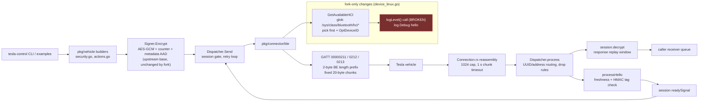
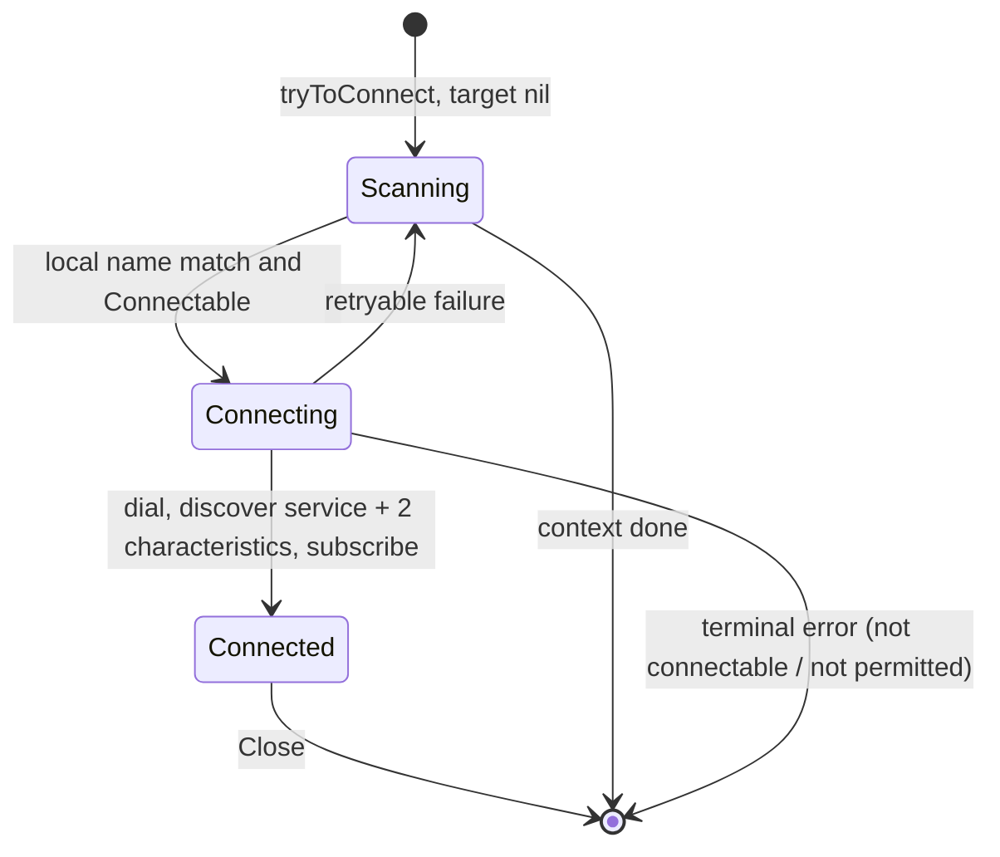
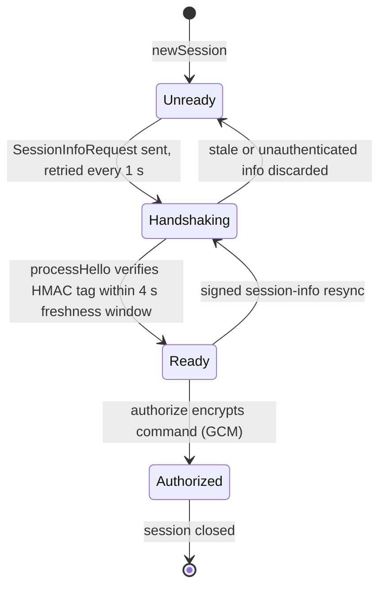

# tesla-local-control/vehicle-command - legacy deep dive

## 1. Provenance

| Field | Value |
| --- | --- |
| Submodule path | `legacy/tesla-local-control-vehicle-command` |
| Pinned gitlink SHA | `bb9f0a2e23584741ebbd54df50d6fe733d3cfc3f` (`git ls-files -s`: `160000 bb9f0a2e23584741ebbd54df50d6fe733d3cfc3f 0`) |
| `rev-parse HEAD` | `bb9f0a2e23584741ebbd54df50d6fe733d3cfc3f` - matches gitlink |
| Worktree status | `git status --porcelain` empty (clean) |
| Last commit | `bb9f0a2 Merge pull request #6 from tesla-local-control/debug-logging2` (2025-02-01) |
| Upstream URL | `https://github.com/tesla-local-control/vehicle-command` (origin fetch + push) |
| License | Apache-2.0 (`LICENSE:1-3`) |
| Language / module | Go 1.23 (`go.mod:3`); module path kept as `github.com/teslamotors/vehicle-command` (`go.mod:1`) - not renamed by the fork |
| Analysis date | 2026-11-21 |
| Fork base | upstream commit `ebad42a` ("Add issue templates to vehicle-command repo (#364)", 2025-01-27); fork delta = 5 commits touching ONE file: `pkg/connector/ble/device_linux.go` (`git diff ebad42a..bb9f0a2 --stat` = 56 lines in 1 file) |
| Cross-reference | `docs/legacy/teslamotors-vehicle-command.md` (deep dive of upstream proper, pinned `0a582da430c4aca6d397fb6cbed5b4d6bb380125`) - this doc analyzes the FORK DELTAS and only re-reads inherited code where a load-bearing claim needed its own citation |
| Frontmatter note | The replaced doc had **no YAML frontmatter** (line 1 was `# tesla-local-control/vehicle-command`) and **no `## Upstream (...)` sections** - nothing to preserve verbatim, none invented. Pre-replace claims are cited below as `git show HEAD:docs/legacy/tesla-local-control-vehicle-command.md` (the replaced summary still exists in git history). |

Files read in the fork tree (line ranges):

- Fork delta (FULL-READ): `pkg/connector/ble/device_linux.go:1-74` plus all five fork commit diffs (`ce061f4`, `8200308`, `f1e042a`, `8a1fe93`, `55b6eca`) read via `git show`.
- Transport (FULL-READ): `pkg/connector/ble/ble.go:1-303`, `device_darwin.go:1-14`, `device_windows.go:1-10`, `pkg/connector/connector.go:1-72`.
- Crypto core (FULL-READ): `internal/authentication/crypto.go:1-66`, `ecdh.go:1-18`, `native.go:1-212`, `metadata.go:1-84`, `window.go:1-68`, `internal/log/logger.go:1-64`.
- Session/router: `internal/dispatcher/session.go:1-136` (FULL-READ); `internal/dispatcher/dispatcher.go:88-162,176-260` (RANGE-CITED).
- Protocol schema (FULL-READ): `pkg/protocol/protobuf/universal_message.proto:1-101`, `signatures.proto:1-94`, `keys.proto:1-16`; `pkg/protocol/protocol.md:140-233` (RANGE-CITED; TLV example, roles, BLE identifiers).
- Vehicle builders: `pkg/vehicle/security.go:170-229` (RANGE-CITED: SetPINToDrive gate, AddKey roles); `pkg/vehicle/actions.go` line-level grep only (`VentWindows` at `:82`).
- Root/build: `README.md:1-315` (FULL-READ), `go.mod:1-35` (FULL-READ), `LICENSE:1-3`, `.golangci.yml:1-30` (RANGE-CITED), `docker-compose.yml:1-16`, `Dockerfile:1-25`, `.github/workflows/build.yml:1-30`, `.github/workflows/publish.yml:44-48` (RANGE-CITED).
- Tests (FULL-READ): `internal/authentication/window_test.go:1-97`. Test inventory per file via `git grep -c 'func Test'` (24 files, 113 functions).
- History: `git log` (123 commits, root `7f69552` 2023-10-09 "vehicle-command: Initial release"), `git log ebad42a..HEAD`, `git tag`, commit diffs, `go build` execution (below).
- Our counterpart (FULL-READ, for parity rows): `firmware/lib/vehicle/ble/msg.h:1-481`, `firmware/lib/vehicle/ble/feature/session.h:1-282`, `firmware/lib/vehicle/ble/feature/key.h:1-151`, `firmware/lib/vehicle/ble/handler/dispatch.h:1-299`, `firmware/lib/io/ble/esp32/ble_client.h` (read to its end, line numbers cited below), plus grep rows in `firmware/lib/io/ble/esp32/tesla_board.h:101,124-127`.
- Upstream-pinned comparisons (for fork-vs-upstream deltas): `git -C legacy/teslamotors-vehicle-command show HEAD:pkg/connector/ble/device_linux.go`, `HEAD:pkg/protocol/protobuf/keys.proto`, `git ls-files` overlap, `git log ebad42a..HEAD` (55 commits).

Files explicitly NOT read: `pkg/vehicle/vcsec.go`, `charge.go`, `climate.go`, `infotainment.go`, `state.go`, `vehicle.go`; `internal/authentication/signer.go`, `verifier.go`, `peer.go`, `jwt.go`; `internal/schnorr/*`; all generated `*.pb.go`; `pkg/proxy/*` bodies; `cmd/*` bodies; `examples/*`; `doc/*.puml`/`*.png`; `pkg/cli/*` (only the keyring constants grepped); `Makefile`, `check-all.sh`, `pkg/account/*`; all test bodies except `window_test.go`; `protocol.md:1-139,234-end`.

Evidence grades: **CODE-READ**, **TEST-READ**, **CAPTURE**, **SUMMARY-ONLY**, **UNVERIFIED**. One build-tool execution is recorded in prose under section 9; it is not a frame capture and is not graded CAPTURE. No other CAPTURE evidence exists in this repo.

## 2. Executive verdict

This fork is a **stale snapshot of teslamotors/vehicle-command (base `ebad42a`, 2025-01-27) plus exactly five commits from one author on one file** (`pkg/connector/ble/device_linux.go`, all on 2025-02-01): a Linux HCI auto-discovery helper (`GetAvailableHCI` glob over `/sys/class/bluetooth/hci*`), a switch to upstream's internal leveled logger, and two debug commits that left debris behind. Consequence: **the fork's pinned HEAD does not compile for the Linux target** - `go build` (GOOS=linux, go1.26.4) fails with `device_linux.go:32:59: undefined: logLevel` - and the file is gofmt-dirty (space-indented blocks, one trailing-whitespace line), so the inherited CI (`make format && git diff --exit-code`) cannot pass either. The fork adds zero protocol, crypto, or frame changes; every wire-level conclusion in the teslamotors deep dive applies unchanged, and upstream has since solved the same HCI problem differently (user-selectable `hci0..15` adapter ID + CAP_NET_ADMIN diagnostics, upstream `058ee32`). The old summary's "key differences" (`.golangci.yml`, Docker Compose, tesla-local-control ecosystem integration) are all upstream-inherited or entirely absent - `git grep 'tesla-local-control'` over the whole tree returns nothing. Nothing from the fork's own commits should be ported; the fork's only value to us is negative (confirming the upstream-parity baseline) plus one new cross-check it prompted: **our `key.h` role constants contradict upstream's `keys.proto`** (`ROLE_OWNER=4`/`ROLE_CHARGING_MANAGER=5` vs upstream `2`/`6` - upstream 4 is FLEET MANAGER, a role that cannot send commands over BLE). Use upstream-pinned `teslamotors-vehicle-command` as the reference, never this fork.

## 3. Evidence map

| Source file | Lines | What it proves | Grade |
| --- | --- | --- | --- |
| `pkg/connector/ble/device_linux.go` | 26-48, 50-64, 66-74 | Fork's only functional delta: `newDevice()` picks the first globbed `/sys/class/bluetooth/hci*` entry via exported `GetAvailableHCI()`, parses `hci%d` with `fmt.Sscanf`, passes `ble.OptDeviceID(index)`; parse failure silently defaults to hci0 (`:71`) | CODE-READ |
| `pkg/connector/ble/device_linux.go` | 8, 32-34 | Imports upstream `internal/log`; HEAD carries debug debris: broken `logLevel()` call (`:32`), `log.Debug("hello")` (`:33`), trailing whitespace on `:32` | CODE-READ |
| `git grep -n 'logLevel'` (whole fork tree) | logger.go:39,46; device_linux.go:32 | `logLevel` is defined only as an unexported func in package `log`; the call in package `ble` resolves to nothing | CODE-READ |
| `go build ./pkg/connector/ble/` (GOOS=linux, go1.26.4, executed 2026-11-21) | - | `device_linux.go:32:59: undefined: logLevel` - fork HEAD is unbuildable on Linux | CODE-READ (compiler output quoted verbatim) |
| `gofmt -l pkg/connector/ble/` (go1.26.4) | all 5 files listed | Fork-authored lines are gofmt-dirty (spaces, trailing whitespace); CI `make format` step cannot pass | CODE-READ |
| `pkg/connector/ble/ble.go` | 20, 25-27, 30-32, 63-83, 104-123 | 1024-byte datagram cap, 1 s chunk timeout, 4 s clock-skew budget, GATT UUIDs, big-endian length prefix, **fixed 20-byte TX chunks** (`:112`) - no MTU exchange anywhere in the fork | CODE-READ |
| `pkg/connector/ble/ble.go` | 129-133, 163, 242 | Vehicle advertisement local name = `S` + lowerhex(SHA1(VIN)[:8]) + `C` (`S%02xC`) | CODE-READ |
| `pkg/connector/connector.go` | 8-20, 23, 26, 29-72 | AuthMethod enum, inbox depth 5, `MaxResponseLength=100000`, `FleetAPIConnector` superset interface | CODE-READ |
| `pkg/protocol/protobuf/universal_message.proto` | 10-14, 30-61, 69-73, 75-78, 80-101 | Domains 2/3; MessageFault enum to 28; `SessionInfoRequest{public_key=1, challenge=2}`; `FLAG_ENCRYPT_RESPONSE=1`; RoutableMessage to=6, payload=10, sig=13, session_info_request=14, session_info=15, request_uuid=50, uuid=51, flags=52, reserved 1-5/11/16-40 | CODE-READ |
| `pkg/protocol/protobuf/signatures.proto` | 8-31, 41-53, 66-75, 87-94 | Tag enum with `TAG_END=255`; **no detached-AES-GCM message and no `SIGNATURE_TYPE_AES_GCM_DETACHED`** (upstream added them post-base); `AES_GCM_Personalized{epoch=1,nonce=2,counter=3,expires_at=4,tag=5}`; `SessionInfo` ends at `handle=6`, **no `flags` field** | CODE-READ |
| `pkg/protocol/protobuf/keys.proto` | 7-15 | Role enum: `ROLE_OWNER=2`, `ROLE_DRIVER=3`, `ROLE_FM=4`, `ROLE_VEHICLE_MONITOR=5`, `ROLE_CHARGING_MANAGER=6`; no `ROLE_GUEST` (upstream added 8 post-base) | CODE-READ |
| `internal/authentication/ecdh.go` + `native.go` | 3-8, 11; 94-136 | Static-key ECDH rationale (HSM); `K = SHA1(sharedX)[:16]`, AES-128; point-at-infinity rejected (`native.go:102-104`) | CODE-READ |
| `internal/authentication/metadata.go` | 34-56, 80-84 | Canonical TLV `tag||len||value`, big-endian uint32, increasing-tag order, 255-byte cap, `TAG_END` before message hash | CODE-READ |
| `internal/authentication/crypto.go` | 12-22, 50 | Subkey labels; `counterMax=0xFFFFFFFF`, `epochIDLength=16`, `maxSecondsWithoutCounter=30`, `windowSize=32`; `epochLength = 1<<30 s` | CODE-READ |
| `internal/authentication/window.go` + `window_test.go` | 9-68; 7-97 | 32-entry sliding-window accept/reject logic; `TestSlidingWindow` asserts exact bitmap expectations for 7 cases (forward jump, in-window, duplicate, out-of-window, equal counter) | CODE-READ + TEST-READ |
| `internal/dispatcher/session.go` | 16, 48-59, 61-98, 113-136 | 5 s default expiration; response anti-replay per request (`ErrReplayedResponse`); `processHello` requires the HMAC tag via `NewAuthenticatedSigner`/`UpdateSignedSessionInfo` | CODE-READ |
| `internal/dispatcher/dispatcher.go` | 88-111, 176-210, 231-253 | Handshake resent every `RetryInterval`; session info discarded when stale (`expired(maxLatency)`), unauthenticated (tag nil), or from an unregistered domain; RX drop rules for missing source/UUID-length/destination | CODE-READ |
| `pkg/vehicle/security.go` | 178-187, 218-225 | `SetPINToDrive` hard-gated to `FleetAPIConnector` (BLE connector does not implement it - method set at `ble.go:51-92`); `AddKey` maps owner to `ROLE_OWNER`, else `ROLE_DRIVER` | CODE-READ |
| `pkg/vehicle/actions.go` | 82 | `VentWindows` exists at base (line-level grep; body not read) | CODE-READ (existence only) |
| `pkg/protocol/protocol.md` | 146-176, 185-210, 217-233 | BLE UUIDs/local name/framing spec; roles (Fleet Manager cannot send commands over BLE on 2023.38+, `:200-202`; Vehicle Monitor read-only, `:206-207`); TLV metadata spec | CODE-READ (spec in repo, RANGE-CITED) |
| `git grep -cE 'PRIVATE KEY' pkg/protocol/protocol.md` | 4 hits | Two published example EC key pairs in the spec (do-not-copy) | CODE-READ (line-level) |
| `internal/log/logger.go` | 13-21, 39-43, 45-64 | Level enum None/Error/Warning/Info/Debug; `logLevel()` unexported; Debug/Info/Warning/Error exported to stderr with RFC3339 timestamps | CODE-READ |
| `go.mod` | 1, 3, 9 | Module path NOT renamed; `go 1.23`; `golang-jwt/jwt/v5 v5.2.1` (upstream bumped to 5.2.2 post-base) | CODE-READ |
| `README.md` | 1-5, 12, 65-66, 88-107, 125-129, 309-315 | Badges/Docker Hub point at `tesla/vehicle-command` (upstream); REST proxy (no gRPC); "tested with Go 1.23.0" (consistent with `go.mod:3`, unlike upstream pinned); `TESLA_CACHE_FILE` session cache | CODE-READ |
| `Dockerfile`, `docker-compose.yml`, `.github/workflows/*` | 1-25; 1-16; build.yml 1-30, publish.yml 44-48 | golang:1.23.0 build, distroless nonroot runtime, entrypoint `tesla-http-proxy`; compose image `tesla/vehicle-command:latest`; CI on push/PR to main runs gofmt check + golangci-lint v1.61.0; publish pushes `tesla/vehicle-command:<version>` | CODE-READ |
| `git grep -nE 'tesla-local-control'` over tree | no output | Zero tesla-local-control integration in the tree; the fork identity exists only in git history (PR merges) and the remote URL | CODE-READ (negative) |
| `git log ebad42a..HEAD` (fork) + `git log ebad42a..HEAD` (teslamotors pinned) | 10 commits; 55 commits | Fork adds 5 commits (PRs #2-#6, all 2025-02-01); upstream moved 55 commits ahead after the base | CODE-READ (subjects) |
| `legacy/teslamotors-vehicle-command` pinned files | device_linux.go; keys.proto | Upstream's newer HCI solution (`newAdapter(id)` validating `hci0..15`, `ErrAdapterInvalidID`, `IsAdapterError`, CAP_NET_ADMIN help, `NewDeviceWithName`); keys.proto identical for roles 0-6 plus `ROLE_GUEST=8` | CODE-READ |
| Our side: `firmware/lib/vehicle/ble/msg.h`, `feature/session.h`, `feature/key.h`, `handler/dispatch.h`, `io/ble/esp32/ble_client.h`, `io/ble/esp32/tesla_board.h` | cited per row in section 11 | Our BLE schema (envelope fields 2/5/6/7/10/14), ephemeral ECDH + HKDF, counter-as-IV, VIN-suffix scan, and the role-constant contradiction | CODE-READ (our side) |
| Old summary (`git show HEAD:docs/legacy/tesla-local-control-vehicle-command.md`) | 5, 10, 44-62 | Pre-replace claims (license, "key differences", gRPC, relevant files) | SUMMARY-ONLY |

## 4. Architecture and build surface

- **Module:** single Go module `github.com/teslamotors/vehicle-command` (unrenamed, `go.mod:1`); deps `go-ble/ble`, `protobuf`, `99designs/keyring`, `golang-jwt v5.2.1`, `saferith`. Build via Makefile / Dockerfile (golang:1.23.0 -> distroless nonroot). CI (`.github/workflows/build.yml:3-9`) runs on push/PR to main: `make format && git diff --exit-code`, golangci-lint v1.61.0, then tests - **HEAD cannot pass the first step** (gofmt-dirty) and cannot compile the BLE package on Linux.
- **Entry points:** `cmd/tesla-control` (CLI), `cmd/tesla-keygen`, `cmd/tesla-http-proxy` (REST relay), `cmd/tesla-auth-token`, `cmd/tesla-jws`; `examples/ble`, `examples/unlock`. Bodies not read this pass (UNVERIFIED).
- **Shared core (identical to upstream base):** `pkg/protocol` (schemas, error taxonomy), `internal/authentication` (static-ECDH Signer/Verifier, TLV metadata, sliding window), `internal/dispatcher` (per-domain sessions, reply routing), `internal/schnorr`, and `internal/log` (leveled dev logger, upstream code).
- **Platform port:** `pkg/connector/ble` - `ble.go` common; `newDevice()` per-OS. Darwin: plain `darwin.NewDevice()` (`device_darwin.go:8-13`). Windows: always errors "not supported on Windows" (`device_windows.go:8-10`). Linux: **the fork's only real change** - `newDevice()` globs `/sys/class/bluetooth/hci*`, picks the first existing entry, logs it via `log.Debug`, and opens it by index (`device_linux.go:26-48`).
- **Fork vs upstream-pinned transport deltas** (both CODE-READ): upstream later replaced `newDevice()` with `newAdapter(id *string)` that validates a user-supplied `hci0..15` ID, uses `NewDeviceWithName("vehicle-command", ...)`, and exports `IsAdapterError` + `AdapterErrorHelpMessage` (CAP_NET_ADMIN `setcap` recipe) - commit `058ee32`; upstream `ble.go` also gained `ExchangeMTU` + `min(MTU,1024)-3` chunking, while the fork still chunks at a **fixed 20 bytes** (`ble.go:112`). The fork therefore predates every BLE-transport improvement upstream shipped after 2025-01-27.
- **Dependency boundary:** `internal/` unimportable outside the module; the fork's `device_linux.go:8` imports `github.com/teslamotors/vehicle-command/internal/log` - legal only because the module path was never renamed.



## 5. Mechanism catalogue

### 5.1 Linux HCI auto-discovery (the fork's only functional delta)

- **Claim (old summary):** not documented at all - the old doc's "Key Differences" missed the fork's actual change (`git show HEAD:docs/legacy/tesla-local-control-vehicle-command.md:44-48` lists golangci/Docker instead).
- **Code path:** `device_linux.go:26` `newDevice()` → `GetAvailableHCI()` (`:51-64`) → `parseHCIIndex()` (`:67-74`) → `linux.NewDevice(ble.OptDeviceID(index))` (`:36-43`) → `ble.SetDefaultDevice` (`ble.go:148`).
- **Frame spec:** n/a (host-side adapter selection, no wire bytes).
- **Gates and timing:** `bleTimeout = 20 s` (`:14`); scan params `0x10/0x10` active (`:18-24`, inherited). `GetAvailableHCI` accepts the first glob entry that `os.Stat` confirms (`:57-61`) - existence only, not "powered/usable"; entries come back in lexicographic order (`hci0, hci1, hci10, ...`); `parseHCIIndex` silently defaults to `0` on parse failure (`:71`).
- **State machine:** None found (single-shot function, fewer than 3 states).
- **Tests:** None found - no `*_test.go` under `pkg/connector/ble/`.
- **Evidence grade:** CODE-READ.
- **Verdict:** CONFIRMED (as fork behavior).
- **Adapt to TeslaCANModder?** no impact - our vehicle link is ESP32 NimBLE (`firmware/lib/io/ble/esp32/ble_client.h:101-154`), which has no host HCI-adapter selection concept, and our host-side tooling is Node.js, not Go. Upstream's later flag-based solution is strictly better documented and diagnosed; neither applies to us.

### 5.2 Fork logging integration and HEAD debug debris

- **Claim (commit subjects):** "Use log.Debug" (`8200308`), "Use teslamotors internal log" (`f1e042a`), "[test] debugging log" / "2" (`8a1fe93`, `55b6eca`).
- **Code path:** `device_linux.go:8` imports `internal/log`; `:32-34` are the surviving lines: `log.Debug("Current log level inside newDevice: '%d'", logLevel())` (trailing whitespace on `:32`, `logLevel` undefined in package `ble`), `log.Debug("hello")`, `log.Debug("Using Bluetooth adapter: '%s'", hciName)`.
- **Frame spec:** n/a.
- **Gates and timing:** upstream logger gates on a global level (`internal/log/logger.go:45-51`), default `LevelNone` - which is almost certainly why the author's `log.Debug` lines never printed and the debug series escalated into committing a level-probe and a hello-line into `main`.
- **State machine:** None found.
- **Tests:** None found.
- **Evidence grade:** CODE-READ; build failure additionally verified by executing `go build ./pkg/connector/ble/` (GOOS=linux, go1.26.4) → `device_linux.go:32:59: undefined: logLevel`.
- **Verdict:** CONTRADICTED - the fork's own HEAD cannot build the Linux BLE package; the last two merges are debug debris, not features.
- **Adapt to TeslaCANModder?** never port the debris; the leveled-dev-logger idea is already present on our side (firmware log ring).

### 5.3 BLE length-prefixed datagram framing (fork variant)

- **Claim (README / spec):** "Messages sent or received over BLE are preceded by the two-byte big-endian encoding of the message length" (`protocol.md:160-161`).
- **Code path:** `Connection.Send` (`ble.go:104-123`) writes `uint8(len>>8), uint8(len)` (`:110`) then chunks at **fixed 20 bytes** (`:112`); `Connection.rx` (`:94-102`) reassembles; `flush` (`:63-83`) computes `msgLength = 256*buf[0] + buf[1]` (`:65`) and drops+clears when `> 1024` (`:66-68`).
- **Frame spec:** 2-byte BE prefix; `maxBLEMessageSize = 1024` (`:20`); inbox depth 5 (`:283`, `connector.go:23`).
- **Gates and timing:** `rxTimeout = 1 s` inter-chunk gap clears partials (`:25`, `:94-97`); `RetryInterval = 1 s` (`:55-57`); `maxLatency = 4 s` (`:26`).
- **State machine:** n/a per datagram.
- **Tests:** None found in `pkg/connector/ble/`.
- **Evidence grade:** CODE-READ.
- **Verdict:** CONFIRMED - but the fork variant is the pre-MTU-exchange implementation; upstream pinned chunks at `min(ExchangeMTU, 1024)-3` with `DefaultMTU-3` fallback instead of fixed 20.
- **Adapt to TeslaCANModder?** candidate for constants/guard comparison only, and only after capturing our own link; note our side already does MTU-based chunking (`ble_client.h:192-193`), i.e. our side matches upstream's newer behavior, not the fork's.

### 5.4 Vehicle beacon scan by SHA1(VIN) local name

- **Claim (spec):** local name = `S + <lowerhex of SHA1(VIN)[:8]> + C` (`protocol.md:154-158`).
- **Code path:** `VehicleLocalName` (`ble.go:129-133`) → `ScanVehicleBeacon` (`:155-168`) → `scanVehicleBeacon` (`:170-206`) → `tryToConnect` verifies `LocalName()` again and `Connectable()` (`:251-257`).
- **Frame spec:** n/a (advertisement filter).
- **Gates and timing:** non-connectable beacon → terminal `ErrMaxConnectionsExceeded` (`ble.go:22` definition, returned at `:255-257`); retry loop gives up on "operation not permitted" (`:219`); up to 3 simultaneous vehicle BLE connections (`protocol.md:163-164`, SUMMARY-ONLY).
- **State machine:**



- **Tests:** None found.
- **Evidence grade:** CODE-READ.
- **Verdict:** CONFIRMED.
- **Adapt to TeslaCANModder?** no impact as-is; our scan filter is a different rule (Tesla service UUID advertised + name ending in last 8 VIN chars, `ble_client.h:113-120`, `dispatch.h:34-43`) - see section 11.

### 5.5 Static-key ECDH handshake with authenticated session info

- **Claim (old summary):** the old doc never describes the handshake (omission, recorded here for completeness).
- **Code path:** `Dispatcher.StartSession` resends `RequestSessionInfo` every `RetryInterval` (`dispatcher.go:88-111`) → vehicle replies with `SessionInfo` + HMAC tag → freshness gate (`:184-193`: older than `maxLatency` or tag nil → discard) → `session.processHello` (`session.go:117-136`) → `NewAuthenticatedSigner` / `UpdateSignedSessionInfo` → `readySignal` closed.
- **Frame spec:** request `SessionInfoRequest{public_key=1, challenge=2}` (`universal_message.proto:69-73`); reply `SessionInfo{counter=1, publicKey=2, epoch=3, clock_time=4, status=5, handle=6}` (`signatures.proto:87-94`, no `flags` in the fork); shared key `K = SHA1(BIG_ENDIAN(sharedX))[:16]` (`native.go:118-124`, `ecdh.go:11`).
- **Gates and timing:** 4 s freshness window (`ble.go:26`, `dispatcher.go:180-187`); reply must carry a valid HMAC tag over {session info, personalization, challenge} (`native.go:76-88`).
- **State machine:**



- **Tests:** handshake retry/discard behavior covered at the base snapshot by `internal/dispatcher/dispatcher_test.go` (19 test functions, bodies not read this pass; see `docs/legacy/teslamotors-vehicle-command.md` section 5.2 for the upstream-pinned read of the same suite).
- **Evidence grade:** CODE-READ.
- **Verdict:** CONFIRMED; identical to upstream base - the fork changed none of it.
- **Adapt to TeslaCANModder?** never port the core (our `session.h:63-199` is ephemeral ECDH + HKDF, a different protocol); the actionable gap is that our `establish` accepts session-info fields with **no tag check** (`session.h:103-113`, `msg.h:411-477`) - candidate, same conclusion as the teslamotors deep dive.

### 5.6 Canonical metadata TLV and HMAC subkeys

- **Claim (spec):** metadata serialized as TLV, hashed as AAD (`protocol.md:217-233`).
- **Code path:** `metadata.Add` (`metadata.go:34-50`) → `AddUint32` BE (`:52-56`) → `Checksum` appends `TAG_END` + message (`:80-84`); subkeys via `NativeSession.subkey` = `HMAC-SHA256(K, label)` (`native.go:66-74`); labels "session info" / "authenticated command" (`crypto.go:12-15`).
- **Frame spec:** `tag || 1-byte len || value`; strictly increasing tags (`metadata.go:35-37`); 255-byte field cap (`:41-43`); `TAG_END=255` (`signatures.proto:20`).
- **Gates and timing:** n/a (pure function).
- **State machine:** n/a.
- **Tests:** `internal/authentication/metadata_test.go` (4 functions, bodies not read this pass).
- **Evidence grade:** CODE-READ.
- **Verdict:** CONFIRMED; identical to upstream base.
- **Adapt to TeslaCANModder?** candidate as an idea (canonical AAD + independent test oracle) - unchanged from the teslamotors deep dive; our `mbedtls_gcm_crypt_and_tag` call passes no AAD (`session.h:242`).

### 5.7 Anti-replay sliding window

- **Claim (old summary):** not covered.
- **Code path:** `updateSlidingWindow` (`window.go:9-50`) ← `SlidingWindow.Update` (`:52-68`) ← `session.decrypt` (`session.go:48-59`).
- **Frame spec / constants:** `windowSize = 32` (`crypto.go:21`); reject equal counter (`window.go:17-20`), out-of-window age (`:22-29`), or already-set bit (`:30-33`); forward jump shifts the bitmap and sets bit `shiftCount-1` (`:40-49`); `counterMax = 0xFFFFFFFF` (`crypto.go:18`); `maxSecondsWithoutCounter = 30` (`:20`).
- **Gates and timing:** counter=0 disables replay tracking but caps remaining TTL (cross-reference: teslamotors deep dive section 5.6 for the verifier-side behavior; verifier body not read in the fork snapshot).
- **State machine:** per-domain `{counter, window}` bitmap; first use accepts any counter (`window.go:58-63`).
- **Tests:** `TestSlidingWindow` (`window_test.go:7-97`) - asserts exact expected counter/window/ok for all 7 cases, both against `updateSlidingWindow` and the `SlidingWindow` struct wrapper.
- **Evidence grade:** CODE-READ + TEST-READ.
- **Verdict:** CONFIRMED.
- **Adapt to TeslaCANModder?** **top candidate for a future PR** (unchanged): our BLE session only increments a TX counter (`session.h:221`) and has no RX replay tracking.

### 5.8 PIN-to-Drive Fleet-API gate

- **Claim (cross-reference):** upstream note "PIN-to-Drive is Fleet API, not BLE" (teslamotors deep dive section 5.10).
- **Code path:** `SetPINToDrive` (`security.go:184-200`) → hard gate `if _, ok := v.conn.(connector.FleetAPIConnector); !ok { return protocol.ErrRequiresEncryption }` (`:185-187`); the BLE `Connection` exposes only Connector methods (`ble.go:51-92`) - no `SendFleetAPICommand`/`Wakeup` - so the gate always rejects BLE.
- **Frame spec:** `VehicleControlSetPinToDriveAction{On, Password}` (`:189-199`).
- **Gates and timing:** connector type only.
- **State machine:** n/a.
- **Tests:** `pkg/vehicle/security_test.go` (1 function, body not read this pass).
- **Evidence grade:** CODE-READ.
- **Verdict:** CONFIRMED. (The base snapshot already contains the SDK method and proxy route `pkg/proxy/command.go:389` - grep-level; upstream's post-base `0aa3b78`/`0a582da` added PIN management and the CLI command, which the fork lacks.)
- **Adapt to TeslaCANModder?** never port onto BLE (same as upstream doc).

### 5.9 VCSEC key roles and add-key request

- **Claim (spec):** roles determine command rights; Owner can manage keys, Fleet Manager cannot use BLE (`protocol.md:185-210`).
- **Code path:** `security.go:218-225` `AddKey` → owner → `ROLE_OWNER`, else `ROLE_DRIVER`; whitelist add payload built in `pkg/vehicle/vcsec.go` (not read this pass; cross-reference teslamotors deep dive section 5.9).
- **Frame spec / constants:** `keys.proto:7-15`: `ROLE_NONE=0`, `ROLE_SERVICE=1`, `ROLE_OWNER=2`, `ROLE_DRIVER=3`, `ROLE_FM=4`, `ROLE_VEHICLE_MONITOR=5`, `ROLE_CHARGING_MANAGER=6` (no `ROLE_GUEST=8` - upstream added it post-base).
- **Gates and timing:** role determines what the enrolled key may authorize; NFC-card confirmation still required for the add-key flow (per protocol spec, SUMMARY-ONLY).
- **State machine:** None found (enum).
- **Tests:** None found for roles specifically.
- **Evidence grade:** CODE-READ.
- **Verdict:** CONFIRMED - and it exposes an our-side contradiction: `firmware/lib/vehicle/ble/feature/key.h:22-23` defines `ROLE_OWNER = 4` / `ROLE_CHARGING_MANAGER = 5`, which upstream assigns to FLEET MANAGER and VEHICLE MONITOR respectively. Our `tesla:key:role:owner` would request a fleet-manager key (a role the spec says cannot send commands over BLE on 2023.38+).
- **Adapt to TeslaCANModder?** align - fix `key.h` to the upstream enum (transport-visible change; walk `docs/checklists/can-review-checklist.md` and confirm with a bench capture before/after).

## 6. Summary vs code contradiction table

Pre-replace claims are cited from `git show HEAD:docs/legacy/tesla-local-control-vehicle-command.md` (line numbers of the replaced file).

| # | Old summary claim | Code evidence | Verdict |
| --- | --- | --- | --- |
| 1 | "Adds linting configuration (golangci.yml)" (`:10`, `:46`, `:61`) | `.golangci.yml` was added by **upstream** commit `29fe990 add linters (#361)` (pre-base, present in the inherited log and in the teslamotors pinned tree); `git diff ebad42a..bb9f0a2` shows the fork changed only `device_linux.go` | CONTRADICTED - not a fork addition |
| 2 | "integration into the tesla-local-control ecosystem for Docker deployment" (`:10`) and "Part of tesla-local-control integration stack" (`:48`) | `git grep -nE 'tesla-local-control'` over the whole tree → no output; `docker-compose.yml:2` and `publish.yml:44-48` target `tesla/vehicle-command` (upstream image); README badges (`:1-5`) point at teslamotors repos | CONTRADICTED - no tlc integration exists in the tree; the fork identity appears only in git history and the remote URL |
| 3 | "Pre-configured for Docker Compose deployment" as a difference from official (`:47`, `:62`) | Docker support came from upstream (`96af672 add docker support (#298)`, pre-base); the compose file and Dockerfile are byte-identical to the base snapshot | CONTRADICTED as a "difference" - the files exist but are upstream's |
| 4 | Comparison table: "Vehicle commands via gRPC" (`:55`) | No gRPC code: the only `grpc` string in the tree is the protoc install link at `protocol.md:70` (demonstrated grep); the proxy is REST (`README:12,152-303`) | CONTRADICTED |
| 5 | Old summary's relevant-files list implies the fork's surface is golangci/Docker (`:58-62`) | Actual fork delta: 5 commits on `pkg/connector/ble/device_linux.go` - HCI auto-pick (`device_linux.go:26-74`), internal-log integration, debug debris with a build-breaking `logLevel()` call (`:32`) | CONTRADICTED by omission - the real deltas are undocumented; the old summary is treated as SUMMARY-ONLY throughout |

Agreements (kept out of this table, see evidence map): license Apache-2.0 (`:5` vs `LICENSE:1-3`); "Fork of Tesla's official vehicle-command" (`:10` - confirmed by inherited history to root `7f69552`); Language Go (`:6`). The old doc had no YAML frontmatter and no `## Upstream (...)` sections - nothing was preserved, and none was invented.

## 7. CAN frame and signal inventory

None found: this repo contains no CAN bus code - no MCP2515 driver, no frame decode/mutate/inject path, no DBC/JSON frame catalog. Negative anchor (run 2026-11-21, case-sensitive):

```text
git grep -nE 'mcp2515|CANFrame|can_id|DLC' .   -> no output (exit 1)
```

The BLE wire contract is the closest equivalent to a frame inventory; rows below are from this snapshot's own files (all CODE-READ unless noted). The fork made **no** changes to any of them relative to its base.

| Wire fact | Layout / value | Source | Grade |
| --- | --- | --- | --- |
| BLE datagram framing | 2-byte big-endian length prefix; RX drops a declared length over 1024 and clears the buffer; TX chunks at fixed 20 bytes (no MTU exchange) | `ble.go:110-112,63-73,20` | CODE-READ |
| GATT service and characteristics | `00000211-…` service, `…0212` write, `…0213` notify | `ble.go:30-32` | CODE-READ |
| Vehicle advertisement local name | `S` + lowerhex(SHA1(VIN)[:8]) + `C` | `ble.go:129-133` | CODE-READ |
| Domain IDs | `DOMAIN_VEHICLE_SECURITY=2`, `DOMAIN_INFOTAINMENT=3` | `universal_message.proto:10-14` | CODE-READ |
| RoutableMessage envelope | to=6, from=7, payload=10, session_info_request=14, session_info=15, sig=13, status=12, request_uuid=50, uuid=51, flags=52; reserved 1-5, 11, 16-40 | `universal_message.proto:80-101` | CODE-READ |
| Command auth block | `AES_GCM_Personalized_Signature_Data{epoch=1, nonce=2, counter=3, expires_at=4, tag=5}` in SignatureData field 5 | `signatures.proto:41-47,66-75` | CODE-READ |
| SessionInfo reply | counter=1, publicKey=2, epoch=3, clock_time=4, status=5, handle=6 - **no flags field in this snapshot** | `signatures.proto:87-94` | CODE-READ |
| Key roles | OWNER=2, DRIVER=3, FM=4, VEHICLE_MONITOR=5, CHARGING_MANAGER=6 (no GUEST) | `keys.proto:7-15` | CODE-READ |
| Metadata TLV | `tag||len||value`, BE uint32, increasing tags, 255-byte cap, `TAG_END=255` before message | `metadata.go:34-56,80-84` | CODE-READ |
| Anti-replay counter | uint32, `counterMax=0xFFFFFFFF`, 32-entry window, 30 s no-counter TTL cap | `crypto.go:17-22` | CODE-READ |
| MessageFault codes on RX | INVALID_TOKEN_OR_COUNTER=6, INCORRECT_EPOCH=15, IV_INCORRECT_LENGTH=16, TIME_EXPIRED=17, TIME_TO_LIVE_TOO_LONG=20 | `universal_message.proto:38,47-52` | CODE-READ |
| Simultaneous vehicle BLE connections | up to 3, shared with keyfobs and phone keys | `protocol.md:163-164` | SUMMARY-ONLY |

No CAPTURE evidence exists: every row comes from reading code and schema files, not recorded vehicle traffic.

## 8. Constants and tuning table

| Constant | Value | Source | Meaning | Grade |
| --- | --- | --- | --- | --- |
| `/sys/class/bluetooth/hci*` | glob pattern | `device_linux.go:52` | fork's HCI discovery source; first stat-confirmed entry wins | CODE-READ |
| parse fallback | `0` | `device_linux.go:67-74` | `fmt.Sscanf("hci%d")` failure silently selects hci0 | CODE-READ |
| TX chunk size | 20 bytes (fixed) | `ble.go:112` | fork-era chunking; upstream pinned uses `min(MTU,1024)-3` instead | CODE-READ |
| `maxBLEMessageSize` | 1024 | `ble.go:20` | datagram cap; larger declared length drops the frame (`:66-68`) | CODE-READ |
| `rxTimeout` | 1 s | `ble.go:25` | inter-chunk gap that clears partial reassembly (`:94-97`) | CODE-READ |
| `maxLatency` / `AllowedLatency()` | 4 s | `ble.go:26,90-92` | vehicle-clock error budget; older session info discarded (`dispatcher.go:184-187`) | CODE-READ |
| `RetryInterval()` | 1 s | `ble.go:55-57` | handshake/connect retransmit interval (`dispatcher.go:106`) | CODE-READ |
| inbox depth / `BufferSize` | 5 | `ble.go:283`, `connector.go:23` | queued datagrams before silent drop | CODE-READ |
| `MaxResponseLength` | 100000 | `connector.go:26` | response cap every connector must support | CODE-READ |
| `bleTimeout` | 20 s | `device_linux.go:14` | Linux dial/listen timeout | CODE-READ |
| `LEScanInterval` / `LEScanWindow` | 0x10 / 0x10 | `device_linux.go:18-24` | active scan duty cycle | CODE-READ |
| `SharedKeySizeBytes` | 16 | `ecdh.go:11` | AES-128 key cut from SHA1(ECDH shared X) (`native.go:118-124`) | CODE-READ |
| `counterMax` | 0xFFFFFFFF | `crypto.go:18` | last valid command counter | CODE-READ |
| `epochIDLength` | 16 | `crypto.go:19` | epoch ID bytes | CODE-READ |
| `epochLength` | 1<<30 s | `crypto.go:50` | epoch rotation period (var for testability) | CODE-READ |
| `windowSize` | 32 | `crypto.go:21` | replay window depth; bitmap is uint64 so ceiling 64 | CODE-READ |
| `maxSecondsWithoutCounter` | 30 | `crypto.go:20` | max remaining TTL when counter is absent | CODE-READ |
| `defaultExpiration` | 5 s | `session.go:16` | command lifetime without a caller deadline | CODE-READ |
| subkey labels | "session info" / "authenticated command" | `crypto.go:12-15` | HMAC-SHA256 subkey derivation labels | CODE-READ |
| metadata field cap | 255 | `metadata.go:41-43` | max bytes per authenticated TLV field | CODE-READ |
| `FLAG_ENCRYPT_RESPONSE` | 1 (enum value) | `universal_message.proto:75-78` | response-encryption flag (wire-bit semantics documented upstream; not decoded by any code read in this snapshot) | CODE-READ (enum only) |
| simultaneous BLE connections | 3 | `protocol.md:163-164` | VCSEC connection budget | SUMMARY-ONLY |

## 9. Failure modes and edge cases

None found for watchdog, bus-off, OTA, brownout, or reboot-state handling: host-side Go SDK. The failure paths that do exist:

| Failure | Handling code path | Tested? | Grade |
| --- | --- | --- | --- |
| **Fork HEAD, Linux build** | `device_linux.go:32` calls `logLevel()`, undefined in package `ble` (only `internal/log/logger.go:39` defines it, unexported, other package) → **compile error**; verified by executing `GOOS=linux go build ./pkg/connector/ble/` (go1.26.4): `device_linux.go:32:59: undefined: logLevel` | n/a (cannot build) | CODE-READ |
| Fork HEAD, CI formatting gate | `device_linux.go` is gofmt-dirty (space-indented fork lines, trailing whitespace on `:32`; `gofmt -l` lists the whole directory) → inherited `make format && git diff --exit-code` step fails | n/a | CODE-READ |
| Glob picks a present-but-unusable adapter | `GetAvailableHCI` checks existence only (`device_linux.go:57-61`); a powered-down or permission-blocked adapter still gets selected, then `linux.NewDevice` errors with no actionable hint - upstream's post-base `AdapterErrorHelpMessage` (CAP_NET_ADMIN `setcap` recipe) does not exist in this snapshot | untested | CODE-READ |
| Glob ordering | `filepath.Glob` returns lexicographic order, so `hci10` sorts before `hci2`; harmless for index parsing but "first available" is not numeric-first | untested | CODE-READ |
| BLE datagram declares length over 1024 | buffer cleared, frame dropped, connection stays up (`ble.go:66-68`) | untested - no `*_test.go` under `pkg/connector/ble/` | CODE-READ |
| Inter-chunk gap over 1 s | partial reassembly cleared on next chunk (`ble.go:94-97`) | untested | CODE-READ |
| Inbound inbox full (5 slots) | datagram silently dropped (`ble.go:74-78`) | untested | CODE-READ |
| Beacon found but not connectable | terminal `ErrMaxConnectionsExceeded`, retry loop exits (`ble.go:255-257`, `:212-231`) | untested | CODE-READ |
| Linux adapter init without CAP_NET_ADMIN | error surfaced bare at this snapshot (upstream added `IsAdapterError` + help text post-base); retry loop stops on "operation not permitted" (`ble.go:219`) | untested | CODE-READ |
| Windows BLE adapter init | always errors "not supported on Windows" (`device_windows.go:8-10`) | untested | CODE-READ |
| RX with missing source / bad UUID length / missing destination | dropped with warning logs (`dispatcher.go:234-253`) | bodies of `dispatcher_test.go` not read this pass (cross-reference: upstream-pinned suite covers them) | CODE-READ |
| Session info stale, unauthenticated, or foreign domain | discarded; session stays unready (`dispatcher.go:184-209`) | cross-reference only (see `docs/legacy/teslamotors-vehicle-command.md` section 9) | CODE-READ |
| Replayed vehicle response | per-request `SlidingWindow` rejects with `ErrReplayedResponse` (`session.go:48-59`) | window logic: `TestSlidingWindow` (`window_test.go:7-97`) | CODE-READ + TEST-READ |

The untested paths cluster exactly where the fork made its changes (`pkg/connector/ble/`, zero test files) - the fork's only touched file has no safety net at all.

## 10. Test coverage map

24 test files, 113 `^func Test` declarations (`git grep -c 'func Test'`, run 2026-11-21). Bodies were NOT read this pass except `window_test.go`; rows below are existence+count inventories. Deep assertion-by-assertion reads exist in `docs/legacy/teslamotors-vehicle-command.md` section 10 for the upstream-pinned snapshot of the same suites - cross-reference, not evidence here.

| Test file(s) | Tests | What the suite covers (by name/area) | Grade |
| --- | --- | --- | --- |
| `internal/authentication/window_test.go` | 1 | exact bitmap expectations for forward-jump, in-window, duplicate, out-of-window, equal-counter (read in full this pass) | TEST-READ |
| `internal/authentication/verifier_test.go` | 30 | nonce/expiry/epoch/window/detached-prefix/response-encryption behaviors (bodies not read) | UNVERIFIED |
| `internal/dispatcher/dispatcher_test.go` | 19 | handshake retry/timeout, invalid replies, session-info discard, cache round-trip (bodies not read) | UNVERIFIED |
| `internal/authentication/signer_test.go` | 15 | session-info update gates, rollover, export/import (bodies not read) | UNVERIFIED |
| `internal/schnorr/{schnorr,sign}_test.go` | 8+3 | Schnorr signing (bodies not read) | UNVERIFIED |
| `pkg/vehicle/vehicle_test.go` + `vcsec_test.go` + `security_test.go` | 8+3+1 | connection/retry/VCSEC mapping/PIN format (bodies not read) | UNVERIFIED |
| `internal/authentication/{ecdh,metadata,native,peer,jwt,error,example,dispatcher}_test.go` | 3+4+2+1+1+1+2+1 | crypto building blocks (bodies not read) | UNVERIFIED |
| `pkg/account`, `pkg/cache`, `pkg/cli`, `pkg/connector/inet`, `pkg/protocol`, `pkg/proxy`, `cmd/*` tests | 3+2+1+1+1+1+1+1+4 | account, cache, CLI config, inet connector, protocol errors, proxy command routing, CLI helpers (bodies not read) | UNVERIFIED |

Fork snapshot is MISSING test files that upstream later added (negative anchor demonstrated: `git grep -nE 'protocol_doc_test|proxy_test\.go|status_test\.go|external_impl_test'` → no output):

- `internal/authentication/protocol_doc_test.go` - upstream's independent AES-GCM worked-example oracle (the exact-hex pin) is absent at this base.
- `pkg/proxy/{proxy,status}_test.go` - proxy forwarding/408/412/body-cap suite (upstream `8163543`) absent.
- `pkg/protocol/external_impl_test.go` - HSM/TEE external-implementation stub absent.

Critical paths with NO test (risk in one line):

- `pkg/connector/ble/**` including the fork's own `device_linux.go` - zero test files; the fork's only functional change and its compile break were never caught by any automated check in this tree.
- `device_{darwin,windows}.go` - platform adapters untested; Windows support is a single error return.

## 11. Parity matrix with TeslaCANModder

Upstream (fork-snapshot) citations are CODE-READ from files read for this doc. Our-side citations are CODE-READ from `firmware/lib/vehicle/ble/msg.h` (read in full), `feature/session.h` (full), `feature/key.h` (full), `handler/dispatch.h` (full), and `firmware/lib/io/ble/esp32/ble_client.h` (read in full). Because the fork changed no protocol code relative to its base, every row that matches the teslamotors deep dive carries the same conclusion; the fork-specific value of this matrix is that it re-confirms the envelope divergence against this snapshot AND adds the role-constant row the previous analysis left open.

| Signal / frame | Fork-snapshot decode | Our decode | Delta | Action |
| --- | --- | --- | --- | --- |
| BLE datagram framing | 2-byte BE prefix, cap 1024, fixed 20-byte chunks, 1 s chunk timeout (`ble.go:110-112,63-73,20,25`) | 2-byte BE prefix, cap 600, MTU-3 chunks (fallback 20), no inter-chunk timeout (`ble_client.h:61-63,29,192-193,222-241`) | same prefix; smaller cap; ours matches upstream's NEWER chunking, not the fork's | align the cap only after a capture shows payloads over 598 bytes |
| GATT service and characteristics | `00000211/00000212/00000213` (`ble.go:30-32`) | identical constants (`ble_client.h:20-26`) | none | ignore |
| Vehicle scan filter | local name `S`+hex(SHA1(VIN)[:8])+`C` (`ble.go:129-133,163`) | Tesla service UUID advertised AND name ending in last 8 VIN chars (`ble_client.h:113-120`; `dispatch.h:34-43`) | different match rule; ours also requires the service UUID | capture-first |
| RoutableMessage envelope fields | to=6, payload=10, sig=13, session_info_request=14, session_info=15, request_uuid=50, uuid=51, flags=52; reserved 1-5/11/16-40 (`universal_message.proto:80-101`) | to=2, payload=5, session_info_request=6, sig=7, session_info(field 10 on RX), uuid=14 (`msg.h:90-92,129-133,311-314,364-368`) | disjoint; ours sits in upstream's reserved 1-5, and upstream's 14/50/51 are absent from ours | capture-first - reconcile before porting any builder (confirmed divergence, first found against upstream proper) |
| SessionInfoRequest inner message | `public_key=1, challenge=2` (`universal_message.proto:69-73`) | fields 1/2, 65-byte key + 16-byte challenge (`msg.h:118-119`) | layouts match | keep; divergence lives in the envelope |
| SessionInfo reply layout | counter=1, publicKey=2, epoch=3, clock_time=4, status=5, handle=6 (`signatures.proto:87-94`) | parser expects publicKey at field 1 (≤65) and challenge at field 2 (≤32) (`msg.h:446-457`) | upstream-format reply parses as invalid: its 65-byte publicKey lands on our challenge field with a 32-byte cap | capture-first - top wire-compatibility question |
| Session-info reply authentication | HMAC tag over {session info, personalization, challenge} required (`dispatcher.go:189-205`; `session.go:117-136`) | fields accepted raw, no tag check (`session.h:103-113`; `msg.h:411-477`) | ours trusts unauthenticated session info | candidate - top security gap |
| **Key role constants** | `ROLE_OWNER=2`, `ROLE_CHARGING_MANAGER=6`; 4=FLEET MANAGER (cannot BLE-command on 2023.38+), 5=VEHICLE_MONITOR (read-only) (`keys.proto:7-15`; `protocol.md:200-207`) | `ROLE_OWNER = 4`, `ROLE_CHARGING_MANAGER = 5` (`key.h:22-23`); `roleValue()` maps "owner"→4 (`tesla_board.h:124-127`); msg.h:55 comment repeats 4/5 | **our constants request FM/monitor roles instead of owner/charging-manager** | align - fix `key.h` (transport-visible; checklist + bench capture; new finding, previous doc left it open) |
| Command auth submessage | `AES_GCM_Personalized{epoch=1, nonce=2, counter=3, expires_at=4, tag=5}` in SignatureData field 5 (`signatures.proto:41-47,70`) | `{tag=1, counter=2, component_id=3}` in SignatureData field 2 (`msg.h:291-302`) | different layout; upstream SignatureData has no field 2 and no component_id | never merge; capture-first |
| Session key derivation | static-key ECDH, `K = SHA1(sharedX)[:16]`, AES-128 (`ecdh.go:3-8,11`; `native.go:94-136`) | ephemeral ECDH + HKDF-SHA256 (salt=vehicle challenge, info=both pubs), 16-byte enc key + 32-byte MAC key (`session.h:114-185`) | different protocols | never port the core; port only the reply-auth idea |
| AES-GCM nonce and AAD | random `NonceSize()` nonce, AAD = metadata hash (`native.go:38-52`) | counter-as-IV little-endian, AAD null (`session.h:223-228,242`) | deterministic IV, no binding | candidate: nonce randomness + AAD, with independent test oracle |
| RX replay protection | 32-entry sliding window per domain + per-request response window (`window.go:52-68`; `session.go:48-59`) | none - TX counter only (`session.h:221`) | no replay defense on our side | candidate for future PR (top) |
| Response decryption round-trip | dispatcher decrypts `AES_GCM_ResponseData` (`dispatcher.go:212-229`); nil data means plaintext | `runAuthCommand` sends and disconnects without reading replies (`dispatch.h:87-96`) | fire-and-forget vs authenticated round-trip | candidate - largest gap, capture required |
| CarServer action coverage | wake/charge/vent-windows/trunk/horn/lights/… builders (`actions.go:82` existence read; rest grep-level) | wake, charge start/stop, amps 1-32, limit 50-100, climate on/off (`msg.h:165-269`; `dispatch.h:221-292,245-246,263-264`) | upstream superset; ours blocked by the envelope divergence | candidate per command, only after the schema decision |
| PIN-to-Drive | Fleet-API-gated, BLE rejected (`security.go:185-187`) | no PIN commands on our BLE surface (`dispatch.h:111-295`) | none applicable | never port onto BLE |

Our-side drift anchors (run 2026-11-21):

```text
grep -nE 'to_destination = field 2|protobuf_message_as_bytes = field 5|signature_data = field 7|uuid = field 14' firmware/lib/vehicle/ble/msg.h -> :90-92, :311-314
grep -nE 'session_info_request = field 6|field == 10' firmware/lib/vehicle/ble/msg.h -> :132, :364
grep -nE 'ROLE_OWNER = 4|ROLE_CHARGING_MANAGER = 5' firmware/lib/vehicle/ble/feature/key.h -> :22-23
grep -nE 'iv\[0\] = \(uint8_t\)\(_counter' firmware/lib/vehicle/ble/feature/session.h -> :225 (counter-as-IV)
grep -nE 'nullptr, 0' firmware/lib/vehicle/ble/feature/session.h -> :242 (no AAD)
grep -nE 'TESLA_RX_BUF = 600|endsWith\(vinSuffix\)' firmware/lib/io/ble/esp32/ble_client.h -> :29, :119
grep -nE 'last 8 characters of the VIN' firmware/lib/vehicle/ble/handler/dispatch.h -> :39
```

## 12. Surface inventory and security notes

| Surface | Semantics | Source | Grade |
| --- | --- | --- | --- |
| BLE central (vehicle link) | GATT `00000211-…`, write `…0212`, subscribe `…0213`; scan by SHA1(VIN) local name; Linux adapter auto-picked by the fork's `GetAvailableHCI` | `ble.go:30-32,155-257`; `device_linux.go:26-74` | CODE-READ |
| `GetAvailableHCI` (exported, fork-only API) | exported symbol in `pkg/connector/ble` - the fork's only public-API addition anywhere | `device_linux.go:51` | CODE-READ |
| `tesla-control` CLI / other `cmd/*` binaries | command dispatch over BLE or Fleet API | entry points inventoried; bodies not read | UNVERIFIED |
| `tesla-http-proxy` REST relay | forwards `/api/1/vehicles/…` to Fleet API; mandatory TLS per README; compose image `tesla/vehicle-command:latest` | `README.md:152-303`; `docker-compose.yml:2`; `pkg/proxy/command.go:389` (grep-level) | CODE-READ (README), UNVERIFIED (proxy code) |
| OS keyring storage | private key + OAuth token under service `com.tesla.auth`, entries `vehicleCommandKey` / `oauthtoken`, fallback dir `~/.tesla_keys` | `pkg/cli/keyring.go:16-19` | CODE-READ |
| Session cache file | `TESLA_CACHE_FILE` JSON `{created_at, domain, data}` per domain | `internal/dispatcher/session.go:20-24`; `README.md:125-129` | CODE-READ |
| Docker publishing | `publish.yml` builds and pushes `tesla/vehicle-command:<version>` on tag push | `.github/workflows/publish.yml:44-48` | CODE-READ |
| CI | push/PR to main: gofmt-dirty check, golangci-lint v1.61.0, Go 1.23.0 toolchain | `.github/workflows/build.yml:3-30` | CODE-READ |

Security notes:

- **Do not build or ship fork HEAD.** The Linux BLE package does not compile (`device_linux.go:32` undefined `logLevel`; compiler output quoted in section 9) and the file is gofmt-dirty, so the inherited CI cannot pass. The fork tag `0.1.2` predates the debris (it points at `ce061f4`), but pre-debris HEAD is also pre-upstream-fixes. Any consumer should use upstream `teslamotors/vehicle-command` instead. CODE-READ.
- **Staleness vs upstream (supply-chain angle):** the fork snapshot predates upstream's post-base hardening commits visible in `git log ebad42a..HEAD` of the teslamotors submodule: in-container privilege-escalation prevention (`d1a7793`), 1 MiB proxy body cap (`f61e29e`), oversized-GET rejection (`fbb557d`), asleep-408/unpaired-412 mapping (`82d5e23`), startup-failure exit (`fc5a191`), Go 1.27.2 static image (`83baa07`), golangci-lint v2 (`99d540b`), `golang-jwt` 5.2.1→5.2.2 (`1570e31`), `jose2go` uprev (`8a1b5b7`), AES-GCM/detached nonce-length checks (`777b18e`, `1381b44`). Commit subjects read; bodies not diffed here. CODE-READ (subjects + fork `go.mod:9` showing v5.2.1).
- **Published example private keys.** `protocol.md` contains 4 `PRIVATE KEY` blocks (worked examples); enrolling them would grant access to vehicles that still accept them. Never ship. CODE-READ (grep count).
- **Keyring/cache exposure.** `TESLA_CACHE_FILE` is plaintext JSON with session state bounded only by OS permissions (`session.go:20-24`); keyring entries named in `pkg/cli/keyring.go:16-19`. CODE-READ.
- **No hardcoded credentials found in the files read**; the only private-key literals are the published examples above. `cmd/` and `pkg/proxy` bodies beyond the cited lines were not read, so the negative claim is scoped to the files read.
- **Our-side context.** Our firmware keeps two BLE trust domains (vehicle link `00000211-…`, `ble_client.h:20`; phone link Nordic UART `6e400001-…` in `firmware/lib/io/ble/esp32/uuids.h`). Upstream has no equivalent of the second surface.

## 13. Adaptation assessment

| Mechanism | Value | Cost | Risk | Evidence | Decision |
| --- | --- | --- | --- | --- | --- |
| 5.1 Linux HCI auto-discovery (fork delta) | none for us | low | none | CODE-READ | no impact - ESP32 NimBLE has no HCI-adapter concept; upstream's later flag-based solution supersedes it anyway |
| 5.2 Logging integration / debug debris | none | low | negative if copied | CODE-READ (incl. failed build) | never port - debris breaks the build; our log ring already exists |
| 5.3 BLE framing (fork variant, fixed-20 chunks) | medium | low | medium (transport-visible) | CODE-READ | candidate for constants/guard comparison only, after a capture of our own link; our side already does MTU chunking |
| 5.4 SHA1(VIN) scan filter | low | low | medium (scan behavior) | CODE-READ | capture-first; ours uses a different filter rule |
| 5.5 Static ECDH handshake + session-info auth | low core / high for the reply-auth gap | high core / low gap | high core / low gap | CODE-READ | never port the core; **candidate**: authenticate the session-info reply (`session.h:103-113` accepts raw fields) |
| 5.6 Metadata TLV + AAD oracle | high | medium | high until wire aligned | CODE-READ | candidate as idea + independent test oracle; blocked on the envelope decision |
| 5.7 Sliding-window replay guard | high | low | low | CODE-READ + TEST-READ | **candidate for future PR** (top; our side has no RX replay check) |
| 5.8 PIN-to-Drive | none | low | high (wrong transport) | CODE-READ | never port onto BLE |
| 5.9 Key roles / add-key | high (correctness) | low | medium (transport-visible) | CODE-READ | **align**: fix our `key.h:22-23` role constants to the upstream enum (2/6), then bench-capture to confirm what the vehicle actually grants |

Top 3 fork-delta-driven actions: **(1) fix `key.h` role constants** (new finding this pass), **(2) sliding-window replay guard** (unchanged top candidate, now with this snapshot's own TEST-READ backing), **(3) session-info reply authentication**. All three touch BLE message shape/authentication: walk `docs/checklists/can-review-checklist.md`, capture a real handshake before landing, and keep an independent test oracle (recompute expected values in the test, never snapshot our own output). License Apache-2.0 is GPL-3.0-compatible, but policy is "derived idea, independent implementation" - never import fork files into `firmware/`, `client/`, `packages/`, or `tools/`.

## 14. Do-not-copy list

| Item (file:line) | Reason |
| --- | --- |
| `pkg/connector/ble/device_linux.go:26-74` (fork's HCI glob + parse) | Fork-authored, license-clean but valueless to us (no HCI concept on ESP32); contains the build-breaking debris at `:32-33`; upstream replaced the approach in `058ee32` |
| `device_linux.go:32-33` specifically | Debug debris: undefined `logLevel()` call and `log.Debug("hello")`; copying reproduces a compile error |
| `pkg/protocol/protobuf/{carserver,vcsec,keys,universalmessage,signatures}/*.pb.go` | Auto-generated; never import generated files into shipping trees; use our hand-rolled `Proto`/`msg.h` |
| Upstream/fork field numbers from `universal_message.proto:80-101` / `signatures.proto:41-75` | Our `msg.h` uses a different schema (fields 2/5/6/7/10/14); copying field numbers is a transport-visible change needing capture + review, not a copy |
| Role enum values from `keys.proto:7-15` | Copy the VALUES into a fix of our `key.h` after checklist + capture; do not copy code - it is an enum, ours stays our naming |
| Published example private keys in `pkg/protocol/protocol.md` (4 `PRIVATE KEY` blocks) | Debug-only keys; enrolling them would grant unauthorized access |
| `pkg/cli/keyring.go:16-19`, `pkg/proxy/*`, `cmd/*` (OAuth/Fleet API/keyring surfaces) | Out of scope for a CAN/BLE modder; introduces OAuth token handling we do not want |
| `pkg/vehicle/security.go:184-200` (`SetPINToDrive`) as a BLE command | Explicitly Fleet-API-gated (`:185-187`); implementing over BLE would bypass the intended control |
| Any `legacy/` file → `firmware/`, `client/`, `packages/`, `tools/` copy | Project policy: read-only reference; comparative notes live in `docs/legacy/` only |

## 15. History and evolution

Mined from the submodule's local `git log` only - no network sources (issues, PR bodies) were consulted, so intent beyond commit subjects stays UNVERIFIED. The fork's history is upstream's history (123 commits at HEAD, root `7f69552` "vehicle-command: Initial release", 2023-10-09) up to base `ebad42a` (2025-01-27, upstream "Add issue templates (#364)"), plus ten fork objects: five PR merges and five commits, **all authored by Pierre Belanger on 2025-02-01, all touching only `pkg/connector/ble/device_linux.go`**:

| Time (2025-02-01) | Commit | Subject |
| --- | --- | --- |
| 10:49 | `ce061f4` | Scan and pick first available hci device (PR #2; fork tag `0.1.2` points here) |
| 21:13 | `8200308` | Use log.Debug (PR #3) |
| 22:00 | `f1e042a` | Use teslamotors internal log (PR #4) |
| 22:17 | `8a1fe93` | [test] debugging log (PR #5) - adds a log-level probe line |
| 22:30 | `55b6eca` | [test] debugging log 2 (PR #6) - probe becomes log.Debug, adds `log.Debug("hello")`; merged as HEAD `bb9f0a2` at 22:31 |

- **Debugging trajectory, told by the diffs:** the author added `log.Printf` (`ce061f4`), could not see it at default log level, switched to `log.Debug` (`8200308`) and to upstream's internal logger (`f1e042a`), then started probing why nothing printed: `[test] debugging log` prints the current level from inside `newDevice` (`8a1fe93`), and the follow-up adds a bare `log.Debug("hello")` sanity line (`55b6eca`). The probe call `logLevel()` is unqualified and unexported-in-package - the session ended with a build break committed to `main` and never cleaned up.
- **Tag:** the fork's only tag is `0.1.2`, pointing at `ce061f4` - i.e. the release marker predates all the debris. Upstream's tag set (`v0.0.1`…`v0.4.1`) has no `0.1.2`, so the tag is fork-specific.
- **Never rebased:** `git log ebad42a..HEAD` of the upstream-pinned teslamotors submodule shows 55 post-base commits (hci-adapter flag, PIN management + PIN-to-Drive CLI, parental controls, media commands, low-power/keep-accessory modes, guest key proto, detached AES-GCM trio, nonce-length checks, proxy hardening wave, Go 1.27.2, golangci v2, jwt 5.2.2) - none present in the fork. The fork has been a frozen Feb-2025 snapshot ever since.
- **What the fork did NOT do:** no protocol changes, no new commands, no Docker/CI/README changes, no module rename - despite the replaced summary's claims (section 6).
- Pre-base upstream history was reviewed at subject-line depth only (inherited log down to `7f69552`); pre-base diff bodies were not read. Network claims about the tesla-local-control project's surrounding ecosystem (their MQTT/docker stack) are UNVERIFIED and out of scope for this submodule's tree.

## 16. Re-verification recipe

```bash
OLD=bb9f0a2e23584741ebbd54df50d6fe733d3cfc3f
BASE=ebad42a   # upstream base of the fork
UPSTREAM=0a582da430c4aca6d397fb6cbed5b4d6bb380125   # teslamotors-vehicle-command pinned
git ls-files -s legacy/tesla-local-control-vehicle-command          # expect 160000 $OLD
git -C legacy/tesla-local-control-vehicle-command rev-parse HEAD    # expect $OLD
git -C legacy/tesla-local-control-vehicle-command status --porcelain # expect empty
git -C legacy/tesla-local-control-vehicle-command fetch --tags --prune
git -C legacy/tesla-local-control-vehicle-command log --oneline $OLD..origin/main
git -C legacy/tesla-local-control-vehicle-command diff --stat $BASE..HEAD   # expect ONLY pkg/connector/ble/device_linux.go
git -C legacy/tesla-local-control-vehicle-command log --oneline $BASE..HEAD # expect 5 commits + 5 merge commits
git -C legacy/teslamotors-vehicle-command log --oneline $BASE..HEAD         # what the fork LACKS (55+ commits)
git -C legacy/tesla-local-control-vehicle-command ls-files         # re-inventory hidden/platform dirs
```

Grep anchors with expected hits (all demonstrated at write time, 2026-11-21; run from `legacy/tesla-local-control-vehicle-command` unless noted). On the Windows host they were demonstrated with `git grep -nE` / PowerShell `Select-String` using identical patterns; the expected hits below are the observed outputs. If line numbers drift more than ~10, re-read the whole function - do not trust this document's numbers.

```text
git grep -nE 'GetAvailableHCI|parseHCIIndex' -- pkg/connector/ble/device_linux.go -> :27,:40,:50,:51,:67
git grep -nE 'logLevel\(\)' -- pkg/connector/ble/device_linux.go              -> :32 (the broken call)
git grep -n 'logLevel' -- .                                                    -> ONLY internal/log/logger.go:39,46 + device_linux.go:32 (undefined in pkg/connector/ble)
git grep -nE 'log\.Debug\("hello"\)' -- pkg/connector/ble/device_linux.go    -> :33 (debris)
git grep -nE 'blockLength := 20' -- pkg/connector/ble/ble.go                  -> :112 (fixed chunking)
git grep -nE 'ExchangeMTU' -- pkg/                                             -> no output (fork predates MTU exchange) [NEGATIVE]
git grep -nE 'maxBLEMessageSize' -- pkg/connector/ble/ble.go                   -> :20,:66
git grep -nE 'S%02xC' -- pkg/connector/ble/ble.go                              -> :132 (SHA1(VIN) local name)
git grep -nE 'to_destination = 6|protobuf_message_as_bytes = 10|session_info = 15|uuid = 51' -- pkg/protocol/protobuf/universal_message.proto -> :84,:88,:90,:99
git grep -nE 'Detached|SESSION_INFO_FLAG' -- pkg/protocol/protobuf/signatures.proto -> no output (upstream-only additions) [NEGATIVE]
git grep -nE 'ROLE_OWNER|ROLE_CHARGING_MANAGER' -- pkg/protocol/protobuf/keys.proto -> :11,:15 (values 2 and 6)
git grep -nE 'SetPINToDrive|FleetAPIConnector' -- pkg/vehicle/security.go     -> :178,:184,:185 (Fleet-API gate)
git grep -nE 'not supported on Windows' -- pkg/connector/ble/device_windows.go -> :9
git grep -nE 'tesla-local-control' -- .                                        -> no output (no ecosystem integration in tree) [NEGATIVE]
git grep -nE 'protocol_doc_test|proxy_test\.go|status_test\.go|external_impl_test' -- . -> no output (tests the fork lacks) [NEGATIVE]
git grep -nE 'mcp2515|CANFrame|can_id|DLC' -- .                                -> no output (no CAN code; keep case-sensitive) [NEGATIVE]
git grep -cE 'PRIVATE KEY' -- pkg/protocol/protocol.md                        -> 4
git tag && git rev-parse 0.1.2                                                -> tag 0.1.2 = ce061f465517b97acc558bc3ace3db63f7b1f4a8
GOOS=linux go build ./pkg/connector/ble/                                      -> device_linux.go:32:59: undefined: logLevel (exit 1)
```

Our-side drift anchors (run from the repo root; the `already present`/`align` decisions rest on these):

```text
grep -nE 'to_destination = field 2|protobuf_message_as_bytes = field 5|signature_data = field 7|uuid = field 14' firmware/lib/vehicle/ble/msg.h -> :90-92,:311-314 (envelope divergence stands)
grep -nE 'ROLE_OWNER = 4|ROLE_CHARGING_MANAGER = 5' firmware/lib/vehicle/ble/feature/key.h -> :22-23 (role-constant contradiction stands until fixed)
grep -nE 'field == 10' firmware/lib/vehicle/ble/msg.h                          -> :364 (our session_info parser field)
grep -nE 'iv\[0\] = \(uint8_t\)\(_counter|nullptr, 0' firmware/lib/vehicle/ble/feature/session.h -> :225,:242 (counter-IV, no AAD)
grep -nE 'TESLA_RX_BUF = 600|endsWith\(vinSuffix\)' firmware/lib/io/ble/esp32/ble_client.h -> :29,:119
grep -nE 'last 8 characters of the VIN' firmware/lib/vehicle/ble/handler/dispatch.h -> :39
```

After any submodule bump, re-run `git ls-files -s` first - a changed gitlink invalidates every line citation above. The compile-check anchor requires a Go toolchain with the module cache reachable; if unavailable, the static grep pair (`logLevel` definition vs call site) still proves the break.

## 17. Open questions and explicitly not investigated

- **Role-constant divergence needs a capture (UNVERIFIED outcome):** upstream unambiguously maps 4→Fleet Manager and 5→Vehicle Monitor (`keys.proto:7-15`, `protocol.md:200-207`), but whether a real vehicle rejects or silently mis-grants our current role bytes can only be settled by a listen-only bench capture of a `tesla:key:send` exchange. The fix itself is low-risk; the verification is not.
- **Fork activity after 2025-02-01:** not checked against the network - the local log ends at `bb9f0a2`. If the fork later synced upstream or cleaned the debris, every "fork lacks/HEAD broken" claim above must be re-derived from the new HEAD.
- **Compile break verified statically + by one compiler run only:** `go build` was executed once (GOOS=linux, go1.26.4, module cache warm after downloads). `go test ./...` was NOT run; TEST-READ grades come from reading assertions, not executing suites.
- **Not read in the fork snapshot:** `internal/authentication/signer.go`, `verifier.go`, `peer.go`, `jwt.go`, `internal/schnorr/*`, `pkg/vehicle/{vcsec,charge,climate,infotainment,state,vehicle}.go` bodies, `pkg/proxy` bodies, `cmd/*` bodies, `examples/*`, `pkg/account/*`, `Makefile`, `check-all.sh`, all test bodies except `window_test.go`, `protocol.md:1-139,234-end`. Claims that rest only on those files are inherited from `docs/legacy/teslamotors-vehicle-command.md` and are cross-references, not re-verified evidence here.
- **`pkg/account/version.txt` is empty in this snapshot** while `publish.yml` derives the image tag from a version step - the version plumbing was not traced (UNVERIFIED how the fork's `0.1.2` tag relates to it).
- **Pre-pin/pre-base history:** upstream commits before base `ebad42a` were reviewed at subject-line depth only; their diff bodies were not read.
- **Old doc had no YAML frontmatter** and no `## Upstream (...)` sections - nothing preserved, none invented. If the project later adds frontmatter to this file, carry it forward explicitly.
