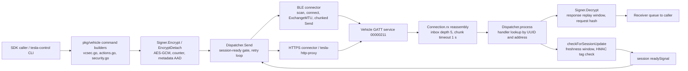
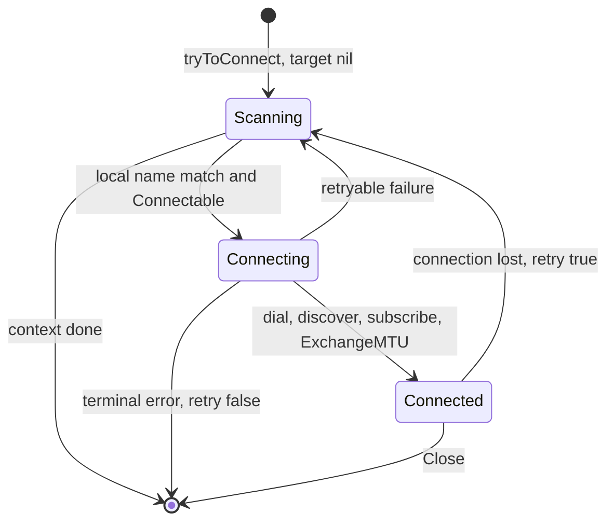
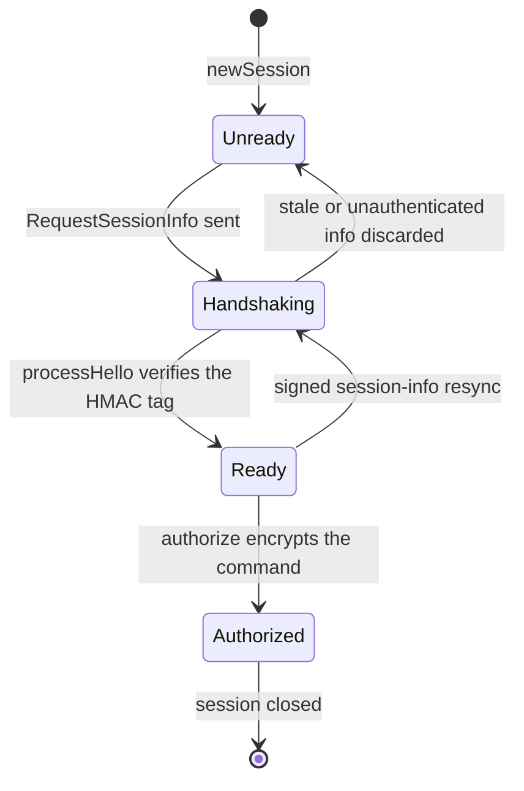
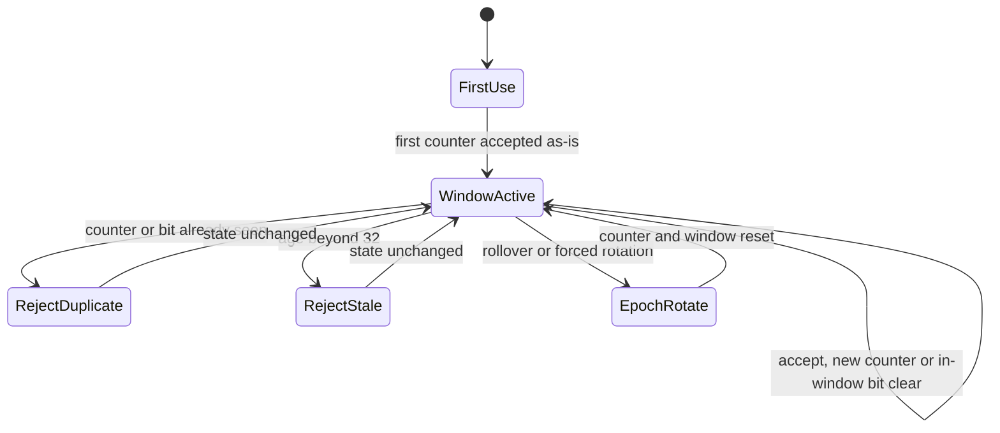

# teslamotors/vehicle-command — legacy deep dive

## 1. Provenance

| Field | Value |
| --- | --- |
| Submodule path | `legacy/teslamotors-vehicle-command` |
| Pinned gitlink SHA | `0a582da430c4aca6d397fb6cbed5b4d6bb380125` (`git ls-files -s`: `160000 <sha> 0`) |
| `rev-parse HEAD` | `0a582da430c4aca6d397fb6cbed5b4d6bb380125` — matches gitlink |
| Worktree status | `git status --porcelain` empty (clean) |
| Last commit | `0a582da tesla-control: add PIN to Drive command` |
| Upstream URL | `https://github.com/teslamotors/vehicle-command` (origin fetch + push) |
| License | Apache-2.0 (`LICENSE:2`) |
| Language / module | Go 1.23 (`go.mod:1-13`), module `github.com/teslamotors/vehicle-command` |
| Analysis date | 2026-11-20 |
| Frontmatter note | Existing file had **no YAML frontmatter** (line 1 was `# teslamotors/vehicle-command`); nothing to preserve verbatim. |

Files read (line ranges):

- Root: `README.md:1-323`, `go.mod:1-35`, `LICENSE:1-202`.
- BLE transport: `pkg/connector/ble/ble.go:1-360`, `device_darwin.go:1-28`, `device_linux.go:1-61`, `device_windows.go:1-20`, `pkg/connector/connector.go:1-72`.
- Crypto core: `internal/authentication/crypto.go:1-66`, `ecdh.go:1-18`, `dispatcher.go:1-18`, `signer.go:1-338`, `verifier.go:1-397`, `native.go:1-212`, `window.go:1-68`, `peer.go:1-136`, `metadata.go:1-84`.
- Session/router: `internal/dispatcher/dispatcher.go:1-536`, `session.go:1-136`, `receiver.go:1-57`.
- Protocol schema: `pkg/protocol/domains.go:1-17`, `pkg/protocol/protocol.md:1-882`, `pkg/protocol/protobuf/universal_message.proto:1-101`, `signatures.proto:1-110`.
- Command builders: `pkg/vehicle/security.go:1-240`, `vcsec.go:1-249`, `actions.go:1-120`.
- Tests read in full: `internal/authentication/ecdh_test.go:40-99`, `window_test.go:1-97`, `protocol_doc_test.go:1-89`; test names for other suites collected via `grep '^func Test'` (70 matches under `internal/authentication/`).
- Our counterpart (read for adaptation decisions): `firmware/lib/vehicle/ble/msg.h:1-481`, `proto.h:1-161`, `feature/session.h:1-282`, `distance.h:1-242`, `feature/distance.h:1-88`, `handler/dispatch.h:1-120`.

Files explicitly NOT read: generated `*.pb.go` (`carserver/`, `vcsec/`, `keys/`, `universalmessage/`, `signatures/`, `errors/`, `managedcharging/`) — `.proto` sources used instead; `pkg/vehicle/charge.go`, `climate.go`, `infotainment.go`, `state.go`, `vehicle.go`, `vehicle_test.go` (only grepped); `internal/authentication/jwt.go`, `internal/schnorr/*`, `pkg/proxy/*`, `pkg/cli/*`, `cmd/*` (only grepped); `doc/*.puml`, `doc/*.png`; `Dockerfile`, `Dockerfile.protoc`, `Makefile`, `check-all.sh`, `.github/**`; test PEM/KEY fixtures; `examples/ble/main.go` (only grepped at RSSI line).

Evidence grades used: **CODE-READ** (implementation read + cited), **TEST-READ** (test asserts behavior), **CAPTURE** (captured frame/decode; none available here), **SUMMARY-ONLY** (README or old doc only), **UNVERIFIED** (inferred, needs check).

## 2. Executive verdict

This is Tesla's official Go SDK for end-to-end authenticated vehicle commands: a static-key P-256 ECDH + AES-128-GCM protocol carried over BLE (length-prefixed protobuf `RoutableMessage`) or relayed through a Fleet API HTTP proxy, with a carefully specified canonical metadata TLV used as GCM AAD, a 32-bit replay window, epoch/clock tracking, detached AES-GCM for Fleet-API scope enforcement, and session caching. The mechanisms that matter to TeslaCANModder are the **replay window**, **authenticated session-info validation**, **AAD/metadata canonicalization with an independent test oracle**, and **response encryption/request-hash checks** — all of which are security guards our BLE code does not currently implement in the files read. Nothing here should be ported wholesale: our BLE stack implements a **different wire schema and handshake** (ephemeral ECDH with HKDF, counter-as-IV, different protobuf field numbers, VIN-suffix scan filter), so upstream frame layouts cannot be layered onto it without a listen-only capture and CAN/BLE review. The old doc's "gRPC services" and "ephemeral key exchange" claims are contradicted by code; the RSSI-distance idea is already implemented in our `distance.h` and needs no port.

## 3. Evidence map

| Source file | Lines | What it proves | Grade |
| --- | --- | --- | --- |
| `pkg/connector/ble/ble.go` | 19-36, 67-127, 327-360 | 2-byte BE length prefix; 1024-byte cap; MTU-3 chunking; service/char UUIDs; 1 s chunk timeout; 4 s clock tolerance | CODE-READ |
| `pkg/connector/ble/ble.go` | 133-137, 184-198, 200-251 | `S+SHA1(VIN)[:8]hex+C` local name; advertisement RSSI only; scan/connect state machine | CODE-READ |
| `pkg/connector/ble/device_{linux,darwin,windows}.go` | 14-61, 9-28, 18-20 | Linux CAP_NET_ADMIN hint + hci0..15; scan interval/window 0x10; Windows BLE unsupported | CODE-READ |
| `pkg/connector/connector.go` | 8-64 | AuthMethod enum (None/GCM/HMAC); BufferSize 5; MaxResponseLength 100000; AllowedLatency contract | CODE-READ |
| `internal/authentication/ecdh.go` + `native.go` | 3-18; 94-145 | Static P-256 ECDH; `K = SHA1(BIG_ENDIAN(Sx,32))[:16]`; HSM-motivated interface rationale; key load from PEM/PKCS8 | CODE-READ |
| `internal/authentication/ecdh_test.go` | 46-87 (`TestSharedKey`) | Leading-zero shared secret padded to 32 bytes; invalid curve point and point-at-infinity rejected | TEST-READ |
| `internal/authentication/native.go` | 38-88 | AES-GCM random `NonceSize()` nonce; tag = last 16 bytes of `Seal`; `subkey(label)=HMAC-SHA256(K,label)` | CODE-READ |
| `internal/authentication/metadata.go` | 27-84 | TLV `tag||len||value`, uint32 BE, increasing-tag order, 255-byte field cap, `TAG_END=0xFF` + message hashed | CODE-READ |
| `internal/authentication/metadata_test.go` | 24,37,45,67 (`TestOutOfOrder`, `TestValueTooLong`, `TestCheckSum`, `TestHash512CheckSum`) | TLV invariants asserted | TEST-READ |
| `internal/authentication/protocol_doc_test.go` | 24-89 (`TestProtocolDocAESGCMExample`) | Pins exact metadata hex `000105...ff`, key, nonce, ciphertext `38038e8c0f2e`, tag `c228e0ff...` | TEST-READ |
| `internal/authentication/signer.go` | 138-181, 312-338 | GCM personalized encryption; counter rollover guard; 12-byte response nonce check | CODE-READ |
| `internal/authentication/verifier.go` | 18, 197-260, 281-332 | `nonceLength=12`; personalized/detached verify; epoch, expiry, fault checks | CODE-READ |
| `internal/authentication/verifier_test.go` | 119,164,185,610,627,670,815,846 (names) | Detached prefix/nonce tests, GCM nonce/window tests, response encryption/decrypt nonce tests | TEST-READ |
| `internal/authentication/window.go` + `crypto.go` | 9-68; 17-22 | 32-bit replay window in uint64 bitmap; `maxSecondsWithoutCounter=30`; `counterMax=0xFFFFFFFF` | CODE-READ |
| `internal/authentication/window_test.go` | 7-97 (`TestSlidingWindow`) | Exact bit-shift expectations for forward skip, in-window accept/reject, outside-window reject | TEST-READ |
| `internal/authentication/verifier.go` | 70-80, 88-153, 155-193 | Epoch rotation; signed SessionInfo; one-way wall-clock correction (never extends expiry) | CODE-READ |
| `internal/authentication/signer.go` | 50-136, 176-225 | Cached/imported SessionInfo; update with monotonic counter; detached auth | CODE-READ |
| `internal/dispatcher/dispatcher.go` | 72-156, 182-243, 245-315, 378-488 | Handshake retries; session-update freshness gate; decrypt dispatch; request UUID/address routing | CODE-READ |
| `internal/dispatcher/session.go` + `receiver.go` | 16, 48-136; 11-57 | 5 s default expiry; `readySignal`; response anti-replay; 16-byte UUID/address lengths | CODE-READ |
| `pkg/protocol/protobuf/universal_message.proto` | 10-101 | Domain 2/3; `RoutableMessage` fields: to=6, from=7, payload=10, sig=13, session_info=15, uuid=51, flags=52; reserved 1-5/11/16-40 | CODE-READ |
| `pkg/protocol/protobuf/signatures.proto` | 8-110 | Tag enum 0..10 + END=255; SignatureType 5/6/8/9/10; GCM data field layouts; SessionInfo fields | CODE-READ |
| `pkg/protocol/protocol.md` | 146-164, 222-258, 343-417, 516-731, 786-882 | BLE framing/UUID/local name; TLV examples; handshake; AES-GCM/detached/HMAC recipes; response rules | CODE-READ (spec in upstream repo) |
| `pkg/vehicle/security.go` + `security_test.go` | 18-31, 191-225; 7 | 4-digit PIN validator; `SetPINToDrive` requires `FleetAPIConnector` else `ErrRequiresEncryption` | CODE-READ + TEST-READ |
| `pkg/vehicle/vcsec.go` + `actions.go` | 23-62, 66-105, 132-249; 67-95 | VCSEC terminal-response logic; RKE/closure/key operations; window vent/close builders | CODE-READ |
| `README.md` vs `go.mod` | 66 vs 3 | "tested with Go 1.27.2" vs `go 1.23` | SUMMARY-ONLY vs CODE-READ |
| `README.md` vs repo-wide grep | 10 | "gRPC services" claim; only `grpc` hit is `protocol.md:70` protoc install link | SUMMARY-ONLY vs CODE-READ |
| `firmware/lib/vehicle/ble/msg.h`, `feature/session.h`, `handler/dispatch.h` | 20-95,288-317,330-477; 63-257; 29-52 | Our BLE schema uses fields 2/5/6/7/10/14, ephemeral ECDH+HKDF, counter-as-IV, VIN-suffix scan | CODE-READ (our side) |

## 4. Architecture and build surface

- **Module / build:** single Go module (`go.mod:1-13`); dependencies: `go-ble/ble` (transport), `google.golang.org/protobuf`, `99designs/keyring`, `golang-jwt/jwt/v5`, `cronokirby/saferith` (constant-time bigint). No C/C++ build flags; platform selection by Go filename suffixes (`device_linux.go`, `device_darwin.go`, `device_windows.go`). Build via `Makefile`, `Dockerfile`, `Dockerfile.protoc`, `.github/workflows/{build,protos,publish}.yml` (paths inventoried, not read in full).
- **Entry points:** `cmd/tesla-control` (CLI commands incl. new PIN-to-Drive), `cmd/tesla-keygen`, `cmd/tesla-http-proxy` (Fleet API REST relay), `cmd/tesla-auth-token`, `cmd/tesla-jws`; examples `examples/ble`, `examples/unlock`.
- **Shared core:** `pkg/protocol` (schemas, `Domains`, error taxonomy), `internal/authentication` (ECDH, Signer/Verifier, TLV metadata, sliding window), `internal/dispatcher` (per-domain sessions, handler map, reply routing), `internal/schnorr`.
- **Platform port:** `pkg/connector/ble` — `ble.go` is common; `newAdapter` is per-OS. Linux active scan interval/window `0x10` (`device_linux.go:30-36`), dial/listen timeout 20 s (`:26`), adapter IDs `hci0..hci15` (`:44-54`), CAP_NET_ADMIN help text (`:18-24`). Windows `newAdapter` always errors (`device_windows.go:18-20`). Darwin adapter-ID selection rejected (`device_darwin.go:18-22`).
- **Dependency boundary:** `internal/` cannot be imported outside the module; `pkg/` is the public API. Transport is abstracted by `connector.Connector` (`connector.go:29-64`), so HTTPS (`pkg/connector/inet`) and BLE share the same Dispatcher; connector advertises `PreferredAuthMethod()`, `RetryInterval()`, `AllowedLatency()`.
- **No gRPC server** exists anywhere in the tree; `pkg/protocol/protobuf/*.proto` are protobuf message definitions only, and `tesla-http-proxy` exposes a REST API (`README.md:152-299`).



## 5. Mechanism catalogue

### 5.1 BLE length-prefixed datagram framing

- **Claim (README / summary):** "length-prefixed protobuf frames"; "verify our BLE MTU and protobuf encode/decode boundaries match the reference" (old doc:108-109).
- **Code path:** `Connection.Send` (`ble.go:108-127`) → `client.WriteCharacteristic` → `Connection.rx` (`:98-106`) → `flush` (`:67-87`) → `inbox` (`:63-65`).
- **Frame spec:** 2-byte **big-endian** length prefix `uint8(len>>8), uint8(len)` (`:114`); `maxBLEMessageSize = 1024` (`:21`); RX computes `msgLength = 256*buf[0] + buf[1]` (`:69`) and drops + clears buffer if `>1024` (`:70-73`); reassembly only when `len(input) >= 2+msgLength` (`:74-84`). Chunk = `min(txMtu,1024)-3` (`:354`) with 3 bytes reserved for header; on MTU-exchange failure fallback `ble.DefaultMTU-3` (`:349-356`). Inbox depth 5 (`:330`; `connector.BufferSize=5` at `connector.go:23`).
- **Gates and timing:** `rxTimeout=1 s` — a gap longer than this clears partial reassembly (`:28`, `:99-102`); `RetryInterval=1 s` (`:59-61`); `maxLatency=4 s` allowed clock skew (`:29`, `:94-96`); Linux dial timeout 20 s (`device_linux.go:26`).
- **State machine:** `tryToConnect` → adapter reuse → scan by local name → verify `Connectable` → dial → discover service/2 characteristics → subscribe RX → ExchangeMTU → `Connection` (`:280-360`). Reconnect loop retries while `retry==true` (`:259-278`).



- **Tests:** none found for BLE transport in `git ls-files` (no `*_test.go` under `pkg/connector/ble/`).
- **Evidence grade:** CODE-READ. **Verdict:** CONFIRMED (no CAPTURE).
- **Adapt to TeslaCANModder?** candidate for constants/guard logic only. Our BLE files read show no MTU exchange or 2-byte length reassembly; adding it is transport work, not a frame-mutation change. Must capture our own link traffic first.

### 5.2 Static-key ECDH session handshake

- **Claim (README / summary):** "ephemeral key exchange"; "full ephemeral-key exchange and command signing" (old doc:48,105-106).
- **Code path:** `Dispatcher.RequestSessionInfo` (`dispatcher.go:482-488`) → `SessionInfoRequest` (`:464-478`) → `session.processHello` (`session.go:117-136`) → `authentication.NewAuthenticatedSigner` (`signer.go:50-64`) → `ImportSessionInfo` (`:73-85`) → `NativeECDHKey.Exchange` (`native.go:112-136`).
- **Frame spec:** request carries `SessionInfoRequest.public_key = ENCODE_PUBLIC(client static P-256)` (`universal_message.proto:69-73`, `protocol.md:351-370`); response `SessionInfo` fields counter/publicKey/epoch[16]/clock_time/status/handle/flags (`signatures.proto:102-110`). Shared key `K = SHA1(BIG_ENDIAN(Sx,32))[:16]` (`native.go:94-125`; `SharedKeySizeBytes=16` at `ecdh.go:11`; `protocol.md:410-417`). Epoch ID 16 bytes (`crypto.go:19`), `epochLength = 1<<30 s` (`crypto.go:50`). `ecdh.go:3-8` explicitly rejects `crypto/ecdh` because vehicle keys are **static** and HSM-backed.
- **Gates and timing:** handshake response must carry a valid HMAC tag over `{session info, VIN, challenge}` (`signer.go:56-63`, `native.go:76-88`); session info older than `AllowedLatency` (BLE 4 s) discarded (`dispatcher.go:194-201`); VCSEC reachable while infotainment asleep (`protocol.md:170-176`); vehicle supports max 3 simultaneous BLE connections (`protocol.md:163-164`).
- **State machine:** `newSession` (unready) → request → `processHello` → `readySignal` closed → `authorize` allowed (`session.go:61-98`, `:131-134`). Resync via `UpdateSignedSessionInfo` (`signer.go:123-136`) and `Verifier.SetSessionInfo` (`verifier.go:132-153`); epoch rotation `verifier.go:70-80`.



- **Tests:** `TestSharedKey` (`ecdh_test.go:46`), `TestNewAuthenticatedSigner` (`signer_test.go:211`), `TestGCMKnown` (`verifier_test.go:521`), `TestProvideHandle` (`verifier_test.go:802`).
- **Evidence grade:** CODE-READ + TEST-READ. **Verdict:** CONTRADICTED (summary says ephemeral; code uses static enrolled key).
- **Adapt to TeslaCANModder?** never port the core — our `firmware/lib/vehicle/ble/feature/session.h:63-199` generates an **ephemeral** P-256 keypair and derives keys via HKDF-SHA256 with both challenges as salt/info (`:149-185`), a different protocol. **Actual gap to consider:** upstream authenticates the handshake response; our `parseSessionInfoFields` (`msg.h:330-477`) and `establish` (`session.h:103-113`) only extract publicKey/challenge and verify no tag.

### 5.3 Canonical metadata TLV + HMAC subkeys

- **Claim (README / summary):** "Cryptography: Vehicle authentication (VCSEC)" (old doc:36); protocol spec `protocol.md:222-258`.
- **Code path:** `metadata.Add` (`metadata.go:34-50`) → `AddUint32` (`:52-56`) → `Checksum` (`:80-84`); `NativeSession.subkey`/`NewHMAC` (`native.go:66-74`); `SessionInfoHMAC` (`:76-88`); `Peer.hmacTag` (`peer.go:88-95`).
- **Frame spec:** each field serialized as `tag byte || 1-byte length || value`; uint32 as 4-byte **big-endian** (`metadata.go:52-56`); tags must be added in strictly increasing order (`metadata.go:35-37`); >255-byte field rejected (`:41-43`); final `SHA256(TLVs || 0xFF || message)` (`:80-84`, `TAG_END=255` at `signatures.proto:21`). Tags 0..10 defined at `signatures.proto:8-22`; named subkeys `HMAC-SHA256(K,"session info")` and `HMAC-SHA256(K,"authenticated command")` (`crypto.go:12-15`, `protocol.md:452-456`, `:723-724`).
- **Gates and timing:** none beyond ordering/length; optional fields (flags) included only if non-zero (`peer.go:78-83`).
- **State machine:** n/a (pure function).
- **Tests:** `metadata_test.go:24,37,45,67`; `protocol_doc_test.go:28` pins exact AAD hex `0001050101030211...070400000002ff` and tag `c228e0ff64991481db3a7bbc133696c5`.
- **Evidence grade:** CODE-READ + TEST-READ. **Verdict:** CONFIRMED.
- **Adapt to TeslaCANModder?** candidate — **idea only**: adopt a canonical TLV/AAD with an independent test oracle, not the Go code. Blocked until our wire schema is reconciled (see §6 row 5); if our protocol has no metadata binding, this is a real security gap.

### 5.4 AES-GCM personalized command encryption

- **Claim (README / summary):** "Encrypted command transmission"; "AES-GCM" (old doc:49,127).
- **Code path:** `Signer.Encrypt` (`signer.go:176-182`) → `encryptWithCounter` (`:138-171`) → `NativeSession.Encrypt` (`native.go:38-52`) → `Dispatcher.Send` (`dispatcher.go:433-460`).
- **Frame spec:** AES-128-GCM key `K`; 12-byte **random** nonce (`nonceLength=12` at `verifier.go:18`; `native.go:43-46`); AAD = `SHA256(canonical metadata)` (`signer.go:164-166`); ciphertext in `RoutableMessage.protobuf_message_as_bytes` (field 10, `universal_message.proto:87-91`); signature in field 13 (`universal_message.proto:93-95`) → `SignatureData.AES_GCM_Personalized_data` field 5 (`signatures.proto:80`) with `epoch=1, nonce=2, counter=3, expires_at=4, tag=5` (`signatures.proto:43-49`); tag = last 16 bytes of `gcm.Seal` (`native.go:47-50`). Counter increments per command and refuses `0xFFFFFFFF` (`signer.go:177-181`).
- **Gates and timing:** expiration = context deadline or `defaultExpiration = 5 s` (`session.go:16,61-66`); flags authenticated only when non-zero (`peer.go:78-83`).
- **State machine:** n/a per message; counter monotonic within epoch.
- **Tests:** `TestProtocolDocAESGCMExample` (`protocol_doc_test.go:28`); `TestValidGCMEncryption` (`verifier_test.go:218`), `TestGCMNonceLength` (`:610`), `TestGCMExpired` (`:490`), `TestSignerCounterRollover` (`signer_test.go:190`).
- **Evidence grade:** CODE-READ + TEST-READ. **Verdict:** CONFIRMED.
- **Adapt to TeslaCANModder?** candidate for **nonce randomness + AAD binding**, not frame layout. Our `session.h:223-244` uses the 32-bit counter as a 12-byte little-endian IV and passes **no AAD** to `mbedtls_gcm_crypt_and_tag`; our signature submessage has a different shape (`msg.h:291-302`: `tag=1, counter=2, component_id=3`). Security-critical: requires independent test oracle + bench validation; cannot be a copy-paste.

### 5.5 Detached AES-GCM (plaintext command type, encrypted parameters)

- **Claim (README / summary):** "detached AES-GCM protobuf definitions" (old doc:127) — confirmed in code.
- **Code path:** `Signer.EncryptDetach` (`signer.go:184-225`) → `addDetachedAuthentication` (`:227-265`) → `Verifier.verifyDetached` (`verifier.go:281-332`) → `marshalNestedMessage` (`peer.go:38-46`).
- **Frame spec:** walk nested protobuf BYTES fields; depth 2 for Infotainment (`Action → service → command`), depth 1 for VCSEC (`UnsignedMessage → command`) (`signer.go:194-201`); `protowire.ConsumeTag`/`ConsumeBytes` require `BytesType` and reject trailing bytes outside the innermost envelope (`signer.go:202-219`); prefix = nested field numbers with empty innermost payload; `TAG_COMMAND_PREFIX` is authenticated (`signer.go:239`, `verifier.go:290-292`); `AES_GCM_Detached_Signature_Data` fields `nonce=1,counter=2,expires_at=3,tag=4,prefix=5` (`signatures.proto:51-57`); verifier reconstructs full command with `marshalNestedMessage(fieldNumbers, plaintext)` (`verifier.go:331`).
- **Gates and timing:** only when `SessionInfo.flags` bit `SESSION_INFO_FLAG_SUPPORTS_DETACHED_ENCRYPTION` is set (`signer.go:83`, `signatures.proto:97-99`); upstream states only Infotainment supports it (`protocol.md:692-695`); `Verifier.DefaultVerifierFlags` sets that bit (`verifier.go:29`). BLE path explicitly told to use `Encrypt` instead (`signer.go:186-187`).
- **State machine:** n/a.
- **Tests:** `verifier_test.go:67,93,119,164,185,735` (`TestInvalidDetachedEncryptionPrefixes`, `TestDetachPrefixTooLong`, `TestDetachedEncryption`, `TestDetachedNonceLength`, `TestEncryptDetachRejectsInvalidCommands`, `TestDetachedEncryptionUprev`).
- **Evidence grade:** CODE-READ + TEST-READ. **Verdict:** CONFIRMED.
- **Adapt to TeslaCANModder?** no impact for BLE. Only relevant if we ever add a Fleet API proxy that must inspect commands for OAuth scopes; never for our BLE dispatcher.

### 5.6 Anti-replay sliding window and epoch/clock guards

- **Claim (README / summary):** "Session handshake hardening" (old doc:105-106); not detailed there.
- **Code path:** `updateSlidingWindow` (`window.go:9-50`) ← `Verifier.Verify` (`verifier.go:228-233`); `SlidingWindow.Update` (`window.go:52-68`) ← `session.decrypt` (`session.go:48-59`); `verifySessionInfo` (`verifier.go:334-366`); `adjustClock`/`rotateEpochIfNeeded` (`verifier.go:70-80,155-193`).
- **Frame spec / constants:** `windowSize = 32` (`crypto.go:21`, must be ≤64 because bitmap is `uint64`); LSB of `window` = age 1; reject `counter == newCounter`, `age > 32`, or already-set bit (`window.go:17-37`); forward jump shifts bitmap and sets bit `shiftCount-1` (`window.go:40-49`). `counter=0` disables replay check but forces remaining TTL ≤ `maxSecondsWithoutCounter = 30` (`crypto.go:20`, `verifier.go:354-364`). `counterMax = 0xFFFFFFFF` (`crypto.go:18`); epoch 16 random bytes, rotated on forced/counter rollover/timestamp > `epochLength` (`verifier.go:70-80`). Clock correction is one-way: wall clock ahead of monotonic by >1 s nudges `timeZero` forward only, so an attacker moving the wall clock can expire commands early but never extend them (`verifier.go:155-193`).
- **Gates and timing:** epoch mismatch → `MESSAGEFAULT_ERROR_INCORRECT_EPOCH`; expired → `TIME_EXPIRED`; TTL too long → `TIME_TO_LIVE_TOO_LONG` (`verifier.go:339-363`, fault codes at `universal_message.proto:47-52`).
- **State machine:** per-domain `{epoch, counter, window, timeZero}`; resync from vehicle-supplied signed SessionInfo without rolling counter backward unless epoch changes (`signer.go:105-116`).



- **Tests:** `TestSlidingWindow` (`window_test.go:7` exact bit patterns), `TestGCMWindow` (`verifier_test.go:627`), `TestGCMWindowRecent` (`:670`), `TestGCMNoCounterLongExpiration` (`:591`), `TestGCMOutOfOrderMessage` (`:389`), `TestEpochChange` (`:403`), `TestGCMEpochRotation` (`:363`).
- **Evidence grade:** CODE-READ + TEST-READ. **Verdict:** CONFIRMED.
- **Adapt to TeslaCANModder?** **top candidate**. Value high (replay protection), cost low (one small helper + state fields), risk low if independent tests are written. Our read BLE files show `TeslaSession` only increments a TX counter (`session.h:221`) and no response-side replay check. Do not use upstream identifiers or bitmap code verbatim.

### 5.7 Response encryption, request hash, response counter

- **Claim (README / summary):** "Protobuf size constraints ... larger carserver commands" (old doc:108-109) — adjacent but not this mechanism.
- **Code path:** `Verifier.Encrypt` (`verifier.go:372-397`) / `Signer.Decrypt` (`signer.go:312-338`) / `responseMetadata` (`peer.go:124-136`) / `RequestID` (`peer.go:97-122`); dispatch `decrypt` (`dispatcher.go:226-243`).
- **Frame spec:** `AES_GCM_Response_data` field 9 (`signatures.proto:83`) with `nonce=1,counter=2,tag=3` (`:59-63`); nonce must be exactly 12 bytes (`signer.go:317-319`); AAD = SHA256 of response TLVs including `TAG_REQUEST_HASH` = one signature-type byte + request tag, truncated to 17 bytes for VCSEC HMAC (`peer.go:110-114`, `protocol.md:797-817`); response flags always included (`peer.go:132`, `protocol.md:844-846`); `FLAG_ENCRYPT_RESPONSE = 1<<1 = 2` (`universal_message.proto:75-78`, `protocol.md:62-65,584-590`); response counter checked against a per-request `SlidingWindow` (`session.go:55-57`), duplicates drop as `ErrReplayedResponse` (`dispatcher.go:302-304`).
- **Gates and timing:** if response has no `AES_GCM_Response_data`, payload is plaintext (`protocol.md:793-795`).
- **Tests:** `TestVerifierEncryption` (`verifier_test.go:815`), `TestSignerDecryptNonceLength` (`:846`), `TestRequestID` (`peer_test.go:104`), `TestSignerDecryptMetadataError` (`signer_test.go:870`).
- **Evidence grade:** CODE-READ + TEST-READ. **Verdict:** CONFIRMED.
- **Adapt to TeslaCANModder?** candidate, **contingent** on wire-format reconciliation. Our `msg.h` parser and `session.h` do not decrypt or authenticate vehicle responses in the files read; this is a larger gap than the replay window and needs a capture before any change.

### 5.8 Session caching and authenticated resync

- **Claim (README / summary):** `TESLA_CACHE_FILE` described at `README.md:125-129`; old doc does not cover it.
- **Code path:** `Signer.ExportSessionInfo`/`ImportSessionInfo` (`signer.go:71-100`) → `Dispatcher.Cache`/`LoadCache` (`dispatcher.go:490-535`) → `CacheEntry{CreatedAt,Domain,SessionInfo}` (`session.go:18-24`); resync via `checkForSessionUpdate` (`dispatcher.go:182-224`) and `UpdateSessionInfo` (`signer.go:102-136`).
- **Frame spec:** cache stores protobuf `SessionInfo` (counter, publicKey, epoch, clock_time, flags) plus creation time; `SESSION_INFO_FLAG_SUPPORTS_DETACHED_ENCRYPTION` preserved across export/import (`signer.go:96-98,83`). Vehicle may piggyback SessionInfo on any reply with `signature_data.session_info_tag` (`verifier.go:132-153`).
- **Gates and timing:** discard cached/session-update info if request older than `AllowedLatency` (4 s BLE), tag missing/invalid, or clock_time earlier than a previously authenticated value in same epoch (`dispatcher.go:194-223`, `signer.go:106-116`, `protocol.md:748-768`).
- **Tests:** `TestExportImport` (`signer_test.go:260`), `TestExportImportPreservesDetachedSupport` (`:288`), `TestUpdateSessionInfo` (`:14`), `TestUpdateSessionInfoBadCounter` (`:85`), `TestBadSessionInfoTag` (`:61`), `TestImportWrongTime` (`:313`).
- **Evidence grade:** CODE-READ + TEST-READ. **Verdict:** CONFIRMED.
- **Adapt to TeslaCANModder?** no impact for current scope (no NVS session cache exists in read files; adding one is a separate feature with its own lifecycle). Reuse the *rules* (freshness window, no counter rollback) if a cache is ever added.

### 5.9 VCSEC / CarServer command builders and reply routing

- **Claim (README / summary):** "Commands: HVAC, locks, trunks, charging, etc." (old doc:38); "VCSEC command parity" (old doc:102-103).
- **Code path:** `executeRKEAction` (`vcsec.go:171-194`), `executeClosureAction` (`:217-249`), `addKeyPayload` (`:151-169`), `getVCSECResult`/`readUntil` (`:66-105`), `unmarshalVCSECResponse` (`:23-62`), `actions.go:12-120` (trunk/frunk, horn/lights, windows, charge port).
- **Frame spec:** VCSEC domain=2, Infotainment=3 (`universal_message.proto:10-14`); VCSEC payload = `vcsec.UnsignedMessage`, Infotainment payload = `carserver.Action` (`protocol.md:39-46`); `slotNone = 0xFFFFFFFF` (`vcsec.go:107`); `VehicleControlWindowAction` with `Vent` or `Close` (`actions.go:67-95`); key add uses `PermissionChange{Key, KeyRole}` + `KeyMetadata{KeyFormFactor}` (`vcsec.go:151-169`).
- **Gates and timing:** up to three VCSEC replies per request; non-whitelist terminal rule = empty `commandStatus` with no `nominalError`; `OPERATIONSTATUS_WAIT` = busy (retry) or NFC-card wait during pairing; `OPERATIONSTATUS_ERROR` is legacy-only and should be discarded (`protocol.md:855-882`, `vcsec.go:132-149`); retries use `protocol.ShouldRetry` + connector `RetryInterval` (`vcsec.go:84-105`).
- **Tests:** `pkg/vehicle/security_test.go`, `vcsec_test.go`, `vehicle_test.go`, `vehicle_mock_test.go` exist (names via grep; not read in full).
- **Evidence grade:** CODE-READ (partial: three builder files), TEST-READ only by file existence. **Verdict:** CONFIRMED for read paths, PARTIAL for full command catalogue.
- **Adapt to TeslaCANModder?** candidate for narrow command parity (e.g. vent windows present at `actions.go:82-95`), but **blocked** by the wire-schema divergence in §6 row 5; porting a command builder into `msg.h` without fixing field numbers would produce invalid frames.

### 5.10 PIN-to-Drive and other PIN-gated security commands

- **Claim (README / summary):** upstream note "PIN-to-Drive is Fleet API, not BLE" (old doc:128).
- **Code path:** `IsValidPIN` (`security.go:18-29`) → `SetPINToDrive` (`:209-225`) → `executeCarServerAction`; `ClearPINToDrive` (`:191-201`), deprecated `ResetPIN` (`:80-93`); valet/speed-limit/parental PIN variants (`:33-158`, `:362-456`).
- **Frame spec:** valid PIN = exactly four ASCII digits (`security.go:19-28`); `SetPINToDrive` emits `VehicleControlSetPinToDriveAction{On, Password}` (`:217-221`); clear uses `VehicleControlResetPinToDriveAdminAction` (`:196-198`). **Hard gate:** `if _, ok := v.conn.(connector.FleetAPIConnector); !ok { return protocol.ErrRequiresEncryption }` (`:210-212`) — BLE connector does not implement `FleetAPIConnector` (`connector.go:66-72`).
- **Gates and timing:** none beyond connector type + PIN format; vehicle remembers the PIN when disabled, so changing it requires `ClearPINToDrive` first (`:206-208`).
- **Tests:** `TestValidPIN` (`security_test.go:7`).
- **Evidence grade:** CODE-READ + TEST-READ. **Verdict:** CONFIRMED — upstream note is correct.
- **Adapt to TeslaCANModder?** never port onto BLE. No TeslaCANModder `tesla:*` command needs a 4-digit PIN; at most reuse the strict input-validation *idea* for any future numeric parameter.

### 5.11 HSM/TEE external key interface

- **Claim (README / summary):** old doc:120 "HSM/TEE external integration: `Session` re-export + `ECDHPrivateKey` HSM/TEE requirements docs" (from commit messages, SUMMARY-ONLY for intent).
- **Code path:** `ECDHPrivateKey` interface (`ecdh.go:13-18`: `Exchange`, `PublicBytes`, `SchnorrSignature`); rationale comment (`:3-8`: avoid divulging long-term secrets to host, supports static keys in HSM); `Session` interface (`crypto.go:32-48`); `SchnorrSignature` used for JWT signing (`jwt.go:37`, grepped); external implementation stub visible in `pkg/protocol/external_impl_test.go:18` (grepped, not read in full).
- **Frame spec:** n/a (interface boundary, not wire).
- **Gates and timing:** n/a.
- **Tests:** `internal/authentication/example_test.go`, `pkg/protocol/external_impl_test.go` exist (names via grep).
- **Evidence grade:** CODE-READ (interfaces + comments), SUMMARY-ONLY (commit intent). **Verdict:** PARTIAL.
- **Adapt to TeslaCANModder?** no impact now. If key material ever moves to a secure element, mirror the *boundary* (private key never leaves HSM; expose ECDH + public-bytes + signature ops) with our own types.

## 6. Summary vs code contradiction table

| # | Old doc / README claim | Code evidence | Verdict |
| --- | --- | --- | --- |
| 1 | "Provides gRPC services for issuing vehicle commands" (old doc:10) | No gRPC code in `git ls-files`; only `grpc` string is `protocol.md:70` protoc install link; REST proxy at `README.md:152-299` | CONTRADICTED |
| 2 | "Ephemeral key exchange" (old doc:48), "full ephemeral-key exchange and command signing" (old doc:105-106) | Static enrolled key ECDH: `ecdh.go:3-8`, `native.go:94-125`, `protocol.md:410-417`; commands use symmetric HMAC/AES-GCM (`signer.go:138-181,267-306`), Schnorr only for JWT (`jwt.go:37`) | CONTRADICTED (TTL/challenge exists, but K is static-key ECDH) |
| 3 | "package was tested with Go 1.27.2" (`README.md:66`) | `go.mod:3` declares `go 1.23` | CONTRADICTED |
| 4 | "RSSI is available from the underlying BLE host stack during this flow" (old doc:85) | Only advertisement RSSI: `ble.go:187,195` (`ScanResult.RSSI = int16(a.RSSI())`), printed at `examples/ble/main.go:113`; no connection-time RSSI read anywhere in repo | PARTIAL / UNVERIFIED — no upstream API for connected-peer RSSI |
| 5 | "primary reference for Tesla protocol frame formats" (old doc:71-75) applied to our BLE code | Upstream `RoutableMessage` fields: to=6, payload=10, sig=13, session_info=15, uuid=51 (`universal_message.proto:81-100`); our `msg.h:90-92,311-314,364-366` uses to=2, payload=5, sig=7, session_info=10, uuid=14 — all in upstream's **reserved** ranges (`universal_message.proto:81-83`). Our scan filter is VIN-suffix (`dispatch.h:29-52`) vs upstream SHA1 local name (`ble.go:133-137`). | CONTRADICTED as implementation guidance — treat our BLE stack as a different/legacy protocol until a capture proves otherwise |
| 6 | "Missing commands (e.g., ... vent windows) can be added" (old doc:103) | `VentWindows` already exists upstream at `actions.go:82-95`; our `msg.h` builders cover wake/charge/amps/limit/climate only (`:165-269`) | CONTRADICTED (upstream has it); gap is on our side |
| 7 | Old doc:127 "AES-GCM/response nonce-length checks" (upstream note) | `nonceLength = 12` (`verifier.go:18`); checks at `signer.go:317-319`, `verifier.go:248-250,320-322`; tests `verifier_test.go:164,610`, `signer_test.go:846` | CONFIRMED — not a contradiction, recorded so future edits don't "fix" it away |
| 8 | Old doc:128 "PIN-to-Drive is Fleet API, not BLE" | `security.go:210-212` requires `FleetAPIConnector` | CONFIRMED |

A contradiction means the surrounding summary prose is SUMMARY-ONLY until re-verified; the whole old doc should not be treated as a trusted spec.

## 7. CAN frame and signal inventory

None found: this repo contains no CAN bus code — no MCP2515 driver, no frame decode/mutate/inject paths, no DBC or JSON frame catalogs. The vehicle interface is BLE GATT plus an HTTPS Fleet API relay. Negative anchor (run 2026-11-20):

```text
grep -rnE 'mcp2515|CANFrame|can_id|DLC' legacy/teslamotors-vehicle-command   -> no output
```

The BLE wire contract is the closest equivalent to a frame inventory, so the load-bearing wire facts are recorded here instead. `protocol.md` is upstream's own spec document; this section stays within the closed five-grade vocabulary, so its rows are SUMMARY-ONLY until confirmed by code or capture (§3 grades its protocol.md rows CODE-READ as spec-in-repo — the grades there are frozen history, the rule here applies going forward):

| Wire fact | Layout / value | Source | Grade |
| --- | --- | --- | --- |
| BLE datagram framing | 2-byte big-endian length prefix, then payload; RX drops a declared length over 1024 and clears the buffer | `ble.go:114` (TX), `ble.go:69-73` (RX), `ble.go:21` (cap) | CODE-READ |
| GATT service and characteristics | service `00000211-b2d1-43f0-9b88-960cebf8b91e`, to-vehicle `00000212-…`, from-vehicle `00000213-…` | `ble.go:33-35` | CODE-READ |
| Vehicle advertisement local name | `S` + lower-case hex of SHA1(VIN)[:8] + `C` | `ble.go:133-137` | CODE-READ |
| Domain IDs | DOMAIN_VEHICLE_SECURITY=2, DOMAIN_INFOTAINMENT=3 | `universal_message.proto:10-14` | CODE-READ |
| RoutableMessage envelope | to_destination=6, from_destination=7, protobuf_message_as_bytes=10, session_info_request=14, session_info=15, signature_data=13, signedMessageStatus=12, request_uuid=50, uuid=51, flags=52; reserved 1-5, 11, 16-40 | `universal_message.proto:80-101` | CODE-READ |
| Command auth block | `AES_GCM_Personalized_Signature_Data`: epoch=1, nonce=2 (12 bytes), counter=3, expires_at=4 (fixed32), tag=5 (16 bytes) | `signatures.proto:43-49`; `verifier.go:18` | CODE-READ |
| SessionInfo reply | counter=1, publicKey=2, epoch=3 (16 bytes), clock_time=4, status=5, handle=6, flags=7 | `signatures.proto:102-110`; `crypto.go:19` | CODE-READ |
| Metadata TLV | `tag||len||value`, uint32 big-endian, strictly increasing tags, 255-byte field cap, `TAG_END=255` appended before the message is hashed | `metadata.go:34-56,80-84`; `signatures.proto:21` | CODE-READ |
| Anti-replay counter | uint32, max 0xFFFFFFFF, 32-entry window | `crypto.go:18,21` | CODE-READ |
| MessageFault codes on RX | INVALID_TOKEN_OR_COUNTER=6, INCORRECT_EPOCH=15, IV_INCORRECT_LENGTH=16, TIME_EXPIRED=17, TIME_TO_LIVE_TOO_LONG=20 | `universal_message.proto:38,47-52` | CODE-READ |
| Simultaneous vehicle BLE connections | up to 3, shared with keyfobs and phone keys | `protocol.md:163-164` | SUMMARY-ONLY |

No CAPTURE evidence exists: every row above comes from reading code and schema files, not from recorded vehicle traffic.

## 8. Constants and tuning table

Values that shape framing, gates, or timing windows. Trivial constants (UUID literals, formatting widths, buffer sizes that never gate behavior) are skipped.

| Constant | Value | Source | Meaning | Grade |
| --- | --- | --- | --- | --- |
| `maxBLEMessageSize` | 1024 | `ble.go:21` | max BLE datagram; a larger declared length drops the frame (`ble.go:70-73`) | CODE-READ |
| `rxTimeout` | 1 s | `ble.go:28` | max gap between chunks; a longer gap clears partial RX reassembly (`ble.go:99-102`) | CODE-READ |
| `maxLatency` / `AllowedLatency()` | 4 s | `ble.go:29,94-96` | tolerated vehicle-clock error; session info older than this is discarded (`dispatcher.go:198-201`) | CODE-READ |
| `RetryInterval()` | 1 s | `ble.go:59-61` | connector-recommended retransmit and handshake retry interval (`dispatcher.go:108,122`) | CODE-READ |
| inbox depth | 5 | `ble.go:330`; `connector.go:23` | queued datagrams before a silent drop (`ble.go:78-82`) | CODE-READ |
| MTU chunk reserve | 3 bytes | `ble.go:352-354` | ATT header excluded from chunk size; fallback `ble.DefaultMTU-3` when ExchangeMTU fails | CODE-READ |
| `MaxResponseLength` | 100000 | `connector.go:26` | response byte cap every connector implementation must support | CODE-READ |
| `bleTimeout` | 20 s | `device_linux.go:26` | Linux dial and listen timeout | CODE-READ |
| `LEScanInterval` / `LEScanWindow` | 0x10 / 0x10 | `device_linux.go:32-33` | active scan duty cycle | CODE-READ |
| `SharedKeySizeBytes` | 16 | `ecdh.go:11` | AES-128 key cut from the SHA1 digest of the ECDH shared X coordinate | CODE-READ |
| `nonceLength` | 12 | `verifier.go:18` | AES-GCM IV size, enforced on commands and responses (`verifier.go:248,320`) | CODE-READ |
| `counterMax` | 0xFFFFFFFF | `crypto.go:18` | last valid command counter; rollover refused (`signer.go:177-179`) and forces epoch rotation (`verifier.go:71`) | CODE-READ |
| `epochIDLength` | 16 | `crypto.go:19` | epoch ID bytes | CODE-READ |
| `epochLength` | 1<<30 s | `crypto.go:50` | epoch rotation period; `var` not `const` to facilitate testing | CODE-READ |
| `windowSize` | 32 | `crypto.go:21` | replay window depth; the bitmap is `uint64`, so the ceiling is 64 | CODE-READ |
| `maxSecondsWithoutCounter` | 30 | `crypto.go:20` | max remaining TTL for counter=0 or out-of-order messages (`verifier.go:359-363`) | CODE-READ |
| `defaultExpiration` | 5 s | `session.go:16,63` | command lifetime when the caller sets no deadline | CODE-READ |
| subkey labels | "session info" / "authenticated command" | `crypto.go:13-14` | labels for HMAC-SHA256 subkey derivation | CODE-READ |
| metadata field cap | 255 | `metadata.go:41-43` | max bytes per authenticated TLV field | CODE-READ |
| simultaneous vehicle BLE connections | 3 | `protocol.md:163-164` | VCSEC connection budget shared with keyfobs and phone keys | SUMMARY-ONLY |

## 9. Failure modes and edge cases

None found for watchdog, bus-off, OTA, brownout, or reboot-state handling: this is a host-side Go SDK, not embedded firmware. The failure paths that do exist:

| Failure | Handling code path | Tested? | Grade |
| --- | --- | --- | --- |
| BLE datagram declares length over 1024 | buffer cleared, frame dropped, connection stays up (`ble.go:70-73`) | untested — no `*_test.go` under `pkg/connector/ble/` | CODE-READ |
| Inter-chunk gap over 1 s | partial reassembly cleared on the next chunk (`ble.go:99-102`) | untested | CODE-READ |
| Inbound inbox full (5 slots) | datagram consumed from the reassembly buffer, then silently dropped (`ble.go:78-82`) | untested at connector level; the dispatcher receiver-queue overflow is tested — `TestDoNotBlockOnResponder` (`dispatcher_test.go:830-877`) | CODE-READ |
| MTU exchange fails | chunk size falls back to `ble.DefaultMTU-3` with a warning (`ble.go:349-353`) | untested | CODE-READ |
| Beacon found but not connectable | terminal `ErrMaxConnectionsExceeded`, retry loop exits (`ble.go:302-304,266-268`) | untested | CODE-READ |
| Windows BLE adapter init | always errors "not supported on Windows" (`device_windows.go:18-20`) | untested | CODE-READ |
| Linux adapter init without CAP_NET_ADMIN | error surfaced with a `setcap` help text; `IsAdapterError` stops the retry loop (`device_linux.go:14-24`; `ble.go:266-268`) | untested | CODE-READ |
| Unparseable RX protobuf | dropped, listen loop continues (`dispatcher.go:353-357`) | `TestInvalidMessages` (`dispatcher_test.go:436,470-492`) | TEST-READ |
| RX missing source, destination, UUID, or address length | dropped with a warning log (`dispatcher.go:248-284`) | `TestInvalidMessages` (`dispatcher_test.go:420-493`) | TEST-READ |
| Session info stale, unauthenticated, or corrupted | discarded; session stays unready, next send gets `ErrNoSession` (`dispatcher.go:194-207`; `session.go:117-136`) | `TestDiscardUnauthenticatedSessionInfo` (`dispatcher_test.go:603`), `TestCorruptedSessionInfo` (`:556`), `TestUnsolicitedSessionInfo` (`:510`) | TEST-READ |
| Replayed vehicle response | per-request `SlidingWindow` rejects; `ErrReplayedResponse` drops the message (`session.go:55-57`; `dispatcher.go:302-304`) | window logic tested (`window_test.go:7-97`); the drop branch has no test references — `grep -nE 'ErrReplayedResponse' internal/` hits only `session.go:56` and `dispatcher.go:302` | CODE-READ |
| Command counter at 0xFFFFFFFF | `Encrypt` refuses with a counter-rollover error (`signer.go:177-179`) | `TestSignerCounterRollover` (`signer_test.go:190`) | TEST-READ |
| Epoch mismatch | `MESSAGEFAULT_ERROR_INCORRECT_EPOCH`, signed session info attached for resync (`verifier.go:339-343`) | `TestGCMInvalidEpoch` (`verifier_test.go:500`), `TestEpochChange` (`:403`) | TEST-READ |
| Command expired | `MESSAGEFAULT_ERROR_TIME_EXPIRED` (`verifier.go:345-348`) | `TestGCMExpired` (`verifier_test.go:490`) | TEST-READ |
| counter=0 or out-of-order with long TTL | `MESSAGEFAULT_ERROR_TIME_TO_LIVE_TOO_LONG` (`verifier.go:354-364`) | `TestGCMNoCounterLongExpiration` (`verifier_test.go:591`) | TEST-READ |
| Nonce length other than 12 | `MESSAGEFAULT_ERROR_IV_INCORRECT_LENGTH` (`verifier.go:248-250,320-322`) | `TestGCMNonceLength` (`verifier_test.go:610`), `TestDetachedNonceLength` (`:164`), `TestSignerDecryptNonceLength` (`:846`) | TEST-READ |
| Host wall clock jumped forward (sleep) | one-way `timeZero` fast-forward; backwards jumps force epoch rotation — an attacker can expire commands early but never extend them (`verifier.go:155-193`) | untested — `grep -nE 'adjustClock|Sleep|FastForward' internal/authentication/verifier_test.go` gives no output | CODE-READ |
| Handshake unresponsive | `SessionInfoRequest` resent every `RetryInterval` until ctx cancel (`dispatcher.go:96-125`) | `TestRetryNonresponsive` (`dispatcher_test.go:970-1013`) | TEST-READ |
| Vehicle answers the handshake with UNKNOWN_KEY_ID | mapped to `ErrKeyNotPaired` — previously hung, fixed by `bdf1025` (`dispatcher.go:111-113`) | `TestNoValidHandshakeResponse` (`dispatcher_test.go:916-968`) | TEST-READ |
| VCSEC busy (OPERATIONSTATUS_WAIT) or legacy ERROR | WAIT retries via `protocol.ShouldRetry` plus connector `RetryInterval`; ERROR is legacy-only and discarded per `protocol.md:855-882` (`vcsec.go:50-52,84-105`) | `EnqueueVCSECBusy` helper and its use (`vcsec_test.go:141-159,227-228`) | TEST-READ |
| Proxy: vehicle asleep, key unpaired, oversized body | 408 / 412 status mapping; body capped at 1 MiB via `http.MaxBytesReader` (`proxy.go:185-189,31,363`) | `status_test.go:22-25,43-44`; `TestServeHTTPRejectsOversizedBody` (`proxy_test.go:1198`) | TEST-READ |
| Cache entry with earlier clock_time in the same epoch | `ImportSessionInfo` rejects — no time rollback (`signer.go:106-116` per §3) | `TestImportWrongTime` (`signer_test.go:313`) | TEST-READ |

The untested paths cluster in `pkg/connector/ble/` (a directory with zero tests) and in the dispatcher's replay-drop branch — exactly the paths a field failure hits first.

## 10. Test coverage map

33 test files, 177 `^func (Test|Example)` declarations (grep count, 2026-11-20). Assertion bodies were read for the files listed in §1 and for `dispatcher_test.go` and `vcsec_test.go` in this pass. Rows graded UNVERIFIED were inventoried by name via `grep -nE '^func (Test|Example)'` and their bodies were NOT read.

| Test file(s) | Tests | What it asserts | Grade |
| --- | --- | --- | --- |
| `internal/dispatcher/dispatcher_test.go` | 21 | handshake start/retry/timeout; invalid-reply filtering; unauthenticated, corrupt, and unsolicited session-info discard; send-without-session; receiver-queue overflow does not block other responders; cache export/load round-trip; stop and not-connected (read in full this pass) | TEST-READ |
| `internal/authentication/window_test.go` | 1 | exact bit-shift expectations: forward jump, in-window accept/reject, outside-window reject | TEST-READ |
| `internal/authentication/ecdh_test.go` | 3 | shared-key zero-padding; invalid curve point and point-at-infinity rejected | TEST-READ |
| `internal/authentication/protocol_doc_test.go` | 1 | pins the protocol.md AES-GCM example: exact metadata hex, key, nonce, ciphertext, tag | TEST-READ |
| `internal/authentication/metadata_test.go` | 4 | TLV ordering, length cap, checksum, SHA-512 variant | TEST-READ |
| `internal/authentication/verifier_test.go` | 39 | nonce length, expiry, epoch change and rotation, sliding window, corrupted ciphertext/metadata, detached-prefix validation, response encryption and decrypt | TEST-READ |
| `internal/authentication/signer_test.go` | 18 | session-info update gates (bad counter, epoch, public key, challenge), counter rollover, export/import including wrong-time rejection | TEST-READ |
| `internal/authentication/{native,peer,error,jwt,example,dispatcher}_test.go` | 2+2+1+1+2+1 | native and peer bodies cited in §3; jwt, example, and error bodies not read | UNVERIFIED |
| `pkg/vehicle/vcsec_test.go` | 3 | nominal VCSEC error mapping with `MayHaveSucceeded` and `Temporary` false; gibberish payload to `ErrBadResponse`; whitelist-operation errors; VCSEC busy helper (`vcsec_test.go:79-159` read this pass) | TEST-READ |
| `pkg/vehicle/{security,vehicle,vehicle_mock}_test.go` | 1+8+0 | PIN format; connection/retry/timeout paths by name; mock harness | UNVERIFIED |
| `pkg/proxy/{proxy,status,command}_test.go` | 39+2+1 | forwarding, retry, auth, VIN routing, JSON errors, 408/412 mapping, 1 MiB body cap, fleet-telemetry config (`status_test.go:22-25` read this pass) | UNVERIFIED |
| `cmd/tesla-http-proxy/main_test.go` | 4 | config parse, startup-failure exit code, TLS serve, command-key recycling (names only) | UNVERIFIED |
| `cmd/tesla-control/commands_test.go` | 2 | date helpers only (`TestMinutesAfterMidnight`, `TestGetDays`) — the CLI command dispatch itself has no test | UNVERIFIED |
| `pkg/account`, `pkg/cache`, `pkg/cli`, `pkg/connector/inet`, `pkg/protocol`, `internal/schnorr` test files | 15 | names via grep; bodies not read | UNVERIFIED |

Critical paths with NO test:

- `pkg/connector/ble/**` — zero test files in `git ls-files`: framing, reassembly, scan, connect, MTU fallback, and the inbox drop are all untested. Risk: the 2025-01 scan-refactor wave (see §15) fixed deadlocks found in the field, not by tests; the next transport refactor can regress silently.
- `device_{linux,darwin,windows}.go` — platform adapters untested; Windows support is a single error return (`device_windows.go:18-20`).
- Dispatcher replay-drop branch — no test references `ErrReplayedResponse` (`dispatcher.go:302-304`).
- Verifier clock fast-forward — no test references `adjustClock` (`verifier.go:155-193`).
- `cmd/tesla-control` dispatch — `commands_test.go` covers only date helpers.

## 11. Parity matrix with TeslaCANModder

Upstream citations are CODE-READ from files read for this doc (§1 and this pass). Our-side citations are CODE-READ from `firmware/lib/vehicle/ble/msg.h`, `firmware/lib/vehicle/ble/feature/session.h`, `firmware/lib/vehicle/ble/handler/dispatch.h`, and `firmware/lib/io/ble/esp32/ble_client.h`, all read in full this pass. Rows without an our-side read are excluded rather than guessed. Whether the real vehicle accepts either layout is UNVERIFIED without a capture.

| Signal / frame | Upstream decode | Our decode | Delta | Action |
| --- | --- | --- | --- | --- |
| BLE datagram framing | 2-byte BE prefix, cap 1024, 1 s chunk timeout clears partials (`ble.go:114,69-73,99-102,21`) | 2-byte BE prefix, cap 600, overflow flag reset per `receive()` (`ble_client.h:198-199,62-63,69-72,29,222-241`) | same prefix scheme; smaller cap; no inter-chunk timeout | align the cap only after a capture shows payloads over 598 bytes |
| GATT service and characteristics | `00000211/00000212/00000213` (`ble.go:33-35`) | identical constants (`ble_client.h:20-26`) | none | ignore |
| Vehicle scan filter | local name `S`+hex(SHA1(VIN)[:8])+`C` (`ble.go:133-137,222`) | Tesla service UUID advertised plus name ending in the last 8 VIN chars (`ble_client.h:113-120`; `dispatch.h:34-43`) | different match rule; ours also requires the service UUID | capture-first: record a real advertisement before touching the filter |
| MTU chunking | ExchangeMTU then `min(MTU,1024)-3`, fallback `DefaultMTU-3` (`ble.go:349-354`) | `getMTU()-3`, fallback 20 (`ble_client.h:192-193`) | equivalent intent, different fallback | ignore |
| SessionInfoRequest inner message | `public_key=1, challenge=2` (`universal_message.proto:69-73`) | eph65 at field 1, challenge16 at field 2 (`msg.h:118-119`) | layouts match — our request message is upstream-shaped | keep; the divergence lives in the envelope, not here |
| RoutableMessage envelope fields | to=6, payload=10, sig=13, session_info=15, uuid=51, session_info_request=14 (`universal_message.proto:84-99`) | to=2, payload=5, sig=7, session_info=10, uuid=14, session_info_request=6 (`msg.h:90-92,129-133,311-314,364-366`) | disjoint: every field differs and ours sits in upstream reserved 1-5; upstream field 14 is the request oneof, ours uses 14 for uuid | capture-first — reconcile before porting any builder (§6 row 5) |
| Command auth submessage | `AES_GCM_Personalized_Signature_Data{epoch=1, nonce=2, counter=3, expires_at=4, tag=5}` in SignatureData field 5 (`signatures.proto:43-49,80`) | `{tag=1, counter=2, component_id=3}` in SignatureData field 2 (`msg.h:291-302`) | different layout; upstream SignatureData has no field 2 and no component_id | never merge; capture-first |
| Session key derivation | static-key ECDH, K = SHA1(sharedX)[:16], AES-128 (`ecdh.go:3-8,11`; `native.go:94-125` per §3) | ephemeral ECDH plus HKDF-SHA256, salt = vehicle challenge, info = both public keys; 16-byte enc key and 32-byte MAC key (`session.h:145-185`) | different protocols | never port the core; port only the response-auth idea (§13) |
| AES-GCM nonce and AAD | random 12-byte nonce, AAD = SHA256(metadata TLV) (`verifier.go:18`; `signer.go:164-166`) | counter-as-IV little-endian, AAD null (`session.h:225-228,242`) | deterministic IV, no metadata binding | candidate: nonce randomness plus AAD, with an independent test oracle |
| SessionInfo reply layout | counter=1, publicKey=2, epoch=3, clock_time=4, status=5, handle=6, flags=7 (`signatures.proto:102-110`) | parser expects publicKey at field 1 (cap 65) and challenge at field 2 (cap 32) (`msg.h:446-457`) | an upstream-format reply parses as invalid: its 65-byte publicKey fails our field-2 cap | capture-first — the top wire-compatibility question |
| Session-info reply authentication | HMAC tag over {session info, VIN, challenge} verified before use (`signer.go:56-63` per §3; `dispatcher.go:203-207`) | no tag check: fields extracted raw and `establish()` accepts them unverified (`msg.h:411-477`; `session.h:103-113`) | ours trusts unauthenticated session info | candidate — top security gap (§5.2) |
| RX replay protection | 32-entry sliding window per domain plus a per-request response window (`window.go:9-50`; `session.go:55-57`) | none: TX counter only (`session.h:221`), no RX counter tracking | no replay defense on our side | candidate for future PR (§5.6) |
| Response decryption and request hash | full round-trip: decrypt with 12-byte nonce and TAG_REQUEST_HASH AAD (`verifier.go:372-397`; `peer.go:110-114` per §3) | none after the handshake: `sendCommand` sends and returns (`session.h:217-258`); `runAuthCommand` disconnects without reading replies (`dispatch.h:87-96`) | fire-and-forget versus authenticated round-trip | candidate — largest gap, capture required |
| CarServer action coverage | vent/close windows, trunk/frunk, horn/lights, charge port, scheduled charging, parental controls (`actions.go:67-95` per §3; commits `0aa3b78`, `ed0cacc`) | wake, charge start/stop, amps 1-32, limit 50-100, climate on/off (`msg.h:165-269`; `dispatch.h:229-292,246,263`) | upstream superset; ours is blocked by the envelope divergence | candidate per command, only after the schema decision |
| Add-key-to-whitelist request | `PermissionChange{Key, KeyRole}` plus `KeyMetadata{KeyFormFactor}` (`vcsec.go:151-169` per §3) | `AddKeyToWhitelistAndAddPermissions{key=1, role=2, form_factor=5}` in UnsignedMessage field 2 (`msg.h:63-95`) | same concept; wire-level equality not proven against upstream `vcsec.proto` | capture-first |

Our-side drift anchors (run 2026-11-20):

```text
grep -nE 'to_destination = field 2|protobuf_message_as_bytes = field 5|signature_data = field 7|session_info = field 10|uuid = field 14|session_info_request = field 6' firmware/lib/vehicle/ble/msg.h -> hits at 90-92, 129-133, 311-314, 366
grep -nE 'iv\[0\] = |nullptr, 0' firmware/lib/vehicle/ble/feature/session.h -> 225 counter-as-IV, 242 no AAD
grep -nE 'TESLA_SVC_UUID|TESLA_RX_BUF|mtu - 3' firmware/lib/io/ble/esp32/ble_client.h -> 20 service UUID, 29 600-byte cap, 193 MTU-3 chunks
grep -nE 'vinLen - 8|amps < 1|amps > 32|pct < 50|pct > 100' firmware/lib/vehicle/ble/handler/dispatch.h -> 40 VIN-suffix filter, 246 amps 1-32, 263 limit 50-100
```

Our BLE peripheral surface for the phone app (Nordic UART `6e400001-…`, `firmware/lib/io/ble/esp32/uuids.h:11-17`) is a separate trust domain from the vehicle link and is not part of this matrix.

## 12. Surface inventory and security notes

| Surface | Semantics | Source | Grade |
| --- | --- | --- | --- |
| BLE central (vehicle link) | connect to vehicle GATT `00000211-…`, write `…0212`, subscribe `…0213`; scan by SHA1(VIN) local name; dial retries while `retry==true` | `ble.go:33-35,200-360` | CODE-READ |
| `tesla-control` CLI dispatch | subcommand dispatch over BLE or Fleet API; the transport choice is per-command | `cmd/tesla-control/commands.go` case labels at `:552-1364` via grep; bodies not read | UNVERIFIED |
| PIN-to-Drive gate | hard-gated to `FleetAPIConnector`; the BLE connector is rejected with `ErrRequiresEncryption` | `security.go:210-212` (§5.10) | CODE-READ |
| `tesla-http-proxy` REST relay | forwards `/api/1/vehicles/…` to Fleet API; mandatory TLS; health-check endpoint (commit `0bfe6b9`); asleep 408, unpaired 412; request body capped at 1 MiB | `proxy.go:31,185-189,363` | CODE-READ |
| `tesla-keygen` / `tesla-auth-token` / `tesla-jws` binaries | key generation, OAuth token exchange, JWS signing | entry points listed in §4; bodies not read | UNVERIFIED |
| OS keyring storage | private key and OAuth token in `99designs/keyring`; service `com.tesla.auth`, key `vehicleCommandKey`, token `oauthtoken`, fallback directory `~/.tesla_keys` | `pkg/cli/keyring.go:11-19` | CODE-READ |
| Session cache file | `TESLA_CACHE_FILE` JSON: `created_at`, `domain`, encoded `SessionInfo` per domain | `session.go:20-24`; `README.md:125,144` | CODE-READ |

Security notes:

- **Published debug private keys.** The protocol spec embeds two complete EC private keys for its worked example (`protocol.md:288,292,320,324`); anchor: `grep -nE 'PRIVATE KEY' pkg/protocol/protocol.md` -> 4 hits, all inside the example. Enrolling them would grant access to any vehicle that still accepts them; already on the do-not-copy list (§14). CODE-READ.
- **Static-key HSM boundary.** `ECDHPrivateKey` exists so the enrolled private key never leaves the enclave (`ecdh.go:3-8,13-18`). CODE-READ.
- **Clock-trust model.** The wall clock is treated as untrustworthy; corrections only shorten command lifetimes, never extend them (`verifier.go:155-193`). CODE-READ.
- **BLE adapter privilege.** Linux requires CAP_NET_ADMIN or root; the help text prints a `setcap` recipe (`device_linux.go:18-24`). CODE-READ.
- **Proxy hardening.** Non-root container (`5a61b6a`, `d1a7793`), 1 MiB body cap and oversized-GET rejection (`f61e29e`, `fbb557d`), non-zero exit on startup failure (`fc5a191`) — commit subjects plus `proxy.go:31,363` read this pass. No hardcoded credentials were found in the files read; the only private-key literals are the published example keys above. `cmd/` and `pkg/proxy` bodies beyond the status mapping were not read, so the negative claim is scoped to the files read. CODE-READ.
- **Cache file exposure.** `TESLA_CACHE_FILE` stores per-domain session state as plaintext JSON on disk (`session.go:20-24`); reuse is still bounded by the freshness and tag rules in §5.8, but the file has no access control beyond OS permissions. CODE-READ.
- **Our-side context.** TeslaCANModder firmware keeps two BLE trust domains: the vehicle link (Tesla service `00000211-…`, `ble_client.h:20`) and the phone link (Nordic UART `6e400001-…`, `uuids.h:11-17`). Upstream has no equivalent of the second surface, so proxy and keyring findings do not transfer to it. CODE-READ.

## 13. Adaptation assessment

| Mechanism | Value | Cost | Risk | Evidence | Decision |
| --- | --- | --- | --- | --- | --- |
| 5.1 BLE framing constants / MTU chunking | medium | low | medium (transport-visible) | CODE-READ | candidate, after capture of our own link; no code copy |
| 5.2 Static ECDH handshake core | low for us | high | high (different protocol) | CODE-READ + TEST-READ | never port core; **gap**: authenticate session-info reply (candidate) |
| 5.3 Metadata TLV + test oracle | high | medium | high until wire aligned | CODE-READ + TEST-READ | candidate as idea + independent oracle; no verbatim port |
| 5.4 AES-GCM personalized | high (nonce/AAD) | medium | high (security-critical) | CODE-READ + TEST-READ | candidate for nonce randomness + AAD only; never copy implementation |
| 5.5 Detached AES-GCM | low (BLE) | medium | low | CODE-READ + TEST-READ | no impact; never for BLE |
| 5.6 Sliding-window replay + epoch/clock guard | high | low | low | CODE-READ + TEST-READ | **candidate for future PR** (top) |
| 5.7 Response encryption / request hash | high | medium | high | CODE-READ + TEST-READ | candidate, contingent on wire reconciliation + bench capture |
| 5.8 Session caching / resync rules | low now | medium | medium | CODE-READ + TEST-READ | no impact now; reuse rules if cache added |
| 5.9 VCSEC/CarServer builders | medium | low per command | high (wrong field numbers) | CODE-READ (partial) | candidate only after schema decision; vent windows is the concrete gap |
| 5.10 PIN-to-Drive | none | low | high (wrong transport) | CODE-READ + TEST-READ | never port |
| 5.11 HSM/TEE interface | low now | high | high (key security) | CODE-READ + SUMMARY-ONLY | no impact; boundary idea only |

Top 3 adaptation candidates: **5.6 replay window**, **5.2 session-info reply authentication + 5.3 metadata/AAD independent test oracle**, **5.7 response encryption/request-hash validation** (last one gated on proving our wire format).

Safety gate: all three touch BLE message authentication/shape. Before landing, walk `docs/checklists/can-review-checklist.md` (transport-visible message shape), capture a real handshake/response, and keep an independent test oracle (recompute expected tag/AAD in the test rather than snapshotting our own output). License is Apache-2.0 → GPL-3.0 compatible, but policy is "derived idea, independent implementation" — never import upstream files into `firmware/`, `client/`, `packages/`, or `tools/`.

## 14. Do-not-copy list

| Item (file:line) | Reason |
| --- | --- |
| `internal/authentication/metadata.go:27-84` (TLV serializer) | Port behavior/format, not Go code; reimplement with our types and comments attributing the idea. |
| `internal/authentication/native.go:38-88,112-136` (GCM + ECDH derivation) | Security-critical; independent implementation + independent test vector required. Our nonce/AAD scheme differs. |
| `pkg/protocol/protobuf/{carserver,vcsec,keys,universalmessage,signatures}/*.pb.go` | Auto-generated; never import generated files into shipping trees; use our hand-rolled `Proto`/`msg.h`. |
| Upstream field numbers from `universal_message.proto:81-100` / `signatures.proto:43-85` | Our `msg.h` uses a different (likely legacy) schema; changing it is transport-visible and needs a capture + review, not a copy. |
| `internal/authentication/jwt.go:37` + `internal/schnorr/*` (Schnorr/JWT signing) | Different key lifecycle; no JWT path in our firmware. Security-critical. |
| `cmd/tesla-http-proxy/*`, `pkg/proxy/*`, `pkg/cli/keyring.go` (OAuth/Fleet API/keyring) | Out of scope; introduces OAuth token handling into a CAN/BLE modder. |
| `pkg/vehicle/security.go:209-225` (`SetPINToDrive`) as a BLE command | Explicitly Fleet-API-gated upstream (`:210-212`); implementing over BLE would bypass the intended control. |
| Published test private keys in `protocol.md:279-342` | Debug-only; enrolling them would grant unauthorized access. Never ship. |
| Any `legacy/` file → `firmware/`, `client/`, `packages/`, `tools/` copy | Project policy: read-only reference; comparative notes live in `docs/legacy/` only. |

## 15. History and evolution

Mined from the submodule's local `git log` (169 commits, 2023-10-09 initial release to pinned `0a582da`, 2026-10-21; `git rev-list v0.4.1..HEAD --count` = 29, matching the Upstream 2026-11-20 note). Only commit subjects were used — no network sources (issues, PR bodies) were consulted — so any intent beyond the subject line stays UNVERIFIED.

- **Origin (2023-10 to 2023-12):** initial release `7f69552`; early command growth — charging amps `35a5462`, actuate trunk `1b9451d`; protobuf schemas added `afa65d5`; the protocol spec document landed `d7a3e30` (2023-12-13).
- **Handshake hardening (2024-01 to 2024-03):** session-info regression fix `7c9d6d8`, handshake retry on timeout `eca5ba5`, configurable timeouts `1bab583`/`b57e560` — the retry state machine in §5.2 took shape in this window.
- **Response security (2024-07 to 2024-12):** verifier clock fast-forward after sleep `d49bf21` (origin of the one-way clock correction, `verifier.go:155-193`), encrypted vehicle responses `856a76e`, session cache default-on `fef8f3a`, BLE location support `8e16f0d`.
- **BLE scan refactor wave (2025-01):** `fda9702` refactored connect/scan for presence detection, then a rapid fix chain followed — goroutine removal `b6895ce`, local-name check simplification `9e781ab`, stop retrying certain failures `518091b`, MacOS deadlock fix `b4b2165`, linter fix `142e78e`. The scan path had zero tests then and still does (§10), so every regression in this wave was field-found — the same risk our `ble_client.h` carries.
- **Command growth (2024-10 to 2026-06):** guest mode `3ee2bec`, erase-guest-data `dd5b389`, PIN management `0aa3b78`, media controls `93dce2b`, low-power mode `cfac363`, keep-accessory-power `2dd7c7b`, guest-key proto `556cf5e`, parental controls `ed0cacc`.
- **Proxy security (2024-10 to 2026-10):** non-root image `5a61b6a`, privilege-escalation prevention `d1a7793`, mandatory-TLS documentation `f4c6ff0`, non-P256 TLS server keys allowed `9efa0cf`, example key moved P521 to P384 `8e13e00`, asleep 408 and unpaired 412 `82d5e23`, 1 MiB body cap `f61e29e`, oversized-GET rejection `fbb557d`; proxy unit tests only arrived with `8163543` (2026-07-29), together with the fallback/retry bugs they exposed `5088256`.
- **Pinned snapshot (2026-10-19 to 2026-10-27):** Go 1.27.2 upgrade and static image `83baa07` (note: `go.mod:3` still declares `go 1.23`, the discrepancy recorded in §6 row 3 — the upgrade did not bump the module directive), detached AES-GCM definitions, implementation, and docs `f7be19a`/`b583561`/`2c16341`, nonce-length rejection in both directions `777b18e`/`1381b44`, response-metadata errors surfaced from `Signer.Decrypt` `50bb383`, PIN-to-Drive CLI `0a582da`, reproducible protoc toolchain and proto-check CI `d6239bf` (commit date 2026-10-27 with an earlier graph position — author and commit dates diverge from a rebase).
- **Rolled back or abandoned:** the vent-windows command accepted a location parameter that was later removed `7bfff28`; publishing a `latest` docker tag was removed `18058ce` and reverted the same day `fa40a30`; the MacOS scan deadlock was refactored away (`b4b2165` after `fda9702`) rather than patched.
- **Recurring theme — races fixed late:** `ErrProtocolNotSupported` race `beb8735`, inet Send/Close panic `eb237eb`, test-code race `49977a1` (v0.4.1), `TestNoValidHandshakeResponse` hang `bdf1025`. Concurrency bugs were repeatedly found by field use or CI, not by test-first design.

Pre-pin upstream history: the full local log was reviewed down to the initial release (`7f69552`, 2023-10-09), but only at subject-line depth; diff bodies of pre-`v0.4.1` commits were not read.

## 16. Re-verification recipe

```bash
OLD=0a582da430c4aca6d397fb6cbed5b4d6bb380125
git ls-files -s legacy/teslamotors-vehicle-command          # expect 160000 $OLD
git -C legacy/teslamotors-vehicle-command rev-parse HEAD    # expect $OLD
git -C legacy/teslamotors-vehicle-command status --porcelain # expect empty
git -C legacy/teslamotors-vehicle-command fetch --tags --prune
git -C legacy/teslamotors-vehicle-command log --oneline $OLD..origin/main
git -C legacy/teslamotors-vehicle-command diff --stat $OLD..origin/main
git -C legacy/teslamotors-vehicle-command diff $OLD..origin/main -- pkg/ internal/ cmd/ doc/
git -C legacy/teslamotors-vehicle-command ls-files         # re-inventory hidden/platform dirs
```

Grep anchors with expected hits (re-run after any bump):

```text
grep -n 'maxBLEMessageSize' pkg/connector/ble/ble.go                 -> maxBLEMessageSize = 1024
grep -n '256\*int(c.inputBuffer\[0\])' pkg/connector/ble/ble.go      -> big-endian length reassembly
grep -n 'func VehicleLocalName' pkg/connector/ble/ble.go             -> fmt.Sprintf("S%02xC", digest[:8])
grep -n 'SharedKeySizeBytes' internal/authentication/ecdh.go        -> = 16
grep -n 'sha1.Sum(sharedSecret)' internal/authentication/native.go   -> digest used as 16-byte AES key
grep -n 'nonceLength = ' internal/authentication/verifier.go        -> 12
grep -n 'windowSize' internal/authentication/crypto.go              -> 32
grep -n 'maxSecondsWithoutCounter' internal/authentication/crypto.go -> 30
grep -n 'TAG_END' pkg/protocol/protobuf/signatures.proto            -> TAG_END = 255
grep -n 'to_destination = ' pkg/protocol/protobuf/universal_message.proto -> = 6
grep -n 'protobuf_message_as_bytes = ' pkg/protocol/protobuf/universal_message.proto -> = 10
grep -n 'SetPINToDrive' pkg/vehicle/security.go                     -> FleetAPIConnector gate + ErrRequiresEncryption
grep -n 'VentWindows' pkg/vehicle/actions.go                        -> VehicleControlWindowAction_Vent
```

Our-side anchors (to detect drift in the divergence claim):

```text
grep -n 'fieldBytes(2, destBuf' firmware/lib/vehicle/ble/msg.h       -> to_destination encoded as field 2
grep -n 'fieldBytes(5, encPayload' firmware/lib/vehicle/ble/msg.h    -> payload encoded as field 5
grep -n 'session_info = field 10' firmware/lib/vehicle/ble/msg.h     -> our parser expects 10 (upstream: 15)
grep -n 'component_id' firmware/lib/vehicle/ble/msg.h                -> our sig submessage, not upstream epoch/nonce layout
grep -n 'iv\[0\] = (uint8_t)(_counter' firmware/lib/vehicle/ble/feature/session.h -> counter-as-IV
grep -n 'last 8 characters of the VIN' firmware/lib/vehicle/ble/handler/dispatch.h -> VIN-suffix filter
```

If line numbers drift more than ~10, re-read the whole function; do not trust this document's numbers. Re-run `git ls-files -s` comparison after every submodule bump — a changed gitlink invalidates every line citation above.

## 17. Open questions and explicitly not investigated

- **Wire compatibility unresolved (UNVERIFIED):** whether our BLE stack is an older Tesla protocol or an incorrect implementation. Needs a listen-only capture of a real `tesla:auth` exchange and comparison against `protocol.md:343-417`. No CAPTURE evidence exists in this analysis.
- **Connected-peer RSSI (UNVERIFIED):** no upstream connection-time RSSI API found; the old doc's NimBLE `getRssi()` suggestion is our own host-side capability, not something confirmed by this repo. Our `distance.h` estimator already exists; only the RSSI source needs verification.
- **Charge/climate/infotainment builders:** `pkg/vehicle/charge.go`, `climate.go`, `infotainment.go`, `state.go`, `vehicle.go` not read in full — "charge-limit behaviors" parity claim from old doc:103 remains UNVERIFIED.
- **Generated protobuf code:** `.pb.go` files not read; `.proto` treated as source of truth. If upstream regenerates with different field numbering, the `.proto` anchors above will catch it.
- **JWT / Schnorr / proxy internals:** only grepped; HSM/TEE mechanism (5.11) rests on the interface + comment, not full implementation.
- **No Go tests were executed** — analysis is read-only; TEST-READ grades come from reading assertions, not from running `go test`.
- **Old doc had no YAML frontmatter** — no frontmatter preserved or invented; if the project later adds one, carry it forward explicitly.
- **Upstream platform support:** Windows BLE is unimplemented (`device_windows.go:18-20`); Darwin adapter selection unsupported (`device_darwin.go:18-22`) — not compared with our supported boards.
- **Role model:** `protocol.md:185-220` (Owner/Driver/Fleet Manager/Service/etc.) read but not cross-checked against our key-role handling (`msg.h:54-56`, `feature/key.h` not fully read).
- **`doc/*.puml`/PNG diagrams**, Docker/CI files, test fixtures, and `cmd/*` sources were not read; they are unlikely to affect mechanism decisions but are not covered by this analysis.

## Upstream (2026-06-20)

4 new commits on `main` since v0.4.1 (`49977a1`):

- HSM/TEE external integration: `Session` re-export + `ECDHPrivateKey` HSM/TEE requirements docs (`3c31a68`, `92b5dec`).
- Lint + gofmt cleanups in `pkg/protocol/external_impl_test.go` (`6609b57`, `e6e889b`).

No BLE distance changes (the relevant code is in a different subtree). Relevant only if we ever move key material to a hardware enclave — the `Session` / `ECDHPrivateKey` interfaces are the integration points. Full commit table: `docs/legacy/upstream-review-2026-06-20.md`.

## Upstream (2026-11-20)

- v0.4.1 -> `0a582da` (29 commits). PIN-to-Drive CLI command, detached AES-GCM protobuf definitions, AES-GCM/response nonce-length checks, reproducible protoc toolchain.
- Detached payload encryption and nonce validation are reference points for `lib/vehicle/ble/`, not a current dependency. PIN-to-Drive is Fleet API, not BLE.
- Full list: `docs/legacy/upstream-review-2026-11-20.md`.
