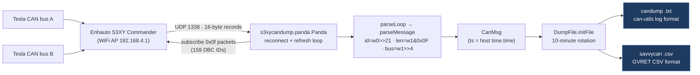
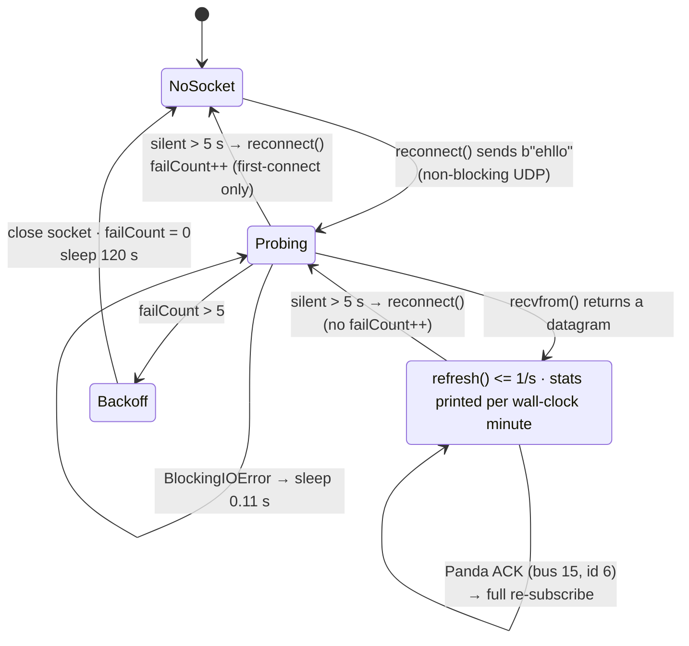

# tumik-S3XY-candump

## 1. Provenance

- **Submodule path:** `legacy/tumik-S3XY-candump`
- **Pinned gitlink:** `160000 a7bff3ccd3b172854edda1ad3923604a0ceb7f93 0` (from `git ls-files -s legacy/tumik-S3XY-candump`; matches `git -C legacy/tumik-S3XY-candump rev-parse HEAD`; worktree clean)
- **Upstream URL:** https://github.com/tumik/S3XY-candump
- **License:** GPL-3.0 (`LICENSE:1-3`, RANGE-CITED). Nested submodule `model3dbc` is MIT, Copyright (c) 2019 Josh Wardell (`model3dbc/LICENSE:1-3`, RANGE-CITED)
- **Analysis date:** 2026-11-21
- **Mode:** replace — this file replaces the previous summary; the pre-replace text is still in git history and is cited as `git show HEAD:docs/legacy/tumik-S3XY-candump.md#<line>` where contradicted. The replaced doc contained **no** `## Upstream (...)` sections, so nothing had to be preserved under that rule. The YAML frontmatter above is preserved byte-for-byte from the replaced doc (including its truncated description, see section 6)
- **Nested submodule:** `model3dbc` at gitlink `c56c113c353d09b1a5dd57677461f02fe8b7c6ca` (`git submodule status`: `111-12-gc56c113`), origin `https://github.com/joshwardell/model3dbc.git`, 45 local commits, HEAD subject "Add files via upload"
- **Local history:** exactly one commit: `a7bff3c Initial release (#1)`

**Files read (upstream, all paths relative to `legacy/tumik-S3XY-candump/`):**

| File | Coverage | Lines |
| --- | --- | --- |
| `s3xy-candump.py` | FULL-READ | 1-51 |
| `s3xycandump/panda.py` | FULL-READ | 1-196 |
| `s3xycandump/canmsg.py` | FULL-READ | 1-20 |
| `s3xycandump/candump.py` | FULL-READ | 1-25 |
| `s3xycandump/dumpfile.py` | FULL-READ | 1-62 |
| `s3xycandump/savvycan.py` | FULL-READ | 1-37 |
| `s3xycandump/__init__.py` | FULL-READ | 0 bytes, empty |
| `README.md` | FULL-READ | 1-32 |
| `.gitmodules` | FULL-READ | 1-3 |
| `model3dbc/README.md` | FULL-READ | 1-21 |
| `LICENSE` | RANGE-CITED | 1-3 of 35 |
| `model3dbc/LICENSE` | RANGE-CITED | 1-3 |
| `.gitignore` | RANGE-CITED | 1-15 of 174 (standard Python ignores, not load-bearing) |
| `model3dbc/Model3CAN.dbc` | STRUCTURAL-PARSE | 322,430 bytes; 159 `BO_` message entries, 2752 `SG_` signals, plus `CM_` comments; only targeted `BO_` line lookups were made, no signal definitions read |

**Files explicitly NOT read:** full GPL-3.0/MIT license texts beyond line 3; `.gitignore` lines 16-174; DBC signal definitions (`SG_` bodies); model3dbc's 44 commits below HEAD; any network resource (candash source, make_cabana_route, ScanMyTesla, Enhauto docs).

**Our-side files read for parity:** `firmware/lib/vehicle/can/ids.h` (1-122, FULL-READ), `firmware/lib/core/can/recorder.h` (1-199, FULL-READ), `firmware/lib/vehicle/can/feature/telemetry/tpms.h` (1-93, FULL-READ), `firmware/lib/vehicle/can/feature/misc/stream.h` (1-35, FULL-READ), `firmware/lib/vehicle/can/feature/misc/can_raw.h` (1-34, FULL-READ), `firmware/lib/vehicle/can/feature/das/das_drive.h` (1-120, RANGE-CITED), `firmware/lib/vehicle/can/handler/variant/bits.h` (10-58, RANGE-CITED), plus grep-verified single lines cited inline.

## 2. Executive verdict

A small, single-purpose Python capture tool: it connects to an Enhauto S3XY Commander's WiFi AP over **UDP** (not TCP as the old summary claimed), subscribes to CAN IDs listed in a vendored Model 3 DBC (159 IDs by default), parses the comma.ai-style 16-byte panda frame records, and appends every frame to rotating files in can-utils candump and SavvyCAN/GVRET CSV formats. It performs **no** CAN decoding, mutation, checksums, or injection — nothing here touches frame content. The mechanisms that matter to TeslaCANModder are at the tooling layer: the panda UDP client, the reconnect/backoff supervision loop, and the two dump-file exporters. The strongest adaptation candidate is the dump-export side: our firmware records frames into a 256-entry on-device ring (`recorder.h`) with no file-format output, and our documented `gvret:*` command has no firmware implementation at all — a `tools/`-side candump/GVRET exporter would fill a real bench gap. The DBC-as-subscribe-list finding cuts the other way: the stock DBC does **not** subscribe to 0x370, 0x39B, 0x398, 0x331, 0x488, 0x106, 0x115, 0x2AA, 0x045, or 0x3EE, so an S3XY capture is not a complete oracle for our mutation targets without extending the subscribe list. Nothing in this repo must be ported as CAN-mutation code; nothing is safety-critical to copy.

## 3. Evidence map

No TEST-READ evidence exists: this repo ships no tests. No CAPTURE evidence exists in this repo: no sample candump output is committed.

| Source file | Lines | What it proves | Grade |
| --- | --- | --- | --- |
| `s3xy-candump.py` | 7-10 | Hardcoded Commander AP address `192.168.4.1`, UDP port `1338`, dump dir, DBC path | CODE-READ |
| `s3xy-candump.py` | 15, 22-25 | Undeclared dependency on `cantools`; DBC loaded to enumerate IDs only | CODE-READ |
| `s3xy-candump.py` | 28, 38-51 | Main loop: `waitForMessage()` → write each msg to every enabled dumpfile; Ctrl-C exits | CODE-READ |
| `s3xycandump/panda.py` | 29-33 | UDP: `socket.AF_INET, socket.SOCK_DGRAM`, non-blocking, `sendto(b"ehllo")` | CODE-READ |
| `s3xycandump/panda.py` | 60-81 | Subscribe packet: type byte `0x0f`, then 3-byte pairs `0xff, id>>8, id&0xff`; flush when packet exceeds 127 bytes; empty list → all DBC IDs (line 63) | CODE-READ |
| `s3xycandump/panda.py` | 88-116 | Record parse: LE `uint32` pair; id = word0 >> 21; len = word1 & 0x0F; bus = word1 >> 4; host `time.time()` timestamp | CODE-READ |
| `s3xycandump/panda.py` | 98-102 | Panda ACK rule (bus 15, frameID 6) triggers automatic full re-subscribe; author's own `TODO is this required?` | CODE-READ |
| `s3xycandump/panda.py` | 118-133 | Datagram guards: max 8192 bytes (512 × 16), length must be multiple of 16 | CODE-READ |
| `s3xycandump/panda.py` | 152-196 | Supervision: 0.11 s poll sleep, ≤1/s refresh, 5 s silence → reconnect, 5 fresh-connect failures → close + 120 s sleep | CODE-READ |
| `s3xycandump/canmsg.py` | 12-20 | `CanMsg` holds host timestamp, bus id, frame id, payload; `ts_us` property | CODE-READ |
| `s3xycandump/candump.py` | 25 | can-utils candump log line: `(<ts>) can<bus> <id03x>#<hex>` | CODE-READ |
| `s3xycandump/savvycan.py` | 15, 29-36 | GVRET CSV header `Time Stamp,ID,Extended,Bus,LEN,D1..D8`; µs timestamps; hex ID; `false` extended flag | CODE-READ |
| `s3xycandump/dumpfile.py` | 24-53 | 10-minute file rotation (rounded down), `candumps/<date>/<date>_<HH-MM>_` naming, append mode | CODE-READ |
| `README.md` | 5, 7, 9 | Two Commander buses; tested on Model 3 2022; candash credited for panda protocol knowledge | SUMMARY-ONLY |
| `model3dbc/Model3CAN.dbc` | structure | 159 messages / 2752 signals; used only as the subscribe filter list | STRUCTURAL-PARSE |

## 4. Architecture and build surface

- **Entry point:** `s3xy-candump.py` — hardcoded config block (lines 7-13), no CLI arguments, no `requirements.txt`/`pyproject.toml` (the `cantools` import at `s3xy-candump.py:15` is undeclared; CODE-READ absence via `git ls-files`)
- **Package:** `s3xycandump/` — 5 modules, zero interdependency cycles: `panda.py` (transport + parse) → `canmsg.py` (dataclass) → `candump.py`/`savvycan.py` (writers) selected by `dumpfile.py` (rotation)
- **Build flags / platform gating:** none. Pure Python 3 (f-strings), any OS
- **External dependencies:** `cantools` (DBC load), stdlib `socket`, `struct`, `time`, `datetime`, `os`
- **Upstream remote:** https://github.com/joshwardell/model3dbc.git vendored as nested submodule `model3dbc/`



There is no mutate/gate stage: RX → parse → log only. The repo never builds or modifies a CAN frame.

## 5. Mechanism catalogue

### M1 — Panda UDP client and keep-alive

- **Claim (README / summary):** "Connects to the Commander's WiFi interface" and "Panda protocol over TCP" (pre-replace doc lines 22, 33)
- **Code path:** `s3xy-candump.py:28` → `Panda.__init__()` → `reconnect()` (`panda.py:20-33`) → `sendto(b"ehllo")`; `refresh()` (`panda.py:35-50`) re-sends the greeting at most once per second
- **Frame spec:** N/A — transport greeting only, 5-byte ASCII payload `ehllo` (comma.ai panda's misspelled "hello", kept byte-exact)
- **Gates and timing:** refresh guarded to ≥1 s spacing (`panda.py:42-44`); socket is non-blocking UDP (`panda.py:30`)
- **State machine:** covered by M4
- **Tests:** None found
- **Evidence grade:** CODE-READ
- **Verdict:** CONTRADICTED on transport — code is UDP (`SOCK_DGRAM`, `panda.py:29`), not TCP as the old summary said; protocol behavior itself CONFIRMED
- **Adapt to TeslaCANModder?** candidate (tools-side capture source, listen-only)

### M2 — DBC-driven CAN-ID subscription

- **Claim (README / summary):** "Uses the DBC file as a filter list for which CAN IDs to subscribe to" (pre-replace doc line 50)
- **Code path:** `s3xy-candump.py:28` passes `subscribeList=[]` → `subscribe()` (`panda.py:52-81`) → empty list becomes all `dbc.messages` frame IDs (`panda.py:62-63`) → UDP `sendto`
- **Frame spec:** packet = `0x0f` type byte, then per ID a 3-byte tuple `0xff, frameId >> 8, frameId & 0xff` (`panda.py:74-77`); packet flushed before exceeding 127 bytes = 43 pairs max per datagram (`panda.py:70-73`, comment "maximum of 43")
- **Gates and timing:** none beyond packet chunking; subscription re-sent from scratch on every ACK (see M3)
- **State machine:** None found (single-shot send)
- **Tests:** None found
- **Evidence grade:** CODE-READ
- **Verdict:** CONFIRMED, with the caveat that "filter list" means all 159 DBC IDs by default, not a curated subset
- **Adapt to TeslaCANModder?** candidate — if we build an S3XY capture source we must extend the list with 0x370, 0x39B, 0x398, 0x331, 0x488 (absent from the DBC, see section 11)

### M3 — Panda frame record parsing

- **Claim (README / summary):** "receives raw CAN data via the Panda protocol" (pre-replace doc line 15)
- **Code path:** `waitForMessage()` (`panda.py:152-196`) → `recvfrom(65535)` → `parseLoop()` (`panda.py:118-133`) → `parseMessage()` (`panda.py:83-116`) → `CanMsg`
- **Frame spec (the only structure this repo decodes):** each record is 16 bytes LE; `struct.unpack('<II', data[0:8])`; frameID = word0 >> 21 (11-bit ID in top bits); frameLength = word1 & 0x0F; frameBusId = word1 >> 4; payload = data[8:8+len]. No counter, no checksum — the tool never validates frame content
- **Gates and timing:** datagram ≤ 8192 bytes (512 × 16) and length % 16 == 0 (`panda.py:120-125`); frameLength must be 1-8, so **DLC-0 CAN frames are silently dropped** (`panda.py:104-107`); frameID == 0 dropped; bus 15 + frameID 6 treated as Panda ACK → triggers full re-subscribe (`panda.py:98-102`, author TODO: "is this required? Is this proper?")
- **State machine:** None found (per-record function)
- **Tests:** None found
- **Evidence grade:** CODE-READ
- **Verdict:** CONFIRMED for what the code does; conformance to comma.ai's panda wire spec is UNVERIFIED (no spec in repo)
- **Adapt to TeslaCANModder?** candidate (part of the tools capture source; trivially simple parse)

### M4 — Connection supervision (reconnect / backoff)

- **Claim (README / summary):** none — the old summary did not describe failure handling at all
- **Code path:** `waitForMessage()` (`panda.py:152-196`) — poll loop with `refresh()`, reconnect triggers, and a fail counter
- **Frame spec:** N/A (transport supervision)
- **Gates and timing:** `BlockingIOError` → sleep 0.11 s (`panda.py:169-171`); refresh ≥1 s spacing; 5 s without any receive → `reconnect()` — first-connect failures increment `failCount` (`panda.py:179-183`), mid-session silence does **not** (`panda.py:185-187`); `failCount > 5` → close socket, sleep 120 s, retry (`panda.py:189-196`)
- **State machine:**



- **Tests:** None found
- **Evidence grade:** CODE-READ
- **Verdict:** CONFIRMED — the mid-session branch reconnects forever without escalating (see section 9)
- **Adapt to TeslaCANModder?** candidate — the backoff ladder is a good pattern for `tools/` serial-bridge robustness; the un-escalated mid-session loop must not be replicated as-is

### M5 — Dual-format dump writers

- **Claim (README / summary):** "writes it to log files in candump and SavvyCAN formats" (pre-replace doc line 15); "can also be imported into Openpilot Cabana via make_cabana_route" (line 53)
- **Code path:** `DumpFile.writeMessage()` (`dumpfile.py:55-62`) → `Candump.writeMessage()` (`candump.py:21-25`) / `Savvycan.writeMessage()` (`savvycan.py:23-37`)
- **Frame spec:** candump line = `(<ts_unix:.6f>) can<bus:x> <id:03x>#<data hex>` (`candump.py:25`), matching can-utils log export. GVRET CSV header `Time Stamp,ID,Extended,Bus,LEN,D1..D8` written only for new files (`savvycan.py:13-15`); row = µs timestamp, `03x` hex ID, literal `false` extended, hex bus, LEN, then `02X` bytes (`savvycan.py:33-36`). No counters, no checksums — payload is copied verbatim
- **Gates and timing:** none; append mode with a warning if the file exists (`candump.py:8-11`, `savvycan.py:8-11`)
- **State machine:** None found
- **Tests:** None found
- **Evidence grade:** CODE-READ (formats); the Cabana import path is SUMMARY-ONLY
- **Verdict:** CONFIRMED for both writers; Cabana claim UNVERIFIED
- **Adapt to TeslaCANModder?** candidate — the strongest one; see section 13

### M6 — 10-minute rotating file manager

- **Claim (README / summary):** none — rotation was never mentioned in the old summary
- **Code path:** `DumpFile.initFile()` (`dumpfile.py:24-53`) → `Candump`/`Savvycan` constructor → file kept open until the next rotation
- **Frame spec:** N/A
- **Gates and timing:** window rounded **down** to the 10-minute boundary (`dumpfile.py:26-27`); path `candumps/<YYYY-MM-DD>/<YYYY-MM-DD_HH-MM>_<format>.<ext>` (`dumpfile.py:37-46`); file closed via `del(self.file)` relying on CPython refcount finalization (`dumpfile.py:34`, `candump.py:17-19`)
- **State machine:** two states (same-window append / rotate-and-reopen) — below the 3-state diagram threshold
- **Tests:** None found
- **Evidence grade:** CODE-READ
- **Verdict:** CONFIRMED
- **Adapt to TeslaCANModder?** no impact (minor utility; if we build exporters, prefer deterministic close)

## 6. Summary vs code contradiction table

| # | Claim (source) | Code reality (citation) | Verdict |
| --- | --- | --- | --- |
| 1 | "Panda protocol **over TCP**" — pre-replace doc, `git show HEAD:docs/legacy/tumik-S3XY-candump.md#22` (mermaid edge) and `#33` ("CAN Interface: ... (Panda protocol over TCP)") | Transport is UDP: `socket.socket(socket.AF_INET, socket.SOCK_DGRAM)` at `s3xycandump/panda.py:29`; all I/O is `sendto`/`recvfrom` (`panda.py:31, 46, 163`); no `SOCK_STREAM`, `listen()`, or `accept()` anywhere (negative anchor, section 16) | CONTRADICTED |
| 2 | Frontmatter `description:` ends mid-word at "...S3XY Commander (formerly S3XY buttons) **hard**" — presumably truncated from "hardware" | Preserved byte-for-byte per replace-mode rules (no trailing whitespace was present on that line, so nothing was stripped); the truncation is recorded here rather than silently fixed | Staleness recorded, bytes kept |

Only actual contradictions are listed. The old summary's other claims (192.168.4.1:1338, DBC-as-filter, two output formats, no decoding, Model 3 2022 testing) were verified and appear in the evidence map. The old doc's duplicated `## Architecture` heading (lines 17 and 36 of the pre-replace doc) was a formatting defect, not a factual contradiction; it disappears with this replacement.

## 7. CAN frame and signal inventory

**The repo decodes no CAN frame, mutates no CAN frame, and injects no CAN frame.** It captures raw payloads verbatim. The only wire structure it decodes is the panda UDP record (a transport encapsulation, not a CAN frame):

| Structure | ID | Bus | Period | DLC | Byte/bit layout | Scale/units | Counter position | Checksum | Read or write | Grade |
| --- | --- | --- | --- | --- | --- | --- | --- | --- | --- | --- |
| Panda UDP record | N/A (encapsulates 11-bit CAN ID) | bus field = word1 >> 4 | event-driven, ≤512 records per datagram | len = word1 & 0x0F (1-8; 0 rejected) | bytes 0-3: LE word0, CAN ID = word0 >> 21; bytes 4-7: LE word1 (len/bus nibbles); bytes 8-15: payload | N/A | None | None | read only | CODE-READ |

Vendored catalog: `model3dbc/Model3CAN.dbc` — STRUCTURAL-PARSE — 159 messages / 2752 signals, MIT-licensed joshwardell content; used by this repo **only** as the subscribe-ID list (names like `VehicleBus`/`ChassisBus` never influence runtime behavior). Not dumped wholesale here; per-ID overlaps with our firmware are handled in section 11.

## 8. Constants and tuning table

| Constant | Value | File:line | Meaning | Grade |
| --- | --- | --- | --- | --- |
| `PANDA_IP` | `"192.168.4.1"` | `s3xy-candump.py:7` | Commander WiFi AP default address | CODE-READ |
| `PANDA_PORT` | `1338` | `s3xy-candump.py:8` | Panda UDP port on the Commander | CODE-READ |
| `b"ehllo"` | 5 ASCII bytes | `s3xycandump/panda.py:31, 46` | Keep-alive greeting; byte-exact panda quirk (note the error message at `panda.py:180` spells it `ehlo`) | CODE-READ |
| Subscribe type byte | `0x0f` | `s3xycandump/panda.py:60, 73` | Marks a subscription packet | CODE-READ |
| Subscribe flush threshold | `> 1 + (3*42)` = 127 bytes | `s3xycandump/panda.py:71` | Flush before exceeding 127 bytes → max 43 ID pairs per datagram | CODE-READ |
| Record size | 16 bytes | `s3xycandump/panda.py:129` | One CAN frame per 16-byte record | CODE-READ |
| Datagram cap | `512*16` = 8192 bytes | `s3xycandump/panda.py:120` | Max accepted UDP payload | CODE-READ |
| ID extraction | `word0 >> 21` | `s3xycandump/panda.py:89` | 11-bit CAN ID lives in top bits of first LE word | CODE-READ |
| Length/bus extraction | `word1 & 0x0F` / `word1 >> 4` | `s3xycandump/panda.py:90-91` | DLC and bus nibbles of second word | CODE-READ |
| ACK rule | bus `15` + frameID `6` | `s3xycandump/panda.py:98` | Panda ACK → full re-subscribe | CODE-READ |
| Refresh spacing | `< 1` s | `s3xycandump/panda.py:42` | Keep-alive sent at most 1/s | CODE-READ |
| Poll sleep | `0.11` s | `s3xycandump/panda.py:171` | Non-blocking recv retry cadence (also bounds timestamp resolution) | CODE-READ |
| Silence window | `5` s | `s3xycandump/panda.py:179, 185` | No receive within 5 s → reconnect | CODE-READ |
| Failure escalation | `failCount > 5` → sleep `120` s | `s3xycandump/panda.py:189-196` | First-connect failure ladder; Commander session timeout note printed | CODE-READ |
| Rotation window | `ts.minute % 10` (rounded down) | `s3xycandump/dumpfile.py:27` | New dump file per 10-minute window | CODE-READ |
| Stats cadence | wall-clock minute boundary | `s3xycandump/panda.py:146-149` | msgs/sec print on minute change | CODE-READ |

## 9. Failure modes and edge cases

No TEST-READ evidence exists: this repo ships no tests, so every row below is untested. Each handling path is CODE-READ from the actual error branches.

| Failure | Handling code path | Tested? | Grade |
| --- | --- | --- | --- |
| First-connect silence (>5 s, no data ever) | `failCount++`, reconnect; after 5 failures close socket + 120 s sleep (`panda.py:179-196`) | no | CODE-READ |
| Mid-session silence (>5 s after good data) | `reconnect()` with **no** `failCount` increment (`panda.py:185-187`) — reconnects forever, never escalates to backoff | no | CODE-READ |
| Socket send/recv exception | print + `reconnect()` (`panda.py:48-50, 172-174`) | no | CODE-READ |
| Oversized / misaligned datagram | print error, drop whole datagram (`panda.py:120-125`) | no | CODE-READ |
| DLC-0 CAN frame | rejected as "Invalid frame length" (`panda.py:104-107`) — legal CAN frames are silently lost | no | CODE-READ |
| Panda ACK frames | every ACK re-sends the full subscription (`panda.py:98-102`) — potential resubscribe storm if the Commander ACKs repeatedly; author's own TODO questions it | no | CODE-READ |
| Re-opening an existing dump file | append + warning (`candump.py:8-11`, `savvycan.py:8-11`) — sessions silently mix in one file; GVRET header only written for new files, so an appended second session has no header | no | CODE-READ |
| File close on rotation | `del(self.file)` relies on CPython refcount finalization (`dumpfile.py:34`, `candump.py:17-19`) — no flush guarantee on other interpreters | no | CODE-READ |
| Timestamp fidelity | `ts_unix = time.time()` at parse time (`panda.py:110`), quantized by the 0.11 s poll loop — candump timestamps are host-receive time, not bus time; ~100 ms jitter makes 25/50 Hz rate analysis unreliable | no | CODE-READ |
| Bus-off / watchdog / OTA / brownout | None found — not applicable to a host-side passive tool; nothing in the repo observes vehicle state | no | CODE-READ |

## 10. Test coverage map

None found: this repo ships no test files (`git ls-files` shows only the 12 tracked files, none under any test directory), no CI configuration, and no dependency manifest. Critical paths with NO test: record parsing (a byte-order regression would corrupt every ID silently), the 43-pair subscribe chunking, the reconnect ladder, and both output formats (a format drift would produce files SavvyCAN/candump reject). Risk in one line: the whole tool is validated only by eyeballing its console output on a real car.

## 11. Parity matrix with TeslaCANModder

Upstream "decode" here means *the DBC subscribe list includes the ID* — the tool captures it raw. Our-side citations are CODE-READ from our firmware/protocol sources. DBC line numbers are from the pinned `c56c113` model3dbc snapshot.

| Signal / frame | Upstream decode (cite) | Our decode (cite) | Delta | Action |
| --- | --- | --- | --- | --- |
| DAS_control `0x2B9`/697 | subscribed, captured raw — `Model3CAN.dbc:644` `BO_ 697 ID2B9DAS_control: 8 ChassisBus` (STRUCTURAL-PARSE) | we **inject** it: TX 25 Hz longitudinal ACC — `firmware/lib/vehicle/can/feature/das/das_drive.h:18,45`; ID at `firmware/lib/vehicle/can/ids.h:19` | upstream listens, we transmit | capture-first: an S3XY trace is a bench oracle for our DAS injection timing |
| UI_autopilotControl `0x3FD`/1021 | subscribed — `Model3CAN.dbc:937` `BO_ 1021 ... 8 ChassisBus` (STRUCTURAL-PARSE) | we **mutate** it: FSD bits 38/46/59/60, nag bit 19/47 — `firmware/lib/vehicle/can/handler/variant/bits.h:19-27,42`; dispatch `hw4.h:128`, `hw3.h:114` | upstream listens, we mutate | capture-first |
| VCSEC_TPMSData `0x219`/537 | DBC: **ChassisBus, DLC 5** — `Model3CAN.dbc:396` (STRUCTURAL-PARSE) | we decode on the **vehicle bus**, require **DLC ≥ 8**: pressures bytes 0-3 (`×0.025 bar`), temps bytes 4-7 (`−40 °C`) — `firmware/lib/vehicle/can/feature/telemetry/tpms.h:51-63`; ID at `ids.h:39` | bus assignment and DLC conflict | capture-first: reconcile with a real capture before trusting either layout |
| `0x249`/585 | DBC: `SCCMLeftStalk`, VehicleBus, DLC 4 — `Model3CAN.dbc:2153` (STRUCTURAL-PARSE) | `CAN_ID_DI_STEER` chassis bus, CRC-8 protected readback — `firmware/lib/vehicle/can/ids.h:40` | name and bus assignment differ | capture-first |
| `0x27D`/637 | DBC: `CP_dcChargeLimits`, VehicleBus — `Model3CAN.dbc:487` (STRUCTURAL-PARSE) | we **inject** `APS_eacMonitor` TX 10 Hz EPAS steer-allow on chassis — `das_drive.h:20,47`; ID at `ids.h:18` | opposite signal meanings on the same ID | capture-first: resolve before using traces near either feature |
| `0x392`/914 | DBC: `BMS_packConfig` — `Model3CAN.dbc:2621` (STRUCTURAL-PARSE) | `CAN_ID_GTW_VERSION` muxed gateway-firmware decode — `ids.h:60` | different content claimed for the same ID | capture-first |
| `0x3F3`/1011 | DBC: `UI_odo`, ChassisBus, DLC 3 — `Model3CAN.dbc:860` (STRUCTURAL-PARSE) | `CAN_ID_SEATBELT_STATUS` vehicle-bus buckled-flags RX — `ids.h:69` | different content claimed | capture-first |
| `0x229`/553 | DBC: `GearLever`, VehicleBus, DLC 3 — `Model3CAN.dbc:2149` (STRUCTURAL-PARSE) | `CAN_ID_EPAS_HARNESS` chassis, CRC-8 protected — `ids.h:17` | different content claimed | capture-first |
| EPAS torque `0x370`/880 | **absent** from the DBC subscribe list (negative anchor, section 16) | `CAN_ID_EPAS_TORQUE` RX nag-killer source; echo writer at `firmware/lib/vehicle/can/feature/fsd/nag.h:453` | capture gap | extend the subscribe list before using S3XY as an oracle for nag work |
| DAS hands-on `0x39B`/923 | **absent** from the DBC subscribe list | `CAN_ID_DAS_STATUS` RX hands-on/AP/lane-change — `ids.h:64` | capture gap | same as above |
| GTW_carConfig `0x398`/920 | **absent** from the DBC subscribe list | `CAN_ID_GTW_CAR_CFG` RX HW-gen detection — `ids.h:62` | capture gap | same as above |
| DAS_steeringControl `0x488`/1160 | **absent** from the DBC subscribe list | TX 50 Hz steering — `das_drive.h:19,46`; `ids.h:26` | capture gap | same as above |
| SavvyCAN/GVRET export | GVRET CSV writer — `s3xycandump/savvycan.py:15,33-36` (CODE-READ) | `gvret:*` command + `gvret/gvretPort/gvretClients` fields exist in `packages/protocol/src/types.ts:225-227` and are documented, but **no firmware implementation exists** (`grep -rnE 'gvret|GVRET' firmware/` → no output); on-device capture is a 256-entry ring — `firmware/lib/core/can/recorder.h:12,144` | we document a feature we do not ship; no file-format export exists on our side | candidate: implement GVRET in firmware or a candump/GVRET exporter in `tools/` |
| can-utils candump export | candump log writer — `s3xycandump/candump.py:25` (CODE-READ) | None found on our side: recorder entries are retrieved as JSON over serial (`recorder.h:181-199`), no can-utils-compatible output | missing capability | candidate (tools-side exporter) |
| ID filter/subscribe model | DBC-driven per-ID subscribe — `panda.py:62-63` | MCP2515 hardware ID filters + `can:raw:on/off` unfiltered toggle — `firmware/lib/vehicle/can/feature/misc/can_raw.h:24-31` | equivalent capability at a different layer | no impact |

## 12. Surface inventory and security notes

| Surface | Semantics | Notes |
| --- | --- | --- |
| UDP client to `192.168.4.1:1338` | outbound `ehllo` greeting + `0x0f` subscribe packets; inbound frame records on the same unconnected socket | no listening service, no auth, no encryption |
| Local file writes | `candumps/<date>/` tree, append mode | no sandboxing; existing files silently re-appended |
| Serial / web / BLE | None found — the tool has no other transport | — |

Provenance/security findings:

- **No credentials, keys, or certs** anywhere in the tracked files (CODE-READ across all 12 files; `.gitignore` is the standard Python template)
- The CAN stream is **unencrypted UDP on the Commander's WiFi AP** — anyone on that AP can receive the same frames; treat captures as vehicle-sensitive data
- **Undeclared dependency**: `import cantools` (`s3xy-candump.py:15`) with no `requirements.txt`/`pyproject.toml` (CODE-READ absence) — reproducibility depends on whatever `cantools` version the user has
- No dangerous build flags; no code execution of captured data (payloads are only formatted with `%x`/`.hex()`)

## 13. Adaptation assessment

| Mechanism | Value | Cost | Risk | Evidence grade | Decision |
| --- | --- | --- | --- | --- | --- |
| M5 dump writers (candump + GVRET CSV) | High — our bench pipeline has no file-format export; `gvret:*` is already protocol-documented with zero firmware backing (section 11) | Low — a `tools/` exporter over the existing serial/REST frame stream | None — output formatting only, no frame mutation | CODE-READ | candidate for future PR (independent implementation; attribute the format spec) |
| M1+M2+M3 panda UDP capture source | Medium — wireless bench oracle that needs zero wiring on the car; validates our RX decode paths against a second capture path | Medium — new tools module; requires extending the subscribe list beyond the stock DBC (0x370, 0x39B, 0x398, 0x331, 0x488, 0x106, 0x115, 0x2AA) | Low — listen-only; no CAN mutation, so no can-review-checklist trigger for the tool itself | CODE-READ | candidate for future PR; keep host-timestamp caveat in mind (M4/do-not-copy #1) |
| M4 reconnect/backoff ladder | Medium — `tools/` serial-bridge currently has no comparable supervision | Low | Low — must fix the un-escalated mid-session branch before reuse | CODE-READ | candidate (pattern, not code) |
| M6 rotating file manager | Low | Low | Low | CODE-READ | no impact |
| Any CAN decode/mutation logic | — | — | — | — | nothing to port: the repo contains no frame mutation of any kind |

Our-side symbols that would change for the top candidate: `tools/` debug CLI gains an exporter command; no firmware change is required for the tools-only path. A firmware GVRET TCP server (matching the already-documented `gvret:on` / `gvret:port:N` contract) would touch `firmware/lib/io/wifi/` and must walk `docs/checklists/can-review-checklist.md` only if it changes transport-visible message shapes of existing flows.

## 14. Do-not-copy list

| Item | File:line | Reason |
| --- | --- | --- |
| Host-side `time.time()` capture timestamps | `s3xycandump/panda.py:110` | 0.11 s poll quantization corrupts rate/timing analysis (our 25/50 Hz injection verification needs better); any our-side exporter must use device timestamps |
| Re-subscribe on every ACK | `s3xycandump/panda.py:98-102` | unbounded resubscribe storm risk; author's own TODO doubts it — if ported, debounce |
| Mid-session reconnect without failure escalation | `s3xycandump/panda.py:185-187` | infinite silent reconnect loop; never reaches the 120 s backoff |
| Blanket `except Exception` + print-and-continue | `s3xycandump/panda.py:48-50, 172-174` | swallows real errors; a our-side bridge must surface transport failure state |
| Append to existing dump files | `s3xycandump/candump.py:8-11`, `savvycan.py:8-11` | silently mixes sessions; an our-side exporter should fail or rotate instead |
| `del(self.file)` for deterministic close | `s3xycandump/dumpfile.py:34` | relies on CPython refcount finalization; use explicit close/flush |

Whole-repo note: nothing here is CAN-mutation code, so there is no safety-critical logic to avoid copying — the items above are robustness anti-patterns, plus the standing rule that no legacy file may be imported into `firmware/`, `client/`, `packages/`, or `tools/`.

## 15. History and evolution

- **Main repo local history:** exactly one commit — `a7bff3c "Initial release (#1)"`. Nothing was tried and rolled back upstream of the pin; there is no changelog. Pre-pin upstream history does not exist locally beyond this single commit, so nothing before the pin was reviewed (see section 17)
- **Nested `model3dbc` submodule:** 45 local commits, pinned at `c56c113c353d09b1a5dd57677461f02fe8b7c6ca` ("Add files via upload", `git submodule status` reports `111-12-gc56c113` — i.e. 111 commits after its last tag). Its deeper history was not mined; only `log -1` and `remote -v` (origin `https://github.com/joshwardell/model3dbc.git`) were inspected
- **In-code evolution hints:** the `TODO is this required? Is this proper?` at `panda.py:99` shows the ACK-resubscribe behavior was cargo-culted from candash without understanding — consistent with `README.md:9` crediting the candash `PandaService.kt` for the protocol knowledge
- **The `ehllo` greeting and `0x0f` subscribe opcode** are inherited comma.ai panda conventions (SUMMARY-ONLY for their origin; the bytes themselves are CODE-READ at `panda.py:31, 60`)
- Network-only claims (GitHub issues, PRs, releases) were not consulted; any such claims are UNVERIFIED

## 16. Re-verification recipe

Pinned gitlink (canonical form): `160000 a7bff3ccd3b172854edda1ad3923604a0ceb7f93 0` for `legacy/tumik-S3XY-candump`; nested `model3dbc` at `c56c113c353d09b1a5dd57677461f02fe8b7c6ca`.

After an upstream bump:

```bash
OLD=a7bff3ccd3b172854edda1ad3923604a0ceb7f93
git -C legacy/tumik-S3XY-candump fetch --tags --prune
git -C legacy/tumik-S3XY-candump log --oneline $OLD..origin/main   # adjust branch name if upstream uses master
git -C legacy/tumik-S3XY-candump diff --stat $OLD..origin/main
git ls-files -s legacy/tumik-S3XY-candump                          # compare gitlink to rev-parse HEAD
```

Every anchor below was **run at write time** (GNU grep 3.12 via Git Bash) and the observed hit is pasted as the expectation. Upstream paths are relative to `legacy/tumik-S3XY-candump/`.

```text
grep -nE 'SOCK_DGRAM' s3xycandump/panda.py
  -> 29: self.sock = socket.socket(socket.AF_INET, socket.SOCK_DGRAM)   # UDP, not TCP (contradiction #1)

grep -nE 'ehllo' s3xycandump/panda.py
  -> hits at 31 and 46                                                  # keep-alive greeting

grep -nE '0x0f' s3xycandump/panda.py
  -> hits at 60 and 73                                                 # subscribe packet type byte

grep -nE '>> 21|& 0x0F|>> 4' s3xycandump/panda.py
  -> hits at 89, 90, 91                                                # record header field extraction

grep -nE 'frameBusId == 15 and frameID == 6' s3xycandump/panda.py
  -> hit at 98                                                         # ACK rule

grep -nE '192\.168\.4\.1|1338' s3xy-candump.py
  -> hits at 7 and 8                                                   # Commander address/port

grep -nE 'ts_unix = time.time' s3xycandump/panda.py
  -> hit at 110                                                        # host-side timestamp

grep -nE 'x.frame_id for x in self.candb' s3xycandump/panda.py
  -> hit at 63                                                         # empty subscribeList = all DBC IDs

grep -nE 'time.sleep\(0.11\)|time.sleep\(120\)' s3xycandump/panda.py
  -> hits at 171 and 196                                               # poll sleep, backoff sleep

grep -nE 'failCount > 5' s3xycandump/panda.py
  -> hit at 189                                                        # escalation threshold

grep -nE 'frame_data.hex' s3xycandump/candump.py s3xycandump/savvycan.py
  -> s3xycandump/candump.py:25, s3xycandump/savvycan.py:29             # writers use raw payload only

grep -nE 'Time Stamp,ID,Extended' s3xycandump/savvycan.py
  -> hit at 15                                                         # GVRET CSV header

grep -nE 'minutes=ts.minute % 10' s3xycandump/dumpfile.py
  -> hit at 27                                                         # 10-minute rotation

grep -nE '^BO_ (697|1021|537|585|637|914|1011|553) ' model3dbc/Model3CAN.dbc
  -> hits at 644, 937, 396, 2153, 487, 2621, 860, 2149                 # parity-table DBC rows

grep -nE '^BO_ (880|923|920|817|1160|262|277|682|69|1006) ' model3dbc/Model3CAN.dbc
  -> no output                                                          # NEGATIVE: 0x370/0x39B/0x398/0x331/0x488/0x106/0x115/0x2AA/0x045/0x3EE not subscribed

grep -niE 'checksum|crc|xor' s3xy-candump.py s3xycandump/*.py
  -> no output                                                          # NEGATIVE: no checksum/CRC logic anywhere

grep -nE 'SOCK_STREAM|listen\(|accept\(' s3xy-candump.py s3xycandump/*.py
  -> no output                                                          # NEGATIVE: no TCP server (contradiction #1)
```

Our-side drift anchors (the `already present` / gap decisions rest on these; run from repo root):

```text
grep -nE 'CAN_ID_DAS_CONTROL|CAN_ID_EPAS_TORQUE|CAN_ID_DAS_STATUS|CAN_ID_GTW_CAR_CFG|CAN_ID_DAS_STEERING_CTRL' firmware/lib/vehicle/can/ids.h
  -> hits at 19, 26, 59, 62, 64                                         # our IDs for 0x2B9/0x488/0x370/0x398/0x39B

grep -nE 'CAN_RECORDER_SIZE = 256' firmware/lib/core/can/recorder.h
  -> hit at 12                                                          # on-device ring size

grep -nE 'if \(dlc < 8\)' firmware/lib/vehicle/can/feature/telemetry/tpms.h
  -> hit at 53                                                          # our TPMS decode demands DLC >= 8 (vs DBC's 5)

grep -nE 'FSD_BIT_AP_ACTIVE|NAG_BIT_HANDS_ON_REQUIREMENT' firmware/lib/vehicle/can/handler/variant/bits.h
  -> hits at 19 and 42                                                  # our 0x3FD mutation bits

grep -nE 'DAS_CTRL_INTERVAL_MS|DAS_STEER_INTERVAL_MS|DAS_EAC_INTERVAL_MS' firmware/lib/vehicle/can/feature/das/das_drive.h
  -> hits at 45, 46, 47                                                 # our DAS injection rates

grep -nE 'CAN_ID_FSD_MUX' firmware/lib/vehicle/can/handler/variant/hw4.h firmware/lib/vehicle/can/handler/variant/hw3.h
  -> hw4.h:128 and hw3.h:114                                            # our FSD mux dispatch

grep -nE 'can:raw:' firmware/lib/vehicle/can/feature/misc/can_raw.h
  -> hits at 14, 20, 26                                                 # our unfiltered-listen toggle

grep -nE 'stream:' firmware/lib/vehicle/can/feature/misc/stream.h
  -> hits at 16, 19, 25                                                 # our frame streaming toggle

grep -rnE 'gvret|GVRET' firmware/
  -> no output                                                          # NEGATIVE: gvret documented but not implemented in firmware

grep -nE 'gvret' packages/protocol/src/types.ts
  -> hits at 225-227 (plus 387-389, 818-820)                           # protocol-side gvret fields exist
```

If line numbers drift more than ~10, re-read the whole function; do not trust this document's numbers.

## 17. Open questions and explicitly not investigated

- **Pre-pin upstream history:** not reviewed — the local clone contains exactly one commit (`a7bff3c Initial release (#1)`), so there is nothing earlier to review. Anything on GitHub before/after the pin (issues, PRs, later commits) is UNVERIFIED
- **Commander bus mapping:** which of the Commander's two CAN buses arrives as panda bus 0 vs bus 1 (and which is our chassis vs vehicle bus) — UNVERIFIED; a single capture with known traffic on both buses, or the candash `PandaService.kt` source, would settle it
- **Panda protocol conformance:** the 16-byte record layout, `ehllo`, and `0x0f` subscribe opcode match comma.ai/candash conventions by construction, but no spec exists in this repo; UNVERIFIED — validate against a real Commander or the candash source
- **`make_cabana_route` import path** (README.md:28) and **ScanMyTesla compatibility** (README.md:16): network claims, UNVERIFIED — would require running those tools against a produced dump
- **"maximum of 43 pairs" comment** (`panda.py:70-71`): traced by hand to 43 pairs max per flushed datagram, but not validated against Commander firmware behavior; UNVERIFIED
- **model3dbc nested history:** 44 commits below `c56c113` not mined; the DBC's signal accuracy for MY2022 is joshwardell-community data, never frame-validated here
- **License bodies:** only the first 3 lines of each LICENSE file were read; the full texts were not compared against canonical GPL-3.0/MIT text
- **Inherited gap:** the pre-replace doc's truncated frontmatter description is preserved byte-for-byte by replace-mode rules; fixing it is a deliberate editorial change left to a future doc-only pass
