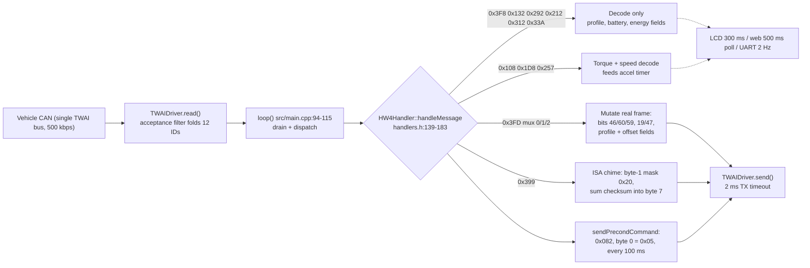
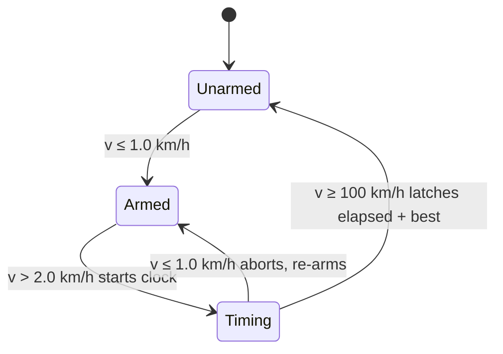
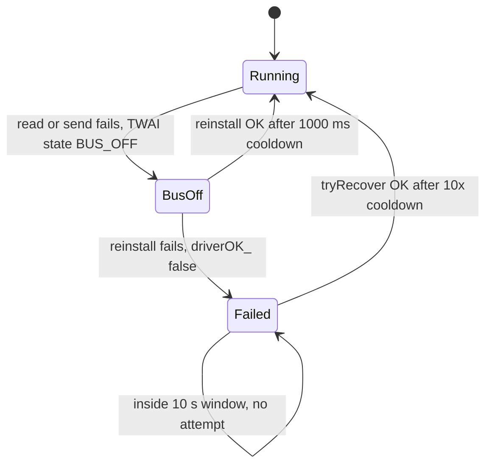

# tuncasoftbildik-tesla-can-mod

## 1. Provenance

- Submodule path: `legacy/tuncasoftbildik-tesla-can-mod` (gitlink mode `160000`).
- Pinned gitlink SHA: `5656dbecc216e63ff65cad2d2b48c5c4cece5651`. `git -C legacy/tuncasoftbildik-tesla-can-mod rev-parse HEAD` returned the same SHA; `status --porcelain` empty. Snapshot is consistent — analysis describes the intended version.
- Upstream: `https://github.com/tuncasoftbildik/tesla-can-mod` (branch `origin/main`).
- Head commit: `5656dbe feat: motor telemetry + passive 0-100 km/h timer (v0.3.0)`.
- License: MIT (`LICENSE:1-3`, copyright 2026 tuncasoftbildik). MIT is GPL-3.0-compatible, but see do-not-copy list — compatibility is not permission to line-copy.
- Analysis date: 2026-11-20.
- Test surface: **no test files exist** in the upstream tree (`git ls-files` has no `test/`, no `*_test.*`). All behavioral evidence below is CODE-READ or SUMMARY-ONLY; there is no TEST-READ or CAPTURE grade available from this repo.
- Files read in full (all 28 text files; line ranges are complete file lengths): `.gitignore:1-7`, `CHANGELOG.md:1-84`, `LICENSE:1-21`, `README.md:1-402`, `TESLA_CAN_BATTERY_REFERENCE.md:1-256`, `TESLA_CAN_STEERING_REFERENCE.md:1-349`, `flipper/.gitignore:1-6`, `flipper/README.md:1-99`, `flipper/application.fam:1-15`, `flipper/teslacan_app.c:1-157`, `flipper/teslacan_app.h:1-50`, `flipper/teslacan_uart.c:1-171`, `flipper/teslacan_uart.h:1-14`, `include/User_Setup.h:1-24`, `include/can_frame_types.h:1-10`, `include/can_helpers.h:1-46`, `include/drivers/can_driver.h:1-13`, `include/drivers/twai_driver.h:1-177`, `include/handlers.h:1-478`, `include/lcd_display.h:1-173`, `include/log_buffer.h:1-42`, `include/shared_types.h:1-10`, `include/uart_bridge.h:1-300`, `include/web/web_server.h:1-248`, `include/web/web_ui.h:1-348`, `platformio.ini:1-30`, `src/main.cpp:1-115`, `tools/teslacan_client.py:1-137`.
- Files explicitly NOT read: `flipper/tesla_10x10.png` (binary 10x10 FAP icon; no load-bearing behavior). No hidden/dot directories were skipped — both `.gitignore` files were inventoried and read.

## 2. Executive verdict

Single-board ESP32-C6 (Waveshare ESP32-C6-LCD-1.47) Tesla Model 3/Y mod: one TWAI bus at 500 kbps, an interrupt-free polling loop, three variant handler classes, battery/motor telemetry decoders, a preconditioning injector, an on-device AP web dashboard, an ST7789 LCD, and an ASCII UART bridge for a Flipper Zero companion. The mechanisms that matter to us are almost entirely **already present** in our firmware with stronger gates: FSD bit 46/60, nag bit 19/47, follow-distance→profile mapping (identical table), ISA chime suppression (identical checksum formula), and battery telemetry. Genuine gaps are narrow: read-only drive-inverter torque decode (0x108/0x1D8), a passive 0–100 km/h stopwatch, and an optional TWAI-style bus-off auto-recovery idea. Everything that changes frame shape (dynamic ISA speed override, 10 Hz precondition spoof) must be rejected as a port until a bench capture exists — the upstream numbers are self-admittedly unverified and the existing `docs/legacy` summary is wrong in at least 12 places. The two upstream `TESLA_CAN_*_REFERENCE.md` files remain useful as DBC-derived *leads*, not as verified truth.

## 3. Evidence map

| Source file | Lines | What it proves | Grade |
| --- | --- | --- | --- |
| `src/main.cpp` | 33-38, 40-92, 94-115 | `HW4Handler` hardcoded; single `TWAIDriver`; loop polls CAN, LCD, web, UART | CODE-READ |
| `src/main.cpp` | 56, 34 | No variant selection anywhere — HW3/Legacy handlers unreachable in shipped build | CODE-READ |
| `include/handlers.h` | 9-123 | `CarManagerBase` state, telemetry fields, passive 0-100 timer constants | CODE-READ |
| `include/handlers.h` | 129-194 | HW4 IDs, 12-entry filter list, switch dispatch, 100 ms precondition loop | CODE-READ |
| `include/handlers.h` | 197-212 | Follow-distance map `1→3, 2→2, 3→1, 4→0, 5→4` | CODE-READ |
| `include/handlers.h` | 214-272 | BMS voltage/current/SoC/status/temp/energy decoders (byte layouts) | CODE-READ |
| `include/handlers.h` | 274-284 | `sendPrecondCommand`: 0x082, DLC 8, `data[0]=0x05` | CODE-READ |
| `include/handlers.h` | 286-339 | AP_CONTROL mux 0/1/2 mutations, bit 46/60/59, bit 19/47, ISA override | CODE-READ |
| `include/handlers.h` | 54-67, 69-79 | Torque/speed DBC scaling with explicit "not yet bench-verified" note | CODE-READ + UNVERIFIED (scaling) |
| `include/handlers.h` | 84-114 | Accel timer state machine, thresholds 1/2/100 km/h | CODE-READ |
| `include/handlers.h` | 343-431, 434-478 | HW3 and Legacy handlers defined but not instantiated | CODE-READ |
| `include/can_helpers.h` | 6-23 | `forceFSDRuntime`, `readMuxID` (data[0]&7), `isFSDSelectedInUI` compile-time bypass | CODE-READ |
| `include/can_helpers.h` | 25-46 | `setSpeedProfileV12V13` (data[6] bits 1-2), `setBit` 0..63 guard | CODE-READ |
| `include/drivers/twai_driver.h` | 15-55 | TWAI init 500 kbps, acceptance-code/mask filter folding | CODE-READ |
| `include/drivers/twai_driver.h` | 59-97, 100-127 | Non-blocking read/send with 2 ms TX timeout, diagnostics struct | CODE-READ |
| `include/drivers/twai_driver.h` | 130-168 | Bus-off recovery, 1000 ms cooldown / 10× cooldown for idle recovery | CODE-READ |
| `include/web/web_server.h` | 20-43 | NVS prefs, AP `TeslaCAN`/`tesla1234`, DNS captive portal on port 53 | CODE-READ |
| `include/web/web_server.h` | 49-150 | `/api/status` JSON shape (fsd/can/bat/perf/log blocks) | CODE-READ |
| `include/web/web_server.h` | 152-232 | Toggle endpoints; ISA multiplier clamp is `0..7`, not `1..15` | CODE-READ |
| `include/web/web_ui.h` | 187-188 | Web slider `min=0 max=7` for ISA multiplier | CODE-READ |
| `include/web/web_ui.h` | 219-344 | 500 ms poll, SVG SoC ring, log viewer, confirm dialog on force-FSD | CODE-READ |
| `include/uart_bridge.h` | 21-48 | Wire protocol is line-based ASCII `EVT `/`CMD `, `\n`, 115200 8N1 | CODE-READ |
| `include/uart_bridge.h` | 98-114, 155-219 | 500 ms (2 Hz) periodic events; command dispatch to runtime toggles only | CODE-READ |
| `include/lcd_display.h` | 14-85, 123-159 | ST7789 172x320 init, 300 ms refresh, perf bar with 0-100 display | CODE-READ |
| `include/log_buffer.h` | 15-34 | 50-entry ring, not 256 | CODE-READ |
| `flipper/teslacan_uart.c` | 19-27, 45-101, 103-141 | Flipper side parses ASCII `EVT ` lines via `strstr` key extraction | CODE-READ |
| `flipper/teslacan_app.c` | 7, 13-43, 53-95 | 500 ms dashboard tick, menu toggles emit `CMD FSD/MODE/PRECOND` | CODE-READ |
| `tools/teslacan_client.py` | 36-133 | Serial-only argparse client; no WiFi/CSV/matplotlib/REPL | CODE-READ |
| `platformio.ini` | 1-30 | ESP32-C6 board, `-D HW4`, `-D FORCE_FSD`, `-D DRIVER_TWAI`, firmware version 0.3.0 | CODE-READ |
| `README.md` | 24-58, 116-140, 245-272 | Feature claims, CAN map, supported-vehicle table, listen-only advice | SUMMARY-ONLY |
| `CHANGELOG.md` | 7-36, 37-84 | v0.3.0/v0.2.0/v0.1.0 release narrative | SUMMARY-ONLY |
| `TESLA_CAN_BATTERY_REFERENCE.md` | 14-31, 56-60, 109-116, 130-170 | DBC-derived signal tables (community-compiled, not captured) | SUMMARY-ONLY |
| `TESLA_CAN_STEERING_REFERENCE.md` | 40-110, 174-201, 234-311 | EPAS tune-mode research and proposed 0x101 layout; **not implemented in code** | SUMMARY-ONLY |
| `docs/legacy/tuncasoftbildik-tesla-can-mod.md` | 93-98 | Prior summary's v0.2.0 claims (binary framing, 1-15 multiplier, 0x238, Python features) | SUMMARY-ONLY (contradicted — see §6) |

## 4. Architecture and build surface

- Entry point `src/main.cpp`: Arduino `setup()` (40-92) builds one `HW4Handler` and one `TWAIDriver(tx=0, rx=1)`, installs filters (71), starts AP web server (81), optional Flipper UART (85-88). `loop()` (94-115) drains frames, calls `handler->handleMessage`, refreshes LCD, serves HTTP, polls UART.
- Shared core vs platform port: `CanDriver` abstract interface (`include/drivers/can_driver.h:4-13`) vs `TWAIDriver` ESP32-TWAI implementation. `CarManagerBase` (`handlers.h:9-123`) holds state; `HW4Handler`/`HW3Handler`/`LegacyHandler` are subclasses. `Shared<T>` (`shared_types.h:4-10`) aliases `std::atomic<T>` unless `NATIVE_BUILD` (no native env exists in `platformio.ini`).
- Build flags (`platformio.ini:8-21`): `-D HW4`, `-D DRIVER_TWAI`, `-D TWAI_TX_PIN=0`, `-D TWAI_RX_PIN=1`, `-D PIN_LED=8`, `-D FORCE_FSD`, `-D FLIPPER_UART_ENABLE`, UART pins 4/5, baud 115200, `FLIPPER_FW_VERSION="0.3.0"`, `-std=gnu++17` (unflags gnu++11). pioarduino ESP32 platform fork, Arduino framework. `HW3`/`LEGACY` flags are documented but not set, and `main.cpp` has no `#if` on them.
- Dependency boundaries: Adafruit GFX/ST7789/BusIO for LCD; ESP32 `WiFi`/`WebServer`/`DNSServer`/`Preferences`; `driver/twai.h`; Python client needs `pyserial`. No test framework, no CI config.
- Transport surfaces: single physical CAN bus (Vehicle CAN per battery reference §5/§6); WiFi AP `TeslaCAN`/`tesla1234` + DNS captive portal; separate UART1 bridge (GPIO 4 TX / 5 RX) for Flipper/host.

Data flow (RX → decode → mutate/gate → TX) at the pinned SHA:



## 5. Mechanism catalogue

### FSD enable injection (0x3FD mux 0)

- **Claim (README / summary):** README:30-31 "FSD activation at CAN frame layer (requires active FSD entitlement)"; CHANGELOG:74 FSD bit 46/60.
- **Code path:** `include/handlers.h:286-313` `HW4Handler::handleAPControl()` → `readMuxID()` (`can_helpers.h:8-11`) → `isFSDSelectedInUI()` (`can_helpers.h:13-23`) → `setBit(frame,46/60/59)` (`can_helpers.h:31-46`) → `driver.send(frame)` → TX.
- **Frame spec:** ID 1021 (0x3FD), mux = `data[0]&0x07`. Mux 0: set bit 46 (FSD/EAP), bit 60 (extra FSD flag), bit 59 (EVD when enabled). Re-emits the *real* received frame with bits modified, not a zeros-built frame.
- **Gates and timing:** `fsdSelected = isFSDSelectedInUI(frame)`; with `-D FORCE_FSD` (platformio.ini:14) that helper returns `true` unconditionally (`can_helpers.h:15-17`). No AP gate, no DAS-state check, no interval — every qualifying mux-0 frame is re-sent.
- **State machine:** `fsdEnabled` set from `fsdSelected` each mux-0 frame; for mux 1/2 `fsdSelected = fsdEnabled` (latched).
- **Tests:** None found (no upstream test suite).
- **Evidence grade:** CODE-READ; entitlement claim SUMMARY-ONLY and contradicted by forced build.
- **Verdict:** CONFIRMED for bit layout; PARTIAL for "requires entitlement" in shipped config.
- **Adapt to TeslaCANModder?** already present — our `firmware/lib/vehicle/can/handler/variant/hw4.h:134`, `fsd.h`, `bits.h:21,23` implement the same bits with an AP gate and `fsd:force:*` commands.

### Driver-attention nag suppression (mux 1, bits 19 + 47)

- **Claim (README / summary):** README:32 "Driver-attention nag suppression"; CHANGELOG:75 bit 19.
- **Code path:** `handlers.h:314-322` (HW4), `401-408` (HW3), `464-469` (Legacy) → `setBit(19,false)`, `setBit(47,true)` (HW4/HW3 only) → `driver.send`.
- **Frame spec:** ID 1021 mux 1; clear bit 19 (`data[2] &= ~0x08` effectively via setBit), set bit 47 (HW4/HW3). HW3 additionally clears `data[2] bit 3` when `isaSpeedOverride`. Legacy only clears bit 19 on ID 1006 mux 1.
- **Gates and timing:** none beyond `isaSuppress`-independent unconditional send on every mux-1 frame; no hands-on/DAS gating.
- **State machine:** none (per-frame stateless mutation).
- **Tests:** None found.
- **Evidence grade:** CODE-READ.
- **Verdict:** CONFIRMED.
- **Adapt to TeslaCANModder?** already present and superseded — our `bits.h:27,42`, `nag.h` (9 strategies incl. feifan), `hw4.h` apply bit 19 + 47 with AP gate. Do not port the ungated upstream version.

### Follow-distance → speed profile (0x3F8)

- **Claim (README / summary):** README:121 "Speed profile via follow-distance stalk"; CHANGELOG:76.
- **Code path:** `handlers.h:197-212` `handleFollowDist()` (HW4) and `364-376` (HW3) → `speedProfile`.
- **Frame spec:** ID 1016 (0x3F8), `fd = (data[5]&0xE0)>>5`. HW4 map `{1:3, 2:2, 3:1, 4:0, 5:4}` (Max/Hurry/Normal/Chill/Sloth); HW3 map `{2:2, 3:1, 4:0}`. Legacy uses ID 69 `data[1]>>5 & 7` (`handlers.h:442-451`).
- **Gates and timing:** per-frame; unknown fd keeps previous profile. No pin/lock concept upstream.
- **State machine:** none.
- **Tests:** None found.
- **Evidence grade:** CODE-READ.
- **Verdict:** CONFIRMED.
- **Adapt to TeslaCANModder?** already present, byte-identical map — our `feature/fsd/profile.h:54-58` `mapHW4FollowDistToProfile` is `{-1,3,2,1,0,4}`; our side adds `profile:lock/unlock`.

### Dynamic speed offset / ISA speed override (0x3FD mux 2)

- **Claim (README / summary):** Existing doc:94-95 claims road-class detection from `0x238 byte 1`, GPS, sign type. Upstream has none of that.
- **Code path:** `handlers.h:295-302` computes offset in mux 0, `323-338` injects in mux 2; HW3 `385-389` / `409-416`.
- **Frame spec:** `off = ((frame.data[3]>>1)&0x3F) - 30`; `speedOffset = clamp(off * isaSpeedMul, 0, 200)`; `isaSpeedMul` default 7 (header `handlers.h:27`), web clamp `0..7` (`web_server.h:210-216`, `web_ui.h:187`). Mux 2 injection: `data[7] = (data[7]&0x1F)|((speedProfile&7)<<5)`; `data[0] = (data[0]&~0xC0)|((speedOffset&3)<<6)`; `data[1] = (data[1]&~0x3F)|((speedOffset>>2)&0x3F)`. Also mux 1 clears `data[2] bit 3` when enabled.
- **Gates and timing:** `isaSpeedOverride` (default `true`) AND `fsdSelected`; no bench capture, no DAS/AP gate, no ceiling check beyond clamp 200.
- **State machine:** `speedOffset` recomputed every mux-0 frame and consumed on mux 2.
- **Tests:** None found.
- **Evidence grade:** CODE-READ for formula; UNVERIFIED for real-world meaning of `data[3]` and for the 0..200 range (upstream gives no capture).
- **Verdict:** CONTRADICTED (source of offset is 0x3FD bytes, not 0x238/GPS).
- **Adapt to TeslaCANModder?** candidate for future PR, gated on a listen-only bench capture. Our `offsets.h` is static-only (0-63 HW4 / 0-100 HW3) with `offset:auto`; extending it would change transport-visible frame shape → `can-review-checklist.md` + independent checksum/frame oracle required. Do not port on CODE-READ alone.

### ISA speed-chime suppression (0x399 / 921)

- **Claim (README / summary):** README:128 "ISA speed-warning chime suppression"; existing doc:94 multiplier context.
- **Code path:** `handlers.h:141-153` (HW4) and `352-362` (HW3) → `frame.data[1] |= 0x20`, checksum loop, `driver.send`.
- **Frame spec:** ID 921 (0x399), set `data[1] bit 5` (mask `0x20`); `sum = Σ data[0..6] + (921 & 0xFF) + (921 >> 8)` = `Σ bytes0-6 + 0x99 + 0x03`; store `sum & 0xFF` in `data[7]`. DLC assumed 8 (no guard).
- **Gates and timing:** `isaSuppress` toggle (default `false`); per-frame, no AP gate.
- **State machine:** none.
- **Tests:** None found.
- **Evidence grade:** CODE-READ.
- **Verdict:** CONFIRMED (formula matches our `computeHW4IsaChecksum` exactly).
- **Adapt to TeslaCANModder?** already present and safer — our `checksum.h:47-56` `computeHW4IsaChecksum`, `hw4.h:70-81` add a DLC≥8 guard and `apGateOpen()` gate. Note our side sends on `BUS_CHASSIS`, matching `can-ids.md:123`; upstream HW3 handler also applies it to 921 although our docs say HW4-only — do not copy that HW3 behavior.

### Emergency vehicle detection (bit 59)

- **Claim (README / summary):** CHANGELOG/EVD not named in README; `emergencyDetect` described in web UI as "Acil Durum Algılama (bit 59)" (`web_ui.h:180`).
- **Code path:** `handlers.h:24`, `308-309` (HW4), `395-396` (HW3) → `setBit(frame,59,true)` inside FSD mux 0.
- **Frame spec:** ID 1021 mux 0, bit 59 set when `emergencyDetect` (default `true`); persisted to NVS via `/api/em-detect` (`web_server.h:177-186`).
- **Gates and timing:** only within the FSD-selected mux-0 branch.
- **State machine:** none.
- **Tests:** None found.
- **Evidence grade:** CODE-READ.
- **Verdict:** CONFIRMED.
- **Adapt to TeslaCANModder?** already present — our `bits.h:22` `FSD_BIT_EVD`, `evd:on/off` commands, HW4 handler.

### Battery telemetry decode (0x132/0x292/0x212/0x312/0x33A)

- **Claim (README / summary):** README:33-35 battery telemetry; `TESLA_CAN_BATTERY_REFERENCE.md` §§1-2.
- **Code path:** `handlers.h:159-163` switch → `parseBmsVoltCurrent` (214-229), `parseBmsSoc` (231-241), `parseBmsStatus` (243-250), `parseBmsTemp` (252-265), `parseEnergy` (267-272).
- **Frame spec:** 0x132 `rawV=data[0]|data[1]<<8 ×0.01`; `rawIu=data[2]|data[3]<<8`, 15-bit signed (bit14 sign), `packCurrent = rawI × -0.1` (negative = discharge), `packPowerKW = V×I/1000`. 0x292 `socUi=((data[1]|data[2]<<8|data[3]<<16)>>2)&0x3FF ×0.1`. 0x212 `precondAllowed=(data[0]>>3)&1`, `precondWorthwhile=(data[0]>>5)&1`. 0x312 `rawMin=((data[5]|data[6]<<8|data[7]<<16)>>4)&0x1FF`, `rawMax=(...>>13)&0x1FF`, each `×0.25−25 °C`. 0x33A `raw = data[0]|data[1]<<8`, `×0.625 Wh/km`.
- **Gates and timing:** per-frame decode; 12-entry filter list includes all IDs (`handlers.h:189-194`).
- **State machine:** none.
- **Tests:** None found.
- **Evidence grade:** CODE-READ; DBC factor validity SUMMARY-ONLY (reference MD compiled from community DBCs, no capture).
- **Verdict:** PARTIAL — code matches the reference for 0x132/0x292/0x212/0x312 but **not** for 0x33A byte offset (see §6).
- **Adapt to TeslaCANModder?** already present and richer — our `feature/telemetry/bms.h` decodes the same IDs plus enhanced BMS fields; do not import upstream decoders, especially not the 0x33A byte-0/1 reading.

### Battery preconditioning injection (0x082)

- **Claim (README / summary):** README:35, 127; `TESLA_CAN_BATTERY_REFERENCE.md` §3 "spoof 0x082 at a higher rate"; CHANGELOG:79 "10 Hz".
- **Code path:** `handlers.h:170-182` periodic check in `handleMessage` → `sendPrecondCommand` (274-284) → `driver.send`. Web endpoint `web_server.h:164-175`; Flipper `uart_bridge.h:191-196`.
- **Frame spec:** ID 130 (0x082), DLC 8, all zeros except `data[0]=0x05` (bit0 tripPlanningActive + bit2 requestActiveBatteryHeating). Period 100 ms (10 Hz) while `precondRequested`.
- **Gates and timing:** `precondRequested` toggle; `now - lastPrecondSend_ > 100`. No BMS-allowed/worthwhile precondition before sending; those flags are only displayed.
- **State machine:** `precondRequested` (web/Flipper) → `precondActive` set true on first send; cleared when request turned off.
- **Tests:** None found.
- **Evidence grade:** CODE-READ.
- **Verdict:** CONFIRMED (10 Hz and 0x05 both real).
- **Adapt to TeslaCANModder?** already present — our `feature/comfort/precondition.h:19-27` builds the identical 0x082/`0x05` frame, and `handler/ticks.h:58-74` re-injects at 500 ms behind `apGateOpen()`. Delta is rate (100 vs 500 ms) and gate; keep ours. The rate question is UNVERIFIED without a capture.

### Motor torque decode + passive 0–100 km/h timer (0x108/0x1D8/0x257)

- **Claim (README / summary):** README:36-37, CHANGELOG:10-23, 31-35; roadmap README:249 notes "DBC scaling unverified on-vehicle".
- **Code path:** `handlers.h:50-79` constants and `parseDriveTorque()`/`parseVehicleSpeed()`, `84-114` `updateAccelTimer()`; dispatch at `164-166`, `418-420`. Display at `lcd_display.h:123-159`, `web_server.h:84-88,101-102`, `uart_bridge.h:29,287-296`.
- **Frame spec:** `CAN_DIR_TORQUE=0x108` (rear), `CAN_DIF_TORQUE=0x1D8` (front, AWD), `CAN_DI_SPEED=0x257`. Torque: `raw = data[3]|data[4]<<8|data[5]<<16`; `t=(raw>>3)&0x1FFF` (13-bit signed @ bit 27); `Nm = st × 0.222f`. Speed: `v=((data[1]|data[2]<<8)>>4)&0x0FFF` (12-bit @ bit 12); `kph = v×0.08 − 40`, clamped ≥0. Timer: arm ≤1.0 km/h, start >2.0 km/h, latch at ≥100.0 km/h, abort back to ≤1.0 km/h; tracks `accel0to100Ms` and `accel0to100BestMs`.
- **Gates and timing:** none — read-only, no frames sent; timer is purely a function of decoded speed.
- **State machine:** `accelState_` 0=idle, 1=timing; `accelArmed_` latch; re-arm on standstill.



- **Tests:** None found.
- **Evidence grade:** CODE-READ for implementation; torque scaling explicitly UNVERIFIED upstream (`handlers.h:58`, CHANGELOG:31-33); speed scaling SUMMARY-ONLY (well-established DBC, not captured here).
- **Verdict:** CONFIRMED as code; scaling UNVERIFIED as vehicle truth.
- **Adapt to TeslaCANModder?** **candidate for future PR** — read-only, additive, low risk. Our `powertrain.h` decodes 0x257 speed but has no torque decode and no stopwatch. Extend our telemetry pipeline + add independent decode test; do not copy upstream identifiers (`accelState_`, `frontTorqueNm`) or the unverified 0.222 constant without a capture-backed test oracle.

### TWAI driver, acceptance filter folding, bus-off recovery

- **Claim (README / summary):** README:35 "TWAI + SN65HVD230"; diagnostics "state, frame counters, error counters" (CHANGELOG:83).
- **Code path:** `twai_driver.h:15-30` `init()` (500 kbps, rx queue 32 / tx 16), `32-55` `setFilters()` computes `differ = OR(ids[0]^ids[i])`, `acceptance_code = (ids[0]&~differ)<<21`, `acceptance_mask = (differ<<21)|0x001FFFFF`, `59-79` `read()`, `81-97` `send()` (2 ms TX timeout), `100-127` `getDiagnostics()`, `130-168` `recoverWithCooldown()` (1000 ms) / `tryRecover()` (10× cooldown).
- **Frame spec:** N/A (transport). Single 11-bit ID space; `kSupportsISR=false` (`twai_driver.h:10`) — everything polled in `loop()`.
- **Gates and timing:** bus-off cooldown 1000 ms; idle-driver retry every 10 s.
- **State machine:** `driverOK_` boolean toggled by install/start/recovery outcomes.



- **Tests:** None found.
- **Evidence grade:** CODE-READ.
- **Verdict:** CONFIRMED.
- **Adapt to TeslaCANModder?** already present for diagnostics (`firmware/lib/core/can/health.h:16-72` detection/health, `checkCanHealth`) but on different hardware (3× MCP2515, not 1× TWAI). The *acceptance-mask folding* is not applicable to our per-bus filter setup. Bus-off auto-recovery not found in files read → UNVERIFIED on our side; low-value backlog item, no port now.

### WiFi AP web dashboard + captive portal

- **Claim (README / summary):** README:40, 144-148 "web dashboard at 192.168.4.1"; existing doc:97 captive portal.
- **Code path:** `web_server.h:39-43` `softAP("TeslaCAN","tesla1234")` + `dnsServer.start(53,"*",APIP)`; routes at `45-237`; `web_ui.h:3` raw HTML string; `web_ui.h:219-344` JS polling/controls.
- **Frame spec:** N/A. JSON at `/api/status`; POST endpoints `/api/force-fsd`, `/api/precond`, `/api/em-detect`, `/api/isa-override`, `/api/isa-suppress`, `/api/isa-mul`, `/api/enable-print`. All use `body.indexOf("true")>=0` — not a JSON parser.
- **Gates and timing:** 500 ms JS poll (`web_ui.h:344`); force-FSD guarded by `confirm()` (`web_ui.h:325-329`).
- **State machine:** none.
- **Tests:** None found.
- **Evidence grade:** CODE-READ.
- **Verdict:** CONFIRMED (captive portal is real, contradicts nothing).
- **Adapt to TeslaCANModder?** no impact — our REST API and Expo client already cover this; our serial contract is JSON-RPC (`docs/reference/commands.md`), not these boolean POST bodies. Do not copy wire shape.

### Flipper UART bridge (ASCII line protocol)

- **Claim (README / summary):** existing doc:93 "binary framing with 0xAA start byte, length field, command byte, XOR checksum"; upstream `uart_bridge.h:21-48` and `flipper/README.md:57-85` say plain ASCII.
- **Code path:** ESP32 side `uart_bridge.h:74-114` `loop()` (newline framed, 96-byte `rxBuf_`), `147-219` `dispatch()`, `221-297` emitters; Flipper side `flipper/teslacan_uart.c:103-122` worker, `45-101` `parse_line()`; host `tools/teslacan_client.py:40-59`.
- **Frame spec:** 115200 8N1, `\n`-terminated ASCII. Events `EVT HELLO/STATUS/BATTERY/CAN/PRECOND/PERF/LOG`; commands `CMD HELLO/STATUS/FSD/MODE/PRECOND/ISA/LOG/STREAM`. Events 2 Hz when `STREAM on` (default off). No 0xAA, no length, no XOR anywhere.
- **Gates and timing:** 500 ms emit cadence; 2500 ms stale threshold in Flipper UI (`teslacan_app.c:17`).
- **State machine:** `streamEnabled_`, `logMirror_` toggles; bridge writes only runtime toggle fields, never sends CAN directly (`uart_bridge.h:46-48`).
- **Tests:** None found.
- **Evidence grade:** CODE-READ.
- **Verdict:** CONTRADICTED (binary framing claim false); CONFIRMED ASCII.
- **Adapt to TeslaCANModder?** no impact / never port as-is — our transport-visible contract is single-line JSON-RPC with `t` fields. Replacing or paralleling it would require `can-review-checklist.md` and contract tests. The *read-only bridge* separation (transport never writes CAN) is already our dispatch design.

### ST7789 LCD dashboard

- **Claim (README / summary):** README:38-39, 69 "built-in 1.47 color LCD".
- **Code path:** `lcd_display.h:14-27` `init()` (SPI begin, `Adafruit_ST7789(14,15,21)`, `init(172,320)`, rotation 0), `29-85` `update()` (300 ms), `110-172` drawing helpers. Note `User_Setup.h:16-20` declares SCLK=2/MOSI=6 but `lcd_display.h:16` calls `SPI.begin(7, -1, 6, 14)` — internal pin inconsistency.
- **Frame spec:** N/A (display).
- **Gates and timing:** 300 ms update throttle; perf bar at y=278-320.
- **State machine:** none.
- **Tests:** None found.
- **Evidence grade:** CODE-READ.
- **Verdict:** CONFIRMED with pin-map inconsistency noted.
- **Adapt to TeslaCANModder?** no impact — hardware-specific (our target is ESP32 DevKit, no onboard LCD). Our on-device dashboard is HTML served over WiFi.

### Rolling event log + Python reference client

- **Claim (README / summary):** existing doc:96 claims CSV logging, matplotlib graphing, version detection, REPL, WiFi support.
- **Code path:** `log_buffer.h:12-40` 50-entry ring (`MAX_ENTRIES=50`), `web_server.h:128-147` log tail in JSON, `uart_bridge.h:119-134` delta mirroring; `tools/teslacan_client.py:77-133` argparse main.
- **Frame spec:** N/A.
- **Gates and timing:** log mirror emits only delta (`lastLogCount_`); web sends last 20 or all depending on `log_since`.
- **State machine:** `logMirror_`, `lastLogCount_`.
- **Tests:** None found.
- **Evidence grade:** CODE-READ.
- **Verdict:** CONTRADICTED for the Python client claims; CONFIRMED 50-entry ring (our ring is 256 — do not adopt the smaller one).
- **Adapt to TeslaCANModder?** no impact — our log ring and `tools/` CLI/bridge already cover this with JSON-RPC.

### Variant handler class architecture

- **Claim (README / summary):** README:135-140 claims HW4/HW3/Legacy all supported; CHANGELOG:73.
- **Code path:** `handlers.h:126` `HW4Handler`, `343` `HW3Handler`, `434` `LegacyHandler`; `main.cpp:34` and `:56` instantiate **only** `HW4Handler`. `platformio.ini:9` sets `-D HW4`; no `#if defined(HW3)`/`LEGACY` exists in `main.cpp`.
- **Frame spec:** N/A.
- **Gates and timing:** none.
- **State machine:** none.
- **Tests:** None found.
- **Evidence grade:** CODE-READ.
- **Verdict:** CONTRADICTED — HW3/Legacy are dead code in the shipped build.
- **Adapt to TeslaCANModder?** already present and far more complete — our `handler/dispatch.h` + `handler/variant/{hw4,hw3,legacy}.h` with runtime `s.variant`. Keep ours.

### EPAS steering-mode research (0x101 / 0x370) — reference-only

- **Claim (README / summary):** `TESLA_CAN_STEERING_REFERENCE.md:12-35, 174-201, 270-300` describes injecting `0x101 GTW_epasTuneRequest` and reading `EPAS_currentTuneMode` from 0x370 byte0 bits 7:4.
- **Code path:** **none** — no `0x101` literal, no `sendSteeringTuneRequest` call in any tracked source file. All `0x370` use in code is nag/telemetry (`handlers.h` has no 0x370 constant at all; only the reference MD mentions it).
- **Frame spec (proposed only):** 0x101 DLC 3, `data[0] bits 0-2 = tune` (1=DM_COMFORT, 2=DM_STANDARD, 3=DM_SPORT, 4-6=RWD_*), bits 3-6 powerMode, `data[1] bit4` LDW; warning about possible HW4 CRC/counter.
- **Gates and timing:** N/A (not implemented).
- **State machine:** N/A.
- **Tests:** None found.
- **Evidence grade:** SUMMARY-ONLY / UNVERIFIED (the MD itself says "needs HW4 verification", "no confirmed public report").
- **Verdict:** UNVERIFIED.
- **Adapt to TeslaCANModder?** **never port on current evidence.** Our side already reads `EPAS_currentTuneMode` from 0x370 byte0 bits 7:4 (`handler/bus/vehicle.h:321-323`). The 0x101 write is a safety-critical steering change with no capture — list as backlog, require bench capture + `can-review-checklist.md` before any reconsideration.

## 6. Summary vs code contradiction table

| # | Claim location | Claim | Code reality | Verdict |
| --- | --- | --- | --- | --- |
| 1 | Existing doc:93 | Flipper UART uses binary `0xAA` start + length + command + XOR checksum | `uart_bridge.h:21-48` and `teslacan_uart.c:45-101` use `\n`-terminated ASCII `EVT `/`CMD `; no `0xAA` anywhere | CONTRADICTED |
| 2 | Existing doc:94 / `handlers.h:27` | ISA multiplier range 1–15 | Web slider `web_ui.h:187` `min=0 max=7`; server clamp `web_server.h:214-215` `0..7`; default 7 | CONTRADICTED |
| 3 | Existing doc:95 | Dynamic speed offset from `0x238 byte 1` road class + GPS + sign type | `handlers.h:298` / `385`: `off = ((data[3]>>1)&0x3F)-30` from AP_CONTROL 0x3FD; no `0x238` in repo | CONTRADICTED |
| 4 | Existing doc:96 | Python client supports serial or WiFi, CSV logging, matplotlib graphing, version detection, REPL | `tools/teslacan_client.py:77-133` is serial-only argparse with no CSV/plot/REPL/WiFi | CONTRADICTED |
| 5 | Existing doc:93 | Flipper provides BLE relay for phone connectivity | `flipper/README.md:94-95` lists BLE companion as roadmap TODO; no BLE code | CONTRADICTED |
| 6 | Existing doc:15 / README:137-139 | HW3 and Legacy handlers supported | `main.cpp:34,56` always builds `HW4Handler`; `platformio.ini:9` forces `-D HW4`; HW3/Legacy unreachable | CONTRADICTED |
| 7 | README:207 | `FLIPPER_FW_VERSION=\"0.2.0\"` in build-flags example | `platformio.ini:20` ships `0.3.0`; `flipper/application.fam:10` and `flipper/README.md:64` still say `0.2.0` | CONTRADICTED (drift) |
| 8 | `TESLA_CAN_BATTERY_REFERENCE.md:113` | `UI_ratedConsumption` at bits 32-41 (bytes 4-5) of 0x33A | `handlers.h:269-271` reads bytes 0-1 (`data[1]<<8 | data[0]`) and comments so | CONTRADICTED |
| 9 | README:128 / code | ISA chime 0x399 treated as generic R/W | `handlers.h:352-362` applies chime suppression in HW3Handler too; our `can-ids.md:123` says HW4-only; our `handler/bus/chassis.h:72-73` notes 0x399 is DAS_status on HW3 | CONTRADICTED (cross-repo) |
| 10 | README:30-31 | FSD activation requires active entitlement | `platformio.ini:14` sets `-D FORCE_FSD`; `can_helpers.h:15-17` returns `true` unconditionally → no UI gate in shipped build | CONTRADICTED |
| 11 | README:270-271 | "listen-only mode (set FORCE_FSD=0 and disable TX)" | No TX-disable flag exists in `platformio.ini:8-21`; every `driver.send()` remains active | CONTRADICTED |
| 12 | Existing doc:62 | "V14 enable (bit 60)" | `handlers.h:307` only comments "Additional FSD flag"; our `bits.h:23` names it `FSD_BIT_DAS_DEV`; no V14 concept in code | UNSUPPORTED NAMING |
| 13 | `TESLA_CAN_STEERING_REFERENCE.md:174-201` | 0x101 steering-tune write with byte layout and CRC warning | No `0x101` in any source file; feature never implemented | UNVERIFIED (SUMMARY-ONLY) |
| 14 | `handlers.h:58`, CHANGELOG:31-33, README:249 | Torque scaling "13-bit @ bit 27 ×0.222" | Code matches formula, but upstream itself says not bench-verified; no capture in repo | UNVERIFIED |

## 7. CAN frame and signal inventory

All rows share the single TWAI bus at 500 kbps (`src/main.cpp:59-61`, `include/drivers/twai_driver.h:21`) — upstream has no chassis/vehicle split, so the bus column reads "TWAI (only)" throughout. Periods are not firmware-defined for received frames (car-originated); only the injected 0x082 has a firmware-set cadence. No frame carries a counter that the code reads, verifies, or updates — `readMuxID` (`include/can_helpers.h:8-11`) is a mux selector, not a counter, and no rolling-counter logic exists anywhere in the repo. Exactly one checksum formula is implemented (the 0x399 sum). No vendored DBC/JSON frame catalog exists; the two `TESLA_CAN_*_REFERENCE.md` files are prose signal tables used as leads (SUMMARY-ONLY, see §6), never machine-parsed. Scale factors for 0x108/0x1D8/0x257 are DBC-derived with no capture anywhere in the repo — treat them as UNVERIFIED as vehicle truth (see §17).

| ID (hex+dec) | bus | period | DLC | byte/bit layout | scale/units | counter position | checksum | read or write | grade |
| --- | --- | --- | --- | --- | --- | --- | --- | --- | --- |
| 0x3FD (1021) AP_CONTROL | TWAI (only) | RX, not stated | 8 assumed, no guard | mux = data[0] bits 2:0 (`can_helpers.h:8-11`); mux 0 sets bits 46, 60, +59 conditional (`handlers.h:306-309`); mux 1 clears bit 19, sets bit 47, clears data[2] bit 3 when `isaSpeedOverride` (`handlers.h:317-319`); mux 2 writes profile to data[7] bits 7:5 and offset to data[0] bits 7:6 + data[1] bits 5:0 (`handlers.h:326-334`); offset source = data[3] bits 6:1 (`handlers.h:298`) | profile 0..4; offset 0..200, unit not established | none | none | RX, mutate, TX | CODE-READ |
| 0x3F8 (1016) follow distance | TWAI (only) | RX, not stated | 8 | fd = data[5] bits 7:5 (`handlers.h:202`) | HW4 fd 1..5 → profile 3/2/1/0/4 (`handlers.h:205-209`); HW3 fd 2..4 → 2/1/0 (`handlers.h:371-373`) | none | none | RX | CODE-READ |
| 0x399 (921) ISA speed chime | TWAI (only) | RX, not stated | 8 assumed, no guard | data[1] bit 5 set (`handlers.h:145`) | n/a | none | data[7] = (Σ data[0..6] + 0x99 + 0x03) & 0xFF (`handlers.h:146-149`) | RX, mutate, TX | CODE-READ |
| 0x082 (130) UI_tripPlanning | TWAI (only) | TX every 100 ms while requested (`handlers.h:177`) | 8 built | zeros except data[0] = 0x05 = bit 0 tripPlanningActive + bit 2 requestActiveBatteryHeating (`handlers.h:277-281`) | n/a | none | none | TX inject | CODE-READ |
| 0x132 (306) BMS_hvBusStatus | TWAI (only) | RX, not stated | 8 | V raw = data[0] + data[1]<<8 (`handlers.h:219`); I raw = data[2] + data[3]<<8, 15-bit, bit 14 sign (`handlers.h:220-223`) | V ×0.01 V; I ×−0.1 A (negative = discharge); P = V×I/1000 kW (`handlers.h:224-228`) | none | none | RX | CODE-READ |
| 0x292 (658) BMS_socStatus | TWAI (only) | RX, not stated | 8 | socUi = (LE24 >> 2) & 0x3FF over bytes 1..3 = bits 10..19 (`handlers.h:236-239`) | ×0.1 % | none | none | RX | CODE-READ |
| 0x212 (530) BMS_status | TWAI (only) | RX, not stated | 8 | data[0] bit 3 = precondAllowed, bit 5 = precondWorthwhile (`handlers.h:248-249`) | boolean | none | none | RX | CODE-READ |
| 0x312 (786) BMS_thermalStatus | TWAI (only) | RX, not stated | 8 | TMin = (LE24 >> 4) & 0x1FF, TMax = (LE24 >> 13) & 0x1FF over bytes 5..7 = bits 44..52 / 53..61 (`handlers.h:258-262`) | ×0.25 °C − 25 (`handlers.h:263-264`) | none | none | RX | CODE-READ |
| 0x33A (826) UI energy | TWAI (only) | RX, not stated | 8 | bytes 0..1 read little-endian (`handlers.h:270`) | ×0.625 Wh/km (`handlers.h:271`); contradicts upstream's own reference bits 32..41 (§6 row 8) | none | none | RX | CODE-READ |
| 0x108 (264) DIR_torque (rear) | TWAI (only) | RX, not stated | 8 | 13-bit signed @ bit 27 = (raw >> 3) & 0x1FFF, bit 12 sign, over LE bytes 3..5 (`handlers.h:59-64`) | ×0.222 Nm — upstream marks DBC-derived, not bench-verified (`handlers.h:58`) | none | none | RX | CODE-READ |
| 0x1D8 (472) DIF_torque (front, AWD) | TWAI (only) | RX, not stated | 8 | same decoder, `front=true` (`handlers.h:165`) | ×0.222 Nm — same unverified note | none | none | RX | CODE-READ |
| 0x257 (599) DI_vehicleSpeed | TWAI (only) | RX, not stated | 8 | 12-bit @ bit 12 = (raw >> 4) & 0xFFF over LE bytes 1..2 (`handlers.h:73-74`) | ×0.08 km/h − 40, clamped ≥ 0 (`handlers.h:75-76`) — DBC-derived, no capture | none | none | RX | CODE-READ |
| 0x045 (69) STW_ACTN_RQ | TWAI (only) | RX, not stated | 8 | val = data[1] bits 7:5 (`handlers.h:444`) | 0/1 → profile 2, 2 → 1, default → 0 (`handlers.h:447-449`); LegacyHandler never built (`src/main.cpp:56`) | none | none | RX (dead code) | CODE-READ |
| 0x3EE (1006) AP_CONTROL (Legacy) | TWAI (only) | RX, not stated | 8 | mux 0 sets bit 46 (`handlers.h:460`); mux 1 clears bit 19 (`handlers.h:466`) | n/a | none | none | RX, mutate, TX (dead code) | CODE-READ |

## 8. Constants and tuning table

Load-bearing constants only; pin assignments and formatting widths skipped. Every value re-read at the pinned SHA on 2026-11-20.

| constant | value | file:line | meaning | grade |
| --- | --- | --- | --- | --- |
| `isaSpeedMul` | default 7, web clamp 0..7 | `handlers.h:27`, `web_server.h:214-215`, `web_ui.h:187` | offset multiplier; header comment says 1..15 but every path clamps 0..7 | CODE-READ |
| offset source bias | −30 over 6-bit field | `handlers.h:298, 385` | centers UI offset steps at zero | CODE-READ |
| `speedOffset` clamp | 0..200 | `handlers.h:300-301, 387-388` | ISA override ceiling; physical meaning not established | CODE-READ |
| HW4 profile field | data[7] bits 7:5 (mask 0x1F, shift 5) | `handlers.h:326` | mux-2 profile injection | CODE-READ |
| HW3/v12-v13 profile field | data[6] bits 2:1 (mask ~0x06, shift 1) | `can_helpers.h:25-29` | profile injection for HW3 mux 2 | CODE-READ |
| HW4 offset field | data[0] bits 7:6 + data[1] bits 5:0 | `handlers.h:332-333` | 8-bit split offset injection | CODE-READ |
| accel thresholds | 1.0 / 2.0 / 100.0 km/h | `handlers.h:117-119` | arm / start / latch for 0-100 timer | CODE-READ |
| torque factor | 0.222f, 13-bit @ bit 27 | `handlers.h:62-64` | Nm scaling; upstream marks it DBC-derived, not bench-verified (`handlers.h:58`) | CODE-READ |
| speed factor | 0.08, −40 offset, 12-bit @ bit 12 | `handlers.h:73-75` | km/h scaling (DBC-derived, no capture) | CODE-READ |
| BMS factors | V ×0.01; I ×−0.1; SoC ×0.1; T ×0.25 − 25; energy ×0.625 | `handlers.h:224, 227, 240, 263-264, 271` | decode scales (DBC-derived, no capture) | CODE-READ |
| precond payload/rate | 0x05 every 100 ms | `handlers.h:177, 281` | 10 Hz spoof, per community-tools comment (`handlers.h:171-173`) | CODE-READ |
| ISA checksum addends | Σ data[0..6] + 0x99 + 0x03 | `handlers.h:146-149` | 921 split into ID low/high bytes | CODE-READ |
| follow-dist maps | HW4 {1:3, 2:2, 3:1, 4:0, 5:4}; HW3 {2:2, 3:1, 4:0}; Legacy {0/1:2, 2:1, default:0} | `handlers.h:205-209, 371-373, 447-449` | stalk position → profile | CODE-READ |
| `BUSOFF_COOLDOWN_MS` | 1000; idle retry ×10 | `twai_driver.h:130, 159` | recovery cooldowns | CODE-READ |
| TWAI queues / TX timeout | rx 32, tx 16, 2 ms | `twai_driver.h:18-19, 92` | non-blocking budgets | CODE-READ |
| acceptance fold | code = (base & ~differ) << 21; mask = (differ << 21) or 0x001FFFFF | `twai_driver.h:37-45` | single 11-bit filter folding | CODE-READ |
| UART bridge cadence | 115200 8N1; 500 ms emit; 96-byte rxBuf_; Flipper stale 2500 ms | `uart_bridge.h:57, 102, 140`, `flipper/teslacan_app.c:17` | bridge timing | CODE-READ |
| log ring | MAX_ENTRIES 50 | `log_buffer.h:15` | ring depth (ours is 256 — do not adopt) | CODE-READ |
| LCD refresh | 300 ms throttle | `lcd_display.h:29-85` | display cadence | CODE-READ |

## 9. Failure modes and edge cases

No test asserts any row below (see §10), so the tested column is uniformly "no". Absence rows carry a demonstrated negative anchor that was run at write time.

| failure | handling code path | tested | grade |
| --- | --- | --- | --- |
| TWAI bus-off on RX | `read()` → `isBusOff()` → `recoverWithCooldown()` reinstall after 1000 ms (`twai_driver.h:68-72, 140-154`) | no | CODE-READ |
| TWAI bus-off on TX | `send()` transmit fail → `isBusOff()` → same cooldown path (`twai_driver.h:92-96`) | no | CODE-READ |
| driver dead (`driverOK_` false) | `read()` → `tryRecover()` at most every 10 s (`twai_driver.h:61-65, 156-168`); `send()` silently drops (`twai_driver.h:83-84`) | no | CODE-READ |
| driver init failure | `setup()` prints + red LCD banner and continues; loop keeps polling a dead driver (`main.cpp:63-68`, `twai_driver.h:61-65`) | no | CODE-READ |
| RX queue overflow | rx queue 32; `rx_missed_count` surfaced in diagnostics only, never acted on (`twai_driver.h:18, 124`) | no | CODE-READ |
| UART line longer than 95 chars | frame dropped, `rxLen_` reset — parser resyncs on next newline (`uart_bridge.h:88-95`) | no | CODE-READ |
| log ring overflow | 50-entry ring silently overwrites the oldest entry, `count_` saturates (`log_buffer.h:22-24`) | no | CODE-READ |
| watchdog | None found: `git grep -nE 'watchdog|task_wdt|WDT'` over `src include platformio.ini` returns no hits — a blocking transport hang is unguarded | no | CODE-READ |
| OTA behavior | None found: `git grep -nE 'ArduinoOTA|Update\.begin|OTA'` over `src include platformio.ini` returns no hits — no update surface and no injection pause (contrast our 0x318 OTA guard) | no | CODE-READ |
| brownout / reboot state | None found: only the four web toggles persist to NVS (`web_server.h:22-37`); accel best time, frame counters and offset state are lost on reboot | no | CODE-READ |
| missing-frame staleness | Flipper UI marks data stale after 2500 ms (`flipper/teslacan_app.c:17`); web + LCD have no staleness indicator — stale decodes render as live values | no | CODE-READ |
| short-DLC frame mutation | `read()` zero-pads to 8 (`twai_driver.h:75-77`) and `setBit` guards 0..63 (`can_helpers.h:33-34`) so mutation cannot read out of bounds; the ISA path writes data[7] with no DLC check (`handlers.h:149`) — theoretical only, since the 12-ID filter passes known frames | no | CODE-READ |

## 10. Test coverage map

None found. `git ls-files` shows no `test/` directory, no `*_test.*` files, no CI configuration, and `platformio.ini` defines no native or test environment — this repo ships no tests of any kind. Accordingly no TEST-READ evidence exists anywhere in this document; every behavioral claim is CODE-READ, SUMMARY-ONLY, or UNVERIFIED. No CAPTURE evidence exists in this repo either.

Critical paths with no test, one-line risk each:

- 0x3FD mux 0/1/2 mutation and re-send — an unverified bit write is broadcast to the vehicle on every matching frame.
- ISA checksum formula (`handlers.h:146-149`) — a wrong sum garbles a live chime frame with no feedback path.
- offset computation `off × mul` clamp 0..200 (`handlers.h:298-302`) — an out-of-range injected offset could exceed any real vehicle limit.
- accel timer threshold interplay 1.0/2.0/100.0 km/h (`handlers.h:84-114`) — a mis-armed timer double-starts or never latches, silently skewing displayed 0-100 results.
- bus-off reinstall loop (`twai_driver.h:140-168`) — a failing reinstall could thrash the TWAI driver every 10 s indefinitely.
- UART `CMD` parser (`uart_bridge.h:155-219`) — malformed lines can partially mutate handler state before erroring.
- 10 Hz precondition burst (`handlers.h:174-182`) — an unvalidated rate could spam the vehicle bus.

## 11. Parity matrix with TeslaCANModder

Our-side files read (CODE-READ) for this matrix on 2026-11-20: `firmware/lib/vehicle/can/handler/variant/{bits,hw4,hw3}.h`, `handler/bus/{chassis,vehicle}.h`, `handler/dispatch.h`, `handler/ticks.h`, `feature/fsd/{profile,offsets,isa_chime}.h`, `feature/telemetry/{bms,powertrain}.h`, `feature/comfort/precondition.h`, `vehicle/can/checksum.h`, and `firmware/lib/core/can/health.h`. Every row below carries an our-side CODE-READ citation; rows with no our-side counterpart say so explicitly. The "already present" decisions in §13 rest on these citations.

| signal/frame | upstream decode (cite) | our decode (cite) | delta | action |
| --- | --- | --- | --- | --- |
| 0x3FD mux 0 FSD bits | sets 46, 60, +59 conditional (`handlers.h:306-309`) | sets 38, 39, 46, 60, +59 conditional behind `fsdAllowed` + `apGateOpen` + AP-First (`hw4.h:136-148`; `bits.h:19-23`) | ours is a superset (AP_ACTIVE 38, CONTINUE_ON_GREEN 39) and gated; upstream's build forces the entitlement check off | ignore |
| 0x3FD mux 1 nag bits | clears 19, sets 47, plus redundant `data[2] &= ~0x08` re-clear of bit 19 (`handlers.h:317-319`) | clears 19, sets 47, plus conditional EAP/laneGraph/ECE-R79 (`hw4.h:150-153` → `applyHW4NagSuppressBits` `hw4.h:40-53`; `bits.h:42, 27`) | same core bits; ours gated by nag mode + AP gate; upstream's extra mask is a no-op duplicate of the bit-19 clear | ignore |
| 0x3FD mux 2 profile bits | data[7] bits 7:5 (`(data[7] & 0x1F) or (profile << 5)`, `handlers.h:326`) | data[7] bits 6:4 (`(data[7] & ~0x70) or (profile << 4)`, `profile.h:30-36`, called `hw4.h:159`) | one-bit shift disagreement on the same field — both cannot be right for one vehicle generation; neither side has a capture | capture-first |
| 0x3FD mux 2 offset encoding | 8-bit offset split: data[0] bits 7:6 + data[1] bits 5:0, value clamp 0..200 (`handlers.h:330-334`) | 6-bit offset in data[1] bits 5:0 only, preserving upper 2 bits, value 0..63 (`hw4.h:160-164`; `bits.h:53-54`; range `offsets.h:86-89`) | field width and byte span differ; upstream writes into data[0], we never do | capture-first |
| 0x3FD data[3] offset source | `((data[3] >> 1) & 0x3F) - 30`, then × `isaSpeedMul` (default 7), clamp 0..200 (`handlers.h:298-302`) | `readHW3UiOffsetSteps` identical extraction (`offsets.h:31-35`, consumed `hw3.h:125`), then ×5 clamp 0..100 (`offsets.h:42-50`) | source field identical; multiplier (7 vs 5) and ceiling (200 vs 100) differ | capture-first |
| HW3 mux 2 offset encoding | data[0] bits 7:6 + data[1] bits 5:0 (`handlers.h:412-413`) | `writeHW3SpeedOffset` identical mask/shift (`offsets.h:17-24`, called `hw3.h:149`) | none in encoding | ignore |
| HW3/v12-v13 profile bits | data[6] bits 2:1 (`can_helpers.h:25-29`) | identical mask ~0x06, shift 1 (`profile.h:17-23`, called `hw3.h:134`) | none | ignore |
| 0x3F8 follow-dist → profile | HW4 {1:3, 2:2, 3:1, 4:0, 5:4} (`handlers.h:202-209`); HW3 {2:2, 3:1, 4:0} (`handlers.h:368-374`) | identical maps: `mapHW4FollowDistToProfile` (`profile.h:54-58`, `hw4.h:88`) and `mapHW3FollowDistToProfile` (`profile.h:43-47`, `hw3.h:74`) | none in mapping; ours adds a `profileOverride` pin (`hw4.h:86-91`) | ignore |
| 0x399 ISA chime | data[1] mask 0x20 + Σ + 0x99 + 0x03, no DLC guard, no AP gate; also applied in HW3 handler (`handlers.h:143-153, 352-362`) | identical mask/formula with DLC≥8 guard + `apGateOpen`, HW4-only by feature gate (`hw4.h:70-81`; `bits.h:48-50`; `checksum.h:47-56`; `isa_chime.h:28-29`) | formula identical; ours gated and HW4-only; our docs assign HW3 0x399 to DAS_status | ignore (do not copy the HW3 application) |
| 0x082 precondition | zeros + data[0]=0x05 every 100 ms, no gate (`handlers.h:174-182, 274-284`) | identical frame bytes 0x05/0x00 (`precondition.h:19-27`), re-injected every 500 ms behind `apGateOpen` on BUS_VEHICLE (`ticks.h:58-74`) | frame identical; cadence (10 Hz vs 2 Hz) and gating differ | capture-first (rate) |
| 0x132 BMS voltage/current | LE bytes 0..1; 15-bit bit-14-sign current ×−0.1 A (`handlers.h:219-227`) | BE bytes 0..1; 16-bit two's-complement current ×0.1 A (`bms.h:18-33`) | endianness and current sign/width conventions both differ — cannot both be right | capture-first |
| 0x292 SoC-UI bits | bits 10..19 via LE raw over bytes 1..3 (`handlers.h:236-239`) | `(data[1] & 0x3F) << 4 or (data[2] >> 4)` (`bms.h:191-195`) | nominally the same field, different bit extraction | capture-first |
| 0x312 pack TMin/TMax | bits 44..52 / 53..61 ×0.25 − 25 (`handlers.h:258-264`) | same nominal bits and scale, different extraction formula (`bms.h:332-347`) | extraction mismatch on identical nominal layout | capture-first |
| 0x212 precond flags | data[0] bit 3 / bit 5 (`handlers.h:248-249`) | identical (`bms.h:354-367`) | none | ignore |
| 0x33A rated consumption | bytes 0..1 LE ×0.625 (`handlers.h:270-271`), contradicting upstream's own reference bits 32..41 | bits 32..41 ×0.625 (`bms.h:257-261`) — matches upstream's reference MD, not its code | different field for the same purpose | capture-first |
| 0x257 vehicle speed | bytes 1..2, 12-bit @ bit 12, ×0.08 − 40 (`handlers.h:73-76`) | bytes 2..3, signed 16-bit ÷ 100 (`powertrain.h:18-22`) | completely different decode of the same ID; a ported 0-100 timer must reuse our decode, not upstream's | capture-first |
| 0x108 / 0x1D8 drive torque | 13-bit @ bit 27 ×0.222 Nm (`handlers.h:54-67`) | None found: `git grep -nE 'TorqueNm|torqueActual|0x108|0x1D8' -- firmware/lib` returns no hits | genuine gap — the adaptation candidate in §13 | capture-first |
| 0x370 EPAS tune mode read | None found in code: `git grep -nE '0x370|EPAS'` over `src include platformio.ini` returns no hits (reference MD only) | reads byte[0] bits 7:4 with DLC≥8 guard (`vehicle.h:319-323`) | upstream has nothing implemented to compare | ignore |
| bus-off auto-recovery | `recoverWithCooldown` / `tryRecover` (`twai_driver.h:130-168`) | None found: `git grep -nE 'recoverWithCooldown|TWAI_STATE_BUS_OFF|busOff' -- firmware/lib/core/can` returns no hits; `health.h:43-72` is detection/health only | upstream-only behavior, on a different controller (TWAI vs 3× MCP2515) | capture-first (bench need before any port) |
| variant dispatch | compile-time single `HW4Handler` (`main.cpp:56`, `platformio.ini:9`) | runtime `switch (s.variant)` plus auto-detect (`chassis.h:93-102, 68-85`) | ours is a superset with auto-detection | ignore |

## 12. Surface inventory and security notes

Transport surfaces (semantics from code, all CODE-READ):

- WiFi AP + HTTP + DNS (network, unauthenticated): AP SSID `TeslaCAN`, WPA2 passphrase `tesla1234` hardcoded (`web_server.h:39-40`); wildcard DNS captive portal on port 53 (`web_server.h:43`); HTTP on port 80 (`web_server.h:13`). Routes: GET `/` (`web_server.h:45-47`), GET `/api/status` (`web_server.h:49-150`), POST `/api/force-fsd` (`web_server.h:152-162`), `/api/precond` (`web_server.h:164-175`), `/api/em-detect` (`web_server.h:177-186`), `/api/isa-override` (`web_server.h:188-197`), `/api/isa-suppress` (`web_server.h:199-208`), `/api/isa-mul` (`web_server.h:210-223`), `/api/enable-print` (`web_server.h:225-232`), 302 catch-all to `/` (`web_server.h:234-237`). Boolean POSTs parse `body.indexOf("true")` at six sites (156, 168, 180, 191, 202, 229) — substring match, not JSON.
- UART1 bridge (physical): GPIO 4/5 at 115200 8N1 (`uart_bridge.h:50-58, 70`); commands `CMD HELLO/STATUS/FSD/MODE/PRECOND/ISA/LOG/STREAM` (`uart_bridge.h:32-40`); writes only runtime toggles and never sends CAN directly (`uart_bridge.h:46-48`). No pairing, no auth — physical access grants control.
- USB-CDC serial: output-only status prints (`main.cpp:42-44, 90-91`); None found for a serial command-input surface.
- LCD: display only, no input surface.
- None found: BLE (roadmap only, `flipper/README.md:94-95`), OTA update surface, and any outbound client connection — `WiFi.mode(WIFI_AP)` at `web_server.h:39` means the firmware never joins a network.

Security notes:

- Hardcoded default AP credential `tesla1234` (`web_server.h:40`), published in the README — a known-credential control plane over safety-critical frame mutation.
- No endpoint authentication: `git grep -nE 'Authorization|token|auth'` over `include/web include/uart_bridge.h` returns no hits. Any connected client can flip force-FSD, ISA override, and preconditioning; the only friction is a client-side `confirm()` on force-FSD (`web_ui.h:325-329`), trivially bypassable.
- Dangerous build-flag default: `-D FORCE_FSD` ships enabled (`platformio.ini:14`), making the UI-entitlement bypass compile-time permanent (`can_helpers.h:15-17`); the persisted runtime toggle defaults false (`web_server.h:23-24`) but is redundant under the build flag.
- No secrets beyond the AP passphrase; no untrusted archives; no telemetry exfiltration — the web UI is pull-only.

## 13. Adaptation assessment

| Mechanism | Value | Cost | Risk | Evidence grade | Decision |
| --- | --- | --- | --- | --- | --- |
| FSD bit 46/60 injection | None (have it) | — | — | CODE-READ | already present |
| Nag bit 19/47 | None (we have 9 strategies) | — | — | CODE-READ | already present |
| Follow-distance map | None (identical map) | — | — | CODE-READ | already present |
| Dynamic ISA speed override | Low — unverified source | Medium (`offsets.h` extension) | High — frame shape, no oracle | CODE-READ + UNVERIFIED | candidate for future PR, gated on capture |
| ISA chime suppression | None (identical checksum + better gates) | — | — | CODE-READ | already present |
| EVD bit 59 | None | — | — | CODE-READ | already present |
| Battery telemetry | Low (we decode more) | — | Medium if 0x33A bug copied | CODE-READ | already present |
| Preconditioning | None (we have it, with AP gate) | — | Rate delta unverified | CODE-READ | already present |
| Motor torque + 0-100 timer | Medium-High (read-only telemetry gap) | Low (extend telemetry) | Low if read-only; medium if 0.222 unverified | CODE-READ + UNVERIFIED scaling | **candidate for future PR** |
| TWAI filter folding / bus-off recovery | Low (different hardware) | Low | Low | CODE-READ | no impact (recovery UNVERIFIED on our side) |
| WiFi AP / web dashboard | None | — | — | CODE-READ | no impact |
| Flipper ASCII bridge | None (different wire contract) | High if mirrored | High — transport-visible | CODE-READ | never port as-is |
| ST7789 LCD | None (no hardware) | — | — | CODE-READ | no impact |
| 50-entry log ring / Python client | None (we have richer tools) | — | — | CODE-READ | no impact |
| Variant handler classes | None (runtime dispatch is better) | — | — | CODE-READ | already present |
| 0x101 steering tune write | Low (speculative) | High | Critical — steering safety, no capture | SUMMARY-ONLY | never port on current evidence |

Top 3 adaptation candidates, in order: (1) passive drive-inverter torque decode, (2) passive 0–100 km/h stopwatch, (3) bus-off auto-recovery idea (lowest priority, needs our-side verification first). None is a frame-mutating port.

## 14. Do-not-copy list

- `README.md:30-31` + `platformio.ini:14` + `can_helpers.h:15-17` — the unconditional `FORCE_FSD` bypass. Our `fsd:force:*` is an explicit, inspectable command behind `s.fsdForceEnabled` and AP gate; never adopt a build-time always-on gate.
- `handlers.h:141-153, 286-339, 352-362` — the ungated frame re-send pattern. Our `hw4.h`/`hw3.h` require `apGateOpen()`; copying the upstream no-gate path would bypass our AP injection safety contract.
- `handlers.h:298-302, 328-334` — the dynamic ISA offset frame mutation. No capture, no checksum oracle, and the source signal is misunderstood by the existing summary. Activity for `can-review-checklist.md`, not copy material.
- `handlers.h:269-271` — 0x33A energy decode from bytes 0-1; contradicts its own reference doc (`TESLA_CAN_BATTERY_REFERENCE.md:113` bits 32-41). Verify against a capture before changing our `bms.h`.
- `handlers.h:352-362` — applying ISA chime suppression on HW3/ID 921; our docs say 0x399 is DAS_status on HW3 (`can-ids.md:123`, `can-protocol.md` ISA note). Do not import.
- `twai_driver.h:32-55` — acceptance-code/mask folding assumes one 11-bit bus; our 3-bus MCP2515 setup uses per-bus filters. Wrong abstraction.
- `uart_bridge.h:21-48, 155-219` and `flipper/teslacan_uart.c` — ASCII `EVT `/`CMD ` wire shape. Our contract is JSON-RPC with `t`/`ack`/`error` envelopes (`docs/reference/commands.md`). Never change transport-visible shape from a legacy lead.
- `web_server.h:152-232` — POST handlers using `body.indexOf("true")>=0` instead of JSON parsing. Our API uses typed JSON; do not weaken it.
- `web_ui.h:325-329` — force-FSD confirmation text only; the feature itself is safety-critical. Our client gating lives in `packages/protocol/src/gating.ts`; keep that as the single source of truth.
- `handlers.h:58-64` + CHANGELOG:31-33 — the `0.222f` torque constant presented in UI. Port behavior only with an independent test oracle; never present an unverified DBC factor as measured truth.
- `flipper/README.md:91-95`, `TESLA_CAN_STEERING_REFERENCE.md:270-300` — roadmap/BLE/0x101 ideas. SUMMARY-ONLY; never a basis for shipping code.
- Any upstream identifier or file: `CanFrame`, `HW4Handler` names collide conceptually with ours but use different types (`Frame`, `State`). Port constants/layouts only, attribute in comments as `derived idea, independent implementation`, and never copy files into `firmware/`, `client/`, `packages/`, or `tools/`.

## 15. History and evolution

Mined from the submodule's local `git log` — all five commits reviewed 2026-11-20, including the four pre-pin commits. Network sources (GitHub issues/PRs) were NOT consulted, so anything beyond this log is UNVERIFIED.

- `d1221af` 2026-04-03 — Initial release, 18 files / 2087 insertions: the `CarManagerBase`/HW4/HW3/Legacy four-class split existed from day one (`git show d1221af:include/handlers.h` contains all four classes), single TWAI driver, ST7789 LCD, first web UI, and both `TESLA_CAN_*_REFERENCE.md` research docs. The 0x101 steering-tune write was documented at v0.1.0 and never implemented (still absent at HEAD — §6 row 13).
- `9ce2a05` 2026-04-03 (same day) — pure web-dashboard redesign (`include/web/web_ui.h` +265/−61); no CAN behavior change.
- `764a4dc` 2026-05-13 — ISA chime suppression + runtime toggles + persistent prefs (`include/handlers.h` +198/−84): introduced `emergencyDetect`/`isaSpeedOverride`/`isaSuppress`/`isaSpeedMul` (absent at `d1221af` — `git show d1221af:include/handlers.h` matches neither identifier) and NVS persistence. The mutate paths gained toggles here but never an AP/DAS gate.
- `e41a9d4` 2026-05-13 (v0.2.0) — Flipper Zero companion + UART bridge + Python client (1342 insertions): the ASCII `EVT `/`CMD ` protocol and the "bridge never writes CAN, handler is the only bus writer" boundary (`uart_bridge.h:46-48`) appeared here. The FAP version drift (0.2.0 vs firmware 0.3.0) originates in this commit's `application.fam` and was never reconciled (§6 row 7).
- `5656dbe` 2026-08-23 (v0.3.0, pinned HEAD) — motor torque decode + passive 0-100 km/h timer; the same commit self-marks the DBC scaling "not yet bench-verified" (`handlers.h:58`).

Patterns: scope grew monotonically (FSD bits → runtime toggles → companion app → telemetry) with no reverts or abandoned-approach commits in the local log; HW3/Legacy have been dead-but-shipped code since the initial release (never instantiated — `main.cpp:56`); the ISA-offset mechanism (`off × mul`, clamp 200) has been stable since `764a4dc` and was never capture-validated. Reviewing this log partially supersedes the note in §17 that pre-pin commit history was not reviewed — the four pre-pin commits are now covered by this section; GitHub-side history (issues/PRs) remains unreviewed.

## 16. Re-verification recipe

Run from repo root. Pin `OLD` to the gitlink SHA above; drift beyond ~10 lines means re-read the whole function, not the cited line number.

```bash
OLD=5656dbecc216e63ff65cad2d2b48c5c4cece5651
git ls-files -s legacy/tuncasoftbildik-tesla-can-mod   # expect 160000 <OLD>
git -C legacy/tuncasoftbildik-tesla-can-mod rev-parse HEAD   # must equal OLD
git -C legacy/tuncasoftbildik-tesla-can-mod status --porcelain   # must be empty
git -C legacy/tuncasoftbildik-tesla-can-mod fetch --tags --prune
git -C legacy/tuncasoftbildik-tesla-can-mod log --oneline $OLD..origin/main
git -C legacy/tuncasoftbildik-tesla-can-mod diff --stat $OLD..origin/main
git -C legacy/tuncasoftbildik-tesla-can-mod diff $OLD..origin/main -- src/ include/ flipper/ tools/ platformio.ini
git -C legacy/tuncasoftbildik-tesla-can-mod ls-files   # re-check hidden dirs: both .gitignore files
```

Grep anchors with expected hits (run inside `legacy/tuncasoftbildik-tesla-can-mod`):

```text
grep -n 'make_unique<HW4Handler>' src/main.cpp                 -> one hit; if HW3/Legacy selection appears, re-check verdict #6
grep -n 'FORCE_FSD' platformio.ini                             -> one -D line; if removed, re-check verdict #10
grep -n 'frame.data\[0\] & 0x07' include/can_helpers.h         -> mux reader unchanged
grep -n 'setBit(frame, 46' include/handlers.h                  -> three hits (HW4/HW3/Legacy mux-0 injection)
grep -n 'frame.data\[1\] |= 0x20' include/handlers.h           -> two hits (HW4 + HW3 ISA chime)
grep -n 'sum += (CAN_ISA_CHIME' include/handlers.h             -> two hits; formula must stay Σ bytes0-6 + 0x99 + 0x03
grep -n 'data\[5\] & 0xE0' include/handlers.h                  -> three hits (HW4 + HW3 code, one comment)
grep -n 'data\[3\] >> 1' include/handlers.h                    -> three hits (HW4 + HW3 code, one comment)
grep -n 'isaSpeedMul' include/handlers.h include/web/web_server.h -> default 7; clamp 0..7 (not 1..15)
grep -n 'pf.data\[0\] = 0x05' include/handlers.h               -> precondition payload
grep -n 'now - lastPrecondSend_ > 100' include/handlers.h      -> 10 Hz spoof rate
grep -n 'ACCEL_TARGET_KPH\|0.222f' include/handlers.h          -> 100.0f and 0.222f (still unverified)
grep -n 'data\[1\] << 8' include/handlers.h                    -> two hits: 0x132 voltage and 0x33A bytes 0-1 (reference says bits 32-41)
grep -n 'EVT \|CMD ' include/uart_bridge.h flipper/teslacan_uart.c -> ASCII line protocol only; any 0xAA/length/XOR means protocol changed
grep -n 'id="tIsaMul" min="0" max="7"' include/web/web_ui.h    -> ISA slider range 0..7
grep -n 'MAX_ENTRIES = 50' include/log_buffer.h                -> log ring size
grep -n 'FLIPPER_FW_VERSION\|fap_version' platformio.ini flipper/application.fam -> version drift still present
grep -rn '0x101\|steeringTune' src/ include/ flipper/ tools/   -> expect NO hits; any hit means the steering research became code
```

If `git ls-files` reveals new hidden/platform dirs (e.g. a previously missed `.firmware/`), inventory and read them before trusting this document. Frame-shape claims here were checked against code only — never against a vehicle capture.

## 17. Open questions and explicitly not investigated

- No listen-only CAN capture exists anywhere in the upstream repo. All bit positions, scale factors (0.222 Nm, 0.08/−40 km/h, 0.25/−25 °C, 0.625 Wh/km), and the mux-2 offset encoding are **UNVERIFIED** as vehicle truth. Verify with a bench capture on the specific firmware version before any port.
- Meaning of 0x3FD `data[3]` bits used for `speedOffset`, and whether clamp 0..200 is physically meaningful — UNVERIFIED.
- Whether 10 Hz (upstream) or 500 ms (ours) precondition re-injection is correct for the target vehicle — UNVERIFIED; needs capture of real MCU 0x082 cadence.
- Whether `speedOffset` injected into mux-2 `data[0]`/`data[1]` collides with other signals in our decoder — not traced; would need field-level comparison against `docs/reference/can-protocol.md`.
- 0x399 on HW4 vs HW3: upstream applies chime suppression in both handlers; our docs say HW3 uses that ID for DAS_status. No capture in upstream to settle which is right for the specific vehicle.
- Steering (0x101 / 0x370 tune mode): reference-only, deliberately not implemented upstream; not investigated beyond confirming no source references exist.
- Hardware electrical details (SN65HVD230, LM2596 wiring, pin maps) were not bench-validated; the `lcd_display.h:16` SCLK=7 vs `User_Setup.h:16` SCLK=2 inconsistency is unexplained.
- The `Shared<T>` atomic abstraction was not exercised in a native build — `platformio.ini` defines no `NATIVE_BUILD` environment, so the `NATIVE_BUILD` branch is untested.
- Flipper `.fap` binary and `ufbt` build were not built; the FAP version string drift (0.2.0 vs 0.3.0) is documented but not resolved.
- No upstream issues, PRs, or commit history before the pinned SHA were reviewed; only the snapshot at `5656dbe` was analyzed.

## Upstream (2026-11-20)

- `5656dbe`: motor telemetry and passive 0-100 km/h timer (v0.3.0). No frame-layout change affecting our telemetry decoders.
- Full list: `docs/legacy/upstream-review-2026-11-20.md`.
