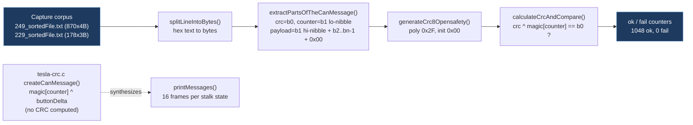

# uhi22-tesla-crc

## 1. Provenance

- Submodule path: `legacy/uhi22-tesla-crc`, pinned gitlink `160000 c5ef6d5f16e8ca4461c0bf86da48deba1a93ee14 0` (matches `git -C legacy/uhi22-tesla-crc rev-parse HEAD`; `status --porcelain` clean at analysis time).
- Upstream URL: `https://github.com/uhi22/tesla-crc` (matches `.gitmodules` and `git remote -v`).
- License: None found — the repo ships no LICENSE file and no license header in any source file. Treat as all-rights-reserved for code text; see section 14.
- Analysis date: 2026-11-21. Mode: **replace** (this doc replaces the previous summary at the same path).
- Frontmatter: preserved byte-for-byte from the pre-replace doc (verified: no trailing whitespace on any frontmatter line, so nothing was stripped). The pre-replace doc contained no `## Upstream (...)` sections, so there is nothing to re-append after section 14. The pre-replace doc had YAML frontmatter; it was not invented here. Its truncated `description` line is recorded as a defect row in section 6, not edited.
- Pre-replace claims in this document are cited as `git show HEAD:docs/legacy/uhi22-tesla-crc.md#<line>` (the old summary still exists in git history; it is not a live file).
- Submodule clone is **shallow** (`rev-parse --is-shallow-repository` → `true`), local history = 1 commit. Pre-pin upstream history was NOT reviewed; see sections 15 and 17.

Files read (line ranges, coverage vocabulary, grade basis):

| File | Lines | Coverage | Basis |
| --- | --- | --- | --- |
| `tesla-crc.c` | 1-157 | FULL-READ | CODE-READ |
| `tesla-crc-filereader.c` | 1-118 | FULL-READ | CODE-READ |
| `opensafety-crc8-demo.c` | 1-46 | FULL-READ | CODE-READ |
| `readme.md` | 1-230 | FULL-READ (read after code, for comparison) | SUMMARY-ONLY unless code-corroborated |
| `vag/vag-crc-filereader.c` | 1-149 | FULL-READ | CODE-READ |
| `vag/readme.md` | 1-30 | FULL-READ (comparison) | SUMMARY-ONLY unless code-corroborated |
| `229_sortedFile.txt` | 1-178 | FULL-READ | CAPTURE |
| `249_sortedFile.txt` | 1-870 | RANGE-CITED (1-20, 866-870 read by eye) plus programmatic full-corpus scans (byte-3 scan, high-nibble histogram, counter range) and a compiled checker over all 870 lines | CAPTURE |
| `vag/mqb_esp21_0fd_DrivingLog1_7-11-23.csv` | header + samples + full-corpus scans (49513 lines, 49512 `0x0FD` rows) | STRUCTURAL-PARSE | CAPTURE (via compiled run) |
| `vag/mqb_esp21_0fd_DrivingLog1_7-17-23.csv` | header + samples + full-corpus scans (42111 lines, 42110 `0x0FD` rows) | STRUCTURAL-PARSE | CAPTURE (via compiled run) |

Files explicitly NOT read: none of the 10 tracked files were skipped. Not fetched (network-only): the openinverter.org forum threads (Ref1/Ref2/Ref3), knx-user-forum.de (Ref4), crccalc.com (Ref5) — their content remains UNVERIFIED.

Verification method note: all three upstream tools were compiled with gcc 16.1.0 and run outside the repo (Windows temp dir), plus an independent checker re-implementing our `firmware/lib/vehicle/can/crc8.h` semantics from values only. Nothing was written into `legacy/`; the only repo file written is this doc. Every CAPTURE grade below was re-established on 2026-11-21 by those runs.

## 2. Executive verdict

This is a 10-file, no-license, offline pure-C toolkit that cracked Tesla's end-to-end frame protection on two CAN IDs: it proves by exhaustive corpus validation (1048/1048 Tesla frames, re-verified by compiled run) that 0x229 and 0x249 carry a CRC-8/OPENSAFETY (poly 0x2F, init 0x00, no reflection, no final XOR) computed over the payload with the alive-counter nibble masked out and a virtual 0x00 byte appended, finalized by XOR with a 16-entry per-ID magic table indexed by the alive counter. The same scheme is shown to generalize to a third frame on a completely different platform (VW MQB ESP_21, 91622/91622 rows). The mechanisms that matter for TeslaCANModder are the frame convention (M2) and the magic-table derivation method (M3); the XOR-delta generator (M4) is a mathematically equivalent curiosity. The critical parity finding: our `teslaCrc8` engine is provably equivalent to upstream's (1048/1048 with upstream tables and coverage), but our shipped `MAGIC_0x229`/`MAGIC_0x249` values fit **0 of 1048** corpus frames under any coverage convention, our ALC stalk frame is the wrong DLC (3 vs the captured 4) with stalk bits in the wrong slots, and our tests never check against any capture — so the ALC 0x249 injection is the top capture-first adaptation candidate. The VAG subfolder has no TeslaCANModder impact. Nothing here may be copied as source text (no license); only behavior, constants and byte layout may be re-derived.

## 3. Evidence map

No TEST-READ evidence exists: this repo ships no tests. All CAPTURE grades were reproduced by compiled runs on 2026-11-21.

| Source file | Lines | What it proves | Grade |
| --- | --- | --- | --- |
| `tesla-crc-filereader.c` | 29-43 | CRC-8/OPENSAFETY bitwise engine: poly 0x2F, init 0x00, no reflect, no final XOR | CODE-READ |
| `tesla-crc-filereader.c` | 67-73 | Frame layout: CRC = byte 0; alive counter = byte 1 low nibble; payload = byte 1 high nibble + bytes 2..n-1; virtual 0x00 appended | CODE-READ |
| `tesla-crc-filereader.c` | 84-85 | Final CRC = `crc8(payload) ^ magic[counter]` | CODE-READ |
| `tesla-crc-filereader.c` | 113-117 | Validation corpus: 870 × 4-byte 0x249, then 178 × 3-byte 0x229 | CODE-READ |
| `229_sortedFile.txt` + `249_sortedFile.txt` | 1-178 / 1-870 | Real-vehicle captures; compiled run: `CRC ok: 1048, CRC fail: 0` | CAPTURE |
| `tesla-crc.c` | 102, 111-138 | 0x229 idle magic table + button-bit injection (0x40 full-down, 0x20 full-up, 0x30 half-down, park in byte 2 bit 0) | CODE-READ |
| `tesla-crc.c` | 121, 125, 129, 133 | Per-button XOR deltas 0xF1 / 0xE9 / 0xEF / 0x0F equal the CRC-of-delta over the 3-byte window (affine property, confirmed by independent checker) | CODE-READ |
| `opensafety-crc8-demo.c` | 33-44 | Demo vectors `76 / ec / f7 / c1` for single-bit payloads; reproduced exactly | CODE-READ |
| `readme.md` | 28-35 | "870/870 verified" claim — independently reproduced (my run: 870 ok, 0 fail inside the 1048 total) | CAPTURE |
| `readme.md` | 13-26 | Transmit-side recipe: counter excluded from CRC input, virtual byte, magic index, counter wraps at 16 | SUMMARY-ONLY (corroborated by `tesla-crc-filereader.c:67-85`) |
| `readme.md` | 149-190 | Polynom recovery by single-bit-shift analysis: `12F` = x^8+x^5+x^3+x^2+x^1+x^0 | SUMMARY-ONLY (math checks out against demo vectors) |
| `vag/vag-crc-filereader.c` | 13-14, 92-106 | Same engine + layout fits 8-byte VW frames; magic table folded with `^0xBA` | CODE-READ |
| `vag/readme.md` | 12-16 | Magic-table extraction method: zero the table, run over log, back-fill each slot with observed discrepancy | SUMMARY-ONLY (method validated by compiled run below) |
| `vag/*.csv` | headers + 91622 `0x0FD` rows | VW corpus; compiled run: `CRC ok: 91622, CRC fail: 0` | CAPTURE |

## 4. Architecture and build surface

Three standalone gcc programs, no Makefile, no build flags, no dependencies beyond libc `stdio/stdlib`, no CAN hardware, no shared core — `vag/vag-crc-filereader.c` copy-pastes the engine and frame-extraction code from `tesla-crc-filereader.c` (lines 29-106 are near-duplicates). Entry points: `main()` in each of `tesla-crc.c`, `tesla-crc-filereader.c`, `opensafety-crc8-demo.c`, `vag/vag-crc-filereader.c`. Input files are hardcoded relative paths (`tesla-crc-filereader.c:115-116`, `vag/vag-crc-filereader.c:146-147`); output is per-line stdout plus ok/fail counters. There is no RX→TX frame pipeline of the kind our firmware has — this is an offline log-analysis pipeline:



## 5. Mechanism catalogue

### M1 — CRC-8/OPENSAFETY engine

- **Claim (README / summary):** "It is a CRC8 with polynom 2F, like CRC-8/OPENSAFETY" (`readme.md:38`); pre-replace doc: "poly 0x2F, init 0x00, no final XOR" (`git show HEAD:docs/legacy/uhi22-tesla-crc.md#60`).
- **Code path:** `opensafety-crc8-demo.c:12-26` and `tesla-crc-filereader.c:29-43` — `generateCrc8Opensafety(data, len)`: `crc=0`, per byte `crc ^= data[i]`, 8× shift-left with `^ 0x2F` on MSB, no final XOR. No TX anywhere.
- **Frame spec:** None found — this is the raw engine, frame-agnostic.
- **Gates and timing:** None found (pure function).
- **State machine:** None found.
- **Tests:** None found. Demo vectors at `opensafety-crc8-demo.c:33-39` assert expected outputs `76/ec/f7/c1`; reproduced exactly by my compiled run and by our table implementation (`tcm_parity_check` table-vs-bitwise equivalence: MATCH).
- **Evidence grade:** CODE-READ.
- **Verdict:** CONFIRMED.
- **Adapt to TeslaCANModder?** already present — our `crc8_opensafety` (`firmware/lib/vehicle/can/crc8.h:35-43`) is a table-driven implementation proven byte-equivalent to upstream's bitwise engine in this analysis (1048/1048 corpus lines match when given the same inputs).

### M2 — Tesla end-to-end frame convention (0x229 / 0x249)

- **Claim (README / summary):** CRC byte 0, alive counter excluded from CRC input and used as magic-table index, virtual 0x00 appended (`readme.md:13-26`); pre-replace doc: "CRC-8/OPENSAFETY computed over payload bytes (high nibble of byte 1 through a virtual trailing 0x00), then XOR'd with a per-message-ID magic byte table indexed by the 4-bit alive counter" (`git show HEAD:docs/legacy/uhi22-tesla-crc.md#52`).
- **Code path:** `tesla-crc-filereader.c:95` `readLogFile()` → `splitLineIntoBytes()` (`:49-61`) → `extractPartsOfTheCanMessage()` (`:65-79`) → `calculateCrcAndCompare()` (`:82-93`) → counters. `extractPartsOfTheCanMessage`: `crcFromCan = canMessage[0]` (`:67`), `aliveCounter = canMessage[1] & 0x0F` (`:68`), `payloadData[0] = canMessage[1] & 0xF0` (`:69` — counter nibble masked OUT of the CRC window), remaining bytes copied (`:70-72`), virtual `0x00` appended (`:73`).
- **Frame spec:**
  - 0x229 (553): DLC 3. `data[0]` = CRC. `data[1][3:0]` = alive counter 0-15 (wraps at 16, `readme.md:24`). `data[1][6:4]` = gear-stalk position (0 idle, 2 full-up, 3 half-down, 4 full-down per `tesla-crc.c:127-133`; position 1 appears in corpus lines 17-32 but is not modeled). `data[2][1:0]` = park button (bit 0 = pressed per `tesla-crc.c:123-126`; `0x03` combos at corpus lines 161-178). Magic table `magicBytes229` (`tesla-crc-filereader.c:13`).
  - 0x249 (585): DLC 4. `data[0]` = CRC, `data[1][3:0]` = counter, `data[1][7:4]` = high-beam/wash-wipe nibble (corpus hi-nibble values {0,1,2,4,5,6,8,9,A}; signal names per DBC cross-ref are SUMMARY-ONLY here), `data[2][3:0]` = turn-stalk enum (single-bit deltas 1/2/4/8 shown at `readme.md:176-190`; all 870 corpus lines have `data[3] = 0x00`), magic table `magicBytes249` (`tesla-crc-filereader.c:12`).
- **Gates and timing:** None found — offline validation. The transmit recipe (`readme.md:13-24`) is un-gated prose.
- **State machine:** None found.
- **Tests:** None found (no test framework). The filereader run itself validates: compiled run 2026-11-21 → `Looped over 178 lines. CRC ok: 1048, CRC fail: 0`.
- **Evidence grade:** CAPTURE (1048/1048 frames validated by my compiled run; layout itself CODE-READ).
- **Verdict:** CONFIRMED.
- **Adapt to TeslaCANModder?** candidate for future PR — our ALC 0x249 injection contradicts this convention on DLC, signal slots, table values and CRC-window coverage (section 11, rows P5-P8); any change requires `docs/checklists/can-review-checklist.md` plus a listen-only bench capture first.

### M3 — Per-ID magic-table derivation method

- **Claim (README / summary):** "The magic byte is the XOR between the calculated and the transmitted CRC. Fill the table of magic bytes accordingly." (`vag/readme.md:12-16`); "The table of magic bytes ... can be created based on the observed log files" (`readme.md:26`); pre-replace doc: "The magic-byte table can be extracted from idle-state log captures" (`git show HEAD:docs/legacy/uhi22-tesla-crc.md#63`).
- **Code path:** `vag/vag-crc-filereader.c:109-120` `calculateCrcAndCompare()` — with the table zeroed, each line's `crcCalculated ^ crcFromCan` discrepancy IS the magic byte for that counter slot. Method narrative in `vag/readme.md:12-16`; not automated (tables are hardcoded at `:13-14`).
- **Frame spec:** None found (method, frame-agnostic given the M2 layout).
- **Gates and timing:** None found.
- **State machine:** None found.
- **Tests:** None found. Validated end-to-end: with the derived table hardcoded, my run over both CSVs → `CRC ok: 91622, CRC fail: 0`.
- **Evidence grade:** CODE-READ (method) + CAPTURE (91622/91622 result).
- **Verdict:** CONFIRMED.
- **Adapt to TeslaCANModder?** candidate for future PR — an offline `tools/` script (independent implementation, no legacy code imported) that back-fills magic tables from our own bench captures would let us re-derive `MAGIC_0x229`/`0x249`/`0x370` instead of trusting unprovenanced constants.

### M4 — XOR-delta button encoding (tesla-crc.c generator)

- **Claim (README / summary):** "We use a table of magic patterns ... As soon as a button is actuated, the CRC changes by a specific XOR delta. The delta is the same for all possible 16 message counter values." (`readme.md:45-49`); pre-replace doc claims this file "demonstrates CRC calculation" (`git show HEAD:docs/legacy/uhi22-tesla-crc.md#39`) — see section 6.
- **Code path:** `tesla-crc.c:111-138` `createCanMessage()` — sets counter + button bits (`:116-134`), then `crc = magicBytes[alivecounter] ^ xorpattern` (`:136`) with per-button constants `0x46^0xB7=0xF1` (`:121`), `0x46^0xAF=0xE9` (`:125`), `0x46^0xA9=0xEF` (`:129`), `0x46^0x49=0x0F` (`:133`). `main()` (`:148-156`) prints 16 frames per stalk state.
- **Frame spec:** 0x229 3-byte, same as M2. XOR deltas: full-down 0xF1, park 0xE9, full-up 0xEF, half-down 0x0F.
- **Gates and timing:** None found.
- **State machine:** None found.
- **Tests:** None found. Output listing in `readme.md:53-146` reproduced exactly by my compiled run.
- **Evidence grade:** CODE-READ.
- **Verdict:** CONFIRMED as implemented, and mathematically redundant: my independent checker shows each XOR delta equals `crc8(payloadDelta)` over the 3-byte window (affine CRC property), i.e. M4 ≡ M2. Only 4 of the corpus's stalk states are modeled (position-1 nibble and 2-bit park combos are absent).
- **Adapt to TeslaCANModder?** no impact — subsumed by M2; never port the precomputed-delta shortcut.

### M5 — VW MQB ESP_21 (0x0FD) validation

- **Claim (README / summary):** "CRC of all 91622 messages is correct" (`vag/readme.md:8`); "ESP_21 uses the same CRC algorithm as described in the tesla analysis" (`vag/readme.md:18`).
- **Code path:** `vag/vag-crc-filereader.c:52-88` `splitLineIntoBytes()` (SavvyCAN CSV: `Time Stamp,ID,Extended,Dir,Bus,LEN,D1..D8`) → same extract (`:92-106`) → same compare (`:109-120`) with `magicBytesESP21` folded `^0xBA` (`:13-14`); `main()` runs both CSVs at len 8 (`:146-147`).
- **Frame spec:** 0x0FD (253), DLC 8, CRC byte 0, counter `data[1][3:0]`, payload `data[1]` hi-nibble + `data[2..6]` + virtual `0x00`; median inter-frame delta ≈ 20045 CSV timestamp units (≈20 ms, unit UNVERIFIED). Magic table `0x19^0xBA .. 0x63^0xBA`.
- **Gates and timing:** None found.
- **State machine:** None found.
- **Tests:** None found. My compiled run: `Looped over 42110 lines. CRC ok: 91622, CRC fail: 0`.
- **Evidence grade:** CAPTURE (91622/91622).
- **Verdict:** CONFIRMED.
- **Adapt to TeslaCANModder?** no impact — different vehicle platform; value is generality proof for M1-M3.

## 6. Summary vs code contradiction table

Structural defect noted in prose (not a claim row): the pre-replace doc has two identical `## Architecture` headings (`git show HEAD:docs/legacy/uhi22-tesla-crc.md#17` and `#37`), a markdown-lint violation CI cannot catch in `docs/legacy/**`.

| Summary claim | Code reality | Verdict |
| --- | --- | --- |
| `git show HEAD:docs/legacy/uhi22-tesla-crc.md#39`: tesla-crc.c "demonstrates CRC calculation via XOR of magic bytes and payload CRC" | `tesla-crc.c` contains no CRC computation at all — no CRC function exists in the file (`git -C legacy/uhi22-tesla-crc grep -nE 'generateCrc8Opensafety' -- tesla-crc.c` → no output); it XORs pre-measured idle-vs-pressed constants (`tesla-crc.c:121-133`) against the idle magic table (`:136`) | CONTRADICTED as phrased (the file computes no CRC; the readme itself says the deltas could be replaced by a real CRC, `readme.md:49`) |
| `git show HEAD:docs/legacy/uhi22-tesla-crc.md#56`: "The proven CRC-8/OPENSAFETY algorithm and magic-byte-table approach documented here is the same scheme used in our handlers" | Our engine is the same family and provably equivalent (1048/1048 with upstream tables+coverage), but our shipped `MAGIC_0x229`/`MAGIC_0x249` values fit 0/1048 corpus frames under any tested coverage convention, only one handler uses the scheme (`auto_lane_change.h:58`), and our 0x370/0x334/0x399/0x2B9 checksums are additive sums, not CRC-8 (`checksum.h:25-75`, `nag.h:486`, `drive_mode.h:110`) | PARTIAL — the old doc overstates our-side equivalence |
| Preserved frontmatter `description` (line 3): "...(specifically IDs 0x22" | Truncated mid-list — drops 0x249 and never closes the sentence; the body (`git show HEAD:...#15`) says "IDs 0x229 and 0x249". Kept byte-for-byte per replace-mode rules | Frontmatter defect recorded, not fixed |
| `tesla-crc-filereader.c:69` comment: "the high nibble of byte 0 is the first payload data" | Code reads `canMessage[1]` (byte 1): `payloadData[0] = canMessage[1] & 0xF0` (`tesla-crc-filereader.c:69`) — same wrong comment copied at `vag/vag-crc-filereader.c:96` | Comment contradicts code; the code is correct (1048/1048 with code semantics) |

Confirmed pre-replace claims (not contradictions) live in section 3: the 870/870 and 178/178 match counts (`git show HEAD:...#40`), the button-bit masks 0x40/0x20/0x30/park (`#49`), the 4-byte 0x249 shape (`#50`), and "no LICENSE file present" (`#35`) — all reproduced or re-read on 2026-11-21.

## 7. CAN frame and signal inventory

| ID (hex+dec) | Bus | Period | DLC | Byte/bit layout | Scale/units | Counter position | Checksum | Read or write | Grade |
| --- | --- | --- | --- | --- | --- | --- | --- | --- | --- |
| 0x229 / 553 | unknown (capture provenance UNVERIFIED; DBC cross-ref says Vehicle) | not in corpus | 3 | `b0` CRC; `b1[3:0]` alive counter; `b1[6:4]` gear-stalk enum (0 idle, 1 up-detent, 2 full-up, 3 half-down, 4 full-down); `b2[1:0]` park button (bit 0 pressed; 0x03 combos seen) | enum / bits | `b1[3:0]`, wraps 0-15 | CRC-8/OPENSAFETY over `{b1&0xF0, b2, 0x00}` ^ `magicBytes229[b1&0x0F]` | R (log) + synthetic W (printed, never transmitted) | CAPTURE (178/178) |
| 0x249 / 585 | unknown (as above) | not in corpus | 4 | `b0` CRC; `b1[3:0]` counter; `b1[7:4]` high-beam/wash-wipe nibble (names per DBC cross-ref, SUMMARY-ONLY); `b2[3:0]` turn-stalk enum (single-bit deltas 1/2/4/8); `b3` always 0x00 in corpus | enum / bits | `b1[3:0]`, wraps 0-15 | CRC-8/OPENSAFETY over `{b1&0xF0, b2, b3, 0x00}` ^ `magicBytes249[b1&0x0F]` | R (log) | CAPTURE (870/870) |
| 0x0FD / 253 (VW) | CSV Bus 0 | ≈20 ms median CSV delta (unit UNVERIFIED) | 8 | `b0` CRC; `b1[3:0]` counter; `b1[7:4]` + `b2..b6` payload; virtual `0x00` appended | not decoded | `b1[3:0]` | CRC-8/OPENSAFETY ^ `magicBytesESP21[counter]` (table pre-XORed `^0xBA`) | R (log) | CAPTURE (91622/91622) |

No vendored DBC/JSON catalog exists in this repo. Corpus details worth keeping: the 0x229 file's 178 lines cover idle (1-16), position-1 (17-32), full-up (33-48), half-down (49-64), full-down (65-80), park (81-96), and park-combined states (97-178); the 0x249 file's 870 lines span all 16 counter values with 9 distinct `b1[7:4]` values.

## 8. Constants and tuning table

| Constant | Value | File:line | Meaning | Grade |
| --- | --- | --- | --- | --- |
| `POLYNOM` | `0x2F` | `tesla-crc-filereader.c:28`, `opensafety-crc8-demo.c:11`, `vag/vag-crc-filereader.c:29` | CRC-8/OPENSAFETY polynomial (full form `0x12F`, `readme.md:171`) | CODE-READ |
| `magicBytes229` | `46 44 52 6D 43 41 DD F9 4C A5 F6 8C 49 2F 31 3B` | `tesla-crc-filereader.c:13`, `tesla-crc.c:102` | 0x229 idle CRC per counter slot | CODE-READ + CAPTURE (178/178) |
| `magicBytes249` | `9B E8 2A D3 D3 83 4C 5E 3F 5E E2 28 3A 13 AF CE` | `tesla-crc-filereader.c:12` | 0x249 idle CRC per counter slot | CODE-READ + CAPTURE (870/870) |
| `magicBytesESP21` | `19^BA 13^BA DC^BA A9^BA 3F^BA A5^BA B7^BA 8D^BA 4A^BA 78^BA 34^BA 1B^BA 82^BA 0B^BA F4^BA 63^BA` | `vag/vag-crc-filereader.c:13-14` | VW 0x0FD magic, pre-XORed with `0xBA` | CODE-READ + CAPTURE (91622/91622) |
| full-down delta | `0x46 ^ 0xB7 = 0xF1` | `tesla-crc.c:121` | CRC delta for `b1[6:4]=4` | CODE-READ |
| park delta | `0x46 ^ 0xAF = 0xE9` | `tesla-crc.c:125` | CRC delta for `b2 bit0` | CODE-READ |
| full-up delta | `0x46 ^ 0xA9 = 0xEF` | `tesla-crc.c:129` | CRC delta for `b1[6:4]=2` | CODE-READ |
| half-down delta | `0x46 ^ 0x49 = 0x0F` | `tesla-crc.c:133` | CRC delta for `b1[6:4]=3` | CODE-READ |
| button masks | `0x40` / `0x20` / `0x30` / `b2|=0x01` | `tesla-crc.c:120,124,128,132` | stalk-state bit writes into `b1[6:4]` / park | CODE-READ |
| virtual byte | `0x00` appended after last payload byte | `tesla-crc-filereader.c:73`, `vag/vag-crc-filereader.c:100` | extends CRC window one byte past the frame | CODE-READ |
| frame lengths | `4` (0x249), `3` (0x229), `8` (ESP_21) | `tesla-crc-filereader.c:115-116`, `vag/vag-crc-filereader.c:146-147` | corpus DLC per ID; also the CRC window length (len + virtual byte) | CODE-READ |
| table size | 16 entries, index = counter & 0x0F | `tesla-crc-filereader.c:12-13`, `readme.md:24` | alive counter wraps at 16 | CODE-READ |

## 9. Failure modes and edge cases

| Failure | Handling code path | Tested? | Grade |
| --- | --- | --- | --- |
| Missing input file (`fopen` returns NULL) | None found — `readLogFile` calls `fgets` on the unchecked pointer (`tesla-crc-filereader.c:100-101`, `vag/vag-crc-filereader.c:127-128`) → NULL-deref crash | no | CODE-READ |
| Malformed log line | Tesla tool: `splitLineIntoBytes` parses blindly; `strtol` yields 0 for garbage, line counted as CRC fail (`tesla-crc-filereader.c:49-61`). VW tool: `splitLineIntoBytes` returns -1 when `nTime==0` and the line is skipped (`vag/vag-crc-filereader.c:77-80`) | no | CODE-READ |
| Row longer than 8 data bytes | VW parser only fills `canMessage[0..7]` (elements 6-13, `vag/vag-crc-filereader.c:73`); extra bytes silently dropped; corpus is all LEN=8 | no | CODE-READ |
| Global-buffer carryover between files | `payloadData` is global and reused across `readLogFile` calls (`tesla-crc-filereader.c:20`); benign because each line rewrites exactly the bytes the CRC window reads (verified by the 178/178 second-file run) | no (observed benign by run) | CODE-READ |
| Bus-off / watchdog / OTA / queue overflow / brownout | None found — offline log analysis, no CAN hardware in the loop | n/a | None found |

## 10. Test coverage map

No test files exist in this repo. None found.

The two filereaders are validation harnesses, not tests: they print ok/fail counters and exit without a pass/fail exit code (`tesla-crc-filereader.c:113-118`, `vag/vag-crc-filereader.c:144-149`).

Critical paths with NO test:

- `fopen` NULL handling — crashes instead of reporting (risk: silent analysis abort on a renamed corpus file).
- The magic tables themselves — hardcoded, never re-derived by code; a transcription error in one of the 16 slots would show up only as a per-counter mismatch count that nobody asserts on.
- The `readme.md:13-24` transmit recipe — prose only, no generating code ships for it (risk: anyone porting the recipe trusts prose over code).

## 11. Parity matrix with TeslaCANModder

All our-side citations are CODE-READ from this session. Verification runs behind the delta column: an independent checker re-implementing `crc8.h` semantics (values only) ran the full corpus under four conventions — `U` (upstream engine+table+coverage), `T1` (our engine, upstream coverage+table), `T2` (our engine, counter-in-window coverage, our table), `T3` (our engine, upstream coverage, our table). Results: `249: U=870/870 T1=870 T2=0 T3=0`; `229: U=178/178 T1=178 T2=11 T3=0`.

| Signal/frame | Upstream decode (cite) | Our decode (cite) | Delta | Action |
| --- | --- | --- | --- | --- |
| CRC-8/OPENSAFETY engine | bitwise poly 0x2F, init 0, no reflect/xorout (`tesla-crc-filereader.c:29-43`) | table-driven `crc8_opensafety` (`firmware/lib/vehicle/can/crc8.h:35-43`) | none — table-vs-bitwise MATCH; T1 run 1048/1048 with identical inputs | align: nothing to change (already present) |
| Virtual trailing 0x00 byte | appended after payload (`tesla-crc-filereader.c:73`) | `buf[len] = 0x00` (`crc8.h:77`) | none | already present |
| Alive counter semantics | `b1[3:0]`, wraps at 16, excluded from CRC window (`tesla-crc-filereader.c:68-69`, `readme.md:24`) | `_alcStalkCounter = (+1) & 0x0F` (`firmware/lib/vehicle/can/feature/fsd/auto_lane_change.h:52`) but counter nibble left INSIDE the CRC window (`auto_lane_change.h:58` passes `&f.data[1]` unmasked) | coverage convention differs — only upstream's is capture-validated | capture-first |
| 0x229 frame role + CRC placement | gear-stalk frame, CRC = full byte 0, counter `b1[3:0]` (`229_sortedFile.txt:1-178`, `tesla-crc.c:102-138`) | `CAN_ID_EPAS_HARNESS` "EPAS_internalHarness" (`firmware/lib/vehicle/can/ids.h:17`); our reference doc claims CRC in `data[0]` high nibble with mux counter in the low nibble (`docs/reference/can-protocol.md:317`) | role and CRC placement both conflict with capture-verified layout | capture-first |
| 0x229 magic table | `magicBytes229` = `46 44 52 ... 3B` fits 178/178 (`tesla-crc-filereader.c:13`) | `MAGIC_0x229` = `07 3F 92 ... 61` (`crc8.h:49-50`) fits 0/178 upstream-coverage, 11/178 counter-in-window | table values wholly different; ours marked "verified against 1048 real frames" (`crc8.h:48`) — the count equals this corpus (870+178) but the values fit none of it | capture-first |
| 0x249 frame shape | DLC 4, `b3` always 0x00 in corpus (`249_sortedFile.txt:1-870`, `tesla-crc-filereader.c:115`) | DLC 3 (`auto_lane_change.h:51`) | DLC off by one byte | capture-first |
| 0x249 magic table | `magicBytes249` = `9B E8 2A ... CE` fits 870/870 (`tesla-crc-filereader.c:12`) | `MAGIC_0x249` = `44 BA 2E ... FC` (`crc8.h:53-54`) fits 0/870 under every tested convention | table values wholly different, unknown provenance | capture-first |
| 0x249 stalk signal slots | turn-stalk enum at `b2[3:0]`, single-bit deltas 1/2/4/8 (`readme.md:176-190`, corpus) | turn bits at `data[1][7:6]` (`0xC0` left / `0x40` right) (`auto_lane_change.h:54`) | our stalk bits land on the corpus's high-beam/wash-wipe nibble; also flagged by the joshwardell DBC cross-ref | capture-first |
| 0x370 / 0x334 / 0x399 / 0x2B9 checksums | None found — repo never analyzes these IDs (`git -C legacy/uhi22-tesla-crc grep -nE '0x370|0x273|0x3FD' -- '*.c'` → no output) | additive sums: `nagChecksum` bytes 0-6 + ID bytes (`checksum.h:67-75`, `nag.h:486`), `driveChecksum` (`ids.h:90-96`, `drive_mode.h:110`), `dasChecksum`/`computeHW4IsaChecksum` (`checksum.h:25-56`); `MAGIC_0x370` (`crc8.h:57-58`) has no call site | no upstream oracle exists for these frames | ignore (this repo cannot adjudicate; note the dead `MAGIC_0x370` table as a separate cleanup already flagged in `docs/legacy/sydneyg007-Tesla-Model-3-EPAS-emulator.md`) |

Ten rows, all our-side CODE-READ. The actionable center of this matrix: our ALC 0x249 injection (`buildStalkFrame`, `auto_lane_change.h:48-59`) currently ships a frame shape, signal slots and CRC table that this repo's 870-frame capture contradicts on every axis, while our engine itself is fine.

## 12. Surface inventory and security notes

Transport surfaces: None found — offline CLI tools only. No serial, web, BLE, MQTT, or any network code. No endpoints, no command parsers beyond argv-free hardcoded `main()`s.

Provenance/security findings:

- No hardcoded credentials, keys, or certs. None found.
- No untrusted archives, no downloads, no dangerous build flags (no build system at all).
- Hardcoded relative input filenames (`tesla-crc-filereader.c:115-116`, `vag/vag-crc-filereader.c:146-147`) — run from the repo root or they crash (see section 9).
- License: None found — no LICENSE file. This is the one real legal/security note: absence of a license means default copyright; see section 14.

## 13. Adaptation assessment

| Mechanism | Value | Cost | Risk | Evidence | Decision |
| --- | --- | --- | --- | --- | --- |
| M1 engine | none — we already ship a proven-equivalent engine | — | — | CODE-READ + CAPTURE (1048/1048 equivalence run) | already present (`crc8.h:35-43`); no PR |
| M2 frame convention + tables | high — the only capture-verified description of 0x229/0x249 end-to-end protection; our ALC injection contradicts it on DLC, slots, table and window | low — one builder function (`buildStalkFrame`, `auto_lane_change.h:48-59`) plus table values | medium — CAN frame mutation; requires `docs/checklists/can-review-checklist.md` and a listen-only bench capture before any change | CAPTURE (1048 frames) | candidate for future PR — rebuild the 0x249 ALC frame as DLC 4 with turn-stalk enum at `b2[3:0]`, masked counter window, and a table re-derived from our own capture; never align on this doc alone |
| M3 magic-derivation method | high — lets us replace unprovenanced `MAGIC_0x229/0x249/0x370` constants with tables derived from our own bench captures | low — one offline `tools/` script, independent implementation | none — offline analysis only | CODE-READ + CAPTURE (91622/91622 on VW) | candidate for future PR |
| M4 XOR-delta generator | none — mathematically identical to M2 (affine property), models fewer states | — | — | CODE-READ | no impact; never port the delta shortcut |
| M5 VW validation | none for TeslaCANModder; generality proof only | — | — | CAPTURE | no impact |

## 14. Do-not-copy list

- `tesla-crc.c:102-138` — magic table + XOR-delta generator. Reason: no upstream license (all-rights-reserved by default); also models fewer stalk states than the corpus and uses no CRC — re-derive via M2/M3 instead.
- `tesla-crc-filereader.c:29-43, 65-93` — engine + frame-extraction code. Reason: unlicensed source text; we already ship an independent, proven-equivalent engine (`crc8.h`); keep ours.
- `vag/vag-crc-filereader.c:13-14, 92-106` — `^0xBA`-folded table and near-duplicate extract code. Reason: unlicensed, VW-specific, copy-pasted from the Tesla tool (a duplication anti-pattern even upstream).
- `readme.md:13-26` — transmit recipe prose. Reason: it is a recipe, not code; when implementing, write from our conventions and attribute: "derived idea, independent implementation; layout facts from uhi22/tesla-crc (openinverter.org discussion p81258)".
- All five `.c`/`.txt` corpus files — never import into `firmware/`, `client/`, `packages/`, `tools/`. The capture corpus itself may be referenced as an oracle for an independent test, not vendored.

## 15. History and evolution

Local `git log` (shallow clone, single commit):

```text
c5ef6d5f16e8ca4461c0bf86da48deba1a93ee14 2025-04-28 "added subfolder for volkswagen. CRC for ESP_21 works."
```

The readme's dated news entries reconstruct the working history before the squash:

- 2025-04-04: 0x229 magic-pattern approach works (`tesla-crc.c`, XOR deltas) — `readme.md:45-51`.
- 2025-04-04: polynom recovered for 0x249 from single-bit shift analysis (`12F` derivation) — `readme.md:41-43, 149-190`.
- 2025-04-05: 0x249 fully verified, 870/870, delta tables superseded by real CRC + per-counter magic — `readme.md:28-39`.
- 2025-04-06: 0x229 also fits the filereader (178 samples) — `readme.md:9-11`.
- 2025-04-28: VAG subfolder added, ESP_21 CRC works — `readme.md:5-7`.

Nothing was rolled back: the older delta-based tool (`tesla-crc.c`) was kept alongside the newer CRC approach, and the author's own note (`readme.md:49`) anticipates the delta trick being replaceable by a real CRC — which this analysis confirmed mathematically (M4 ≡ M2). Network-only history (openinverter threads, PRs, issues) remains UNVERIFIED. Pre-pin history was NOT reviewed: the shallow clone exposes only the pinned snapshot.

## 16. Re-verification recipe

Standalone `grep` is absent on this Windows host, so anchors use `git grep -nE` (identical ERE syntax; run from the repo root). Every anchor below was executed on 2026-11-21 and its expected output pasted.

```bash
OLD=c5ef6d5f16e8ca4461c0bf86da48deba1a93ee14
git -C legacy/uhi22-tesla-crc fetch --tags --prune
git -C legacy/uhi22-tesla-crc log --oneline $OLD..origin/main
git -C legacy/uhi22-tesla-crc diff --stat $OLD..origin/main
git -C legacy/uhi22-tesla-crc diff $OLD..origin/main -- '*.c' '*.md' '*.txt' vag/
git ls-files -s legacy/uhi22-tesla-crc        # expect: 160000 c5ef6d5f16e8ca4461c0bf86da48deba1a93ee14 0
```

Upstream anchors:

```text
git -C legacy/uhi22-tesla-crc grep -nE 'POLYNOM 0x2F' -- '*.c'
  -> 3 hits: opensafety-crc8-demo.c:11, tesla-crc-filereader.c:28, vag/vag-crc-filereader.c:29
git -C legacy/uhi22-tesla-crc grep -nE '0x9B, 0xE8' -- tesla-crc-filereader.c
  -> tesla-crc-filereader.c:12 (magicBytes249 head)
git -C legacy/uhi22-tesla-crc grep -nE '0x46, 0x44, 0x52' -- tesla-crc.c tesla-crc-filereader.c
  -> tesla-crc.c:102 and tesla-crc-filereader.c:13 (magicBytes229)
git -C legacy/uhi22-tesla-crc grep -nE 'aliveCounter = canMessage\[1\] & 0x0F' -- '*.c'
  -> tesla-crc-filereader.c:68, vag/vag-crc-filereader.c:95
git -C legacy/uhi22-tesla-crc grep -nE 'payloadData\[i-1\] = 0x00' -- '*.c'
  -> tesla-crc-filereader.c:73, vag/vag-crc-filereader.c:100 (virtual byte)
git -C legacy/uhi22-tesla-crc grep -nE '0x46 \^ 0xB7' -- tesla-crc.c
  -> tesla-crc.c:121 (full-down XOR delta)
git -C legacy/uhi22-tesla-crc grep -nE '\^0xBA' -- vag/vag-crc-filereader.c
  -> vag/vag-crc-filereader.c:13-14 (ESP_21 magic fold)
git -C legacy/uhi22-tesla-crc grep -nE '0x370|0x273|0x3FD|inject|transmit|mcp|MCP' -- '*.c'
  -> no output (negative anchor: no other Tesla IDs, no injection, no CAN driver)
git -C legacy/uhi22-tesla-crc grep -nE 'generateCrc8Opensafety' -- tesla-crc.c
  -> no output (negative anchor: the delta tool computes no CRC)
```

Our-side drift anchors (the `already present` and `capture-first` decisions rest on these):

```text
git grep -nE 'inline uint8_t teslaCrc8' -- firmware/lib/vehicle/can/crc8.h
  -> firmware/lib/vehicle/can/crc8.h:71
git grep -nE 'MAGIC_0x249' -- firmware/lib
  -> crc8.h:53 (definition) + feature/fsd/auto_lane_change.h:58 (only call site)
git grep -nE 'MAGIC_0x370' -- firmware/lib
  -> crc8.h:57 only (dead table, no call site)
git grep -nE 'nagChecksum' -- firmware/lib
  -> checksum.h:67 (definition) + feature/fsd/nag.h:486 (0x370 uses additive, not CRC-8)
git grep -nE 'driveChecksum' -- firmware/lib
  -> ids.h:90 + feature/drive/drive_mode.h:110 + pedal.h:49 + regen.h:32 + stop.h:41
git grep -nE 'CAN_ID_EPAS_HARNESS|CAN_ID_DI_STEER' -- firmware/lib/vehicle/can/ids.h
  -> ids.h:17 (0x229) + ids.h:40 (0x249)
git grep -nE 'sortedFile' -- firmware
  -> no output (negative anchor: our tests never validate against this corpus)
```

Reproduction runs (compile outside the repo; nothing may be written into `legacy/`):

```text
gcc -O2 -o fr tesla-crc-filereader.c && ./fr   -> "Looped over 178 lines." "CRC ok: 1048,  CRC fail: 0"
gcc -O2 -o d opensafety-crc8-demo.c && ./d     -> 00 / 76 / ec / f7 / c1
gcc -O2 -o v vag/vag-crc-filereader.c && ./v   -> "CRC ok: 91622,  CRC fail: 0"
```

If line numbers drift more than ~10 after an upstream bump, re-read the whole function; do not trust this document's numbers.

## 17. Open questions and explicitly not investigated

- UNVERIFIED: capture provenance — which vehicle model/year, which bus, which tap point produced `229_sortedFile.txt` / `249_sortedFile.txt`. The openinverter.org threads (Ref1/Ref2) were not fetched. A bench capture on our X179 connector would settle whether the 0x229 gear-stalk view and our `CAN_ID_EPAS_HARNESS` label are two buses or a mislabel (parity row P4).
- UNVERIFIED: the provenance of our `MAGIC_0x229` comment "verified against 1048 real frames" (`crc8.h:48`) — the count equals this corpus (870+178) exactly, yet the values fit 0/178 of it. Either the comment inherited the count from this repo while shipping different values, or a second 1048-frame corpus exists somewhere. Settled only by finding that source or re-deriving from our own capture (M3).
- UNVERIFIED: whether our 3-byte 0x249 ALC frame (`auto_lane_change.h:50-58`) has ever been accepted by a real vehicle — no capture oracle exists on our side (negative anchor O7), and this corpus, the joshwardell DBC and the hypery11 analysis all describe a different 4-byte shape.
- UNVERIFIED: whether the 3-byte additive-checksum 0x249 variant documented in `docs/legacy/hypery11-flipper-tesla-fsd.md#384` and the 4-byte CRC-8 variant validated here are different model years/firmware generations of the same frame.
- UNVERIFIED: signal names for the 0x249 `b1[7:4]` nibble (high-beam / wash-wipe) — taken from the joshwardell DBC cross-ref, not from this repo; positions themselves are CAPTURE.
- UNVERIFIED: the CSV timestamp unit behind the ≈20 ms ESP_21 period estimate, and the decoding of the 0x229 position-1 state (`b1[6:4]=1`, corpus lines 17-32) and `b2=0x03` park-button combos — inferred from corpus structure and `tesla-crc.c` masks, not documented upstream.
- Not investigated: full row-level content of the two VW CSVs beyond structure (STRUCTURAL-PARSE only) — ESP_21 payload signals are out of TeslaCANModder scope.
- Not investigated: pre-pin upstream history (shallow clone exposes one commit only; default assumption per skill: only the pinned snapshot was reviewed).
- Not investigated: crccalc.com and knx-user-forum.de references (network-only, UNVERIFIED).
