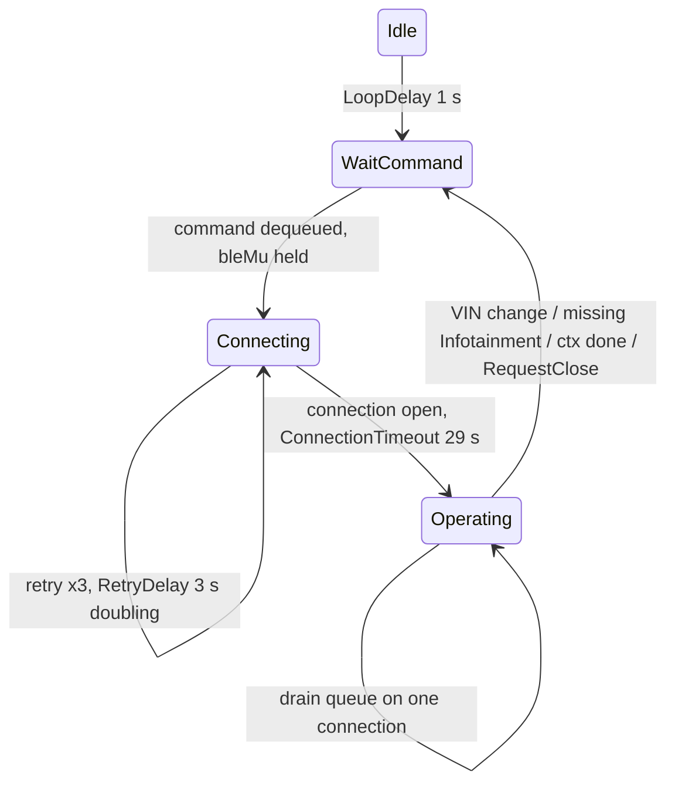
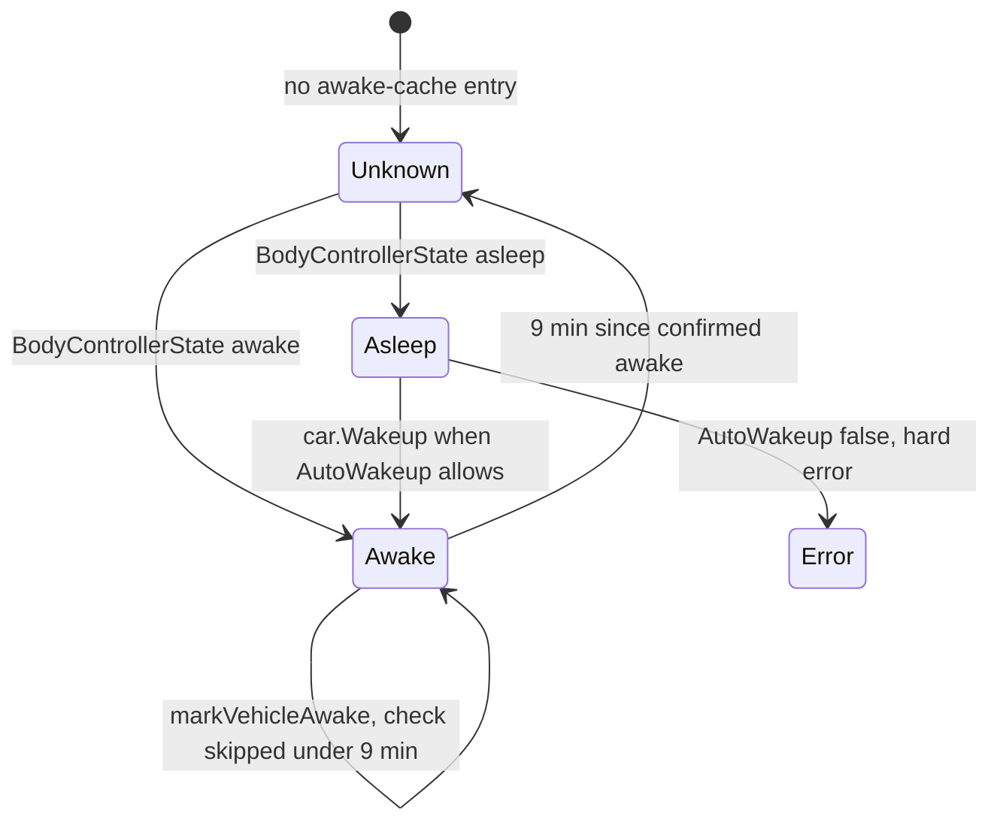
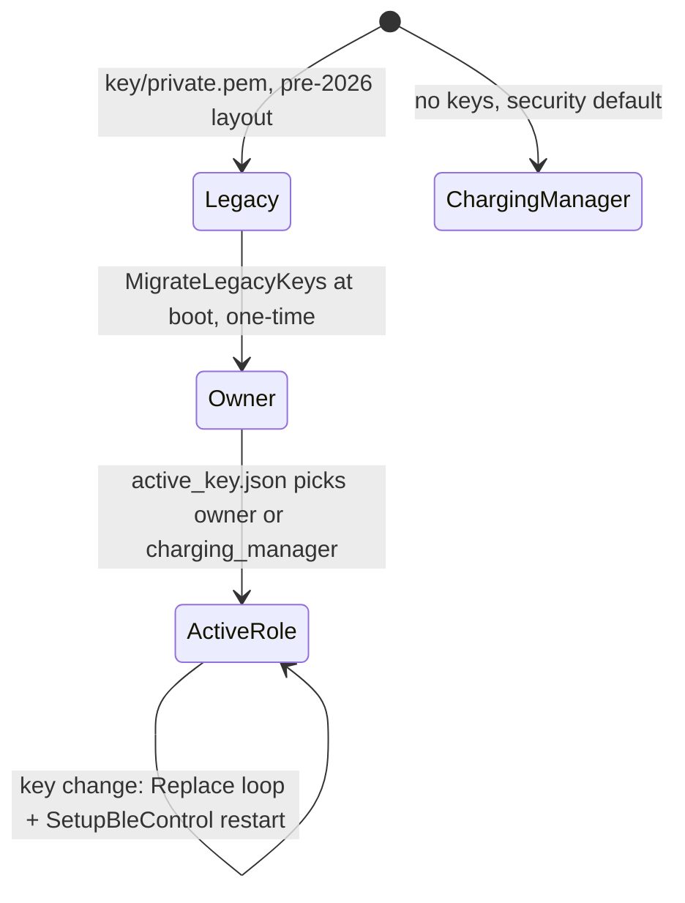
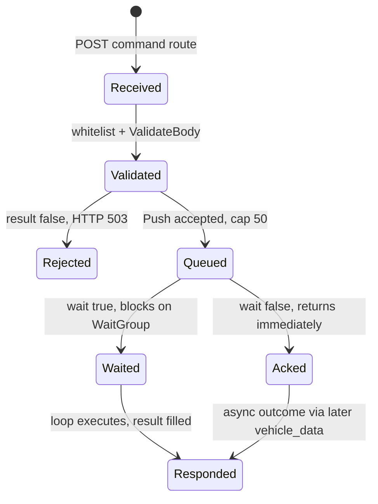

# wimaha-TeslaBleHttpProxy

## 1. Provenance

- **Submodule path:** `legacy/wimaha-TeslaBleHttpProxy`
- **Pinned gitlink SHA:** `edb47a0e09a02e1c1d371a6ef38e4c9858857fc1` (parent `160000` entry). `git -C legacy/wimaha-TeslaBleHttpProxy rev-parse HEAD` matches; `status --porcelain` empty; `log -1` = `Merge pull request #181 from wimaha/chore/pr-template`.
- **Upstream URL:** `https://github.com/wimaha/TeslaBleHttpProxy` (origin fetch+push).
- **License:** Apache License 2.0 (`LICENSE:1-3`); note this differs from our GPL-3.0. Idea-port only, never line-copy.
- **Analysis date:** 2026-11-20.
- **Language/toolchain:** Go 1.27.0 (`go.mod:3`), with `replace` to forks `wimaha/vehicle-command v0.0.8` and `wimaha/ble_BleConnectFix` (`go.mod:42-44`).
- **Files read (full unless noted):** `main.go:1-53`, `go.mod:1-44`, `config/config.go:1-195`, `internal/ble/control/control.go:1-849`, `internal/ble/control/key.go:1-188`, `internal/ble/control/keymanager.go:1-340`, `internal/ble/control/keyloader.go:1-17`, `internal/ble/control/status.go:1-111`, `internal/ble/fakecar/fakecar.go:1-447`, `internal/tesla/commands/command.go:1-90`, `internal/tesla/commands/commands.go:1-427`, `internal/tesla/commands/charge_schedule.go:1-179`, `internal/api/routes/routes.go:1-66`, `internal/api/handlers/tesla.go:1-437`, `internal/api/handlers/status.go:1-137`, `internal/api/handlers/version.go:1-28`, `internal/api/handlers/html.go:1-338`, `internal/api/handlers/security_test.go:1-118`, `internal/api/models/statesConverter.go:1-202`, `internal/api/models/response.go:1-15`, `internal/api/models/apiResponse.go:1-15`, `README.md:1-327`, `docs/environment_variables.md:1-74`, `CHANGELOG.md:1-60`, test names/line anchors from all 16 `*_test.go` files (detail reads: `commands_send_test.go:123-192`, `control_sim_test.go:100-199`). Our counterparts: `firmware/lib/vehicle/ble/feature/session.h:1-282`, `firmware/lib/vehicle/ble/feature/key.h:1-90`, `firmware/lib/vehicle/ble/feature/vcsec.h:1-141`, `firmware/lib/vehicle/ble/msg.h:1-366`, `firmware/lib/vehicle/ble/handler/dispatch.h:1-260`, `firmware/lib/client/api/routes.h:1-359`, `firmware/lib/client/api/auth.h:1-80`.
- **Files explicitly NOT read:** `.github/workflows/*`, `.golangci*.yml`, `Dockerfile`, `docker-compose.yml`, `Makefile`, `scripts/check-release-docs.sh`, `static/css/style.css`, `static/js/status.js`, `html/*.html`, `internal/logging/*`, `internal/api/handlers/logs.go`, `internal/api/models/message_stack.go`, `internal/api/models/states.go`, `docs/installation.md`, `docs/manually_gen_key.md`, and the vendored source of the two Go `replace` forks (external to the submodule). These are backlog, not evidence.

## 2. Executive verdict

A Linux/Go HTTP-to-BLE proxy for evcc/Home Assistant: it exposes a narrow Tesla Fleet-API-shaped REST surface (`/api/1/vehicles/{vin}/...`), serializes every request through one in-process command queue so only one BLE central connection to the car is open, opens a VCSEC session first (wake / body-controller-state need only VCSEC) then upgrades to VCSEC+Infotainment, and enforces restart-safe, non-retry semantics for non-idempotent commands. Strong mechanisms worth studying: (1) single-connection queue with clean key-swap/Stop handover and queue-full rejection, (2) VCSEC-first two-domain handshake plus a 9-minute awake cache that avoids waking the car for `vehicle_data`, (3) explicit retry vs `NotRetriedError` classification (rear-trunk toggle, new schedule without `id`), (4) validate-before-connect input oracle, (5) browser cross-origin protection with `trustedOrigins` escape hatch, (6) per-VIN/per-endpoint cache with stale fallback. We already ship BLE session/key/role/VCSEC/carserver primitives and split REST status commands, so the core crypto and command vocabulary are **already present**. Do not port the Go REST shape itself (our wire contract is `{cmd}` JSON-RPC with `t`-typed envelopes), the D-Bus/BlueZ adapter handling, or the role name mapping. No CAN frame is built or mutated anywhere in this repo — do-not-copy list is mostly about avoiding architecture drift, not CAN safety.

## 3. Evidence map

| Source file | Lines | What it proves | Grade |
| --- | --- | --- | --- |
| `internal/ble/control/control.go` | 23-33, 106-177, 179-297 | `atomic.Pointer` instance, `bleMu`, `commandStack` cap 50, `providerStack` unbuffered, `Push` non-blocking with `errQueueFull`/`errStopped` | CODE-READ |
| `internal/ble/control/control.go` | 332-411, 647-749 | Connect retry loop (3 attempts, 3 s doubling), 15 s per-attempt ctx, connection kept `ConnectionTimeout` 29 s, VIN/domain reconnection triggers, `needsInfotainment` | CODE-READ |
| `internal/ble/control/control.go` | 414-505, 518-645 | `bleDial` beacon scan (`scanTimeout` independent ctx, `CAP_NET_ADMIN` hint), VCSEC-first session, `wake_up` VCSEC-only, 9-min awake cache, Infotainment upgrade | CODE-READ |
| `internal/ble/control/control.go` | 751-849 | `ExecuteCommand` retry loop, `InvalidInputError` handling, `"closed pipe"` reconnect signal, result/error/WaitGroup bookkeeping | CODE-READ |
| `internal/ble/control/control_sim_test.go` | 108-192 | Wake sequence `Dial,StartSession,Wakeup,StartSession,<cmd>`, wake_up VCSEC-only + session reuse, 9-min awake cache, sleeping vehicle_data not retried | TEST-READ |
| `internal/ble/control/control_lifecycle_test.go` | 71-408 | Stop/Replace handover, adapter release only while idle, full-queue rejection, RequestClose, VIN status tracking | TEST-READ |
| `internal/tesla/commands/commands.go` | 18-19, 21-290, 307-326 | 20-command whitelist + 3-endpoint whitelist, command switch, `NotRetriedError`, `ValidateBody` (5 commands only) | CODE-READ |
| `internal/tesla/commands/commands.go` | 328-427 | `parseInt32Field`/`parseBoolField` accept JSON number or string; temps clamped 15-28 °C; trunk `front|rear` | CODE-READ |
| `internal/tesla/commands/charge_schedule.go` | 11, 30-104, 119-179 | `maxMinuteOfDay=1439`, required lat/lon/days, day bitmask/name parsing (`All`=127, `Weekdays`=62) | CODE-READ |
| `internal/tesla/commands/commands_send_test.go` | 123-181 | Retry decision table: rear trunk and schedule-add-without-id are not retried; schedule update is; `is_charging` = success | TEST-READ |
| `internal/ble/control/key.go` | 20-114, 123-188 | P-256 key gen, private key `Chmod(0600)` (line 74), `add-key-request` via temporary BleControl, `SendKeysToVehicle` 30 s adapter wait | CODE-READ |
| `internal/ble/control/keymanager.go` | 14-55, 57-175, 261-340 | Valid roles `owner`/`charging_manager`, `ValidateRole` whitelist + traversal check, `active_key.json`, legacy key migration to owner | CODE-READ |
| `internal/tesla/commands/commands.go` | 143-206 | `add-key-request` maps role to `keys.Role_ROLE_*`, form factor `KEY_FORM_FACTOR_CLOUD_KEY`, NFC-card confirmation message | CODE-READ |
| `internal/api/routes/routes.go` | 18-66 | Fleet-shaped routes, `http.NewCrossOriginProtection()`, `normalizeOrigin` (lowercase, no trailing slash, strip default ports) | CODE-READ |
| `internal/api/handlers/tesla.go` | 115-189, 196-360, 362-437 | `wait` sync/async, body validation before queue, per-VIN/end point cache key `VIN:endpoint`, stale fallback, 15 s body-controller wait, `Cache-Control` | CODE-READ |
| `internal/api/handlers/security_test.go` | 42-118 | Cross-site unlock = 403 and zero car calls; non-browser unlock works; key routes reject GET; dashboard escapes form input | TEST-READ |
| `internal/api/handlers/status.go` | 21-137 | Read-only `buildStatus()`, VIN regex `^[A-HJ-NPR-Z0-9]{17}$`, refresh bypasses cache, never contacts car for status | CODE-READ |
| `internal/api/handlers/status_e2e_test.go` | 81-201 | Status never contacts car; refresh bypasses cache; wakeup flag behavior; invalid VIN rejected | TEST-READ |
| `internal/api/models/statesConverter.go` | 10-202 | Protobuf→Fleet JSON conversion, `flatten()` string hack, `speedFloat` fallback, odometer hundredths→miles, shift-state oneof | CODE-READ |
| `README.md` / `CHANGELOG.md` / `docs/environment_variables.md` | README 1-327, CHANGELOG 1-60, env 1-74 | Deployment, defaults (`:8080`, cache 30 s, timeout 29 s, scan 5 s), security posture, version markers | SUMMARY-ONLY |
| `firmware/lib/vehicle/ble/feature/session.h` (our code) | 21-282 | We already establish ECDH/AES-128-GCM session per domain with monotonic counter | CODE-READ |
| `firmware/lib/vehicle/ble/feature/key.h` (our code) | 22-23 | We already define `ROLE_OWNER=4`, `ROLE_CHARGING_MANAGER=5` | CODE-READ |
| `firmware/lib/client/api/routes.h` (our code) | 245-359 | Our REST uses wildcard CORS, sync `{"t":"ack","cmd":"..."}`, no Fleet envelope | CODE-READ |
| BLE beacon interval ~200 ms; vehicle "max 3 BLE devices" | `control.go:432`, `README.md:303-311` | Comments/docs only; no frame capture or test | UNVERIFIED |

## 4. Architecture and build surface

- **Entry point:** `main.go:19-53` — `logging.InitLogHandler()` → `config.InitConfig()` → `control.MigrateLegacyKeys()` → `control.SetupBleControl()` → `routes.SetupRoutes(...)` → `http.ListenAndServe(:8080)`.
- **Shared core vs platform port:** Protocol/command code is in `internal/tesla/commands` and `internal/api/models`; the only platform-specific BLE code is `internal/ble/control/control.go:bleDial` (Teslamotors `vehicle-command` BLE connector over BlueZ/D-Bus). `Car` and `Dialer` interfaces (`control.go:83-91`) plus `internal/ble/fakecar` let the whole loop run in native Go tests without hardware. No build flags; behavior is environment-variable driven (`config/config.go:89-98`).
- **Dependency boundaries:** `go.mod:5-10` — `charmbracelet/log`, `gorilla/mux`, `teslamotors/vehicle-command`, `protobuf`; two forks pinned via `replace` (line 42-44). Static HTML/JS embedded with `go:embed` (`main.go:13-17`).
- **Process model:** one OS process, one active `*BleControl` behind `atomic.Pointer` (`control.go:25-44`, swapped by dashboard key changes), one `sync.Mutex` (`bleMu`) guaranteeing one open BLE connection, two channels feeding one goroutine `Loop()`. `SendKeysToVehicle` is the sole controlled exception: it acquires `bleMu` itself and opens a temporary second `BleControl` with no private key (`key.go:138-188`).
- **Deployment:** Docker with `/var/run/dbus` mount, `privileged: true`, `NET_ADMIN`/`SYS_ADMIN` (`README.md:32-46`); `releaseAdapterWhenIdle` exists for hosts sharing BlueZ (`config.go:97`, `control.go:197-203`).

```mermaid
flowchart LR
    Client([evcc / curl / dashboard]) --> HTTP["HTTP REST :8080<br/>routes.go"]
    HTTP --> Validate["handlers.Command<br/>whitelist + ValidateBody pre-queue"]
    Validate --> Queue["commandStack cap 50<br/>Push never blocks"]
    Queue --> Loop["BleControl.Loop<br/>single goroutine behind bleMu"]
    Loop --> Dial["bleDial: beacon scan<br/>BlueZ / D-Bus"]
    Dial --> VCSEC["StartSession VCSEC"]
    VCSEC --> Gate{command class}
    Gate -->|wake_up, body-controller-state| VSend["send on VCSEC session only"]
    Gate -->|all others| Wake["Wakeup if asleep<br/>9-min awake cache"]
    Wake --> Both["StartSession VCSEC + Infotainment"]
    Both --> Exec["ExecuteCommand<br/>3 attempts, retry / non-retry"]
    VSend --> Exec
    Exec --> Car([Tesla vehicle over BLE])
```



## 5. Mechanism catalogue

### M1 — Serialized single-connection command queue

- **Claim (README / summary):** "stores the received requests in a queue and processes them one by one. This ensures that only one Bluetooth connection to the vehicle is established at a time" (`README.md:7`); existing doc repeats it.
- **Code path:** `control.Push` (`control.go:283-297`) → `commandStack` (cap 50, `control.go:167`) → `BleControl.Loop` (`control.go:179-220`) → `connectToVehicleAndOperateConnection` (`control.go:332-411`, holds `bleMu`) → `operateConnection` (`control.go:647-743`, drains both stacks on one open connection) → `ExecuteCommand` (`control.go:751-849`).
- **Frame spec:** N/A — no CAN; BLE messages are protobuf `RoutableMessage`s built by the upstream library, not by this repo.
- **Gates and timing:** `LoopDelay` 1 s, `RetryDelay` 3 s doubled per retry, `ConnectionTimeout` 29 s (`DefaultTiming`, `control.go:100-104`). `Push` never blocks; full queue → `errQueueFull`. `Stop` closes `done`, blocks new pushes via `stopMu`, and `failQueued()` answers all waiters with `errStopped` (`control.go:224-267`). `Replace()` + `previous.Stop()` swaps the loop on key change (`control.go:46-72`).
- **State machine:** idle → wait for command → connect (≤3 attempts) → operate open connection → on new VIN / missing Infotainment / context done / close request → disconnect and re-loop; `wake_up` execution upgrades an existing VCSEC session to include Infotainment (`control.go:661-676`).



- **Tests:** `TestFullQueueRejectsAndStopDoesNotHang` (`control_lifecycle_test.go:323`), `TestCommandsShareOneConnection` (`control_sim_test.go:300`), `TestReplacedLoopHandsOverConnection` (`control_lifecycle_test.go:130`).
- **Evidence grade:** CODE-READ + TEST-READ.
- **Verdict:** CONFIRMED (with documented `SendKeysToVehicle` exception).
- **Adapt to TeslaCANModder?** candidate for future PR (see §13).

### M2 — VCSEC-first two-domain handshake with wake/sleep gating

- **Claim (README / summary):** "Commands automatically wake up the vehicle if it is asleep" (`README.md:162`); vehicle_data does not wake by default and skips the status check if awake within 9 minutes (`README.md:214`).
- **Code path:** `TryConnectToVehicle` (`control.go:518-645`) → `StartSession{ VCSEC }` (line 537) → either `isWakeUpCommand` (line 544, VCSEC only) or `shouldCheckSleepStatus` + `BodyControllerState` (lines 554-615) → `car.Wakeup` when required → `StartSession{ VCSEC, Infotainment }` (lines 629-634). `shouldCheckSleepStatus` = `time.Since(lastAwake) > 9*time.Minute` (`control.go:311-322`); `markVehicleAwake` records it (line 325-330).
- **Frame spec:** N/A (BLE domain IDs: `vcsec`, `infotainment`, from `command.go:20-28`). No Tesla CAN frame content in this repo.
- **Gates and timing:** `wake_up` bypasses sleep check/Infotainment entirely; `body-controller-state` is `Domain.VCSEC` (`tesla.go:388-393`) and needs no wake; all other commands always `Wakeup` (`control.go:616-625`); unknown sleep status + `AutoWakeup=false` → hard error (lines 575, 609).
- **State machine:** per-VIN `lastAwakeTime` map (line 131); `ASLEEP`→wake (if allowed)→mark awake; `AWAKE`→mark awake; unknown→wake best-effort if allowed.



- **Tests:** `TestWakeUpStartsWithVCSECOnly` (`control_sim_test.go:125`), `TestVehicleDataDoesNotWakeSleepingCar` (line 142), `TestVehicleDataRemembersAwakeCar` (line 177), `TestInfotainmentCommandReconnectsAfterBodyControllerState` (`control_lifecycle_test.go:211`).
- **Evidence grade:** CODE-READ + TEST-READ.
- **Verdict:** CONFIRMED.
- **Adapt to TeslaCANModder?** candidate for future PR (gap: our `runAuthCommand` establishes one domain per command and has no awake cache).

### M3 — Retry vs deliberate non-retry (idempotency)

- **Claim (README / summary):** Rear trunk is a toggle and is not retried; schedule add without `id` is not retried (`README.md:194, 203`); CHANGELOG `2026-11-20` upstream note calls this "rejected async command reporting".
- **Code path:** `Command.Send` returns `(shouldRetry, err)` (`commands.go:21-290`); non-retry cases: `NotRetriedError` for rear trunk (`commands.go:80-82`), `schedule.Id != 0` for add schedule (`commands.go:271-275`), `InvalidInputError` for bad bodies (`charge_schedule.go:13-21`), `is_charging`/`complete`/`not_charging` treated as success (`commands.go:92-113`). `ExecuteCommand` honors `retry` flag and 3 attempts (`control.go:806-848`); `"closed pipe"` forces reconnect-and-retry (line 840).
- **Frame spec:** N/A. The "frame" here is an HTTP response: `result:false` + reason + HTTP 503 (`tesla.go:88-102`).
- **Gates and timing:** 3 attempts, `RetryDelay` doubling; `InvalidInputError` never retried and must reach caller even when the send loop would otherwise drop it (`control.go:828-832`, `control_test.go:14-40`).
- **State machine:** per-command `retry` boolean derived from command semantics, not a global policy.
- **Tests:** `TestSendRetryDecision` (`commands_send_test.go:123`), `TestRearTrunkFailureIsReported` (line 160), `TestChargeStartStopAlreadyDone` (line 171), `TestInvalidInputKeepsConnection` (`control_sim_test.go:319`).
- **Evidence grade:** CODE-READ + TEST-READ.
- **Verdict:** CONFIRMED.
- **Adapt to TeslaCANModder?** candidate for future PR (cheap, no CAN impact).

### M4 — Role-based key model, path-safe role handling, legacy migration

- **Claim (README / summary):** Two key roles — Owner (full) and Charging Manager (limited, recommended for security); NFC card confirms key enrollment (`README.md:77-98`); existing doc calls it "a good security pattern".
- **Code path:** `ValidateRole` (`keymanager.go:23-55`, whitelist + lowercase/digit/underscore/hyphen + `..//\` check) → `GetKeyFiles`/`GetActiveKeyRole` (`keymanager.go:63-139`) → `active_key.json` (`keymanager.go:57-61`, 141-175) → `MigrateLegacyKeys` (`keymanager.go:262-340`, called at `main.go:28-31`) → `SendKeysToVehicle` (`key.go:138-188`) → `add-key-request` (`commands.go:143-206`) maps to `keys.Role_ROLE_OWNER` / `ROLE_CHARGING_MANAGER` with `vcsec.KeyFormFactor_KEY_FORM_FACTOR_CLOUD_KEY` (line 202). Key files written with `Chmod(0600)` (`key.go:74`, `keymanager.go:307`).
- **Frame spec:** N/A (no CAN). Role names are proxy filesystem labels; the *vehicle* enforces command permissions — no role check exists in `Command.Send`.
- **Gates and timing:** `SendKeysToVehicle` requests the loop to close its connection, then `TryLock` `bleMu` for ≤30 s (`key.go:123-149`), with a 15 s connection context (line 166).
- **State machine:** legacy key → owner role (one-time migration) → active role file → on key change/replace, `SetupBleControl()` restarts the loop (`html.go:99, 199, 322`).



- **Tests:** key-route tests (`routes_test.go:65, 96`; `security_test.go:85`); role validation itself has no dedicated unit test in the read files → partial evidence.
- **Evidence grade:** CODE-READ (TEST-READ for HTTP route protection only).
- **Verdict:** PARTIAL (role semantics vehicle-side, unverified here).
- **Adapt to TeslaCANModder?** already present (core) / no impact — we already define both role constants (`key.h:22-23`) and emit add-key requests with role (`msg.h:55`), with NVS rather than PEM files.

### M5 — Fleet-shaped REST surface + synchronous/asynchronous envelope

- **Claim (README / summary):** "uses the same interfaces as the Tesla Fleet API" (`README.md:139`); existing doc says "Fleet API–compatible interface".
- **Code path:** `routes.SetupRoutes` (`routes.go:18-46`) → `handlers.Command` / `VehicleData` / `BodyControllerState` → `bc.PushCommand(...)` → `models.Response{Return,Reason,Vin,Command,Response}` (`response.go:9-15`) → `commonDefer` HTTP 200 or 503 (`tesla.go:88-102`). `wait=true` uses `sync.WaitGroup` + request context (`tesla.go:159-179`); without `wait`, success means "queued" only, but a rejected push now returns `result:false`/503 (`tesla.go:181-188`).
- **Frame spec:** N/A. 20 whitelisted commands (`commands.go:18`) and only `charge_state`, `climate_state`, `drive_state` for vehicle_data (`commands.go:19`, `tesla.go:214-222`); default endpoints are charge+climate (`tesla.go:207`).
- **Gates and timing:** body decoded leniently (`tesla.go:138`), command must be in whitelist, `ValidateBody` before queue (line 152); HTTP 503 whenever `result:false`.
- **State machine:** request → validate → push → (wait? block : immediate ack) → loop executes → response constructed.



- **Tests:** `TestHTTPCommandReachesCar` (`tesla_test.go:92`), `TestHTTPCommandWithoutWait` (line 110), `TestHTTPCommandWithoutWaitReportsRejection` (line 130), `TestHTTPRejectsWithoutContactingCar` (line 146).
- **Evidence grade:** CODE-READ + TEST-READ.
- **Verdict:** CONFIRMED but narrow (whitelist, not a general Fleet proxy).
- **Adapt to TeslaCANModder?** never port wholesale (conflicts with our JSON-RPC `{cmd}` contract); optional adapter at tools layer only.

### M6 — Per-VIN per-endpoint cache with stale fallback

- **Claim (README / summary):** "Each endpoint ... cached separately per VIN ... default: 30 seconds" (`README.md:212`, `docs/environment_variables.md:19-21`).
- **Code path:** `fetchVehicleData` (`tesla.go:238-360`) → key `vin + ":" + endpoint` (`tesla.go:191-194`) → `vehicleDataCache` map guarded by RWMutex (`tesla.go:29-32`) → BLE fetch for missing endpoints → cache write (lines 306-325) → stale data served with reason "partially processed from cache. Some data may be stale" on BLE failure (lines 338-359). Separate `bodyControllerCache` is dashboard-only, never answers the endpoint (`tesla.go:34-39, 409-412`).
- **Frame spec:** N/A.
- **Gates and timing:** `VehicleDataCacheTime` default 30 s (`config.go:140-149`); `Cache-Control: public, max-age=5, must-revalidate` on body-controller responses (`tesla.go:431-437`).
- **Tests:** `TestHTTPVehicleDataIsCached` (`tesla_test.go:186`), `TestHTTPVehicleDataFallsBackToCache` (line 212), `TestHTTPVehicleDataSleepingCar` (line 232).
- **Evidence grade:** CODE-READ + TEST-READ.
- **Verdict:** CONFIRMED.
- **Adapt to TeslaCANModder?** no impact (we keep live CAN state + recorder ring, not remote BLE data fetch).

### M7 — Browser cross-origin protection with trusted-origin exemption

- **Claim (README / summary):** State-changing browser requests from other sites get 403; evcc/curl/Home Assistant pass; `trustedOrigins` escapes reverse-proxy Host rewriting (`README.md:319-325`, `docs/environment_variables.md:27-38`).
- **Code path:** `routes.SetupRoutes` wraps the mux in `http.NewCrossOriginProtection()` with `AddTrustedOrigin(normalizeOrigin(...))` (`routes.go:39-45`); `normalizeOrigin` lowercases, strips trailing slash and default ports, bracket-wraps IPv6 (`routes.go:51-66`).
- **Frame spec:** N/A.
- **Gates and timing:** Only state-changing requests are challenged; GET/version/status pass.
- **State machine:** static middleware, no state.
- **Tests:** `TestCrossOriginCommandIsRejected`, `TestReverseProxyOriginNeedsTrust` (`routes_test.go:32, 75`), `TestHTTPCrossSiteUnlockNeverReachesCar`, `TestHTTPNonBrowserUnlockReachesCar` (`security_test.go:42, 70`), `TestNormalizeOrigin` (`routes_test.go:96`).
- **Evidence grade:** CODE-READ + TEST-READ.
- **Verdict:** CONFIRMED.
- **Adapt to TeslaCANModder?** candidate for future PR (our `sendCorsHeaders()` sets `Access-Control-Allow-Origin: *`, `routes.h:251`; auth is optional, `auth.h:70-71`).

### M8 — Read-only status snapshot + explicit refresh split

- **Claim (README / summary):** Dashboard shows status "without contacting the vehicle"; Refresh fetches without waking, Wake & refresh wakes (`README.md:283-289`, CHANGELOG 2.5.0 "Added").
- **Code path:** `statusTracker` (`status.go:34-101`, per-VIN `VehicleConnection` with connected/sleep/last success/error) is filled only where the loop already learns it (`control.go:394-396, 771-774`); `buildStatus()` merges it with cached data (`handlers/status.go:52-95`); `GET /api/proxy/1/status` never contacts car (line 97-111); `POST /status/refresh` validates VIN regex and calls `fetchVehicleData(..., 0, wakeup, ...)` bypassing cache (`status.go:113-137`).
- **Frame spec:** N/A.
- **Gates and timing:** 10 s dashboard auto-update (CHANGELOG:24); refresh with cacheTime 0 forces BLE.
- **Tests:** `TestHTTPStatusNeverContactsCar` (`status_e2e_test.go:81`), `TestHTTPRefreshBypassesCache` (line 186), `TestHTTPRefreshRejects` (line 201), `TestStatusShowsExpiredCacheEntries` (`status_test.go:14`).
- **Evidence grade:** CODE-READ + TEST-READ.
- **Verdict:** CONFIRMED.
- **Adapt to TeslaCANModder?** already present (our `status:meta|state|features|can|compact|live` split covers the read-only snapshot idea).

### M9 — Validate-before-connect input oracle

- **Claim (README / summary):** "An invalid body ... is rejected with `result: false` before the proxy connects to the car, so it does not wake the car" (`README.md:195`).
- **Code path:** `handlers.Command` calls `commands.ValidateBody` before `PushCommand` (`tesla.go:151-157`); `ValidateBody` covers only `set_temps`, `actuate_trunk`, `set_charging_amps`, `set_charge_limit`, `set_sentry_mode` (`commands.go:307-326`); parsers accept JSON number or string and produce `InvalidInputError` (`commands.go:328-427`); charge-schedule body validated only in `Send` (`charge_schedule.go:30-92`).
- **Frame spec:** N/A. Ranges: temps 15-28 °C (`commands.go:401-405`), `charging_amps` int32, schedule minutes 0-1439 (`charge_schedule.go:11`), days bitmask 0-127 (line 147).
- **Gates and timing:** Rejection happens pre-queue → no BLE dial, no wake.
- **Tests:** `TestValidateBody`, `TestParseErrorsAreInvalidInput` (`commands_parse_test.go:71, 124`), `TestSendBadBodyDoesNotTouchCar` (`commands_send_test.go:184`), `TestChargeScheduleRejectsBadInput` (`charge_schedule_test.go:86`).
- **Evidence grade:** CODE-READ + TEST-READ.
- **Verdict:** CONFIRMED for the 5 covered commands; PARTIAL for schedule commands (validated at execution time).
- **Adapt to TeslaCANModder?** candidate for future PR (validate in our dispatch before establishing BLE session).

### M10 — Connection reuse, adapter release and retry timing

- **Claim (README / summary):** Default 29 s connection reuse; `releaseAdapterWhenIdle` hands BlueZ adapter back; ~30 s vehicle-side disconnect is normal (`README.md:299-317`, `docs/environment_variables.md:40-50`).
- **Code path:** `ConnectionTimeout` 29 s (`control.go:103`, `config.go:151-160`); `operateConnection` uses a `connectionCtx` with that timeout and drains queued commands on the same car (`control.go:650-743`); `ReleaseAdapterWhenIdle` calls `ble.CloseAdapter` while holding `bleMu` between connections (`control.go:111-114, 197-203`); `bleDial` error string for `operation not permitted` suggests `setcap cap_net_admin=eip` (`control.go:464-468`); scan timeout is independent of parent ctx so scan gets full duration (`control.go:435-456`).
- **Frame spec:** N/A.
- **Gates and timing:** 3 connect attempts (line 339), first retry 3 s then doubling (line 102, 386); 15 s per connect attempt (line 389); 30 s wait for `bleMu` in key send (`key.go:124`).
- **Tests:** `TestConnectionClosesAfterTimeout` (`control_sim_test.go:347`), `TestAdapterReleasedOnlyWhileIdle`, `TestAdapterKeptByDefault` (`control_lifecycle_test.go:239, 265`), `TestLockBLEGivesUp` (line 385).
- **Evidence grade:** CODE-READ + TEST-READ.
- **Verdict:** CONFIRMED.
- **Adapt to TeslaCANModder?** no impact for BlueZ adapter release; candidate only for the retry/backoff shape if we add BLE-central connect retries.

## 6. Summary vs code contradiction table

| Claim in summary / README | Code evidence | Verdict |
| --- | --- | --- |
| Existing doc: "Low direct relevance since our project operates at the CAN bus level, not BLE"; "Reusability: Low" | Our repo ships `firmware/lib/vehicle/ble/` (session/key/vcsec/carserver), `tesla:*` commands and REST status — M2/M3/M7/M9 map to real gaps | CONTRADICTED by our code (the *upstream* repo has no CAN, that part is true: `git ls-files` shows zero CAN files) |
| Existing doc / README: "only one Bluetooth connection ... at a time" | `SendKeysToVehicle` opens a second, keyless `BleControl` outside the queue, serialized by `bleMu` + `RequestClose` (`key.go:138-188`) | PARTIAL — one connection at a time, but two `BleControl` instances exist transiently |
| README: "Fleet API–compatible interface" / "same interfaces as the Tesla Fleet API" | Whitelist of 20 commands (`commands.go:18`) and 3 vehicle_data endpoints (`commands.go:19`); no general Fleet proxy, no auth/OAuth | CONTRADICTED as stated — narrow subset only |
| Existing doc: "Two key roles ... Charging Manager (limited to charging commands)" implies proxy-side limitation | `Command.Send` has no role check (`commands.go:21-290`); role is sent to car at enrollment (`commands.go:202`) and vehicle enforces it (`README.md:193`) | PARTIAL — proxy selects key, vehicle enforces scope |
| Upstream note (existing doc, 2026-11-20): "Go 1.27" | `go.mod:3` = `go 1.27.0`; CHANGELOG:46 says Docker built with Go 1.27.2 (toolchain, not module floor) | CONFIRMED (no contradiction; recorded to prevent a false flag) |
| Upstream note: "rejected async command reporting `f9c9c3b`" | `Push` returns `errQueueFull`/`errStopped`; non-wait handler sets `result:false`/503 (`tesla.go:181-188`), CHANGELOG:15,43 | CONFIRMED |
| Upstream note: "dashboard status/refresh endpoints, per-vehicle connection tracking" | `status.go:52-137`, `control/status.go:34-101` | CONFIRMED |
| README: "maximum of 3 BLE keys/devices" | No code, test or capture in repo; vehicle-side claim only | UNVERIFIED (backlog, not a contradiction) |

## 7. CAN frame and signal inventory

None found: no CAN frame is decoded, mutated or injected anywhere in this repo — the vehicle link is BLE only, and every protobuf `RoutableMessage` byte is assembled by the vendored `teslamotors/vehicle-command` library, not by this repo. Demonstrated negative anchor (run from `legacy/wimaha-TeslaBleHttpProxy`):

```text
git grep -nEi 'can_id|canid|mcp2515|can_frame' -- '*.go'   -> no output (exit 1)
```

BLE wire facts that stand in for a frame table:

| Wire fact | Value / layout | Where | Grade |
| --- | --- | --- | --- |
| BLE domain labels | `Domain.VCSEC = "vcsec"`, `Domain.Infotainment = "infotainment"`, `None = ""` | `internal/tesla/commands/command.go:20-28` | CODE-READ |
| BLE message envelope | protobuf `RoutableMessage` built by vendored `teslamotors/vehicle-command` (imported at `command.go:9-14`); this repo never assembles frame bytes itself | `command.go:9-14` | CODE-READ |
| Session establishment order | VCSEC session first, Infotainment added only when a command needs it; `wake_up` stays VCSEC-only | `internal/ble/control/control.go:537, 616-634` | CODE-READ |
| add-key-request | `SendAddKeyRequestWithRole(publicKey, keys.Role, vcsec.KeyFormFactor)`; roles `ROLE_OWNER` / `ROLE_CHARGING_MANAGER`; form factor `KEY_FORM_FACTOR_CLOUD_KEY` | `command.go:53`, `internal/tesla/commands/commands.go:177-187, 202` | CODE-READ |
| Vehicle state categories | 12 named categories (`charge_state` … `parental-controls`) known to `GetCategory`; the HTTP surface whitelists only 3 | `command.go:70-83`, `commands.go:19` | CODE-READ |
| Advertisement beacon | vehicle claimed to beacon "every ~200ms", which sizes the scan budget | `control.go:432` | UNVERIFIED |

The beacon row is a code comment with no capture behind it, and the vendored protobuf layout (field numbers, counter placement, checksums) is UNVERIFIED because the `replace` forks were not read. No TEST-READ or CAPTURE evidence exists for any wire bytes in this repo — the tests fake the car at the Go interface level.

## 8. Constants and tuning table

| Constant | Value | Where | Meaning | Grade |
| --- | --- | --- | --- | --- |
| `commandStack` capacity | 50 | `internal/ble/control/control.go:167` | queue bound; the 51st push is rejected with `errQueueFull` | CODE-READ |
| `LoopDelay` | 1 s | `control.go:101` | pause between connection cycles | CODE-READ |
| `RetryDelay` | 3 s, doubled per attempt | `control.go:102`, `control.go:386` | first wait before a connect retry | CODE-READ |
| `retryCount` | 3 | `control.go:339` | connect attempts before the command fails | CODE-READ |
| per-attempt dial context | 15 s | `control.go:389` | budget for one `TryConnectToVehicle` | CODE-READ |
| `ConnectionTimeout` | 29 s (env `connectionTimeout`) | `control.go:103`, `config/config.go:151-160` | how long an open connection is kept for reuse | CODE-READ |
| `ScanTimeout` | 5 s default (env `scanTimeout`) | `config.go:129-137`, `control.go:435-456` | beacon scan budget on an independent context; history: 2 s default until commit `3931195` raised it to 5 s | CODE-READ |
| awake cache window | 9 min | `control.go:311-322` | skip the sleep check when the vehicle was confirmed awake within this window | CODE-READ |
| `VehicleDataCacheTime` | 30 s default | `config.go:140-149` | per-VIN per-endpoint response cache | CODE-READ |
| `cacheMaxAge` | 5 default | `config.go:118-127` | HTTP `Cache-Control` max-age for body-controller responses | CODE-READ |
| key-send `bleMu` wait | 30 s | `internal/ble/control/key.go:124` | `SendKeysToVehicle` waits for the loop to release the adapter | CODE-READ |
| key-send connection context | 15 s | `key.go:166` | budget for the temporary keyless connection | CODE-READ |
| `set_temps` clamp | 15–28 °C | `internal/tesla/commands/commands.go:401-405` | accepted cabin temperature range | CODE-READ |
| `maxMinuteOfDay` | 1439 | `internal/tesla/commands/charge_schedule.go:11` | charge-schedule minute-of-day bound | CODE-READ |
| `days_of_week` bitmask | 0–127; `all`=127, `weekdays`=62, `sunday`=1 … `saturday`=64 | `charge_schedule.go:147, 158-168` | schedule day encoding (Fleet API bitmask or names) | CODE-READ |
| VIN pattern | `^[A-HJ-NPR-Z0-9]{17}$` | `internal/api/handlers/status.go:113` | refresh-endpoint VIN gate (no I/O/Q) | CODE-READ |
| HTTP surface bound | 20 commands / 3 endpoints | `commands.go:18-19` | hard whitelists behind the Fleet-shaped URL space | CODE-READ |

Trivial constants (pin masks, formatting widths, log labels) are skipped per the skill. Every row above was read in code at the pinned SHA; none is CAPTURE-backed, so treat the timing numbers as tuning leads, not vehicle contracts.

## 9. Failure modes and edge cases

| Failure | Handling code path | Tested? | Grade |
| --- | --- | --- | --- |
| queue full | `Push` is non-blocking and returns `errQueueFull`; non-wait handler answers `result:false` / HTTP 503 | yes — `TestFullQueueRejectsAndStopDoesNotHang` (`control_lifecycle_test.go:323`) | TEST-READ |
| loop stopped / replaced | `Stop` closes `done`, blocks new pushes, `failQueued` answers waiters with `errStopped`; Stop also cancels in-flight connection attempts | yes — `TestStopAnswersQueuedAndLaterCommands` (`control_lifecycle_test.go:71`), `TestStopEndsConnectionAttempt` (`:305`) | TEST-READ |
| connect failure | 3 attempts with 3 s doubling; permanent errors skip the retry | yes — `TestConnectRetriesThenSucceeds` / `TestConnectGivesUpAfterThreeAttempts` / `TestConnectDoesNotRetryPermanentError` (`control_sim_test.go:194, 206, 221`) | TEST-READ |
| BlueZ permission failure | `"operation not permitted"` → no retry, error string suggests `setcap cap_net_admin=eip` | no dedicated test; error-string branch only (`control.go:464-468`) | CODE-READ |
| session handshake failure | disconnect, next connect attempt proceeds | yes — `TestFailedHandshakeDisconnects` (`control_sim_test.go:234`) | TEST-READ |
| command failure | 3 attempts; rear trunk, new schedule and `InvalidInputError` are never retried | yes — `TestCommandRetriesThenSucceeds` / `TestCommandFailsAfterThreeAttempts` / `TestRearTrunkFailureIsNotRetried` (`control_sim_test.go:247, 259, 287`) | TEST-READ |
| mid-command `"closed pipe"` | reconnect and retry | no dedicated test found (`control.go:840`) | CODE-READ |
| invalid request body | rejected pre-queue, connection kept open, error reaches caller | yes — `TestInvalidInputKeepsConnection` (`control_sim_test.go:319`), `TestExecuteCommandReportsInvalidInput` (`control_test.go:14`) | TEST-READ |
| sleeping vehicle, `AutoWakeup=false` | hard error, vehicle never woken | wake paths tested (`TestCommandWakesSleepingCar`, `control_sim_test.go:108`); hard-error branch has no dedicated test (`control.go:575, 609`) | CODE-READ |
| BLE failure during vehicle_data | stale cache served with an explicit reason | yes — `TestHTTPVehicleDataFallsBackToCache` (`tesla_test.go:212`) | TEST-READ |
| adapter contention | `LockBLE` gives up after 30 s | yes — `TestLockBLEGivesUp` (`control_lifecycle_test.go:385`) | TEST-READ |
| request canceled | command not sent and not retried | yes — `TestCanceledRequestIsNotRetried` (`control_sim_test.go:273`), `TestCanceledRequestDoesNotReachCar` (`control_lifecycle_test.go:346`) | TEST-READ |
| watchdog / brownout / bus-off / OTA | None found: no watchdog, no OTA handling and no CAN bus exist in this repo | demonstrated absence (below) | CODE-READ |

Demonstrated negative anchor:

```text
git grep -nEi 'watchdog|ota_update|otaUpdate' -- '*.go'   -> no output (exit 1)
```

Untested error paths and their one-line risks: the `"closed pipe"` reconnect could storm on a flapping link; `MigrateLegacyKeys` (`keymanager.go:261-340`) has no test, so a failed migration could silently fall back to a legacy key; and all BlueZ/D-Bus behavior is faked behind the `Car`/`Dialer` interfaces, so real-adapter release behavior is untested.

## 10. Test coverage map

16 test files, 93 test functions at the pinned SHA. Per file:

| Test file | Asserts |
| --- | --- |
| `internal/ble/control/control_sim_test.go` (17) | wake/sleep matrix incl. VCSEC-only wake and the 9-min awake cache; connect retry x3; permanent-error no-retry; handshake failure disconnect; command retry; rear-trunk non-retry; one shared connection; invalid input keeps connection; VIN switch; connection close after timeout |
| `internal/ble/control/control_lifecycle_test.go` (15) | Stop semantics and `errStopped`; replaced-loop handover; race-free instance swap; body-controller reuse and Infotainment reconnect; adapter released only while idle; queue-full rejection; canceled request; `RequestClose`; `LockBLE` give-up; per-VIN status tracking |
| `internal/ble/control/control_test.go` (2) | `ExecuteCommand` surfaces `InvalidInputError` (incl. bad temps/trunk) to the caller |
| `internal/api/handlers/tesla_test.go` (9) | HTTP command reaches car with and without `wait`; push rejection reported as 503; reject before contacting car; car error surfaced; vehicle_data cached / stale-fallback / sleeping car; body_controller_state |
| `internal/api/handlers/security_test.go` (4) | cross-site unlock never reaches car; non-browser unlock passes; key routes reject GET; dashboard escapes send-key input |
| `internal/api/routes/routes_test.go` (6) | cross-origin command rejected; non-browser passes; same-origin form passes; key routes reject GET; reverse-proxy origin needs trust; `normalizeOrigin` rules |
| `internal/api/handlers/status_e2e_test.go` (7) | status never contacts car; cached data without location; body-controller state; refresh no-wake / with wakeup / bypasses cache / rejects invalid VIN |
| `internal/api/handlers/status_test.go` (2) | expired cache entries still shown; dashboard status section renders |
| `internal/api/handlers/html_test.go` (1) | dashboard escapes messages |
| `internal/tesla/commands/commands_send_test.go` (8) | send dispatch reaches car; schedule reaches car; retry decision table; rear-trunk failure reported; charge already-done = success; bad body never touches car; vehicle_data JSON shape; read error retried |
| `internal/tesla/commands/commands_parse_test.go` (5) | temps parse (number or string); trunk parse; `ValidateBody` coverage; invalid body not retried; parse errors are `InvalidInputError` |
| `internal/tesla/commands/commands_docs_test.go` (3) | README lists every whitelisted command; body commands have examples; all vehicle_data endpoints documented |
| `internal/tesla/commands/commands_test.go` (1) | every `ExceptedCommands` entry is implemented on the `Vehicle` interface |
| `internal/tesla/commands/charge_schedule_test.go` (6) | energy-brain bodies parse; day names; Fleet bitmask; bad input rejected; lat/lon/days required; id from body |
| `internal/api/models/statesConverter_test.go` (4) | odometer hundredths→miles; shift-state oneof; speed fallback; missing optional odometer |
| `release_docs_test.go` (3) | README release note points at latest release; development note present; release markers on own lines |

Critical paths with NO test:

- `ValidateRole` traversal hardening (`keymanager.go:23-55`) — only the HTTP 405/escaping side is tested; a bypass would silently pick the wrong key file.
- `MigrateLegacyKeys` (`keymanager.go:261-340`) — no test; a failed migration falls back to legacy keys silently.
- `"closed pipe"` reconnect (`control.go:840`) — no test; reconnect storms would go unnoticed.
- Real BlueZ/D-Bus behavior — every test fakes the car and dialer; adapter release against a real host is unverified.
- `statesConverter.go` — only the four drive-state paths are asserted; the other categories are untested.

## 11. Parity matrix with TeslaCANModder

Our-side counterparts re-read for this section: `firmware/lib/vehicle/ble/feature/session.h`, `firmware/lib/vehicle/ble/feature/key.h`, `firmware/lib/vehicle/ble/msg.h`, `firmware/lib/vehicle/ble/handler/dispatch.h`, `firmware/lib/client/api/routes.h`, `firmware/lib/client/api/auth.h`, `packages/protocol/src/commands.ts`.

| Signal / mechanism | Upstream (cite) | Ours (cite) | Delta | Action |
| --- | --- | --- | --- | --- |
| BLE session crypto: ECDH P-256 → HKDF-SHA256 → AES-128-GCM, monotonic counter | orchestrated `control.go:537, 629-634`; crypto lives in the vendored lib | `session.h:63-206` `TeslaSession::establish`, `session.h:217-258` `sendCommand`, counter `session.h:196, 221-228` | same family, but ours is one domain per command, no VCSEC-first ordering, no awake cache | align (candidate PR, M2) |
| key role vocabulary | `keys.Role_ROLE_OWNER` / `ROLE_CHARGING_MANAGER`, strings `owner` / `charging_manager` (`keymanager.go:14-19`, `commands.go:177-187`) | numeric `ROLE_OWNER=4`, `ROLE_CHARGING_MANAGER=5` (`key.h:22-23`), same name whitelist (`dispatch.h:152`) | naming only | ignore — already present |
| add-key-request form factor | `KEY_FORM_FACTOR_CLOUD_KEY` (`commands.go:202`) | `KEY_FORM_FACTOR_NFC_CARD` via `buildAddKeyRequest` (`dispatch.h:204`, builder `msg.h:63-95`) | different form-factor value on the wire; both expect an NFC-card confirmation tap | capture-first — record what the vehicle accepts before changing ours |
| wake / sleep gating before send | sleep check + `car.Wakeup` + 9-min cache (`control.go:518-645`, `control.go:311-322`) | none — `runAuthCommand` connects and sends blind (`dispatch.h:63-97`); wake exists only as an explicit command (`dispatch.h:222-226`) | ours never checks sleep state | align (candidate PR, M2) |
| command whitelist | 20 commands / 3 endpoints (`commands.go:18-19`) | registry `commands.ts:527-539` plus the `strcmp` chain `dispatch.h:108-295` | concept already present, dispatch-shaped not HTTP-shaped | ignore |
| validate before connecting | pre-queue `ValidateBody` (`tesla.go:151-157`, `commands.go:307-326`) | numeric args checked pre-connect: amps 1-32 (`dispatch.h:243-249`), limit 50-100 (`dispatch.h:260-266`), VIN 5-17 (`dispatch.h:167-175`); but protobuf build errors surface only after the session is up (`dispatch.h:78-85`) | ours validates numbers early, yet an encoding failure still costs a full BLE session | align — hoist the build call above `session.establish` |
| REST browser-CSRF defense | cross-origin protection + `trustedOrigins` (`routes.go:39-45`), no auth at all (`README.md:291`) | wildcard CORS `Access-Control-Allow-Origin: *` (`routes.h:249-254`) with optional `X-API-Key` auth (`auth.h:68-71`) | we have optional auth but no CSRF defense; they have CSRF defense but no auth | align (candidate PR, M7) |
| response envelope | Fleet-shaped `models.Response` (`response.go:9-15`, `tesla.go:88-102`) | `{"t":"ack","cmd":...}` (`routes.h:357-359`) | incompatible wire contracts | ignore — never port |
| read-only status snapshot | `buildStatus()` never contacts the car (`status.go:52-111`) | `GET /api/status` (`routes.h:285-295`) plus the `status:meta|state|features|can|compact` split | equivalent idea already shipped | ignore — already present |
| serialized BLE command queue | cap-50 stack + `bleMu` (`control.go:116-117, 167, 332-334`) | single-shot connect → send → disconnect per command (`dispatch.h:63-97`) | ours has no queue; concurrent BLE commands would collide | align only if a BLE-central pipeline ever ships (M1) |

Every row carries an our-side CODE-READ citation, so none is SUMMARY-ONLY.

## 12. Surface inventory and security notes

HTTP surface (`routes.go:23-37`):

| Surface | Method | Semantics |
| --- | --- | --- |
| `/api/1/vehicles/{vin}/command/{command}` | POST | 20-command whitelist; body validated pre-queue; `wait` flag; result envelope or 503 |
| `/api/1/vehicles/{vin}/vehicle_data` | GET | 3 endpoints (`charge_state`, `climate_state`, `drive_state`); per-VIN cache with stale fallback |
| `/api/1/vehicles/{vin}/body_controller_state` | GET | VCSEC-only state read; dashboard cache; `Cache-Control` |
| `/api/proxy/1/version` | GET | build version |
| `/api/proxy/1/status` | GET | read-only proxy + vehicle snapshot; never contacts the car |
| `/api/proxy/1/status/refresh` | POST | form fields `vin`, `wakeup`; bypasses cache; VIN regex gate (`status.go:113, 128-131`) |
| `/dashboard`, `/logs` | GET | HTML dashboards |
| `/api/logs`, `/api/logs/stats` | GET | in-memory log viewer |
| `/gen_keys`, `/remove_keys`, `/activate_key`, `/send_key` | POST | key lifecycle; POST-only (`routes.go:33-36`, `README.md:327`) |
| `/static/` | GET | embedded static files |
| BLE central to vehicle | — | one connection, VCSEC then Infotainment domains (`control.go:537, 629-634`) |

Security notes:

- **No authentication anywhere.** No auth middleware or token check exists in `routes.go:18-46`; upstream states it plainly (`README.md:291` "No login", commit `0c59487`). The cross-origin protection is the only access control and deliberately passes non-browser clients (`routes.go:14-17` comment). Our default posture is equally open when auth is off (`auth.h:70-71` returns true), but we at least ship optional `X-API-Key` auth.
- **Private key files `Chmod(0600)`** — `key.go:74`, `keymanager.go:307`. Our keys live in NVS, which has no file permission to leak.
- **No hardcoded credentials.** Demonstrated: `git grep -nEi 'password|secret|token|credential' -- '*.go'` → no output (exit 1).
- **`trustedOrigins` weakens the CSRF defense for listed origins** (`routes.go:40-44`) — a misconfigured list reopens cross-site state changes.
- **Dashboard XSS escaping is tested** (`security_test.go:95`).
- **Docker runs privileged** with `NET_ADMIN`/`SYS_ADMIN` and the `/var/run/dbus` mount (`README.md:32-46`). Dockerfile/compose not read; treat as SUMMARY-ONLY.
- **`setcap cap_net_admin=eip` guidance** — the vendored BLE stack calls `HCIDEVDOWN`, so the binary needs elevated caps (`control.go:464-468`).
- **Role path traversal blocked at three layers** (`keymanager.go:23-55`, `commands.go:152-168`, `config.go:69-74`).

## 13. Adaptation assessment

| Mechanism | Value | Cost | Risk | Evidence grade | Decision (our-side symbol) |
| --- | --- | --- | --- | --- | --- |
| M1 Serialized queue | med (multi-command BLE central flows) | med | low (no CAN changes) | CODE-READ+TEST-READ | candidate for future PR only if we add a BLE-central command pipeline; extend `firmware/lib/vehicle/ble/handler/dispatch.h:runAuthCommand` + `firmware/lib/io/ble/esp32/` with a bounded queue and non-blocking rejection |
| M2 VCSEC-first handshake + awake cache | high (real gap) | med | med (wake changes vehicle state → needs listen-only bench check) | CODE-READ+TEST-READ | candidate for future PR: make `TeslaSession::establish` call sites in `dispatch.h:70-100` VCSEC-first, add body-controller-state sleep read, then Infotainment; mirror 9-min cache with our time source |
| M3 Retry / non-retry classification | high | low | low | CODE-READ+TEST-READ | candidate for future PR: annotate BLE commands in `dispatch.h:100-260` with retry/no-retry and surface failures as `t:"error"` rather than silent acks |
| M4 Role model + migration | low (we have roles) | low | low | CODE-READ | already present / no impact — `key.h:22-23` constants + `msg.h:55` add-key role; NVS storage makes PEM migration irrelevant |
| M5 Fleet REST + wait envelope | low | high (breaks wire contract) | high (protocol break) | CODE-READ+TEST-READ | never port wholesale; optional tools-layer adapter only; do not touch `packages/protocol/src/parser.ts` or `firmware/lib/client/api/routes.h` ack shape |
| M6 Per-endpoint cache + stale fallback | low | med | low | CODE-READ+TEST-READ | no impact — our state is live CAN (`State`) + recorder; do not add a parallel cache |
| M7 Cross-origin protection | high (we use wildcard CORS) | low | low | CODE-READ+TEST-READ | candidate for future PR: replace `Access-Control-Allow-Origin: *` in `firmware/lib/client/api/routes.h:251` with Fetch-Metadata/Origin checks; retain `X-API-Key` (`auth.h:68`) as companion |
| M8 Status snapshot + refresh | med | low | low | CODE-READ+TEST-READ | already present — `status:meta/state/features/can/compact/live` in `docs/reference/commands.md`; no new surface |
| M9 Validate-before-connect | high | low | low | CODE-READ+TEST-READ | candidate for future PR: reject bad bodies in `dispatch.h` before `runAuthCommand` establishes a session; write independent test oracle, do not snapshot our own output |
| M10 Adapter release / retry timing | low | low | low | CODE-READ+TEST-READ | no impact for BlueZ adapter; retry constants (3 attempts, 3 s doubling) are a reference if we add BLE-central connect retries |

No CAN frame mutation, routing or checksum is involved in any decision above, so `docs/checklists/can-review-checklist.md` is not triggered by an adaptation of these mechanisms by itself. If M2 is ever extended to drive vehicle wake/state over BLE, validate against a listen-only bench capture before landing.

## 14. Do-not-copy list

| Upstream item (file:line) | Reason |
| --- | --- |
| All Go source text, `package` layout, `go.mod` deps (`main.go:1`, whole tree) | Wrong language/runtime; port behavior only. Apache-2.0 upstream vs our GPL-3.0. |
| `KeyRoleOwner`/`KeyRoleChargingManager` string constants and `keys.Role_ROLE_*` mapping (`keymanager.go:14-19`, `commands.go:177-187`) | We already have numeric `ROLE_OWNER=4`, `ROLE_CHARGING_MANAGER=5` (`key.h:22-23`); map to those, never import upstream identifiers. |
| `bleMu`/`commandStack` names and `errStopped`/`errQueueFull` strings (`control.go:30-33, 74-79`) | Reimplement with our naming/style; error text is wire-visible in their API, not ours. |
| `ExceptedCommands` / `ExceptedEndpoints` hardcoded whitelists (`commands.go:18-19`) | Our command registry is `packages/protocol/src/commands.ts`; duplicating a second whitelist invites drift. |
| `models.Response{Return,Reason,...}` / `{"response":{...}}` envelope (`response.go:5-15`, `tesla.go:88-102`) | Conflicts with our `t`-typed single-line JSON contract (`docs/reference/commands.md`); never leak into serial/BLE/WiFi responses. |
| `flatten()` protobuf enum string hack (`statesConverter.go:10-12, 14-65`) | Upstream JSON-compat quirk; our `packages/protocol` decoders have their own field mapping (`can-protocol.md` Field Name Mapping). |
| D-Bus/BlueZ specifics: `ble.CloseAdapter`, `setcap cap_net_admin=eip`, `HCIDEVDOWN` workarounds (`control.go:197-203, 464-468`, `go.mod:44`) | Linux-only; our ESP32 BLE is on-device. Copying would be wrong-platform and unsafe. |
| PEM key files, `active_key.json`, `MigrateLegacyKeys` (`key.go:20-114`, `keymanager.go:261-340`) | Our keys/roles live in NVS; file migration has no equivalent and introduces filesystem attack surface. |
| `internal/ble/fakecar` harness (`fakecar.go:1-447`) | Useful *idea* (stateful fake + FailNext/HangNext); write our native tests with our own fakes, never import the file. |
| Hardcoded timing constants as authority (`control.go:100-104`: 1 s/3 s/29 s; `control.go:321`: 9 min) | Treat as leads; verify against our own latency budget before adopting any number. |
| `http.NewCrossOriginProtection` call verbatim (`routes.go:39`) | Adopt the *policy* (reject cross-site state changes, exempt trusted origins), implement with our server primitives. |

## 15. History and evolution

Mined from the submodule's local `git log` (298 commits, initial `4455b27` 2024-06-09 → pinned `edb47a0` 2026-10-26). All 298 commit subjects were scanned for this section; commit bodies were read only for `7df20fe` and `7c68848`. Network-side history (issues, PR discussions) was not consulted, so anything not citable to a local commit stays UNVERIFIED.

- **2024-06 (birth):** `97a7b2d` "Bugfixing, add retrying, better error management" — retry policy existed from the first week. `eba88a8` (2024-06-27) already treats already-charging `charge_start`/`charge_stop` as success: the idempotency classification (M3) is original design, not a recent fix. `4a66e62` (2024-06-30) "Change http status code to 200 (for evcc)" — the Fleet-shaped envelope exists for evcc compatibility, which is why it must never leak into our wire contract.
- **2024-12 (v2 restructure):** project restructured and command sending moved from control to commands (`4619d68`, `875ac8c`); body-controller-state endpoint added (`1fd7178`, `5551b76`); `wait` option added (`fc9a218`); vehicle_data with charge state (`1c28705`) and the `flatten()` compat hack (`b958502`).
- **actuate_trunk was abandoned, then reborn safer.** Added in the 2024-12 command wave (`2578278`), removed `7df20fe` (2024-12-27, subject only, no reason recorded) the same day explicit `open_trunk`/`close_trunk` landed — the toggle was replaced by idempotent open/close. Re-added `7c68848` (2026-10-01) in Fleet API body format, this time with pre-queue validation (`4b64559`), rear-toggle non-retry (`356adcb`) and `InvalidInputError` reporting (`ea89f4a`): the same risky toggle, now wrapped in the M3/M9 machinery.
- **2026-01-06 (behavior wave):** `autoWakeup` support (`e0998c7`), vehicle_data cache (`0f1a219`), VCSEC-only `wake_up` (`e7136a9`), and the 9-minute awake cache (`3931195`) — that commit also raised the scanTimeout default from 2 s (set `1ca73f8`, 2025-06-02) to 5 s.
- **2026-01-08 → 12 (BLE stability + keys):** scan retry and independent scan context (`b1cd23f`, `ac2f378`, `2511083`); multi-role keys (`12457a5`), path-traversal hardening (`8397a0e`), and the default role switched to `charging_manager` for security (`c5c60b8`).
- **2026-10-18 (security + serialization waves):** cross-site/XSS hardening (`e163933`), `trustedOrigins` (`31dfc21`) with origin normalization (`e1f0da1`); BLE serialized behind one loop (`bb3f460`), non-blocking `Push` (`a4197a0`), rejected async reporting (`f9c9c3b`), and the `ble_BleConnectFix` bump so BlueZ gets the adapter back (`c30dab0`).
- **2026-10-03:** `ac371ed` — invalid requests used to drop the BLE connection; now the connection is kept open. Tests began earlier: `e123362` (2025-01-06) "Start creating tests".
- **Later 2026:** charge schedules (`2c978e0`, 2026-03-03) hardened into input validation, Fleet bitmask and non-retry-on-add (`91be1d9`, `13ba8c0`); `drive_state` endpoint from community PR #160 (`203a16b`, 2026-07-12); dashboard status endpoints (`6840095`, `bf35b40`, `ab52a6f`) and Go 1.27 (`fd0a30d`, 2026-10-19).
- **Only clear rollback:** the actuate_trunk removal above; other "remove" commits (`7050e1d` "removed unused code", `e79d9a8`) are housekeeping after the 2024-07 restructure (`30251dc`).
- **Pre-pin history:** reviewed — all commit subjects back to the initial commit were scanned for this section; only the two bodies cited above were read.

## 16. Re-verification recipe

```bash
OLD=edb47a0e09a02e1c1d371a6ef38e4c9858857fc1
git -C legacy/wimaha-TeslaBleHttpProxy fetch --tags --prune
git -C legacy/wimaha-TeslaBleHttpProxy log --oneline $OLD..origin/main
git -C legacy/wimaha-TeslaBleHttpProxy diff --stat $OLD..origin/main
git -C legacy/wimaha-TeslaBleHttpProxy diff $OLD..origin/main -- internal/ config/ main.go
git ls-files -s legacy/wimaha-TeslaBleHttpProxy       # compare gitlink to rev-parse HEAD
git -C legacy/wimaha-TeslaBleHttpProxy status --porcelain  # must be empty
```

Grep anchors (run from `legacy/wimaha-TeslaBleHttpProxy`; expected hits at pinned SHA):

```text
grep -n 'commandStack:' internal/ble/control/control.go          -> make(chan commands.Command, 50)
grep -n 'retryCount = 3' internal/ble/control/control.go         -> lines ~339 and ~765
grep -n 'RetryDelay:' internal/ble/control/control.go            -> 3 * time.Second (line ~102)
grep -n 'ConnectionTimeout:' internal/ble/control/control.go     -> 29 * time.Second (line ~103)
grep -n '9\*time.Minute' internal/ble/control/control.go         -> time.Since(lastAwake) > 9*time.Minute (line ~321)
grep -n 'KeyFormFactor_KEY_FORM_FACTOR_CLOUD_KEY' internal/tesla/commands/commands.go -> line ~202
grep -n 'maxMinuteOfDay = 1439' internal/tesla/commands/charge_schedule.go            -> line 11
grep -n 'NewCrossOriginProtection' internal/api/routes/routes.go -> line ~39
grep -n 'vinPattern' internal/api/handlers/status.go            -> ^[A-HJ-NPR-Z0-9]{17}$ (line ~113)
grep -n '"vehicleDataCacheTime"' config/config.go               -> default 30 (line ~142)
grep -n 'go 1.27' go.mod                                        -> go 1.27.0 (line 3)
```

If line numbers drift more than ~10, re-read the whole function; do not trust this document's numbers. If any anchor returns zero hits, re-run the mechanism cards M1-M10 before using this doc for an adaptation decision.

## 17. Open questions and explicitly not investigated

- **No CAPTURE evidence.** No vehicle or BLE sniffer was used; all protocol claims are CODE-READ or TEST-READ against `fakecar`. The "~200 ms beacon" (`control.go:432`) and "3 BLE devices max" (`README.md:303-311`) are UNVERIFIED; settling them needs a real BLE capture / vehicle test.
- **Role scope is vehicle-enforced.** Which commands a Charging Manager key actually refuses (`README.md:193`) is UNVERIFIED; no proxy code checks it and no captured responses exist.
- **Vendored fork internals not read.** `wimaha/vehicle-command v0.0.8` and `wimaha/ble_BleConnectFix` (`go.mod:42-44`) implement the actual session crypto and `CloseAdapter` behavior; the D-Bus fix claim (CHANGELOG:45) is SUMMARY-ONLY. Verify by reading those modules at their pinned versions if BlueZ behavior ever matters.
- **Unread support files** listed in §1 (workflows, Dockerfile, static assets, HTML templates, logging, log viewer, `states.go`, message stack). They may contain further security/UI claims; treat as backlog.
- **Not investigated:** exact `add-key-request` protobuf field layout (built by upstream lib, not this repo), real-world queue-full frequency, OTA interaction (none in this repo), and whether any mechanism interacts with Tesla CAN frames (it does not — no CAN files in the submodule).
- **Preservation note:** the original long summary's "Key Takeaways" and "Relevance" sections were opinion, not evidence; they are superseded by §6/§13 rather than silently carried forward.

## Upstream (2026-11-20)

- 2.3.0 -> 2.5.0 (297 commits). Go 1.27, dashboard status/refresh endpoints, per-vehicle connection tracking, rejected async command reporting `f9c9c3b`.
- Async rejection reporting is a small pattern candidate for our command-dispatch acks; no direct code impact.
- Full list: `docs/legacy/upstream-review-2026-11-20.md`.
