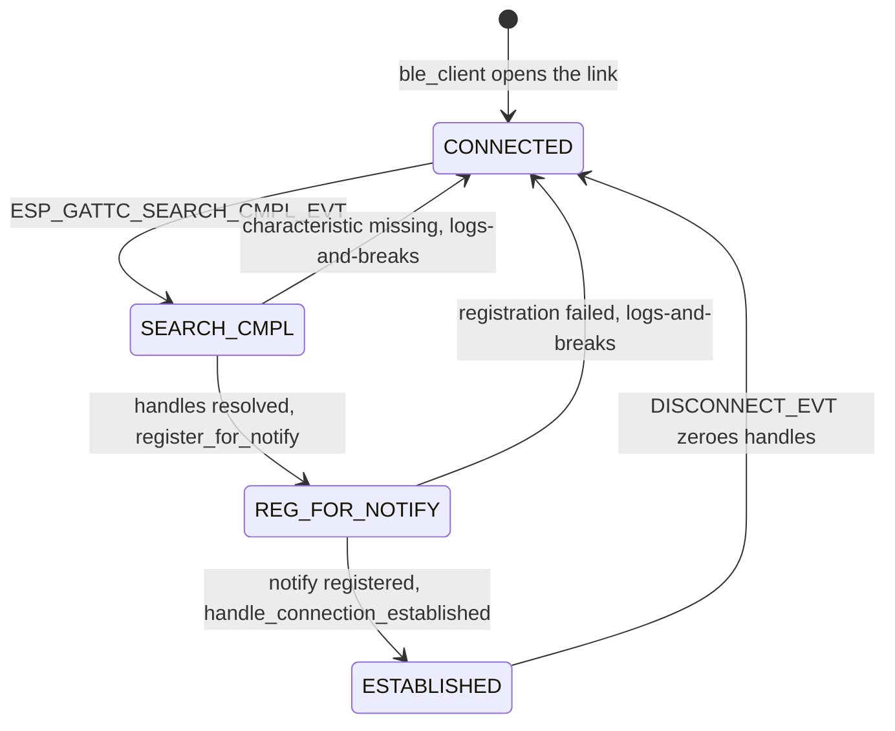
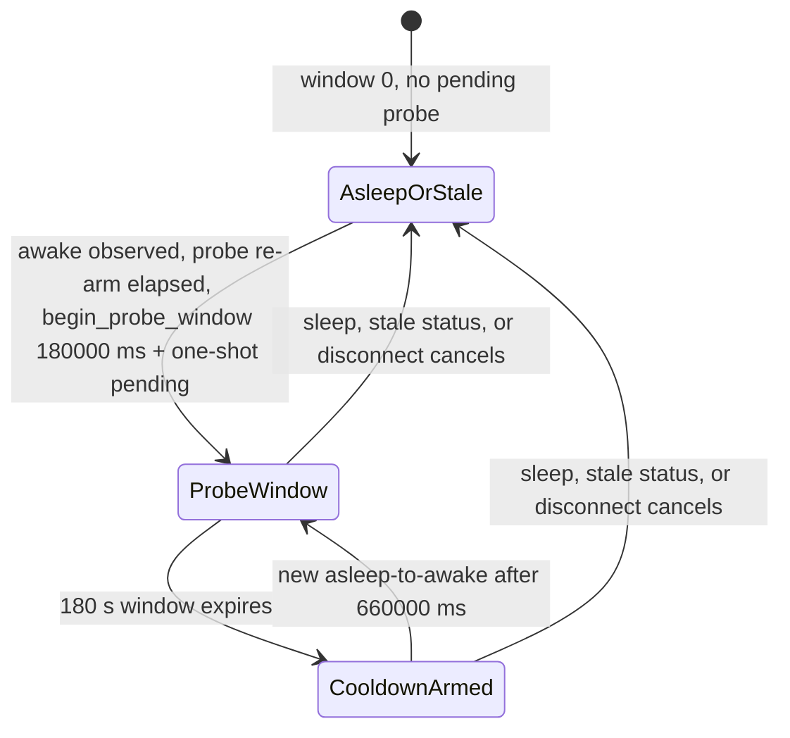
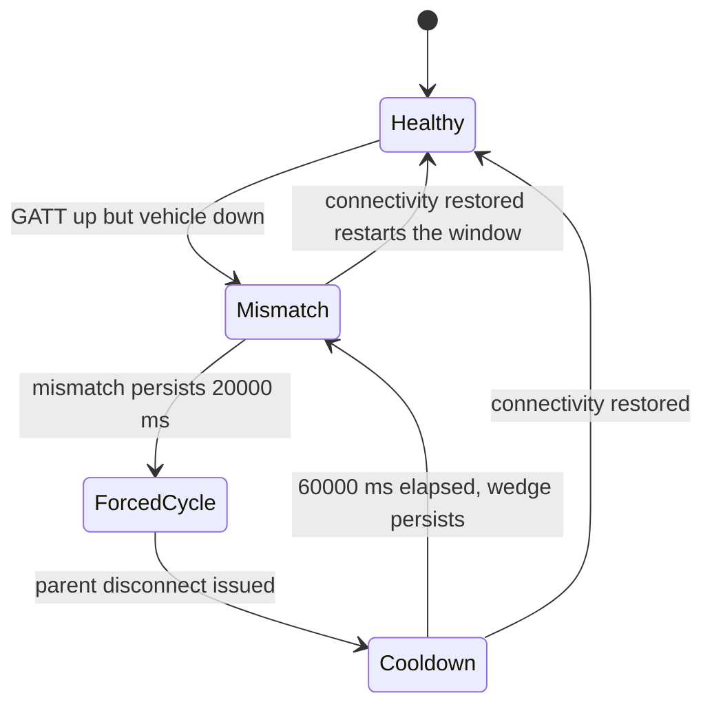
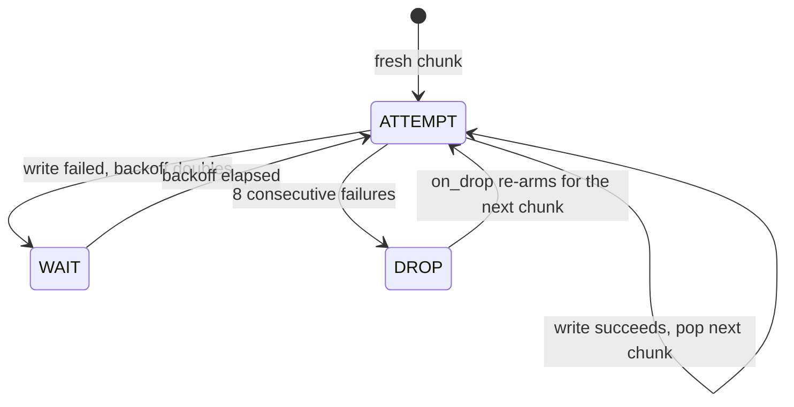
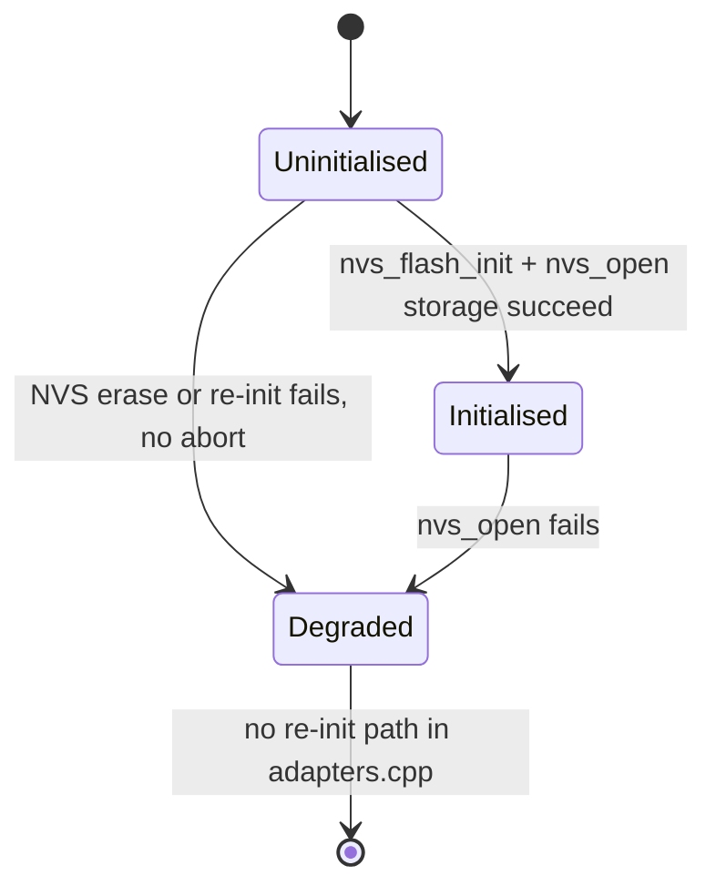
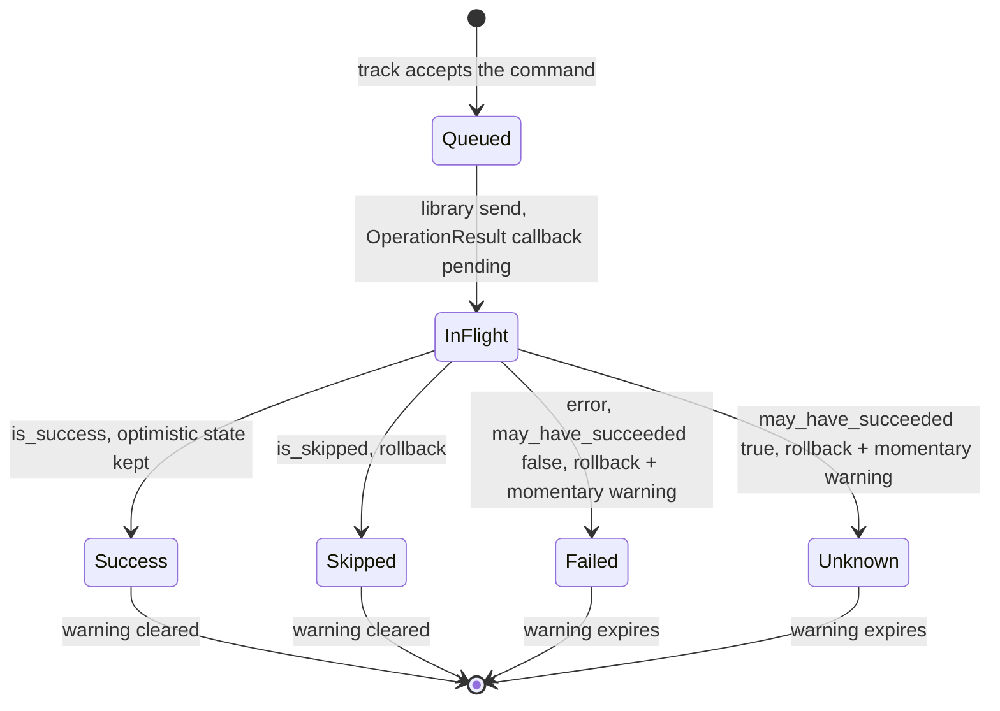

# yoziru/esphome-tesla-ble

Deep-dive per `.opencode/skills/legacy-repo-deep-dive/SKILL.md`. Code is evidence; README and the old `docs/legacy/` summary are leads only.

## 1. Provenance

| Field | Value |
| ----- | ----- |
| Submodule path | `legacy/yoziru-esphome-tesla-ble` |
| Parent gitlink | `160000 6068b320c2db5eb1b81b9877f84d45c1ebdfabf2` |
| `git -C … rev-parse HEAD` | `6068b320c2db5eb1b81b9877f84d45c1ebdfabf2` (matches; working tree clean) |
| Upstream | `https://github.com/yoziru/esphome-tesla-ble.git` (origin, branch `main`) |
| HEAD subject | `test: compile native component command-result tests (#294)` |
| License | **AGPL-3.0** (`LICENSE:1-2`, GNU Affero GPL v3) — not GPL-3.0; do not line-copy |
| Project version | `2026.10.4` (`packages/project.yml:3-4`) |
| External dependency | `yoziru/tesla-ble` pinned `ref: v6.4.0` (`packages/board.yml:12-14`); build tool `esphome==2026.10.0` (`requirements.txt:1`) |
| Analysis date | 2026-11-20 |

Files read in full (line ranges): `components/tesla_ble_vehicle/tesla_ble_vehicle.h:1-489`, `tesla_ble_vehicle.cpp:1-1288`, `vehicle_state_manager.h:1-240`, `vehicle_state_manager.cpp:1-799`, `adapters.cpp:1-196`, `ble_adapter_impl.h:1-54`, `storage_adapter_impl.h:1-38`, `connection_reset_policy.h:1-75`, `write_retry_policy.h:1-85`, `seat_climate_policy.h:1-69`, `__init__.py:1-636`; `components/tesla_ble_listener/tesla_ble_listener.h:1-23`, `tesla_ble_listener.cpp:1-32`, `__init__.py:1-27`; `tests/test_connection_reset_policy.cpp:1-141`, `test_write_retry_policy.cpp:1-100`, `test_seat_climate_policy.cpp:1-74`, `test_command_results.cpp:1-313`, `test_charging_power.py:1-89`, `test_codegen.py:1-215`; `README.md:1-302`, `LICENSE:1-25`, in-repo `AGENTS.md`, `requirements.txt:1`, `packages/board.yml:1-14`; our counterpart `firmware/lib/vehicle/ble/handler/dispatch.h:1-299` plus grep of `firmware/lib/vehicle/ble/**`, `firmware/lib/core/persist/nvs.h`, `firmware/lib/client/gamepad/ble.h`; our `docs/legacy/upstream-review-2026-11-20.md:1-96`.

Files explicitly **NOT** read: all `yoziru/tesla-ble` v6.4.0 library sources — not vendored; only included (`polling_policy.h`, `state_text.h/.cpp`, `charging_power.h`, `vin_utils.h`, `adapters.h`, `vehicle.h`, `client.h`, `defs.h`, `tb_utils.h`, `car_server.pb.h`, `vcsec.pb.h`, generated protobufs). Also not read: `tests/host/**` stubs, `tests/CMakeLists.txt`, `tests/secrets.yaml`, `tests/dashboard_config.yml`, `scripts/release.sh`, `Makefile` (only `Makefile.common` grepped), `.github/**`, `boards/**`, other `packages/*.yml` (grep only), top-level `tesla-ble*.yml`, `secrets.yaml.example`, `docs/*.png`, and the 2026-06-20 upstream-review doc (its conclusions are quoted in the preserved section below, not re-verified). **No build or test command was run** — this analysis is read-only; TEST-READ grades mean tests exist and were read, not executed.

## 2. Executive verdict

ESPHome external component pair that bridges Tesla's BLE (VCSEC + Infotainment/CarServer protobufs, via the separately pinned `yoziru/tesla-ble` v6.4.0 library) into Home Assistant entities. It contains no CAN code. The valuable parts are not the protocol implementation (external) but the **link/robustness policies around it**: bounded awake-probe polling with never-wake automatic polls, a wedged-GATT reconnect policy, bounded BLE TX backlog with poison-chunk drop, NVS degradation instead of boot-loop, and optimistic command results with rollback. These are CODE-READ and several are TEST-READ; they are real adaptation candidates **only if** TeslaCANModder moves from connect-per-command BLE to a persistent link. Framing/checksum claims are out of scope here: there are none in this repo. Everything protocol-level (IEC 61851 mapping, VIN advertisement-name derivation, 1.5 s deferred refresh, wake-policy internals) lives in the unread external library and is UNVERIFIED — do not port on that basis.

## 3. Evidence map

| Source file | Lines | What it proves | Grade |
| ----------- | ----- | -------------- | ----- |
| `components/tesla_ble_vehicle/tesla_ble_vehicle.h` | 36-44, 59-252 | Service/read/write UUIDs; component state, polling fields, command tracking | CODE-READ |
| `components/tesla_ble_vehicle/tesla_ble_vehicle.cpp` | 132-167, 194-237 | Sleep freshness gate, 180 s probe, 660000 ms cooldown, charge-port idle reset; automatic polls always `NO_WAKE_SKIP` | CODE-READ |
| `components/tesla_ble_vehicle/tesla_ble_vehicle.cpp` | 169-192, 859-989 | Wedged-link force-cycle call site; GATT event state machine, registration, RX dispatch | CODE-READ |
| `components/tesla_ble_vehicle/tesla_ble_vehicle.cpp` | 465-523 | `track()`/`handle_command_result()` outcome strings and key-rejected gate | CODE-READ |
| `components/tesla_ble_vehicle/tesla_ble_vehicle.cpp` | 287-309, 623-663 | NVS max-amps load/save with FNV-1 hash; clamping and rollback | CODE-READ |
| `components/tesla_ble_vehicle/connection_reset_policy.h` | 27-72 | 20 s mismatch grace, 60 s retrigger cooldown, pure logic | CODE-READ |
| `tests/test_connection_reset_policy.cpp` | 25-129 | Healthy/no-link/normal setup never triggers; wedge fires once then backs off; blip restarts window | TEST-READ |
| `components/tesla_ble_vehicle/write_retry_policy.h` | 27-82 | 8 failures → DROP; 100 ms doubling capped 2000 ms | CODE-READ |
| `tests/test_write_retry_policy.cpp` | 22-89 | Backoff growth, success reset, poison drop, rearm | TEST-READ |
| `components/tesla_ble_vehicle/ble_adapter_impl.h`, `adapters.cpp` | 44-50; 27-105 | 18-byte chunks, 256-chunk whole-frame admission, queue drain per `loop()` | CODE-READ |
| `components/tesla_ble_vehicle/adapters.cpp` | 117-193 | NVS init erase recovery, `map_key()` session key shortening, blob load/save/remove | CODE-READ |
| `components/tesla_ble_vehicle/seat_climate_policy.h` | 17-66 | Canonical option 0 Off / 1-3 heat / 4-6 cool / 7 Auto; capability gating | CODE-READ |
| `tests/test_seat_climate_policy.cpp` | 13-66 | Direction mapping, unsupported rejection, auto outranks stale level | TEST-READ |
| `components/tesla_ble_vehicle/vehicle_state_manager.cpp` | 137-340, 735-792 | Charge telemetry decode, dynamic max-amps, estimated power and DC exclusion | CODE-READ |
| `tests/test_charging_power.py` | 23-85 | Recompiles production power publisher; NaN recovery + DC exclusion | TEST-READ |
| `components/tesla_ble_vehicle/__init__.py` | 131-342, 498-542 | Data-driven entity lists, config schema (max 48), mbedTLS guard | CODE-READ |
| `tests/test_codegen.py` | 91-162 | AST cross-check of Python sensor IDs vs C++ `publish_*` IDs and seat option order | TEST-READ |
| `tests/test_command_results.cpp` | 88-304 | Outcome strings, number rollback, warning expiry, probe lifecycle, charge-port wake-policy assertions | TEST-READ |
| `components/tesla_ble_listener/*` | listener.cpp:10-30 | VIN-derived advertisement-name exact match | CODE-READ (name derivation external → UNVERIFIED) |
| `packages/board.yml`, `requirements.txt` | 9-14; 1 | Pins `tesla-ble` v6.4.0 and ESPHome 2026.10.0 | CODE-READ |
| `README.md` | 198-226, 43 | No-wake automatic polling; 180 s / 11 min; software update "every 5th cycle"; 1.5 s refresh | SUMMARY-ONLY / CONTRADICTED (see §6) |
| `README.md` / old doc | 15, 26 | "Tesla firmware 2024.26.3.1+", "PlatformIO 6.8.1 / ESP-IDF 5.3.0" | UNVERIFIED (no capture, no toolchain pin in repo) |

## 4. Architecture and build surface

Two ESPHome external components, no CAN:

- **`tesla_ble_vehicle`** — `TeslaBLEVehicle : PollingComponent, BLEClientNode` (`tesla_ble_vehicle.h:59`). Constructs `BleAdapterImpl` + `StorageAdapterImpl`, hands both to the external `TeslaBLE::Vehicle` (`tesla_ble_vehicle.cpp:68-130`), wires protobuf callbacks into `VehicleStateManager`. `VehicleStateManager` stores entities in `std::map<std::string, …*>` (`vehicle_state_manager.h:163-165`) so Python codegen can add sensors without C++ edits.
- **`tesla_ble_listener`** — `ESPBTDeviceListener` matching the VIN-derived advertisement name (`tesla_ble_listener.cpp:16-30`); included but disabled by default (`README.md:234`).

```mermaid
flowchart LR
    HA["Home Assistant / ESPHome automations"] -->|"entities + actions<br/>__init__.py:131-319,548-570"| Comp["TeslaBLEVehicle<br/>PollingComponent + BLEClientNode"]
    Comp -->|"track() commands, key_rejected gate<br/>tesla_ble_vehicle.cpp:505-523"| Lib["yoziru/tesla-ble v6.4.0 external<br/>protobuf, session, wake policy,<br/>deferred refresh"]
    Comp -->|"update() poll gates<br/>tesla_ble_vehicle.cpp:194-237"| Lib
    Lib -->|"BleAdapterImpl::write()<br/>adapters.cpp:27-52"| Q["write_queue_<br/>18-byte chunks, 256-chunk admission,<br/>backoff + poison drop"]
    Q -->|"esp_ble_gattc_write_char<br/>char 0x212, NO_RSP<br/>adapters.cpp:86-90"| Car["Vehicle GATT server<br/>service 0x211"]
    Car -->|"notify on char 0x213<br/>tesla_ble_vehicle.cpp:922-932"| Rx["on_rx_data decode"]
    Rx --> Lib
    Lib -->|"decoded protobuf callbacks"| Vsm["VehicleStateManager<br/>bounds-checked publishes<br/>vehicle_state_manager.cpp:137-340"]
    Vsm --> HA
    Adv["VCSEC advertisement<br/>asleep vehicle, name from VIN"] -.->|"exact name match<br/>tesla_ble_listener.cpp:16-30"| Listener["tesla_ble_listener<br/>disabled by default"]
    Listener -.->|"MAC for ble_client config"| HA
```

Entry points: `tesla-ble-{esp32-generic,m5stack-atoms3,m5stack-nanoc6}.yml` → `packages/*.yml` → `boards/*.yml`; `Makefile.common:10,26,31` runs `uvx esphome==2026.10.0 config|compile`. Build gating is YAML substitutions plus compile-time `__has_include(<charging_power.h>)` (`vehicle_state_manager.h:19-21`) and `#ifdef USE_API` (`vehicle_state_manager.cpp:781-789`) — **not** our `BUS_*_ACTIVE` flags. No `platformio.ini` in this repo; `tesla-ble` arrives as an ESPHome managed component pinned at v6.4.0. Dependency boundary: everything below `TeslaBLE::Vehicle` (session, protobuf, wake policy, state_text, charging power, VIN ad-name) is outside this repo.



## 5. Mechanism catalogue

### M1 — GATT transport adapter and 18-byte TX fragmentation

- **Claim (README / summary):** "BLE service UUID `00000211-…` with separate read/write GATT characteristics."
- **Code path:** `tesla_ble_vehicle.cpp:859-944` — `gattc_event_handler()` → `on_rx_data()`; `adapters.cpp:27-99` — `BleAdapterImpl::write()` → `process_write_queue()` → `esp_ble_gattc_write_char()`.
- **Frame spec:** service `00000211-b2d1-43f0-9b88-960cebf8b91e`, read `0x213`, write `0x212` (`tesla_ble_vehicle.h:42-44`); TX chunk `BLOCK_LENGTH = 18` bytes, `ESP_GATT_WRITE_TYPE_NO_RSP` (`adapters.cpp:44-49`).
- **Gates and timing:** writes only when `is_connected()` and `write_handle_ != 0`; whole-frame admission rejects the frame if `queued + chunks > 256`.
- **State machine:** `CONNECTED` → `SEARCH_CMPL` (resolve handles, register notify) → `REG_FOR_NOTIFY` → `ESTABLISHED`; disconnect zeroes handles.



- **Tests:** none for the adapter itself; policy tests only (M3/M4).
- **Evidence grade:** CODE-READ.
- **Verdict:** CONFIRMED.
- **Adapt to TeslaCANModder?** no impact today — our BLE is NimBLE connect-per-command (`firmware/lib/vehicle/ble/handler/dispatch.h:29-97`); revisit only with a persistent link.

### M2 — Bounded awake-probe polling with never-wake automatic polls

- **Claim (README / summary):** 11-min wake window; active vs awake intervals; "automatic telemetry never sends wake commands".
- **Code path:** `tesla_ble_vehicle.cpp:132-167` — `handle_vehicle_status()`; `194-237` — `update()`.
- **Frame spec:** N/A (protocol polling, not a CAN frame). Constants: awake-probe window `180000` ms (`:144`), repeat cooldown `660000` ms (`:143`, 11 min), stale-status threshold `max(120000, vcsec_poll_interval_*2)` (`:138,209`), active freshness `max(120000, awake_interval*2)` (`:219-220`). VCSEC default 10 s, awake 30 s, active 10 s, sleep timeout 660 s (`__init__.py:334-337`).
- **Gates and timing:** only charging **or** sentry (with fresh telemetry) sustains active cadence (`:214-228`); unlocked/user-present explicitly do not. Unknown sleep counts as asleep (`vehicle_state_manager.cpp:748-753`). Charge-port opening while awake calls `poll_policy_.reset()` (`:154-166`). Automatic polls use `NO_WAKE_SKIP`; only `force_update()` uses `WAKE_IF_NEEDED` (`:601-602`).
- **State machine:** asleep/unknown → probe window 0; fresh awake after connect or asleep→awake → one-shot pending probe + bounded 180 s window, re-arm only after 660000 ms; sleep/stale/disconnect cancels.



- **Tests:** `awake_probe_lifecycle` / `active_observations_expire` / `charge_port_edges` in `tests/test_command_results.cpp:176-304`.
- **Evidence grade:** CODE-READ + TEST-READ (policy internals in external library UNVERIFIED).
- **Verdict:** CONFIRMED for this repo's wiring; PARTIAL for the "wake_policy" output (see §6).
- **Adapt to TeslaCANModder?** **candidate for future PR** if we add persistent BLE presence detection — mirrors the standing note in our `docs/legacy/upstream-review-2026-11-20.md:54`. Requires capture; no port of library code.

### M3 — Wedged-GATT connection reset

- **Claim (README / summary):** not mentioned in old summary.
- **Code path:** `connection_reset_policy.h:43-62` → `tesla_ble_vehicle.cpp:175-191` `loop()` → `parent()->disconnect()`.
- **Frame spec:** N/A. Constants: mismatch grace `20000` ms, retrigger cooldown `60000` ms (`:65-66`); unsigned `millis()` arithmetic wrap-safe (`:42`).
- **Gates and timing:** triggers when GATT `ESTABLISHED` **or** stalled in `CONNECTED` but `vehicle_->is_connected() == false`; healthy/connecting states reset the mismatch timer; after forced cycle, cooldown before re-arm.
- **State machine:** mismatch → grace → force disconnect → cooldown → re-arm; restored connectivity clears tracking.



- **Tests:** `test_wedged_link_triggers_once_then_backs_off`, `test_connectivity_blip_restarts_the_window`, `test_stalled_setup_triggers_after_grace` at `tests/test_connection_reset_policy.cpp:66-129`.
- **Evidence grade:** CODE-READ + TEST-READ.
- **Verdict:** CONFIRMED.
- **Adapt to TeslaCANModder?** no impact today (no persistent GATT link). Candidate only if that changes; constants need bench validation.

### M4 — Bounded BLE write queue with exponential backoff and poison drop

- **Claim (README / summary):** not mentioned in old summary.
- **Code path:** `write_retry_policy.h:35-76` → `adapters.cpp:54-105` `process_write_queue()`.
- **Frame spec:** N/A. Constants: `MAX_CONSECUTIVE_FAILURES = 8`, `INITIAL_BACKOFF_MS = 100`, `MAX_BACKOFF_MS = 2000`, `MAX_TX_BACKLOG_CHUNKS = 256`, `BLOCK_LENGTH = 18`.
- **Gates and timing:** untried chunk attempts immediately; failure → 100→200→400…2000 ms backoff; 8 consecutive failures → DROP head chunk so newer traffic proceeds; success/`on_drop()`/`reset()` clear history; queue cleared on disconnect (`adapters.cpp:101-105`).
- **State machine:** ATTEMPT → WAIT → ATTEMPT … → DROP → rearm.



- **Tests:** `test_backoff_grows_with_consecutive_failures`, `test_persistent_failures_drop_the_chunk` at `tests/test_write_retry_policy.cpp:38-82`.
- **Evidence grade:** CODE-READ + TEST-READ.
- **Verdict:** CONFIRMED.
- **Adapt to TeslaCANModder?** **candidate for future PR (pattern only)** — our BLE path has no persistent TX queue, so no head-of-line blocking today. If a persistent link lands, port the *drop-after-N* idea with independent tests, not the policy code.

### M5 — NVS session/key storage with key shortening and graceful degradation

- **Claim (README / summary):** "Session keys stored in ESP NVS flash" (in-repo `AGENTS.md`).
- **Code path:** `adapters.cpp:117-193` — `StorageAdapterImpl::initialize()` → `map_key()` → `nvs_get_blob`/`nvs_set_blob`/`nvs_commit`.
- **Frame spec:** NVS namespace `"storage"`; key map `session_vcsec → tk_vcsec`, `session_infotainment → tk_infotainment` (20-char library key exceeds NVS 15-char limit), `private_key` unchanged (`adapters.cpp:151-156`).
- **Gates and timing:** `nvs_flash_init()` on `NO_FREE_PAGES`/`NEW_VERSION` → erase → retry; if erase or re-init fails, **continue without persistence** rather than boot-loop (`:119-142`).
- **State machine:** uninitialised → initialised; failed init leaves all load/save/remove returning false.



- **Tests:** none directly.
- **Evidence grade:** CODE-READ (key material handling inside external library UNVERIFIED).
- **Verdict:** CONFIRMED for adapter behavior.
- **Adapt to TeslaCANModder?** **already present in spirit** — our `firmware/lib/core/persist/nvs.h:20-31` has corrupt-NVS detection/reset; check that our failure path degrades rather than boot-loops. No code port.

### M6 — Command results: phases, "Outcome unknown", optimistic rollback

- **Claim (summary):** "`send_command_result` now tracks command phase and outcome" (preserved upstream note).
- **Code path:** `tesla_ble_vehicle.cpp:505-523` `track()` → `475-503` `handle_command_result()`; rollback via `vehicle_state_manager.cpp:702-733` `republish_charging_amps/limit()`.
- **Frame spec:** N/A. Outcome strings `→ Success`, `→ Skipped`, `→ Failed: <msg>`, `→ Outcome unknown` when `result.error()->may_have_succeeded()` (`:479-489`); momentary warning on failure; key-rejected short-circuits all commands except `Pair` (`:508-512`).
- **Gates and timing:** only apply optimistic entity state on `succeeded`; on failure republish previous value; `key_rejected_` pauses polling and forces pairing warning.
- **State machine:** queued → callback → success/skip/fail/unknown → clear or momentary warning.



- **Tests:** `command_outcomes`, `warnings_and_pairing` at `tests/test_command_results.cpp:88-174`.
- **Evidence grade:** CODE-READ + TEST-READ.
- **Verdict:** CONFIRMED.
- **Adapt to TeslaCANModder?** **candidate for future PR (small)** — our serial/BLE dispatch acks do not distinguish "unknown outcome after a failed write" from "failed". Extend our ack path in `firmware/lib/client/command/` with an `unknown` outcome; do not copy `track()`.

### M7 — Charging telemetry mapping, learned max-amps, estimated power

- **Claim (old summary):** "IEC 61851 charge state mapping logic is directly reusable."
- **Code path:** `vehicle_state_manager.cpp:137-340` `update_charge_state()`, `735-742` `update_charging_power()`, `763-792` `update_charging_amps_max()`; persistence `tesla_ble_vehicle.cpp:287-309`.
- **Frame spec:** N/A (protobuf). Learned max from `charge_current_request_max` accepted 1..100 A (`:249-258`), persisted via FNV-1-extended hash of `"tesla_ble_vehicle.charging_amps_max"` + VIN (`tesla_ble_vehicle.cpp:298-309`); number trait max updated and API clients force-disconnected to refresh discovery (`:781-789`). Estimated power = AC-only `power_w/1000`, else NaN (`vehicle_state_manager.cpp:736-741`).
- **Gates and timing:** bounds checks on every sensor (e.g. battery 0..100, power 0..500 kW, voltage 0..600 V); `charge_limit_reason` falls back to `"ExternalLimit"` when omitted but actual < requested (`274-291`).
- **State machine:** N/A.
- **Tests:** `tests/test_charging_power.py:54-75` (11.184 kW, phase 3, NaN recovery, DC exclusion) — recompiles production function against stubs, independent oracle.
- **Evidence grade:** CODE-READ + TEST-READ (IEC 61851 string mapping itself is in external `state_text.cpp` → UNVERIFIED here).
- **Verdict:** PARTIAL — wrapping code CONFIRMED, mapping claim not evidence-backed in this repo.
- **Adapt to TeslaCANModder?** **no impact today** (our BMS telemetry is CAN-decoded); backlog item: compare with `firmware/lib/vehicle/can/feature/bms` only after reading the external `state_text` mapping.

### M8 — Data-driven ESPHome entity codegen with bidirectional ID check

- **Claim (old summary):** "ESPHome custom component pattern … well-structured model."
- **Code path:** `__init__.py:131-319` entity lists → `498-541` `to_code()` generic setters; `vehicle_state_manager.h:163-165` map storage; consistency test `tests/test_codegen.py:91-162`.
- **Frame spec:** N/A. Guard: `esp32.require_mbedtls_tls()` for ESPHome ≥ 2026.10 so tesla-ble's PEM key writer stays compiled (`__init__.py:503-507`, tested at `test_codegen.py:145-162`).
- **Gates and timing:** build-time only.
- **State machine:** N/A.
- **Tests:** `test_codegen.py` checks unique IDs, C++ `publish_*` ↔ Python ID parity in both directions, canonical seat option order.
- **Evidence grade:** CODE-READ + TEST-READ.
- **Verdict:** CONFIRMED.
- **Adapt to TeslaCANModder?** **no impact** — different client stack. Idea worth keeping: bidirectional protocol-ID cross-check tests, already partly present in `packages/protocol/` contract validation.

### M9 — Seat-climate option model with observed-capability gating

- **Claim (README):** per-seat climate; cooling/Auto require observed support and are not dynamically hidden.
- **Code path:** `seat_climate_policy.h:32-66` → `tesla_ble_vehicle.cpp:1163-1177`, `vehicle_state_manager.cpp:410-470`.
- **Frame spec:** N/A. Option indices 0 Off, 1-3 heat, 4-6 cool, 7 Auto; `-1` = not reported; Auto falls back to index 4 when cooling is unsupported (`:43,54`).
- **Gates and timing:** select built with `cooling_supported`/`auto_supported` from config; capability flips true only when telemetry reports the field (`:459-462`); Auto outranks a stale heat level.
- **State machine:** state→option index mapping.
- **Tests:** `tests/test_seat_climate_policy.cpp:13-66`.
- **Evidence grade:** CODE-READ + TEST-READ.
- **Verdict:** CONFIRMED.
- **Adapt to TeslaCANModder?** **no impact** — no seat-heat control surface in our client for BLE.

### M10 — VIN-derived BLE advertisement discovery

- **Claim (old summary):** "BLE scanner that discovers Tesla vehicles by matching VIN-derived advertisement names."
- **Code path:** `tesla_ble_listener.cpp:10-30` — `get_vin_advertisement_name()` wraps external `TeslaBLE::get_vin_advertisement_name()` → `parse_device()` exact `device.get_name() == vin_ad_name_`.
- **Frame spec:** advertisement name format `S` + 16 hex + `C` per `README.md:232` (external derivation formula not in repo).
- **Gates and timing:** VCSEC advertises while asleep; listener disabled by default to avoid scanning cost.
- **State machine:** N/A.
- **Tests:** none.
- **Evidence grade:** CODE-READ for the match; UNVERIFIED for the name derivation (external `vin_utils.h`).
- **Verdict:** PARTIAL.
- **Adapt to TeslaCANModder?** **candidate for future PR (low)** — our `connectToVehicle()` filters on last 8 VIN chars as an advertisement suffix (`firmware/lib/vehicle/ble/handler/dispatch.h:29-46`). Validate on a real advertisement whether that suffix is actually present before considering an exact hashed-name match.

### M11 — Pairing rejection gate and role mapping

- **Claim (README):** Pairing Required pauses polling; DRIVER / CHARGING_MANAGER roles.
- **Code path:** `tesla_ble_vehicle.cpp:465-473` `handle_key_not_paired()`, `546-570` `start_pairing()`, `194-196` polling gate, `561-568` success clears flag.
- **Frame spec:** role strings `"DRIVER"` → `Keys_Role_ROLE_DRIVER`, `"CHARGING_MANAGER"` → `Keys_Role_ROLE_CHARGING_MANAGER` (`:554-559`); config default DRIVER (`__init__.py:332`).
- **Gates and timing:** `key_rejected_` blocks every command except Pair and stops automatic polling until successful pairing or reconnect handling.
- **State machine:** rejected → warning + sensor true → successful Pair → cleared.
- **Tests:** `warnings_and_pairing` at `tests/test_command_results.cpp:121-174`.
- **Evidence grade:** CODE-READ + TEST-READ.
- **Verdict:** CONFIRMED.
- **Adapt to TeslaCANModder?** **candidate (small)** — our `tesla:key:role` accepts `owner`/`charging_manager` (`firmware/lib/vehicle/ble/handler/dispatch.h:148-164`) and has no "key rejected, pause automation" latch. Idea only; do not copy role enum names.

## 6. Summary vs code contradiction table

| # | Claim source | Claim | Code reality | Verdict |
| - | ------------ | ----- | ------------ | ------- |
| 1 | Old doc `docs/legacy/yoziru-esphome-tesla-ble.md` (prior version, line 32) | `components/tesla_ble_vehicle/command_builder.h` exists as a "Helper for building vehicle commands" | No such file in `git ls-files`; command logic is inline in `tesla_ble_vehicle.cpp:529-853`. Prior doc's own upstream note records the removal. | CONTRADICTED |
| 2 | Old doc (line 58) | "Smart polling with sleep-awareness (11-min wake window)" | 660000 ms is the **re-arm cooldown**; the awake-cadence window is 180000 ms (3 min, `tesla_ble_vehicle.cpp:144`); 660 s is the sleep-timeout config default. Automatic probes never wake (`NO_WAKE_SKIP`, `:233`). | CONTRADICTED / conflated |
| 3 | `README.md:43` | Software update "polled every 5th infotainment cycle" | `software_update_poll()` appears exactly once in vendored C++ — inside `force_update()` (`tesla_ble_vehicle.cpp:602`); no periodic 5th-cycle call here. Likely in external library. | UNVERIFIED from this repo |
| 4 | `README.md:226` | "Successful controls refresh the affected state after 1.5 seconds" | Deferred/coalesced refresh lives in external `TeslaBLE::Vehicle` (per in-repo `AGENTS.md`); no 1500 constant in vendored code. | UNVERIFIED from this repo |
| 5 | Old doc (line 51) | "IEC 61851 charge state mapping logic is directly reusable" | Only the *call* to `state_text::iec61851_state()` is vendored (`vehicle_state_manager.cpp:164`); implementation/table is in external `state_text.cpp`, not in this repo. | PARTIAL / SUMMARY-ONLY |
| 6 | `__init__.py:330` vs `:564` vs `adapters`/`vehicle_state_manager` | Config `charging_amps_max` range | Python config allows 1..48; action schema allows 0..80; NVS restore/save accept 1..80 (`tesla_ble_vehicle.cpp:290,303`); learned vehicle max accepts 1..100 (`vehicle_state_manager.cpp:251`). Four different bands. | CONTRADICTED (internal) |
| 7 | `tests/test_command_results.cpp:279-304` vs `tesla_ble_vehicle.cpp:163,233` | Test asserts charge-port reopening flips poll decision `wake_policy` to `WAKE_IF_NEEDED` and resets to `NO_WAKE_SKIP` after 660001 ms | Production resets `poll_policy_` on charge-port open but always sends `NO_WAKE_SKIP`; `decision.wake_policy` is never consumed. Test validates the external library decision object, not what this component sends. | CONTRADICTED (test/code gap) |
| 8 | Old doc (line 15), README | "Tested with Tesla firmware 2024.26.3.1+", "PlatformIO 6.8.1 / ESP-IDF 5.3.0" | No capture, log, or toolchain pin in repo. Repo pins `esphome==2026.10.0` and `tesla-ble v6.4.0`; PlatformIO/ESP-IDF versions are transitive and unstated. | UNVERIFIED |
| 9 | Old doc (line 29) | Component "Manages BLE connection, GATT events, and command dispatch" — implies self-contained | GATT events yes; protobuf framing, session, wake policy, command queue and deferred refresh are external `yoziru/tesla-ble` v6.4.0. | PARTIAL |

## 7. CAN frame and signal inventory

None found: this repo contains no CAN code — no MCP2515 driver, no frame builder, no DBC/JSON catalog. Transport is BLE GATT and payloads are protobufs owned by the external `yoziru/tesla-ble` v6.4.0 library (§1, files explicitly NOT read).

The only wire-format facts that live in this repo are BLE-level, listed so the absence is auditable rather than silent:

| Item                           | Value / layout                                                        | Source                                            | Direction                                    | Grade     |
| ------------------------------ | --------------------------------------------------------------------- | ------------------------------------------------- | -------------------------------------------- | --------- |
| Tesla BLE service UUID         | `00000211-b2d1-43f0-9b88-960cebf8b91e`                                | `tesla_ble_vehicle.h:42`                          | connect                                      | CODE-READ |
| GATT read/notify characteristic | `00000213-b2d1-43f0-9b88-960cebf8b91e` (`0x213`)                     | `tesla_ble_vehicle.h:43`                          | RX — notify dispatch `tesla_ble_vehicle.cpp:922-932` | CODE-READ |
| GATT write characteristic      | `00000212-b2d1-43f0-9b88-960cebf8b91e` (`0x212`)                     | `tesla_ble_vehicle.h:44`                          | TX — `esp_ble_gattc_write_char` `adapters.cpp:86-90` | CODE-READ |
| TX fragmentation               | 18-byte chunks, `ESP_GATT_WRITE_TYPE_NO_RSP`                          | `ble_adapter_impl.h:50`, `adapters.cpp:44-49`     | TX                                           | CODE-READ |
| VCSEC advertisement name       | `S` + 16 hex chars + `C`, derived from VIN by the external library; exact `get_name()` match | `README.md:232`, match at `tesla_ble_listener.cpp:23-27` | RX — scan                     | CODE-READ |

The name-derivation formula itself is external (`vin_utils.h`) and stays UNVERIFIED. Frame contents (protobuf bodies, session auth, counters) are entirely outside this repo. No CAPTURE evidence exists in this repo.

## 8. Constants and tuning table

| Constant                     | Value                                  | Location                                             | Meaning                                                                    | Grade     |
| ---------------------------- | -------------------------------------- | ---------------------------------------------------- | -------------------------------------------------------------------------- | --------- |
| awake-probe window           | `180000` ms                            | `tesla_ble_vehicle.cpp:144`                          | infotainment awake-cadence window opened after asleep→awake                | CODE-READ |
| awake-probe re-arm cooldown  | `660000U` ms (11 min)                  | `tesla_ble_vehicle.cpp:143`                          | minimum time between probe windows                                          | CODE-READ |
| stale-status threshold       | `max(120000, vcsec_poll_interval_*2)`  | `tesla_ble_vehicle.cpp:138,209`                      | VCSEC status older than this counts as asleep                               | CODE-READ |
| active-freshness window      | `max(120000, awake_interval_*2)`       | `tesla_ble_vehicle.cpp:219-220`                      | charge/closure observations older than this drop the active cadence          | CODE-READ |
| VCSEC poll default           | 10 s (range 5–300)                     | `__init__.py:334`                                    | low-power poll, safe on a sleeping vehicle                                  | CODE-READ |
| infotainment awake interval  | 30 s (range 10–600)                   | `__init__.py:335`                                    | cadence while awake but idle                                                | CODE-READ |
| infotainment active interval | 10 s (range 5–120)                     | `__init__.py:336`                                    | cadence while charging/sentry and fresh                                     | CODE-READ |
| sleep timeout                | 660 s (range 60–3600)                  | `__init__.py:337`                                    | external-library sleep-backoff seed                                         | CODE-READ |
| mismatch grace               | `20000` ms                             | `connection_reset_policy.h:65`                       | GATT-up/vehicle-down must persist this long before a forced reconnect       | CODE-READ |
| retrigger cooldown           | `60000` ms                             | `connection_reset_policy.h:66`                       | back-off between forced reconnect cycles                                    | CODE-READ |
| `MAX_CONSECUTIVE_FAILURES`   | 8                                      | `write_retry_policy.h:29`                            | consecutive write failures before poison-drop                               | CODE-READ |
| `INITIAL_BACKOFF_MS`          | 100                                    | `write_retry_policy.h:30`                            | first retry delay, doubling after                                           | CODE-READ |
| `MAX_BACKOFF_MS`             | 2000                                   | `write_retry_policy.h:31`                            | backoff cap                                                                 | CODE-READ |
| `MAX_TX_BACKLOG_CHUNKS`      | 256 chunks                             | `ble_adapter_impl.h:49`                              | whole-frame admission bound (max frame ≈ 42 chunks; 256 holds poll bursts)  | CODE-READ |
| `BLOCK_LENGTH`               | 18 bytes                               | `ble_adapter_impl.h:50`                              | GATT write chunk size (safe MTU)                                            | CODE-READ |
| charging amps config band    | 1..48 A, default 32                    | `__init__.py:97,330`; `tesla_ble_vehicle.h:37`       | user config cap — narrowest of four amps bands (§6 item 6)                  | CODE-READ |
| charging amps action band    | 0..80 A                                | `__init__.py:562-565`                                | automation action schema                                                    | CODE-READ |
| charging amps NVS band       | 1..80 A                                | `tesla_ble_vehicle.cpp:290,303`                      | restore/save guard                                                          | CODE-READ |
| learned vehicle max band     | 1..100 A                               | `vehicle_state_manager.cpp:251`                      | `charge_current_request_max` acceptance; widens the number-trait max        | CODE-READ |
| charging limit band           | 50..100 %                              | `__init__.py:567-570`; `tesla_ble_vehicle.h:38-39`   | action + number trait                                                        | CODE-READ |
| telemetry sanity bounds       | battery 0..100 %, power 0..500 kW, range 0..500 mi, voltage 0..600 V, current/pilot/request 0..100 A, non-negative energy/minutes | `vehicle_state_manager.cpp:174,184,203,211,219,227,235-243,263` | out-of-range or NaN telemetry is never published | CODE-READ |
| seat option indices          | 0 Off, 1-3 heat, 4-6 cool, 7 Auto, `-1` none | `seat_climate_policy.h:18-22,65`               | canonical select order, shared with Python codegen                          | CODE-READ |
| NVS key map                  | `session_vcsec`→`tk_vcsec`, `session_infotainment`→`tk_infotainment`, `private_key` unchanged | `adapters.cpp:151-156`      | 20-char library keys shortened to the NVS 15-char limit                     | CODE-READ |
| NVS namespace                 | `"storage"`                            | `adapters.cpp:144`                                   | key-material partition                                                      | CODE-READ |
| amps-max pref hash           | FNV-1 of `"tesla_ble_vehicle.charging_amps_max"` extended with VIN | `tesla_ble_vehicle.cpp:298-300`    | per-vehicle NVS preference key                                               | CODE-READ |

All values are bench-unvalidated on TeslaCANModder hardware: no CAPTURE evidence exists in this repo. Do not port tuning values as authoritative (§14).

## 9. Failure modes and edge cases

| Failure                                                          | Handling code path                                                                                                                            | Tested?                          | Grade     |
| ---------------------------------------------------------------- | ---------------------------------------------------------------------------------------------------------------------------------------------- | -------------------------------- | --------- |
| NVS layout changed or full (`NO_FREE_PAGES`, `NEW_VERSION_FOUND`) | erase + re-init; on failure continue without persistence instead of aborting — explicit anti-boot-loop comment `adapters.cpp:120-123`         | No                               | CODE-READ |
| NVS erase or re-init fails                                        | adapter stays uninitialised; every load/save/remove returns false                                                                               | No                               | CODE-READ |
| GATT up but vehicle session down (library auth-stuck watchdog)    | forced `parent()->disconnect()` after 20000 ms mismatch grace, 60000 ms retrigger cooldown (`tesla_ble_vehicle.cpp:183-191`, `connection_reset_policy.h:43-62`) | Yes — `test_wedged_link_triggers_once_then_backs_off` `tests/test_connection_reset_policy.cpp:66-97` | TEST-READ |
| Setup stalled in CONNECTED (discovery/notify registration failed; handler logs-and-breaks) | same reset policy treats stalled setup as link-up-not-ready; break paths `tesla_ble_vehicle.cpp:886-903,912-915`                | Yes — `test_stalled_setup_triggers_after_grace` `tests/test_connection_reset_policy.cpp:120-129` | TEST-READ |
| Persistent GATT write failure (ESP_GATT_BUSY, status 133, stale conn_id) | exponential backoff 100→2000 ms; DROP head chunk after 8 consecutive failures (`adapters.cpp:54-99`)                                      | Yes — `tests/test_write_retry_policy.cpp:59-82`                  | TEST-READ |
| TX backlog overflow (queued + new chunks > 256)                   | whole-frame admission rejects the frame before partial enqueue, surfaces to the library as a failed write (`adapters.cpp:34-39`)               | No                               | CODE-READ |
| Disconnect mid-command                                           | library delivers failure with `may_have_succeeded` → `→ Outcome unknown` + momentary warning; queues cleared, handles zeroed, warning timeout cancelled (`tesla_ble_vehicle.cpp:479-489,871-881,969-989`) | Yes — `tests/test_command_results.cpp:139-143` | TEST-READ |
| Key rejected / not paired                                        | latch blocks every command except `Pair`, pauses automatic polling, raises pairing warning + sensor (`tesla_ble_vehicle.cpp:195,465-473,508-512`) | Yes — `tests/test_command_results.cpp:121-174` | TEST-READ |
| Vehicle sleep state unknown (first poll / no data)                | treated as asleep so a wake request sends the wake action (`vehicle_state_manager.cpp:748-753`)                                               | Yes — unknown-sleep branch `tests/test_command_results.cpp:216-231` | TEST-READ |
| Out-of-range or NaN charge telemetry                              | per-field bounds checks; never published; DC fast-charging forces `charger_power_estimated` to NaN (`vehicle_state_manager.cpp:172-258,735-741`) | Yes — `tests/test_charging_power.py:54-75` | TEST-READ |
| Learned `charge_current_request_max` ≤ 0                          | warn + ignore; no trait or NVS write (`vehicle_state_manager.cpp:763-767`)                                                                    | No                               | CODE-READ |
| `millis()` ~49-day wraparound                                    | unsigned subtraction in both policies, documented wrap-safe (`connection_reset_policy.h:42-43,55`, `write_retry_policy.h:34,42`)              | No wrap-specific case            | CODE-READ |

Watchdog, brownout, bus-off and OTA-pause guards: None found — no CAN in this repo; reboot/watchdog behaviour is owned by the ESPHome framework, not this component. Vehicle OTA is only *reported* via the `software_update_*` entities; there is no OTA-pause logic of our own here. The untested NVS and backlog-admission rows are the highest-value gaps: both fail silently (log lines only) on a sick device.

## 10. Test coverage map

Files additionally read for this section, superseding their §1 not-read entries: `tests/CMakeLists.txt`, `tests/secrets.yaml` (read again for §12).

| Test file                                       | What it asserts                                                                                                                                                                                                                                                                                                                                                                        | Grade     |
| ----------------------------------------------- | -------------------------------------------------------------------------------------------------------------------------------------------------------------------------------------------------------------------------------------------------------------------------------------------------------------------------------------------------------------------------------------- | --------- |
| `tests/test_connection_reset_policy.cpp:25-129` | healthy/no-GATT/normal-bring-up never force a disconnect; slow-but-successful setup rides the grace; a wedged link fires once, backs off 60 s, re-fires if the wedge survives; a mid-grace connectivity blip restarts the window; stalled CONNECTED fires after 20 s                                                                                                                 | TEST-READ |
| `tests/test_write_retry_policy.cpp:22-89`       | fresh chunk attempted immediately; failed chunk waits out a 100 ms backoff that doubles; success forgets history; 8 persistent failures drop the chunk; `reset()` clears everything                                                                                                                                                                                                     | TEST-READ |
| `tests/test_seat_climate_policy.cpp:13-66`      | option index → heat/cool/auto direction mapping; unsupported cooling/Auto rejected per capability flags; out-of-range indices invalid; reported state → matching option; Auto outranks a stale heat level; nothing reported → `-1`                                                                                                                                                        | TEST-READ |
| `tests/test_command_results.cpp:88-311`         | per-outcome optimistic-state apply/rollback across switch and number entities; momentary warning set/expiry; disconnect converts a queued command to `→ Outcome unknown`; `key_not_paired` latches the pairing sensor and warning and blocks polls until a successful Pair; awake-probe one-shot lifecycle incl. stale/unknown-sleep cancellation and 660 s re-arm; charge-port open while awake resets the poll policy while every emitted poll stays `NO_WAKE_SKIP`; active charge/sentry observations expire | TEST-READ |
| `tests/test_charging_power.py:23-85`            | recompiles the production `publish_sensor_state` + `update_charging_power` against stubs (independent oracle, no framework): 11.184 kW publish, NaN on absent fields, recovery after NaN, DC exclusion → NaN                                                                                                                                                                             | TEST-READ |
| `tests/test_codegen.py:165-211`                 | entity-list schema and unique IDs across 10 lists; C++ `publish_*` ids ↔ Python sensor ids cross-checked in both directions; seat option order matches the C++ indexing contract for all 4 capability combinations; `to_code` calls `esp32.require_mbedtls_tls()` under an `ESPHOME_VERSION` guard                                                                                 | TEST-READ |
| `tests/CMakeLists.txt:3-16`                     | `test_command_results` compiles against the **production** `tesla_ble_vehicle.cpp` + `vehicle_state_manager.cpp` + the external TeslaBLE library (`TESLA_BLE_DIR` must point at a tesla-ble checkout; `-fno-access-control` reaches private members)                                                                                                                                   | CODE-READ |

Critical paths with NO test (risk in one line):

- GATT adapter itself — chunking, whole-frame admission, `process_write_queue()` drain (`adapters.cpp:27-105`): silent frame loss on a sick link would be invisible until vehicle state goes stale.
- `StorageAdapterImpl` NVS init/erase/degrade path (`adapters.cpp:117-193`): silent no-persistence would surface only as a re-pairing prompt after reboot.
- `gattc_event_handler` fault events — OPEN failure, WRITE_CHAR failure, unknown events (`tesla_ble_vehicle.cpp:864-943`): exercised only indirectly via the fixture's synthetic connect/disconnect.
- VIN advertisement-name listener (`tesla_ble_listener.cpp:10-32`): a regression in the exact-match filter would silently stop discovery.
- Learned max-amps update path incl. the API-client force-disconnect (`vehicle_state_manager.cpp:763-792`): an errant trigger disconnects every Home Assistant client.
- `millis()` wraparound behaviour of both policies: arithmetic is unsigned and wrap-safe by construction, but no case pins it.
- The `wake_policy` output of the external poll decision is asserted but never consumed by production code — §6 item 7.

## 11. Parity matrix with TeslaCANModder

BLE-domain signals both projects touch. Our-side files read in full for this section: `firmware/lib/vehicle/ble/handler/dispatch.h:1-299`, `firmware/lib/vehicle/ble/feature/session.h:1-282`, `feature/key.h:1-151`, `feature/carserver.h:1-307`, `feature/vcsec.h:1-146`; plus `firmware/lib/io/ble/esp32/tesla_board.h:122-127`. Charging telemetry is excluded: upstream decodes it from BLE protobufs, ours from CAN (M7) — no shared signal path.

| Signal                      | Upstream (cite)                                                                                                                                                                  | TeslaCANModder (cite)                                                                                                                        | Delta                                                                                                                            | Action      |
| --------------------------- | -------------------------------------------------------------------------------------------------------------------------------------------------------------------------------- | -------------------------------------------------------------------------------------------------------------------------------------------- | -------------------------------------------------------------------------------------------------------------------------------- | ----------- |
| Key role semantics          | config enum `DRIVER`/`CHARGING_MANAGER` → `Keys_Role_ROLE_*` in `start_pairing()` (`tesla_ble_vehicle.cpp:554-559`); before 2026-08-09 every pairing silently fell back to `Keys_Role_ROLE_OWNER` (GHSA-jxgf-36pw-3pfm, fixed `65a4f0f`) | numeric `ROLE_OWNER=4` / `ROLE_CHARGING_MANAGER=5` (`firmware/lib/vehicle/ble/feature/key.h:22-23`); `roleValue()` maps `"owner"`→4, anything else→5 (`firmware/lib/io/ble/esp32/tesla_board.h:124-127`) | upstream offers DRIVER, ours OWNER; our unknown-role fallback is CHARGING_MANAGER (least privilege) vs upstream's historical OWNER escalation | align — verify 4/5 against `vcsec.proto Keys_Role_E` with a capture before any change; keep our least-privilege fallback |
| Vehicle discovery by advertisement | exact match on VIN-derived name from external `vin_utils` (`tesla_ble_listener.cpp:10-30`)                                                                                 | BLE scan filtered on the last 8 VIN chars as suffix (`firmware/lib/vehicle/ble/handler/dispatch.h:29-46`)                                    | unknown whether Tesla advertisements carry a VIN-derived suffix at all; upstream's hashed-name match is the documented Tesla convention | capture-first — one scanner log settles whether our suffix filter ever matches |
| Charging amps command       | action schema 0..80 A; config cap 1..48 A; learned vehicle max 1..100 A widens the number trait; persisted 1..80 A (`__init__.py:562-565,330`; `vehicle_state_manager.cpp:251,763-792`; `tesla_ble_vehicle.cpp:290,303`) | `tesla:charge:amps` clamps 1..32 A (`firmware/lib/vehicle/ble/handler/dispatch.h:243-256`)                                                    | ours has no learned max and a fixed 32 A ceiling; 48 A+ chargers unsupported over our BLE path                                    | capture-first — read `vehicle_max_charge_current` from a real vehicle before widening our clamp |
| Charging limit command      | 50..100 % (`__init__.py:567-570`; `tesla_ble_vehicle.h:38-39`)                                                                                                                  | `tesla:charge:limit` clamps 50..100 % (`firmware/lib/vehicle/ble/handler/dispatch.h:260-274`)                                                | none                                                                                                                             | ignore      |
| Wake                        | `wake_vehicle()`: asleep → tracked library `wake()`; already awake → VCSEC poll instead (`tesla_ble_vehicle.cpp:529-543`)                                                        | `buildWakeAction()` → VCSEC RKE action 30, unsigned PRESENT_KEY message (`firmware/lib/vehicle/ble/feature/vcsec.h:29,139-142`; `dispatch.h:222-226`) | different mechanism and domain; ours always sends the RKE wake, upstream downgrades to a poll when awake                          | ignore      |
| Command outcome reporting   | `track()` + `handle_command_result()` → `→ Success / Skipped / Failed / Outcome unknown` with optimistic rollback (`tesla_ble_vehicle.cpp:475-523`)                              | `runAuthCommand()` returns bool, logs, never verifies the vehicle acted (`firmware/lib/vehicle/ble/handler/dispatch.h:62-97`)                | ours cannot distinguish delivered, failed and ambiguous                                                                          | align — the M6 candidate: add an `unknown` outcome to our ack path |
| Session persistence         | session blobs for both domains in NVS, key map `tk_vcsec`/`tk_infotainment` (`adapters.cpp:144-156`)                                                                             | none — fresh ECDH per command, keys in RAM only (`firmware/lib/vehicle/ble/feature/session.h:40-48,63-206`); no NVS symbol in the file        | ours pays a full ECDH exchange on every `tesla:` command                                                                         | capture-first — only relevant if we move to a persistent link (M2/M3) |
| Seat climate model          | 9 positions, heat 1-3 / cool 1-3 / Auto, capability-gated (`seat_climate_policy.h:18-22,32-66`)                                                                                   | heat-only builder for 4 positions, currently not wired to any serial command (`firmware/lib/vehicle/ble/feature/carserver.h:58-68,218-233`)   | upstream richer; ours unwired                                                                                                    | ignore      |

Our-side drift anchors, all demonstrated for this section (`git grep -nE` was used as the grep-equivalent runner because `grep` is not on PATH in the Windows shell used; pattern syntax is identical to `grep -nE`):

```text
grep -nE 'ROLE_OWNER|ROLE_CHARGING_MANAGER' firmware/lib/vehicle/ble/feature/key.h           -> :22 "= 4", :23 "= 5"
grep -nE 'amps must be 1-32|limit must be 50-100' firmware/lib/vehicle/ble/handler/dispatch.h -> :248, :265
grep -nE 'RKE_ACTION_WAKE_VEHICLE' firmware/lib/vehicle/ble/feature/vcsec.h                  -> :29 "= 30", :141 use
grep -nE 'vinLen - 8' firmware/lib/vehicle/ble/handler/dispatch.h                            -> :40 (suffix copy)
grep -nE 'roleValue' firmware/lib/io/ble/esp32/tesla_board.h                                 -> :124 (definition)
grep -nE 'nvs|NVS' firmware/lib/vehicle/ble/feature/session.h                                 -> no output (no session persistence)
```

## 12. Surface inventory and security notes

Transport surfaces exposed by this repo:

| Surface                        | Mechanism                                                                              | Semantics                                                                                                                                                                                                                       | Grade     |
| ------------------------------ | --------------------------------------------------------------------------------------- | --------------------------------------------------------------------------------------------------------------------------------------------------------------------------------------------------------------------------------- | --------- |
| ESPHome native API → HA        | data-driven entity lists, `to_code()` (`__init__.py:131-319,498-541`)                   | 74 entities: 13 binary sensors, 20 sensors, 8 text sensors, 9 buttons, 3 switches, 2 locks, 5 covers, 11 selects, 1 climate, 2 numbers — published via `VehicleStateManager`                                                        | CODE-READ |
| Automation actions              | `WakeAction`, `PairAction`, `RegenerateKeyAction`, `ForceUpdateAction`, `SetCharging`, `SetChargingAmps`, `SetChargingLimit` (`__init__.py:86-92,548-570`) | ESPHome automations can trigger pairing, key regeneration and charge control                                                                                                       | CODE-READ |
| BLE GATT client                | service `0x211`, write `0x212`, notify `0x213` (`tesla_ble_vehicle.h:42-44`)            | outbound commands + telemetry RX to the vehicle                                                                                                                                                                                  | CODE-READ |
| BLE advertisement listener     | VIN-derived name exact match (`tesla_ble_listener.cpp:10-32`)                          | discovery only; disabled by default (`README.md:234`)                                                                                                                                                                           | CODE-READ |
| Fallback AP / captive portal    | `packages/base.yml:38-42` (password via `!secret`), `packages/dashboard.yml:30-34` (`ap: {}`) | the dashboard package only guarantees a fallback AP exists and explicitly leaves its password to the device YAML — an unconfigured device yields an unsecured hotspot                                                             | CODE-READ |
| NVS                            | namespace `"storage"`: `private_key`, `tk_vcsec`, `tk_infotainment` blobs (`adapters.cpp:144-156`) | key material at rest in flash, no encryption layer in this component                                                                                                            | CODE-READ |

Security notes:

- **GHSA-jxgf-36pw-3pfm (fixed in `65a4f0f`, 2026-08-09):** `TESLA_ROLES[role]` emitted the full protobuf enum name, which `start_pairing()` never matched, so **every pairing silently requested `Keys_Role_ROLE_OWNER`** regardless of the configured role — a silent privilege escalation. The fix forces `str(role)`. Our role path has no enum-name indirection (`tesla_board.h:124-127` compares plain strings and maps to numeric constants), so this specific failure mode cannot recur on our side. The advisory details are quoted from the local commit message; the advisory page itself was not fetched.
- Hardcoded credentials: none found — every password/key in `packages/*.yml` is a `!secret` reference (`packages/base.yml:21-40`).
- `tests/secrets.yaml` (additionally read for this section) contains fixture-only mock values, explicitly marked safe to commit (`tests/secrets.yaml:1-7`).
- CI pins GitHub Actions to commit SHAs for supply-chain security (`df30fbc`, 2026-06-05, per local log) and the project requires encrypted OTA updates (`8b9ec1c`, 2026-09-20, per local log).
- Private-key regeneration is a manual, disabled-by-default diagnostic button (`__init__.py:197`; `edbc8e8` made regeneration default-off, per local log) — no automatic key turnover.
- Web surface: none — `web_server` was removed early (`9892841`, 2024-07-23, per local log).

## 13. Adaptation assessment

| Mechanism | Value | Cost | Risk | Evidence | Decision |
| --------- | ----- | ---- | ---- | -------- | -------- |
| M1 GATT adapter / 18-byte chunks | Low today | High (different stack) | Low | CODE-READ | no impact today; revisit with persistent link |
| M2 bounded awake probes | High if persistent BLE presence added | Medium | Medium — power/sleep behavior needs real-car capture | CODE-READ + TEST-READ | **candidate for future PR** (behavior only); must walk can-review checklist only if frame mutation is added |
| M3 wedged-link reset | Medium (only with persistent GATT) | Low | Medium — aggressive reconnect churn if constants wrong | CODE-READ + TEST-READ | no impact today; candidate later, constants UNVERIFIED |
| M4 write retry / poison drop | Medium | Low | Medium — dropping a command chunk changes semantics | CODE-READ + TEST-READ | **candidate (pattern only)** for a future persistent TX queue |
| M5 NVS degradation | Medium | Low | Low | CODE-READ | **already present in spirit** — verify our `lib/core/persist/nvs.h` failure path, no port |
| M6 command result "unknown" + rollback | Medium | Low | Low | CODE-READ + TEST-READ | **candidate for future PR (small)** in `firmware/lib/client/command/` |
| M7 charging telemetry / IEC mapping | Low (CAN path differs) | Medium | Medium — wrong mapping would corrupt state | CODE-READ + TEST-READ, mapping UNVERIFIED | no impact; backlog until external `state_text` read |
| M8 data-driven codegen + ID parity test | Low (different client) | Low | Low | CODE-READ + TEST-READ | no impact; keep the bidirectional-ID-test idea for `packages/protocol/` |
| M9 seat climate model | None today | Medium | Low | CODE-READ + TEST-READ | no impact |
| M10 VIN advertisement name | Low–Medium | Low | Medium — hashed-name formula external | CODE-READ + UNVERIFIED | **candidate (low)**: validate our VIN-suffix filter against a real ad first |
| M11 pairing rejection latch | Low–Medium | Low | Low | CODE-READ + TEST-READ | **candidate (small)** idea for `tesla:` command gating |

Top 3 adaptation candidates: **M2 bounded awake probes**, **M4 write retry/poison-drop pattern**, **M6 outcome-unknown command acks**.

## 14. Do-not-copy list

| Item | Location | Reason |
| ---- | -------- | ------ |
| Any source text / upstream identifiers (`TeslaBLEVehicle`, `BleAdapterImpl`, `ConnectionResetPolicy`, `WriteRetryPolicy`, `WithParent`, `DEFINE_TESLA_BUTTON/SWITCH`) | `tesla_ble_vehicle.h:258-303`, policy headers | Port behavior/constants/layout only; use our `Frame`/`State` and tab/Allman style. |
| All `yoziru/tesla-ble` v6.4.0 headers and generated protobufs | includes in `tesla_ble_vehicle.h:23-29`, `.cpp:3-10`, `vehicle_state_manager.h:17-21` | Not vendored, not reviewed; AGPL-3.0. Never import into `firmware/`, `client/`, `packages/`, `tools/`. |
| Verbatim code under AGPL-3.0 into our GPL-3.0 tree | `LICENSE:1-2` | License incompatibility for line-copying; attribute the idea in a comment instead. |
| Tuning constants `180000`, `660000`, `20000`, `60000`, `100`, `2000`, `8`, `256`, `18` as authoritative for our hardware | M2/M3/M4 cards | UNVERIFIED on our link; re-derive from bench capture. Mark any eventual port `derived idea, independent implementation`. |
| NVS key names `tk_vcsec` / `tk_infotainment` and `"storage"` namespace | `adapters.cpp:151-156,144` | Upstream-specific; our NVS namespaces/keys differ. |
| `state_text::iec61851_state()` mapping and VIN ad-name formula | external `state_text.cpp`, `vin_utils.h` | Not present in this repo; no independent oracle available. |
| ESPHome entity lists, seat option order, install YAML/package snippets | `__init__.py:131-319`, `README.md:54-226` | Product/stack-specific; no equivalent in our client. |
| Chasing `command_builder.h` | absent from `git ls-files` | Removed upstream; §6 item 1. |
| README's "5th infotainment cycle" and "1.5 s refresh" as implemented facts | `README.md:43,226` | External library behavior; UNVERIFIED. |

Any eventual firmware change that touches BLE command shape or CAN frame mutation still requires `docs/checklists/can-review-checklist.md` and a listen-only bench capture; agreement between two docs is not validation.

## 15. History and evolution

Mined from the submodule's local `git log` (subject list for the full history back to the initial commit `3943f01`, 2024-06-20; diffs read only for `65a4f0f`). Network sources (issues, PR pages, the GHSA advisory page) were not consulted — advisory details are quoted from the local commit message.

Evolution in five eras:

- **2024-06 → 2024-08 — thin shell:** the initial commit already has the GATT event approach (`44228d7` `ESP_GATTC_SEARCH_CMPL_EVT`), pair button (`23f3bee`), key NVS storage (`d0dd8d9`) and keycard-tap wait (`b8c6b04`). The in-repo queue architecture is born on 2024-08-01: read queue `f9fb058`, response queue `fa825d7`, write queue `df4f63f`, timeout/retry state machine `2915904` — and the mutex approach is explicitly abandoned (`e412d44` "get rid of writeble mutex"). License switches GPL-3.0 → AGPL-3.0 (`93437d6`). Key role default narrows OWNER → DRIVER (`09f8ca3`). Web surface abandoned early: `web_server` removed (`9892841`).
- **2025-08 → 2025-12 — in-repo protocol era, then handover:** a large rework consolidates entities into the component (`6870343`), adds smart polling (`3270033`) and dynamic amps max (`10e828b`). The 2025-09-07 "bug-fixes" wave hardens what was then in-repo protocol code — command queue limit + timeout (`0a0841e`), read-queue overflow handling (`9ea63b0`), telemetry bounds validation (`a585cea`), rollover-safe time math (`7c6f944`), anti-replay counter handling (`76fccbb`) — and then `f2414c5` removes the counter logic outright as framing moves into the library. IEC 61851 text sensor lands 2025-12-28 (`a3019d2`); the listener switches to shared VIN utils (`66c27d9`).
- **2026-01 — tesla-ble 4.x rework:** `7c4407d` "tesla ble 4.0" plus new vehicle entity types (`88a45a4`) reshape the component around the library's new API.
- **2026-06 → 2026-08 — dead-code removal + testability:** `command_builder.h` removed (`5154bf2`, §6 item 1), phase/outcome command results added (`bcf5ffb`); the native test framework arrives 2026-08-09 (`1eaf57f`, `759d5f5`, `3b04cb9` — poll scheduling extracted into the library's `InfotainmentPollPolicy` and covered). Same day, the GHSA-jxgf-36pw-3pfm merge (`65a4f0f`) fixes the silent `Keys_Role_ROLE_OWNER` escalation (§12).
- **2026-08-26 → pinned HEAD — robustness wave:** one commit per failure mode, each subject naming the bug it kills: GATT-stall reconnect (`ed09a96`), auth-stuck reconnect (`aa5be79`), poison-chunk backoff (`8add011`), NVS no-abort (`9bd6a50`), amps-max persistence (`994566f`). Config slimming follows (drop redundant BLE poll interval `71daf02`, drop config restating ESPHome defaults `1adf91b`, remove unused boilerplate `47cc4b5`, dedupe WithParent/templates/table-driven `to_code` `2ebaf94`/`06648eb`/`92daf2a`). Pairing rejection surfaced (`fd39666`), unknown sleep = asleep (`f87ad60`), climate state-before-publish (`006ef70`), dead state-manager API removed (`82ca0f5`). Final stretch: shared charging-power estimates (`271d8f7`), sleep backoff preserved across reconnects (`a3fe35b`), mbedTLS PEM guard (`587b063`), bounded awake probes on tesla-ble 6.4.0 (`8e8af84`), compiled command-result tests (`6068b32` = pinned HEAD).

Explicit rollbacks and abandoned approaches (local log evidence):

- `788bae2` Revert "add generic ESP32 board" — the board was added (`d7bc5dd`) and reverted within hours, then re-merged via PR (`9f9ebbc`).
- `968c754` Revert "fix external_components github source for esphome dashboard" — dashboard-source fixing abandoned.
- `1d952f2` "fix generated_at (revert to std::time)" — a time-source change rolled back.
- Abandoned outright: `web_server` (`9892841`), the writeable mutex (`e412d44`), `dumpBuffer` debug logging (`a6a5320`), the publish workflow (`15424b0`; later replaced by the release workflow `b4a156d`), `command_builder.h` (`5154bf2`), `CustomBinarySensor` (`0ddcb4e`), the RMT channel on boards (`4899cf6`), committed `compile_flags.txt` (`5118973`), the unused static site (`7e4c89a`), and key regeneration as a default-on action (`edbc8e8` made it default-off).
- Security-driven changes visible in the log: encrypted OTA required (`8b9ec1c`), GitHub Actions pinned to SHAs (`df30fbc`), the GHSA role-escalation fix (`65a4f0f`).

Trend read: the author repeatedly moved protocol ownership out of the component (queues → library, counters → library, poll policy → library) and kept only testable pure-logic policies in-repo. That is the same direction as our `firmware/lib/vehicle/ble/` split between `feature/` builders and `handler/` dispatch.

## 16. Re-verification recipe

```bash
OLD=6068b320c2db5eb1b81b9877f84d45c1ebdfabf2
git -C legacy/yoziru-esphome-tesla-ble fetch --tags --prune
git -C legacy/yoziru-esphome-tesla-ble log --oneline $OLD..origin/main
git -C legacy/yoziru-esphome-tesla-ble diff --stat $OLD..origin/main
git -C legacy/yoziru-esphome-tesla-ble diff $OLD..origin/main -- components/ tests/ packages/
git ls-files -s legacy/yoziru-esphome-tesla-ble   # compare gitlink to rev-parse HEAD
git -C legacy/yoziru-esphome-tesla-ble status --porcelain   # must be empty
```

Grep anchors with expected hits (paths relative to `legacy/yoziru-esphome-tesla-ble`):

```text
grep -n 'begin_probe_window' components/tesla_ble_vehicle/tesla_ble_vehicle.cpp   -> 180000 probe (~:144) + 0 at establish/lost (~:950,:973)
grep -n '660000U' components/tesla_ble_vehicle/tesla_ble_vehicle.cpp               -> 1 hit (~:143)
grep -n 'NO_WAKE_SKIP' components/tesla_ble_vehicle/tesla_ble_vehicle.cpp          -> ~:203, :233, :537, :957
grep -n 'MAX_TX_BACKLOG_CHUNKS\|BLOCK_LENGTH' components/tesla_ble_vehicle/ble_adapter_impl.h -> 256 and 18 (~:44-50)
grep -n 'MAX_CONSECUTIVE_FAILURES\|INITIAL_BACKOFF_MS\|MAX_BACKOFF_MS' components/tesla_ble_vehicle/write_retry_policy.h -> 8 / 100 / 2000 (~:29-31)
grep -n 'DEFAULT_MISMATCH_GRACE_MS\|DEFAULT_RETRIGGER_COOLDOWN_MS' components/tesla_ble_vehicle/connection_reset_policy.h -> 20000 / 60000 (~:65-66)
grep -n 'int_range(min=1, max=48)\|int_range(min=0, max=80)' components/tesla_ble_vehicle/__init__.py -> hits ~:330 and ~:564
grep -n 'map_key\|tk_vcsec\|tk_infotainment' components/tesla_ble_vehicle/adapters.cpp -> mapping ~:151-156
grep -n 'SEAT_OPTION_AUTO\|SEAT_OPTION_COOL_LOW' components/tesla_ble_vehicle/seat_climate_policy.h -> 7 / 4 (~:20-21)
grep -n 'ref: v6.4.0' packages/board.yml                                            -> 1 hit (~:14)
grep -n 'esphome==' requirements.txt                                                -> esphome==2026.10.0
grep -rn 'software_update_poll' components/                                          -> 1 hit only, force_update (~:602)
grep -n 'wake_policy' tests/test_command_results.cpp components/tesla_ble_vehicle/tesla_ble_vehicle.cpp -> test hit (~:286), no production hit
git -C legacy/yoziru-esphome-tesla-ble ls-files | grep command_builder              -> no output
```

If line numbers drift more than ~10, re-read the whole function; do not trust this document's numbers. If `git ls-files` gains `command_builder.h` or `software_update_poll` gains a periodic call site, §6 items 1 and 3 must be revisited first.

## 17. Open questions and explicitly not investigated

- **UNVERIFIED:** external `yoziru/tesla-ble` v6.4.0 internals — `polling_policy.h` (`wake_policy` semantics, sleep backoff preservation), `state_text.cpp` (IEC 61851 / lock / shift mappings), `vin_utils.h` (advertisement-name formula), `charging_power.h` (phase estimate), the 1.5 s coalesced deferred refresh, and `pending_command_count`. Verify by vendoring the pinned library into a scratch dir and reading it; do not add to shipping tree.
- **UNVERIFIED:** whether README's "every 5th infotainment cycle" software-update poll is implemented in v6.4.0 or is stale documentation.
- **UNVERIFIED:** all tuning constants on real hardware; no CAPTURE-grade evidence exists in this repo. Need a listen-only BLE capture plus power measurements before adapting M2/M3/M4.
- **UNVERIFIED:** the "Tesla firmware 2024.26.3.1+" and old PlatformIO/ESP-IDF version claims — no capture or pin found.
- **Not investigated:** the `tests/host/**` stubs and whether `make test` currently passes; test files were read, not run. No build was performed (read-only subagent task).
- **Not investigated:** `boards/**`, remaining `packages/*.yml`, `.github/workflows/`, `scripts/release.sh`, image assets, and the 2026-06-20 upstream review doc beyond the preserved note below.
- **Not investigated:** whether our VIN-last-8 advertisement suffix filter (`firmware/lib/vehicle/ble/handler/dispatch.h:29-46`) matches any real Tesla VCSEC advertisement; needs a scanner capture.
- **No CAN mechanism exists here** — nothing in this repo falls under `docs/checklists/can-review-checklist.md` today.

<!-- Preserved verbatim from the previous version of this document. -->

## Upstream (2026-06-20)

8 new commits on `main` (v2026.6.7 → v2026.6.8):

- `yoziru/tesla-ble` library bump 5.0.6 → 5.1.1 (`1de8ac2`).
- `command_builder.h` removed; command logic moved inline to `tesla_ble_vehicle.cpp` (`5154bf2`).
- `send_command_result` now tracks command **phase** and **outcome** (`bcf5ffb`).
- `charger_phases` sensor from `ChargeState` proto (`c194917`).
- CI: PlatformIO package cache + stale-run cancel (`ebc40af`).
- README rewrite: quick-start, install methods, role docs (`f935126`).

Net: 660 lines deleted, 486 added across 14 files. The component shed the `command_builder.h` indirection and grew inline command logic. The underlying `yoziru/tesla-ble` library 5.0.6→5.1.1 is the most relevant change for anyone re-syncing the embedded dependency. Full commit table: `docs/legacy/upstream-review-2026-06-20.md`.

## Upstream (2026-11-20)

- v2026.6.7 -> v2026.10.4 (90 commits). `tesla-ble` 6.x, bounded awake probes `8e8af84` (180 s probe window, 11 min repeat), sleep backoff preserved across reconnects `a3fe35b`, shared charging-power estimates `271d8f7`.
- Bounded polling is a candidate pattern if we add persistent BLE presence detection; no direct VCSEC change for us today.
- Full list: `docs/legacy/upstream-review-2026-11-20.md`.
