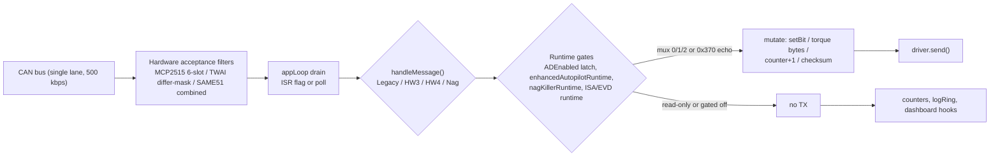
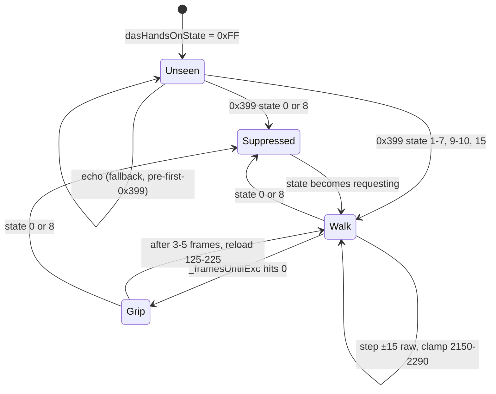
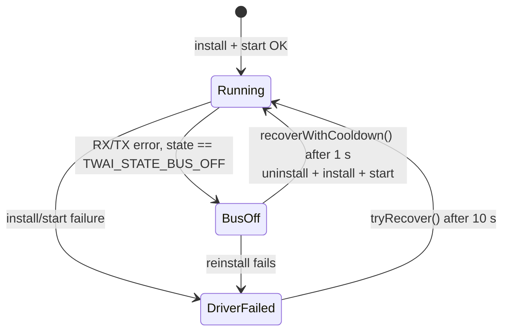

# zdenekbouresh / ev-open-can-tools

Deep-dive analysis (replace mode). The YAML frontmatter above is preserved byte-for-byte from the pre-replace summary; that summary — including the stale claims in its `description` — still exists in git history and is cited below as `git show HEAD:docs/legacy/zdenekbouresh-ev-open-can-tools.md` (line numbers from that command). The pre-replace doc contained no `## Upstream (...)` sections, so there was nothing to re-attach after section 14.

Citation notation: `file:line` = fork dev snapshot (pinned). `feat:file:line` = `origin/feat/das-aware-nag-suppression` (fork-only commits c73a46d, fa7d6b0, 124d1e1, dcbce37, 2e109b8). `up:file:line` = `legacy/ev-open-can-tools-ev-open-can-tools` pinned at 338d276 ("Release 3.1.1", 2026-08-05). Repo-relative paths (`firmware/...`) = TeslaCANModder shipping code.

## 1. Provenance

- Submodule: `legacy/zdenekbouresh-ev-open-can-tools`, pinned gitlink `160000 35c970f46a061cf8bcb175a2375e818a0016e55e 0` (`git ls-files -s`), matches `git -C legacy/zdenekbouresh-ev-open-can-tools rev-parse HEAD`. Working tree clean (`git status --porcelain` empty). HEAD commit: `35c970f Added support for waveshare ESP32-S3-RS485-CAN` (Bruvv, 2026-04-12).
- Upstream URL: `https://github.com/zdenekbouresh/ev-open-can-tools.git`. Branches: `dev` (default, pinned), `origin/main` == `dev` (same SHA), `origin/feat/das-aware-nag-suppression` (research branch).
- License: GPL-3.0 (LICENSE, 553 lines, RANGE-CITED; confirmed by README.md:56-58). Third-party deps (autowp-mcp2515 MIT, Adafruit CAN MIT, esp-idf Apache-2.0) listed in THIRD_PARTY_LICENSES (not read).
- Analysis date: 2026-11-20. Analyzer: GLM-5.3 subagent, one-repo deep dive per `.opencode/skills/legacy-repo-deep-dive/SKILL.md`.
- Comparison repo: `legacy/ev-open-can-tools-ev-open-can-tools`, gitlink `160000 338d2760899735530c7eeccb190a4673f1c58202 0`.
- Provenance finding (verified by object-DB checks, not by README): every commit on the fork's `dev` branch — including the waveshare HEAD — exists in upstream's object DB and is an ancestor of upstream HEAD. `dev` is a frozen pin of upstream's own v1.0.0-era line (root commit `b7581a9 "we are back"` 2026-04-10). The only commits absent from upstream are the five on the feat branch (c73a46d DAS gating, fa7d6b0 organic torque, 124d1e1 clang-format, dcbce37 plugin example doc, 2e109b8 installable plugin JSON). The fork added nothing on `dev` itself.
- Reading coverage — fork dev snapshot, FULL-READ: `include/handlers.h` (1-579), `src/main.cpp` (1-84), `include/app.h` (1-108), `include/can_helpers.h` (1-135), `include/shared_types.h` (1-11), `include/can_frame_types.h` (1-11), `include/log_buffer.h` (1-52), `include/drivers/can_driver.h` (1-13), `include/drivers/mcp2515_driver.h` (1-69), `include/drivers/esp32_mcp2515_driver.h` (1-72), `include/drivers/twai_driver.h` (1-151), `include/drivers/same51_driver.h` (1-70), `include/drivers/mock_driver.h` (1-32), `include/web/mcp2515_dashboard.h` (1-887), `platformio.ini` (1-164), `platformio_profile.h` (1-33), `CHANGELOG.md` (1-14), `README.md` (1-58), `.github/workflows/ci.yml` (1-242), `scripts/platformio_sync_profile.py` (1-189), `scripts/platformio_set_profile.py` (1-100), `test/test_native_nag/test_nag_handler.cpp` (1-399), `test/test_native_hw3/test_hw3_handler.cpp` (1-254), `test/test_native_hw4/test_hw4_handler.cpp` (1-344), `test/test_native_legacy/test_legacy_handler.cpp` (1-153), `test/test_native_helpers/test_helpers.cpp` (1-267), `test/test_native_bypass_tlssc_requirement/test_bypass_tlssc_requirement.cpp` (1-110), `test/test_native_log_buffer/test_log_buffer.cpp` (1-101), `test/test_native_twai/test_twai_filter.cpp` (1-227), `test/README`, `VERSION` (1 line).
- RANGE-CITED: `include/web/mcp2515_dashboard_ui.h` (grep-anchored ranges 249-320, 445-483, 540, 607-690), `scripts/check_release_metadata.py` (1-40), `.devcontainer/devcontainer.json` (1-25).
- STRUCTURAL-PARSE: `scripts/ev_can_analyzer.py` (first 45 lines: argparse/json/dataclass scaffolding + enum tables GTW_AUTOPILOT_ENUM, UDS_SERVICE_NAMES).
- Feat branch (via read-only `git show`): `include/handlers.h` FULL-READ of the NagHandler section (290-474) plus grep-anchored lines; `docs/plugins/epas-nag-suppress-basic.json` FULL-READ (17 lines); commit messages of all five fork-only commits FULL-READ; test inventory of `test/test_native_nag/test_nag_handler.cpp` via test-name listing (RANGE-CITED).
- Upstream comparison: `up:include/handlers.h` RANGE-CITED (1-120, 660-999); `up:CHANGELOG.md` RANGE-CITED (first 80 lines); full file inventory via `git ls-files`.
- Our side (parity CODE-READ): `firmware/lib/vehicle/can/feature/fsd/nag.h` FULL-READ (1-524), `firmware/lib/vehicle/can/feature/fsd/nag/math.h` FULL-READ (1-52), `firmware/lib/vehicle/can/checksum.h` FULL-READ (1-75), `firmware/lib/vehicle/can/handler/filters.h` FULL-READ (1-158), `firmware/lib/vehicle/can/handler/variant/hw4.h` FULL-READ (1-169), RANGE-CITED: `firmware/lib/vehicle/can/handler/bus/vehicle.h` (100-219, 310-364), `firmware/lib/vehicle/can/handler/variant/legacy.h` (40-79), `firmware/lib/vehicle/can/feature/fsd/profile.h` (38-75), `firmware/lib/vehicle/can/feature/body/track_mode.h` (1-58), `firmware/lib/core/driver/common.h` (195-234), grep-anchored: `firmware/lib/vehicle/can/ids.h`, `firmware/lib/vehicle/can/feature/fsd/offsets.h`, `firmware/lib/vehicle/can/handler/variant/bits.h`, `firmware/lib/vehicle/can/feature/telemetry/frame_readers.h:19`, `firmware/lib/client/command/messages.h:119`.
- Files explicitly NOT read: `.gitignore`, `.clang-format`, LICENSE full text, THIRD_PARTY_LICENSES, `.github/dependabot.yml`, `.github/pull_request_template.md`, `.devcontainer/post-create.sh`, `docs/.gitkeep` (empty), body of `scripts/ev_can_analyzer.py` beyond line 45, `test/test_can_analyzer.py` (only its CI invocation, ci.yml:41-49), upstream repo files other than the three cited above.

## 2. Executive verdict

This submodule is a GitHub fork whose pinned `dev` branch is a frozen April-2026 point of upstream's own v1.0.0 history — it contains zero fork-authored code; upstream (pinned at 3.1.1, 2026-08-05) has since moved three major versions ahead (plugin engine, GVRET, injection policies, its own DAS-gated nag modes). The fork's entire research contribution is five commits on `feat/das-aware-nag-suppression`: a DAS-gated 0x370 EPAS echo (hands-on state decoded from 0x399) plus an organic xorshift32 torque walk with periodic grip excursions. The grip-excursion and walk machinery is already adapted into our shipping organic nag mode with identical constants (2350±20 base, 3-5 frames, 125-225 interval), so the headline "port candidate" is already present. The live findings are elsewhere: (1) the fork's own comment/summary claim a 3.10–3.30 Nm grip excursion while the code produces 2.80–3.20 Nm; (2) upstream 3.1.1 later hard-clamped nag torque to ±1.80 Nm, contradicting the fork's 1.00–2.40 Nm walk; (3) the DAS hands-on carrier frame is contested across all three codebases (fork 0x399, ours 0x39B, upstream 0x399 for Legacy/HW3 + 0x39B for HW4) — this is a capture-first investigation that may expose a dead DAS gate on HW3 in our firmware. Never port: the always-on fixed-1.80 Nm echo, the unauthenticated WiFi dashboard, and the default-credential template that its own guard fails to block.

## 3. Evidence map

| Source | Lines | What it proves | Grade |
| --- | --- | --- | --- |
| `include/handlers.h` | 41-111 | LegacyHandler: stalk 69 → profile; 1006 mux0 bit46+profile, mux1 bit19 | CODE-READ |
| `include/handlers.h` | 113-290 | HW3Handler: 787 track-mode force-on, 1016 mapping, 2047 tier, 1021 mux0/1/2 edits | CODE-READ |
| `include/handlers.h` | 292-377 | Dev NagHandler: fixed 0x08B6 torque echo, counter+1 at byte 6, checksum +0x73 | CODE-READ |
| `include/handlers.h` | 379-579 | HW4Handler: bits 46/60/59, bit 47 on mux1, mux2 profile/offset, 921 ISA chime | CODE-READ |
| `include/handlers.h` | 133-157, 404-428 | Inline 0x370 echo inside HW3/HW4, compiled only under ESP32_DASHBOARD | CODE-READ |
| `include/can_helpers.h` | 40-54 | Build-flag defaults for NAG_KILLER/ISA/EVD/ENHANCED_AUTOPILOT runtime toggles | CODE-READ |
| `include/can_helpers.h` | 56-135 | readMuxID, isADSelectedInUI, readGTWAutopilot, setSpeedProfileV12V13, computeVehicleChecksum | CODE-READ |
| `include/web/mcp2515_dashboard.h` | 20-31, 839-871 | Compile-time WiFi AP + OTA credentials; 14 HTTP endpoints, only `/update` authenticated | CODE-READ |
| `include/web/mcp2515_dashboard.h` | 252-308, 510-562 | NVS persistence of feature toggles; `/features` handler never reads an `nk` argument | CODE-READ |
| `include/web/mcp2515_dashboard_ui.h` | 294, 473, 635 | UI posts `nk=` and reads `d.feat.nk` — backend never emits it: dead control | CODE-READ |
| `include/drivers/twai_driver.h` | 15-151 | TWAI 500 kbps, differ-mask filter, 2 ms TX timeout, 1 s bus-off cooldown recovery | CODE-READ |
| `include/drivers/esp32_mcp2515_driver.h` + `mcp2515_dashboard.h:357-378` | — | ext-MCP2515 driver + dashboard EFLG 0x20 poll every 5 s with reset/re-init | CODE-READ |
| `platformio.ini` | 123-137 | Fork HEAD's only dev-branch content: waveshare ESP32-S3-RS485-CAN env (TWAI pins 15/16, LED 14) | CODE-READ |
| `platformio_profile.h` + `scripts/platformio_sync_profile.py` | 21-25; 26-27, 153-166 | Template ships `"changeme"` but guard checks `"changeme1"/"changeme2"` → build succeeds with defaults | CODE-READ |
| `test/test_native_nag/test_nag_handler.cpp` | 12-43, 129-277 | EPAS frame builder (tRaw=(Nm+20.5)/0.01), checksum oracle, counter/handsOn/torque asserts | TEST-READ |
| `test/test_native_hw3/test_hw3_handler.cpp` | 158-170 | 787 track-mode mutation + checksum 0xE7 asserted | TEST-READ |
| `test/test_native_hw4/test_hw4_handler.cpp` | 229-262 | 921 ISA bit 0x20 + checksum 0xD1 asserted (id bytes 0x99+0x03) | TEST-READ |
| feat:`include/handlers.h` | 292-474 | DAS gate from 0x399 d[5] bits[5:2]; suppress states 0/8; 0xFF fallback; xorshift32 walk 2150-2290; excursion 2350+(r%41)-20 | CODE-READ |
| feat:`include/handlers.h` | 395 | Comment claims excursion ≈ 3.10-3.30 Nm; code at 406 yields 2.80-3.20 Nm | CODE-READ |
| feat:`test/test_native_nag/test_nag_handler.cpp` (names) | test_nag_suppressed_when_das_state_0/_8, fires_when_das_state_2/4/6, fires_on_unseen_das_state, das_frame_not_echoed, torque_in_organic_range, torque_varies_across_frames | DAS gating and organic ranges are test-asserted on the feat branch | TEST-READ |
| feat:`docs/plugins/epas-nag-suppress-basic.json` | 1-17 | Stateless fixed-1.80 Nm echo as plugin; commit dcbce37 documents its inferiority to the gated handler | CODE-READ |
| up:`include/handlers.h` | 25-33, 65-69, 698-705, 729-991 | Upstream 3.1.1 Mode A/B/C; ±1.80 Nm clamp (0x074E..0x08B6); 0x399 Legacy/HW3 + 0x39B HW4 DAS carriers; own-echo guard; HW4 Mode C fails closed | CODE-READ |
| up:`CHANGELOG.md` | 8-60 | Upstream later shipped its own nag modes, fail-closed summon policy, GVRET, plugins | CODE-READ |
| `firmware/lib/vehicle/can/feature/fsd/nag.h` | 47-160, 274-295, 412-487 | Our DAS gate set, grip-excursion constants, counter byte 1-or-6 pipeline, checksum | CODE-READ |
| `firmware/lib/vehicle/can/handler/bus/vehicle.h` | 130-136, 318-345 | Our dasHandsOnState source is 0x39B; our 0x370 echo pipeline | CODE-READ |

No CAPTURE evidence exists in this repo: all frame layouts rest on code/comments plus one comment-claimed on-vehicle test ("Tested: Model Y Performance 2022 HW3, Basic Autopilot", include/handlers.h:305; "Tested: Model X HW3, Legacy platform, FW 2026.8.3", feat:327). Those on-vehicle claims are UNVERIFIED — no trace files ship with the repo.

## 4. Architecture and build surface

Entry point `src/main.cpp:30-84` selects one of four `CanDriver` implementations via build flags (`DRIVER_MCP2515` RP2040 SPI, `DRIVER_SAME51` native CAN, `DRIVER_TWAI` ESP32 TWAI, `DRIVER_ESP32_EXT_MCP2515` ESP32 + external MCP2515), then `app.h:48-108` (`appSetup`/`appLoop`) drains frames into one variant handler chosen by `app.h:17-35`: `ESP32_DASHBOARD` → Legacy/HW3/HW4 pool with runtime swap, else exactly one of `NAG_KILLER` → `NagHandler`, `HW4`, `HW3`, `LEGACY`. Shared core = `can_frame_types.h` (plain `CanFrame`), `shared_types.h` (`Shared<T>` = atomic on target, plain on native), `log_buffer.h` (32-entry ring). Platform ports are the four drivers; dependency boundary is the `CanDriver` interface (`include/drivers/can_driver.h:5-13`). Build flags gate features: `ISA_SPEED_CHIME_SUPPRESS`, `EMERGENCY_VEHICLE_DETECTION`, `BYPASS_TLSSC_REQUIREMENT`, `ENHANCED_AUTOPILOT`, `NAG_KILLER` (`include/can_helpers.h:8-54`), `DASH_DEFAULT_HW` 0/1/2, `MCP_CRYSTAL_FREQ`. Ten firmware envs in `platformio.ini` (feather_rp2040_can, feather_m4_can, esp32_twai, esp32_feather_v2_mcp2515, lilygo_tcan485_hw3, m5stack-atomic-can-base, m5stack-atoms3-mini-can-base, esp32_ext_mcp2515, waveshare_ESP32_S3_RS485_CAN, plus 4 native test envs). `scripts/platformio_sync_profile.py` enforces one-driver/one-vehicle selection and syncs `platformio_profile.h`.



## 5. Mechanism catalogue

### LegacyHandler (stalk profile + 1006 mux)

- **Claim (README / summary):** README.md:18-21 lists nag suppression, speed profiles; no legacy-specific doc. `git show HEAD:docs/legacy/zdenekbouresh-ev-open-can-tools.md` did not cover the dev snapshot's variant handlers at all.
- **Code path:** `include/handlers.h:50-110` — `handleMessage()` → stalk decode or mux edit → `driver.send()`.
- **Frame spec:** 0x045 (69) read: `data[1] >> 5` stalk position 0-7 → profile (≤1→2, 2→1, else 0). 0x3EE (1006) mux = `data[0] & 0x07`: mux0 sets bit 46 + profile bits (`data[6]` bits[2:1], `setSpeedProfileV12V13` can_helpers.h:92-96) when AD selected (`data[4]` bit 6, or forced by `bypassTlsscRequirementRuntime`); mux1 clears bit 19 unconditionally. DLC guards: 69→2, 1006→8.
- **Gates and timing:** None found (no interval logic; every eligible frame is re-transmitted).
- **State machine:** None found (latched `ADEnabled` only).
- **Tests:** `test_legacy_stalk_pos0..3_sets_profile`, `test_legacy_AD_*`, `test_legacy_nag_suppression_clears_bit19_on_mux1` at test/test_native_legacy/test_legacy_handler.cpp:22-150.
- **Evidence grade:** CODE-READ + TEST-READ.
- **Verdict:** CONFIRMED.
- **Adapt to TeslaCANModder?** already present (our legacy.h:40-79 mirrors the same decode and bit edits).

### HW3Handler (0x3FD FSD mux + track mode + tier readback)

- **Claim (README / summary):** README.md:18 "Nag Suppression — clears the hands-on-wheel ECE R79 nag bit" (this is the bit-19 path, distinct from the 0x370 echo).
- **Code path:** `include/handlers.h:113-290`.
- **Frame spec:** 0x313 (787): force `data[0]` bits[1:0] = 0x01 (`setTrackModeRequest`, can_helpers.h:98-102) + checksum `data[7]` = id-bytes + payload sum (can_helpers.h:104-118). 0x3F8 (1016): follow distance `data[5]` bits[7:5] → profile 1→2, 2→1, 3→0. 0x7FF (2047) mux2: tier `(data[5] >> 2) & 0x07` (can_helpers.h:68-71), read-only. 0x3FD (1021): mux0 — decode speed offset `((data[3]>>1 & 0x3F) - 30) * 5` clamped 0..100, set bit 46 + profile bits; mux1 — clear bit 19, set bit 46 (only when `enhancedAutopilotRuntime`); mux2 — inject offset into `data[0]` bits[7:6] + `data[1]` bits[5:0].
- **Gates and timing:** `ADEnabled` latched from mux0 `data[4]` bit 6; `speedProfileLocked` freezes stalk auto-mapping; per-frame retransmission, no pacing.
- **State machine:** None found beyond the `ADEnabled` latch.
- **Tests:** `test_hw3_track_mode_request_forces_on_and_updates_checksum` (expects data[0]=0xFD, checksum 0xE7) at test/test_native_hw3/test_hw3_handler.cpp:158-170; mux/offset asserts at 56-155.
- **Evidence grade:** CODE-READ + TEST-READ.
- **Verdict:** CONFIRMED.
- **Adapt to TeslaCANModder?** already present (see parity rows: offset decode, profile bits, bit 19/46, 0x7FF tier identical in our code).

### HW4Handler (bits 46/60/59 + ISA chime)

- **Claim (README / summary):** README.md:22-23 claims ISA chime suppression and emergency vehicle detection on HW4.
- **Code path:** `include/handlers.h:379-579`.
- **Frame spec:** 0x3FD mux0 — set bits 46, 60, optional bit 59 (EVD); mux1 — clear bit 19, set bit 47; mux2 — profile into `data[7]` bits[6:4], offset into `data[1]` bits[5:0] (values >0 only). 0x3F8 — five-position stalk 1→3, 2→2, 3→1, 4→0, 5→4. 0x399 (921) ISA chime — `data[1] |= 0x20`, checksum `data[7]` = sum(b0..b6) + 0x99 + 0x03 (id byte split) at handlers.h:429-448. 0x7FF mux2 tier readback as HW3.
- **Gates and timing:** `isaSpeedChimeSuppressRuntime`, `emergencyVehicleDetectionRuntime`, `enhancedAutopilotRuntime`, `hw4OffsetRuntime` (can_helpers.h:48-54); no pacing.
- **State machine:** None found beyond latches.
- **Tests:** `test_hw4_isa_suppress_checksum_correct` expects 0xD1 (test/test_native_hw4/test_hw4_handler.cpp:246-262); bit asserts at 87-187.
- **Evidence grade:** CODE-READ + TEST-READ.
- **Verdict:** CONFIRMED.
- **Adapt to TeslaCANModder?** already present (our hw4.h:65-169 + bits.h:19-22, 48-50; ours additionally sets bits 38/39 and gates on `apGateOpen()`).

### NagHandler (dev snapshot: fixed-torque counter+1 echo)

- **Claim (README / summary):** README.md:19 "Autosteer Nag Killer — echoing modified EPAS steering torque frames on CAN bus 4"; comment include/handlers.h:292-309 describes the TSL6P-module replication and claims "Tested: Model Y Performance 2022 HW3, Basic Autopilot. Bus: X179 pin 2/3 (CAN bus 4)".
- **Code path:** `include/handlers.h:310-377` — filter {880} → gate on `handsOn == 0` → build echo → `driver.send()`.
- **Frame spec:** CAN 880 (0x370) EPAS3P_sysStatus, DLC 8. Echo: copy b0/b1/b5; `data[2] = (data[2] & 0xF0) | 0x08`; `data[3] = 0xB6` (fixed 1.80 Nm; tRaw = (1.80+20.5)/0.01 = 2230 = 0x08B6); `data[4] |= 0x40` (handsOnLevel=1); counter = (`data[6]` & 0x0F) + 1 mod 16; checksum `data[7]` = (sum(b0..b6) + 0x73) & 0xFF. Torque slot: 12-bit, `data[2]` low nibble = tRaw >> 8, `data[3]` = low byte.
- **Gates and timing:** fires on every frame with handsOnLevel==0 (~25 Hz claimed in feat comment; no capture in repo) — always-on while `nagKillerActive` && `nagKillerRuntime`. Injection trick: the echo uses counter+1 of the observed frame, so the real next EPAS frame carrying that counter is rejected downstream as a duplicate.
- **State machine:** None found.
- **Tests:** 26 asserts in test/test_native_nag/test_nag_handler.cpp:58-346: filter IDs, handsOn gating, counter increment/wrap/nibble preservation, handsOn=1, 0xB6, torque decode 1.80±0.1 Nm, checksum sweep across 16 counters, safe-range canary [-5, 5] Nm.
- **Evidence grade:** CODE-READ + TEST-READ (on-vehicle claim UNVERIFIED).
- **Verdict:** CONFIRMED (code and tests); the always-on behavior is exactly the weakness the feat branch calls out.
- **Adapt to TeslaCANModder?** never port as-is (constant 1.80 Nm for minutes is trivially fingerprinted; our nag.h:384-388 comment says the same and our organic/feifan modes supersede it).

### feat/das-aware-nag-suppression: DAS-gated organic NagHandler (the fork's only novel mechanism)

- **Claim (README / summary):** `git show HEAD:docs/legacy/zdenekbouresh-ev-open-can-tools.md:39-64` — gate on DAS_autopilotHandsOnState from CAN 921, organic walk 1.00-2.40 Nm, grip 3.10-3.30 Nm every 5-9 s, xorshift32 0xDEADBEEF, step ±15.
- **Code path:** feat:`include/handlers.h:332-473` — filter {880, 921} → 0x399 updates `dasHandsOnState` → 0x370 gate `dasState == 0 || dasState == 8` return → walk/excursion update → echo build → `driver.send()`.
- **Frame spec:** identical 0x370 echo layout as dev NagHandler except torque bytes are walk-driven: `data[2] = (data[2] & 0xF0) | (torqRaw >> 8)`, `data[3] = torqRaw & 0xFF`. 0x399 gate signal: `dasHandsOnState = (data[5] >> 2) & 0x0F` (feat:364, dlc≥6). Comment feat:390-391 gives scale tRaw = (Nm + 20.5)/0.01; comment feat:327 claims "Tested: Model X HW3, Legacy platform, FW 2026.8.3. Bus: X179 pin 18/19 (Chassis CAN)".
- **Gates and timing:** echo suppressed at DAS state 0 (NOT_REQD) and 8 (SUSPENDED); fires for 1-7, 9-10, 15 (SNA), and 0xFF (no DAS frame yet — conservative startup fallback, feat:337-340, 379-382). Walk: `_torqWalk` starts 2230 raw (1.80 Nm), step `(r % 31) - 15` raw/frame, clamped [2150, 2290] = [1.00, 2.40] Nm. Excursion: `_torqWalk = 2350 + (r % 41) - 20` = [2330, 2370] raw = [2.80, 3.20] Nm actual (comment claims 3.10-3.30), 3-5 frames (`3 + r % 3`), every 125-225 frames (`125 + r % 101` ≈ 5-9 s at 25 Hz), initial `_framesUntilExc = 175`. handsOnLevel stays 1 throughout.
- **State machine:** states below; PRNG/walk members are deliberately non-atomic (serialised CAN context, feat:343-344).



- **Tests:** feat test suite adds `test_nag_suppressed_when_das_state_0`, `_8`, `test_nag_fires_when_das_state_2/4/6`, `test_nag_fires_on_unseen_das_state`, `test_nag_das_frame_not_echoed`, `test_nag_das_short_dlc_ignored`, `test_nag_das_state_transitions`, `test_nag_torque_in_organic_range`, `test_nag_torque_varies_across_frames`, `test_nag_output_torque_always_in_safe_range` (feat test file, name listing).
- **Evidence grade:** CODE-READ + TEST-READ (0x399 carrier role and on-vehicle claims UNVERIFIED).
- **Verdict:** PARTIAL — DAS gating and organic variation confirmed in code+tests; the excursion magnitude comment is contradicted by its own code (see §6), and the 0x399 carrier conflicts with both our ids.h and upstream 3.1.1's per-variant mapping.
- **Adapt to TeslaCANModder?** already present in substance — our organic mode has the same excursion constants (nag.h:274-295) and our safe/natural/organic/feifan modes all DAS-gate; remaining delta is the carrier-frame question (parity row 5) and state-1 handling.

### WiFi dashboard (ESP32_DASHBOARD builds)

- **Claim (README / summary):** README.md:24 "WiFi hotspot on ESP32 boards for real-time monitoring, runtime feature toggles, and over-the-air firmware updates".
- **Code path:** `include/web/mcp2515_dashboard.h:816-885` (`mcpDashboardSetup`/`mcpDashboardLoop`) + `src/main.cpp:34-60`.
- **Frame spec:** n/a (transport surface). Sniffer labels 11 IDs in `decodeCanId` (dashboard:119-148), display-only.
- **Gates and timing:** web task pinned to core 0 (dashboard:843), 2 ms yield; bus health poll every 5 s (dashboard:364); canOnline timeout 10 s (dashboard:393); recorder cap 2000 frames, sniffer 30, log 80 (dashboard:93, 107, 159).
- **State machine:** `dashSwapHandler` (dashboard:791-814) swaps Legacy/HW3/HW4 handlers, re-programs filters, carries over profile/print flags; prefs persisted per toggle (dashboard:252-308).
- **Tests:** None found — no dashboard test exists in the dev snapshot (upstream added test_native_dashboard later).
- **Evidence grade:** CODE-READ.
- **Verdict:** CONFIRMED code; the UI `nk` toggle is dead (see §9) and `/disable` is partial (see §9).
- **Adapt to TeslaCANModder?** no impact (our REST API + dashboard already cover this with auth; see §12 security rows for what not to copy).

### CAN driver layer (TWAI / MCP2515 / SAME51)

- **Claim (README / summary):** README.md:30 "sits on the vehicle CAN bus, intercepts relevant frames, modifies the necessary bits, and re-transmits".
- **Code path:** `include/drivers/twai_driver.h:7-151`, `mcp2515_driver.h:9-69`, `esp32_mcp2515_driver.h:9-72`, `same51_driver.h:7-70`.
- **Frame spec:** n/a. TWAI: rx queue 32, tx queue 16, 2 ms TX timeout (twai:18-19, 93-96); differ-mask acceptance filter computed over the ID set (twai:32-56); bus-off cooldown 1000 ms, failed-driver retry window 10 s (twai:104-142).
- **Gates and timing:** `BUSOFF_COOLDOWN_MS = 1000` (twai:104); MCP ext bus-off: EFLG bit 0x20 checked every 5000 ms → reset + bitrate + filters (dashboard:357-378).
- **State machine (TWAI):**



- **Tests:** filter math only — test/test_native_twai/test_twai_filter.cpp:12-33 re-implements the computation instead of calling the driver (drift risk); no test covers recovery paths.
- **Evidence grade:** CODE-READ (recovery paths untested).
- **Verdict:** CONFIRMED code; UNVERIFIED recovery behavior on hardware.
- **Adapt to TeslaCANModder?** already present — our `driverPollBusErrors()` polls EFLG_TXBO per active bus (firmware/lib/core/driver/common.h:204-220), a superset of the fork's single-bus dashboard poll.

### Upstream 3.1.1 Mode A/B/C nag system (comparison context, not in this fork)

- **Claim (README / summary):** up:CHANGELOG.md:26-28 "Added built-in Nag Suppression modes Off, A, B, and C, including dashboard controls, NVS persistence, ... regression coverage."
- **Code path:** up:`include/handlers.h:691-992` (`NagHandler::handleMessageAt` → `decideInjection` → echo build).
- **Frame spec:** same 0x370 echo skeleton (counter+1 at byte 6, checksum +0x73, handsOn |= 0x40) but torque hard-clamped to raw [0x074E, 0x08B6] = [-1.80, +1.80] Nm (up:25-33). Mode A: fixed 0x08B6. Mode B: cycle {0x08B6, 0x0898, 0x076C, 0x074E} (+1.80/+1.50/-1.50/-1.80 Nm), 200 ms per step, 1 s burst / 1.5 s pause (up:703-705, 939-953). Mode C: gated by DAS status carrier 0x399 (Legacy/HW3) or 0x39B (HW4) plus 0x129 steering context, both fresh within 1000 ms; AP state 3-6; steering ±5°; state 2 → 2 s dwell then ±0.5..1.80 Nm walk opposite steering sign; state 3 → triangle wave ±1.8 Nm at 1 s; `setHandsOn` only if |torque| ≥ 1.0 Nm (up:929-991). Own-echo guard: `handsOn==1 && torqueRaw==TORQUE_RAW_MAX` or byte-exact match of last echo (up:769-773). Mode C fails closed to Off on HW4 (up:65-69).
- **Gates and timing:** `kContextFreshMs = 1000`, `kModeBBurstMs = 1000`, `kModeBPauseMs = 1500`, `kModeBTorqueStepMs = 200` (up:702-705).
- **State machine:** Mode B cycle + Mode C handsOnState tracking with state-entry timestamps (up:840-891).
- **Tests:** upstream has test_native_nag with regression coverage (file inventory; not read — upstream repo is out of scope beyond this comparison).
- **Evidence grade:** CODE-READ.
- **Verdict:** CONFIRMED — upstream superseded the always-echo design independently of this fork and rejected the >1.80 Nm ranges.
- **Adapt to TeslaCANModder?** candidate for future PR only in narrow deltas: own-echo guard concept and per-variant DAS carrier; the ±1.80 Nm clamp decision is a safety-relevant cross-check for our organic excursions (see §13).

## 6. Summary vs code contradiction table

Pre-replace summary cited as `S#<line>` = `git show HEAD:docs/legacy/zdenekbouresh-ev-open-can-tools.md` line #.

| # | Claim | Code evidence | Verdict |
| --- | --- | --- | --- |
| 1 | S#15: fork's dev has "minor additions (Waveshare ESP32-S3 board support, devcontainer)" | `git log` 35c970f authored by Bruvv (upstream); devcontainer commits e5db928/c7193b6 merged from upstream main; both are ancestors of upstream HEAD | CONTRADICTED — attribution is wrong; dev adds nothing upstream lacks |
| 2 | S#3, S#15, S#17: dev "tracks upstream closely", "HEAD = upstream main equivalent" | Upstream pinned is 3.1.1 (2026-08-05) with a 1141-line handlers.h, plugin engine, GVRET, injection policy; fork dev is a 2026-04-12 v1.0.0-era pin (550-line handlers.h) | STALE — true on the writing date, false after upstream's 2.x/3.x evolution |
| 3 | S#59 (and feat comment 395): "Grip excursion: raw 2350 ± 20 ≈ 3.10–3.30 Nm" | feat:406 `2350 + (r % 41) - 20` → raw [2330, 2370]; with tRaw=(Nm+20.5)/0.01 that is [2.80, 3.20] Nm. 3.10-3.30 Nm needs center 2370 | CONTRADICTED — the old doc inherited the upstream comment bug |
| 4 | S#81: our nag gate source is "CAN 880 byte 5 bits[5:2]" | Our gate: `s.dasHandsOnState = readDasHandsOnState(f)` on `CAN_ID_DAS_STATUS` 0x39B (firmware/lib/vehicle/can/handler/bus/vehicle.h:130-132, ids.h:64); the only caller. Our nag.h:43 comment saying "from 0x370" is itself stale | CONTRADICTED — our gate frame is 0x39B; the old doc copied our stale comment |
| 5 | S#39, S#46: DAS gating "from CAN 921 DAS_status" (as a settled fact) | feat:353, 364 confirms the fork reads 0x399; but up:699-700 uses 0x399 only for Legacy/HW3 and 0x39B for HW4, and our ids.h:21, 63 labels 0x399 as HW4 ISA alert / blind-spot | PARTIAL — code-confirmed in the fork, contested across codebases; carrier is UNVERIFIED per variant |
| 6 | S#87, S#94: "1.0–2.4 Nm with 3.1–3.3 Nm grip excursions is the community-validated effective range" | up:25-33 clamps all upstream nag torque to ±1.80 Nm (0x074E..0x08B6) as a firmware safety bound; fork's own excursion is 2.80-3.20 Nm (row 3); no capture evidence anywhere | OVERSTATED — SUMMARY-ONLY at best, and numerically wrong on the excursion |
| 7 | S#51: "Echo fires for all other states (1-7, 9-10, 15=SNA fallback)" | feat:340, 379-382 also fires at 0xFF before any 0x399 frame (startup fallback) | OMISSION — behavior is broader than documented |
| 8 | README.md:20: "Actually Smart Summon (ASS) — Removes EU regulatory restrictions on Smart Summon (HW3/HW4)" | No summon frame logic exists in dev handlers (git grep `summon` → only dashboard prefs/UI); `feat.summonUnlock` only feeds `enhancedAutopilotRuntime` (dashboard:279, 520, 526), which drives the bit 46/47 EAP edits | CONTRADICTED — repo self-contradiction; "summon" is just the EAP-bit unlock label |
| 9 | platformio_profile.h:21: "The build will fail if DASH_PASS or DASH_OTA_PASS are left unchanged" | Guard checks `"changeme1"`/`"changeme2"` (scripts/platformio_sync_profile.py:26-27, 162-166); shipped template values are `"changeme"` (platformio_profile.h:23, 25) → guard never trips on the template | CONTRADICTED — repo self-contradiction; builds succeed with default credentials |

## 7. CAN frame and signal inventory

Frames the repo decodes, mutates, or injects. Bus: single lane (the fork listens on one CAN; the 0x370 comment says X179 pin 2/3 dev, X179 18/19 feat — pin claims are comment-only, UNVERIFIED). Periods are not encoded anywhere; the ~25 Hz 0x370 rate is comment-sourced (feat:308, 420).

| ID (hex+dec) | Name | DLC | Byte/bit layout | Scale / units | Counter | Checksum | R/W | Grade |
| --- | --- | --- | --- | --- | --- | --- | --- | --- |
| 0x045 (69) | STW_ACTN_RQ stalk | ≥2 | `data[1]` bits[7:5] position | positions 0x00/0x21/0x42/0x64/0x85/0xA6/0xC8 (comment 54-55) | None found | None found | read | CODE-READ |
| 0x313 (787) | UI_trackModeSettings | 8 | `data[0]` bits[1:0] forced 0x01 | n/a | None found | `data[7]` = id bytes + sum(b0..b6 excl 7) (can_helpers.h:104-118) | read+mutate+TX (HW3 only) | CODE-READ+TEST-READ |
| 0x3F8 (1016) | follow distance | ≥6 | `data[5]` bits[7:5] | HW3 1→2, 2→1, 3→0; HW4 1→3, 2→2, 3→1, 4→0, 5→4 (profile) | None found | None found | read | CODE-READ+TEST-READ |
| 0x370 (880) | EPAS3P_sysStatus | 8 | handsOn `data[4]` bits[7:6]; torque 12-bit `data[2]` low nibble + `data[3]`; counter `data[6]` low nibble; checksum `data[7]` | tRaw = (Nm + 20.5)/0.01; dev fixed 0x08B6 = 1.80 Nm; feat walk [2150, 2290] = [1.00, 2.40] Nm, excursion [2330, 2370] = [2.80, 3.20] Nm | `data[6]` & 0x0F, +1 mod 16 | sum(b0..b6) + 0x73 | read+mutate+TX echo | CODE-READ+TEST-READ |
| 0x399 (921) | ISA speed chime (dev HW4) / DAS_status gate (feat) | 8 / ≥6 | ISA: `data[1] |= 0x20`; gate: `data[5]` bits[5:2] hands-on state | state enum 0=NOT_REQD … 8=SUSPENDED, 15=SNA (feat:313-325) | None found | ISA: `data[7]` = sum(b0..b6) + 0x99 + 0x03 (handlers.h:436-441) | read; ISA mutate+TX | CODE-READ+TEST-READ |
| 0x3EE (1006) | Legacy FSD mux | 8 | mux `data[0]` bits[2:0]; mux0 bit 46 + `data[6]` bits[2:1] profile; mux1 bit 19 clear | n/a | None found | None found | read+mutate+TX | CODE-READ+TEST-READ |
| 0x3FD (1021) | FSD mux (HW3/HW4) | 8 | mux `data[0]` bits[2:0]; AD-UI `data[4]` bit 6; HW3 mux0: bit 46, profile `data[6]` bits[2:1], offset decode `data[3]` bits[6:1]; HW3 mux2 offset inject `data[0]` bits[7:6] + `data[1]` bits[5:0]; HW4 mux0: bits 46, 60 (+59); HW4 mux1: bit 19 clear + bit 47; HW4 mux2: profile `data[7]` bits[6:4], offset `data[1]` bits[5:0] | HW3 offset decode ((x-30)×5 clamp 0..100); HW4 offset 0-63 raw | None found | None found | read+mutate+TX | CODE-READ+TEST-READ |
| 0x7FF (2047) | GTW_carConfig mux | ≥6 | mux2 `data[5]` bits[4:2] autopilot tier | 0 NONE, 1 HIGHWAY, 2 ENHANCED, 3 SELF_DRIVING, 4 BASIC (can_helpers.h:73-90) | None found | None found | read-only | CODE-READ+TEST-READ |

Display-only sniffer labels (dashboard:119-148): 0x045, 0x129, 0x175, 0x186, 0x257, 0x293, 0x321, 0x329, 0x399, 0x3E8, 0x3FD — no decode, no DBC/JSON catalog exists in this repo (STRUCTURAL-PARSE not needed). Upstream 3.1.1 additionally consumes 0x39B (HW4 DAS status) and 0x129 (steering context) in its NagHandler — neither appears in the fork.

## 8. Constants and tuning table

| Constant | Value | File:line | Meaning | Grade |
| --- | --- | --- | --- | --- |
| `kTrackModeRequestOn` | 0x01 | can_helpers.h:6 | track-mode enable bits | CODE-READ |
| fixed torque byte | 0xB6 (=0x08B6=2230 raw=1.80 Nm) | handlers.h:299, 342 | dev NagHandler torque | CODE-READ |
| torque scale | tRaw=(Nm+20.5)/0.01 | feat:391; test_nag_handler.cpp:19 | 12-bit EPAS torque encode (0 Nm → 2050) | CODE-READ |
| checksum constant | 0x73 | handlers.h:354 | ≡ id bytes 0x70+0x03 of 0x370 | CODE-READ |
| walk clamp | 2150 / 2290 raw | feat:413-416 | organic walk band [1.00, 2.40] Nm | CODE-READ |
| walk step | (r % 31) - 15 raw | feat:412 | ±15 raw/frame ≈ ±0.15 Nm per 40 ms | CODE-READ |
| excursion base | 2350 + (r % 41) - 20 | feat:406 | grip pulse [2330, 2370] raw = [2.80, 3.20] Nm (comment says 3.10-3.30) | CODE-READ |
| excursion frames | 3 + (r % 3) | feat:419 | 3-5 frames ≈ 120-200 ms | CODE-READ |
| excursion interval | 125 + (r % 101), initial 175 | feat:420, 348 | 125-225 frames ≈ 5-9 s @ 25 Hz | CODE-READ |
| PRNG seed | 0xDEADBEEF | feat:345 | xorshift32 initial state | CODE-READ |
| DAS gate init | 0xFF | feat:340 | echo-before-first-DAS-frame fallback | CODE-READ |
| DAS decode | (d[5] >> 2) & 0x0F | feat:364 | hands-on state 0-15 | CODE-READ |
| suppressed states | 0, 8 | feat:381 | NOT_REQD, SUSPENDED | CODE-READ |
| ISA suppress | data[1] |= 0x20 | handlers.h:436 | HW4 chime mute bit | CODE-READ |
| ISA checksum | sum(b0..b6) + 0x99 + 0x03 | handlers.h:440 | id-inclusive sum | CODE-READ |
| HW3 offset decode | ((d[3]>>1 & 0x3F) - 30) * 5, clamp 0..100 | handlers.h:230 | UI offset steps → percent | CODE-READ |
| HW4 offset slot | d[1] bits[5:0], mask 0x3F | handlers.h:553-555 | raw 0-63 | CODE-READ |
| HW4 profile slot | d[7] bits[6:4] | handlers.h:551-552 | profile 0-4 | CODE-READ |
| AD UI bit | (d[4] >> 6) & 0x01 | can_helpers.h:65 | FSD-selected-in-UI latch source | CODE-READ |
| GTW tier | (d[5] >> 2) & 0x07 | can_helpers.h:70 | 0x7FF mux2 tier readback | CODE-READ |
| profile bits V12/V13 | d[6] bits[2:1] | can_helpers.h:92-96 | legacy/HW3 profile inject | CODE-READ |
| recorder / sniffer / log caps | 2000 / 30 / 80 | dashboard.h:93, 107, 159 | dashboard buffer sizes | CODE-READ |
| LogRingBuffer | 32 × 128 chars | log_buffer.h:10-11 | native log ring | CODE-READ |
| `BUSOFF_COOLDOWN_MS` | 1000 | twai_driver.h:104 | bus-off recovery cooldown | CODE-READ |
| TWAI TX timeout | 2 ms | twai_driver.h:96 | protect 32-deep RX queue | CODE-READ |
| TWAI queues | rx 32 / tx 16 | twai_driver.h:18-19 | queue depths | CODE-READ |
| EFLG poll interval / bit | 5000 ms / 0x20 | dashboard.h:364, 369 | MCP ext bus-off detection | CODE-READ |
| canOnline timeout | 10000 ms | dashboard.h:393 | frame-timeout offline flag | CODE-READ |
| TWAI default pins | TX GPIO5 / RX GPIO4 | main.cpp:20-25 | fallback pin config | CODE-READ |
| up: torque clamp | raw 0x074E..0x08B6 (±1.80 Nm) | up:25-33 | upstream 3.1.1 hard safety bound | CODE-READ |
| up: Mode B cycle | {0x08B6, 0x0898, 0x076C, 0x074E}, 1000/1500/200 ms | up:941, 703-705 | alternating-torque mode | CODE-READ |
| up: context freshness | 1000 ms | up:702 | Mode C DAS/steering staleness gate | CODE-READ |

## 9. Failure modes and edge cases

| Failure | Handling code path | Tested? | Grade |
| --- | --- | --- | --- |
| TWAI bus-off | `recoverWithCooldown()` 1 s cooldown, uninstall/reinstall/start (twai_driver.h:104-128) | No — no driver-level test | CODE-READ |
| TWAI driver dead (install fail) | `tryRecover()` every 10 s (twai_driver.h:130-142) | No | CODE-READ |
| MCP2515 ext bus-off | dashboard EFLG poll every 5 s → reset, bitrate, filters (dashboard.h:357-378) | No | CODE-READ |
| CAN silent bus | `canOnline` cleared after 10 s without frames (dashboard.h:393-397, 880-884) | No | CODE-READ |
| Missing DAS frame (feat) | 0xFF initial state echoes as fallback (feat:337-340) | Yes — `test_nag_fires_on_unseen_das_state` | TEST-READ |
| Short frames | DLC guards: 69→2, 1006/1021/880/921→8, 2047/1016→6, 0x399 gate→6 (handlers.h throughout) | Yes — `test_nag_ignores_short_dlc`, `test_nag_das_short_dlc_ignored` | TEST-READ |
| OTA in progress | `appLoop` and `mcpDashboardLoop` early-return while `Update.isRunning()` (app.h:84-90; dashboard.h:876-878) | No | CODE-READ |
| Emergency stop gaps | `/disable` clears feature runtimes but the 787 track-mode path has no runtime gate (handlers.h:158-167) and `nagKillerRuntime` is not touched (dashboard.h:697-710) — injection is only partially stopped | No — no dashboard tests exist | CODE-READ |
| Dead UI control | `tgl-nk` posts `nk=` (ui.h:473) and reads `d.feat.nk` (ui.h:635); backend parses no `nk` (dashboard.h:510-562) and status JSON never emits it (dashboard.h:444-457) — the 0x370-echo toggle does nothing on both dev and feat | No | CODE-READ |
| Dashboard-build echo never fires | `nagKillerRuntime` defaults false without `-DNAG_KILLER` (can_helpers.h:40-46); no dashboard env defines it (platformio.ini:19-137); nothing sets it at runtime → inline echo blocks (handlers.h:133-157, 404-428) are dead code in all shipped dashboard builds | No | CODE-READ |
| Emergency stop persistence | `canActive` auto-resets to ON at boot with a WARN log (dashboard.h:274-290); `canActive` gates nothing in the injection path — display-only | No | CODE-READ |
| CAN init failure | prints "CAN init failed" and continues with a dead driver (app.h:63-66) | No | CODE-READ |
| Filter re-program gap | `TWAIDriver::setFilters` stops/uninstalls/reinstalls the driver (twai_driver.h:48-56) — RX loss window on HW swap | No | CODE-READ |

## 10. Test coverage map

| Suite | Asserts | Grade |
| --- | --- | --- |
| test_native_helpers | setBit byte/bit math incl. bounds guard (can_helpers.h:120-123), readMuxID, isADSelectedInUI, readGTWAutopilot bits 42-44, setSpeedProfileV12V13 bits, setTrackModeRequest, computeVehicleChecksum (=0xE7 for the 787 fixture), runtime-toggle defaults | TEST-READ |
| test_native_hw3 | filters {787, 1016, 1021, 2047}; follow-dist 1/2/3→2/1/0; AD latch + mux-2 shadowing regression; mux0 bit46; mux1 bit19 clear (skipped when EAP runtime off); 787 force-on + checksum 0xE7; 0x7FF tier latch without TX | TEST-READ |
| test_native_hw4 | filters {921, 1016, 1021, 2047} (native env defines ISA flag); follow-dist 1-5 → 3/2/1/0/4; bits 46/60/(59 when EVD on); mux1 bit19+47; mux2 profile bits and offset; ISA bit 0x20, checksum 0xD1, runtime-off skip | TEST-READ |
| test_native_legacy | filters {69, 1006}; stalk positions; AD latch; bit46; profile bits data[6]; mux1 bit19 | TEST-READ |
| test_native_nag (dev) | 26 asserts: gating, counter+1/wrap/nibble, handsOn=1, 0xB6, torque 1.80±0.1, byte preservation, checksum across 16 counters, safe-range canary, echo counts | TEST-READ |
| test_native_bypass_tlssc_requirement | AD-selected forced true on all three variants; mux2 send without UI toggle | TEST-READ |
| test_native_log_buffer | head, readSince, wraparound (drops oldest), max-out, truncation | TEST-READ |
| test_native_twai | acceptance code/mask math — re-implementation of the driver logic (test_twai_filter.cpp:4-33), not the driver itself | TEST-READ |
| test_can_analyzer.py | CI runs it (ci.yml:41-49); file body not read — RANGE-CITED | RANGE-CITED |

Critical paths with NO test: the entire dashboard (config/features/recorder/emergency stop/OTA/handler swap), all driver recovery paths (TWAI bus-off, MCP EFLG), the inline dashboard echo blocks in HW3/HW4 (native envs build without `ESP32_DASHBOARD` so they compile out — platformio.ini:145 vs handlers.h:117, 133), and the TWAI filter code itself (only its test-side re-implementation is exercised — drift risk).

## 11. Parity matrix with TeslaCANModder

Our-side citations are CODE-READ unless marked. Rows without an our-side code cite are not included.

| Signal / frame | Fork (cite) | Ours (cite) | Delta | Action |
| --- | --- | --- | --- | --- |
| 0x370 handsOnLevel decode | (d[4]>>6)&0x03, handlers.h:327 | vehicle.h:325 same expression | identical | align — none needed |
| 0x370 torque slot + scale | 12-bit d[2] low nibble + d[3], tRaw=(Nm+20.5)/0.01 (feat:390-392, 436-437) | same slot via `preserveData2High` (nag.h:112-114, 467-475); organic raws are 2048-centered (NAG_ORG_RAW_CENTER, nag.h:79) vs fork 2050-centered | zero-offset differs by 2 LSB (2048 vs 2050); ours follows the feifan V4.1.00 capture center (nag.h:90-96) | capture-first if a bench trace ever disagrees |
| 0x370 rolling counter | always byte 6 low nibble (feat:444-446) | mode-dependent: byte 1 for legacy/safe/natural, byte 6 for organic/feifan (nag.h:111, 420, 426, 438, 443; apply at nag.h:462-465) | ours is per-mode; both byte positions supported | align — keep ours |
| 0x370 checksum | +0x73 constant (handlers.h:353-354) | `nagChecksum` = + id bytes 0x70+0x03 (checksum.h:67-75) | mathematically identical | align — none needed |
| DAS hands-on carrier | 0x399 d[5] bits[5:2] (feat:353, 364) | 0x39B d[5] bits[5:2] (vehicle.h:130-132; ids.h:64); upstream: 0x399 Legacy/HW3, 0x39B HW4 (up:699-700) | three-way disagreement; if HW3 broadcasts only 0x399, our `dasSeen` never sets on HW3 → our safe/natural/organic gates stay closed | capture-first — top follow-up |
| Gate state set | fire except {0, 8}, incl. 15 and 0xFF (feat:381) | safe/natural: only 2-7, 9, 10 (`dasHandsOnRequested`, nag.h:57-60); organic: skip 0/8/15 plus `dasApState` 3-6 (nag.h:147-152); organic handles state 1 via 500 ms grace (nag.h:305-315) | ours is stricter (SNA-15 and unknown excluded, AP-state required); fork fires on SNA and pre-DAS | align — keep ours (safer); note fork fires on state 1, our safe/natural do not |
| Grip excursion | 2350±20, 3-5 frames, 125-225 interval (feat:406, 419-420) | identical constants, signed form: NAG_ORG_RAW_EXC_BASE 2350, (r%41)-20, 3+(r%3), 125+(r%101) (nag.h:85, 274-295) | already ported (commands.md credits "zdenekbouresh grip-excursion pattern") | already present |
| Organic walk band | unsigned [2150, 2290] ≈ 1.00-2.40 Nm (feat:394) | sign-of-steering ±[0.5, 2.0] Nm (NAG_ORG_RAW_MILD_*, nag.h:80-83, 225-236); upstream clamps ±1.80 (up:25-28) | different model: fork rests near +1.7 Nm; ours counter-steers against steering angle; upstream bounds both | capture-first before any range change |
| 0x3FD mux0 FSD bits | HW4: 46, 60, optional 59 (handlers.h:514-519); HW3: 46 (handlers.h:231) | HW4: bits 38, 39, 46, 60, optional 59 (bits.h:19-22; hw4.h:136-147); HW3/legacy: bit 46 (legacy.h:68) | ours is a superset (adds 38 AP-active, 39 continue-on-green, dev bit) | align — keep ours |
| 0x3FD mux1 nag bits | HW3: bit19 clear + bit46; HW4: bit19 clear + bit47 (handlers.h:244-245, 531-532) | bit19 clear + bit47 (`FSD_BIT_NAG_ORGANIC`) + optional EAP/laneGraph/ECE-R79 (hw4.h:40-53; bits.h:26-27, 42-45) | ours adds optional edits and gates on `apGateOpen()`/`nagModeUsesBit19` | align — keep ours |
| 0x3FD mux2 profile/offset | HW4 profile d[7] bits[6:4], offset d[1] bits[5:0] (handlers.h:551-555) | same slots + HW4_OFFSET masks (hw4.h:159-163; bits.h:53-54) | identical | align |
| HW3 speed offset | decode ((d[3]>>1&0x3F)-30)×5 clamp 0..100 (handlers.h:230); inject d[0] bits[7:6]+d[1] bits[5:0] (handlers.h:263-266) | decode (d[3]>>1&0x3F)-30 and steps×5 (offsets.h:34, 44) | same formula; clamp not visible in our cited range | align; verify our clamp in a follow-up |
| 0x3F8 follow-distance maps | HW3 1→2/2→1/3→0; HW4 1→3/2→2/3→1/4→0/5→4 (handlers.h:174-189, 455-473) | identical maps (profile.h:43-60) | identical | align |
| Legacy stalk mapping | ≤1→2, 2→1, else 0 (handlers.h:56-67) | identical (legacy.h:45-51) | identical | align |
| 0x313 track mode | mutates observed frame, forces bits[1:0]=01, recomputes id-inclusive checksum (handlers.h:158-166) | constructs zero-based frame, 20-frame burst @20 ms (track_mode.h:22-33) | different approach: fork rides real frames with checksum; ours bursts a synthetic frame | ignore — ours matches our shipped contract (can-protocol.md) |
| 0x7FF tier readback | mux2, (d[5]>>2)&0x07, dlc≥6 (can_helpers.h:68-71; handlers.h:192-219) | same mux/byte/bits (frame_readers.h:19; vehicle.h:497; types.h:578) | identical | align |
| 0x399 ISA chime (HW4) | d[1] |= 0x20, checksum sum(b0..b6)+0x99+0x03 (handlers.h:429-448) | same bit + `computeHW4IsaChecksum` (hw4.h:70-81; bits.h:48-50; checksum.h:47-56) | identical | align |
| MCP2515 bus-off recovery | dashboard single-bus EFLG 0x20 poll every 5 s (dashboard.h:357-378) | `driverPollBusErrors()` per active bus, EFLG_TXBO (core/driver/common.h:204-220) | ours is a superset (3 buses) | already present |
| HW4 offset slider bound | 0..63 (dashboard.h:543) | 0..63 (commands.md offset:N HW4 0-63) | identical | align |

## 12. Surface inventory and security notes

Transport surfaces (all unauthenticated except where noted):

| Surface | Endpoint / semantics | Auth |
| --- | --- | --- |
| WiFi AP | `DASH_SSID`/`DASH_PASS`, AP-only, IP 192.168.4.1 (dashboard.h:839-841) | WPA2 pass (compile-time) |
| HTTP `/` | dashboard HTML (dashboard.h:386-389) | none |
| HTTP GET `/status` | hw/profile/offset/tier/rx/tx/err/fps/feat JSON (dashboard.h:391-469) | none |
| HTTP POST `/config` | hw mode swap, profile 0-4, profile lock, canActive (dashboard.h:471-508) | none |
| HTTP POST `/features` | AD, nag (→enhancedAutopilotRuntime), summon, isa, evd, h4o 0-63, fAD bypass, eprn (dashboard.h:510-562) | none |
| HTTP GET `/frames`, `/log` | sniffer ring (30), log ring (80) (dashboard.h:564-614) | none |
| HTTP POST `/reset_stats` | zero counters (dashboard.h:616-626) | none |
| HTTP POST `/rec_start`, `/rec_stop`, GET `/rec_status`, `/rec_download` | 2000-frame recorder → SPIFFS CSV download (dashboard.h:628-695) | none |
| HTTP POST `/disable` | emergency stop — partial (see §9) (dashboard.h:697-710) | none |
| HTTP POST `/reboot` | `ESP.restart()` (dashboard.h:712-717) | none |
| HTTP POST `/update` | OTA upload + result (dashboard.h:719-765) | HTTP basic auth `DASH_OTA_USER`/`DASH_OTA_PASS` |
| ArduinoOTA | hostname "ADunlock", password `DASH_OTA_PASS` (dashboard.h:845-853) | password |
| USB serial | 115200 log prints only — no command parser in this fork (app.h:53-57; handlers print via Serial) | n/a |

Provenance/security findings:

- Hardcoded-by-template credentials: `platformio_profile.h:22-25` ships `DASH_SSID "EVtools"`, `DASH_PASS "changeme"`, `DASH_OTA_USER "admin"`, `DASH_OTA_PASS "changeme"`. The build guard checks `changeme1`/`changeme2` (sync_profile.py:26-27) so the shipped values pass; the profile's own comment (platformio_profile.h:21) claiming the build fails is false. Anyone flashing a stock build gets a known AP password and OTA password.
- `SKIP_DASH_CREDENTIAL_CHECK=1` disables even that check (sync_profile.py:153-158).
- All frame-mutation controls (`/config`, `/features`, `/disable`, `/reboot`) are unauthenticated on the AP — anyone on the hotspot can enable/disable injection or reboot the device mid-drive.
- No untrusted archives, no keys/certs, no dangerous remote-build flags beyond the devcontainer convenience (`.devcontainer/`, not read in full). CI uses `DISCORD_WEBHOOK_URL` from GitHub secrets only (ci.yml:180-242).

## 13. Adaptation assessment

| Mechanism | Value | Cost | Risk | Evidence | Decision |
| --- | --- | --- | --- | --- | --- |
| DAS-gated echo concept (feat) | targets injection to actual nag demand; eliminates ~25 fps idle echo | zero — ours already gates via `dasHandsOnState` | carrier-frame question (0x399 vs 0x39B) | CODE-READ + TEST-READ both sides | already present (our safe/natural/organic/feifan) |
| Organic torque walk + grip excursion (feat) | anti-fingerprinting variation | zero — already ported with identical constants (nag.h:274-295) | fork's 3.10-3.30 Nm claim is numerically wrong (code: 2.80-3.20); upstream 3.1.1 clamps ±1.80 | CODE-READ both sides | already present; capture-first before ever raising our excursion above the current ~3.02 Nm base |
| Per-variant DAS carrier (0x399 Legacy/HW3 vs 0x39B HW4) | could fix a dead DAS gate on HW3 in our firmware (if HW3 only broadcasts 0x399, our `dasSeen` never sets and nag modes 2-5 never fire on HW3) | one extra filter ID + one decode branch (our-side symbol: `vehicle.h:130-136` branch, `filters.h:117` list) | wrong-carrier decode would corrupt gate state | CODE-READ (three conflicting mappings) | candidate for future PR — capture-first, HW3 bench trace of 0x399 vs 0x39B required before any change; can-review checklist applies |
| State-1 (REQD_DETECTED) handling | fork echoes at state 1; our safe/natural exclude it, organic grace-holds | one condition in `dasHandsOnRequested` (nag.h:57-60) | negligible | CODE-READ | no impact — keep ours unless capture shows a state-1 gap |
| Fixed 1.80 Nm always-on echo (dev NagHandler) | none — superseded | n/a | constant torque is trivially detectable in telemetry (feat commit fa7d6b0 says so explicitly) | CODE-READ + TEST-READ | never port |
| Excursion/walk ranges as "community-validated" (old doc) | none as stated | n/a | exceeds upstream's own ±1.80 Nm safety clamp | SUMMARY-ONLY | never port on this evidence; capture-first if revisited |
| Own-echo guard (up:769-773) | prevents re-injecting our own echo on bus topologies where TX loops back | small compare against last echo | none | CODE-READ (upstream only) | candidate for future PR only if bench shows our MCP2515 RX observing our TX (it normally does not) |
| MCP EFLG bus-off poll | robustness | zero — ours already per-bus (common.h:204-220) | none | CODE-READ | already present (ours stronger) |
| Dashboard recorder CSV download | bench convenience | our recorder already has retrieval commands | none | CODE-READ | no impact |
| Default-credential template + desynced guard | none for us | n/a | security anti-pattern | CODE-READ | never port (recorded in §14) |
| Waveshare ESP32-S3-RS485-CAN env | board support note only (upstream's own work) | n/a | n/a | CODE-READ | no impact |

## 14. Do-not-copy list

- `include/web/mcp2515_dashboard.h:384-871` — unauthenticated HTTP control surface for frame mutation, plus `WebServer`-based pattern; our REST API has auth. Copying any endpoint semantics wholesale would regress our security posture.
- `platformio_profile.h:22-25` with `scripts/platformio_sync_profile.py:26-27` — default-credential template whose guard is desynced from it; never ship build-time default credentials.
- `include/handlers.h:310-377` — fixed-torque always-on NagHandler; superseded by gated modes on both sides.
- `include/handlers.h:133-157` and `404-428` — duplicated inline echo blocks (the exact "4th copy-paste apply function" anti-pattern our refactor-over-duplication skill prohibits), unreachable in shipped dashboard builds, untested.
- feat:`include/handlers.h:292-330` — the comment block itself: its excursion range (3.10-3.30 Nm) contradicts its own code (2.80-3.20 Nm). Copy comments as history, never as spec.
- feat:`docs/plugins/epas-nag-suppress-basic.json` — stateless fixed-1.80 echo; the authoring commit dcbce37 itself documents its inferiority.
- `test/test_native_twai/test_twai_filter.cpp:4-33` — test-side re-implementation of production filter math; copying this pattern invites test/code drift.
- `include/web/mcp2515_dashboard_ui.h` — 648-line raw HTML/JS in a C header; ours has a separate dashboard pipeline; do not import.
- Everything under `legacy/` is reference-only: no file may be imported into `firmware/`, `client/`, `packages/`, or `tools/`. Any eventual port is behavior-level with an "derived idea, independent implementation" attribution comment and an independent test oracle.

## 15. History and evolution

All findings from the submodule's local `git log` (no network). Fork `dev` line: root `b7581a9 "we are back"` (2026-04-10, repo resurrection, initial import), `af852c5 "refresh"`, devcontainer + featherwing-config PRs (e5db928, 5db1e8d, 1063d66, da8920e, 1013f58, 7e03047, e31f25d), feather-v2 driver migration (9120480), docs placeholder (92f4833, adds only `docs/.gitkeep`), merge of upstream main (c7193b6), waveshare board (35c970f, Bruvv, 2026-04-12 = pinned HEAD). Verified: every one of these is upstream's own history — the fork's `dev` is a stale pin, not a divergence.

Fork-only work lives on `feat/das-aware-nag-suppression`, based on a newer upstream point (9c86fd0 "Create CNAME", 2026-04-14, post-plugin-system): c73a46d "DAS-aware echo suppression via 0x399 DAS_status gating" (+9 tests), fa7d6b0 "organic torque variation replaces fixed 1.80 Nm" (test rewrite), 124d1e1 clang-format pass, dcbce37 plugin example + comparison doc, 2e109b8 installable plugin JSON (Co-Authored-By: Claude Sonnet 4.6). Author dates (2026-04-12/15) precede the base commit date — the branch was rebased. The branch stops there: none of the five commits exist upstream, and nothing after 2e109b8 exists in the fork.

What was abandoned/superseded: the always-echo design was abandoned by its own author (c73a46d commit message calls the ~25 fps idle echo out by name); upstream independently built Mode A/B/C with a ±1.80 Nm clamp, per-variant DAS carriers, steering context, and fail-closed HW4 Mode C ("Fix HW4 nag modes" 5886422, "fix: fail closed HW4 nag" 4583224, "Fix HW4 AP status decoding" 2179c92), diverging from the fork's 0x399-only gate and its >1.80 Nm excursions. Upstream also abandoned the v1.0.0 dashboard layout the fork still pins (obsolete sniffer/recorder paths removed per up:CHANGELOG.md:43-48).

## 16. Re-verification recipe

Pinned state: gitlink `160000 35c970f46a061cf8bcb175a2375e818a0016e55e 0` (dev); feat branch head `2e109b8`; upstream comparison `160000 338d2760899735530c7eeccb190a4673f1c58202 0`.

```bash
OLD=35c970f46a061cf8bcb175a2375e818a0016e55e
git -C legacy/zdenekbouresh-ev-open-can-tools fetch --tags --prune
git -C legacy/zdenekbouresh-ev-open-can-tools log --oneline $OLD..origin/dev
git -C legacy/zdenekbouresh-ev-open-can-tools diff --stat $OLD..origin/dev
git -C legacy/zdenekbouresh-ev-open-can-tools log --oneline $OLD..origin/feat/das-aware-nag-suppression
git ls-files -s legacy/zdenekbouresh-ev-open-can-tools   # compare gitlink to rev-parse HEAD
git -C legacy/ev-open-can-tools-ev-open-can-tools log --oneline 338d276..HEAD   # upstream drift
```

Demonstrated anchors (all run at write time, expected outputs pasted):

```text
git -C legacy/zdenekbouresh-ev-open-can-tools grep -nE '0x73' -- include/handlers.h
  -> expect 4 hits: 149, 352, 354, 420 (checksum constant; 352 is the comment)
git -C legacy/zdenekbouresh-ev-open-can-tools grep -nE 'nagKillerRuntime' -- include/handlers.h
  -> expect 3 hits: 134, 329, 405 (inline echo gates)
git -C legacy/zdenekbouresh-ev-open-can-tools grep -nE 'ids\[\] = \{880\}' -- include/handlers.h
  -> expect 1 hit: 317 (dev NagHandler single-ID filter)
git -C legacy/zdenekbouresh-ev-open-can-tools grep -nE '0xB6' -- include/handlers.h
  -> expect 4 hits: 144, 299, 342, 415 (fixed torque byte; 299 is the comment)
git -C legacy/zdenekbouresh-ev-open-can-tools grep -nE '0xAA|GVRET|plugin' -- include/handlers.h
  -> expect no output (dev snapshot predates plugin/GVRET work)
git -C legacy/zdenekbouresh-ev-open-can-tools grep -nE 'changeme1|changeme2' -- scripts/platformio_sync_profile.py
  -> expect 2 hits: 26, 27 (guard placeholders)
git -C legacy/zdenekbouresh-ev-open-can-tools grep -nE 'DASH_PASS' -- platformio_profile.h
  -> expect 2 hits: 21 (comment), 23 (define "changeme")
git -C legacy/zdenekbouresh-ev-open-can-tools grep -nE 'tgl-nk' -- include/web/mcp2515_dashboard_ui.h
  -> expect 3 hits: 294, 473, 635 (dead nag-killer toggle in UI)
git -C legacy/zdenekbouresh-ev-open-can-tools grep -nE 'hasArg\("nk"\)|feat\.nk' -- include/web/mcp2515_dashboard.h
  -> expect no output, exit 1 (backend never handles nk — negative anchor)
```

Feat-branch anchors (read-only, no checkout):

```text
git -C legacy/zdenekbouresh-ev-open-can-tools show origin/feat/das-aware-nag-suppression:include/handlers.h | grep -nE '0xDEADBEEF|2350 \+|2150|dasHandsOnState = |ids\[\] = \{880, 921\}'
  -> expect hits at 345 (seed), 353 (filter pair), 364 (decode), 394 (walk comment), 406 (excursion), 413-414 (clamp)
```

Our-side drift anchors (the "already present" decisions rest on these):

```text
git grep -nE 'NAG_ORG_RAW_EXC_BASE|NAG_ORG_RAW_MILD_MIN_POS|NAG_ORG_RAW_MILD_MAX_POS' -- firmware/lib/vehicle/can/feature/fsd/nag.h
  -> expect 80, 81, 85 plus use-sites 225, 226, 279, 291
git grep -nE 'readDasHandsOnState' -- firmware/lib/vehicle/can/handler/bus/vehicle.h
  -> expect 1 hit: 132 (dasHandsOnState fed from the 0x39B branch)
git grep -nE 'define CAN_ID_DAS_STATUS|define CAN_ID_EPAS_TORQUE|define CAN_ID_ISA_SPEED|define CAN_ID_BLIND_SPOT' -- firmware/lib/vehicle/can/ids.h
  -> expect 20, 21, 59, 63, 64 (note 0x399 is double-named: ISA_SPEED and BLIND_SPOT)
git grep -nE 'nagChecksum' -- firmware/lib/vehicle/can/checksum.h
  -> expect 67 (definition; id-split 0x70+0x03 form at 72-73)
git grep -nE 'dasApState < 3' -- firmware/lib/vehicle/can/feature/fsd/nag.h
  -> expect 148 (organic AP-state gate)
git grep -nE 'mapHW4FollowDistToProfile|mapHW3FollowDistToProfile' -- firmware/lib/vehicle/can/feature/fsd/profile.h
  -> expect 43, 54
git grep -nE 'CAN_ID_EPAS_TORQUE & 0xFF' -- firmware/lib/vehicle/can/checksum.h
  -> expect 72
```

If any line number drifts more than ~10 lines, re-read the whole function; do not trust this document's numbers. Pre-pin history was reviewed only down to the fork's root commit b7581a9 (2026-04-10), which is also upstream's root — there is no older history in either clone.

## 17. Open questions and explicitly not investigated

- UNVERIFIED — 0x399 vs 0x39B DAS hands-on carrier per variant: fork feat gates on 0x399 (Model X HW3 claim), our firmware on 0x39B for all variants, upstream 3.1.1 on 0x399 for Legacy/HW3 and 0x39B for HW4. A single HW3 bench capture listing both IDs settles it; a positive 0x399-only result means our DAS-gated nag modes never arm on HW3 (our `dasSeen` stays false, vehicle.h:136).
- UNVERIFIED — on-vehicle claims: "Tested: Model Y Performance 2022 HW3, Basic Autopilot" (handlers.h:305), "Tested: Model X HW3, Legacy platform, FW 2026.8.3" (feat:327). No captures ship with either repo; verifying requires a bench trace of the 0x370 echo being accepted.
- UNVERIFIED — 0x370 frame rate "~25 Hz" (feat:308, 420): comment-sourced; a capture would confirm the 5-9 s excursion cadence math.
- UNVERIFIED — whether ~3.0 Nm grip excursions are accepted or flagged by 2026.x firmware; upstream 3.1.1's ±1.80 Nm clamp (up:25-33) suggests at least one maintainer judged higher values unsafe. No test or capture either way.
- UNVERIFIED — our own stale comment: `firmware/lib/vehicle/can/feature/fsd/nag.h:43` says `readDasHandsOnState` reads "from 0x370 byte 5" while its only caller feeds it the 0x39B frame (vehicle.h:130-132). Flagged for an our-side cleanup PR; this doc does not touch firmware.
- UNVERIFIED — whether the fork's dev-era dead `nk` UI toggle was ever wired in upstream 3.1.1's dashboard (out of scope; upstream repo analysis is separate).
- Not investigated: `scripts/ev_can_analyzer.py` beyond its first 45 lines (STRUCTURAL-PARSE) and `test/test_can_analyzer.py`; upstream 3.1.1's plugin engine, GVRET, injection-policy and summon-gating internals (belongs to the upstream repo's own deep-dive); `.devcontainer/post-create.sh`; LICENSE full text.
- Pre-pin upstream history: the pin shares upstream's root commit, so there is no unreviewed older history; only the pinned snapshots (dev 35c970f, feat 2e109b8, upstream 338d276) were analyzed.
